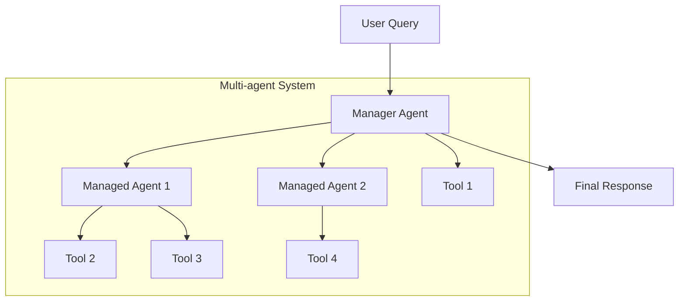
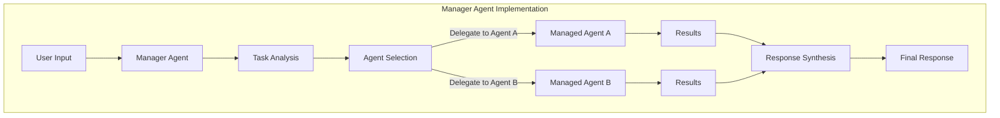
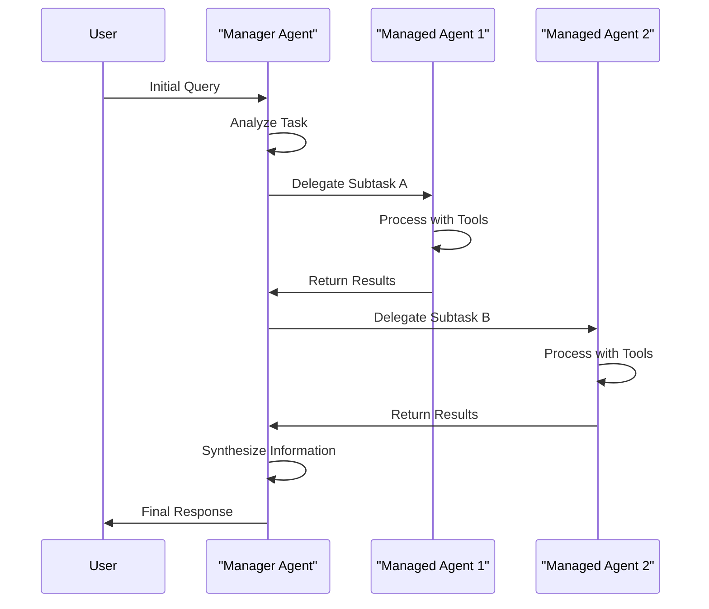
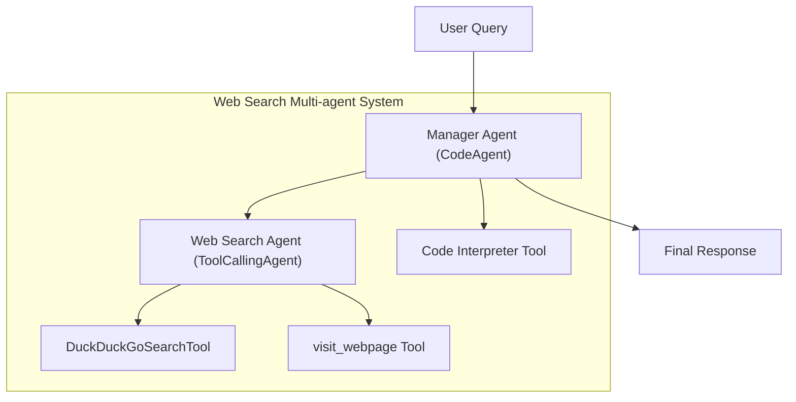
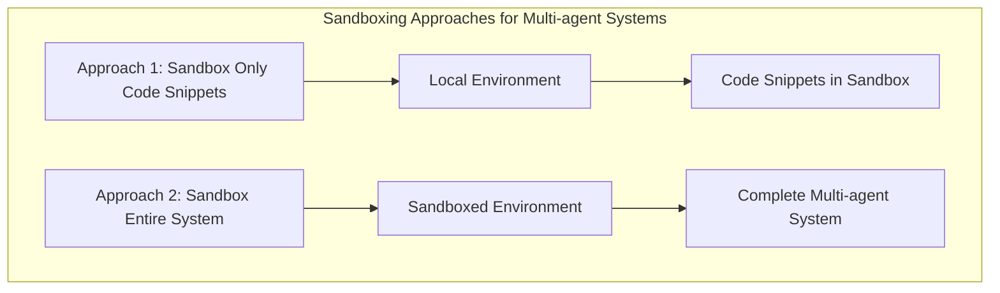
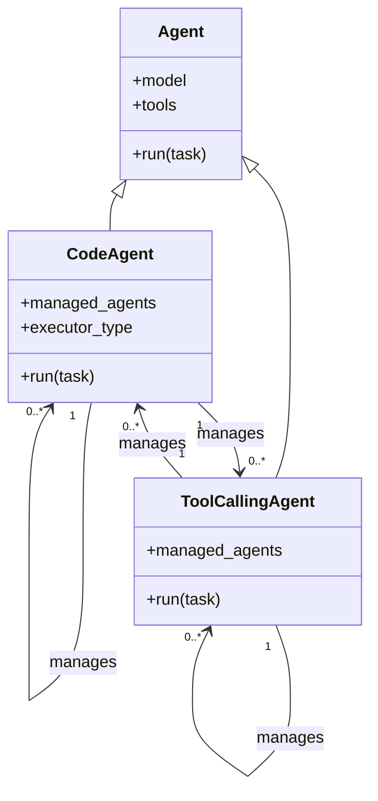

<!-- source: DeepWiki mcp.deepwiki.com · repo huggingface/notebooks · page 4.3 Multi-agent Systems · fetched 2026-10-26 -->

# Multi-agent Systems

<details>
<summary>Relevant source files</summary>

The following files were used as context for generating this wiki page:

- [smolagents_doc/en/guided_tour.ipynb](smolagents_doc/en/guided_tour.ipynb)
- [smolagents_doc/en/multiagents.ipynb](smolagents_doc/en/multiagents.ipynb)
- [smolagents_doc/en/pytorch/guided_tour.ipynb](smolagents_doc/en/pytorch/guided_tour.ipynb)
- [smolagents_doc/en/pytorch/multiagents.ipynb](smolagents_doc/en/pytorch/multiagents.ipynb)
- [smolagents_doc/en/pytorch/rag.ipynb](smolagents_doc/en/pytorch/rag.ipynb)
- [smolagents_doc/en/pytorch/secure_code_execution.ipynb](smolagents_doc/en/pytorch/secure_code_execution.ipynb)
- [smolagents_doc/en/pytorch/text_to_sql.ipynb](smolagents_doc/en/pytorch/text_to_sql.ipynb)
- [smolagents_doc/en/pytorch/tools.ipynb](smolagents_doc/en/pytorch/tools.ipynb)
- [smolagents_doc/en/rag.ipynb](smolagents_doc/en/rag.ipynb)
- [smolagents_doc/en/secure_code_execution.ipynb](smolagents_doc/en/secure_code_execution.ipynb)
- [smolagents_doc/en/tensorflow/guided_tour.ipynb](smolagents_doc/en/tensorflow/guided_tour.ipynb)
- [smolagents_doc/en/tensorflow/multiagents.ipynb](smolagents_doc/en/tensorflow/multiagents.ipynb)
- [smolagents_doc/en/tensorflow/rag.ipynb](smolagents_doc/en/tensorflow/rag.ipynb)
- [smolagents_doc/en/tensorflow/secure_code_execution.ipynb](smolagents_doc/en/tensorflow/secure_code_execution.ipynb)
- [smolagents_doc/en/tensorflow/tools.ipynb](smolagents_doc/en/tensorflow/tools.ipynb)
- [smolagents_doc/en/tools.ipynb](smolagents_doc/en/tools.ipynb)

</details>


This page documents the multi-agent systems capabilities in the SmolaAgents library. Multi-agent systems allow developers to create hierarchical agent architectures where specialized agents collaborate under the coordination of a manager agent to solve complex tasks. For information about secure code execution, see [Secure Code Execution](#4.1), and for details about the tool system, see [Tool System](#4.2).

## Architecture Overview

Multi-agent systems in SmolaAgents follow a hierarchical architecture pattern. At the top level, a manager agent coordinates specialized agents and tools, orchestrating the workflow to solve complex tasks efficiently.



Sources: [smolagents_doc/en/multiagents.ipynb:29-43]()

## Manager and Managed Agents

### Manager Agent

The manager agent serves as the orchestrator in a multi-agent system. It:

1. Receives the user's query
2. Determines which managed agent to dispatch the task to
3. Coordinates communication between different agents
4. Synthesizes information from multiple sources
5. Delivers the final response

In SmolaAgents, any `CodeAgent` or `ToolCallingAgent` can function as a manager agent by specifying a list of managed agents.



Sources: [smolagents_doc/en/multiagents.ipynb:229-241]()

### Managed Agents

Managed agents are specialized agents focused on specific tasks. They:

1. Receive tasks from the manager agent
2. Have access to specific tools relevant to their domain
3. Return their findings to the manager agent

Each managed agent can be configured with its own:
- Name and description
- Set of tools
- Maximum number of steps
- Model

Sources: [smolagents_doc/en/multiagents.ipynb:204-227]()

## Multi-agent Communication

When a manager agent delegates a task to a managed agent, it includes:

1. The specific query or task
2. Any relevant context from previous interactions
3. Additional arguments if needed

The managed agent then processes the task using its specialized tools and knowledge, and returns the results to the manager agent.



Sources: [smolagents_doc/en/multiagents.ipynb:243-270]()

## Implementation Example: Web Search Multi-agent System

The following example shows a multi-agent system that combines a specialized web search agent with a manager agent that can also run code.



The system is organized as follows:

| Component | Type | Purpose | Tools |
|-----------|------|---------|-------|
| Manager Agent | `CodeAgent` | Orchestrates the system, runs code, processes information | Code execution |
| Web Agent | `ToolCallingAgent` | Handles web searching and content retrieval | `DuckDuckGoSearchTool`, `visit_webpage` |

Sources: [smolagents_doc/en/multiagents.ipynb:29-43](), [smolagents_doc/en/multiagents.ipynb:204-227](), [smolagents_doc/en/multiagents.ipynb:229-241]()

### Setting Up the Multi-agent System

To create a multi-agent system, you need to:

1. Initialize the specialized agents with their respective tools
2. Pass these agents to the manager agent as `managed_agents`
3. Run queries through the manager agent

Here's how to create the web search agent:

```python
web_agent = ToolCallingAgent(
    tools=[DuckDuckGoSearchTool(), visit_webpage],
    model=model,
    max_steps=10,
    name="web_search_agent",
    description="This agent helps the user browse the web by searching and retrieving content from webpages."
)
```

Then create the manager agent with the web agent as a managed agent:

```python
manager_agent = CodeAgent(
    model=model,
    tools=[],
    managed_agents=[web_agent],
)
```

Sources: [smolagents_doc/en/multiagents.ipynb:204-227](), [smolagents_doc/en/multiagents.ipynb:229-241]()

## Security Considerations for Multi-agent Systems

Running multi-agent systems requires special security considerations, especially when code execution is involved.

### Sandbox Options for Multi-agent Systems

There are two main approaches to sandboxing multi-agent systems:



| Approach | Pros | Cons | Suitable For |
|----------|------|------|--------------|
| Sandbox Only Code Snippets | • Simple setup<br>• No need to transfer API keys<br>• Better protection for local environment | • Doesn't support multi-agents<br>• Requires transferring state between environments | Simple single-agent systems |
| Sandbox Entire System | • Supports multi-agents<br>• Complete isolation<br>• More flexible | • Complex setup<br>• May require sharing API keys<br>• Higher latency | Complex multi-agent systems |

Sources: [smolagents_doc/en/secure_code_execution.ipynb:187-197](), [smolagents_doc/en/secure_code_execution.ipynb:586-623]()

### Setting Up Multi-agent Systems in E2B Sandbox

To run multi-agent systems in an E2B sandbox, you need to run the entire agent system within the sandbox:

```python
# Create the sandbox
sandbox = Sandbox()

# Install required packages
sandbox.commands.run("pip install smolagents")

# Define and run your agent code inside the sandbox
agent_code = """
import os
from smolagents import CodeAgent, InferenceClientModel

# Initialize the agents
agent = CodeAgent(
    model=InferenceClientModel(token=os.getenv("HF_TOKEN")),
    tools=[],
    name="coder_agent",
    description="This agent takes care of coding tasks."
)

manager_agent = CodeAgent(
    model=InferenceClientModel(token=os.getenv("HF_TOKEN")),
    tools=[],
    managed_agents=[agent],
)

# Run the agent
response = manager_agent.run("Your task here")
print(response)
"""

# Run the agent code in the sandbox
execution_logs = run_code_raise_errors(sandbox, agent_code)
```

Sources: [smolagents_doc/en/secure_code_execution.ipynb:273-338]()

### Setting Up Multi-agent Systems in Docker Sandbox

Similarly, for Docker sandboxes, you need to run the entire multi-agent system within the container:

```python
# Create a Docker sandbox
sandbox = DockerSandbox()

# Define your multi-agent code
agent_code = """
import os
from smolagents import CodeAgent, InferenceClientModel

# Initialize the agent
agent = CodeAgent(
    model=InferenceClientModel(token=os.getenv("HF_TOKEN")),
    tools=[]
)

manager_agent = CodeAgent(
    model=InferenceClientModel(token=os.getenv("HF_TOKEN")),
    tools=[],
    managed_agents=[agent],
)

# Run the agent
response = manager_agent.run("Your task here")
print(response)
"""

# Run the code in the sandbox
output = sandbox.run_code(agent_code)
```

Sources: [smolagents_doc/en/secure_code_execution.ipynb:400-533]()

## Best Practices for Multi-agent Systems

### Agent Design

- **Specialization**: Each managed agent should have a focused, well-defined role
- **Clear Descriptions**: Provide detailed descriptions for each agent to help the manager agent delegate appropriately
- **Appropriate Tools**: Equip each agent with only the tools necessary for its specific tasks

### Communication

- **Maximum Steps**: Consider increasing `max_steps` for complex tasks that might require extended reasoning
- **Error Handling**: Implement robust error handling in the manager agent to deal with failed sub-tasks
- **Context Management**: Ensure relevant context is passed between agents as needed

### Resource Management

- **Memory Efficiency**: Be mindful of the increased token usage in multi-agent systems
- **Model Selection**: Use efficient models for specialized agents to reduce computational overhead
- **Parallel Processing**: Consider implementing parallel processing for independent tasks when possible

Sources: [smolagents_doc/en/multiagents.ipynb:204-227](), [smolagents_doc/en/secure_code_execution.ipynb:540-565]()

## Code Structure



The multi-agent system is built on the core Agent classes in SmolaAgents, where both `CodeAgent` and `ToolCallingAgent` can function as manager agents by including other agents in their `managed_agents` parameter.

Sources: [smolagents_doc/en/multiagents.ipynb:204-227](), [smolagents_doc/en/multiagents.ipynb:229-241]()

---

