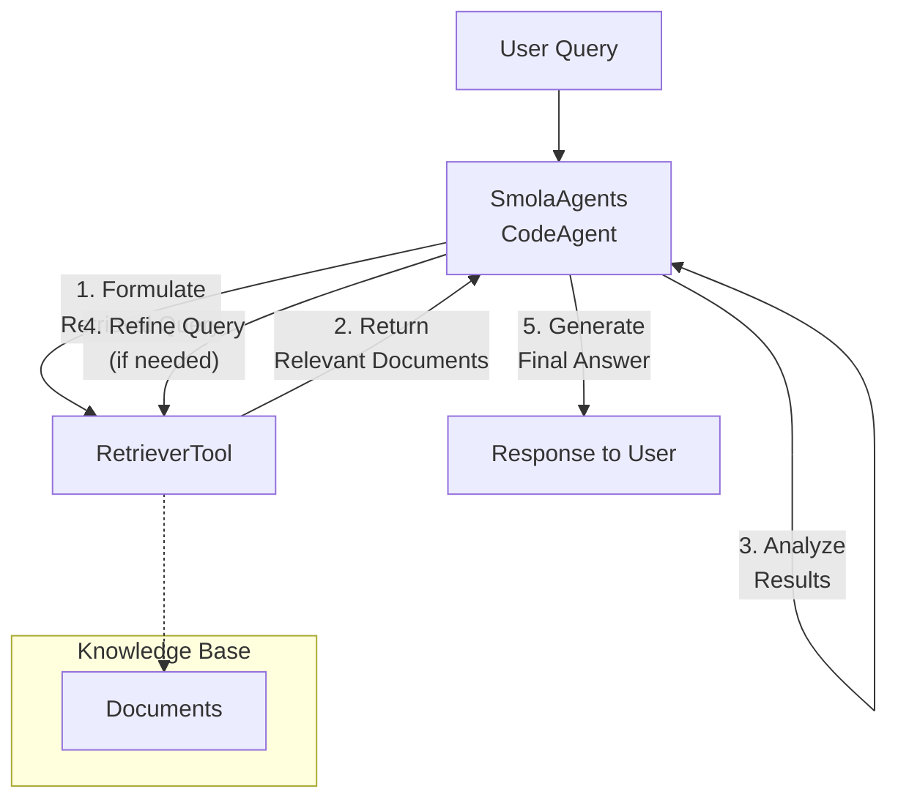
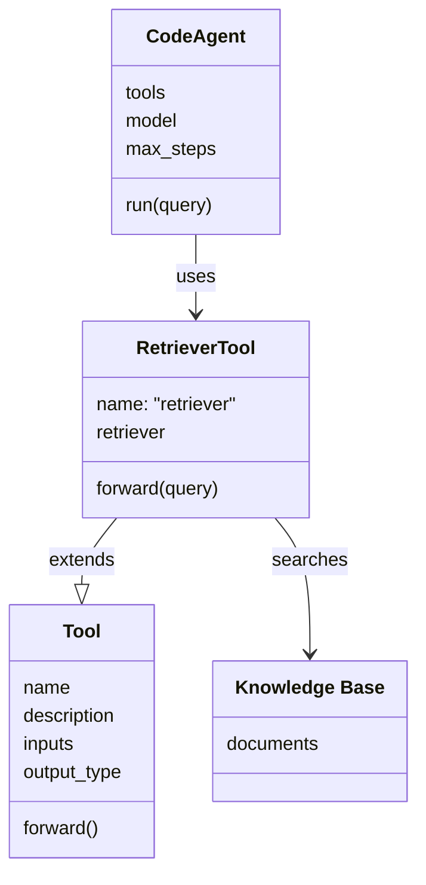
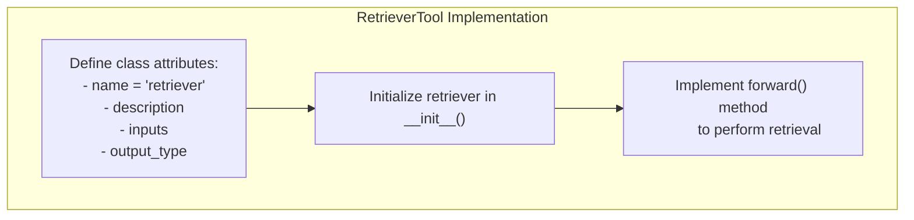
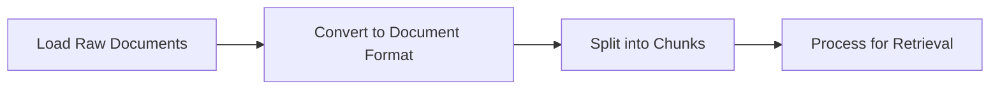
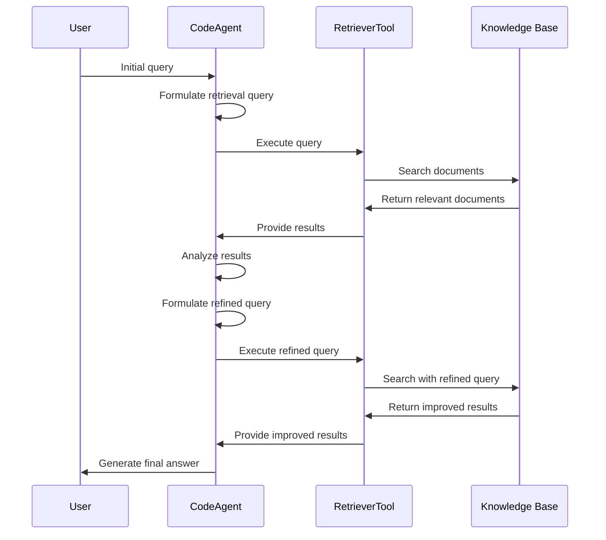
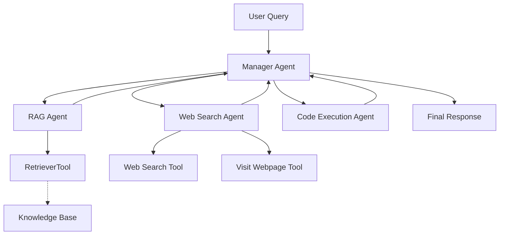

<!-- source: DeepWiki mcp.deepwiki.com · repo huggingface/notebooks · page 4.4 RAG Integration · fetched 2026-10-26 -->

# RAG Integration

<details>
<summary>Relevant source files</summary>

The following files were used as context for generating this wiki page:

- [smolagents_doc/en/multiagents.ipynb](smolagents_doc/en/multiagents.ipynb)
- [smolagents_doc/en/pytorch/multiagents.ipynb](smolagents_doc/en/pytorch/multiagents.ipynb)
- [smolagents_doc/en/pytorch/rag.ipynb](smolagents_doc/en/pytorch/rag.ipynb)
- [smolagents_doc/en/pytorch/text_to_sql.ipynb](smolagents_doc/en/pytorch/text_to_sql.ipynb)
- [smolagents_doc/en/pytorch/tools.ipynb](smolagents_doc/en/pytorch/tools.ipynb)
- [smolagents_doc/en/rag.ipynb](smolagents_doc/en/rag.ipynb)
- [smolagents_doc/en/tensorflow/multiagents.ipynb](smolagents_doc/en/tensorflow/multiagents.ipynb)
- [smolagents_doc/en/tensorflow/rag.ipynb](smolagents_doc/en/tensorflow/rag.ipynb)
- [smolagents_doc/en/tensorflow/tools.ipynb](smolagents_doc/en/tensorflow/tools.ipynb)
- [smolagents_doc/en/tools.ipynb](smolagents_doc/en/tools.ipynb)

</details>


This document provides a comprehensive guide to implementing Retrieval-Augmented Generation (RAG) with SmolaAgents. It covers how to build agentic RAG systems that overcome the limitations of traditional RAG approaches by leveraging SmolaAgents' tool and agent capabilities.

For information about the general tool system, see [Tool System](#4.2). For multi-agent orchestration that can be combined with RAG, see [Multi-agent Systems](#4.3).

## What is Agentic RAG?

Retrieval-Augmented Generation (RAG) enhances language model responses by retrieving relevant information from external knowledge sources before generating answers. Traditional RAG pipelines have important limitations:

1. They typically perform only a single retrieval step
2. They use the original user query for retrieval, which may not be optimally formulated
3. They lack the ability to evaluate and improve upon retrieval results

Agentic RAG addresses these limitations by implementing RAG as an agent equipped with retrieval tools. This approach enables:

- Dynamic, multi-step retrieval processes
- Self-formulation of optimal retrieval queries
- Critical evaluation of retrieval results
- Iterative improvement of queries based on initial results



Sources: [smolagents_doc/en/rag.ipynb:19-39](), [smolagents_doc/en/rag.ipynb:102-110]()

## RAG Architecture in SmolaAgents

The SmolaAgents RAG implementation follows a modular architecture that leverages the tool system to integrate retrieval capabilities into agents.



The main components are:

1. **RetrieverTool**: A custom tool that inherits from the base `Tool` class, wrapping a retrieval system (like BM25 or embedding-based retrievers).

2. **CodeAgent**: Uses the RetrieverTool to access external knowledge, formulate retrieval queries, and generate responses based on retrieved information.

3. **Knowledge Base**: Contains the document collection that the retriever searches through.

Sources: [smolagents_doc/en/rag.ipynb:113-152](), [smolagents_doc/en/tools.ipynb:63-108]()

## Implementing RAG with SmolaAgents

### Creating a Retriever Tool

The retriever tool is implemented by subclassing the `Tool` class:



The RetrieverTool requires:

1. A descriptive name and description to help the agent understand the tool's purpose
2. Input and output definitions that specify what the tool accepts and returns
3. A retriever instance (like BM25Retriever or an embedding-based retriever)
4. A forward method that executes the retrieval process

Sources: [smolagents_doc/en/rag.ipynb:119-152](), [smolagents_doc/en/tools.ipynb:68-90]()

### Setting Up the Knowledge Base

Before creating the retriever tool, you need to prepare your document collection:

1. **Load documents**: Import your corpus from a dataset, files, or API
2. **Process documents**: Convert to a consistent format with appropriate metadata
3. **Split documents**: Chunk documents into manageable pieces for retrieval
4. **Create document store**: Organize documents for efficient retrieval

Here's the typical document preparation workflow:



Sources: [smolagents_doc/en/rag.ipynb:64-98]()

### Configuring the RAG Agent

The RAG agent is instantiated as a `CodeAgent` with the retriever tool:

```
agent = CodeAgent(
    tools=[retriever_tool], 
    model=InferenceClientModel(), 
    max_steps=4, 
    verbosity_level=2
)
```

Key configuration options:

| Parameter | Description | Example Value |
|-----------|-------------|---------------|
| tools | List of tools the agent can use | [retriever_tool] |
| model | LLM powering the agent | InferenceClientModel() |
| max_steps | Maximum number of tool calls | 4 |
| verbosity_level | Detail level of agent outputs | 2 |

Sources: [smolagents_doc/en/rag.ipynb:171-182](), [smolagents_doc/en/rag.ipynb:193-198]()

## Advanced RAG Capabilities

### Multi-step Retrieval

The agent can perform multiple retrieval steps, refining its queries based on initial results. This capability addresses one of the main limitations of traditional RAG systems.



Sources: [smolagents_doc/en/rag.ipynb:26-39]()

### Query Reformulation (HyDE-like Capabilities)

The agent can reformulate user queries to better match the knowledge base content. This is similar to the Hypothetical Document Embeddings (HyDE) technique but done through the agent's natural reasoning.

For example, when a user asks "Which is slower, the forward or backward pass in transformers?", the agent might reformulate this as a retrieval query like "transformers model training forward backward pass performance comparison" to better match information in the knowledge base.

Sources: [smolagents_doc/en/rag.ipynb:37-39](), [smolagents_doc/en/rag.ipynb:193-198]()

### Integration with Multi-agent Systems

RAG capabilities can be integrated into multi-agent systems, where specialized agents handle different aspects of information retrieval and processing. For example:



In this setup, the manager agent orchestrates specialized agents, delegating retrieval tasks to the RAG agent when appropriate.

Sources: [smolagents_doc/en/multiagents.ipynb:26-47](), [smolagents_doc/en/multiagents.ipynb:175-187]()

## Customization Options

### Alternative Retrieval Methods

The base implementation uses BM25 for retrieval, but you can customize the retriever with different methods:

| Retrieval Method | Advantages | Use Cases |
|------------------|------------|-----------|
| BM25 | Fast, no training required | Quick prototyping, keyword-based retrieval |
| Dense Retrievers | Better semantic understanding | Complex queries, similarity beyond keywords |
| Hybrid Retrievers | Combines strengths of multiple methods | Production systems requiring high accuracy |

To implement a different retriever, simply replace the retriever initialization in the RetrieverTool:

```python
# Instead of BM25:
self.retriever = BM25Retriever.from_documents(docs, k=10)

# Use a dense retriever:
self.retriever = EmbeddingRetriever.from_documents(docs, k=10)
```

Sources: [smolagents_doc/en/rag.ipynb:158-169]()

### Performance Optimization

For production RAG systems, consider these optimizations:

1. **Chunk size tuning**: Experiment with different document chunk sizes for optimal retrieval
2. **Retrieval parameters**: Adjust the number of retrieved documents (k value)
3. **Embedding models**: For dense retrievers, select appropriate embedding models from the [MTEB Leaderboard](https://huggingface.co/spaces/mteb/leaderboard)
4. **Agent steps**: Increase max_steps for complex queries requiring multiple retrieval iterations

Sources: [smolagents_doc/en/rag.ipynb:90-98](), [smolagents_doc/en/rag.ipynb:158-169]()

## Conclusion

SmolaAgents provides a powerful framework for implementing RAG systems that overcome the limitations of traditional approaches. By leveraging the tool system and agent capabilities, RAG implementations can perform multi-step retrieval, optimize queries dynamically, and integrate with broader agent systems.

For more advanced agent orchestration techniques that can complement RAG, see [Multi-agent Systems](#4.3). For details on tool implementation that can extend RAG capabilities, see [Tool System](#4.2).

---

