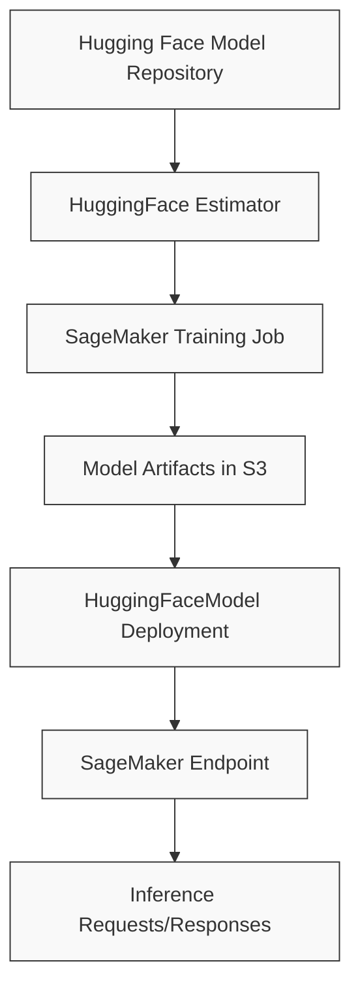
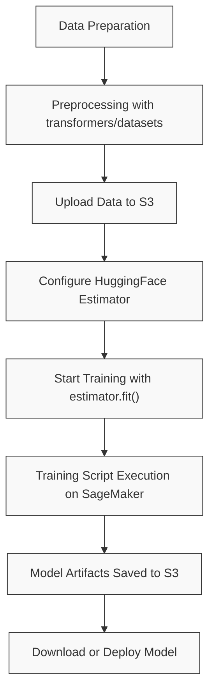
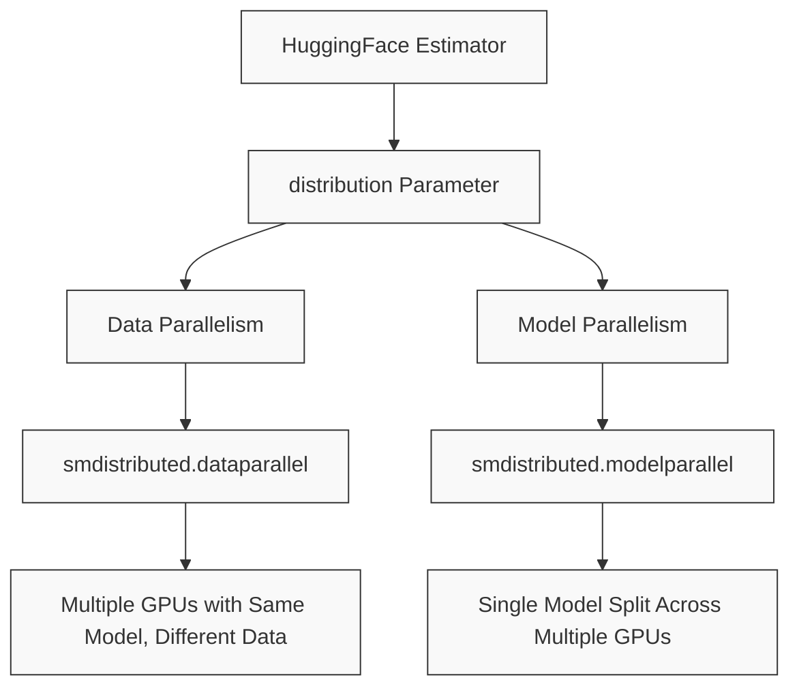
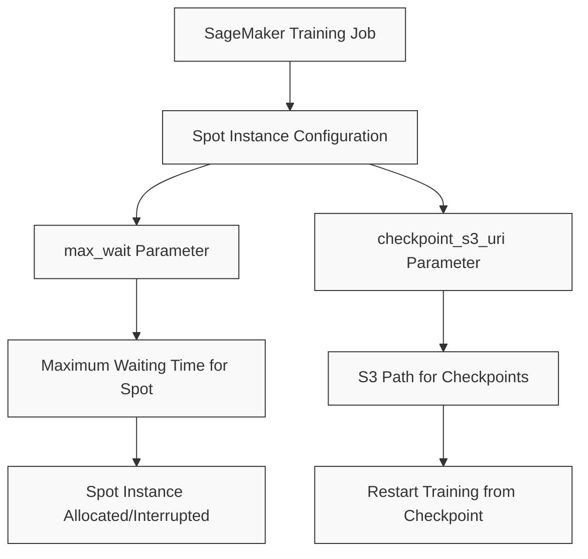
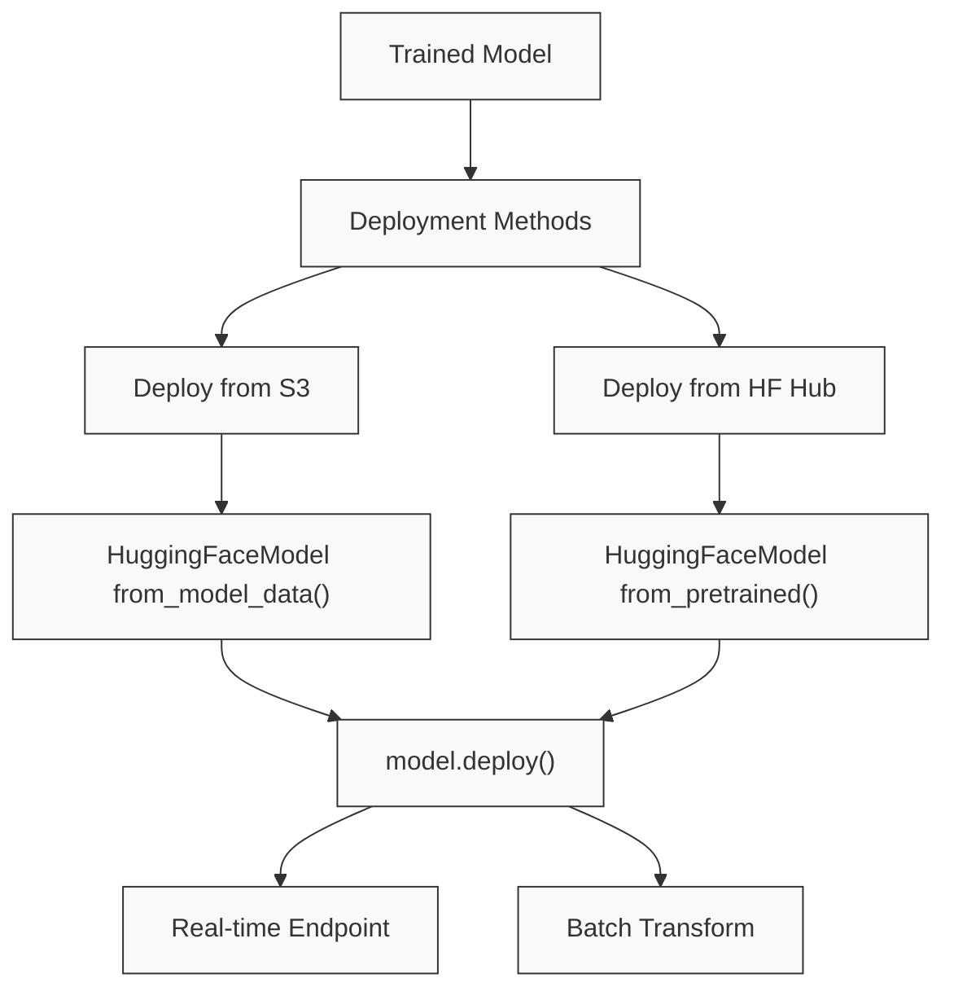
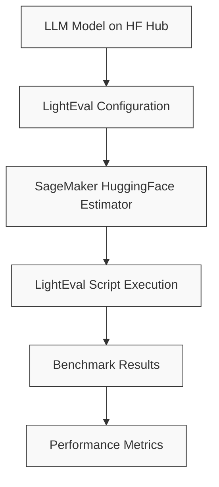

<!-- source: DeepWiki mcp.deepwiki.com · repo huggingface/notebooks · page 5 SageMaker Integration · fetched 2026-10-26 -->

# SageMaker Integration

<details>
<summary>Relevant source files</summary>

The following files were used as context for generating this wiki page:

- [sagemaker/01_getting_started_pytorch/sagemaker-notebook.ipynb](sagemaker/01_getting_started_pytorch/sagemaker-notebook.ipynb)
- [sagemaker/01_getting_started_pytorch/scripts/train.py](sagemaker/01_getting_started_pytorch/scripts/train.py)
- [sagemaker/02_getting_started_tensorflow/sagemaker-notebook.ipynb](sagemaker/02_getting_started_tensorflow/sagemaker-notebook.ipynb)
- [sagemaker/02_getting_started_tensorflow/scripts/train.py](sagemaker/02_getting_started_tensorflow/scripts/train.py)
- [sagemaker/03_distributed_training_data_parallelism/sagemaker-notebook.ipynb](sagemaker/03_distributed_training_data_parallelism/sagemaker-notebook.ipynb)
- [sagemaker/04_distributed_training_model_parallelism/sagemaker-notebook.ipynb](sagemaker/04_distributed_training_model_parallelism/sagemaker-notebook.ipynb)
- [sagemaker/05_spot_instances/imgs/overview.png](sagemaker/05_spot_instances/imgs/overview.png)
- [sagemaker/05_spot_instances/sagemaker-notebook.ipynb](sagemaker/05_spot_instances/sagemaker-notebook.ipynb)
- [sagemaker/05_spot_instances/scripts/train.py](sagemaker/05_spot_instances/scripts/train.py)
- [sagemaker/06_sagemaker_metrics/sagemaker-notebook.ipynb](sagemaker/06_sagemaker_metrics/sagemaker-notebook.ipynb)
- [sagemaker/06_sagemaker_metrics/scripts/train.py](sagemaker/06_sagemaker_metrics/scripts/train.py)
- [sagemaker/07_tensorflow_distributed_training_data_parallelism/sagemaker-notebook.ipynb](sagemaker/07_tensorflow_distributed_training_data_parallelism/sagemaker-notebook.ipynb)
- [sagemaker/07_tensorflow_distributed_training_data_parallelism/scripts/train.py](sagemaker/07_tensorflow_distributed_training_data_parallelism/scripts/train.py)
- [sagemaker/08_distributed_summarization_bart_t5/sagemaker-notebook.ipynb](sagemaker/08_distributed_summarization_bart_t5/sagemaker-notebook.ipynb)
- [sagemaker/09_image_classification_vision_transformer/sagemaker-notebook.ipynb](sagemaker/09_image_classification_vision_transformer/sagemaker-notebook.ipynb)
- [sagemaker/09_image_classification_vision_transformer/scripts/train.py](sagemaker/09_image_classification_vision_transformer/scripts/train.py)
- [sagemaker/10_deploy_model_from_s3/deploy_transformer_model_from_s3.ipynb](sagemaker/10_deploy_model_from_s3/deploy_transformer_model_from_s3.ipynb)
- [sagemaker/11_deploy_model_from_hf_hub/deploy_transformer_model_from_hf_hub.ipynb](sagemaker/11_deploy_model_from_hf_hub/deploy_transformer_model_from_hf_hub.ipynb)
- [sagemaker/12_batch_transform_inference/sagemaker-notebook.ipynb](sagemaker/12_batch_transform_inference/sagemaker-notebook.ipynb)
- [sagemaker/13_deploy_and_autoscaling_transformers/sagemaker-notebook.ipynb](sagemaker/13_deploy_and_autoscaling_transformers/sagemaker-notebook.ipynb)
- [sagemaker/29_deploy_llms_on_inferentia2/sagemaker-notebook.ipynb](sagemaker/29_deploy_llms_on_inferentia2/sagemaker-notebook.ipynb)
- [sagemaker/30_evaluate_llms_with_lighteval/sagemaker-notebook.ipynb](sagemaker/30_evaluate_llms_with_lighteval/sagemaker-notebook.ipynb)
- [sagemaker/31_deploy_embedding_models/assets/cw.png](sagemaker/31_deploy_embedding_models/assets/cw.png)
- [sagemaker/31_deploy_embedding_models/sagemaker-notebook.ipynb](sagemaker/31_deploy_embedding_models/sagemaker-notebook.ipynb)
- [sagemaker/32_train_deploy_embedding_models/sagemaker-notebook.ipynb](sagemaker/32_train_deploy_embedding_models/sagemaker-notebook.ipynb)
- [sagemaker/32_train_deploy_embedding_models/scripts/requirements.txt](sagemaker/32_train_deploy_embedding_models/scripts/requirements.txt)
- [sagemaker/32_train_deploy_embedding_models/scripts/run_mnr.py](sagemaker/32_train_deploy_embedding_models/scripts/run_mnr.py)
- [sagemaker/README.md](sagemaker/README.md)

</details>


Amazon SageMaker Integration for Hugging Face provides a streamlined way to leverage AWS's managed machine learning service with Hugging Face Transformers models. This document covers how to set up SageMaker for training and deploying Hugging Face models, using features like distributed training, spot instances for cost optimization, and deployment strategies. This page focuses specifically on the integration between Hugging Face and SageMaker; for information about specific model architectures, see the relevant documentation for [Transformers](#2), [Diffusers](#3), or [SmolaAgents](#4).

## Overview

Amazon SageMaker is a fully managed machine learning service that enables data scientists and developers to build, train, and deploy machine learning models. The Hugging Face integration with SageMaker allows you to:

1. Train Hugging Face Transformers models on SageMaker's managed infrastructure
2. Use distributed training strategies (data parallelism and model parallelism)
3. Optimize training costs with spot instances and checkpointing
4. Deploy models for real-time inference or batch processing
5. Auto-scale production endpoints
6. Evaluate large language models using benchmarks

This integration provides a seamless workflow from model development to production deployment while leveraging AWS's scalable infrastructure.

### SageMaker and Hugging Face Integration Architecture



Sources:
- [sagemaker/README.md]()
- [sagemaker/01_getting_started_pytorch/sagemaker-notebook.ipynb]()
- [sagemaker/02_getting_started_tensorflow/sagemaker-notebook.ipynb]()

## Setting Up SageMaker Environment

Before training or deploying models, you need to set up the SageMaker environment with appropriate permissions and configurations.

### Prerequisites

1. An AWS account with appropriate permissions
2. The AWS CLI and boto3 Python SDK installed
3. The SageMaker Python SDK installed (`pip install sagemaker`)
4. Hugging Face Transformers library (`pip install transformers`)

### Configuring SageMaker Session

To initialize a SageMaker session and set up the necessary resources:

```python
import sagemaker
import boto3

# Initialize SageMaker session
sess = sagemaker.Session()

# Set default S3 bucket for SageMaker artifacts
sagemaker_session_bucket = sess.default_bucket()

# Get SageMaker execution role
try:
    role = sagemaker.get_execution_role()
except ValueError:
    iam = boto3.client('iam')
    role = iam.get_role(RoleName='sagemaker_execution_role')['Role']['Arn']

print(f"SageMaker role ARN: {role}")
print(f"SageMaker bucket: {sagemaker_session_bucket}")
print(f"SageMaker session region: {sess.boto_region_name}")
```

Sources:
- [sagemaker/01_getting_started_pytorch/sagemaker-notebook.ipynb]()
- [sagemaker/02_getting_started_tensorflow/sagemaker-notebook.ipynb]()
- [sagemaker/05_spot_instances/sagemaker-notebook.ipynb]()

## Training Models on SageMaker

### Training Workflow

The general workflow for training models on SageMaker is:



Sources:
- [sagemaker/01_getting_started_pytorch/sagemaker-notebook.ipynb]()
- [sagemaker/02_getting_started_tensorflow/sagemaker-notebook.ipynb]()

### Training with PyTorch

To train a Hugging Face model using PyTorch on SageMaker:

```python
from sagemaker.huggingface import HuggingFace

# Configure the estimator
huggingface_estimator = HuggingFace(
    entry_point='train.py',  # Training script
    source_dir='./scripts',  # Directory containing training script
    instance_type='ml.p3.2xlarge',  # GPU instance
    instance_count=1,
    role=role,
    transformers_version='4.26.0',  # Transformers version
    pytorch_version='1.13.1',       # PyTorch version
    py_version='py39',              # Python version
    hyperparameters={
        'epochs': 3,
        'train_batch_size': 32,
        'model_name': 'distilbert-base-uncased',
        'learning_rate': 5e-5
    }
)

# Start training job
huggingface_estimator.fit({'train': train_data_s3_uri, 'test': test_data_s3_uri})
```

The training script (`train.py`) typically follows this structure:

```python
import argparse
import transformers
from datasets import load_from_disk

# Parse hyperparameters
parser = argparse.ArgumentParser()
parser.add_argument('--epochs', type=int, default=3)
parser.add_argument('--train_batch_size', type=int, default=32)
parser.add_argument('--model_name', type=str)
parser.add_argument('--learning_rate', type=float, default=5e-5)
# Add SageMaker-specific arguments
parser.add_argument('--output_data_dir', type=str, default=os.environ['SM_OUTPUT_DATA_DIR'])
parser.add_argument('--model_dir', type=str, default=os.environ['SM_MODEL_DIR'])
parser.add_argument('--training_dir', type=str, default=os.environ['SM_CHANNEL_TRAIN'])
parser.add_argument('--test_dir', type=str, default=os.environ['SM_CHANNEL_TEST'])
args, _ = parser.parse_known_args()

# Load datasets from SageMaker channels
train_dataset = load_from_disk(args.training_dir)
test_dataset = load_from_disk(args.test_dir)

# Set up model, training arguments, and trainer
model = AutoModelForSequenceClassification.from_pretrained(args.model_name)
training_args = TrainingArguments(
    output_dir=args.model_dir,
    num_train_epochs=args.epochs,
    per_device_train_batch_size=args.train_batch_size,
    learning_rate=args.learning_rate,
    # More training arguments...
)
trainer = Trainer(
    model=model,
    args=training_args,
    train_dataset=train_dataset,
    eval_dataset=test_dataset,
    # More trainer configurations...
)

# Train model
trainer.train()

# Save model
trainer.save_model(args.model_dir)
```

Sources:
- [sagemaker/01_getting_started_pytorch/sagemaker-notebook.ipynb]()
- [sagemaker/01_getting_started_pytorch/scripts/train.py]()

### Training with TensorFlow

To train a Hugging Face model using TensorFlow on SageMaker:

```python
from sagemaker.huggingface import HuggingFace

# Configure the estimator
huggingface_estimator = HuggingFace(
    entry_point='train.py',  # Training script
    source_dir='./scripts',  # Directory containing training script
    instance_type='ml.p3.2xlarge',  # GPU instance
    instance_count=1,
    role=role,
    transformers_version='4.26.0',    # Transformers version
    tensorflow_version='2.11.0',      # TensorFlow version
    py_version='py39',                # Python version
    hyperparameters={
        'epochs': 3,
        'train_batch_size': 16,
        'eval_batch_size': 8,
        'model_id': 'distilbert-base-uncased',
        'learning_rate': 3e-5
    }
)

# Start training job
huggingface_estimator.fit()
```

The TensorFlow training script follows a similar structure to the PyTorch one but uses TensorFlow-specific methods:

```python
import tensorflow as tf
from transformers import AutoTokenizer, TFAutoModelForSequenceClassification, DataCollatorWithPadding, create_optimizer

# Parse hyperparameters and prepare data...

# Build model
model = TFAutoModelForSequenceClassification.from_pretrained(args.model_id)

# Create optimizer
optimizer, _ = create_optimizer(init_lr=args.learning_rate, num_train_steps=total_train_steps)

# Compile model
model.compile(optimizer=optimizer, loss=loss, metrics=metrics)

# Train model
train_results = model.fit(
    tf_train_dataset,
    epochs=args.epochs,
    validation_data=tf_validation_dataset,
)

# Save model
model.save_pretrained(args.model_dir)
tokenizer.save_pretrained(args.model_dir)
```

Sources:
- [sagemaker/02_getting_started_tensorflow/sagemaker-notebook.ipynb]()
- [sagemaker/02_getting_started_tensorflow/scripts/train.py]()

## Distributed Training on SageMaker

For large models or datasets, SageMaker provides distributed training options:



Sources:
- [sagemaker/03_distributed_training_data_parallelism/sagemaker-notebook.ipynb]()
- [sagemaker/04_distributed_training_model_parallelism/sagemaker-notebook.ipynb]()

### Data Parallelism

Data parallelism is useful when you can fit your model on a single GPU but want to process more data in parallel:

```python
# Configure distributed training with data parallelism
distribution = {'smdistributed': {'dataparallel': {'enabled': True}}}

# Create the estimator with distribution configuration
huggingface_estimator = HuggingFace(
    entry_point='run_summarization.py',
    source_dir='./examples/pytorch/summarization',
    instance_type='ml.p3dn.24xlarge',
    instance_count=2,  # Multiple instances for distributed training
    role=role,
    transformers_version='4.26.0',
    pytorch_version='1.13.1',
    py_version='py39',
    hyperparameters={
        'model_name_or_path': 'facebook/bart-large-cnn',
        'dataset_name': 'samsum',
        'do_train': True,
        'do_eval': True,
        'fp16': True,
        'output_dir': '/opt/ml/model',
        # Additional hyperparameters...
    },
    distribution=distribution  # Add distribution configuration
)

# Start distributed training
huggingface_estimator.fit()
```

Sources:
- [sagemaker/03_distributed_training_data_parallelism/sagemaker-notebook.ipynb]()
- [sagemaker/08_distributed_summarization_bart_t5/sagemaker-notebook.ipynb]()

### Model Parallelism

Model parallelism is useful for large models that don't fit in a single GPU's memory:

```python
# Configure distributed training with model parallelism
mpi_options = {
    "enabled": True,
    "processes_per_host": 8,
}
smp_options = {
    "enabled": True,
    "parameters": {
        "microbatches": 4,
        "placement_strategy": "spread",
        "pipeline": "interleaved",
        "optimize": "speed",
        "partitions": 4,
        "ddp": True,
    }
}

distribution = {
    "smdistributed": {"modelparallel": smp_options},
    "mpi": mpi_options
}

# Create the estimator with model parallelism configuration
huggingface_estimator = HuggingFace(
    entry_point='train.py',
    source_dir='code',
    instance_type='ml.p3.16xlarge',
    instance_count=1,
    role=role,
    transformers_version='4.26.0',
    pytorch_version='1.13.1',
    py_version='py39',
    hyperparameters={
        'max_steps': 500,
        'model_name': 'roberta-large',
        'task_name': 'mnli',
        # Additional hyperparameters...
    },
    distribution=distribution
)

# Start distributed training with model parallelism
huggingface_estimator.fit({'train': train_input, 'validation': validation_input})
```

For model parallelism, you need to use special imports in your training script:

```python
from transformers.sagemaker import SageMakerTrainingArguments as TrainingArguments
from transformers.sagemaker import SageMakerTrainer as Trainer
```

Sources:
- [sagemaker/04_distributed_training_model_parallelism/sagemaker-notebook.ipynb]()

## Cost Optimization with Spot Instances

Amazon EC2 Spot Instances allow you to use spare EC2 capacity at a discount of up to 90% compared to On-Demand prices:



Sources:
- [sagemaker/05_spot_instances/sagemaker-notebook.ipynb]()

### Setting Up Spot Training with Checkpointing

```python
from sagemaker.huggingface import HuggingFace

# S3 URI for storing checkpoints
checkpoint_s3_uri = f's3://{sess.default_bucket()}/checkpoints'

# Create the estimator with spot instance configuration
huggingface_estimator = HuggingFace(
    entry_point='train.py',
    source_dir='scripts',
    instance_type='ml.p3.2xlarge',
    instance_count=1,
    role=role,
    transformers_version='4.26.0',
    pytorch_version='1.13.1',
    py_version='py39',
    hyperparameters={
        'epochs': 3,
        'train_batch_size': 16,
        'model_name': 'distilbert-base-uncased',
        'output_dir': '/opt/ml/checkpoints'  # Local checkpoint directory
    },
    # Spot instance configuration
    use_spot_instances=True,  # Use spot instances
    max_wait=3600,  # Maximum time to wait for spot instances (seconds)
    max_run=1800,  # Maximum runtime (seconds)
    # Checkpoint configuration
    checkpoint_s3_uri=checkpoint_s3_uri,  # S3 path for checkpoints
    checkpoint_local_path='/opt/ml/checkpoints'  # Local path for checkpoints
)

# Start training on spot instances
huggingface_estimator.fit({'train': train_input_path, 'test': test_input_path})
```

In your training script, you need to handle checkpointing:

```python
# In train.py
import os
from transformers import Trainer, TrainingArguments
from transformers.trainer_utils import get_last_checkpoint

# Check for existing checkpoints to resume training
last_checkpoint = get_last_checkpoint(args.output_dir)
resume_from_checkpoint = last_checkpoint if os.path.exists(args.output_dir) else None

# Configure training arguments with checkpoint support
training_args = TrainingArguments(
    output_dir=args.output_dir,
    num_train_epochs=args.epochs,
    per_device_train_batch_size=args.train_batch_size,
    save_strategy="epoch",  # Save checkpoint at the end of each epoch
    # More training arguments...
)

# Initialize the trainer
trainer = Trainer(
    model=model,
    args=training_args,
    train_dataset=train_dataset,
    eval_dataset=test_dataset,
)

# Train the model, potentially resuming from checkpoint
trainer.train(resume_from_checkpoint=resume_from_checkpoint)
```

Sources:
- [sagemaker/05_spot_instances/sagemaker-notebook.ipynb]()
- [sagemaker/05_spot_instances/scripts/train.py]()

## Tracking Metrics during Training

SageMaker allows you to track custom metrics during training for monitoring and analysis:

```python
from sagemaker.huggingface import HuggingFace

# Define metrics to capture during training
metric_definitions = [
    {'Name': 'train_loss', 'Regex': "'loss': ([0-9\\.]+)"},
    {'Name': 'eval_accuracy', 'Regex': "'eval_accuracy': ([0-9\\.]+)"},
    {'Name': 'eval_f1', 'Regex': "'eval_f1': ([0-9\\.]+)"}
]

# Create the estimator with metric definitions
huggingface_estimator = HuggingFace(
    entry_point='train.py',
    source_dir='scripts',
    instance_type='ml.p3.2xlarge',
    instance_count=1,
    role=role,
    transformers_version='4.26.0',
    pytorch_version='1.13.1',
    py_version='py39',
    hyperparameters={
        'epochs': 3,
        'train_batch_size': 16,
        'model_name': 'distilbert-base-uncased'
    },
    metric_definitions=metric_definitions  # Add metric definitions
)

# Start training with metric tracking
huggingface_estimator.fit({'train': train_input_path, 'test': test_input_path})
```

In your training script, make sure to print metrics in the expected format:

```python
# In train.py
def compute_metrics(pred):
    labels = pred.label_ids
    preds = pred.predictions.argmax(-1)
    precision, recall, f1, _ = precision_recall_fscore_support(labels, preds, average='binary')
    acc = accuracy_score(labels, preds)
    return {
        'accuracy': acc,
        'f1': f1,
        'precision': precision,
        'recall': recall
    }

# Setup trainer with compute_metrics function
trainer = Trainer(
    model=model,
    args=training_args,
    train_dataset=train_dataset,
    eval_dataset=test_dataset,
    compute_metrics=compute_metrics
)
```

Sources:
- [sagemaker/06_sagemaker_metrics/sagemaker-notebook.ipynb]()
- [sagemaker/06_sagemaker_metrics/scripts/train.py]()

## Deploying Models for Inference

After training, you can deploy models to SageMaker for inference in different ways:



Sources:
- [sagemaker/10_deploy_model_from_s3/deploy_transformer_model_from_s3.ipynb]()
- [sagemaker/11_deploy_model_from_hf_hub/deploy_transformer_model_from_hf_hub.ipynb]()

### Deploying a Model from S3

To deploy a model saved in S3 (typically after training):

```python
from sagemaker.huggingface.model import HuggingFaceModel

# Initialize the model from S3 location
huggingface_model = HuggingFaceModel(
    model_data=huggingface_estimator.model_data,  # S3 path to model artifacts
    role=role,
    transformers_version='4.26.0',
    pytorch_version='1.13.1',
    py_version='py39',
)

# Deploy the model to a SageMaker endpoint
predictor = huggingface_model.deploy(
    initial_instance_count=1,
    instance_type='ml.m5.xlarge'
)

# Make predictions
prediction = predictor.predict({
    'inputs': 'This is a test sentence.'
})
```

Sources:
- [sagemaker/10_deploy_model_from_s3/deploy_transformer_model_from_s3.ipynb]()

### Deploying a Model from Hugging Face Hub

To deploy a pre-trained model directly from the Hugging Face Hub:

```python
from sagemaker.huggingface.model import HuggingFaceModel

# Initialize the model from Hugging Face Hub
huggingface_model = HuggingFaceModel(
    transformers_version='4.26.0',
    pytorch_version='1.13.1',
    py_version='py39',
    role=role,
    hub={
        'HF_MODEL_ID': 'distilbert-base-uncased-finetuned-sst-2-english',  # Model ID from Hub
        'HF_TASK': 'text-classification'  # Task type
    }
)

# Deploy the model to a SageMaker endpoint
predictor = huggingface_model.deploy(
    initial_instance_count=1,
    instance_type='ml.m5.xlarge'
)

# Make predictions
prediction = predictor.predict({
    'inputs': 'This movie was great!'
})
```

Sources:
- [sagemaker/11_deploy_model_from_hf_hub/deploy_transformer_model_from_hf_hub.ipynb]()

### Batch Transform for Inference

For batch processing of large datasets:

```python
from sagemaker.huggingface.model import HuggingFaceModel

# Initialize the model
huggingface_model = HuggingFaceModel(
    transformers_version='4.26.0',
    pytorch_version='1.13.1',
    py_version='py39',
    role=role,
    hub={
        'HF_MODEL_ID': 'distilbert-base-uncased-finetuned-sst-2-english',
        'HF_TASK': 'text-classification'
    }
)

# Create a transformer for batch processing
transformer = huggingface_model.transformer(
    instance_count=1,
    instance_type='ml.m5.xlarge',
    output_path=f's3://{sess.default_bucket()}/batch-output/'
)

# Run batch transform job
transformer.transform(
    data=f's3://{sess.default_bucket()}/batch-input/input.jsonl',
    content_type='application/json',
    split_type='Line'
)
```

Sources:
- [sagemaker/12_batch_transform_inference/sagemaker-notebook.ipynb]()

### Auto-scaling SageMaker Endpoints

For production deployments, you can set up auto-scaling:

```python
from sagemaker.huggingface.model import HuggingFaceModel
from sagemaker.scaling import ScalingPolicy

# Deploy the model
predictor = huggingface_model.deploy(
    initial_instance_count=1,
    instance_type='ml.m5.xlarge'
)

# Configure auto-scaling
scaling_policy = ScalingPolicy(
    policy_name='auto-scaling-policy',
    metric_specification={
        'TargetValue': 70,  # Target utilization (percentage)
        'PredefinedMetricSpecification': {
            'PredefinedMetricType': 'SageMakerVariantInvocationsPerInstance',
        }
    },
    min_capacity=1,  # Minimum instance count
    max_capacity=4   # Maximum instance count
)

# Register auto-scaling policy
predictor.apply_scaling_policy(
    policy_name='auto-scaling-policy',
    policy_type='TargetTrackingScaling',
    target_value=70,
    scale_in_cooldown=60,
    scale_out_cooldown=60,
    min_capacity=1,
    max_capacity=4
)
```

Sources:
- [sagemaker/13_deploy_and_autoscaling_transformers/sagemaker-notebook.ipynb]()

## LLM Evaluation with LightEval

LightEval is a lightweight LLM evaluation suite that powers the Hugging Face Open LLM Leaderboard. It helps assess model performance on academic benchmarks:



Sources:
- [sagemaker/30_evaluate_llms_with_lighteval/sagemaker-notebook.ipynb]()

### Setting Up LightEval on SageMaker

```python
from sagemaker.huggingface import HuggingFace

# Create evaluation configuration
config = {
    "model_args": {
        "model_id": "HuggingFaceH4/zephyr-7b-beta",
        "dtype": "bfloat16", 
    },
    "tasks": ["truthfulqa"],
    "output_dir": "/opt/ml/output", 
    "log_level": "info"
}

# Create HuggingFace estimator for LightEval
lighteval_estimator = HuggingFace(
    entry_point='lighteval_launcher.py',
    source_dir='code',
    instance_type='ml.g5.2xlarge',
    instance_count=1,
    role=role,
    transformers_version='4.34.0',
    pytorch_version='2.0.1',
    py_version='py310',
    hyperparameters={
        'config': config
    }
)

# Start evaluation job
lighteval_estimator.fit()
```

Sources:
- [sagemaker/30_evaluate_llms_with_lighteval/sagemaker-notebook.ipynb]()

## Advanced Topics

### Deploying Large Language Models

For large language models (LLMs), SageMaker offers specialized deployment options:

```python
from sagemaker.huggingface.model import HuggingFaceModel

# Deploy LLM from Hugging Face Hub
llm_model = HuggingFaceModel(
    role=role,
    image_uri=f"763104351884.dkr.ecr.{region}.amazonaws.com/huggingface-pytorch-tgi:2.0.0-tgi1.0.3-gpu-py39-cu118",
    env={
        'HF_MODEL_ID': 'HuggingFaceH4/zephyr-7b-beta',
        'SM_NUM_GPUS': '1',
        'MAX_INPUT_LENGTH': '2048',
        'MAX_TOTAL_TOKENS': '4096',
    }
)

# Deploy the LLM
llm_predictor = llm_model.deploy(
    initial_instance_count=1,
    instance_type='ml.g5.2xlarge',
)
```

Sources:
- [sagemaker/29_deploy_llms_on_inferentia2/sagemaker-notebook.ipynb]()

### Hardware Acceleration with AWS Inferentia

For cost-effective inference, you can deploy models on AWS Inferentia accelerators:

```python
from sagemaker.huggingface.model import HuggingFaceModel

# Deploy model on Inferentia
inferentia_model = HuggingFaceModel(
    role=role,
    image_uri=f"763104351884.dkr.ecr.{region}.amazonaws.com/huggingface-pytorch-inference-neuron:1.13.0-transformers4.34.1-neuron-py310-sdk2.15.0-ubuntu20.04",
    env={
        'HF_MODEL_ID': 'HuggingFaceH4/zephyr-7b-beta',
        'HF_TASK': 'text-generation',
    }
)

# Deploy the model on Inferentia
inferentia_predictor = inferentia_model.deploy(
    initial_instance_count=1,
    instance_type='ml.inf2.8xlarge',
)
```

Sources:
- [sagemaker/29_deploy_llms_on_inferentia2/sagemaker-notebook.ipynb]()

### Deploying Embedding Models

```python
from sagemaker.huggingface.model import HuggingFaceModel

# Deploy embedding model
embedding_model = HuggingFaceModel(
    role=role,
    image_uri=f"763104351884.dkr.ecr.{region}.amazonaws.com/huggingface-pytorch-tei:2.0.1-transformers4.28.1-gpu-py310-cu118-ubuntu20.04",
    env={
        'HF_MODEL_ID': 'sentence-transformers/all-MiniLM-L6-v2',
        'HF_TASK': 'feature-extraction',
        'SAGEMAKER_CONTAINER_LOG_LEVEL': '20',
    }
)

# Deploy embedding model
embedding_predictor = embedding_model.deploy(
    initial_instance_count=1,
    instance_type='ml.g4dn.xlarge',
)
```

Sources:
- [sagemaker/31_deploy_embedding_models/assets/cw.png]()
- [sagemaker/32_train_deploy_embedding_models/scripts/requirements.txt]()

## Summary

The integration between Hugging Face and Amazon SageMaker provides a comprehensive solution for training, evaluating, and deploying transformer-based models. This integration offers:

1. A streamlined workflow from model development to production deployment
2. Scalable training options including distributed training for large models and datasets
3. Cost optimization strategies like spot instances with checkpointing
4. Flexible deployment options for real-time inference, batch processing, and auto-scaling
5. Support for advanced scenarios like LLM evaluation, hardware acceleration, and embedding models

This infrastructure allows you to focus on model development while leveraging AWS's scalable and managed infrastructure for training and deployment.

Sources:
- [sagemaker/README.md]()

---

