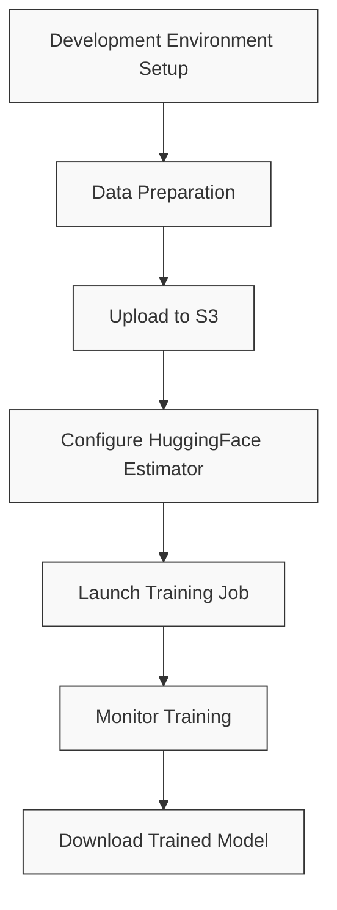
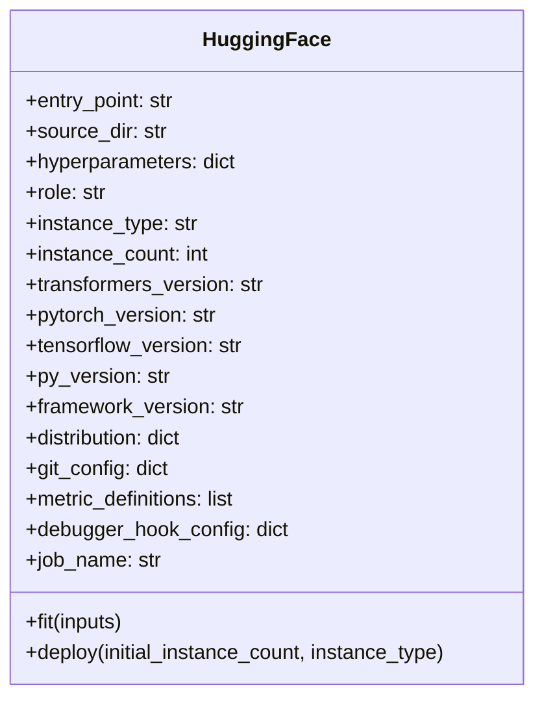
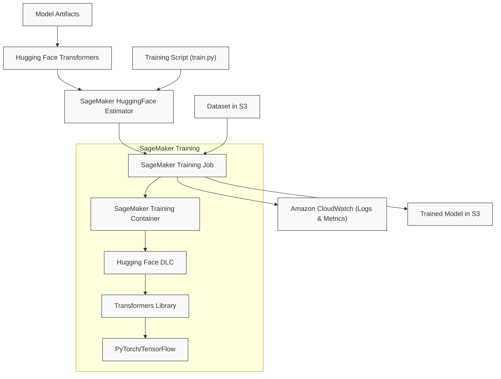
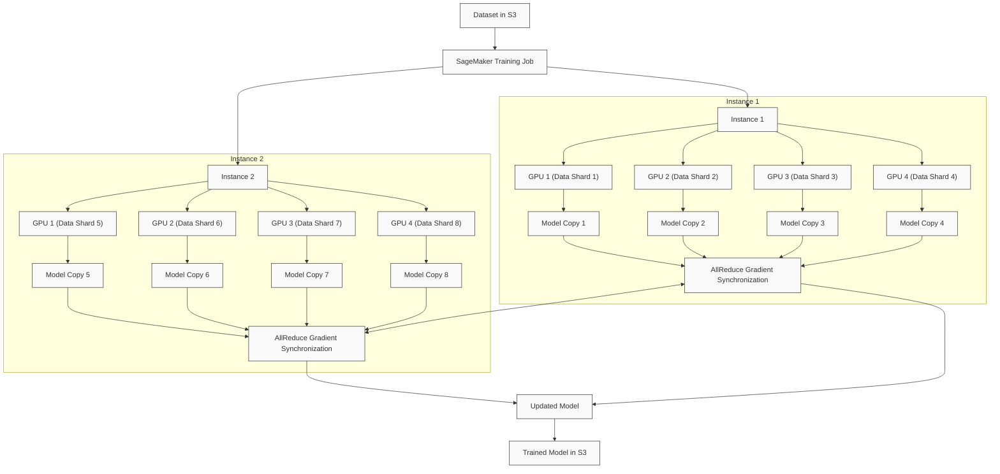

<!-- source: DeepWiki mcp.deepwiki.com · repo huggingface/notebooks · page 5.1 Training on SageMaker · fetched 2026-10-26 -->

# Training on SageMaker

<details>
<summary>Relevant source files</summary>

The following files were used as context for generating this wiki page:

- [sagemaker/01_getting_started_pytorch/sagemaker-notebook.ipynb](sagemaker/01_getting_started_pytorch/sagemaker-notebook.ipynb)
- [sagemaker/01_getting_started_pytorch/scripts/train.py](sagemaker/01_getting_started_pytorch/scripts/train.py)
- [sagemaker/02_getting_started_tensorflow/sagemaker-notebook.ipynb](sagemaker/02_getting_started_tensorflow/sagemaker-notebook.ipynb)
- [sagemaker/02_getting_started_tensorflow/scripts/train.py](sagemaker/02_getting_started_tensorflow/scripts/train.py)
- [sagemaker/03_distributed_training_data_parallelism/sagemaker-notebook.ipynb](sagemaker/03_distributed_training_data_parallelism/sagemaker-notebook.ipynb)
- [sagemaker/04_distributed_training_model_parallelism/sagemaker-notebook.ipynb](sagemaker/04_distributed_training_model_parallelism/sagemaker-notebook.ipynb)
- [sagemaker/05_spot_instances/imgs/overview.png](sagemaker/05_spot_instances/imgs/overview.png)
- [sagemaker/05_spot_instances/sagemaker-notebook.ipynb](sagemaker/05_spot_instances/sagemaker-notebook.ipynb)
- [sagemaker/05_spot_instances/scripts/train.py](sagemaker/05_spot_instances/scripts/train.py)
- [sagemaker/06_sagemaker_metrics/sagemaker-notebook.ipynb](sagemaker/06_sagemaker_metrics/sagemaker-notebook.ipynb)
- [sagemaker/06_sagemaker_metrics/scripts/train.py](sagemaker/06_sagemaker_metrics/scripts/train.py)
- [sagemaker/07_tensorflow_distributed_training_data_parallelism/sagemaker-notebook.ipynb](sagemaker/07_tensorflow_distributed_training_data_parallelism/sagemaker-notebook.ipynb)
- [sagemaker/07_tensorflow_distributed_training_data_parallelism/scripts/train.py](sagemaker/07_tensorflow_distributed_training_data_parallelism/scripts/train.py)
- [sagemaker/08_distributed_summarization_bart_t5/sagemaker-notebook.ipynb](sagemaker/08_distributed_summarization_bart_t5/sagemaker-notebook.ipynb)
- [sagemaker/09_image_classification_vision_transformer/sagemaker-notebook.ipynb](sagemaker/09_image_classification_vision_transformer/sagemaker-notebook.ipynb)
- [sagemaker/09_image_classification_vision_transformer/scripts/train.py](sagemaker/09_image_classification_vision_transformer/scripts/train.py)
- [sagemaker/10_deploy_model_from_s3/deploy_transformer_model_from_s3.ipynb](sagemaker/10_deploy_model_from_s3/deploy_transformer_model_from_s3.ipynb)
- [sagemaker/11_deploy_model_from_hf_hub/deploy_transformer_model_from_hf_hub.ipynb](sagemaker/11_deploy_model_from_hf_hub/deploy_transformer_model_from_hf_hub.ipynb)
- [sagemaker/12_batch_transform_inference/sagemaker-notebook.ipynb](sagemaker/12_batch_transform_inference/sagemaker-notebook.ipynb)
- [sagemaker/13_deploy_and_autoscaling_transformers/sagemaker-notebook.ipynb](sagemaker/13_deploy_and_autoscaling_transformers/sagemaker-notebook.ipynb)

</details>


This document provides a comprehensive guide to training Hugging Face Transformer models using Amazon SageMaker. It covers the necessary setup, configuration, and execution of training jobs, along with advanced options like distributed training and cost optimization using spot instances. For information about deploying models on SageMaker, see [Model Deployment](#5.3).

## Overview of SageMaker Training with Hugging Face

Amazon SageMaker provides managed infrastructure for training machine learning models at scale. With the Hugging Face and SageMaker integration, you can easily train Transformer models on SageMaker's managed infrastructure without worrying about setting up and maintaining your own training clusters.

The key components of training on SageMaker include:

1. Setting up the development environment and permissions
2. Preparing and uploading your dataset to Amazon S3
3. Configuring and launching training jobs using the HuggingFace estimator
4. Utilizing advanced options like distributed training and spot instances
5. Monitoring training progress and capturing metrics
6. Downloading the trained model for deployment or further refinement



Sources: 
- [sagemaker/01_getting_started_pytorch/sagemaker-notebook.ipynb]()
- [sagemaker/08_distributed_summarization_bart_t5/sagemaker-notebook.ipynb]()

## Setting Up Your Environment

Before you can train models on SageMaker, you need to set up your development environment and configure the necessary permissions.

### Installation Requirements

You need to install the SageMaker Python SDK and the Hugging Face Transformers library:

```python
!pip install "sagemaker>=2.140.0" "transformers==4.26.1" "datasets[s3]==2.10.1" --upgrade
```

### Development Environment

The SageMaker SDK provides the `HuggingFace` estimator that facilitates training Transformer models:

```python
import sagemaker.huggingface
```

### Permissions

You need an IAM role with appropriate permissions for SageMaker. The role should have access to:
- Create and manage SageMaker resources
- Read and write to Amazon S3 buckets
- Create and manage AWS CloudWatch logs

Here's how to get your execution role and set up a SageMaker session:

```python
import sagemaker
import boto3

sess = sagemaker.Session()
sagemaker_session_bucket = sess.default_bucket()

role = sagemaker.get_execution_role()

print(f"sagemaker role arn: {role}")
print(f"sagemaker bucket: {sagemaker_session_bucket}")
print(f"sagemaker session region: {sess.boto_region_name}")
```

Sources:
- [sagemaker/01_getting_started_pytorch/sagemaker-notebook.ipynb]()
- [sagemaker/05_spot_instances/sagemaker-notebook.ipynb:78-98]()

## Data Preparation and Uploading

Before training your model, you need to prepare your dataset and upload it to Amazon S3 for SageMaker to access during training.

### Dataset Preprocessing

You can use the Hugging Face `datasets` library to load and preprocess your data:

```python
from datasets import load_dataset
from transformers import AutoTokenizer

# Load tokenizer
tokenizer = AutoTokenizer.from_pretrained("distilbert-base-uncased")

# Load dataset
dataset = load_dataset("imdb")

# Tokenize dataset
def tokenize(batch):
    return tokenizer(batch["text"], padding="max_length", truncation=True)

train_dataset = dataset["train"].map(tokenize, batched=True)
test_dataset = dataset["test"].map(tokenize, batched=True)
```

### Uploading to S3

After preprocessing, upload your dataset to S3 for SageMaker to access:

```python
# Upload to S3
train_input_path = sess.upload_data(
    path="train",
    bucket=sagemaker_session_bucket,
    key_prefix="data/imdb/train"
)

test_input_path = sess.upload_data(
    path="test",
    bucket=sagemaker_session_bucket,
    key_prefix="data/imdb/test"
)
```

Sources:
- [sagemaker/01_getting_started_pytorch/sagemaker-notebook.ipynb]()
- [sagemaker/05_spot_instances/sagemaker-notebook.ipynb]()

## The Hugging Face Estimator

The HuggingFace estimator is the central component for configuring and launching training jobs on SageMaker.



### Creating a Basic Estimator

Here's an example of creating a basic HuggingFace estimator for training a text classification model:

```python
from sagemaker.huggingface import HuggingFace

# Define hyperparameters
hyperparameters = {
    'epochs': 3,
    'train_batch_size': 32,
    'eval_batch_size': 64,
    'learning_rate': 5e-5,
    'model_name': 'distilbert-base-uncased'
}

# Create the estimator
huggingface_estimator = HuggingFace(
    entry_point='train.py',                # Training script
    source_dir='./scripts',                # Directory containing the script
    instance_type='ml.p3.2xlarge',         # Instance type for training
    instance_count=1,                      # Number of instances
    role=role,                             # IAM role
    transformers_version='4.26.0',         # Transformers version
    pytorch_version='1.13.1',              # PyTorch version
    py_version='py39',                     # Python version
    hyperparameters=hyperparameters        # Hyperparameters
)
```

Sources:
- [sagemaker/01_getting_started_pytorch/sagemaker-notebook.ipynb]()
- [sagemaker/02_getting_started_tensorflow/sagemaker-notebook.ipynb]()
- [sagemaker/08_distributed_summarization_bart_t5/sagemaker-notebook.ipynb:234-250]()

## Training Scripts

Your training script (`train.py`) needs to be SageMaker-compatible. Here's a simplified example of a training script for text classification:

```python
import argparse
import os
from transformers import AutoModelForSequenceClassification, Trainer, TrainingArguments, AutoTokenizer
from datasets import load_from_disk
import torch

if __name__ == "__main__":
    parser = argparse.ArgumentParser()
    
    # Hyperparameters passed by the estimator
    parser.add_argument("--epochs", type=int, default=3)
    parser.add_argument("--train_batch_size", type=int, default=32)
    parser.add_argument("--eval_batch_size", type=int, default=64)
    parser.add_argument("--model_name", type=str)
    parser.add_argument("--learning_rate", type=str, default=5e-5)
    
    # SageMaker specific arguments
    parser.add_argument("--output_data_dir", type=str, default=os.environ["SM_OUTPUT_DATA_DIR"])
    parser.add_argument("--model_dir", type=str, default=os.environ["SM_MODEL_DIR"])
    
    args, _ = parser.parse_known_args()
    
    # Load datasets
    training_dir = os.environ["SM_CHANNEL_TRAIN"]
    testing_dir = os.environ["SM_CHANNEL_TEST"]
    train_dataset = load_from_disk(training_dir)
    eval_dataset = load_from_disk(testing_dir)
    
    # Load model from Hub
    model = AutoModelForSequenceClassification.from_pretrained(
        args.model_name, num_labels=2
    )
    
    # Define training arguments
    training_args = TrainingArguments(
        output_dir=args.model_dir,
        num_train_epochs=args.epochs,
        per_device_train_batch_size=args.train_batch_size,
        per_device_eval_batch_size=args.eval_batch_size,
        learning_rate=float(args.learning_rate),
        evaluation_strategy="epoch",
    )
    
    # Create Trainer
    trainer = Trainer(
        model=model,
        args=training_args,
        train_dataset=train_dataset,
        eval_dataset=eval_dataset
    )
    
    # Train model
    trainer.train()
    
    # Evaluate model
    eval_result = trainer.evaluate()
    
    # Save model
    trainer.save_model(args.model_dir)
```

Sources:
- [sagemaker/01_getting_started_pytorch/scripts/train.py]()
- [sagemaker/02_getting_started_tensorflow/scripts/train.py]()
- [sagemaker/05_spot_instances/scripts/train.py]()

## Starting and Monitoring Training

Once you've set up your estimator, you can start the training job and monitor its progress.

### Launching a Training Job

To start a training job, call the `fit` method on your estimator:

```python
# Define training data channels
data_channels = {
    'train': train_input_path,
    'test': test_input_path
}

# Start training
huggingface_estimator.fit(data_channels)
```

SageMaker will create training instances, upload your code, download the specified model, and execute your training script.

### Monitoring Progress

You can monitor training progress in the SageMaker console or by checking CloudWatch logs. The training logs will show:

- Initialization and environment setup
- Dataset loading
- Training progress (loss, metrics)
- Evaluation results
- Any errors or warnings

Sources:
- [sagemaker/01_getting_started_pytorch/sagemaker-notebook.ipynb]()
- [sagemaker/05_spot_instances/sagemaker-notebook.ipynb]()

## Advanced Training Options

SageMaker offers several advanced options for training Hugging Face models more efficiently.

### Distributed Training with Data Parallelism

Data parallelism is useful for large datasets where you want to distribute the training data across multiple instances:

```python
# Configuration for data parallelism
distribution = {
    'smdistributed': {
        'dataparallel': {
            'enabled': True
        }
    }
}

# Create the estimator with distributed training
huggingface_estimator = HuggingFace(
    entry_point='train.py',
    source_dir='./scripts',
    instance_type='ml.p3dn.24xlarge',
    instance_count=2,  # Using multiple instances
    role=role,
    transformers_version='4.26.0',
    pytorch_version='1.13.1',
    py_version='py39',
    hyperparameters=hyperparameters,
    distribution=distribution  # Add distribution configuration
)
```

### Distributed Training with Model Parallelism

Model parallelism is useful for large models that don't fit in a single GPU's memory:

```python
# Configuration for model parallelism
mpi_options = {
    "enabled": True,
    "processes_per_host": 8  # Number of processes
}

smp_options = {
    "enabled": True,
    "parameters": {
        "partitions": 2,      # Number of model partitions
        "microbatches": 4,    # Number of microbatches
        "placement_strategy": "spread",
        "pipeline": "interleaved",
        "optimize": "speed",
        "ddp": True
    }
}

distribution = {
    "smdistributed": {"modelparallel": smp_options},
    "mpi": mpi_options
}

# To use model parallelism, you need a special trainer
# See the SageMaker examples for details
```

### Training with Spot Instances

Spot instances can reduce training costs by up to 90%, but they may be interrupted. You can configure your estimator to use spot instances and checkpointing to handle interruptions:

```python
# Create the estimator with spot instance support
huggingface_estimator = HuggingFace(
    entry_point='train.py',
    source_dir='./scripts',
    instance_type='ml.p3.2xlarge',
    instance_count=1,
    role=role,
    transformers_version='4.26.0',
    pytorch_version='1.13.1',
    py_version='py39',
    hyperparameters=hyperparameters,
    use_spot_instances=True,              # Enable spot instances
    max_wait=3600,                        # Max wait time for spot (1 hour)
    max_run=1800,                         # Max run time (30 minutes)
    checkpoint_s3_uri=f's3://{sagemaker_session_bucket}/checkpoints'  # Where to save checkpoints
)
```

Your training script needs to be updated to handle checkpoints. The Hugging Face Trainer supports checkpointing out of the box when used with SageMaker.

### Custom Metrics

You can define custom metrics to monitor your training progress:

```python
# Define metrics
metric_definitions = [
    {'Name': 'train_loss', 'Regex': "'loss': ([0-9\\.]+)"},
    {'Name': 'eval_accuracy', 'Regex': "'eval_accuracy': ([0-9\\.]+)"},
    {'Name': 'eval_loss', 'Regex': "'eval_loss': ([0-9\\.]+)"}
]

# Create the estimator with custom metrics
huggingface_estimator = HuggingFace(
    entry_point='train.py',
    source_dir='./scripts',
    instance_type='ml.p3.2xlarge',
    instance_count=1,
    role=role,
    transformers_version='4.26.0',
    pytorch_version='1.13.1',
    py_version='py39',
    hyperparameters=hyperparameters,
    metric_definitions=metric_definitions  # Add metric definitions
)
```

Sources:
- [sagemaker/03_distributed_training_data_parallelism/sagemaker-notebook.ipynb]()
- [sagemaker/04_distributed_training_model_parallelism/sagemaker-notebook.ipynb]()
- [sagemaker/05_spot_instances/sagemaker-notebook.ipynb]()
- [sagemaker/06_sagemaker_metrics/sagemaker-notebook.ipynb]()
- [sagemaker/08_distributed_summarization_bart_t5/sagemaker-notebook.ipynb:219-220]()

## SageMaker and Hugging Face Integration Architecture

The following diagram illustrates how SageMaker and Hugging Face components interact during the training process:



Sources:
- [sagemaker/08_distributed_summarization_bart_t5/sagemaker-notebook.ipynb]()
- [sagemaker/01_getting_started_pytorch/sagemaker-notebook.ipynb]()

## Distributed Training Architecture

This diagram shows how data parallelism works in SageMaker for distributed training:



Sources:
- [sagemaker/03_distributed_training_data_parallelism/sagemaker-notebook.ipynb]()
- [sagemaker/08_distributed_summarization_bart_t5/sagemaker-notebook.ipynb]()

## Retrieving Trained Models

After training completes, you can download the trained model artifacts from S3 or use them directly for deployment.

### Downloading the Model

```python
import os
import tarfile
from sagemaker.s3 import S3Downloader

local_path = 'my_model'
os.makedirs(local_path, exist_ok=True)

# Download model from S3
S3Downloader.download(
    s3_uri=huggingface_estimator.model_data,
    local_path=local_path
)

# Extract the model
tar = tarfile.open(f"{local_path}/model.tar.gz", "r:gz")
tar.extractall(path=local_path)
tar.close()
```

### Preparing for Deployment

Once you have the trained model, you can use it for inference by loading it with the Transformers library or deploying it to SageMaker for inference.

Sources:
- [sagemaker/08_distributed_summarization_bart_t5/sagemaker-notebook.ipynb:338-359]()

## Best Practices

### Cost Optimization

1. **Use Spot Instances**: Configure your training job to use spot instances when possible to save up to 90% on training costs.
2. **Right-size Instances**: Choose the appropriate instance type for your workload.
3. **Use Checkpointing**: Enable checkpointing to save training progress in case of spot instance interruptions.

### Performance Optimization

1. **Distributed Training**: Use data parallelism for large datasets and model parallelism for large models.
2. **Batch Size Optimization**: Use the largest batch size that fits in your GPU memory to maximize throughput.
3. **Mixed Precision Training**: Enable mixed precision training (`fp16=True` in your hyperparameters) to speed up training on compatible hardware.

### Monitoring and Debugging

1. **Define Custom Metrics**: Define custom metrics that are relevant to your task to better monitor training progress.
2. **Use SageMaker Debugger**: Configure SageMaker Debugger to capture and analyze tensors during training.
3. **Check CloudWatch Logs**: Regularly check CloudWatch logs for any errors or warnings.

Sources:
- [sagemaker/05_spot_instances/sagemaker-notebook.ipynb]()
- [sagemaker/06_sagemaker_metrics/sagemaker-notebook.ipynb]()

## Comparison of Training Options

| Training Option | Best For | Instance Types | Key Configuration |
|-----------------|----------|----------------|-------------------|
| Single-instance Training | Small to medium datasets, experiments | ml.p3.2xlarge, ml.g4dn.xlarge | Default configuration |
| Data Parallelism | Large datasets | ml.p3.16xlarge, ml.p3dn.24xlarge | `distribution={'smdistributed':{'dataparallel':{'enabled':True}}}` |
| Model Parallelism | Large models (>= 10B parameters) | ml.p3.16xlarge, ml.p3dn.24xlarge | Complex configuration with SMP options |
| Spot Instances | Cost-sensitive training | Any | `use_spot_instances=True, max_wait=3600, max_run=1800` |

Sources:
- [sagemaker/01_getting_started_pytorch/sagemaker-notebook.ipynb]()
- [sagemaker/03_distributed_training_data_parallelism/sagemaker-notebook.ipynb]()
- [sagemaker/04_distributed_training_model_parallelism/sagemaker-notebook.ipynb]()
- [sagemaker/05_spot_instances/sagemaker-notebook.ipynb]()
- [sagemaker/08_distributed_summarization_bart_t5/sagemaker-notebook.ipynb]()

## Conclusion

Training Hugging Face Transformer models on Amazon SageMaker provides a scalable, cost-effective way to build state-of-the-art NLP models. By leveraging SageMaker's managed infrastructure and the Hugging Face integration, you can focus on developing your models rather than managing infrastructure.

For complex workloads, explore the advanced options like distributed training and spot instances to optimize for performance and cost. Make sure to follow the best practices for monitoring and debugging to ensure successful training runs.

---

