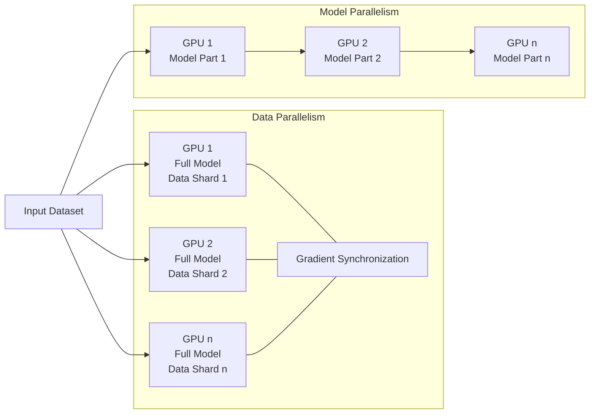
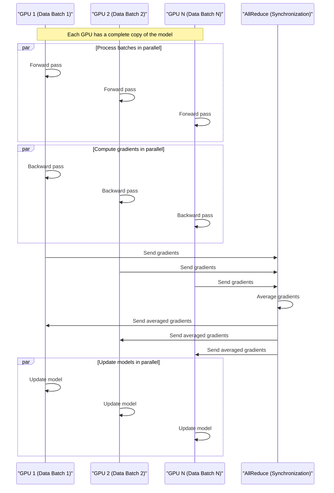
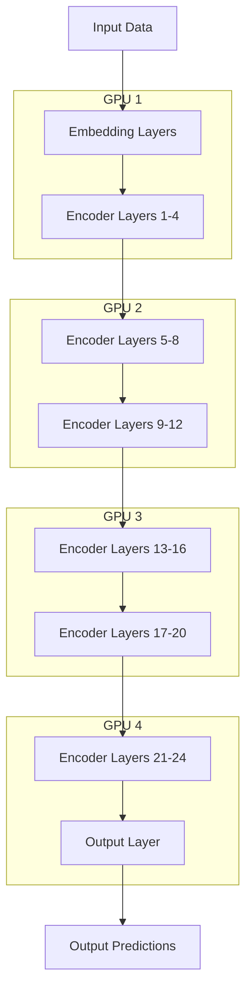
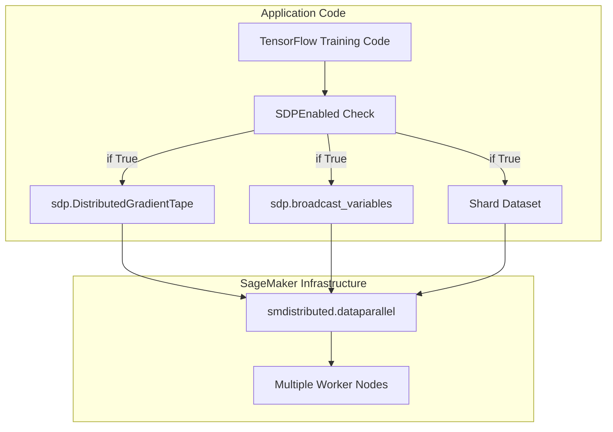
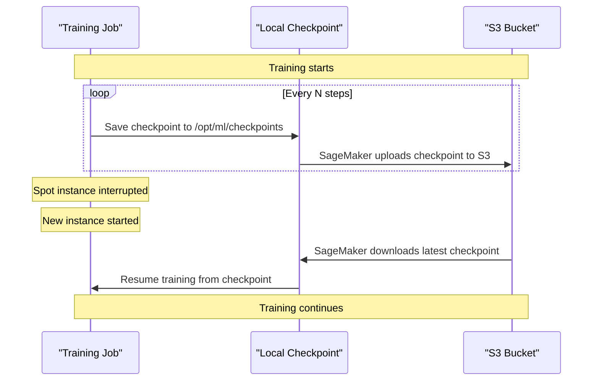

<!-- source: DeepWiki mcp.deepwiki.com · repo huggingface/notebooks · page 5.2 Distributed Training · fetched 2026-10-26 -->

# Distributed Training

<details>
<summary>Relevant source files</summary>

The following files were used as context for generating this wiki page:

- [sagemaker/01_getting_started_pytorch/sagemaker-notebook.ipynb](sagemaker/01_getting_started_pytorch/sagemaker-notebook.ipynb)
- [sagemaker/01_getting_started_pytorch/scripts/train.py](sagemaker/01_getting_started_pytorch/scripts/train.py)
- [sagemaker/02_getting_started_tensorflow/sagemaker-notebook.ipynb](sagemaker/02_getting_started_tensorflow/sagemaker-notebook.ipynb)
- [sagemaker/02_getting_started_tensorflow/scripts/train.py](sagemaker/02_getting_started_tensorflow/scripts/train.py)
- [sagemaker/03_distributed_training_data_parallelism/sagemaker-notebook.ipynb](sagemaker/03_distributed_training_data_parallelism/sagemaker-notebook.ipynb)
- [sagemaker/04_distributed_training_model_parallelism/sagemaker-notebook.ipynb](sagemaker/04_distributed_training_model_parallelism/sagemaker-notebook.ipynb)
- [sagemaker/05_spot_instances/imgs/overview.png](sagemaker/05_spot_instances/imgs/overview.png)
- [sagemaker/05_spot_instances/sagemaker-notebook.ipynb](sagemaker/05_spot_instances/sagemaker-notebook.ipynb)
- [sagemaker/05_spot_instances/scripts/train.py](sagemaker/05_spot_instances/scripts/train.py)
- [sagemaker/06_sagemaker_metrics/sagemaker-notebook.ipynb](sagemaker/06_sagemaker_metrics/sagemaker-notebook.ipynb)
- [sagemaker/06_sagemaker_metrics/scripts/train.py](sagemaker/06_sagemaker_metrics/scripts/train.py)
- [sagemaker/07_tensorflow_distributed_training_data_parallelism/sagemaker-notebook.ipynb](sagemaker/07_tensorflow_distributed_training_data_parallelism/sagemaker-notebook.ipynb)
- [sagemaker/07_tensorflow_distributed_training_data_parallelism/scripts/train.py](sagemaker/07_tensorflow_distributed_training_data_parallelism/scripts/train.py)
- [sagemaker/08_distributed_summarization_bart_t5/sagemaker-notebook.ipynb](sagemaker/08_distributed_summarization_bart_t5/sagemaker-notebook.ipynb)

</details>


This document explains how to perform distributed training with Hugging Face Transformers in Amazon SageMaker. It covers two main approaches to distributed training: data parallelism and model parallelism, along with spot instance training for cost optimization. For information about non-distributed SageMaker training, see [SageMaker Integration](#5.1).

## Overview

Hugging Face Transformers models can be large and require significant computational resources to train. Distributed training allows you to spread this computation across multiple GPUs and/or multiple nodes, enabling faster training and the ability to work with larger models that wouldn't fit on a single GPU.

SageMaker offers two main approaches to distributed training:

1. **Data Parallelism**: Each device (GPU) has a complete copy of the model but trains on a different subset of the data
2. **Model Parallelism**: The model is split across multiple devices

These approaches can be implemented with minimal code changes by leveraging SageMaker's distributed training libraries integrated with Hugging Face's Trainer API.

**Diagram: Distributed Training Approaches**



Sources: [sagemaker/08_distributed_summarization_bart_t5/sagemaker-notebook.ipynb:1-570](), [sagemaker/03_distributed_training_data_parallelism/sagemaker-notebook.ipynb:1-200](), [sagemaker/04_distributed_training_model_parallelism/sagemaker-notebook.ipynb:1-200]()

## Data Parallelism

In data parallelism, the model is replicated on each GPU, but each GPU processes a different batch of data. After each forward and backward pass, the gradients from all GPUs are synchronized to ensure model consistency.

**Diagram: Data Parallelism Workflow**



### Implementation with SageMaker

To enable data parallelism in SageMaker, you simply need to:

1. Set up a distribution configuration in your HuggingFace estimator
2. Use multiple GPUs by configuring the `instance_count` and an appropriate `instance_type`

Here's how to configure a HuggingFace estimator for data parallelism:

```python
# configuration for running training on smdistributed Data Parallel
distribution = {'smdistributed':{'dataparallel':{ 'enabled': True }}}

# create the Estimator
huggingface_estimator = HuggingFace(
    entry_point='run_summarization.py',
    source_dir='./examples/pytorch/summarization',
    instance_type='ml.p3dn.24xlarge',
    instance_count=2,
    transformers_version='4.26.0',
    pytorch_version='1.13.1',
    py_version='py39',
    role=role,
    hyperparameters=hyperparameters,
    distribution=distribution
)
```

The best part is that you don't need to modify your training script for data parallelism as SageMaker handles the distribution automatically.

Sources: [sagemaker/08_distributed_summarization_bart_t5/sagemaker-notebook.ipynb:212-250](), [sagemaker/03_distributed_training_data_parallelism/sagemaker-notebook.ipynb:150-200]()

## Model Parallelism

Model parallelism is useful when your model is too large to fit on a single GPU. In this approach, the model is partitioned across multiple GPUs, with each GPU holding only a portion of the model. This approach is more complex than data parallelism as it requires coordination during the forward and backward passes.

**Diagram: Model Parallelism Architecture**



### Implementing Model Parallelism

SageMaker provides a custom extension to the Hugging Face Trainer class for model parallelism. To use it:

1. Import the SageMaker-specific trainer classes:
```python
from transformers.sagemaker import SageMakerTrainingArguments as TrainingArguments
from transformers.sagemaker import SageMakerTrainer as Trainer
```

2. Configure model parallelism in your distribution configuration:
```python
mpi_options = {
    "enabled" : True,
    "processes_per_host" : 8
}

smp_options = {
    "enabled":True,
    "parameters": {
        "microbatches": 4,
        "placement_strategy": "spread",
        "pipeline": "interleaved",
        "optimize": "speed",
        "partitions": 4,
        "ddp": True,
    }
}

distribution={
    "smdistributed": {"modelparallel": smp_options},
    "mpi": mpi_options
}
```

3. Create and run your HuggingFace estimator with this configuration:
```python
huggingface_estimator = HuggingFace(
    entry_point='run_glue_smp.py',
    source_dir='./scripts',
    instance_type='ml.p3.16xlarge',
    instance_count=1,
    transformers_version='4.26.0',
    pytorch_version='1.13.1',
    py_version='py39',
    role=role,
    hyperparameters=hyperparameters,
    distribution=distribution
)
```

The key difference from data parallelism is that your training script must use the `SageMakerTrainer` instead of the regular `Trainer` class.

Sources: [sagemaker/04_distributed_training_model_parallelism/sagemaker-notebook.ipynb:193-250]()

## TensorFlow Distributed Training

If you're using TensorFlow instead of PyTorch, SageMaker offers similar distributed training capabilities, but the implementation is slightly different. 

**Diagram: TensorFlow Distributed Training**



In your training script, you need to:

1. Check if SageMaker distributed training is enabled:
```python
if os.environ.get("SDP_ENABLED") or is_sagemaker_dp_enabled():
    SDP_ENABLED = True
    import smdistributed.dataparallel.tensorflow as sdp
else:
    SDP_ENABLED = False
```

2. Modify your training loop to use SageMaker's distributed training components:
```python
# Wrap the gradient tape
if SDP_ENABLED:
    tape = sdp.DistributedGradientTape(tape, sparse_as_dense=True)

# Broadcast variables (first batch only)
if SDP_ENABLED:
    if i == 0:
        sdp.broadcast_variables(model.variables, root_rank=0)
        sdp.broadcast_variables(opt.variables(), root_rank=0)

# Shard your dataset
if SDP_ENABLED:
    tf_train_dataset = tf_train_dataset.shard(sdp.size(), sdp.rank())
```

Sources: [sagemaker/07_tensorflow_distributed_training_data_parallelism/sagemaker-notebook.ipynb:60-120](), [sagemaker/07_tensorflow_distributed_training_data_parallelism/scripts/train.py:11-82]()

## Cost Optimization with Spot Instances

When running distributed training, you can significantly reduce costs by using EC2 spot instances, which offer steep discounts compared to on-demand instances. However, spot instances can be interrupted, so you need to implement checkpointing to avoid losing progress.

**Diagram: Spot Training with Checkpointing**



### Setting Up Spot Training

To enable spot training with checkpointing:

1. Configure spot parameters in your estimator:
```python
# enables spot training
use_spot_instances = True
# max time including spot start + training time
max_wait = 7200
# expected training time
max_run = 4000
```

2. Set up a checkpoint S3 location:
```python
checkpoint_s3_uri = f's3://{sess.default_bucket()}/{base_job_name}/checkpoints'
```

3. Create your HuggingFace estimator with these parameters:
```python
huggingface_estimator = HuggingFace(
    entry_point='train.py',
    source_dir='./scripts',
    instance_type='ml.p3.2xlarge',
    instance_count=1,
    transformers_version='4.26.1',
    pytorch_version='1.13.1',
    py_version='py39',
    role=role,
    hyperparameters=hyperparameters,
    use_spot_instances=use_spot_instances,
    max_wait=max_wait,
    max_run=max_run,
    checkpoint_s3_uri=checkpoint_s3_uri
)
```

4. In your training script, ensure checkpoints are saved to `/opt/ml/checkpoints` (or your configured checkpoint path):
```python
# Set output_dir to checkpoint location in hyperparameters
hyperparameters = {
    # ...other hyperparameters...
    'output_dir': '/opt/ml/checkpoints'
}
```

Sources: [sagemaker/05_spot_instances/sagemaker-notebook.ipynb:183-230](), [sagemaker/05_spot_instances/scripts/train.py:65-100]()

## Best Practices for Distributed Training

When implementing distributed training with Hugging Face and SageMaker, consider the following best practices:

| Approach | When to Use | Best Instance Types | Key Considerations |
|----------|-------------|---------------------|---------------------|
| Data Parallelism | Models fit on a single GPU but training is slow | ml.p3.16xlarge, ml.p3dn.24xlarge | Increase batch size proportionally to the number of GPUs |
| Model Parallelism | Models too large to fit on a single GPU | ml.p3.16xlarge, ml.p4d.24xlarge | Requires more complex setup; optimize pipeline configuration |
| Hybrid Parallelism | Very large models requiring many GPUs | ml.p4d.24xlarge, ml.p4de.24xlarge | Most complex setup but most efficient for largest models |
| Spot Training | Any training job where interruptions are acceptable | Any instance type | Always use with checkpointing; set appropriate max_wait time |

### Typical Multi-Node Configuration Example

Here's a typical setup for a multi-node distributed training job:

```python
huggingface_estimator = HuggingFace(
    entry_point='run_summarization.py',
    source_dir='./examples/pytorch/summarization',
    instance_type='ml.p3dn.24xlarge',  # 8 V100 GPUs per instance
    instance_count=4,                  # 4 instances = 32 total GPUs
    transformers_version='4.26.0',
    pytorch_version='1.13.1',
    py_version='py39',
    role=role,
    hyperparameters={
        'per_device_train_batch_size': 8,
        'model_name_or_path': 'facebook/bart-large-cnn',
        'dataset_name': 'samsum',
        'do_train': True,
        'do_eval': True,
        'output_dir': '/opt/ml/model',
        'num_train_epochs': 3,
        'fp16': True,
    },
    distribution={'smdistributed':{'dataparallel':{'enabled': True}}},
    use_spot_instances=True,
    max_wait=10800,
    max_run=7200,
    checkpoint_s3_uri=f's3://{sess.default_bucket()}/checkpoints'
)
```

This configuration sets up a training job that:
- Uses 4 p3dn.24xlarge instances (32 GPUs total)
- Enables SageMaker distributed data parallelism
- Uses spot instances with checkpointing for cost efficiency
- Trains a BART model for summarization on the SAMSum dataset

Sources: [sagemaker/08_distributed_summarization_bart_t5/sagemaker-notebook.ipynb:229-250](), [sagemaker/05_spot_instances/sagemaker-notebook.ipynb:247-271]()

## Conclusion

Distributed training with Hugging Face and SageMaker enables you to train larger models faster and more cost-effectively. Data parallelism is easier to implement and works well for models that fit on a single GPU, while model parallelism is necessary for larger models. Combining these approaches with spot instances and checkpointing can significantly reduce your training costs.

For complex models, you may need to experiment with different parallelism strategies, instance types, and hyperparameters to find the optimal configuration for your specific use case.

---

