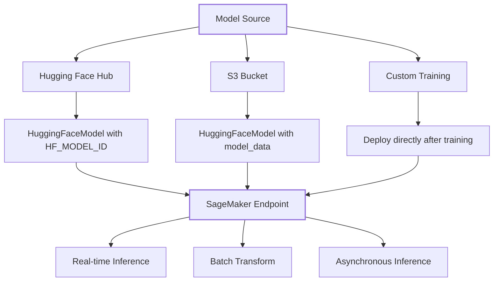
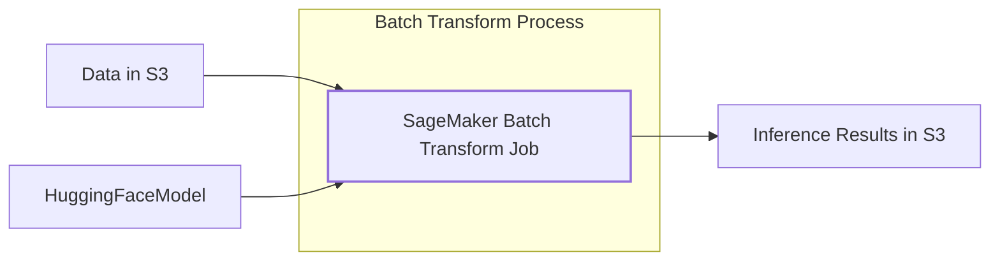
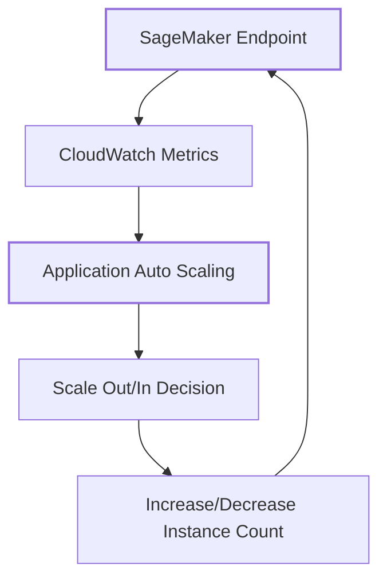
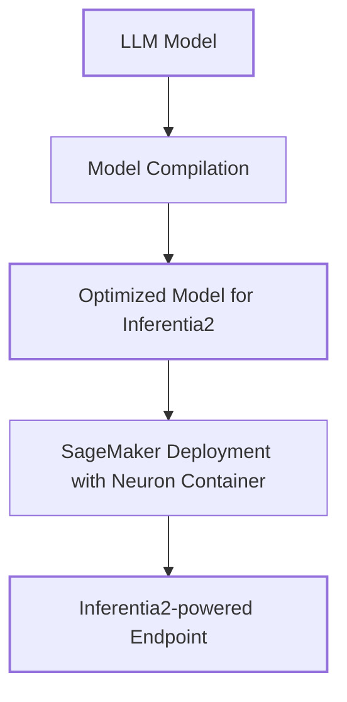
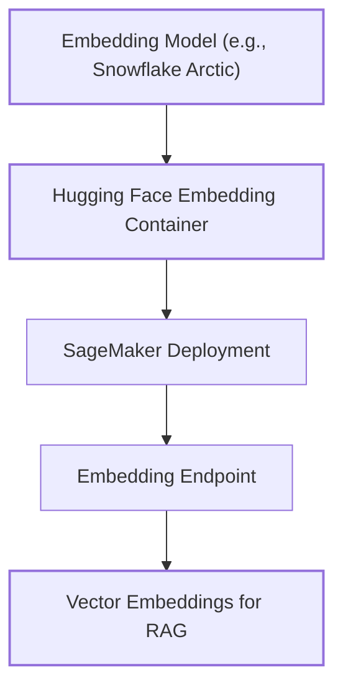

<!-- source: DeepWiki mcp.deepwiki.com · repo huggingface/notebooks · page 5.3 Model Deployment · fetched 2026-10-26 -->

# Model Deployment

<details>
<summary>Relevant source files</summary>

The following files were used as context for generating this wiki page:

- [sagemaker/09_image_classification_vision_transformer/sagemaker-notebook.ipynb](sagemaker/09_image_classification_vision_transformer/sagemaker-notebook.ipynb)
- [sagemaker/09_image_classification_vision_transformer/scripts/train.py](sagemaker/09_image_classification_vision_transformer/scripts/train.py)
- [sagemaker/10_deploy_model_from_s3/deploy_transformer_model_from_s3.ipynb](sagemaker/10_deploy_model_from_s3/deploy_transformer_model_from_s3.ipynb)
- [sagemaker/11_deploy_model_from_hf_hub/deploy_transformer_model_from_hf_hub.ipynb](sagemaker/11_deploy_model_from_hf_hub/deploy_transformer_model_from_hf_hub.ipynb)
- [sagemaker/12_batch_transform_inference/sagemaker-notebook.ipynb](sagemaker/12_batch_transform_inference/sagemaker-notebook.ipynb)
- [sagemaker/13_deploy_and_autoscaling_transformers/sagemaker-notebook.ipynb](sagemaker/13_deploy_and_autoscaling_transformers/sagemaker-notebook.ipynb)
- [sagemaker/29_deploy_llms_on_inferentia2/sagemaker-notebook.ipynb](sagemaker/29_deploy_llms_on_inferentia2/sagemaker-notebook.ipynb)
- [sagemaker/30_evaluate_llms_with_lighteval/sagemaker-notebook.ipynb](sagemaker/30_evaluate_llms_with_lighteval/sagemaker-notebook.ipynb)
- [sagemaker/31_deploy_embedding_models/assets/cw.png](sagemaker/31_deploy_embedding_models/assets/cw.png)
- [sagemaker/31_deploy_embedding_models/sagemaker-notebook.ipynb](sagemaker/31_deploy_embedding_models/sagemaker-notebook.ipynb)
- [sagemaker/32_train_deploy_embedding_models/sagemaker-notebook.ipynb](sagemaker/32_train_deploy_embedding_models/sagemaker-notebook.ipynb)
- [sagemaker/32_train_deploy_embedding_models/scripts/requirements.txt](sagemaker/32_train_deploy_embedding_models/scripts/requirements.txt)
- [sagemaker/32_train_deploy_embedding_models/scripts/run_mnr.py](sagemaker/32_train_deploy_embedding_models/scripts/run_mnr.py)
- [sagemaker/README.md](sagemaker/README.md)

</details>


This document provides a comprehensive guide for deploying trained models using Amazon SageMaker within the Hugging Face ecosystem. It covers various deployment methods including deploying directly from the Hugging Face Hub, deploying from S3, batch inference, and specialized deployments for embedding models and large language models (LLMs).

For information about training models, see [Training on SageMaker](#5.1) and [Distributed Training](#5.2).

## Overview of SageMaker Deployment Options

Amazon SageMaker offers several paths to deploy machine learning models for inference. Each approach has specific use cases and advantages:



Sources: [sagemaker/README.md:28-47](), [sagemaker/11_deploy_model_from_hf_hub/deploy_transformer_model_from_hf_hub.ipynb:80-88](), [sagemaker/10_deploy_model_from_s3/deploy_transformer_model_from_s3.ipynb:80-90]()

Deploying a model in SageMaker is a three-step process:

1. Create a model in SageMaker by specifying the model components location
2. Create an endpoint configuration for an HTTPS endpoint
3. Create an HTTPS endpoint that launches the ML compute instances

## Deployment from Hugging Face Hub

One of the simplest deployment methods is deploying models directly from the Hugging Face Hub. This approach allows you to leverage any of the 10,000+ pre-trained models available on the Hub.

### Required Environment Variables

To deploy a model from the Hugging Face Hub, you need to define two environment variables:

| Environment Variable | Description | Example Value |
|---------------------|-------------|---------------|
| `HF_MODEL_ID` | Model ID from Hugging Face Hub | `"distilbert-base-uncased-distilled-squad"` |
| `HF_TASK` | NLP task for the Transformers pipeline | `"question-answering"` |

### Deployment Code Example

```python
from sagemaker.huggingface import HuggingFaceModel

# Hub Model configuration
hub = {
  'HF_MODEL_ID': 'distilbert-base-uncased-distilled-squad', 
  'HF_TASK': 'question-answering'
}

# Create Hugging Face Model Class
huggingface_model = HuggingFaceModel(
   env=hub,
   role=role,  # IAM role with permissions to create an Endpoint
   transformers_version="4.26",
   pytorch_version="1.13",
   py_version="py39",
)

# Deploy model to SageMaker Inference
predictor = huggingface_model.deploy(
   initial_instance_count=1,
   instance_type="ml.m5.xlarge"
)
```

Sources: [sagemaker/11_deploy_model_from_hf_hub/deploy_transformer_model_from_hf_hub.ipynb:80-167]()

## Deployment from S3

You can also deploy models that have been uploaded to an S3 bucket. This is particularly useful for custom-trained models or models that have been fine-tuned for specific tasks.

### Deployment Code Example

```python
from sagemaker.huggingface import HuggingFaceModel

# Create Hugging Face Model Class
huggingface_model = HuggingFaceModel(
   model_data="s3://hf-sagemaker-inference/model.tar.gz",  # path to your trained model
   role=role,
   transformers_version="4.26",
   pytorch_version="1.13",
   py_version="py39",
)

# Deploy model to SageMaker Inference
predictor = huggingface_model.deploy(
   initial_instance_count=1,
   instance_type="ml.m5.xlarge"
)
```

Sources: [sagemaker/10_deploy_model_from_s3/deploy_transformer_model_from_s3.ipynb:122-193]()

## Inference API

The SageMaker Hugging Face Inference Toolkit provides an API that simplifies inference with deployed models. This API follows a format similar to the Hugging Face Accelerated Inference API.

### API Structure

Requests to the SageMaker endpoint should include inputs formatted according to the task the model performs:

- For text classification:
  ```json
  {
    "inputs": "Camera - You are awarded a SiPix Digital Camera! call 09061221066 fromm landline. Delivery within 28 days."
  }
  ```

- For question-answering:
  ```json
  {
    "inputs": {
      "question": "What is used for inference?",
      "context": "My Name is Philipp and I live in Nuremberg. This model is used with sagemaker for inference."
    }
  }
  ```

- For zero-shot classification:
  ```json
  {
    "inputs": "Hi, I recently bought a device from your company but it is not working as advertised and I would like to get reimbursed!",
    "parameters": {
      "candidate_labels": [
        "refund",
        "legal",
        "faq"
      ]
    }
  }
  ```

Sources: [sagemaker/11_deploy_model_from_hf_hub/deploy_transformer_model_from_hf_hub.ipynb:33-62](), [sagemaker/10_deploy_model_from_s3/deploy_transformer_model_from_s3.ipynb:33-62]()

## Batch Transform for Inference

SageMaker Batch Transform allows you to run inference on datasets stored in S3 without maintaining a persistent endpoint. This is useful for processing large volumes of data or when real-time inference isn't required.



### Creating a Batch Transform Job

There are two main approaches to creating a Batch Transform job:

1. **After training a model**:
   ```python
   batch_job = huggingface_estimator.transformer(
       instance_count=1,
       instance_type='ml.c5.2xlarge',
       strategy='SingleRecord')
   
   batch_job.transform(
       data='s3://s3-uri-to-batch-data',
       content_type='application/json',    
       split_type='Line')
   ```

2. **Using a deployed model**:
   ```python
   from sagemaker.huggingface.model import HuggingFaceModel
   
   # Hub Model configuration
   hub = {
       'HF_MODEL_ID': 'cardiffnlp/twitter-roberta-base-sentiment',
       'HF_TASK': 'text-classification'
   }
   
   # Create Hugging Face Model Class
   huggingface_model = HuggingFaceModel(
      env=hub,
      role=role,
      transformers_version="4.26",
      pytorch_version="1.13",
      py_version='py39',
   )
   
   # Create Transformer to run batch job
   batch_job = huggingface_model.transformer(
       instance_count=1,
       instance_type='ml.p3.2xlarge',
       output_path=output_s3_path,
       strategy='SingleRecord')
   
   # Start batch transform job
   batch_job.transform(
       data=s3_file_uri,
       content_type='application/json',    
       split_type='Line')
   ```

Sources: [sagemaker/12_batch_transform_inference/sagemaker-notebook.ipynb:30-52](), [sagemaker/12_batch_transform_inference/sagemaker-notebook.ipynb:204-239]()

## Auto-scaling SageMaker Endpoints

For production deployments, it's important to ensure that your model can handle varying workloads efficiently. SageMaker provides auto-scaling capabilities that can automatically adjust the number of instances based on the traffic patterns.



### Configuring Auto-scaling

To set up auto-scaling for a SageMaker endpoint:

1. Register the endpoint as a scalable target:
   ```python
   import boto3
   
   # Client for Application Auto Scaling
   asg_client = boto3.client('application-autoscaling')
   
   # Resource ID format: endpoint/{endpoint_name}/variant/{variant_name}
   resource_id = f"endpoint/{predictor.endpoint_name}/variant/AllTraffic"
   
   # Register the endpoint as a scalable target
   response = asg_client.register_scalable_target(
       ServiceNamespace='sagemaker',
       ResourceId=resource_id,
       ScalableDimension='sagemaker:variant:DesiredInstanceCount', 
       MinCapacity=1,
       MaxCapacity=4
   )
   ```

2. Create a scaling policy:
   ```python
   response = asg_client.put_scaling_policy(
       PolicyName=f'Request-ScalingPolicy-{predictor.endpoint_name}',
       ServiceNamespace='sagemaker',
       ResourceId=resource_id,
       ScalableDimension='sagemaker:variant:DesiredInstanceCount',
       PolicyType='TargetTrackingScaling',
       TargetTrackingScalingPolicyConfiguration={
           'TargetValue': 10.0,  # Threshold
           'PredefinedMetricSpecification': {
               'PredefinedMetricType': 'SageMakerVariantInvocationsPerInstance',
           },
           'ScaleInCooldown': 300,  # Duration until scale in
           'ScaleOutCooldown': 60  # Duration between scale out
       }
   )
   ```

Sources: [sagemaker/13_deploy_and_autoscaling_transformers/sagemaker-notebook.ipynb:223-296]()

## Specialized Deployments

### Deploying Large Language Models on Inferentia2

For cost-effective inference of Large Language Models (LLMs), AWS Inferentia2 provides specialized hardware acceleration. Deploying to Inferentia2 requires using specialized containers and model compilation.



#### Retrieving the TGI Neuronx Image

```python
from sagemaker.huggingface import get_huggingface_llm_image_uri

# Retrieve the LLM image URI
llm_image = get_huggingface_llm_image_uri(
  "huggingface-neuronx",
  version="0.0.17"
)
```

#### Deploying to Inferentia2

```python
import json
from sagemaker.huggingface import HuggingFaceModel

# Environment variables for the endpoint
environment = {
  "HF_MODEL_ID": "aws-neuron/zephyr-7b-seqlen-2048-bs-4",  # Pre-compiled for Inferentia2
  "SM_NUM_GPUS": "0",  # No GPUs
  "MAX_INPUT_LENGTH": "2048",  # Max sequence length for compilation
  "MAX_TOTAL_TOKENS": "2048",  # Equal to MAX_INPUT_LENGTH
  "MAX_BATCH_PREFILL_TOKENS": "4096",  # batch_size * sequence_length / 2
  "MAX_BATCH_TOTAL_TOKENS": "8192",  # batch_size * sequence_length
}

# Create the Hugging Face Model
llm_model = HuggingFaceModel(
  image_uri=llm_image,
  env=environment,
  role=role,
)

# Deploy the model
llm_predictor = llm_model.deploy(
  initial_instance_count=1,
  instance_type="ml.inf2.xlarge",
)
```

Sources: [sagemaker/29_deploy_llms_on_inferentia2/sagemaker-notebook.ipynb:108-146](), [sagemaker/29_deploy_llms_on_inferentia2/sagemaker-notebook.ipynb:152-189]()

### Deploying Embedding Models

Embedding models are crucial for retrieval augmented generation (RAG) applications. SageMaker provides a specialized container for deploying embedding models efficiently.



#### Retrieving the Embedding Container

```python
from sagemaker.huggingface import get_huggingface_llm_image_uri

# Helper function to get the right container based on instance type
def get_image_uri(instance_type):
  key = "huggingface-tei" if instance_type.startswith("ml.g") or instance_type.startswith("ml.p") else "huggingface-tei-cpu"
  return get_huggingface_llm_image_uri(key, version="1.2.3")
```

#### Deploying an Embedding Model

```python
from sagemaker.huggingface import HuggingFaceModel

# Define instance type
instance_type = "ml.g5.xlarge"

# Configuration for the embedding model
config = {
  'HF_MODEL_ID': "Snowflake/snowflake-arctic-embed-m",
}

# Create HuggingFaceModel with the embedding container
emb_model = HuggingFaceModel(
  role=role,
  image_uri=get_image_uri(instance_type),
  env=config
)

# Deploy the model
emb_predictor = emb_model.deploy(
  initial_instance_count=1,
  instance_type=instance_type
)
```

Sources: [sagemaker/31_deploy_embedding_models/sagemaker-notebook.ipynb:110-151](), [sagemaker/31_deploy_embedding_models/sagemaker-notebook.ipynb:152-165]()

## Fine-tuning and Deploying Embedding Models

For domain-specific applications, fine-tuning embedding models can significantly improve performance. SageMaker supports both fine-tuning and deployment of custom embedding models.


### Fine-tuning Process

Fine-tuning typically uses a training script that leverages the Sentence Transformers library:

```python
# Example training script structure
def training_function(script_args):
    # Load dataset
    train_dataset = load_dataset(...)
    test_dataset = load_dataset(...)
    
    # Create model and evaluator
    model = SentenceTransformer(
        script_args.model_id,
        device="cuda",
    )
    evaluator = create_evaluator(train_dataset, test_dataset)
    
    # Define loss function
    train_loss = MatryoshkaLoss(model, inner_train_loss, matryoshka_dims=matryoshka_dimensions)
    
    # Training configuration
    training_args = SentenceTransformerTrainingArguments(
        output_dir="/opt/ml/model",
        num_train_epochs=script_args.num_train_epochs,
        per_device_train_batch_size=script_args.per_device_train_batch_size,
        # ...other arguments
    )
    
    # Create trainer and train
    trainer = SentenceTransformerTrainer(
        model=model,
        args=training_args,
        train_dataset=train_dataset,
        loss=train_loss,
        evaluator=evaluator,
    )
    
    trainer.train()
    trainer.save_model()
```

### Deployment After Fine-tuning

After fine-tuning, you can deploy the model using the Hugging Face Embedding Container:

```python
from sagemaker.huggingface import HuggingFaceModel
from sagemaker.huggingface import get_huggingface_llm_image_uri

# Get the embedding container image URI
def get_embedding_image_uri(instance_type):
    key = "huggingface-tei" if instance_type.startswith("ml.g") else "huggingface-tei-cpu"
    return get_huggingface_llm_image_uri(key, version="1.2.3")

# Create the model
embedding_model = HuggingFaceModel(
    model_data=s3_model_uri,  # Path to fine-tuned model
    role=role,
    image_uri=get_embedding_image_uri(instance_type),
)

# Deploy the model
embedding_predictor = embedding_model.deploy(
    initial_instance_count=1,
    instance_type=instance_type,
)
```

Sources: [sagemaker/32_train_deploy_embedding_models/scripts/run_mnr.py:87-175](), [sagemaker/32_train_deploy_embedding_models/sagemaker-notebook.ipynb]()

## Evaluating Models

Evaluating deployed models is crucial for ensuring they meet performance requirements. SageMaker integrates with tools like Hugging Face LightEval for LLM evaluation.

```python
from sagemaker.huggingface import HuggingFace

# Hyperparameters for evaluation
hyperparameters = {
  'model_args': "pretrained=HuggingFaceH4/zephyr-7b-beta",  # Model to evaluate
  'task': 'tasks.txt',  # Tasks to evaluate on
  'model_dtype': 'bfloat16',  # Data type for model weights
  'output_dir': '/opt/ml/model'  # Directory for results
}

# Create the Estimator for evaluation
huggingface_estimator = HuggingFace(
  entry_point='run_evals_accelerate.py',
  source_dir='scripts',
  instance_type='ml.g5.4xlarge',
  instance_count=1,
  role=role,
  transformers_version='4.36',
  pytorch_version='2.1',
  py_version='py310',
  hyperparameters=hyperparameters,
  environment={"HUGGINGFACE_HUB_CACHE": "/tmp/.cache"},
)

# Run the evaluation
huggingface_estimator.fit()
```

Sources: [sagemaker/30_evaluate_llms_with_lighteval/sagemaker-notebook.ipynb:159-186]()

## Model Monitoring and Management

Once deployed, it's important to monitor the performance of your endpoints and manage them efficiently.

### Monitoring with CloudWatch

SageMaker integrates with Amazon CloudWatch to provide metrics for your endpoints:

```
https://console.aws.amazon.com/cloudwatch/home?region={region}#metricsV2:graph=~(metrics~(~(~'AWS*2fSageMaker~'ModelLatency~'EndpointName~'{endpoint_name}~'VariantName~'AllTraffic))~view~'timeSeries~stacked~false~start~'-PT15M~end~'P0D~region~'{region}~stat~'SampleCount~period~30)
```

Key metrics to monitor include:
- `ModelLatency`: Time your model takes to respond to inference requests
- `Invocations`: Number of requests sent to the model endpoint
- `InvocationsPerInstance`: Number of requests processed per instance

Sources: [sagemaker/13_deploy_and_autoscaling_transformers/sagemaker-notebook.ipynb:191](), [sagemaker/31_deploy_embedding_models/assets/cw.png]()

### Endpoint Management

After you're done with an endpoint, it's important to clean up resources to avoid unnecessary charges:

```python
# Delete the endpoint
predictor.delete_endpoint()

# If you also want to delete the model
predictor.delete_model()
```

For batch transform jobs, resources are automatically cleaned up after the job completes, as they don't maintain persistent endpoints.

Sources: [sagemaker/11_deploy_model_from_hf_hub/deploy_transformer_model_from_hf_hub.ipynb:211-214](), [sagemaker/10_deploy_model_from_s3/deploy_transformer_model_from_s3.ipynb:234-237]()

## Conclusion

Amazon SageMaker provides a comprehensive suite of tools for deploying machine learning models. Whether you're deploying directly from the Hugging Face Hub, from S3, or after custom training, SageMaker offers flexible deployment options to meet various needs. Advanced features like batch transform, auto-scaling, and specialized hardware support make it suitable for both development and production environments.

---

