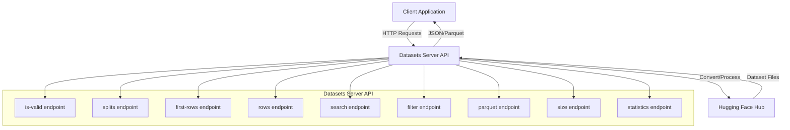
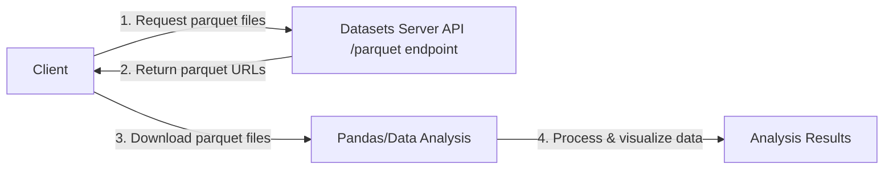
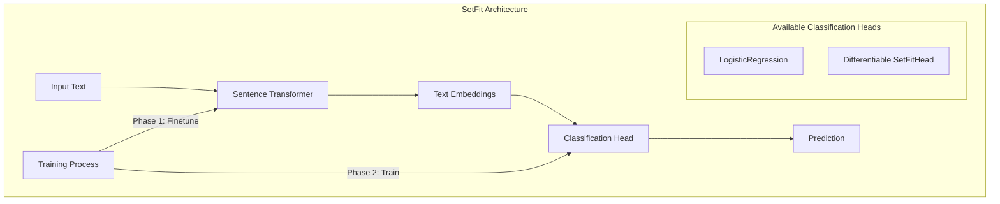
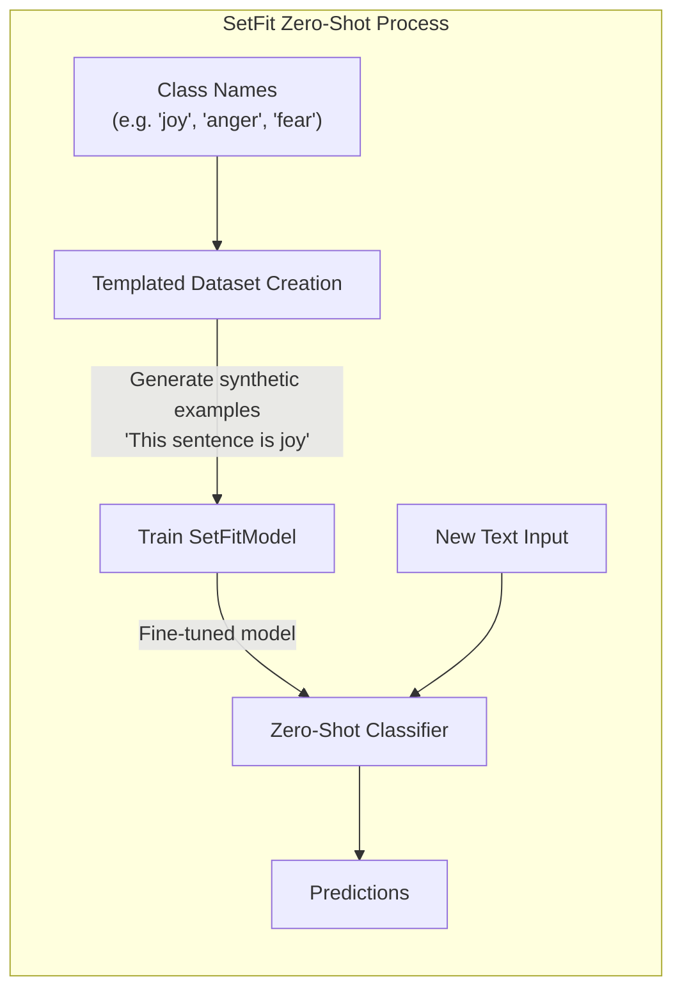
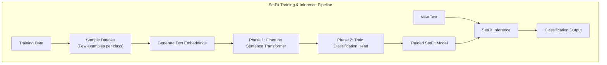
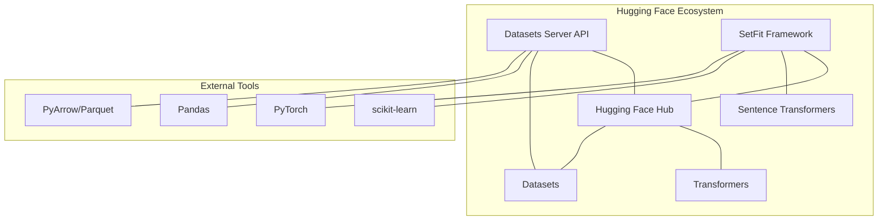

<!-- source: DeepWiki mcp.deepwiki.com · repo huggingface/notebooks · page 6 Additional Tools · fetched 2026-10-26 -->

# Additional Tools

<details>
<summary>Relevant source files</summary>

The following files were used as context for generating this wiki page:

- [datasets-server_doc/en/analyze_data.ipynb](datasets-server_doc/en/analyze_data.ipynb)
- [datasets-server_doc/en/pytorch/analyze_data.ipynb](datasets-server_doc/en/pytorch/analyze_data.ipynb)
- [datasets-server_doc/en/pytorch/quick_start.ipynb](datasets-server_doc/en/pytorch/quick_start.ipynb)
- [datasets-server_doc/en/quick_start.ipynb](datasets-server_doc/en/quick_start.ipynb)
- [datasets-server_doc/en/tensorflow/analyze_data.ipynb](datasets-server_doc/en/tensorflow/analyze_data.ipynb)
- [datasets-server_doc/en/tensorflow/quick_start.ipynb](datasets-server_doc/en/tensorflow/quick_start.ipynb)
- [setfit_doc/en/classification_heads.ipynb](setfit_doc/en/classification_heads.ipynb)
- [setfit_doc/en/pytorch/classification_heads.ipynb](setfit_doc/en/pytorch/classification_heads.ipynb)
- [setfit_doc/en/pytorch/quickstart.ipynb](setfit_doc/en/pytorch/quickstart.ipynb)
- [setfit_doc/en/pytorch/zero_shot.ipynb](setfit_doc/en/pytorch/zero_shot.ipynb)
- [setfit_doc/en/quickstart.ipynb](setfit_doc/en/quickstart.ipynb)
- [setfit_doc/en/tensorflow/classification_heads.ipynb](setfit_doc/en/tensorflow/classification_heads.ipynb)
- [setfit_doc/en/tensorflow/quickstart.ipynb](setfit_doc/en/tensorflow/quickstart.ipynb)
- [setfit_doc/en/tensorflow/zero_shot.ipynb](setfit_doc/en/tensorflow/zero_shot.ipynb)
- [setfit_doc/en/zero_shot.ipynb](setfit_doc/en/zero_shot.ipynb)

</details>


This page provides documentation for additional tools in the Hugging Face ecosystem that complement the main libraries covered in other sections. Here, we focus on the Datasets Server REST API and the SetFit framework - two powerful tools that enhance your ability to work with datasets and perform efficient text classification.

## Datasets Server API

The Datasets Server API is a REST API service that allows you to interact with datasets hosted on the Hugging Face Hub without having to download them completely or use the `datasets` library directly. This makes it ideal for quick exploration, validation, and analysis of datasets.



Sources: [datasets-server_doc/en/tensorflow/quick_start.ipynb:31-74](), [datasets-server_doc/en/quick_start.ipynb:31-74]()

### API Endpoints

The Datasets Server provides several endpoints to perform different operations on datasets:

| Endpoint | Method | Description | Key Query Parameters |
|----------|--------|-------------|---------------------|
| `/is-valid` | GET | Check whether a specific dataset is valid | `dataset`: name of the dataset |
| `/splits` | GET | Get configurations and splits of a dataset | `dataset`: name of the dataset |
| `/first-rows` | GET | Get the first rows of a dataset split | `dataset`, `config`, `split` |
| `/rows` | GET | Get a slice of rows from a specific location | `dataset`, `config`, `split`, `offset`, `length` |
| `/search` | GET | Search text in string columns | `dataset`, `config`, `split`, `query` |
| `/filter` | GET | Filter rows based on query string | `dataset`, `config`, `split`, `where` |
| `/parquet` | GET | Get URLs to parquet files of the dataset | `dataset` |
| `/size` | GET | Get dataset size (rows and bytes) | `dataset` |
| `/statistics` | GET | Get statistics about a dataset split | `dataset`, `config`, `split` |

The base URL for all endpoints is `https://datasets-server.huggingface.co`.

Sources: [datasets-server_doc/en/tensorflow/quick_start.ipynb:38-74](). [datasets-server_doc/en/quick_start.ipynb:38-74]()

### Authentication for Gated Datasets

For accessing gated or private datasets, you need to provide authentication in your request:

```python
headers = {"Authorization": f"Bearer {API_TOKEN}"}
API_URL = "https://datasets-server.huggingface.co/is-valid?dataset=mozilla-foundation/common_voice_10_0"
response = requests.get(API_URL, headers=headers)
```

Sources: [datasets-server_doc/en/tensorflow/quick_start.ipynb:88-105](). [datasets-server_doc/en/quick_start.ipynb:88-105]()

### Data Analysis with Parquet Files

One of the most powerful features of the Datasets Server is its ability to convert datasets to Parquet format, which enables efficient data analysis with tools like Pandas:



Sources: [datasets-server_doc/en/analyze_data.ipynb:14-35](). [datasets-server_doc/en/tensorflow/analyze_data.ipynb:14-35](). [datasets-server_doc/en/pytorch/analyze_data.ipynb:14-35]()

#### Example Workflow:

1. Get parquet file URL for a dataset:
```python
import requests
API_URL = "https://datasets-server.huggingface.co/parquet?dataset=codeparrot/codecomplex"
response = requests.get(API_URL)
parquet_url = response.json()["parquet_files"][0]["url"]
```

2. Load into Pandas and analyze:
```python
import pandas as pd
df = pd.read_parquet(parquet_url)
# Perform data analysis
df.groupby('column_name').mean()
```

Sources: [datasets-server_doc/en/analyze_data.ipynb:30-118](). [datasets-server_doc/en/tensorflow/analyze_data.ipynb:30-118](). [datasets-server_doc/en/pytorch/analyze_data.ipynb:30-118]()

## SetFit Framework

SetFit is an efficient framework for text classification that requires very little training data. It excels at both zero-shot and few-shot classification tasks, making it ideal for situations where labeled data is scarce.



Sources: [setfit_doc/en/pytorch/classification_heads.ipynb:14-20](). [setfit_doc/en/tensorflow/classification_heads.ipynb:14-20](). [setfit_doc/en/classification_heads.ipynb:14-20]()

### Zero-shot Text Classification

SetFit excels at zero-shot text classification, where it can classify text into categories without specific training examples. This works by leveraging the semantic understanding in pre-trained Sentence Transformer models.



Sources: [setfit_doc/en/zero_shot.ipynb:14-217](). [setfit_doc/en/tensorflow/zero_shot.ipynb:14-217](). [setfit_doc/en/pytorch/zero_shot.ipynb:14-217]()

The zero-shot capabilities are enabled by:

1. Creating synthetic examples from class names using templates
2. Training the model on these examples
3. Applying the model to new, unseen text

SetFit's zero-shot performance significantly outperforms traditional transformer-based zero-shot classifiers:

| Model | Accuracy on Emotion Dataset | Latency per sentence |
|-------|----------------------------|---------------------|
| SetFit with BAAI/bge-small-en-v1.5 | 59.1% | 0.46ms |
| Transformers zero-shot (BART) | 37.7% | 31.18ms |

Sources: [setfit_doc/en/zero_shot.ipynb:272-336](). [setfit_doc/en/tensorflow/zero_shot.ipynb:272-336](). [setfit_doc/en/pytorch/zero_shot.ipynb:272-336]()

### Classification Heads

SetFit models consist of two main components:

1. **Sentence Transformer Body**: Generates embeddings from input text
2. **Classification Head**: Maps embeddings to class predictions

Two types of classification heads are supported:

1. **Logistic Regression** (default): A scikit-learn logistic regression model
   ```python
   model = SetFitModel.from_pretrained("BAAI/bge-small-en-v1.5")
   # Customize with head parameters
   model = SetFitModel.from_pretrained("BAAI/bge-small-en-v1.5", 
                                      head_params={"solver": "liblinear", "max_iter": 300})
   ```

2. **Differentiable Head**: A PyTorch-based differentiable linear layer
   ```python
   model = SetFitModel.from_pretrained("BAAI/bge-small-en-v1.5", 
                                      use_differentiable_head=True,
                                      head_params={"out_features": 5})
   ```

Sources: [setfit_doc/en/pytorch/classification_heads.ipynb:26-154](). [setfit_doc/en/tensorflow/classification_heads.ipynb:26-154](). [setfit_doc/en/classification_heads.ipynb:26-154]()

### Training and Usage Workflow

SetFit training consists of two phases:
1. Finetuning the Sentence Transformer to produce better embeddings
2. Training the classification head on those embeddings



Sources: [setfit_doc/en/pytorch/quickstart.ipynb:40-292](). [setfit_doc/en/tensorflow/quickstart.ipynb:40-292](). [setfit_doc/en/quickstart.ipynb:40-292]()

Basic usage example:

```python
from setfit import SetFitModel, Trainer, TrainingArguments, sample_dataset
from datasets import load_dataset

# Initialize model
model = SetFitModel.from_pretrained("BAAI/bge-small-en-v1.5")

# Prepare dataset
dataset = load_dataset("SetFit/sst2")
train_dataset = sample_dataset(dataset["train"], label_column="label", num_samples=8)
test_dataset = dataset["test"]

# Configure training
args = TrainingArguments(batch_size=32, num_epochs=10)
trainer = Trainer(model=model, args=args, train_dataset=train_dataset)

# Train and evaluate
trainer.train()
metrics = trainer.evaluate(test_dataset)

# Make predictions
predictions = model.predict([
    "It's a charming and often affecting journey.",
    "It's slow -- very, very slow."
])
```

Sources: [setfit_doc/en/pytorch/quickstart.ipynb:54-395](). [setfit_doc/en/tensorflow/quickstart.ipynb:54-395](). [setfit_doc/en/quickstart.ipynb:54-395]()

## Integration with Other Hugging Face Components

Both the Datasets Server API and SetFit framework integrate with other components of the Hugging Face ecosystem:



These additional tools enhance the Hugging Face ecosystem by providing:

1. **Datasets Server API**: Lightweight, browser-friendly access to datasets without needing to download them or use the full `datasets` library
2. **SetFit**: Efficient text classification with minimal labeled data and fast inference times

---

