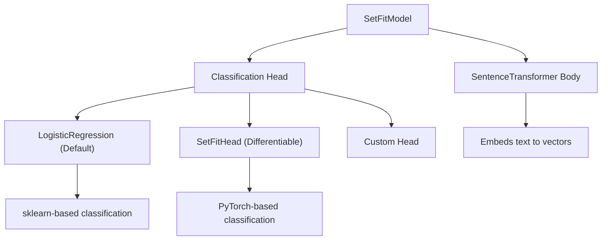
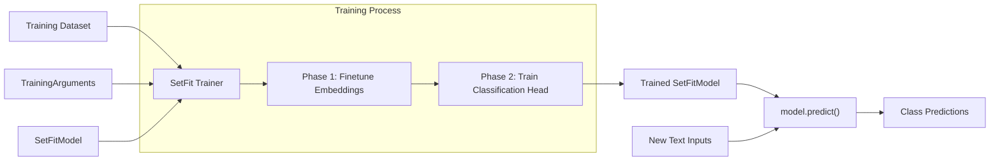

<!-- source: DeepWiki mcp.deepwiki.com · repo huggingface/notebooks · page 6.2 SetFit Framework · fetched 2026-10-26 -->

# SetFit Framework

<details>
<summary>Relevant source files</summary>

The following files were used as context for generating this wiki page:

- [setfit_doc/en/classification_heads.ipynb](setfit_doc/en/classification_heads.ipynb)
- [setfit_doc/en/pytorch/classification_heads.ipynb](setfit_doc/en/pytorch/classification_heads.ipynb)
- [setfit_doc/en/pytorch/quickstart.ipynb](setfit_doc/en/pytorch/quickstart.ipynb)
- [setfit_doc/en/pytorch/zero_shot.ipynb](setfit_doc/en/pytorch/zero_shot.ipynb)
- [setfit_doc/en/quickstart.ipynb](setfit_doc/en/quickstart.ipynb)
- [setfit_doc/en/tensorflow/classification_heads.ipynb](setfit_doc/en/tensorflow/classification_heads.ipynb)
- [setfit_doc/en/tensorflow/quickstart.ipynb](setfit_doc/en/tensorflow/quickstart.ipynb)
- [setfit_doc/en/tensorflow/zero_shot.ipynb](setfit_doc/en/tensorflow/zero_shot.ipynb)
- [setfit_doc/en/zero_shot.ipynb](setfit_doc/en/zero_shot.ipynb)

</details>


SetFit is an efficient framework for text classification that excels in scenarios with limited labeled data. It provides effective solutions for both few-shot learning (with limited examples) and zero-shot learning (using only class names), offering superior accuracy and inference speed compared to traditional approaches.

## Architecture Overview

The SetFit framework combines sentence transformers with classification heads to create powerful yet efficient text classifiers:



Sources:
- [setfit_doc/en/classification_heads.ipynb:14-20]()
- [setfit_doc/en/pytorch/quickstart.ipynb:54-57]()

### Sentence Transformer Body

The sentence transformer body converts input text into fixed-size vector representations (embeddings). SetFit uses pre-trained [SentenceTransformer](https://sbert.net/) models, which can be loaded from the Hugging Face Hub. High-quality embeddings are critical for achieving good classification performance.

Common sentence transformer models used with SetFit include:
- `BAAI/bge-small-en-v1.5`: A small but performant model
- Other models from the MTEB Leaderboard

Sources:
- [setfit_doc/en/pytorch/quickstart.ipynb:54-57]()
- [setfit_doc/en/quickstart.ipynb:54-57]()

### Classification Heads

The classification head takes embeddings from the sentence transformer body and predicts which class the text belongs to. SetFit provides three types of classification heads:

| Classification Head | Type | Implementation | Use Case |
|---|---|---|---|
| LogisticRegression | Non-differentiable | sklearn | Default head, works well for most cases |
| SetFitHead | Differentiable | PyTorch | End-to-end training with the embedding model |
| Custom | Either | User-defined | Specialized classification needs |

Sources:
- [setfit_doc/en/classification_heads.ipynb:26-34]()
- [setfit_doc/en/classification_heads.ipynb:93-101]()
- [setfit_doc/en/classification_heads.ipynb:260-268]()

## Training Process

Training a SetFit model involves a two-phase process:



1. **Finetuning Embeddings**: The sentence transformer body is finetuned to make embeddings of texts from the same class more similar and embeddings from different classes more dissimilar.
2. **Training Classification Head**: The classification head is trained on the embeddings produced by the finetuned sentence transformer body.

Sources:
- [setfit_doc/en/pytorch/quickstart.ipynb:190-193]()
- [setfit_doc/en/pytorch/classification_heads.ipynb:178-179]()

### Few-shot Learning

SetFit excels in few-shot learning scenarios where only a small number of labeled examples are available per class. In practice, SetFit can achieve strong performance with as few as 8 examples per class, making it ideal for real-world scenarios where labeled data is scarce.

The `sample_dataset` function makes it easy to create balanced few-shot datasets:

```python
from setfit import sample_dataset
from datasets import load_dataset

dataset = load_dataset("SetFit/sst2")
train_dataset = sample_dataset(dataset["train"], label_column="label", num_samples=8)
```

This creates a dataset with 8 examples for each class.

Sources:
- [setfit_doc/en/pytorch/quickstart.ipynb:117-118]()
- [setfit_doc/en/quickstart.ipynb:117-118]()

### Zero-shot Learning

SetFit supports zero-shot text classification by using class names to generate a synthetic dataset. The `get_templated_dataset()` function creates a synthetic dataset based on class names, which is then used to train a SetFit model.

```python
from setfit import get_templated_dataset

# Generate a synthetic dataset using class names
train_dataset = get_templated_dataset()
```

This allows SetFit to perform classification with no real labeled examples, using only the class names.

Sources:
- [setfit_doc/en/zero_shot.ipynb:79-80]()
- [setfit_doc/en/zero_shot.ipynb:88-90]()

## Usage Guide

### Model Initialization

A SetFit model can be initialized using `SetFitModel.from_pretrained()` by specifying a sentence transformer model:

```python
from setfit import SetFitModel

# Initialize from a pre-trained sentence transformer
model = SetFitModel.from_pretrained("BAAI/bge-small-en-v1.5")

# Optionally set class labels for readable predictions
model.labels = ["negative", "positive"]
```

Sources:
- [setfit_doc/en/pytorch/quickstart.ipynb:65-67]()
- [setfit_doc/en/quickstart.ipynb:65-67]()
- [setfit_doc/en/quickstart.ipynb:183-184]()

### Configuration and Training

To train a SetFit model, you need to:

1. Initialize a model
2. Prepare a dataset
3. Configure training arguments
4. Create a trainer
5. Run training

```python
from setfit import SetFitModel, Trainer, TrainingArguments, sample_dataset
from datasets import load_dataset

# Initialize model
model = SetFitModel.from_pretrained("BAAI/bge-small-en-v1.5")

# Prepare dataset
dataset = load_dataset("SetFit/sst2")
train_dataset = sample_dataset(dataset["train"], label_column="label", num_samples=8)
test_dataset = dataset["test"]

# Configure training arguments
args = TrainingArguments(
    batch_size=32,
    num_epochs=10,
)

# Create trainer and train
trainer = Trainer(
    model=model,
    args=args,
    train_dataset=train_dataset,
)
trainer.train()

# Evaluate
metrics = trainer.evaluate(test_dataset)
print(metrics)  # {'accuracy': 0.8511806699615596}
```

Sources:
- [setfit_doc/en/pytorch/quickstart.ipynb:440-468]()
- [setfit_doc/en/quickstart.ipynb:440-468]()

### Model Saving and Loading

After training, a SetFit model can be saved to a local directory or the Hugging Face Hub:

```python
# Save to local directory
model.save_pretrained("setfit-bge-small-v1.5-sst2-8-shot")

# Push to Hugging Face Hub
model.push_to_hub("username/setfit-bge-small-v1.5-sst2-8-shot")
```

To load a saved model:

```python
# Load from the Hugging Face Hub
model = SetFitModel.from_pretrained("username/setfit-bge-small-v1.5-sst2-8-shot")

# Load from a local directory
model = SetFitModel.from_pretrained("setfit-bge-small-v1.5-sst2-8-shot")
```

Sources:
- [setfit_doc/en/pytorch/quickstart.ipynb:314-315]()
- [setfit_doc/en/pytorch/quickstart.ipynb:330-331]()
- [setfit_doc/en/pytorch/quickstart.ipynb:353-356]()

### Inference

Once trained, a SetFit model can be used for inference with the `predict()` method:

```python
preds = model.predict([
    "It's a charming and often affecting journey.",
    "It's slow -- very, very slow.",
    "A sometimes tedious film.",
])
print(preds)  # ['positive', 'negative', 'negative']
```

Sources:
- [setfit_doc/en/pytorch/quickstart.ipynb:389-395]()
- [setfit_doc/en/quickstart.ipynb:389-395]()

## Classification Heads in Detail

### Logistic Regression (Default)

By default, SetFit uses a scikit-learn logistic regression classifier as the classification head, which has been shown to be highly effective when applied on top of a finetuned sentence transformer body.

```python
from setfit import SetFitModel

# Default head is LogisticRegression
model = SetFitModel.from_pretrained("BAAI/bge-small-en-v1.5")
print(model.model_head)  # LogisticRegression()

# With custom parameters
model = SetFitModel.from_pretrained(
    "BAAI/bge-small-en-v1.5", 
    head_params={"solver": "liblinear", "max_iter": 300}
)
print(model.model_head)  # LogisticRegression(max_iter=300, solver='liblinear')
```

Sources:
- [setfit_doc/en/classification_heads.ipynb:33-34]()
- [setfit_doc/en/classification_heads.ipynb:53-57]()
- [setfit_doc/en/classification_heads.ipynb:85-86]()

### Differentiable Classification Head

SetFit provides a differentiable classification head (`SetFitHead`) that uses a linear layer to map embeddings to class predictions. This can be trained end-to-end with the sentence transformer body.

```python
model = SetFitModel.from_pretrained(
    "BAAI/bge-small-en-v1.5", 
    use_differentiable_head=True,
    head_params={"out_features": 5}  # For a 5-class classification problem
)
```

When using the differentiable head, additional training arguments become available:

| Argument | Type | Description |
|---|---|---|
| `end_to_end` | bool | Train the entire model end-to-end |
| `body_learning_rate` | float or tuple | Learning rate for the sentence transformer body |
| `head_learning_rate` | float | Learning rate for the differentiable head |
| `l2_weight` | float | L2 regularization weight |

Example of training with a differentiable head:

```python
from setfit import SetFitModel, Trainer, TrainingArguments, sample_dataset
from datasets import load_dataset

model = SetFitModel.from_pretrained(
    "BAAI/bge-small-en-v1.5", 
    use_differentiable_head=True, 
    head_params={"out_features": 2}
)

dataset = load_dataset("SetFit/sst2")
train_dataset = sample_dataset(dataset["train"], label_column="label", num_samples=32)
test_dataset = dataset["test"]

args = TrainingArguments(
    batch_size=(32, 16),
    num_epochs=(3, 8),
    end_to_end=True,
    body_learning_rate=(2e-5, 5e-6),
    head_learning_rate=2e-3,
    l2_weight=0.01,
)

trainer = Trainer(
    model=model,
    args=args,
    train_dataset=train_dataset,
)
trainer.train()
```

Sources:
- [setfit_doc/en/classification_heads.ipynb:100-101]()
- [setfit_doc/en/classification_heads.ipynb:122-123]()
- [setfit_doc/en/classification_heads.ipynb:152-153]()
- [setfit_doc/en/classification_heads.ipynb:178-190]()
- [setfit_doc/en/pytorch/classification_heads.ipynb:199-226]()

### Custom Classification Heads

SetFit allows using custom classification heads, which can be either differentiable (PyTorch-based) or non-differentiable (like sklearn classifiers).

Requirements for a custom non-differentiable head:
- `predict` method: Classifies embeddings into class indices
- `predict_proba` method: Outputs class probabilities
- `fit` method: Trains the head on embeddings and labels

Many sklearn classifiers already meet these requirements, such as `RandomForestClassifier`, `MLPClassifier`, or `KNeighborsClassifier`.

Example of using a custom head:

```python
from setfit import SetFitModel
from sklearn.svm import LinearSVC
from sentence_transformers import SentenceTransformer

model_body = SentenceTransformer("BAAI/bge-small-en-v1.5")
model_head = LinearSVC()
model = SetFitModel(model_body, model_head)
```

Sources:
- [setfit_doc/en/classification_heads.ipynb:267-268]()
- [setfit_doc/en/classification_heads.ipynb:302-307]()
- [setfit_doc/en/classification_heads.ipynb:318-325]()

## Performance Comparison

SetFit offers significant advantages in terms of both accuracy and inference speed compared to traditional zero-shot classification methods.

In a benchmark on the "dair-ai/emotion" dataset, SetFit was compared with the Transformers zero-shot classification pipeline:

| Method | Accuracy | Inference Time (ms/sentence) | Speedup |
|---|---|---|---|
| SetFit with `BAAI/bge-small-en-v1.5` | 59.1% | 0.46 | 67x faster |
| Transformers with `facebook/bart-large-mnli` | 37.65% | 31.18 | - |

SetFit not only achieves higher accuracy in zero-shot classification but is also dramatically faster for inference.

Sources:
- [setfit_doc/en/zero_shot.ipynb:230-231]()
- [setfit_doc/en/zero_shot.ipynb:272-273]()
- [setfit_doc/en/zero_shot.ipynb:286-287]()
- [setfit_doc/en/zero_shot.ipynb:334-336]()