# Page: Overview

# Overview

<details>
<summary>Relevant source files</summary>

The following files were used as context for generating this wiki page:

- [sagemaker/29_deploy_llms_on_inferentia2/sagemaker-notebook.ipynb](sagemaker/29_deploy_llms_on_inferentia2/sagemaker-notebook.ipynb)
- [sagemaker/30_evaluate_llms_with_lighteval/sagemaker-notebook.ipynb](sagemaker/30_evaluate_llms_with_lighteval/sagemaker-notebook.ipynb)
- [sagemaker/31_deploy_embedding_models/assets/cw.png](sagemaker/31_deploy_embedding_models/assets/cw.png)
- [sagemaker/31_deploy_embedding_models/sagemaker-notebook.ipynb](sagemaker/31_deploy_embedding_models/sagemaker-notebook.ipynb)
- [sagemaker/32_train_deploy_embedding_models/sagemaker-notebook.ipynb](sagemaker/32_train_deploy_embedding_models/sagemaker-notebook.ipynb)
- [sagemaker/32_train_deploy_embedding_models/scripts/requirements.txt](sagemaker/32_train_deploy_embedding_models/scripts/requirements.txt)
- [sagemaker/32_train_deploy_embedding_models/scripts/run_mnr.py](sagemaker/32_train_deploy_embedding_models/scripts/run_mnr.py)
- [sagemaker/README.md](sagemaker/README.md)
- [smolagents_doc/en/guided_tour.ipynb](smolagents_doc/en/guided_tour.ipynb)
- [smolagents_doc/en/pytorch/guided_tour.ipynb](smolagents_doc/en/pytorch/guided_tour.ipynb)
- [smolagents_doc/en/pytorch/secure_code_execution.ipynb](smolagents_doc/en/pytorch/secure_code_execution.ipynb)
- [smolagents_doc/en/secure_code_execution.ipynb](smolagents_doc/en/secure_code_execution.ipynb)
- [smolagents_doc/en/tensorflow/guided_tour.ipynb](smolagents_doc/en/tensorflow/guided_tour.ipynb)
- [smolagents_doc/en/tensorflow/secure_code_execution.ipynb](smolagents_doc/en/tensorflow/secure_code_execution.ipynb)
- [transformers_doc/quicktour.ipynb](transformers_doc/quicktour.ipynb)
- [transformers_doc/training.ipynb](transformers_doc/training.ipynb)

</details>


The Hugging Face Notebooks repository provides a comprehensive collection of educational notebooks that demonstrate how to use various Hugging Face libraries and tools. These notebooks serve as practical guides and examples for working with state-of-the-art machine learning models across a range of tasks including natural language processing, computer vision, generative AI, and agent systems.

This overview page summarizes the main components and libraries found in the repository, their purposes, and how they relate to each other. For more detailed information about specific libraries, please refer to their dedicated pages: [Transformers Library](#2), [Diffusers Library](#3), [SmolaAgents Library](#4), and [SageMaker Integration](#5).

## Repository Structure

The Hugging Face Notebooks repository is organized around several core libraries and tools, each with its own set of notebooks demonstrating various capabilities and use cases.

```mermaid
flowchart TD
    subgraph "Hugging Face Notebooks Repository"
        Transformers["Transformers Library Notebooks"]
        Diffusers["Diffusers Library Notebooks"]
        SmolaAgents["SmolaAgents Library Notebooks"]
        SageMaker["SageMaker Integration Notebooks"]
        Others["Additional Tools Notebooks"]
    end

    Transformers --> NLP["NLP Tasks"]
    Transformers --> CV["Computer Vision Tasks"]
    Transformers --> Training["Model Training & Fine-tuning"]
    
    Diffusers --> SD["Stable Diffusion"]
    Diffusers --> DB["DreamBooth & Textual Inversion"]
    Diffusers --> CP["Custom Pipelines"]
    
    SmolaAgents --> CodeExec["Secure Code Execution"]
    SmolaAgents --> ToolSystem["Tool System"]
    SmolaAgents --> MultiAgent["Multi-agent Systems"]
    SmolaAgents --> RAG["RAG Integration"]
    
    SageMaker --> SMTraining["Training on SageMaker"]
    SageMaker --> SMDeployment["Model Deployment"]
    SageMaker --> SMDistributed["Distributed Training"]
    
    Others --> DSServer["Datasets Server API"]
    Others --> SetFit["SetFit Framework"]
```

Sources: 
- [smolagents_doc/en/secure_code_execution.ipynb]()
- [sagemaker/README.md]()
- [smolagents_doc/en/guided_tour.ipynb]()

## Major Libraries

### Transformers Library

The Transformers library provides access to state-of-the-art NLP and computer vision models in a unified interface. The notebooks for this library demonstrate how to use these models for various tasks through simple APIs.

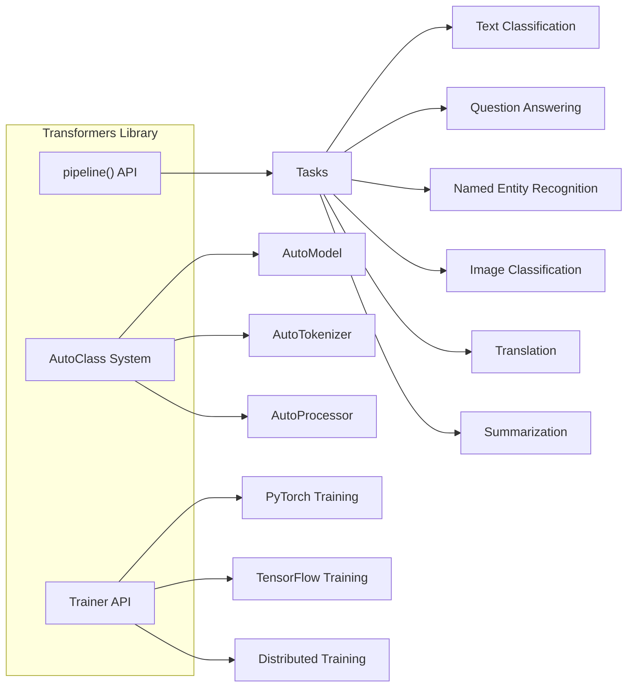

The Transformers library includes key components:

1. **Pipeline API**: Provides a simple interface for using pre-trained models for common tasks without requiring deep understanding of model architecture.
   
2. **AutoClass System**: Offers a convenient way to load pre-trained models and tokenizers that automatically handles architecture-specific details.

3. **Trainer API**: Simplifies the process of fine-tuning models on custom datasets with optimized training loops.

Sources:
- [transformers_doc/quicktour.ipynb]() 
- [transformers_doc/training.ipynb]()

### Diffusers Library

The Diffusers library enables working with generative image models, particularly diffusion models like Stable Diffusion. The notebooks demonstrate image generation, personalization, and customization.

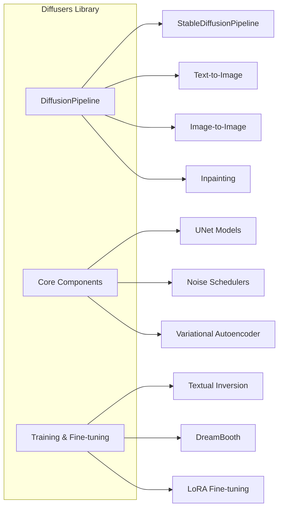

The Diffusers library focuses on:

1. **Diffusion Pipelines**: End-to-end pipelines for generating images from text prompts, modifying existing images, or filling in missing parts.

2. **Model Components**: Modular components that can be customized or combined to create new diffusion models.

3. **Personalization Techniques**: Methods like Textual Inversion, DreamBooth, and LoRA for adapting pre-trained models to specific concepts or styles.

Sources:
- Repository structure information provided

### SmolaAgents Library

The SmolaAgents library provides a framework for building AI agents that can execute code and interact with tools. The notebooks demonstrate agent construction, tool integration, and secure execution.

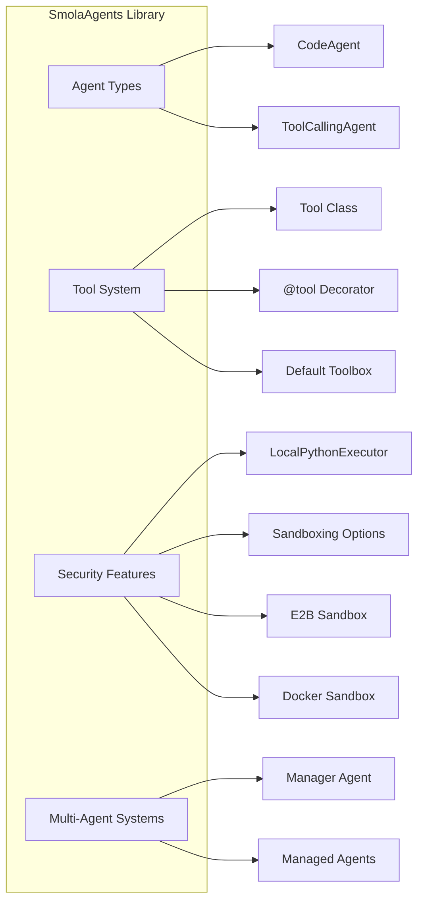

Key components of SmolaAgents include:

1. **Agent Types**:
   - **CodeAgent**: Executes Python code snippets for tasks
   - **ToolCallingAgent**: Makes structured tool calls in JSON format

2. **Tool System**: Framework for defining, managing, and using tools that agents can access.

3. **Security Features**: Options for secure code execution, including a custom Python interpreter and sandboxing alternatives.

4. **Multi-Agent Systems**: Capabilities for creating hierarchical agent structures with manager and specialized agents.

Sources:
- [smolagents_doc/en/secure_code_execution.ipynb]()
- [smolagents_doc/en/guided_tour.ipynb]()
- [smolagents_doc/en/pytorch/guided_tour.ipynb]()
- [smolagents_doc/en/tensorflow/guided_tour.ipynb]()

### SageMaker Integration

The notebooks demonstrate how to integrate Hugging Face libraries with Amazon SageMaker for training and deploying models at scale.

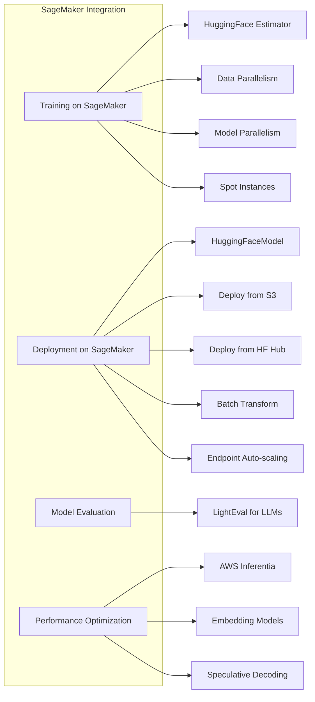

The SageMaker integration covers:

1. **Training Integration**: Using SageMaker for efficient model training with features like distributed training and spot instances.

2. **Deployment Options**: Various methods for deploying models to production endpoints.

3. **Performance Optimization**: Techniques for improving inference speed and cost-efficiency.

4. **Evaluation**: Tools for benchmarking and evaluating models.

Sources:
- [sagemaker/README.md]()
- [sagemaker/30_evaluate_llms_with_lighteval/sagemaker-notebook.ipynb]()
- [sagemaker/29_deploy_llms_on_inferentia2/sagemaker-notebook.ipynb]()
- [sagemaker/31_deploy_embedding_models/sagemaker-notebook.ipynb]()
- [sagemaker/32_train_deploy_embedding_models/sagemaker-notebook.ipynb]()

## Core Workflows

The repository demonstrates several core workflows that span multiple libraries:

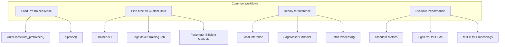

These core workflows represent the typical journey from loading pre-trained models to deploying them for production use:

1. **Model Loading**: Using `AutoClass` implementations to load pre-trained models from the Hugging Face Hub or local storage.

2. **Fine-tuning**: Adapting pre-trained models to specific tasks or domains using various training techniques.

3. **Deployment**: Serving models for inference in different environments, from local development to cloud-based production.

4. **Evaluation**: Assessing model performance on relevant benchmarks and task-specific metrics.

Sources:
- [transformers_doc/quicktour.ipynb]()
- [transformers_doc/training.ipynb]()
- [sagemaker/README.md]()
- [sagemaker/30_evaluate_llms_with_lighteval/sagemaker-notebook.ipynb]()

## Library Interoperability

The notebooks also demonstrate how the different Hugging Face libraries can be used together or interchangeably with other frameworks:

| Library | Key Integrations | Use Cases |
|---------|-----------------|-----------|
| Transformers | PyTorch, TensorFlow, Flax | Model training and inference across different frameworks |
| Diffusers | Transformers (for text encoders) | Text-to-image generation using language models |
| SmolaAgents | Transformers, LiteLLM, MLX | Using various LLM backends for agent systems |
| All Libraries | SageMaker | Training, deployment, and scaling in AWS |

This interoperability allows developers to:
- Choose the most suitable framework for their use case
- Combine components from different libraries
- Scale workloads from local development to production systems

Sources:
- [smolagents_doc/en/guided_tour.ipynb]()
- [sagemaker/README.md]()

## Getting Started

To start using the notebooks in this repository:

1. Choose the library that matches your task (Transformers for NLP/CV, Diffusers for image generation, SmolaAgents for agent systems)
2. Navigate to the corresponding section in the repository
3. Follow the example notebooks that demonstrate your specific use case
4. Adapt the examples to your own data and requirements

For more detailed information about each library and its capabilities, refer to the dedicated documentation pages:
- [Transformers Library](#2)
- [Diffusers Library](#3)
- [SmolaAgents Library](#4)
- [SageMaker Integration](#5)
- [Additional Tools](#6)

Sources:
- Repository structure information provided

---

# Page: Transformers Library

# Transformers Library

<details>
<summary>Relevant source files</summary>

The following files were used as context for generating this wiki page:

- [examples/images/question_answering.png](examples/images/question_answering.png)
- [examples/images/token_classification.png](examples/images/token_classification.png)
- [examples/language_modeling.ipynb](examples/language_modeling.ipynb)
- [examples/language_modeling_from_scratch.ipynb](examples/language_modeling_from_scratch.ipynb)
- [examples/multiple_choice.ipynb](examples/multiple_choice.ipynb)
- [examples/question_answering.ipynb](examples/question_answering.ipynb)
- [examples/summarization.ipynb](examples/summarization.ipynb)
- [examples/text_classification.ipynb](examples/text_classification.ipynb)
- [examples/token_classification.ipynb](examples/token_classification.ipynb)
- [examples/tokenizer_training.ipynb](examples/tokenizer_training.ipynb)
- [examples/translation.ipynb](examples/translation.ipynb)
- [transformers_doc/preprocessing.ipynb](transformers_doc/preprocessing.ipynb)
- [transformers_doc/quicktour.ipynb](transformers_doc/quicktour.ipynb)
- [transformers_doc/task_summary.ipynb](transformers_doc/task_summary.ipynb)
- [transformers_doc/tokenizer_summary.ipynb](transformers_doc/tokenizer_summary.ipynb)
- [transformers_doc/training.ipynb](transformers_doc/training.ipynb)

</details>


The Transformers library provides a unified API for using state-of-the-art NLP and computer vision models. It offers easy access to pre-trained models for various tasks while abstracting away model architecture details. This document gives an overview of the library's core components and their relationships. For specific task implementations, see individual task pages ([NLP Tasks](#2.2), [Computer Vision](#2.3), [Training](#2.4)).

## Core Components

The Transformers library is built around several key components that work together to provide a flexible interface for using pre-trained models:

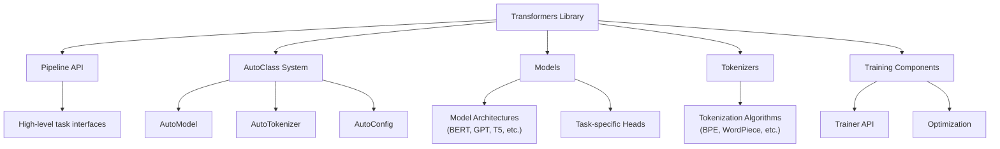

Sources: 
- [transformers_doc/quicktour.ipynb:25-100]()
- [transformers_doc/task_summary.ipynb:25-62]()

## Pipeline API

The Pipeline API provides the simplest way to use pre-trained models for inference on specific tasks. It handles all the preprocessing and postprocessing needed for the given task.

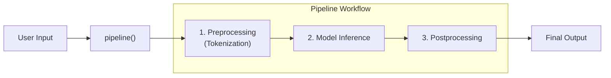

### Supported Tasks

| Category | Tasks |
|----------|-------|
| **Text** | Sentiment analysis, text generation, named entity recognition, question answering, fill-mask, summarization, translation, feature extraction |
| **Image** | Image classification, image segmentation, object detection |
| **Audio** | Audio classification, automatic speech recognition |

Example usage:

```python
from transformers import pipeline

# Sentiment analysis pipeline
classifier = pipeline("sentiment-analysis")
result = classifier("We are very happy to show you the 🤗 Transformers library.")
# Returns: [{'label': 'POSITIVE', 'score': 0.9998}]
```

Sources:
- [transformers_doc/quicktour.ipynb:82-132]()
- [transformers_doc/quicktour.ipynb:142-202]()
- [transformers_doc/task_summary.ipynb:61-128]()

## AutoClass System

The AutoClass system is a key component that automatically instantiates the right architecture based on a model checkpoint name or path. This allows for a consistent interface regardless of the underlying model architecture.

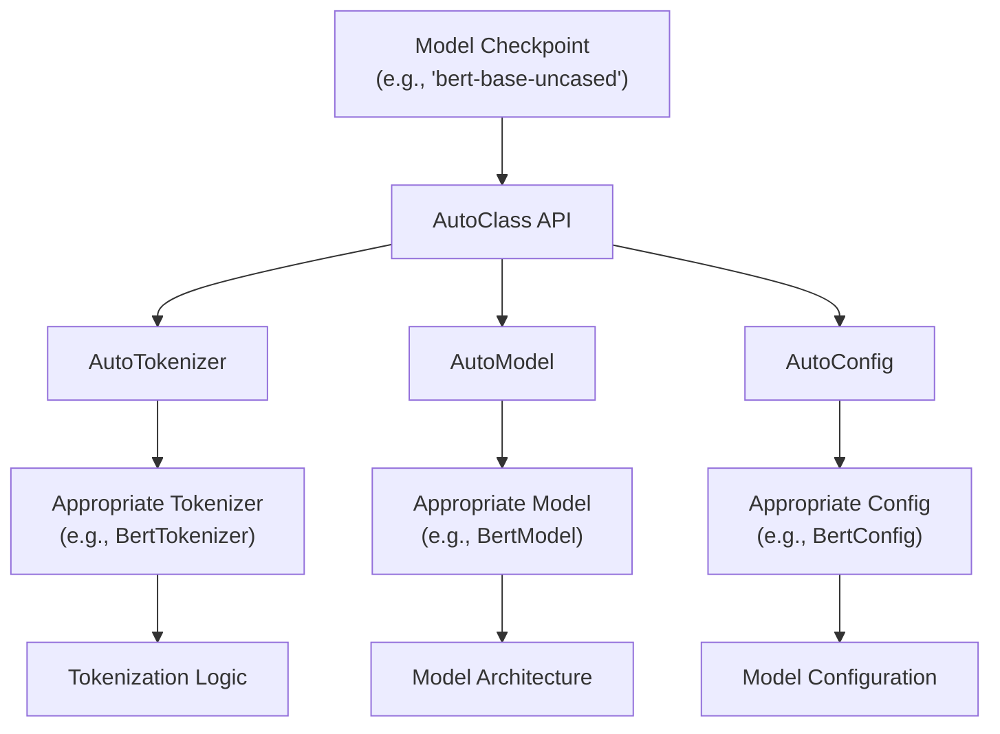

Main AutoClass types:

1. **AutoTokenizer**: Loads the appropriate tokenizer for a checkpoint
2. **AutoModel**: Loads the base model (without task-specific heads)
3. **AutoModelForXxx**: Task-specific variants (e.g., `AutoModelForSequenceClassification`)

Example usage:

```python
from transformers import AutoTokenizer, AutoModelForSequenceClassification

# Load tokenizer and model for sentiment analysis
tokenizer = AutoTokenizer.from_pretrained("distilbert-base-uncased")
model = AutoModelForSequenceClassification.from_pretrained("distilbert-base-uncased")
```

Sources:
- [transformers_doc/quicktour.ipynb:400-462]()
- [transformers_doc/quicktour.ipynb:554-574]()
- [examples/text_classification.ipynb:959-964]()

## Tokenization

Tokenizers are responsible for converting raw text into a format that models can understand, implementing preprocessing steps like splitting text into tokens, converting tokens to IDs, and generating attention masks.

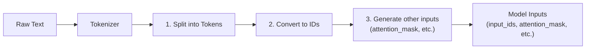

### Tokenization Methods

| Method | Description | Used by |
|--------|-------------|---------|
| **WordPiece** | Splits words into subwords, using ## prefix for subword tokens | BERT, DistilBERT |
| **BPE (Byte-Pair Encoding)** | Starts with characters and iteratively merges most frequent pairs | GPT-2, RoBERTa |
| **SentencePiece** | Character-based tokenization that handles different languages uniformly | XLNet, T5 |

Example usage:

```python
from transformers import AutoTokenizer

tokenizer = AutoTokenizer.from_pretrained("bert-base-cased")
encoded_input = tokenizer("Hello, how are you?")
# Returns: {'input_ids': [101, 8667, 117, 1293, 1105, 1115, 136, 102], 'token_type_ids': [0, 0, 0, 0, 0, 0, 0, 0], 'attention_mask': [1, 1, 1, 1, 1, 1, 1, 1]}
```

Sources:
- [transformers_doc/preprocessing.ipynb:73-116]()
- [transformers_doc/tokenizer_summary.ipynb:62-72]()
- [examples/text_classification.ipynb:617-671]()

## Models and Tasks

The Transformers library supports a wide variety of models and tasks, with task-specific model heads on top of base transformer architectures.

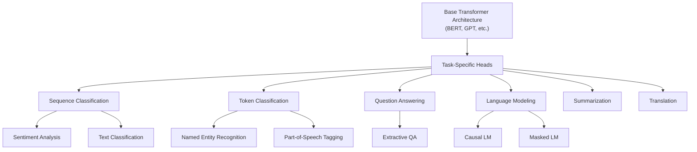

### Major Tasks

1. **Sequence Classification**: Predicting a class for an entire input sequence
   - Examples: Sentiment analysis, entailment, spam detection

2. **Token Classification**: Predicting a class for each token in the input
   - Examples: Named Entity Recognition (NER), Part-of-Speech (POS) tagging

3. **Question Answering**: Extracting an answer from a context given a question
   - Model identifies the start and end positions of the answer in the context

4. **Language Modeling**:
   - Causal: Predicting the next token (Used in GPT models)
   - Masked: Predicting masked tokens in a sequence (Used in BERT models)

5. **Generation Tasks**:
   - Summarization: Creating shorter versions of texts
   - Translation: Converting text from one language to another

Sources:
- [transformers_doc/task_summary.ipynb:67-72]()
- [examples/text_classification.ipynb:111-143]()
- [examples/question_answering.ipynb:124-129]()
- [examples/token_classification.ipynb:128-134]()

## Training and Fine-tuning

The Transformers library provides tools for fine-tuning pre-trained models on specific tasks and datasets.

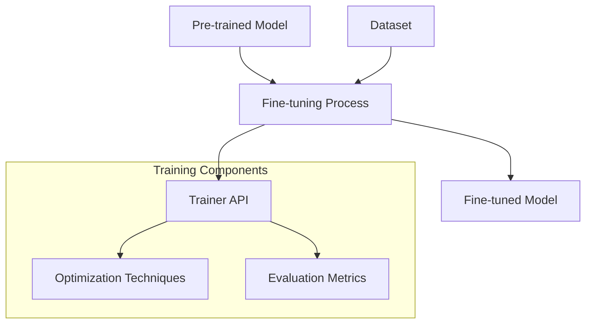

### Training Approaches

1. **Using the Trainer API**: High-level API that handles the training loop, evaluation, and optimization
   ```python
   from transformers import Trainer, TrainingArguments
   trainer = Trainer(
       model=model,
       args=training_args,
       train_dataset=train_dataset,
       eval_dataset=eval_dataset
   )
   trainer.train()
   ```

2. **Using TensorFlow/Keras**: For TensorFlow users
   ```python
   # Compile and fit
   model.compile(optimizer=tf.keras.optimizers.Adam(learning_rate=5e-5))
   model.fit(tf_train_dataset, validation_data=tf_validation_dataset)
   ```

3. **Custom PyTorch Training Loop**: For more control over the training process

### Common Fine-tuning Steps

1. Load pre-trained model and tokenizer
2. Prepare and preprocess dataset
3. Define training arguments (batch size, learning rate, etc.)
4. Initialize trainer with model, datasets, and arguments
5. Start training
6. Evaluate the model
7. Save or share the fine-tuned model

Sources:
- [transformers_doc/training.ipynb:26-33]()
- [transformers_doc/training.ipynb:193-246]()
- [transformers_doc/training.ipynb:322-354]()
- [examples/text_classification.ipynb:928-1007]()

## Practical Workflow

The typical workflow when using the Transformers library involves these steps:

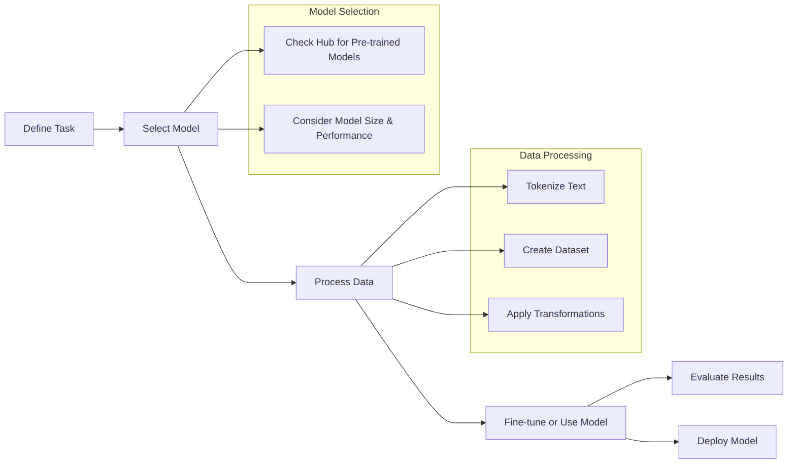

### Common Use Patterns

1. **Quick Inference with Pipelines**:
   ```python
   from transformers import pipeline
   classifier = pipeline("sentiment-analysis")
   result = classifier("This is a great product!")
   ```

2. **Custom Inference with AutoModels**:
   ```python
   from transformers import AutoTokenizer, AutoModelForSequenceClassification
   tokenizer = AutoTokenizer.from_pretrained("model-name")
   model = AutoModelForSequenceClassification.from_pretrained("model-name")
   inputs = tokenizer("Text to classify", return_tensors="pt")
   outputs = model(**inputs)
   ```

3. **Fine-tuning for a Specific Task**:
   ```python
   from transformers import Trainer, TrainingArguments
   # [Define model, tokenizer, dataset...]
   trainer = Trainer(model=model, args=args, train_dataset=train_dataset)
   trainer.train()
   ```

Sources:
- [transformers_doc/quicktour.ipynb:142-202]()
- [examples/text_classification.ipynb:928-1007]()
- [transformers_doc/training.ipynb:193-354]()

## Integration with Other Libraries

The Transformers library integrates well with other PyTorch and TensorFlow ecosystems and libraries.

### PyTorch Ecosystem

- Compatible with PyTorch DataLoaders
- Works with PyTorch Lightning for simplified training
- Integrates with torchvision for vision tasks

### TensorFlow Ecosystem

- Works with tf.data for efficient data loading
- Compatible with Keras API for model definition and training
- Supports TensorFlow Extended (TFX) for production pipelines

### Other Integrations

- **Datasets Library**: For data loading and processing
- **Tokenizers Library**: For fast tokenization
- **Hugging Face Hub**: For sharing and loading models
- **Accelerate**: For distributed training

Sources:
- [transformers_doc/training.ipynb:397-506]()
- [examples/text_classification.ipynb:93-109]()

## Conclusion

The Transformers library provides a comprehensive framework for using state-of-the-art models across various NLP and CV tasks. Its main strengths include:

1. **Ease of use**: Simple API for both beginners and experts
2. **Flexibility**: Supports multiple frameworks and use cases
3. **Extensibility**: Easy to add custom components and behaviors
4. **Community support**: Large ecosystem of pre-trained models
5. **State-of-the-art implementations**: Constantly updated with latest research

For specific task implementations, refer to the task-specific pages in this wiki.

Sources:
- [transformers_doc/quicktour.ipynb:19-34]()
- [transformers_doc/task_summary.ipynb:25-62]()

---

# Page: Quick Start with Transformers

# Quick Start with Transformers

<details>
<summary>Relevant source files</summary>

The following files were used as context for generating this wiki page:

- [transformers_doc/en/pytorch/quicktour.ipynb](transformers_doc/en/pytorch/quicktour.ipynb)
- [transformers_doc/en/quicktour.ipynb](transformers_doc/en/quicktour.ipynb)
- [transformers_doc/en/tensorflow/quicktour.ipynb](transformers_doc/en/tensorflow/quicktour.ipynb)
- [transformers_doc/es/pytorch/quicktour.ipynb](transformers_doc/es/pytorch/quicktour.ipynb)
- [transformers_doc/es/quicktour.ipynb](transformers_doc/es/quicktour.ipynb)
- [transformers_doc/es/tensorflow/quicktour.ipynb](transformers_doc/es/tensorflow/quicktour.ipynb)
- [transformers_doc/quicktour.ipynb](transformers_doc/quicktour.ipynb)
- [transformers_doc/training.ipynb](transformers_doc/training.ipynb)

</details>


This guide provides a rapid introduction to using the 🤗 Transformers library, focusing on the easiest ways to start using pretrained models for inference. You'll learn how to use the `pipeline()` function for quick inference and how to leverage the AutoClass system to load pretrained models and tokenizers.

For more advanced usage and fine-tuning models, see [Training and Fine-tuning Transformers](#2.4).

## Overview

The 🤗 Transformers library provides simple, efficient access to state-of-the-art transformer models for natural language processing, computer vision, and audio tasks. This guide will help you:

1. Use `pipeline()` for out-of-the-box inference
2. Understand how to work with the AutoClass system
3. Learn how to process inputs and interpret outputs

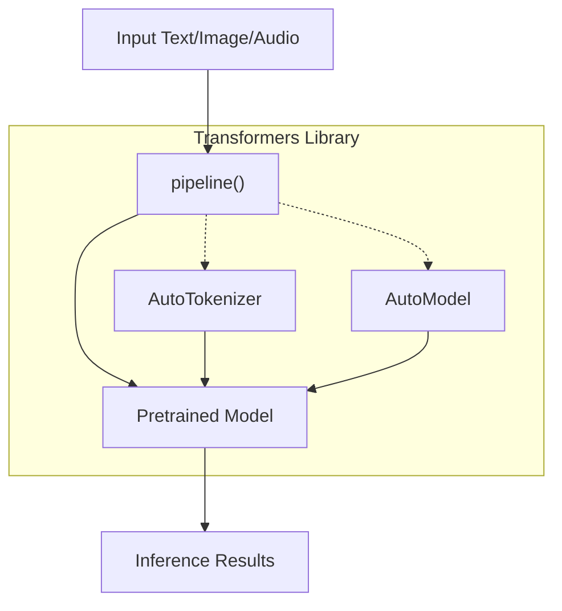

Sources: [transformers_doc/quicktour.ipynb:26-107](transformers_doc/quicktour.ipynb:26-107)

## Getting Started

Before you begin, make sure you have the Transformers library installed:

```bash
pip install transformers datasets
```

You'll also need to install your preferred machine learning framework:

```bash
pip install torch  # PyTorch
# or
pip install tensorflow  # TensorFlow
```

Sources: [transformers_doc/quicktour.ipynb:8-42](transformers_doc/quicktour.ipynb:8-42)

## The Pipeline API

The `pipeline()` function is the simplest way to use pretrained models for inference. It handles all the preprocessing and postprocessing for you, allowing you to focus on your task rather than implementation details.

### Supported Tasks

The `pipeline()` function supports many common tasks across different modalities:

| **Task** | **Description** | **Modality** | **Pipeline Identifier** |
|----------|----------------|--------------|-------------------------|
| Text classification | Assign a label to text | NLP | `sentiment-analysis` |
| Text generation | Generate text from a prompt | NLP | `text-generation` |
| Named entity recognition | Label words with entity types | NLP | `ner` |
| Question answering | Extract answers from context | NLP | `question-answering` |
| Fill-mask | Fill in masked words | NLP | `fill-mask` |
| Summarization | Summarize long text | NLP | `summarization` |
| Translation | Translate text | NLP | `translation_xx_to_yy` |
| Image classification | Classify images | Vision | `image-classification` |
| Image segmentation | Classify image pixels | Vision | `image-segmentation` |
| Object detection | Detect objects in images | Vision | `object-detection` |
| Audio classification | Classify audio | Audio | `audio-classification` |
| Automatic speech recognition | Transcribe speech to text | Audio | `automatic-speech-recognition` |

Sources: [transformers_doc/quicktour.ipynb:81-101](transformers_doc/quicktour.ipynb:81-101)

### Basic Pipeline Usage

Using the `pipeline()` function is as simple as specifying your task:

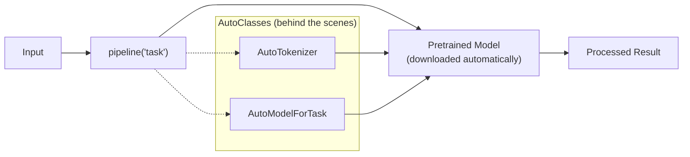

For example, to analyze sentiment in text:

1. Create a pipeline for sentiment analysis:
   ```python
   from transformers import pipeline
   classifier = pipeline("sentiment-analysis")
   ```

2. Apply it to your text:
   ```python
   classifier("We are very happy to show you the 🤗 Transformers library.")
   # Output: [{'label': 'POSITIVE', 'score': 0.9998}]
   ```

3. Process multiple inputs as a list:
   ```python
   results = classifier([
       "We are very happy to show you the 🤗 Transformers library.",
       "We hope you don't hate it."
   ])
   # Returns a list of dictionaries with results
   ```

Sources: [transformers_doc/quicktour.ipynb:109-172](transformers_doc/quicktour.ipynb:109-172)

### Processing Datasets

The `pipeline()` can also process entire datasets. Here's an example with speech recognition:

1. Create a pipeline:
   ```python
   from transformers import pipeline
   speech_recognizer = pipeline(
       "automatic-speech-recognition", 
       model="facebook/wav2vec2-base-960h"
   )
   ```

2. Load a dataset:
   ```python
   from datasets import load_dataset, Audio
   dataset = load_dataset("PolyAI/minds14", name="en-US", split="train")
   ```

3. Ensure matching sampling rates:
   ```python
   dataset = dataset.cast_column(
       "audio", 
       Audio(sampling_rate=speech_recognizer.feature_extractor.sampling_rate)
   )
   ```

4. Process samples:
   ```python
   results = speech_recognizer(dataset[:4]["audio"])
   # Process and extract transcriptions
   ```

Sources: [transformers_doc/quicktour.ipynb:178-264](transformers_doc/quicktour.ipynb:178-264)

### Using Custom Models in a Pipeline

You can customize the `pipeline()` by specifying a different pretrained model:

1. Choose a model from the Hugging Face Hub:
   ```python
   model_name = "nlptown/bert-base-multilingual-uncased-sentiment"
   ```

2. Load the model and tokenizer:
   ```python
   from transformers import AutoTokenizer, AutoModelForSequenceClassification
   
   model = AutoModelForSequenceClassification.from_pretrained(model_name)
   tokenizer = AutoTokenizer.from_pretrained(model_name)
   ```

3. Create a pipeline with your custom model and tokenizer:
   ```python
   classifier = pipeline("sentiment-analysis", model=model, tokenizer=tokenizer)
   classifier("Nous sommes très heureux de vous présenter la bibliothèque 🤗 Transformers.")
   # Output: [{'label': '5 stars', 'score': 0.7273}]
   ```

Sources: [transformers_doc/quicktour.ipynb:269-360](transformers_doc/quicktour.ipynb:269-360)

## The AutoClass System

Under the hood, the `pipeline()` function uses the AutoClass system to automatically load the right model architecture and tokenizer based on the model name or task. Understanding the AutoClass system gives you more control over the process.

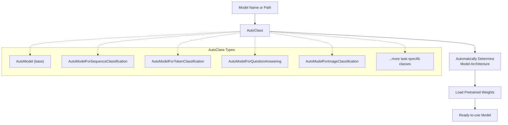

Sources: [transformers_doc/quicktour.ipynb:367-405](transformers_doc/quicktour.ipynb:367-405)

### AutoTokenizer

Tokenizers convert text into numbers that models can understand. The tokenization process involves:

1. Splitting text into tokens (words, subwords, or characters)
2. Converting tokens to IDs from the model's vocabulary
3. Adding special tokens and attention masks

To use a tokenizer:

```python
from transformers import AutoTokenizer

model_name = "nlptown/bert-base-multilingual-uncased-sentiment"
tokenizer = AutoTokenizer.from_pretrained(model_name)

# Process a single input
encoding = tokenizer("We are very happy to show you the 🤗 Transformers library.")
# Returns a dictionary with input_ids, attention_mask, etc.

# Process multiple inputs with padding and truncation
batch = tokenizer(
    ["We are very happy to show you the 🤗 Transformers library.", 
     "We hope you don't hate it."],
    padding=True,
    truncation=True,
    max_length=512,
    return_tensors="pt",  # for PyTorch tensors
)
```

The tokenizer returns a dictionary with:
- `input_ids`: numerical representations of tokens
- `attention_mask`: indicates which tokens should be attended to
- `token_type_ids`: (for some models) differentiates between segments

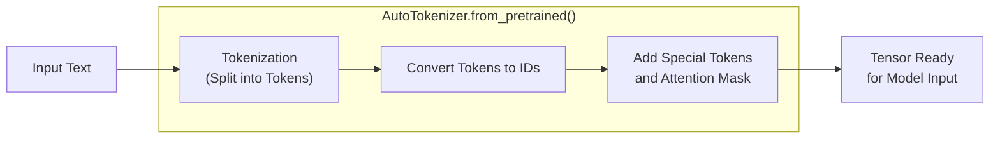

Sources: [transformers_doc/quicktour.ipynb:390-520](transformers_doc/quicktour.ipynb:390-520)

### AutoModel

The AutoModel classes automatically determine the right model architecture for your task. You select the appropriate AutoModel variant based on what you're trying to accomplish:

| **Task** | **AutoModel Class** |
|----------|---------------------|
| Base transformer | `AutoModel` |
| Text classification | `AutoModelForSequenceClassification` |
| Token classification | `AutoModelForTokenClassification` |
| Question answering | `AutoModelForQuestionAnswering` |
| Language generation | `AutoModelForCausalLM` |
| Masked language modeling | `AutoModelForMaskedLM` |
| Image classification | `AutoModelForImageClassification` |
| Speech recognition | `AutoModelForSpeechSeq2Seq` |

To load a model:

```python
from transformers import AutoModelForSequenceClassification

model_name = "nlptown/bert-base-multilingual-uncased-sentiment"
model = AutoModelForSequenceClassification.from_pretrained(model_name)
```

Then you can pass your preprocessed inputs to the model:

```python
outputs = model(**batch)
```

The model outputs the final activations in the `logits` attribute, which you can then process as needed:

```python
from torch import nn
import torch

# Apply softmax to get probabilities
predictions = nn.functional.softmax(outputs.logits, dim=-1)
```

Sources: [transformers_doc/quicktour.ipynb:523-608](transformers_doc/quicktour.ipynb:523-608)

### Complete Workflow Example

Here's a complete example showing how to load a model, process inputs, and get predictions:

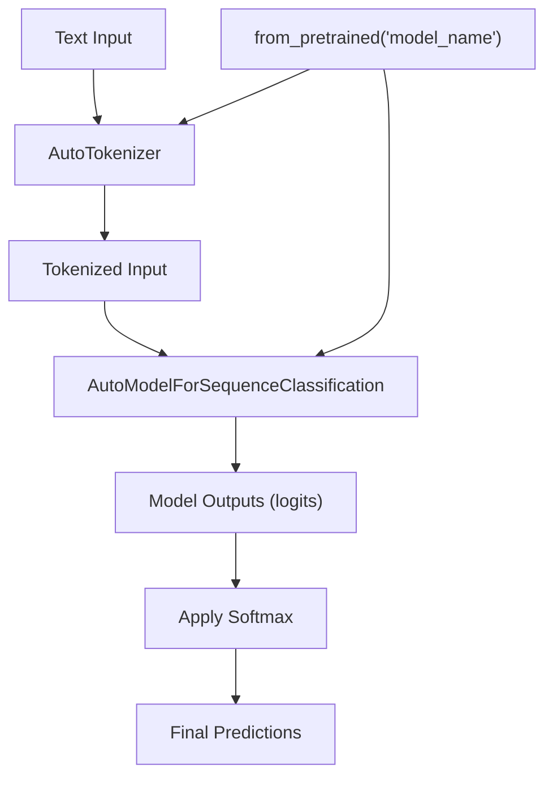

1. Set up the tokenizer and model:
   ```python
   from transformers import AutoTokenizer, AutoModelForSequenceClassification
   import torch.nn as nn
   
   model_name = "distilbert-base-uncased-finetuned-sst-2-english"
   tokenizer = AutoTokenizer.from_pretrained(model_name)
   model = AutoModelForSequenceClassification.from_pretrained(model_name)
   ```

2. Process inputs:
   ```python
   inputs = tokenizer(
       "This movie was fantastic! I really enjoyed it.",
       return_tensors="pt"
   )
   ```

3. Forward pass through model:
   ```python
   outputs = model(**inputs)
   ```

4. Process outputs:
   ```python
   predictions = nn.functional.softmax(outputs.logits, dim=-1)
   print(predictions)
   ```

Sources: [transformers_doc/quicktour.ipynb:523-626](transformers_doc/quicktour.ipynb:523-626)

### Saving and Loading Models

After using or fine-tuning a model, you can save it for future use:

```python
# Save model and tokenizer
save_directory = "./my_saved_model"
tokenizer.save_pretrained(save_directory)
model.save_pretrained(save_directory)

# Load model and tokenizer later
loaded_tokenizer = AutoTokenizer.from_pretrained(save_directory)
loaded_model = AutoModelForSequenceClassification.from_pretrained(save_directory)
```

You can even convert between PyTorch and TensorFlow models:

```python
# Convert from TensorFlow to PyTorch
pt_model = AutoModelForSequenceClassification.from_pretrained(
    "path/to/tf_model", 
    from_tf=True
)

# Convert from PyTorch to TensorFlow
tf_model = TFAutoModelForSequenceClassification.from_pretrained(
    "path/to/pt_model", 
    from_pt=True
)
```

Sources: [transformers_doc/quicktour.ipynb:583-632](transformers_doc/quicktour.ipynb:583-632)

## Framework-Specific Usage

### PyTorch

In PyTorch, you typically use the model like this:

```python
# Load model and tokenizer
tokenizer = AutoTokenizer.from_pretrained("model_name")
model = AutoModelForSequenceClassification.from_pretrained("model_name")

# Process inputs
inputs = tokenizer("Hello world!", return_tensors="pt")

# Forward pass
outputs = model(**inputs)

# Process outputs
import torch.nn.functional as F
probs = F.softmax(outputs.logits, dim=-1)
```

Sources: [transformers_doc/en/pytorch/quicktour.ipynb:495-562](transformers_doc/en/pytorch/quicktour.ipynb:495-562)

### TensorFlow

In TensorFlow, the usage is similar:

```python
# Load model and tokenizer
tokenizer = AutoTokenizer.from_pretrained("model_name")
model = TFAutoModelForSequenceClassification.from_pretrained("model_name")

# Process inputs
inputs = tokenizer("Hello world!", return_tensors="tf")

# Forward pass
outputs = model(inputs)

# Process outputs
import tensorflow as tf
probs = tf.nn.softmax(outputs.logits, axis=-1)
```

Sources: [transformers_doc/en/tensorflow/quicktour.ipynb:493-563](transformers_doc/en/tensorflow/quicktour.ipynb:493-563)

## Next Steps

Now that you're familiar with the basics of the 🤗 Transformers library, you can:

- Explore more advanced tasks with different pipeline types
- Use specific models from the [Hugging Face Hub](https://huggingface.co/models)
- Learn about fine-tuning models on your own data in [Training and Fine-tuning Transformers](#2.4)
- Explore how to use transformers for specific tasks like [NLP Tasks with Transformers](#2.2) or [Computer Vision with Transformers](#2.3)

By mastering these fundamentals, you're well on your way to leveraging the power of transformer models for your applications.

---

# Page: NLP Tasks with Transformers

# NLP Tasks with Transformers

<details>
<summary>Relevant source files</summary>

The following files were used as context for generating this wiki page:

- [examples/images/question_answering.png](examples/images/question_answering.png)
- [examples/images/token_classification.png](examples/images/token_classification.png)
- [examples/language_modeling.ipynb](examples/language_modeling.ipynb)
- [examples/language_modeling_from_scratch.ipynb](examples/language_modeling_from_scratch.ipynb)
- [examples/multiple_choice.ipynb](examples/multiple_choice.ipynb)
- [examples/question_answering.ipynb](examples/question_answering.ipynb)
- [examples/summarization.ipynb](examples/summarization.ipynb)
- [examples/text_classification.ipynb](examples/text_classification.ipynb)
- [examples/token_classification.ipynb](examples/token_classification.ipynb)
- [examples/tokenizer_training.ipynb](examples/tokenizer_training.ipynb)
- [examples/translation.ipynb](examples/translation.ipynb)
- [transformers_doc/en/language_modeling.ipynb](transformers_doc/en/language_modeling.ipynb)
- [transformers_doc/en/masked_language_modeling.ipynb](transformers_doc/en/masked_language_modeling.ipynb)
- [transformers_doc/en/pytorch/language_modeling.ipynb](transformers_doc/en/pytorch/language_modeling.ipynb)
- [transformers_doc/en/pytorch/masked_language_modeling.ipynb](transformers_doc/en/pytorch/masked_language_modeling.ipynb)
- [transformers_doc/en/pytorch/question_answering.ipynb](transformers_doc/en/pytorch/question_answering.ipynb)
- [transformers_doc/en/pytorch/sequence_classification.ipynb](transformers_doc/en/pytorch/sequence_classification.ipynb)
- [transformers_doc/en/pytorch/token_classification.ipynb](transformers_doc/en/pytorch/token_classification.ipynb)
- [transformers_doc/en/question_answering.ipynb](transformers_doc/en/question_answering.ipynb)
- [transformers_doc/en/sequence_classification.ipynb](transformers_doc/en/sequence_classification.ipynb)
- [transformers_doc/en/tensorflow/language_modeling.ipynb](transformers_doc/en/tensorflow/language_modeling.ipynb)
- [transformers_doc/en/tensorflow/masked_language_modeling.ipynb](transformers_doc/en/tensorflow/masked_language_modeling.ipynb)
- [transformers_doc/en/tensorflow/question_answering.ipynb](transformers_doc/en/tensorflow/question_answering.ipynb)
- [transformers_doc/en/tensorflow/sequence_classification.ipynb](transformers_doc/en/tensorflow/sequence_classification.ipynb)
- [transformers_doc/en/tensorflow/token_classification.ipynb](transformers_doc/en/tensorflow/token_classification.ipynb)
- [transformers_doc/en/token_classification.ipynb](transformers_doc/en/token_classification.ipynb)
- [transformers_doc/preprocessing.ipynb](transformers_doc/preprocessing.ipynb)
- [transformers_doc/task_summary.ipynb](transformers_doc/task_summary.ipynb)
- [transformers_doc/tokenizer_summary.ipynb](transformers_doc/tokenizer_summary.ipynb)

</details>


This page provides a detailed guide on using the Transformers library for various Natural Language Processing (NLP) tasks. We'll cover the most common NLP tasks and how to implement them using the Hugging Face Transformers library, focusing on practical examples and implementation details. For a quick introduction to the Transformers library, see [Quick Start with Transformers](#2.1). For information about computer vision tasks, see [Computer Vision with Transformers](#2.3).

## Overview of NLP Tasks

The Transformers library supports a wide range of NLP tasks through specialized model architectures and pipelines. Here are the primary NLP tasks covered in this guide:

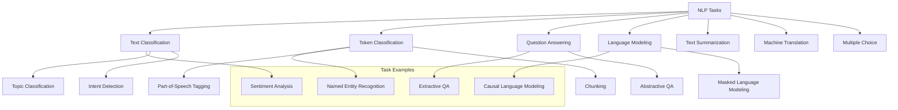

Sources:
- [transformers_doc/task_summary.ipynb]()
- [examples/text_classification.ipynb]()
- [examples/token_classification.ipynb]()
- [examples/question_answering.ipynb]()
- [examples/language_modeling.ipynb]()

## The Pipeline API

Transformers provides a high-level `pipeline` API that allows for quick implementation of NLP tasks without detailed knowledge of the underlying model architecture. Each pipeline wraps a pre-trained model with its preprocessing and postprocessing steps.

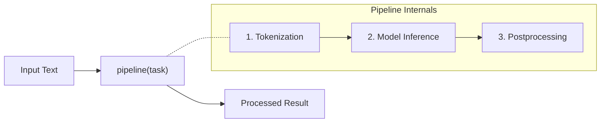

### Common NLP Pipelines

| Task | Pipeline Name | Description | Example Usage |
|------|--------------|-------------|--------------|
| Text Classification | `text-classification` | Assign a label to a text | Sentiment analysis |
| Token Classification | `ner` | Assign a label to each token | Named entity recognition |
| Question Answering | `question-answering` | Extract answer from context | Finding information in text |
| Text Generation | `text-generation` | Generate text from a prompt | Completing sentences |
| Summarization | `summarization` | Create shorter version of text | Condensing articles |
| Translation | `translation_xx_to_yy` | Translate between languages | en-to-fr translation |
| Text2Text Generation | `text2text-generation` | Transform text to text | Paraphrasing |
| Fill-Mask | `fill-mask` | Fill in masked tokens | Completing sentences |

Sources:
- [transformers_doc/task_summary.ipynb]()
- [transformers_doc/preprocessing.ipynb]()

## Text Classification

Text classification assigns a label or category to an entire sequence of text. Common applications include sentiment analysis, topic classification, and spam detection.

### Implementation Flow

```mermaid
flowchart TD
    Data["Load Dataset"] --> Preprocess["Preprocess Text"]
    Preprocess --> Tokenize["Tokenize Input"]
    Tokenize --> ForwardPass["Model Forward Pass"]
    ForwardPass --> Predictions["Get Predictions"]
    Predictions --> Evaluate["Evaluate Results"]
    
    subgraph "Model Architecture"
        Input["Input IDs + Attention Mask"]
        Encoder["Transformer Encoder"]
        ClassificationHead["Classification Head"]
        
        Input --> Encoder
        Encoder --> ClassificationHead
    end
    
    Tokenize -.- Input
    ForwardPass -.- ClassificationHead
```

### Key Components

1. **Dataset**: Text classification tasks often use datasets like GLUE, which contains multiple sentence and sentence-pair classification tasks.

2. **Model**: `AutoModelForSequenceClassification` is the primary class for text classification tasks.

3. **Preprocessing**: Converting raw text into input suitable for the model using a tokenizer.

4. **Training**: Using the `Trainer` API for fine-tuning or the TensorFlow/PyTorch native training loops.

5. **Evaluation**: Common metrics include accuracy, F1 score, and Matthews correlation coefficient.

### Example Workflow

```python
# Load model and tokenizer
tokenizer = AutoTokenizer.from_pretrained("distilbert-base-uncased")
model = AutoModelForSequenceClassification.from_pretrained("distilbert-base-uncased", num_labels=2)

# Preprocess data
def preprocess_function(examples):
    return tokenizer(examples["text"], truncation=True)

tokenized_dataset = dataset.map(preprocess_function, batched=True)

# Train model
trainer = Trainer(
    model=model,
    train_dataset=tokenized_dataset["train"],
    eval_dataset=tokenized_dataset["validation"],
    tokenizer=tokenizer,
)
trainer.train()
```

Sources:
- [examples/text_classification.ipynb:117-143]()
- [examples/text_classification.ipynb:936-1007]()
- [transformers_doc/en/sequence_classification.ipynb]()

## Token Classification

Token classification assigns a label to individual tokens in a text sequence. The most common token classification task is Named Entity Recognition (NER), which identifies entities like persons, organizations, and locations.

### Implementation Flow

```mermaid
flowchart TD
    Data["Load Dataset"] --> Preprocess["Preprocess Text"]
    Preprocess --> Tokenize["Tokenize Input"]
    Tokenize --> AlignLabels["Align Token-Label Mapping"]
    AlignLabels --> ForwardPass["Model Forward Pass"]
    ForwardPass --> Predictions["Get Token Predictions"]
    Predictions --> Evaluate["Evaluate Results"]
    
    subgraph "Token Classification Model"
        Input["Input IDs + Attention Mask"]
        Encoder["Transformer Encoder"]
        TokenClassifier["Token Classification Head"]
        
        Input --> Encoder
        Encoder --> TokenClassifier
    end
    
    Tokenize -.- Input
    ForwardPass -.- TokenClassifier
```

### Key Components

1. **Dataset**: NER datasets like CoNLL-2003, WNUT-17 that contain token-level annotations.

2. **Model**: `AutoModelForTokenClassification` is used for token-level prediction tasks.

3. **Preprocessing**: Special handling is needed to align word-level labels with subword tokens.

4. **Evaluation**: Metrics like precision, recall, F1-score at the entity level using the `seqeval` library.

### Handling Subword Tokens

A key challenge in token classification is aligning labels with subword tokens. The following steps are typically used:

1. Map each token to its corresponding word using the `word_ids` method
2. Assign special tokens (like `[CLS]`, `[SEP]`) the label `-100` to ignore them in loss calculation
3. For words split into multiple tokens, typically only label the first token and mark others as `-100`

```python
def tokenize_and_align_labels(examples):
    tokenized_inputs = tokenizer(examples["tokens"], truncation=True, is_split_into_words=True)
    labels = []
    
    for i, label in enumerate(examples["ner_tags"]):
        word_ids = tokenized_inputs.word_ids(batch_index=i)
        previous_word_idx = None
        label_ids = []
        
        for word_idx in word_ids:
            if word_idx is None:
                label_ids.append(-100)  # Special tokens
            elif word_idx != previous_word_idx:
                label_ids.append(label[word_idx])  # Label first token of word
            else:
                label_ids.append(-100)  # Ignore other tokens of word
                
            previous_word_idx = word_idx
            
        labels.append(label_ids)
    
    tokenized_inputs["labels"] = labels
    return tokenized_inputs
```

Sources:
- [transformers_doc/en/token_classification.ipynb:305-324]()
- [examples/token_classification.ipynb]()
- [transformers_doc/en/pytorch/token_classification.ipynb]()

## Question Answering

Question answering tasks involve generating answers to questions. The most common approach with Transformers is extractive question answering, where the answer is extracted as a span of text from a provided context.

### Implementation Flow

```mermaid
flowchart TD
    Data["Load QA Dataset"] --> Preprocess["Preprocess QA Pairs"]
    Preprocess --> Tokenize["Tokenize Question+Context"]
    Tokenize --> FindSpans["Find Answer Positions"]
    FindSpans --> ForwardPass["Model Forward Pass"]
    ForwardPass --> Predictions["Predict Start/End Positions"]
    Predictions --> ExtractAnswer["Extract Answer Span"]
    ExtractAnswer --> Evaluate["Evaluate Results"]
    
    subgraph "Question Answering Model"
        Input["Question + Context Tokens"]
        Encoder["Transformer Encoder"]
        SpanPredictor["Start/End Position Heads"]
        
        Input --> Encoder
        Encoder --> SpanPredictor
    end
    
    Tokenize -.- Input
    ForwardPass -.- SpanPredictor
```

### Key Components

1. **Dataset**: Common QA datasets include SQuAD, TriviaQA, and Natural Questions.

2. **Model**: `AutoModelForQuestionAnswering` predicts the start and end positions of the answer in the context.

3. **Preprocessing**:
   - Special handling for long contexts using a sliding window approach with stride
   - Tracking token positions to map back to original text

4. **Evaluation**: Metrics like Exact Match (EM) and F1 score.

### Handling Long Contexts

Question answering often deals with long contexts that exceed model's maximum input length. This is handled by:

1. Breaking the context into overlapping chunks with a sliding window
2. Processing each chunk separately
3. Aggregating predictions across chunks
4. Selecting the best answer span based on confidence scores

```python
# Configuration for handling long contexts
max_length = 384  # Maximum sequence length
doc_stride = 128  # Overlap between chunks

# Example preprocessing for QA
tokenized_examples = tokenizer(
    questions,
    contexts,
    stride=doc_stride,
    max_length=max_length,
    padding="max_length",
    truncation="only_second",
    return_overflowing_tokens=True,
    return_offsets_mapping=True
)
```

Sources:
- [examples/question_answering.ipynb:636-637]()
- [examples/question_answering.ipynb:147-153]()
- [transformers_doc/en/pytorch/question_answering.ipynb]()

## Language Modeling

Language modeling is the task of predicting the next word or token in a sequence. There are two main types of language modeling tasks:

1. **Causal Language Modeling**: Predicting the next token based on previous tokens (unidirectional)
2. **Masked Language Modeling**: Predicting masked tokens in a sequence using context from both directions (bidirectional)

### Implementation Flow

```mermaid
flowchart TD
    Data["Load Text Corpus"] --> Preprocess["Preprocess Text"]
    Preprocess --> Tokenize["Tokenize & Create Inputs"]
    Tokenize --> CreateTask["Create LM Task Format"]
    CreateTask --> ForwardPass["Model Forward Pass"]
    ForwardPass --> Predictions["Get Token Predictions"]
    Predictions --> Calculate["Calculate Loss"]
    Calculate --> Train["Train Model"]
    
    subgraph "Causal vs Masked LM"
        CausalLM["Causal LM\n(Future tokens hidden)"]
        MaskedLM["Masked LM\n(Random tokens masked)"]
    end
    
    CreateTask --> CausalLM
    CreateTask --> MaskedLM
```

### Key Components

1. **Causal Language Modeling**:
   - Used primarily for text generation
   - Models: GPT-2, GPT-Neo, OPT, BLOOM
   - Class: `AutoModelForCausalLM`
   - Each token can only attend to previous tokens

2. **Masked Language Modeling**:
   - Used for learning bidirectional representations
   - Models: BERT, RoBERTa, DistilBERT
   - Class: `AutoModelForMaskedLM`
   - Random tokens are masked and predicted using full context

3. **Data Preprocessing**:
   - For causal LM: Simple tokenization, possibly with padding/truncation
   - For masked LM: Need to mask random tokens with special token like `[MASK]`

### Example: Creating Training Data for Causal LM

```python
def tokenize_function(examples):
    return tokenizer(examples["text"])

# Process dataset
tokenized_dataset = dataset.map(
    tokenize_function,
    batched=True,
    remove_columns=["text"]
)

# Create input-target pairs for causal LM (shift tokens to create targets)
def group_texts(examples):
    # Concatenate all texts and chunk by block_size
    concatenated = {k: sum(examples[k], []) for k in examples.keys()}
    total_length = len(concatenated[list(examples.keys())[0]])
    
    # Create blocks of max_length tokens
    result = {
        k: [t[i : i + block_size] for i in range(0, total_length, block_size)]
        for k, t in concatenated.items()
    }
    
    # Create input_ids and labels for causal LM
    result["labels"] = result["input_ids"].copy()
    
    return result
```

Sources:
- [examples/language_modeling.ipynb:129-139]()
- [transformers_doc/en/language_modeling.ipynb]()
- [transformers_doc/en/masked_language_modeling.ipynb]()

## Text Generation

Text generation leverages causal language modeling to generate new text from a prompt. It's used for tasks like story generation, chatbots, and content creation.

### Implementation Flow

```mermaid
flowchart LR
    Prompt["Input Prompt"] --> Tokenize["Tokenize Prompt"]
    Tokenize --> Model["Causal Language Model"]
    Model --> GenerateToken["Generate Next Token"]
    GenerateToken --> SelectToken["Select Token via Sampling"]
    SelectToken --> AppendToken["Append to Sequence"]
    AppendToken -->|Repeat| GenerateToken
    AppendToken --> Complete["Complete Generation"]
    Complete --> Decode["Decode to Text"]
    
    subgraph "Generation Parameters"
        MaxLength["max_length"]
        Temperature["temperature"]
        TopK["top_k"]
        TopP["top_p / nucleus sampling"]
        RepetitionPenalty["repetition_penalty"]
    end
    
    SelectToken -.-> MaxLength
    SelectToken -.-> Temperature
    SelectToken -.-> TopK
    SelectToken -.-> TopP
    SelectToken -.-> RepetitionPenalty
```

### Key Parameters for Text Generation

| Parameter | Description | Effect |
|-----------|-------------|--------|
| `max_length` | Maximum length of generated text | Limits output size |
| `temperature` | Controls randomness | Higher = more random, Lower = more deterministic |
| `top_k` | Sample from top k most likely tokens | Restricts token choice to most probable |
| `top_p` | Sample from smallest set of tokens whose cumulative probability exceeds p | Maintains diversity while removing unlikely tokens |
| `repetition_penalty` | Penalizes repeated tokens | Reduces repetitive text |
| `do_sample` | Use sampling vs greedy decoding | True = use sampling, False = greedy |
| `num_return_sequences` | Number of sequences to generate | Multiple outputs for same prompt |

### Example Generation

```python
from transformers import pipeline, set_seed

# Initialize text generation pipeline
generator = pipeline("text-generation", model="gpt2")

# Generate text with various parameters
set_seed(42)
generated_text = generator(
    "Transformers library can be used to",
    max_length=50,
    num_return_sequences=2,
    do_sample=True,
    temperature=0.7,
    top_k=50,
    top_p=0.95,
    repetition_penalty=1.2
)
```

Sources:
- [transformers_doc/en/language_modeling.ipynb]()
- [transformers_doc/en/pytorch/language_modeling.ipynb]()

## Other NLP Tasks

Beyond the core tasks covered above, the Transformers library supports several other important NLP tasks:

### Summarization

Text summarization generates a concise version of a longer text.

1. **Models**: BART, T5, Pegasus, LED
2. **Class**: `AutoModelForSeq2SeqLM`
3. **Evaluation**: ROUGE scores

### Machine Translation

Translates text from one language to another.

1. **Models**: T5, mBART, NLLB, M2M100
2. **Class**: `AutoModelForSeq2SeqLM`
3. **Evaluation**: BLEU, METEOR scores

### Multiple Choice

Selects the correct answer from multiple options.

1. **Models**: BERT, RoBERTa
2. **Class**: `AutoModelForMultipleChoice`
3. **Preprocessing**: Special format with question and all choices

Sources:
- [examples/summarization.ipynb]()
- [examples/translation.ipynb]()
- [examples/multiple_choice.ipynb]()

## Common Data Processing Patterns

Across all NLP tasks, certain data processing patterns appear consistently:

### Tokenization

Converting text to tokens is a fundamental step in all NLP tasks. The Transformers library provides a unified tokenizer interface:

```python
from transformers import AutoTokenizer

tokenizer = AutoTokenizer.from_pretrained("model-name")

# Basic tokenization
encoded = tokenizer("Here is some text to encode", padding=True, truncation=True)

# Batch tokenization
batch_encoded = tokenizer(
    ["First sentence", "Second sentence"],
    padding=True,
    truncation=True,
    return_tensors="pt"  # Return PyTorch tensors (use "tf" for TensorFlow)
)
```

### Dataset Loading and Processing

The Datasets library simplifies working with NLP datasets:

```python
from datasets import load_dataset

# Load dataset
dataset = load_dataset("glue", "sst2")

# Preprocess dataset using map
tokenized_dataset = dataset.map(
    lambda examples: tokenizer(examples["sentence"], padding="max_length", truncation=True),
    batched=True
)

# Prepare for training
train_dataset = tokenized_dataset["train"]
eval_dataset = tokenized_dataset["validation"]
```

### Training with the Trainer API

The `Trainer` API provides a unified interface for training across tasks:

```python
from transformers import Trainer, TrainingArguments

training_args = TrainingArguments(
    output_dir="./results",
    evaluation_strategy="epoch",
    learning_rate=2e-5,
    per_device_train_batch_size=16,
    per_device_eval_batch_size=16,
    num_train_epochs=3,
)

trainer = Trainer(
    model=model,
    args=training_args,
    train_dataset=train_dataset,
    eval_dataset=eval_dataset,
    tokenizer=tokenizer,
    compute_metrics=compute_metrics,
)

trainer.train()
```

Sources:
- [transformers_doc/preprocessing.ipynb]()
- [examples/text_classification.ipynb:995-1007]()
- [examples/token_classification.ipynb:538-562]()

## Summary

The Transformers library provides comprehensive support for a wide range of NLP tasks:

- **Text Classification**: Categorizing text into predefined classes
- **Token Classification**: Labeling individual tokens in a sequence
- **Question Answering**: Extracting answers from context
- **Language Modeling**: Predicting tokens in a sequence
- **Text Generation**: Creating new text from prompts
- **Summarization**: Condensing text while preserving meaning
- **Translation**: Converting text between languages
- **Multiple Choice**: Selecting correct answers from options

Each task follows a similar workflow:
1. Load and preprocess data
2. Fine-tune a pre-trained model
3. Evaluate performance
4. Deploy for inference

The library's unified API makes it easy to switch between tasks while following consistent patterns, minimizing the learning curve for implementing different NLP capabilities.

---

# Page: Computer Vision with Transformers

# Computer Vision with Transformers

<details>
<summary>Relevant source files</summary>

The following files were used as context for generating this wiki page:

- [transformers_doc/en/image_classification.ipynb](transformers_doc/en/image_classification.ipynb)
- [transformers_doc/en/pytorch/image_classification.ipynb](transformers_doc/en/pytorch/image_classification.ipynb)
- [transformers_doc/en/pytorch/semantic_segmentation.ipynb](transformers_doc/en/pytorch/semantic_segmentation.ipynb)
- [transformers_doc/en/semantic_segmentation.ipynb](transformers_doc/en/semantic_segmentation.ipynb)
- [transformers_doc/en/tensorflow/image_classification.ipynb](transformers_doc/en/tensorflow/image_classification.ipynb)
- [transformers_doc/en/tensorflow/semantic_segmentation.ipynb](transformers_doc/en/tensorflow/semantic_segmentation.ipynb)

</details>


This document provides a comprehensive overview of using the 🤗 Transformers library for computer vision tasks. We'll cover how to leverage transformer architectures for image classification and semantic segmentation, including model selection, data preparation, training, and inference. For NLP tasks with Transformers, see [NLP Tasks with Transformers](#2.2).

## Overview of Vision Transformers

Vision Transformers adapt the transformer architecture (originally designed for NLP) to computer vision tasks. Unlike traditional convolutional neural networks (CNNs), vision transformers process images by:

1. Splitting images into fixed-size patches
2. Linearly embedding these patches
3. Adding positional embeddings
4. Passing the resulting sequence through transformer encoder blocks

```mermaid
flowchart TD
    A["Input Image"] --> B["Image Patchification"]
    B --> C["Linear Embedding"]
    C --> D["Add Position Embeddings"]
    D --> E["Transformer Encoder"]
    E --> F["MLP Head"]
    F --> G["Task-Specific Output"]
    
    subgraph "Vision Transformer Pipeline"
        B
        C
        D
        E
        F
    end
```

Sources: `transformers_doc/en/tensorflow/image_classification.ipynb`, `transformers_doc/en/pytorch/image_classification.ipynb`

## Supported Computer Vision Tasks

The Transformers library supports several computer vision tasks, with the primary ones being:

| Task | Description | Primary Model Classes | Example Models |
|------|-------------|------------------------|----------------|
| Image Classification | Assigning a label or class to an entire image | `AutoModelForImageClassification` | ViT, BEiT, DeiT |
| Semantic Segmentation | Assigning a class label to every pixel in an image | `AutoModelForSemanticSegmentation` | SegFormer, BEiT, UPerNet |

Sources: `transformers_doc/en/image_classification.ipynb`, `transformers_doc/en/semantic_segmentation.ipynb`

## Supported Vision Model Architectures

The Transformers library supports a wide range of vision model architectures:

```mermaid
graph TD
    VisionModels["Vision Models in Transformers"] --> ClassificationModels["Image Classification Models"]
    VisionModels --> SegmentationModels["Semantic Segmentation Models"]
    
    ClassificationModels --> ViT["ViT - Vision Transformer"]
    ClassificationModels --> BEiT["BEiT"]
    ClassificationModels --> ConvNeXT["ConvNeXT"]
    ClassificationModels --> DeiT["DeiT"]
    ClassificationModels --> Swin["Swin Transformer"]
    ClassificationModels --> MobileNet["MobileNet variants"]
    
    SegmentationModels --> SegFormer["SegFormer"]
    SegmentationModels --> BEiTSeg["BEiT for segmentation"]
    SegmentationModels --> DPT["DPT"]
    SegmentationModels --> UPerNet["UPerNet"]
```

Sources: `transformers_doc/en/image_classification.ipynb:65-70`, `transformers_doc/en/semantic_segmentation.ipynb:62-70`

## Core Components for Vision Tasks

When working with vision models in the Transformers library, several key components are used:

```mermaid
graph TD
    A["Vision Task Pipeline"] --> B["AutoImageProcessor"]
    A --> C["Vision Models"]
    A --> D["Data Preparation Tools"]
    
    B --> B1["Resize"]
    B --> B2["Normalize"]
    B --> B3["Convert to tensors"]
    
    C --> C1["AutoModelForImageClassification"]
    C --> C2["AutoModelForSemanticSegmentation"]
    C --> C3["TFAutoModelForImageClassification"]
    C --> C4["TFAutoModelForSemanticSegmentation"]
    
    D --> D1["Data augmentation"]
    D --> D2["Dataset preprocessing"]
    D --> D3["Evaluation metrics"]
```

Sources: `transformers_doc/en/tensorflow/image_classification.ipynb`, `transformers_doc/en/semantic_segmentation.ipynb`

## Image Classification with Transformers

### Model Architecture

For image classification, the Vision Transformer (ViT) is the foundational architecture, which follows this structure:

```mermaid
graph TD
    A["Input Image"] --> B["Image Patchifier"]
    B --> C["Patch Embeddings + Position Embeddings"]
    C --> D["Transformer Encoder Blocks"]
    D --> E["Classification Head"]
    E --> F["Class Predictions"]
    
    subgraph "ViT Model Components"
        direction LR
        G["Self-Attention"] <--> H["Feed Forward Network"]
        G --> I["Layer Norm"]
        H --> J["Layer Norm"]
    end
```

Sources: `transformers_doc/en/tensorflow/image_classification.ipynb`, `transformers_doc/en/image_classification.ipynb`

### Workflow for Image Classification

The typical workflow for image classification involves:

1. Loading and preprocessing a dataset
2. Setting up an image processor
3. Defining data augmentation transforms
4. Loading a pre-trained model
5. Fine-tuning the model
6. Using the model for inference

```mermaid
flowchart LR
    A["Dataset Loading"] --> B["Dataset Preprocessing"]
    B --> C["Model Setup"]
    C --> D["Training/Fine-tuning"]
    D --> E["Inference"]
    
    subgraph "Dataset Processing"
        A
        B
    end
    
    subgraph "Model Lifecycle"
        C
        D
        E
    end
```

Sources: `transformers_doc/en/tensorflow/image_classification.ipynb:94-159`, `transformers_doc/en/image_classification.ipynb:94-168`

### Example Code Structure

```mermaid
graph TD
    IC["Image Classification Workflow"] --> IC1["Load Dataset"]
    IC --> IC2["Image Processor"]
    IC --> IC3["Model"]
    IC --> IC4["Training"]
    IC --> IC5["Inference"]
    
    IC1 --> IC1_1["load_dataset()"]
    IC1 --> IC1_2["train_test_split()"]
    
    IC2 --> IC2_1["AutoImageProcessor.from_pretrained()"]
    IC2 --> IC2_2["Data Augmentation Transforms"]
    
    IC3 --> IC3_1["AutoModelForImageClassification.from_pretrained()"]
    IC3 --> IC3_2["TFAutoModelForImageClassification.from_pretrained()"]
    
    IC4 --> IC4_1["Trainer"]
    IC4 --> IC4_2["TF Model.fit()"]
    
    IC5 --> IC5_1["pipeline()"]
    IC5 --> IC5_2["model(**inputs)"]
```

Sources: `transformers_doc/en/tensorflow/image_classification.ipynb`, `transformers_doc/en/image_classification.ipynb`

## Semantic Segmentation with Transformers

### Model Architecture

For semantic segmentation, models like SegFormer follow this architecture:

```mermaid
graph TD
    A["Input Image"] --> B["Hierarchical Transformer Encoder"]
    B --> C["Multi-scale Features"]
    C --> D["MLP Decoder"]
    D --> E["Per-pixel Class Predictions"]
    
    subgraph "SegFormer Components"
        F["Efficient Self-Attention"]
        G["Mix-FFN"]
        H["Overlapping Patch Merging"]
        I["All-MLP Decoder"]
    end
```

Sources: `transformers_doc/en/semantic_segmentation.ipynb`, `transformers_doc/en/tensorflow/semantic_segmentation.ipynb`

### Workflow for Semantic Segmentation

The typical workflow for semantic segmentation involves:

1. Loading and preprocessing a dataset with segmentation maps
2. Setting up an image processor with label reduction (if needed)
3. Defining data transformations for images and segmentation maps
4. Loading a pre-trained segmentation model
5. Fine-tuning the model using an IoU metric
6. Using the model for inference

```mermaid
flowchart LR
    A["Dataset Loading"] --> B["Dataset Preprocessing"]
    B --> C["Model Setup"]
    C --> D["Training/Fine-tuning"]
    D --> E["Inference"]
    
    subgraph "Segmentation Data Processing"
        A
        B
    end
    
    subgraph "Segmentation Model Lifecycle"
        C
        D
        E
    end
```

Sources: `transformers_doc/en/semantic_segmentation.ipynb:97-192`, `transformers_doc/en/tensorflow/semantic_segmentation.ipynb:97-192`

### Example Code Structure

```mermaid
graph TD
    SS["Semantic Segmentation Workflow"] --> SS1["Load Dataset"]
    SS --> SS2["Image Processor"]
    SS --> SS3["Model"]
    SS --> SS4["Training"]
    SS --> SS5["Inference"]
    
    SS1 --> SS1_1["load_dataset()"]
    SS1 --> SS1_2["train_test_split()"]
    SS1 --> SS1_3["Label Maps (id2label, label2id)"]
    
    SS2 --> SS2_1["AutoImageProcessor.from_pretrained()"]
    SS2 --> SS2_2["Image and Label Transforms"]
    
    SS3 --> SS3_1["AutoModelForSemanticSegmentation.from_pretrained()"]
    SS3 --> SS3_2["TFAutoModelForSemanticSegmentation.from_pretrained()"]
    
    SS4 --> SS4_1["mean_iou Evaluation Metric"]
    SS4 --> SS4_2["Trainer or Model.fit()"]
    
    SS5 --> SS5_1["Prediction"]
    SS5 --> SS5_2["Upsampling Logits"]
    SS5 --> SS5_3["Visualization"]
```

Sources: `transformers_doc/en/semantic_segmentation.ipynb`, `transformers_doc/en/tensorflow/semantic_segmentation.ipynb`

## Framework Implementations

The Transformers library supports both PyTorch and TensorFlow for computer vision tasks:

| Feature | PyTorch | TensorFlow |
|---------|---------|------------|
| Image Classification | `AutoModelForImageClassification` | `TFAutoModelForImageClassification` |
| Semantic Segmentation | `AutoModelForSemanticSegmentation` | `TFAutoModelForSemanticSegmentation` |
| Training Interface | `Trainer` class | Keras `model.fit()` |
| Callbacks | Built into `Trainer` | Keras callbacks system |
| Data Format | PyTorch tensors | TensorFlow tensors |
| Data Pipeline | `Dataset.with_transform()` | `Dataset.to_tf_dataset()` |

Sources: `transformers_doc/en/tensorflow/image_classification.ipynb`, `transformers_doc/en/image_classification.ipynb`, `transformers_doc/en/semantic_segmentation.ipynb`, `transformers_doc/en/tensorflow/semantic_segmentation.ipynb`

## Using Vision Transformers

### Data Preparation

Common data preparation steps for vision transformer tasks:

1. **Loading datasets**:
   ```python
   from datasets import load_dataset
   dataset = load_dataset("food101", split="train[:5000]")
   ```

2. **Data splitting**:
   ```python
   dataset = dataset.train_test_split(test_size=0.2)
   ```

3. **Label mapping**:
   ```python
   labels = dataset["train"].features["label"].names
   id2label = {str(i): label for i, label in enumerate(labels)}
   label2id = {label: str(i) for i, label in enumerate(labels)}
   ```

Sources: `transformers_doc/en/tensorflow/image_classification.ipynb:115-187`, `transformers_doc/en/semantic_segmentation.ipynb:113-190`

### Model Initialization

Vision Transformer models are typically initialized with:

1. **Image Processor**:
   ```python
   from transformers import AutoImageProcessor
   image_processor = AutoImageProcessor.from_pretrained("google/vit-base-patch16-224-in21k")
   ```

2. **Classification Model**:
   ```python
   from transformers import AutoModelForImageClassification
   model = AutoModelForImageClassification.from_pretrained(
       "google/vit-base-patch16-224-in21k",
       num_labels=len(labels),
       id2label=id2label,
       label2id=label2id
   )
   ```

3. **Segmentation Model**:
   ```python
   from transformers import AutoModelForSemanticSegmentation
   model = AutoModelForSemanticSegmentation.from_pretrained(
       "nvidia/mit-b0",  # SegFormer model
       id2label=id2label,
       label2id=label2id
   )
   ```

Sources: `transformers_doc/en/tensorflow/image_classification.ipynb:237-240`, `transformers_doc/en/image_classification.ipynb:237-240`, `transformers_doc/en/semantic_segmentation.ipynb:213-216`

### Training

Models are trained differently based on the framework:

**PyTorch (using Trainer)**:
```python
from transformers import TrainingArguments, Trainer

training_args = TrainingArguments(
    output_dir="my_vision_model",
    per_device_train_batch_size=16,
    evaluation_strategy="epoch",
    num_train_epochs=3,
    # Other arguments...
)

trainer = Trainer(
    model=model,
    args=training_args,
    train_dataset=train_dataset,
    eval_dataset=val_dataset,
    compute_metrics=compute_metrics,
)

trainer.train()
```

**TensorFlow**:
```python
# Compile the model
model.compile(optimizer=optimizer)

# Define callbacks
callbacks = [
    KerasMetricCallback(metric_fn=compute_metrics, eval_dataset=eval_dataset),
    PushToHubCallback(output_dir="model_directory", tokenizer=image_processor)
]

# Train the model
model.fit(
    train_dataset,
    validation_data=val_dataset,
    epochs=num_epochs,
    callbacks=callbacks
)
```

Sources: `transformers_doc/en/tensorflow/image_classification.ipynb:454-596`, `transformers_doc/en/image_classification.ipynb:526-579`

### Inference

Inference can be performed using the `pipeline` API or manually:

**Using pipeline**:
```python
from transformers import pipeline

# For image classification
classifier = pipeline("image-classification", model="my_trained_model")
result = classifier(image)

# For semantic segmentation
segmenter = pipeline("image-segmentation", model="my_segmentation_model")
result = segmenter(image)
```

**Manual inference for classification**:
```python
# Process the image
inputs = image_processor(image, return_tensors="pt")  # or "tf" for TensorFlow

# Get predictions
outputs = model(**inputs)
logits = outputs.logits

# Get predicted class
predicted_class_id = logits.argmax(-1).item()
predicted_label = model.config.id2label[predicted_class_id]
```

**Manual inference for segmentation**:
```python
# Process the image
inputs = image_processor(image, return_tensors="pt")  # or "tf" for TensorFlow

# Get predictions
outputs = model(**inputs)
logits = outputs.logits

# Resize logits to original image size and get class per pixel
upsampled_logits = nn.functional.interpolate(
    logits,
    size=image.size[::-1],  # Height, width
    mode="bilinear",
    align_corners=False,
)
pred_seg = upsampled_logits.argmax(dim=1)[0]
```

Sources: `transformers_doc/en/tensorflow/image_classification.ipynb:634-743`, `transformers_doc/en/semantic_segmentation.ipynb:534-617`

## Practical Considerations

When working with Vision Transformers, keep these considerations in mind:

1. **Resource requirements**: Vision transformers generally require more computational resources than comparable CNNs
2. **Data augmentation**: Crucial for good performance, especially with limited datasets
3. **Patch size**: Impacts both performance and computational requirements
4. **Transfer learning**: Most effective when fine-tuning from pre-trained models
5. **Evaluation metrics**: Use task-appropriate metrics (accuracy for classification, IoU for segmentation)

Sources: `transformers_doc/en/tensorflow/image_classification.ipynb`, `transformers_doc/en/semantic_segmentation.ipynb`

---

# Page: Training and Fine-tuning Transformers

# Training and Fine-tuning Transformers

<details>
<summary>Relevant source files</summary>

The following files were used as context for generating this wiki page:

- [examples/images/question_answering.png](examples/images/question_answering.png)
- [examples/images/token_classification.png](examples/images/token_classification.png)
- [examples/language_modeling.ipynb](examples/language_modeling.ipynb)
- [examples/language_modeling_from_scratch.ipynb](examples/language_modeling_from_scratch.ipynb)
- [examples/multiple_choice.ipynb](examples/multiple_choice.ipynb)
- [examples/question_answering.ipynb](examples/question_answering.ipynb)
- [examples/summarization.ipynb](examples/summarization.ipynb)
- [examples/text_classification.ipynb](examples/text_classification.ipynb)
- [examples/token_classification.ipynb](examples/token_classification.ipynb)
- [examples/tokenizer_training.ipynb](examples/tokenizer_training.ipynb)
- [examples/translation.ipynb](examples/translation.ipynb)
- [transformers_doc/en/pytorch/question_answering.ipynb](transformers_doc/en/pytorch/question_answering.ipynb)
- [transformers_doc/en/pytorch/sequence_classification.ipynb](transformers_doc/en/pytorch/sequence_classification.ipynb)
- [transformers_doc/en/pytorch/token_classification.ipynb](transformers_doc/en/pytorch/token_classification.ipynb)
- [transformers_doc/en/question_answering.ipynb](transformers_doc/en/question_answering.ipynb)
- [transformers_doc/en/sequence_classification.ipynb](transformers_doc/en/sequence_classification.ipynb)
- [transformers_doc/en/tensorflow/question_answering.ipynb](transformers_doc/en/tensorflow/question_answering.ipynb)
- [transformers_doc/en/tensorflow/sequence_classification.ipynb](transformers_doc/en/tensorflow/sequence_classification.ipynb)
- [transformers_doc/en/tensorflow/token_classification.ipynb](transformers_doc/en/tensorflow/token_classification.ipynb)
- [transformers_doc/en/token_classification.ipynb](transformers_doc/en/token_classification.ipynb)

</details>


This page covers the process of training and fine-tuning transformer models using the Hugging Face Transformers library. We'll explore the different training approaches available, including the Trainer API for PyTorch users and TensorFlow/Keras integration for TensorFlow users. This guide focuses on practical training workflows across various NLP tasks such as text classification, token classification, question answering, and language modeling.

For information about using pre-trained models without fine-tuning, see [Quick Start with Transformers](#2.1).

## Core Training Components

The Transformers library offers multiple ways to train models, with components designed to streamline the process while maintaining flexibility. The central components of the training ecosystem include:

```mermaid
graph TD
    Training["Training Components"] --> Trainer["Trainer API"]
    Training --> TF["TensorFlow/Keras"]
    Training --> Pytorch["PyTorch Native"]
    Training --> Args["TrainingArguments"]
    Training --> DC["Data Collators"]
    
    Trainer --> Train["train()"]
    Trainer --> Eval["evaluate()"]
    Trainer --> Predict["predict()"]
    Trainer --> Push["push_to_hub()"]
    
    Args --> EvalStrategy["evaluation_strategy"]
    Args --> SaveStrategy["save_strategy"]
    Args --> LR["learning_rate"]
    Args --> BSizes["batch_sizes"]
    Args --> Epochs["num_train_epochs"]
    Args --> WDecay["weight_decay"]
    
    DC --> TokenClass["DataCollatorForTokenClassification"]
    DC --> LM["DataCollatorForLanguageModeling"]
    DC --> Padding["DataCollatorWithPadding"]
    DC --> QA["DataCollatorForQuestionAnswering"]
```

Sources:
- [examples/text_classification.ipynb:984-1007]()
- [examples/question_answering.ipynb:984-1006]() 
- [transformers_doc/en/token_classification.ipynb:539-550]()

### Trainer API (PyTorch)

The `Trainer` class provides a high-level API for PyTorch-based training. It handles the training loop, evaluation, and model saving with minimal code.

```mermaid
graph TD
    Trainer["`Trainer`"] --> Model["`model`"]
    Trainer --> Args["`args: TrainingArguments`"]
    Trainer --> TrainData["`train_dataset`"]
    Trainer --> EvalData["`eval_dataset`"]
    Trainer --> Tokenizer["`tokenizer`"]
    Trainer --> DataCol["`data_collator`"]
    Trainer --> Metrics["`compute_metrics`"]

    Model --> AutoModel["`AutoModelForXXX.from_pretrained()`"]
    Args --> TrainingArgs["`TrainingArguments(...)`"]
    TrainData --> Dataset["`datasets.load_dataset()`"]
    EvalData --> Dataset
    Tokenizer --> AutoTokenizer["`AutoTokenizer.from_pretrained()`"]
    DataCol --> Collators["`DataCollatorForXXX`"]
    Metrics --> CustomFunction["`def compute_metrics()`"]
```

The `Trainer` simplifies the fine-tuning process by managing:
- Training and evaluation loops
- Gradient accumulation and mixed precision
- Checkpointing and model saving
- Logging and TensorBoard integration
- Model pushing to the Hugging Face Hub

Sources:
- [examples/text_classification.ipynb:1009-1017]()
- [transformers_doc/en/token_classification.ipynb:552-560]()

### TensorFlow Training

For TensorFlow users, models can be fine-tuned using Keras's familiar API:

```mermaid
graph TD
    TFTraining["`TensorFlow Training`"] --> Model["`TFAutoModelForXXX.from_pretrained()`"]
    TFTraining --> Compile["`model.compile()`"]
    TFTraining --> Fit["`model.fit()`"]
    TFTraining --> Predict["`model.predict()`"]
    
    Compile --> Optimizer["`optimizer`"]
    Compile --> Loss["`loss`"] 
    Compile --> Metrics["`metrics`"]
    
    Fit --> TrainData["`tf_train_dataset`"]
    Fit --> ValidationData["`tf_validation_dataset`"]
    Fit --> Epochs["`epochs`"]
    Fit --> Callbacks["`callbacks`"]
```

TensorFlow training involves:
1. Converting datasets to TensorFlow format
2. Configuring optimization parameters
3. Using Keras callbacks for checkpointing and logging
4. Integration with TensorFlow's ecosystem

Sources:
- [transformers_doc/en/tensorflow/token_classification.ipynb:368-370]()
- [transformers_doc/en/tensorflow/sequence_classification.ipynb]()

## Data Preparation for Fine-tuning

Proper data preparation is crucial for effective fine-tuning. The process typically follows these steps:

```mermaid
flowchart TD
    Load["Load Dataset"] --> Preprocess["Preprocess Text"]
    Preprocess --> Tokenize["Tokenize"]
    Tokenize --> Format["Format for Model Input"]
    Format --> Collate["Batch & Collate"]
    
    Load --> DatasetLib["`datasets.load_dataset()`"]
    Preprocess --> CustomFuncs["`custom preprocessing functions`"]
    Tokenize --> AutoTokenizer["`AutoTokenizer.from_pretrained()`"]
    Format --> MapMethod["`dataset.map(preprocess_function)`"]
    Collate --> DataCollator["`DataCollatorForXXX`"]
```

Sources:
- [examples/text_classification.ipynb:787-908]()
- [examples/question_answering.ipynb:633-638]()
- [transformers_doc/en/token_classification.ipynb:305-324]()

### Loading Datasets

Datasets are typically loaded using the 🤗 Datasets library:

```python
from datasets import load_dataset
dataset = load_dataset("glue", "cola")  # Example with GLUE benchmark
```

For custom datasets, you can load from local files:

```python
dataset = load_dataset("text", data_files={"train": "path_to_train.txt", "validation": "path_to_validation.txt"})
```

Sources:
- [examples/text_classification.ipynb:295-297]()
- [examples/question_answering.ipynb:272-273]()
- [examples/language_modeling.ipynb:176-177]()

### Tokenization and Preprocessing

Each task requires specific preprocessing. The general pattern involves:

1. Loading a tokenizer that matches your model
2. Creating a preprocessing function
3. Applying the function to the entire dataset

Example for text classification:

```python
tokenizer = AutoTokenizer.from_pretrained(model_checkpoint)

def preprocess_function(examples):
    return tokenizer(examples["text"], truncation=True)

tokenized_dataset = dataset.map(preprocess_function, batched=True)
```

For more complex tasks like question answering or token classification, additional alignment between tokens and labels is required.

Sources:
- [examples/text_classification.ipynb:657-663]()
- [transformers_doc/en/token_classification.ipynb:305-324]()
- [examples/question_answering.ipynb:633-638]()

## Model Selection and Initialization

Selecting the right model type for your task is crucial:

```mermaid
graph LR
    Task["Task Type"] --> ModelClass["Model Class"]
    
    Task --> TextClassification["Text Classification"]
    Task --> TokenClassification["Token Classification"]
    Task --> QuestionAnswering["Question Answering"]
    Task --> LanguageModeling["Language Modeling"]
    Task --> Summarization["Summarization"]
    Task --> Translation["Translation"]
    
    TextClassification --> ForSequence["`AutoModelForSequenceClassification`"]
    TokenClassification --> ForToken["`AutoModelForTokenClassification`"]
    QuestionAnswering --> ForQA["`AutoModelForQuestionAnswering`"]
    LanguageModeling --> ForMaskedLM["`AutoModelForMaskedLM`"]
    LanguageModeling --> ForCausalLM["`AutoModelForCausalLM`"]
    Summarization --> ForSeq2Seq["`AutoModelForSeq2SeqLM`"]
    Translation --> ForSeq2Seq
```

Models are initialized with pretrained weights and adapted to your specific task:

```python
from transformers import AutoModelForSequenceClassification

# For a classification task with 2 labels
model = AutoModelForSequenceClassification.from_pretrained(
    "distilbert-base-uncased", 
    num_labels=2
)
```

Sources:
- [examples/text_classification.ipynb:960-963]()
- [transformers_doc/en/token_classification.ipynb:517-519]()
- [examples/question_answering.ipynb:960-963]()

## Training Configuration 

The `TrainingArguments` class controls all aspects of the training process:

```python
from transformers import TrainingArguments

training_args = TrainingArguments(
    output_dir="./results",               # Directory to save model checkpoints
    evaluation_strategy="epoch",          # Evaluate every epoch
    learning_rate=2e-5,                   # Recommended LR for transformers
    per_device_train_batch_size=16,       # Batch size for training
    per_device_eval_batch_size=16,        # Batch size for evaluation
    num_train_epochs=3,                   # Number of training epochs
    weight_decay=0.01,                    # Weight decay for regularization
    load_best_model_at_end=True,          # Load best model at the end of training
    push_to_hub=True,                     # Push model to the Hugging Face Hub
)
```

Key parameters include:
- Learning rate: Usually between 1e-5 and 5e-5
- Batch size: Adjust based on your GPU memory
- Number of epochs: Typically 2-5 is sufficient
- Evaluation strategy: When to perform evaluation
- Saving strategy: When to save checkpoints

Sources:
- [examples/text_classification.ipynb:984-1007]()
- [transformers_doc/en/token_classification.ipynb:539-550]()
- [examples/question_answering.ipynb:984-1006]()

## Fine-tuning for Specific Tasks

The Transformers library supports fine-tuning for a wide range of NLP tasks. Here are the most common ones:

### Text Classification

Used for sentiment analysis, topic classification, and other tasks where the goal is to assign a label to a text sequence.

```python
from transformers import AutoModelForSequenceClassification, Trainer

model = AutoModelForSequenceClassification.from_pretrained(
    "distilbert-base-uncased", 
    num_labels=num_labels
)

trainer = Trainer(
    model=model,
    args=training_args,
    train_dataset=tokenized_dataset["train"],
    eval_dataset=tokenized_dataset["validation"],
    tokenizer=tokenizer,
    compute_metrics=compute_metrics
)

trainer.train()
```

Sources:
- [examples/text_classification.ipynb:960-1020]()
- [transformers_doc/en/sequence_classification.ipynb]()

### Token Classification

Used for named entity recognition (NER), part-of-speech tagging, and other tasks where labels are assigned to individual tokens.

```python
from transformers import AutoModelForTokenClassification, Trainer

model = AutoModelForTokenClassification.from_pretrained(
    "distilbert-base-uncased", 
    num_labels=len(label_list),
    id2label=id2label,
    label2id=label2id
)

trainer = Trainer(
    model=model,
    args=training_args,
    train_dataset=tokenized_dataset["train"],
    eval_dataset=tokenized_dataset["test"],
    tokenizer=tokenizer,
    data_collator=data_collator,
    compute_metrics=compute_metrics,
)

trainer.train()
```

Token classification requires careful handling of subword tokenization and label alignment.

Sources:
- [transformers_doc/en/token_classification.ipynb:517-562]()
- [examples/token_classification.ipynb]()

### Question Answering

Used for extractive question answering where the answer is a span of text from a context.

```python
from transformers import AutoModelForQuestionAnswering, Trainer

model = AutoModelForQuestionAnswering.from_pretrained(model_checkpoint)

trainer = Trainer(
    model=model,
    args=training_args,
    train_dataset=tokenized_datasets["train"],
    eval_dataset=tokenized_datasets["validation"],
    tokenizer=tokenizer,
    data_collator=data_collator,
    post_process_function=post_processing_function,
    compute_metrics=compute_metrics,
)

trainer.train()
```

Question answering models require special handling of long contexts with a sliding window approach and careful post-processing.

Sources:
- [examples/question_answering.ipynb:960-1018]()
- [transformers_doc/en/question_answering.ipynb]()

### Language Modeling

Two main types of language modeling are supported:

1. **Masked Language Modeling**: Pre-training task for BERT-like models where random tokens are masked and the model predicts them.
2. **Causal Language Modeling**: Next-token prediction, used for GPT-like models.

```python
# For masked language modeling
from transformers import AutoModelForMaskedLM, DataCollatorForLanguageModeling

model = AutoModelForMaskedLM.from_pretrained(model_checkpoint)
data_collator = DataCollatorForLanguageModeling(tokenizer=tokenizer, mlm_probability=0.15)

# For causal language modeling
from transformers import AutoModelForCausalLM

model = AutoModelForCausalLM.from_pretrained(model_checkpoint)
data_collator = DataCollatorForLanguageModeling(tokenizer=tokenizer, mlm=False)
```

Sources:
- [examples/language_modeling.ipynb]()
- [examples/language_modeling_from_scratch.ipynb]()

## Training Tokenizers

In addition to fine-tuning models, you can also train custom tokenizers on your specific corpus:

```python
from transformers import AutoTokenizer

# Load an existing tokenizer to use as a base
tokenizer = AutoTokenizer.from_pretrained("gpt2")

# Train a new tokenizer with the same algorithm but on your data
new_tokenizer = tokenizer.train_new_from_iterator(text_iterator, vocab_size=25000)

# Save the new tokenizer
new_tokenizer.save_pretrained("my-new-tokenizer")
```

For more control, you can use the 🤗 Tokenizers library to build custom tokenizers with specific components.

Sources:
- [examples/tokenizer_training.ipynb:317-318]()
- [examples/tokenizer_training.ipynb:378-379]()

## Saving and Sharing Models

After training, you can save your model locally or share it on the Hugging Face Hub:

```python
# Save locally
trainer.save_model("./my-finetuned-model")

# Push to Hugging Face Hub
trainer.push_to_hub()
```

Pushing to the Hub makes your model accessible for inference via:
- The Hugging Face website
- The `pipeline()` API
- The Inference API (REST)

Sources:
- [examples/text_classification.ipynb:1019-1020]()
- [transformers_doc/en/token_classification.ipynb:578-579]()

## Best Practices for Training

Here are some best practices to ensure effective and efficient transformer training:

| Practice | Description |
|----------|-------------|
| Start with a pre-trained model | Fine-tuning is usually more efficient than training from scratch |
| Use an appropriate learning rate | Usually between 1e-5 and 5e-5 for transformers |
| Choose the right batch size | As large as your GPU memory allows |
| Apply gradient accumulation | For effectively larger batch sizes when memory is limited |
| Use mixed precision training | For faster training without significant accuracy loss |
| Monitor multiple metrics | Not just loss but also task-specific metrics |
| Save checkpoints regularly | To resume training in case of interruptions |
| Use early stopping | To prevent overfitting |
| Clean and preprocess data | Garbage in, garbage out |
| Balance dataset when possible | For classification tasks with imbalanced classes |

Sources:
- [examples/text_classification.ipynb:984-1007]()
- [transformers_doc/en/token_classification.ipynb:539-550]()
- [examples/question_answering.ipynb:984-1006]()

## Advanced Training Techniques

For more complex or specialized training scenarios, consider these advanced techniques:

### Distributed Training

Training across multiple GPUs using PyTorch's DistributedDataParallel or TensorFlow's distribution strategies:

```python
# In TrainingArguments
training_args = TrainingArguments(
    ...
    fp16=True,                      # Mixed precision training
    gradient_accumulation_steps=4,  # Effectively increases batch size
    sharded_ddp="zero_dp_2",        # Sharded DDP for memory efficiency
    deepspeed="ds_config.json",     # DeepSpeed integration
)
```

### Custom Training Loops

For maximum control, you can implement custom training loops using the base PyTorch or TensorFlow models:

```python
# PyTorch example (simplified)
model = AutoModelForSequenceClassification.from_pretrained(...)
optimizer = AdamW(model.parameters(), lr=2e-5)

for epoch in range(num_epochs):
    for batch in dataloader:
        outputs = model(**batch)
        loss = outputs.loss
        loss.backward()
        optimizer.step()
        optimizer.zero_grad()
```

This provides full control over the training process, allowing for advanced techniques like custom learning rate schedules, gradient manipulation, and specialized regularization.

Sources:
- [examples/text_classification.ipynb:984-1007]()
- [examples/language_modeling_from_scratch.ipynb]()

## Conclusion

The Hugging Face Transformers library provides flexible and powerful tools for training and fine-tuning transformer models. Whether you need a simple fine-tuning process using the Trainer API or a customized training loop, the library offers solutions for a wide range of NLP tasks.

This page covered the main components and workflows for training transformers, including data preparation, model selection, training configuration, and task-specific fine-tuning. By following these patterns and best practices, you can effectively leverage the power of transformer models for your specific use cases.

---

# Page: Diffusers Library

# Diffusers Library

<details>
<summary>Relevant source files</summary>

The following files were used as context for generating this wiki page:

- [diffusers/.gitignore](diffusers/.gitignore)
- [diffusers/CLIP_Guided_Stable_diffusion_with_diffusers.ipynb](diffusers/CLIP_Guided_Stable_diffusion_with_diffusers.ipynb)
- [diffusers/README.md](diffusers/README.md)
- [diffusers/diffusers_intro.ipynb](diffusers/diffusers_intro.ipynb)
- [diffusers/image_2_image_using_diffusers.ipynb](diffusers/image_2_image_using_diffusers.ipynb)
- [diffusers/in_painting_with_stable_diffusion_using_diffusers.ipynb](diffusers/in_painting_with_stable_diffusion_using_diffusers.ipynb)
- [diffusers/latent_diffusion_upscaler.ipynb](diffusers/latent_diffusion_upscaler.ipynb)
- [diffusers/sd_101_guide.ipynb](diffusers/sd_101_guide.ipynb)
- [diffusers/sd_dreambooth_inference.ipynb](diffusers/sd_dreambooth_inference.ipynb)
- [diffusers/sd_dreambooth_training.ipynb](diffusers/sd_dreambooth_training.ipynb)
- [diffusers/sd_textual_inversion_training.ipynb](diffusers/sd_textual_inversion_training.ipynb)
- [diffusers/stable_conceptualizer_inference.ipynb](diffusers/stable_conceptualizer_inference.ipynb)
- [diffusers/stable_diffusion.ipynb](diffusers/stable_diffusion.ipynb)
- [diffusers/training_example.ipynb](diffusers/training_example.ipynb)
- [diffusers_doc/en/basic_training.ipynb](diffusers_doc/en/basic_training.ipynb)
- [diffusers_doc/en/loading.ipynb](diffusers_doc/en/loading.ipynb)
- [diffusers_doc/en/lora.ipynb](diffusers_doc/en/lora.ipynb)
- [diffusers_doc/en/pytorch/basic_training.ipynb](diffusers_doc/en/pytorch/basic_training.ipynb)
- [diffusers_doc/en/pytorch/loading.ipynb](diffusers_doc/en/pytorch/loading.ipynb)
- [diffusers_doc/en/pytorch/lora.ipynb](diffusers_doc/en/pytorch/lora.ipynb)
- [diffusers_doc/en/pytorch/quicktour.ipynb](diffusers_doc/en/pytorch/quicktour.ipynb)
- [diffusers_doc/en/pytorch/stable_diffusion.ipynb](diffusers_doc/en/pytorch/stable_diffusion.ipynb)
- [diffusers_doc/en/pytorch/write_own_pipeline.ipynb](diffusers_doc/en/pytorch/write_own_pipeline.ipynb)
- [diffusers_doc/en/quicktour.ipynb](diffusers_doc/en/quicktour.ipynb)
- [diffusers_doc/en/stable_diffusion.ipynb](diffusers_doc/en/stable_diffusion.ipynb)
- [diffusers_doc/en/tensorflow/basic_training.ipynb](diffusers_doc/en/tensorflow/basic_training.ipynb)
- [diffusers_doc/en/tensorflow/loading.ipynb](diffusers_doc/en/tensorflow/loading.ipynb)
- [diffusers_doc/en/tensorflow/lora.ipynb](diffusers_doc/en/tensorflow/lora.ipynb)
- [diffusers_doc/en/tensorflow/quicktour.ipynb](diffusers_doc/en/tensorflow/quicktour.ipynb)
- [diffusers_doc/en/tensorflow/stable_diffusion.ipynb](diffusers_doc/en/tensorflow/stable_diffusion.ipynb)
- [diffusers_doc/en/tensorflow/write_own_pipeline.ipynb](diffusers_doc/en/tensorflow/write_own_pipeline.ipynb)
- [diffusers_doc/en/write_own_pipeline.ipynb](diffusers_doc/en/write_own_pipeline.ipynb)

</details>


The Diffusers Library is a powerful toolbox by Hugging Face for working with state-of-the-art diffusion models for generative AI. This page provides an overview of its architecture, core components, and functionalities, focusing on image generation capabilities. For specific integration with other Hugging Face libraries like Transformers, see [Transformers Library](#2).

## Overview

The Diffusers Library provides a modular framework for implementing and using diffusion models. Diffusion models are a class of generative models that work by gradually denoising random Gaussian noise through a series of steps to generate high-quality outputs such as images, audio, or other data types.

```mermaid
graph TD
    subgraph "Diffusers Library Overview"
        Pipeline["DiffusionPipeline"] --> Models["Models"]
        Pipeline --> Schedulers["Schedulers"]
        Pipeline --> Optimizers["Optimization Techniques"]
        
        Models --> UNet["UNet2DConditionalModel"]
        Models --> VAE["AutoencoderKL (VAE)"]
        Models --> TextEncoder["CLIPTextModel"]
        
        Schedulers --> DDPM["DDPMScheduler"]
        Schedulers --> PNDM["PNDMScheduler"]
        Schedulers --> DPMSolver["DPMSolverMultistepScheduler"]
        Schedulers --> Others["Other Schedulers..."]
        
        Customization["Model Customization"] --> TI["Textual Inversion"]
        Customization --> DB["DreamBooth"]
        Customization --> LoRA["LoRA Fine-tuning"]
    end
```

Sources:
- [diffusers_doc/en/stable_diffusion.ipynb]()
- [diffusers/CLIP_Guided_Stable_diffusion_with_diffusers.ipynb]()
- [diffusers/stable_diffusion.ipynb]()
- [diffusers_doc/en/write_own_pipeline.ipynb]()

## Core Architecture

The Diffusers Library is built around three main components:

1. **Pipelines**: Ready-to-use end-to-end systems for inference
2. **Models**: Neural network components that perform diffusion and related tasks
3. **Schedulers**: Components that control the diffusion process across steps

These components can be used together through pipelines or accessed individually for custom implementations.

```mermaid
graph TD
    subgraph "Core Components"
        DiffPipe["DiffusionPipeline"] --> |"encapsulates"| Components
        
        subgraph "Components"
            Models["Models"] 
            Schedulers["Schedulers"]
            Processors["Processors/Tokenizers"]
        end
        
        subgraph "Usage Patterns"
            HighLevel["High-level API"] -->|"uses"| DiffPipe
            LowLevel["Low-level API"] -->|"directly uses"| Components
        end
    end
    
    DiffPipe -->|"provides"| UseCases
    
    subgraph "UseCases"
        T2I["Text-to-Image"]
        I2I["Image-to-Image"]
        Inpaint["Inpainting"]
        Custom["Custom Generation"]
    end
```

Sources:
- [diffusers_doc/en/write_own_pipeline.ipynb]()
- [diffusers_doc/en/quicktour.ipynb]()
- [diffusers_doc/en/pytorch/write_own_pipeline.ipynb]()

## Diffusion Pipelines

The `DiffusionPipeline` is the main interface for using pre-trained diffusion models. It provides a simple API to load models from the Hugging Face Hub and run inference.

### Core Pipeline Functionality

```python
from diffusers import DiffusionPipeline

# Load a pre-trained pipeline
pipeline = DiffusionPipeline.from_pretrained("model_id")

# Move to GPU for faster inference
pipeline = pipeline.to("cuda")

# Run inference
output = pipeline(prompt="a photo of an astronaut riding a horse on mars")
```

The `DiffusionPipeline` automatically selects the appropriate pipeline class based on the model configuration. The most popular pipeline is the `StableDiffusionPipeline` for text-to-image generation.

Sources:
- [diffusers/stable_diffusion.ipynb:29-33]()
- [diffusers_doc/en/stable_diffusion.ipynb:29-33]()
- [diffusers_doc/en/quicktour.ipynb]()

### Types of Pipelines

The library offers various specialized pipelines for different tasks:

| Pipeline Type | Description | Example Use Case |
|---------------|-------------|------------------|
| `StableDiffusionPipeline` | Text-to-image generation | Creating images from text descriptions |
| `StableDiffusionImg2ImgPipeline` | Image-to-image translation | Transforming existing images based on text |
| `StableDiffusionInpaintPipeline` | Image inpainting | Filling in masked portions of images |
| `DDPMPipeline` | Basic diffusion | Unconditional image generation |
| `DiffusionPipeline` | Generic base class | Custom pipelines and other generation tasks |

Sources:
- [diffusers/stable_diffusion.ipynb]()
- [diffusers/in_painting_with_stable_diffusion_using_diffusers.ipynb]()
- [diffusers_doc/en/write_own_pipeline.ipynb]()

## Models

The Diffusers Library includes various model implementations that form the building blocks of diffusion systems.

### Key Models

```mermaid
graph TD
    subgraph "Model Components in Stable Diffusion"
        UNet["UNet2DConditionalModel"] -->|"predicts noise"| NoiseResidual["Noise Residual"]
        TextEncoder["CLIPTextModel"] -->|"encodes"| TextEmbeddings["Text Embeddings"]
        VAE["AutoencoderKL"] -->|"encodes"| LatentSpace["Latent Space"]
        VAE -->|"decodes"| FinalImage["Final Image"]
        
        TextEmbeddings -->|"conditions"| UNet
        LatentSpace -->|"input for denoising"| UNet
        NoiseResidual -->|"used by"| Scheduler
        Scheduler -->|"controls denoising"| DenoisedLatents["Denoised Latents"]
        DenoisedLatents -->|"decoded by"| VAE
    end
```

1. **UNet2DConditionalModel**: The core diffusion model that predicts noise residuals at each step
2. **AutoencoderKL**: A variational autoencoder (VAE) that encodes images to and from latent space
3. **CLIPTextModel**: Text encoder that converts prompts into embeddings to condition the UNet
4. **CLIPFeatureExtractor**: Processes images for CLIP models in CLIP-guided diffusion

Sources:
- [diffusers_doc/en/stable_diffusion.ipynb]()
- [diffusers_doc/en/write_own_pipeline.ipynb]()
- [diffusers/CLIP_Guided_Stable_diffusion_with_diffusers.ipynb]()

## Schedulers

Schedulers control the diffusion process by defining how noise is added and removed during sampling. Different schedulers offer tradeoffs between quality and speed.

### Available Schedulers

```python
# List compatible schedulers
pipeline.scheduler.compatibles
```

| Scheduler | Description | Typical Steps | Strengths |
|-----------|-------------|---------------|-----------|
| `DDPMScheduler` | Original DDPM algorithm | 1000 | High quality, slow |
| `DDIMScheduler` | Deterministic diffusion | 50-100 | Good quality-speed balance |
| `PNDMScheduler` | Default in Stable Diffusion | 50 | Good default choice |
| `DPMSolverMultistepScheduler` | High-order solver | 20-25 | Very fast, good quality |
| `EulerDiscreteScheduler` | Euler method-based | 30-50 | Good for ancestral sampling |
| `LMSDiscreteScheduler` | Linear multistep | 30-50 | Good stability |

```python
# Switch to a faster scheduler
from diffusers import DPMSolverMultistepScheduler
pipeline.scheduler = DPMSolverMultistepScheduler.from_config(pipeline.scheduler.config)
```

Sources:
- [diffusers_doc/en/stable_diffusion.ipynb:168-183]()
- [diffusers_doc/en/pytorch/stable_diffusion.ipynb:168-183]()
- [diffusers_doc/en/tensorflow/stable_diffusion.ipynb:168-183]()

## Optimization Techniques

The Diffusers Library provides several optimization techniques to improve inference performance.

### Speed Optimization

1. **Float16 Precision**:
   ```python
   pipeline = DiffusionPipeline.from_pretrained("model_id", torch_dtype=torch.float16)
   ```

2. **Efficient Schedulers**:
   ```python
   from diffusers import DPMSolverMultistepScheduler
   pipeline.scheduler = DPMSolverMultistepScheduler.from_config(pipeline.scheduler.config)
   ```

3. **Reduced Inference Steps**:
   ```python
   pipeline(prompt="...", num_inference_steps=20)
   ```

### Memory Optimization

1. **Attention Slicing**: Reduces memory usage but slightly increases inference time
   ```python
   pipeline.enable_attention_slicing()
   ```

2. **Model Offloading**: Moves model components to CPU when not in use
   ```python
   pipeline.enable_model_cpu_offload()
   ```

3. **xFormers Memory Efficient Attention**: Third-party optimization for attention
   ```python
   pipeline.enable_xformers_memory_efficient_attention()
   ```

Sources:
- [diffusers_doc/en/stable_diffusion.ipynb:62-230]()
- [diffusers_doc/en/pytorch/stable_diffusion.ipynb:62-230]()
- [diffusers_doc/en/tensorflow/stable_diffusion.ipynb:62-230]()

## Model Customization Techniques

The library supports various techniques for personalizing diffusion models to create custom content.

```mermaid
graph LR
    subgraph "Model Customization Techniques"
        TI["Textual Inversion"] -->|"learns new"| TIEmbedding["Token Embeddings"]
        DB["DreamBooth"] -->|"fine-tunes"| EntireModel["Entire Model"]
        LoRA["LoRA"] -->|"adds rank-decomposition matrices to"| AttentionLayers["Attention Layers"]
        
        TIEmbedding -->|"smaller (few MBs)"| Portability
        EntireModel -->|"larger (GBs)"| Portability
        AttentionLayers -->|"medium (MBs)"| Portability
        
        TI -->|"3-5 images"| TrainingData
        DB -->|"5-10 images"| TrainingData
        LoRA -->|"few images or dataset"| TrainingData
    end
```

### 1. Textual Inversion

Teaches new concepts to diffusion models by learning new token embeddings with just a few images. Minimal storage requirements.

```python
# Loading a textual inversion concept
pipe = StableDiffusionPipeline.from_pretrained("runwayml/stable-diffusion-v1-5")
pipe.load_textual_inversion("sd-concepts-library/cat-toy")

# Using the concept in a prompt
image = pipe("A <cat-toy> sitting on a chair").images[0]
```

Sources:
- [diffusers/sd_textual_inversion_training.ipynb]()
- [diffusers/stable_conceptualizer_inference.ipynb]()

### 2. DreamBooth

A more comprehensive fine-tuning approach that adapts the entire diffusion model to learn specific subjects.

```python
# Training a DreamBooth model
# The training script is more complex and requires several components
```

Sources:
- [diffusers/sd_dreambooth_training.ipynb]()
- [diffusers/sd_dreambooth_inference.ipynb]()

### 3. LoRA (Low-Rank Adaptation)

A memory-efficient fine-tuning technique that adds pairs of rank-decomposition matrices to existing weights.

```python
# Loading and using a LoRA model
from diffusers import StableDiffusionPipeline
import torch

# Load base model
pipe = StableDiffusionPipeline.from_pretrained("runwayml/stable-diffusion-v1-5", torch_dtype=torch.float16)

# Load LoRA weights
pipe.unet.load_attn_procs("julien-c/pokemon-lora")

# Use the model with LoRA weights
image = pipe("a pokemon in the style of monet").images[0]
```

Sources:
- [diffusers_doc/en/lora.ipynb]()
- [diffusers_doc/en/pytorch/lora.ipynb]()
- [diffusers_doc/en/tensorflow/lora.ipynb]()

## Using Custom Pipelines

The Diffusers Library allows you to create custom pipelines by combining models and schedulers directly.

### Basic Example

```python
# Load components separately
from diffusers import UNet2DModel, DDPMScheduler
import torch

# Load model and scheduler
model = UNet2DModel.from_pretrained("google/ddpm-cat-256")
scheduler = DDPMScheduler.from_pretrained("google/ddpm-cat-256")

# Manual denoising loop
sample = torch.randn((1, 3, 256, 256))
for t in scheduler.timesteps:
    model_input = scheduler.scale_model_input(sample, t)
    noise_prediction = model(model_input, t).sample
    sample = scheduler.step(noise_prediction, t, sample).prev_sample
```

Sources:
- [diffusers_doc/en/write_own_pipeline.ipynb]()
- [diffusers_doc/en/pytorch/write_own_pipeline.ipynb]()
- [diffusers_doc/en/tensorflow/write_own_pipeline.ipynb]()

### CLIP-Guided Diffusion

```python
# Example of more advanced custom pipeline
from diffusers import StableDiffusionPipeline, DPMSolverMultistepScheduler
from transformers import CLIPModel, CLIPTextModel, CLIPTokenizer
import torch

# Load components
model_id = "CompVis/stable-diffusion-v1-4"
pipe = StableDiffusionPipeline.from_pretrained(model_id)
clip_model = CLIPModel.from_pretrained("openai/clip-vit-large-patch14")
```

Sources:
- [diffusers/CLIP_Guided_Stable_diffusion_with_diffusers.ipynb]()

## Training Diffusion Models

The library provides tools for training diffusion models from scratch or fine-tuning existing ones.

### Basic Training Example

```python
from diffusers import UNet2DModel, DDPMScheduler, DDPMPipeline
import torch

# Initialize model and scheduler
model = UNet2DModel(
    sample_size=32,
    in_channels=3,
    out_channels=3,
    layers_per_block=2,
    block_out_channels=(64, 128, 256, 512),
    down_block_types=("DownBlock2D", "DownBlock2D", "DownBlock2D", "AttnDownBlock2D"),
    up_block_types=("AttnUpBlock2D", "UpBlock2D", "UpBlock2D", "UpBlock2D"),
)
scheduler = DDPMScheduler(num_train_timesteps=1000, beta_schedule="squaredcos_cap_v2")

# Set up optimizer
optimizer = torch.optim.AdamW(model.parameters(), lr=1e-4)

# Training loop (simplified)
for epoch in range(100):
    for batch in train_dataloader:
        # Forward pass, loss calculation, and optimization steps
```

Sources:
- [diffusers/training_example.ipynb]()
- [diffusers_doc/en/basic_training.ipynb]()
- [diffusers_doc/en/pytorch/basic_training.ipynb]()
- [diffusers_doc/en/tensorflow/basic_training.ipynb]()

## Conclusion

The Diffusers Library provides a comprehensive set of tools for working with diffusion models. Its modular architecture allows for easy use through pre-configured pipelines while also enabling customization for advanced users. The library supports state-of-the-art models like Stable Diffusion and provides optimization techniques to improve performance on various hardware configurations.

With support for model personalization techniques like Textual Inversion, DreamBooth, and LoRA, users can adapt pre-trained models to their specific needs with minimal resources. The extensive documentation and examples make it accessible to both beginners and experienced practitioners in the field of generative AI.

---

# Page: Stable Diffusion with Diffusers

# Stable Diffusion with Diffusers

<details>
<summary>Relevant source files</summary>

The following files were used as context for generating this wiki page:

- [diffusers/.gitignore](diffusers/.gitignore)
- [diffusers/CLIP_Guided_Stable_diffusion_with_diffusers.ipynb](diffusers/CLIP_Guided_Stable_diffusion_with_diffusers.ipynb)
- [diffusers/README.md](diffusers/README.md)
- [diffusers/diffusers_intro.ipynb](diffusers/diffusers_intro.ipynb)
- [diffusers/image_2_image_using_diffusers.ipynb](diffusers/image_2_image_using_diffusers.ipynb)
- [diffusers/in_painting_with_stable_diffusion_using_diffusers.ipynb](diffusers/in_painting_with_stable_diffusion_using_diffusers.ipynb)
- [diffusers/latent_diffusion_upscaler.ipynb](diffusers/latent_diffusion_upscaler.ipynb)
- [diffusers/sd_101_guide.ipynb](diffusers/sd_101_guide.ipynb)
- [diffusers/sd_dreambooth_inference.ipynb](diffusers/sd_dreambooth_inference.ipynb)
- [diffusers/sd_dreambooth_training.ipynb](diffusers/sd_dreambooth_training.ipynb)
- [diffusers/sd_textual_inversion_training.ipynb](diffusers/sd_textual_inversion_training.ipynb)
- [diffusers/stable_conceptualizer_inference.ipynb](diffusers/stable_conceptualizer_inference.ipynb)
- [diffusers/stable_diffusion.ipynb](diffusers/stable_diffusion.ipynb)
- [diffusers/training_example.ipynb](diffusers/training_example.ipynb)
- [diffusers_doc/en/lora.ipynb](diffusers_doc/en/lora.ipynb)
- [diffusers_doc/en/pytorch/lora.ipynb](diffusers_doc/en/pytorch/lora.ipynb)
- [diffusers_doc/en/pytorch/stable_diffusion.ipynb](diffusers_doc/en/pytorch/stable_diffusion.ipynb)
- [diffusers_doc/en/stable_diffusion.ipynb](diffusers_doc/en/stable_diffusion.ipynb)
- [diffusers_doc/en/tensorflow/lora.ipynb](diffusers_doc/en/tensorflow/lora.ipynb)
- [diffusers_doc/en/tensorflow/stable_diffusion.ipynb](diffusers_doc/en/tensorflow/stable_diffusion.ipynb)

</details>


This document provides a comprehensive guide to using Stable Diffusion models with the Hugging Face Diffusers library. It covers how to set up and run text-to-image generation efficiently, optimize performance, and improve output quality. For information about fine-tuning Stable Diffusion models with techniques like DreamBooth, see [Model Personalization Techniques](#3.2), and for building custom diffusion pipelines, see [Custom Diffusion Pipelines](#3.3).

## Overview of Stable Diffusion with Diffusers

Stable Diffusion is a text-to-image latent diffusion model created by researchers from CompVis, Stability AI, and LAION. The Diffusers library provides an easy-to-use API for loading, configuring, and running these models efficiently.

```mermaid
graph TD
    User["User"] -->|"Text Prompt"| DiffusionPipeline["DiffusionPipeline"]
    DiffusionPipeline -->|"Creates"| Image["Generated Image"]
    
    DiffusionPipeline -.->|"Uses"| Scheduler["Scheduler"]
    DiffusionPipeline -.->|"Uses"| Models["Models"]
    DiffusionPipeline -.->|"Uses"| Processors["Processors"]
    
    Models -->|"Includes"| UNet["UNet2DConditionModel"]
    Models -->|"Includes"| VAE["AutoencoderKL"]
    Models -->|"Includes"| TextEncoder["CLIPTextModel"]
    
    Scheduler -->|"Options"| PNDM["PNDMScheduler"]
    Scheduler -->|"Options"| DPM["DPMSolverMultistepScheduler"]
    Scheduler -->|"Options"| DDIM["DDIMScheduler"]
    
    Processors -->|"Includes"| TextProcessor["CLIPTokenizer"]
    Processors -->|"Includes"| ImageProcessor["CLIPFeatureExtractor"]
```

Sources: [diffusers_doc/en/stable_diffusion.ipynb:14-21](), [diffusers/stable_diffusion.ipynb:12-18]()

## Components of Stable Diffusion

Stable Diffusion is implemented through the `StableDiffusionPipeline` class, which is a subclass of `DiffusionPipeline` that orchestrates several interacting components:

```mermaid
graph TD
    StableDiffusionPipeline["StableDiffusionPipeline"] 
    
    StableDiffusionPipeline -->|"Contains"| UNet["UNet2DConditionModel<br>Neural network that predicts noise"]
    StableDiffusionPipeline -->|"Contains"| VAE["AutoencoderKL<br>Encodes/decodes images to/from latent space"]
    StableDiffusionPipeline -->|"Contains"| TextEncoder["CLIPTextModel<br>Encodes text into embeddings"]
    StableDiffusionPipeline -->|"Contains"| Tokenizer["CLIPTokenizer<br>Converts text to tokens"]
    StableDiffusionPipeline -->|"Contains"| Scheduler["Scheduler<br>Controls the denoising process"]
    
    StableDiffusionPipeline -->|"Method"| Call["__call__()"]
    Call -->|"Process"| TokenizeText["1. Tokenize Text"]
    TokenizeText -->|"Process"| EncodeText["2. Encode Text"]
    EncodeText -->|"Process"| GenerateLatents["3. Generate Latents"]
    GenerateLatents -->|"Process"| DenoisingLoop["4. Denoising Loop"]
    DenoisingLoop -->|"Process"| DecodeLatents["5. Decode Latents"]
    
    UNet -->|"Used in"| DenoisingLoop
    Scheduler -->|"Used in"| DenoisingLoop
    TextEncoder -->|"Used in"| EncodeText
    VAE -->|"Used in"| DecodeLatents
    Tokenizer -->|"Used in"| TokenizeText
```

Sources: [diffusers_doc/en/stable_diffusion.ipynb:29-32](), [diffusers/stable_diffusion.ipynb:330-333]()

## Basic Usage

Using Stable Diffusion with Diffusers is straightforward:

1. Load the pipeline:
```python
from diffusers import DiffusionPipeline
import torch

# Load the pipeline
model_id = "runwayml/stable-diffusion-v1-5"
pipeline = DiffusionPipeline.from_pretrained(model_id, torch_dtype=torch.float16)
pipeline = pipeline.to("cuda")  # Move to GPU
```

2. Generate images from text:
```python
# Set a seed for reproducibility
generator = torch.Generator("cuda").manual_seed(0)

# Generate an image
prompt = "portrait photo of a old warrior chief"
image = pipeline(prompt, generator=generator).images[0]
```

Sources: [diffusers_doc/en/stable_diffusion.ipynb:29-33](), [diffusers_doc/en/stable_diffusion.ipynb:48-49](), [diffusers_doc/en/stable_diffusion.ipynb:93-96](), [diffusers_doc/en/stable_diffusion.ipynb:111-112]()

## Generation Process

The image generation process with Stable Diffusion follows these steps:

```mermaid
sequenceDiagram
    participant User
    participant Pipeline as "StableDiffusionPipeline"
    participant Tokenizer as "CLIPTokenizer"
    participant TextEncoder as "CLIPTextModel"
    participant Scheduler as "Scheduler"
    participant UNet as "UNet2DConditionModel"
    participant VAE as "AutoencoderKL"
    
    User->>Pipeline: __call__(prompt, num_inference_steps, ...)
    Pipeline->>Tokenizer: tokenize(prompt)
    Tokenizer-->>Pipeline: tokens
    Pipeline->>TextEncoder: encode(tokens)
    TextEncoder-->>Pipeline: text_embeddings
    
    Pipeline->>Pipeline: initialize_latents(generator)
    
    loop For each denoising step
        Pipeline->>UNet: forward(latents, timestep, text_embeddings)
        UNet-->>Pipeline: noise_prediction
        Pipeline->>Scheduler: step(model_output, timestep, latents)
        Scheduler-->>Pipeline: latents
    end
    
    Pipeline->>VAE: decode(latents)
    VAE-->>Pipeline: images
    Pipeline-->>User: images
```

Sources: [diffusers_doc/en/stable_diffusion.ipynb:111-112](), [diffusers/stable_diffusion.ipynb:330-333]()

## Optimization Techniques

Stable Diffusion can be optimized for better performance in terms of speed, memory usage, and output quality.

### Speed Optimization

1. **Use float16 precision**:
   ```python
   pipeline = DiffusionPipeline.from_pretrained(model_id, torch_dtype=torch.float16)
   ```

2. **Use more efficient schedulers**:
   ```python
   from diffusers import DPMSolverMultistepScheduler
   pipeline.scheduler = DPMSolverMultistepScheduler.from_config(pipeline.scheduler.config)
   ```

3. **Reduce inference steps**:
   ```python
   image = pipeline(prompt, generator=generator, num_inference_steps=20).images[0]
   ```

Sources: [diffusers_doc/en/stable_diffusion.ipynb:136-140](), [diffusers_doc/en/stable_diffusion.ipynb:199-201](), [diffusers_doc/en/stable_diffusion.ipynb:217-219]()

### Memory Optimization

1. **Enable attention slicing** to reduce memory usage:
   ```python
   pipeline.enable_attention_slicing()
   ```

This allows you to run larger batch sizes or on GPUs with less memory.

Sources: [diffusers_doc/en/stable_diffusion.ipynb:318](), [diffusers_doc/en/stable_diffusion.ipynb:334-335]()

### Quality Optimization

There are several ways to improve the quality of generated images:

1. **Use better checkpoints**: Try models like `runwayml/stable-diffusion-v1-5` or `stabilityai/stable-diffusion-2-1` for potentially better results.

2. **Replace pipeline components** with improved versions:
   ```python
   from diffusers import AutoencoderKL
   vae = AutoencoderKL.from_pretrained("stabilityai/sd-vae-ft-mse", torch_dtype=torch.float16).to("cuda")
   pipeline.vae = vae
   ```

3. **Improve prompt engineering**:
   - Be specific and detailed
   - Include style information
   - Add technical details like camera types or lighting

Sources: [diffusers_doc/en/stable_diffusion.ipynb:399-402](), [diffusers_doc/en/stable_diffusion.ipynb:442-443](), [diffusers_doc/en/stable_diffusion.ipynb:427-432]()

## Available Models and Pipelines

Several Stable Diffusion model versions are available:

| Model ID | Description |
|----------|-------------|
| `CompVis/stable-diffusion-v1-4` | Original Stable Diffusion v1.4 |
| `runwayml/stable-diffusion-v1-5` | Improved v1.5 version |
| `stabilityai/stable-diffusion-2-1-base` | Base model of v2.1 |
| `stabilityai/stable-diffusion-2-1` | Full v2.1 (higher resolution) |

Sources: [diffusers/stable_diffusion.ipynb:102-111]()

## Compatible Schedulers

Stable Diffusion supports various schedulers that determine the denoising process:

```python
pipeline.scheduler.compatibles
[
    diffusers.schedulers.scheduling_lms_discrete.LMSDiscreteScheduler,
    diffusers.schedulers.scheduling_unipc_multistep.UniPCMultistepScheduler,
    diffusers.schedulers.scheduling_k_dpm_2_discrete.KDPM2DiscreteScheduler,
    diffusers.schedulers.scheduling_deis_multistep.DEISMultistepScheduler,
    diffusers.schedulers.scheduling_euler_discrete.EulerDiscreteScheduler,
    diffusers.schedulers.scheduling_dpmsolver_multistep.DPMSolverMultistepScheduler,
    diffusers.schedulers.scheduling_ddpm.DDPMScheduler,
    diffusers.schedulers.scheduling_dpmsolver_singlestep.DPMSolverSinglestepScheduler,
    diffusers.schedulers.scheduling_k_dpm_2_ancestral_discrete.KDPM2AncestralDiscreteScheduler,
    diffusers.schedulers.scheduling_heun_discrete.HeunDiscreteScheduler,
    diffusers.schedulers.scheduling_pndm.PNDMScheduler,
    diffusers.schedulers.scheduling_euler_ancestral_discrete.EulerAncestralDiscreteScheduler,
    diffusers.schedulers.scheduling_ddim.DDIMScheduler,
]
```

Different schedulers offer trade-offs between speed and quality. For example, the default `PNDMScheduler` typically requires ~50 inference steps, while `DPMSolverMultistepScheduler` can yield good results with only ~20-25 steps.

Sources: [diffusers_doc/en/stable_diffusion.ipynb:168-183](), [diffusers_doc/en/stable_diffusion.ipynb:190-191]()

## Advanced Usage

### Batch Generation

You can generate multiple images at once using batch processing:

```python
def get_inputs(batch_size=1):
    generator = [torch.Generator("cuda").manual_seed(i) for i in range(batch_size)]
    prompts = batch_size * [prompt]
    num_inference_steps = 20
    return {"prompt": prompts, "generator": generator, "num_inference_steps": num_inference_steps}

images = pipeline(**get_inputs(batch_size=8)).images
```

Sources: [diffusers_doc/en/stable_diffusion.ipynb:255-261](), [diffusers_doc/en/stable_diffusion.ipynb:334-335]()

### Visualization Tools

For visualizing batches of images, you can use the `image_grid` function:

```python
from PIL import Image

def image_grid(imgs, rows=2, cols=2):
    w, h = imgs[0].size
    grid = Image.new("RGB", size=(cols * w, rows * h))
    
    for i, img in enumerate(imgs):
        grid.paste(img, box=(i % cols * w, i // cols * h))
    return grid

grid = image_grid(images, rows=2, cols=4)
```

Sources: [diffusers_doc/en/stable_diffusion.ipynb:276-286](), [diffusers_doc/en/stable_diffusion.ipynb:334-335]()

## Extensions and Alternative Approaches

Stable Diffusion can be extended and enhanced with several techniques:

1. **CLIP Guidance**: Use CLIP models to guide the generation process for better text-image alignment.
2. **DreamBooth**: Fine-tune Stable Diffusion on a few images of a specific concept to personalize the model.
3. **Textual Inversion**: Teach the model new concepts by learning new embeddings for specific tokens.
4. **LoRA (Low-Rank Adaptation)**: Efficiently fine-tune the model with low-rank decomposition matrices.

Sources: [diffusers/CLIP_Guided_Stable_diffusion_with_diffusers.ipynb:19-21](), [diffusers/sd_dreambooth_training.ipynb:9-15](), [diffusers_doc/en/lora.ipynb:7-42]()

## Best Practices

1. **Always use float16 precision** for better performance with minimal quality loss.
2. **Experiment with different schedulers** to find the best trade-off between speed and quality.
3. **Utilize attention slicing** when working with limited GPU memory.
4. **Craft detailed prompts** for better results, including style information and technical details.
5. **Try different model checkpoints** for different use cases.
6. **Set a seed with the generator** for reproducible results.

Sources: [diffusers_doc/en/stable_diffusion.ipynb:154-157](), [diffusers_doc/en/stable_diffusion.ipynb:136-140](), [diffusers_doc/en/stable_diffusion.ipynb:318](), [diffusers_doc/en/stable_diffusion.ipynb:427-432]()

## Conclusion

This guide covered the basics of using Stable Diffusion with the Diffusers library, including how to load models, generate images, optimize performance, and improve results. With these tools and techniques, you can efficiently create high-quality images from text descriptions and further customize the models to your specific needs.

For more advanced topics like model personalization with DreamBooth and Textual Inversion, or building custom diffusion pipelines, refer to the dedicated sections of the documentation.

---

# Page: Model Personalization Techniques

# Model Personalization Techniques

<details>
<summary>Relevant source files</summary>

The following files were used as context for generating this wiki page:

- [diffusers/.gitignore](diffusers/.gitignore)
- [diffusers/CLIP_Guided_Stable_diffusion_with_diffusers.ipynb](diffusers/CLIP_Guided_Stable_diffusion_with_diffusers.ipynb)
- [diffusers/README.md](diffusers/README.md)
- [diffusers/diffusers_intro.ipynb](diffusers/diffusers_intro.ipynb)
- [diffusers/image_2_image_using_diffusers.ipynb](diffusers/image_2_image_using_diffusers.ipynb)
- [diffusers/in_painting_with_stable_diffusion_using_diffusers.ipynb](diffusers/in_painting_with_stable_diffusion_using_diffusers.ipynb)
- [diffusers/latent_diffusion_upscaler.ipynb](diffusers/latent_diffusion_upscaler.ipynb)
- [diffusers/sd_101_guide.ipynb](diffusers/sd_101_guide.ipynb)
- [diffusers/sd_dreambooth_inference.ipynb](diffusers/sd_dreambooth_inference.ipynb)
- [diffusers/sd_dreambooth_training.ipynb](diffusers/sd_dreambooth_training.ipynb)
- [diffusers/sd_textual_inversion_training.ipynb](diffusers/sd_textual_inversion_training.ipynb)
- [diffusers/stable_conceptualizer_inference.ipynb](diffusers/stable_conceptualizer_inference.ipynb)
- [diffusers/stable_diffusion.ipynb](diffusers/stable_diffusion.ipynb)
- [diffusers/training_example.ipynb](diffusers/training_example.ipynb)
- [diffusers_doc/en/dreambooth.ipynb](diffusers_doc/en/dreambooth.ipynb)
- [diffusers_doc/en/lora.ipynb](diffusers_doc/en/lora.ipynb)
- [diffusers_doc/en/pytorch/dreambooth.ipynb](diffusers_doc/en/pytorch/dreambooth.ipynb)
- [diffusers_doc/en/pytorch/lora.ipynb](diffusers_doc/en/pytorch/lora.ipynb)
- [diffusers_doc/en/pytorch/stable_diffusion.ipynb](diffusers_doc/en/pytorch/stable_diffusion.ipynb)
- [diffusers_doc/en/pytorch/text_inversion.ipynb](diffusers_doc/en/pytorch/text_inversion.ipynb)
- [diffusers_doc/en/stable_diffusion.ipynb](diffusers_doc/en/stable_diffusion.ipynb)
- [diffusers_doc/en/tensorflow/dreambooth.ipynb](diffusers_doc/en/tensorflow/dreambooth.ipynb)
- [diffusers_doc/en/tensorflow/lora.ipynb](diffusers_doc/en/tensorflow/lora.ipynb)
- [diffusers_doc/en/tensorflow/stable_diffusion.ipynb](diffusers_doc/en/tensorflow/stable_diffusion.ipynb)
- [diffusers_doc/en/tensorflow/text_inversion.ipynb](diffusers_doc/en/tensorflow/text_inversion.ipynb)
- [diffusers_doc/en/text_inversion.ipynb](diffusers_doc/en/text_inversion.ipynb)

</details>


This document explains key techniques for personalizing diffusion models within the Hugging Face diffusers library. Model personalization allows you to teach pre-trained text-to-image models (like Stable Diffusion) new concepts or subjects using only a few example images. The following personalization techniques are covered:

- Textual Inversion: Teaches new concepts to a model by learning new token embeddings
- DreamBooth: Fine-tunes models to learn specific subjects while preserving class knowledge
- LoRA (Low-Rank Adaptation): Efficiently fine-tunes models through parameter-efficient training

For general information about diffusion models and basic usage, see the pages on the [Diffusers Library](#3) and [Stable Diffusion with Diffusers](#3.1).

## Overview of Personalization Techniques

Each personalization technique offers different trade-offs between ease of training, computational requirements, and customization level.

```mermaid
flowchart TD
    subgraph "Model Personalization Techniques"
        TI["Textual Inversion"]
        DB["DreamBooth"]
        LO["LoRA"]
    end
    
    subgraph "Modification Scope"
        TE["Text Encoder Embeddings"]
        FM["Full Model Fine-tuning"]
        AL["Attention Layers Only"]
    end
    
    subgraph "Resource Requirements"
        LR["Low Resources"]
        MR["Medium Resources"]
        HR["High Resources"]
    end
    
    TI --> TE
    TI --> LR
    DB --> FM
    DB --> HR
    LO --> AL
    LO --> MR
```

### Comparison of Techniques

| Technique | What's Trained | Memory Requirement | Training Time | Use Case |
|-----------|----------------|-------------------|---------------|----------|
| Textual Inversion | Token embeddings only | Low | Fastest | New styles or concepts |
| DreamBooth | Entire model | High | Slowest | Detailed subject personalization |
| LoRA | Rank decomposition matrices | Medium | Fast | Efficient subject and style learning |

Sources:
- [diffusers/sd_textual_inversion_training.ipynb:11-26]()
- [diffusers/sd_dreambooth_training.ipynb:9-19]()
- [diffusers_doc/en/pytorch/lora.ipynb:21-33]()

## Textual Inversion

Textual Inversion teaches new concepts to Stable Diffusion with just a few example images (3-5) by optimizing a new token embedding vector that represents the concept.

```mermaid
graph TD
    subgraph "Textual Inversion Process"
        A["Input Images of Concept<br/>(3-5 images)"] --> B["Initialize New Token<br/>Embedding Vector"]
        B --> C["Freeze Model Weights"]
        C --> D["Train Only Token<br/>Embedding"]
        D --> E["Save Learned<br/>Embedding Vector"]
        E --> F["Use in Prompts<br/>with Special Token"]
    end
    
    subgraph "Model Components"
        T["Text Encoder"]
        U["UNet"]
        V["VAE"]
    end
    
    D -.-> T
    F -.-> T
    T --> U
    U --> V
```

### How It Works

1. Initialize a new special token (e.g., "S*") in the tokenizer vocabulary
2. Freeze all model weights except the embedding for this new token
3. Train the model to associate this token with your concept images
4. Use the learned embedding in prompts like "A photo of S* in the jungle"

### Implementation Details

Textual Inversion training requires:
- A small dataset of 3-5 images representing your concept
- Training for approximately 3,000-5,000 steps
- Relatively low GPU memory (can run on consumer GPUs)

### Example Usage

After training, the learned concept can be loaded and used with a regular Stable Diffusion pipeline:

```python
from diffusers import StableDiffusionPipeline
import torch

# Load model with learned concept
pipe = StableDiffusionPipeline.from_pretrained("runwayml/stable-diffusion-v1-5", torch_dtype=torch.float16)
pipe.to("cuda")

# Load your learned concept embedding
pipe.load_textual_inversion("learned_concept.bin")

# Generate image using concept
prompt = "A photo of <learned-concept> in the jungle"
image = pipe(prompt).images[0]
```

Sources:
- [diffusers/sd_textual_inversion_training.ipynb:9-48]()
- [diffusers/sd_textual_inversion_training.ipynb:158-166]()
- [diffusers_doc/en/text_inversion.ipynb:14-22]()

## DreamBooth

DreamBooth is a technique to personalize text-to-image models given just a few (3-5) images of a subject. It fine-tunes the entire model to generate contextual images of the subject in different scenes, poses, and views.

```mermaid
graph TD
    subgraph "DreamBooth Training"
        A["Subject Images<br/>(3-5 images)"] --> B["Subject-specific Prompt:<br/>'a photo of [unique-id] [class]'"]
        C["Class Images<br/>(generated prior)"] --> D["Class Prompt:<br/>'a photo of [class]'"]
        B --> E["Fine-tune<br/>Full Model"]
        D --> E
        E --> F["Personalized<br/>Stable Diffusion Model"]
    end
    
    subgraph "Prior Preservation Loss"
        G["Subject Loss"]
        H["Class Prior Loss"]
        G --> I["Combined Loss"]
        H --> I
    end
    
    E -.-> G
    E -.-> H
```

### How It Works

1. Uses a unique identifier to represent your subject (e.g., "sks dog" for a specific dog)
2. Fine-tunes the entire diffusion model using this identifier
3. Employs "prior preservation loss" to prevent language drift and maintain class knowledge
4. Generates class samples during training to avoid overfitting

### Implementation Details

DreamBooth requires:
- 3-5 images of your subject (more consistent quality with more images)
- Higher GPU memory (16GB+ recommended, though 8bit optimizers can reduce this)
- Prior preservation to prevent overfitting and maintain class knowledge
- Training for 800-1500 steps typically

### Resource Requirements

DreamBooth is more resource-intensive than Textual Inversion, but offers several options:
- Full precision training (requires 24GB+ VRAM)
- 8bit optimizer training (works with ~12GB VRAM)
- CPU offloading (works with 8GB VRAM but is slower)
- LoRA with DreamBooth (works with ~8GB VRAM)

Sources:
- [diffusers/sd_dreambooth_training.ipynb:9-19]()
- [diffusers_doc/en/dreambooth.ipynb:14-42]()
- [diffusers_doc/en/pytorch/dreambooth.ipynb:14-42]()

## LoRA (Low-Rank Adaptation)

LoRA is a training method that accelerates training of large models while consuming less memory. It adds pairs of rank-decomposition weight matrices (called update matrices) to existing weights, and only trains these newly added weights.

```mermaid
graph TD
    subgraph "LoRA Architecture"
        A["Pre-trained Weights<br/>(Frozen)"] --> C["Forward Pass"]
        B["LoRA Modules<br/>(Trainable)"] --> C
        C --> D["Model Output"]
    end
    
    subgraph "LoRA Module Details"
        E["Input"] --> F["Down-projection<br/>(Trainable)"]
        F --> G["Up-projection<br/>(Trainable)"]
        G --> H["Scale Factor"]
        H --> I["Add to Original Weights"]
    end
    
    subgraph "Model Components"
        J["UNet Attention Layers"]
        K["Text Encoder (Optional)"]
    end
    
    B -.-> J
    B -.-> K
```

### Key Advantages

1. **Memory Efficiency**: Trains significantly fewer parameters than full fine-tuning
2. **Prevents Catastrophic Forgetting**: Original weights remain frozen
3. **Portability**: LoRA weights are much smaller (typically <100MB)
4. **Adaptability**: Scale parameter controls strength of adaptation
5. **Hardware Accessibility**: Can run on consumer GPUs (even 8GB VRAM)

### Technical Implementation

LoRA works by:
1. Adding pairs of low-rank decomposition matrices to model weights
2. Focusing on attention layers (most commonly)
3. Freezing original model weights
4. Training only the added rank-decomposition matrices

In diffusers, LoRA is primarily applied to the attention layers of the UNet model, with optional support for the text encoder in DreamBooth scenarios.

### LoRA with Text-to-Image vs. DreamBooth

LoRA can be used for both general text-to-image training and DreamBooth-style subject personalization:

- **Text-to-Image LoRA**: Fine-tune on a dataset of images with captions to learn a style or theme
- **DreamBooth LoRA**: Fine-tune on a few images of a specific subject with class preservation

### Example Usage

Loading and using a trained LoRA model:

```python
from diffusers import StableDiffusionPipeline
import torch

# Load base model
pipe = StableDiffusionPipeline.from_pretrained(
    "runwayml/stable-diffusion-v1-5", 
    torch_dtype=torch.float16
)
pipe.to("cuda")

# Load LoRA weights
pipe.unet.load_attn_procs("path-to-lora-weights")

# Adjust LoRA scale (optional)
pipe.set_adapters_scale(0.8)  # Controls strength of adaptation

# Generate image
prompt = "A photo of a pokemon in the forest"
image = pipe(prompt).images[0]
```

Sources:
- [diffusers_doc/en/pytorch/lora.ipynb:21-35]()
- [diffusers_doc/en/lora.ipynb:21-35]()
- [diffusers_doc/en/tensorflow/lora.ipynb:21-35]()

## Choosing the Right Technique

Here's a decision flowchart to help you select the appropriate personalization technique:

```mermaid
flowchart TD
    A["What do you want to personalize?"] --> B{"Type of personalization?"}
    B -->|"Specific subject<br>(person, pet, object)" | C{"Available GPU memory?"}
    B -->|"Style or concept<br>(art style, theme)" | D{"How precise do you need?"}
    
    C -->|"8-10GB" | E["LoRA with DreamBooth"]
    C -->|"12-16GB" | F["DreamBooth with 8bit"]
    C -->|"24GB+" | G["Full DreamBooth"]
    
    D -->|"High control" | H["LoRA text-to-image"]
    D -->|"Basic concept" | I["Textual Inversion"]
    
    I --> J["Need 3-5 images<br>Fastest training<br>Smallest file size"]
    H --> K["Need dataset with captions<br>Good balance of quality/resources"]
    E --> L["Need 3-5 images<br>Good results with less memory"]
    F --> M["Need 3-5 images<br>Better results with more memory"]
    G --> N["Need 3-5 images<br>Best quality but most resources"]
```

### When to Use Each Technique

- **Textual Inversion**: When you need to learn a simple style or concept and have limited GPU resources
- **DreamBooth**: When you need the highest quality personalization of a specific subject and have adequate GPU resources
- **LoRA**: When you want a good balance between quality and resource efficiency

## Technical Details and Integration

### File Structure and Components

The personalization techniques are integrated into the diffusers library through several key files and classes:

- **Textual Inversion**: Primarily implemented in the text encoder components
- **DreamBooth**: Modifies the entire UNet model and potentially the text encoder
- **LoRA**: Focuses on the attention processors in the UNet model

Sources:
- [diffusers/sd_textual_inversion_training.ipynb:120-150]()
- [diffusers/sd_dreambooth_training.ipynb:120-160]()
- [diffusers_doc/en/pytorch/lora.ipynb:62-110]()

## Best Practices

### Training Data Preparation

For all personalization techniques:
- Use 3-5 clear images of your subject/concept
- Ensure images have consistent quality
- Vary the background, pose, and perspective for better generalization
- Crop images to focus on the subject
- Remove other subjects to avoid confusion

### Training Parameters

| Technique | Learning Rate | Training Steps | Batch Size |
|-----------|---------------|----------------|------------|
| Textual Inversion | 5e-4 to 1e-3 | 3000-5000 | 1-4 |
| DreamBooth | 1e-6 to 5e-6 | 800-1500 | 1-4 |
| LoRA | 1e-4 | 1000-3000 | 1-8 |

### Integration with Existing Workflows

All these personalization techniques can be combined with other diffusers features:
- Use with different schedulers for faster inference
- Compatible with various prompt engineering techniques
- Can be combined with other optimization methods like attention slicing

Sources:
- [diffusers/sd_textual_inversion_training.ipynb:190-220]()
- [diffusers_doc/en/stable_diffusion.ipynb:60-90]()
- [diffusers_doc/en/pytorch/lora.ipynb:127-147]()

## Conclusion

Model personalization techniques like Textual Inversion, DreamBooth, and LoRA provide powerful ways to customize diffusion models with minimal data. Each technique offers different trade-offs between ease of use, computational requirements, and results quality. By understanding these differences, you can choose the most appropriate technique for your specific needs and hardware constraints.

Sources:
- [diffusers/sd_textual_inversion_training.ipynb]()
- [diffusers/sd_dreambooth_training.ipynb]()
- [diffusers_doc/en/pytorch/lora.ipynb]()
- [diffusers_doc/en/dreambooth.ipynb]()
- [diffusers_doc/en/text_inversion.ipynb]()

---

# Page: Custom Diffusion Pipelines

# Custom Diffusion Pipelines

<details>
<summary>Relevant source files</summary>

The following files were used as context for generating this wiki page:

- [diffusers_doc/en/basic_training.ipynb](diffusers_doc/en/basic_training.ipynb)
- [diffusers_doc/en/loading.ipynb](diffusers_doc/en/loading.ipynb)
- [diffusers_doc/en/pytorch/basic_training.ipynb](diffusers_doc/en/pytorch/basic_training.ipynb)
- [diffusers_doc/en/pytorch/loading.ipynb](diffusers_doc/en/pytorch/loading.ipynb)
- [diffusers_doc/en/pytorch/quicktour.ipynb](diffusers_doc/en/pytorch/quicktour.ipynb)
- [diffusers_doc/en/pytorch/write_own_pipeline.ipynb](diffusers_doc/en/pytorch/write_own_pipeline.ipynb)
- [diffusers_doc/en/quicktour.ipynb](diffusers_doc/en/quicktour.ipynb)
- [diffusers_doc/en/tensorflow/basic_training.ipynb](diffusers_doc/en/tensorflow/basic_training.ipynb)
- [diffusers_doc/en/tensorflow/loading.ipynb](diffusers_doc/en/tensorflow/loading.ipynb)
- [diffusers_doc/en/tensorflow/quicktour.ipynb](diffusers_doc/en/tensorflow/quicktour.ipynb)
- [diffusers_doc/en/tensorflow/write_own_pipeline.ipynb](diffusers_doc/en/tensorflow/write_own_pipeline.ipynb)
- [diffusers_doc/en/write_own_pipeline.ipynb](diffusers_doc/en/write_own_pipeline.ipynb)

</details>


This page explains how to build and customize diffusion pipelines by understanding and manipulating their core components. While the `DiffusionPipeline` class provides a convenient high-level API for inference, understanding how to unbundle and customize pipelines gives you the flexibility to create tailored diffusion systems for specific use cases. For information about using pre-built diffusion pipelines, see [Diffusers Library](#3).

## Understanding Pipeline Components

At its core, a diffusion pipeline consists of two primary components:

1. **Models** - Neural networks that predict the noise residual at each denoising step (e.g., UNet2DModel)
2. **Schedulers** - Algorithms that control how noise is added during training and removed during inference

The simplicity of diffusion systems comes from this consistent pattern: initialize components, generate noise, run a denoising loop that alternates between model prediction and scheduler updates, and convert the result to an image.

```mermaid
flowchart TB
    subgraph "DiffusionPipeline"
        direction TB
        model["Models (UNet, VAE, etc.)"]
        scheduler["Scheduler (DDPM, PNDM, etc.)"]
        denoising["Denoising Loop"]
        
        model -- "noise prediction" --> denoising
        scheduler -- "noise removal strategy" --> denoising
    end
    
    input["Input (noise/prompt)"] --> DiffusionPipeline
    DiffusionPipeline --> output["Output (image)"]
```

Sources: [diffusers_doc/en/write_own_pipeline.ipynb:14-22]()

## Deconstructing a Basic Pipeline

To understand how pipelines work, let's deconstruct a basic DDPM (Denoising Diffusion Probabilistic Model) pipeline. This will reveal the core pattern that all diffusion systems follow.

### Basic Pipeline Components

A basic DDPM pipeline contains:
- A `UNet2DModel` that predicts noise residuals
- A `DDPMScheduler` that guides the denoising process

```mermaid
classDiagram
    class DDPMPipeline {
        +UNet2DModel model
        +DDPMScheduler scheduler
        +__call__(num_inference_steps)
    }
    
    class UNet2DModel {
        +forward(sample, timestep)
    }
    
    class DDPMScheduler {
        +set_timesteps(num_inference_steps)
        +step(model_output, timestep, sample)
    }
    
    DDPMPipeline --> UNet2DModel : contains
    DDPMPipeline --> DDPMScheduler : contains
```

Sources: [diffusers_doc/en/write_own_pipeline.ipynb:39-44](), [diffusers_doc/en/write_own_pipeline.ipynb:69-72]()

### Denoising Process

The denoising process follows these steps:

1. Set the number of timesteps for the denoising process 
2. Create random noise as the starting point
3. Iterate through the timesteps from noisiest to least noisy
4. At each step:
   - The model predicts the noise residual
   - The scheduler uses this prediction to compute a less noisy sample
5. Convert the final output to an image

```mermaid
sequenceDiagram
    participant Noise as Random Noise
    participant Model as UNet2DModel
    participant Scheduler as DDPMScheduler
    participant Image as Final Image
    
    Note over Noise,Image: Denoising Process
    
    Noise->>Scheduler: Initialize with random noise
    Scheduler->>Scheduler: set_timesteps(num_steps)
    
    loop For each timestep t
        Scheduler->>Model: Pass current noisy sample
        Model->>Model: forward(sample, t)
        Model->>Scheduler: Return noise residual
        Scheduler->>Scheduler: step(noise_residual, t, sample)
        Scheduler->>Scheduler: Compute less noisy sample
    end
    
    Scheduler->>Image: Convert final sample to image
```

Sources: [diffusers_doc/en/write_own_pipeline.ipynb:88-89](), [diffusers_doc/en/write_own_pipeline.ipynb:153-159]()

### Code Implementation

Here's how you would manually implement the same flow that happens inside a DDPMPipeline:

1. Load the model and scheduler
2. Set the number of denoising steps
3. Create random noise
4. Run the denoising loop
5. Convert the result to an image

The key parts of the denoising loop are:
- Getting the noise prediction from the model: `noisy_residual = model(input, t).sample`
- Using the scheduler to calculate the next sample: `previous_noisy_sample = scheduler.step(noisy_residual, t, input).prev_sample`

Sources: [diffusers_doc/en/write_own_pipeline.ipynb:134-138](), [diffusers_doc/en/write_own_pipeline.ipynb:153-159](), [diffusers_doc/en/write_own_pipeline.ipynb:177-183]()

## Building Complex Diffusion Pipelines

While the basic pattern remains the same, more complex pipelines like Stable Diffusion incorporate additional components and techniques.

### Stable Diffusion Components

Stable Diffusion is a latent diffusion model that works with more components:

```mermaid
flowchart TB
    subgraph "StableDiffusionPipeline"
        direction TB
        vae["VAE (AutoencoderKL)"]
        unet["UNet (UNet2DConditionModel)"]
        text_encoder["Text Encoder (CLIPTextModel)"]
        tokenizer["Tokenizer (CLIPTokenizer)"]
        scheduler["Scheduler"]
        
        tokenizer --> text_encoder
        text_encoder -- "text embeddings" --> unet
        unet -- "denoised latents" --> vae
    end
    
    prompt["Text Prompt"] --> tokenizer
    noise["Random Noise"] --> unet
    vae --> image["Generated Image"]
```

Sources: [diffusers_doc/en/write_own_pipeline.ipynb:225-233]()

### Customizing Stable Diffusion

The complexity comes from:

1. **Text conditioning** - Converting prompts to embeddings using a tokenizer and text encoder
2. **Latent diffusion** - Working in a compressed latent space rather than pixel space
3. **Classifier-free guidance** - Balancing prompt adherence with generation quality

Despite this complexity, the denoising loop remains similar to the basic pipeline:

```mermaid
sequenceDiagram
    participant Input as "Text Prompt + Noise"
    participant TextEncoder as "Text Encoder"
    participant UNet as "UNet2DConditionModel"
    participant Scheduler as "Scheduler"
    participant VAE as "VAE Decoder"
    participant Output as "Final Image"
    
    Input->>TextEncoder: Process text prompt
    TextEncoder->>UNet: Create text embeddings
    
    loop For each timestep t
        UNet->>UNet: Predict noise residual
        UNet->>Scheduler: Pass noise prediction
        Scheduler->>Scheduler: Compute less noisy latent
    end
    
    Scheduler->>VAE: Pass final latent
    VAE->>Output: Decode latent to image
```

Sources: [diffusers_doc/en/write_own_pipeline.ipynb:452-471](), [diffusers_doc/en/write_own_pipeline.ipynb:494-497]()

## Creating Your Own Pipeline

To create a custom diffusion pipeline, you can:

1. Start with individual components and assemble them manually
2. Customize an existing pipeline by swapping components
3. Modify the denoising process for specialized use cases

### Starting from Scratch

When creating a pipeline from scratch, follow these steps:

1. Initialize all required models and the scheduler
2. Process your inputs (text, images, etc.)
3. Implement the denoising loop
4. Post-process and return the results

### Customizing Existing Pipelines

A common customization is to swap the scheduler to trade off between speed and quality. For example:

```mermaid
flowchart LR
    subgraph "Original Pipeline"
        orig_unet["UNet2DModel"]
        orig_scheduler["PNDMScheduler"]
    end
    
    subgraph "Custom Pipeline"
        custom_unet["UNet2DModel"]
        custom_scheduler["EulerDiscreteScheduler"]
    end
    
    orig_scheduler -- "replace with" --> custom_scheduler
    orig_unet -- "keep" --> custom_unet
```

Sources: [diffusers_doc/en/write_own_pipeline.ipynb:249-251]()

## Best Practices

When creating custom diffusion pipelines:

1. **Start simple** - Understand basic pipelines before tackling complex ones
2. **Swap one component at a time** - Changing multiple components simultaneously can make debugging difficult
3. **Reuse model weights** - Load model weights once and reuse them across pipelines to save memory
4. **Scale inputs properly** - Ensure inputs are properly scaled for the models (e.g., [-1, 1] range)
5. **Handle edge cases** - Consider edge cases like batch processing, error handling, etc.

## Next Steps

After mastering custom pipelines, you might want to:

1. Contribute your pipeline to the Diffusers library
2. Explore advanced techniques like LoRA fine-tuning or textual inversion
3. Optimize your pipeline for specific hardware or latency requirements

For information on contributing pipelines to the Diffusers library, refer to the official documentation. To explore model personalization techniques, see [Model Personalization Techniques](#3.2).

Sources: [diffusers_doc/en/write_own_pipeline.ipynb:540-547]()

---

# Page: SmolaAgents Library

# SmolaAgents Library

<details>
<summary>Relevant source files</summary>

The following files were used as context for generating this wiki page:

- [smolagents_doc/en/guided_tour.ipynb](smolagents_doc/en/guided_tour.ipynb)
- [smolagents_doc/en/multiagents.ipynb](smolagents_doc/en/multiagents.ipynb)
- [smolagents_doc/en/pytorch/guided_tour.ipynb](smolagents_doc/en/pytorch/guided_tour.ipynb)
- [smolagents_doc/en/pytorch/multiagents.ipynb](smolagents_doc/en/pytorch/multiagents.ipynb)
- [smolagents_doc/en/pytorch/rag.ipynb](smolagents_doc/en/pytorch/rag.ipynb)
- [smolagents_doc/en/pytorch/secure_code_execution.ipynb](smolagents_doc/en/pytorch/secure_code_execution.ipynb)
- [smolagents_doc/en/pytorch/text_to_sql.ipynb](smolagents_doc/en/pytorch/text_to_sql.ipynb)
- [smolagents_doc/en/pytorch/tools.ipynb](smolagents_doc/en/pytorch/tools.ipynb)
- [smolagents_doc/en/rag.ipynb](smolagents_doc/en/rag.ipynb)
- [smolagents_doc/en/secure_code_execution.ipynb](smolagents_doc/en/secure_code_execution.ipynb)
- [smolagents_doc/en/tensorflow/guided_tour.ipynb](smolagents_doc/en/tensorflow/guided_tour.ipynb)
- [smolagents_doc/en/tensorflow/multiagents.ipynb](smolagents_doc/en/tensorflow/multiagents.ipynb)
- [smolagents_doc/en/tensorflow/rag.ipynb](smolagents_doc/en/tensorflow/rag.ipynb)
- [smolagents_doc/en/tensorflow/secure_code_execution.ipynb](smolagents_doc/en/tensorflow/secure_code_execution.ipynb)
- [smolagents_doc/en/tensorflow/tools.ipynb](smolagents_doc/en/tensorflow/tools.ipynb)
- [smolagents_doc/en/tools.ipynb](smolagents_doc/en/tools.ipynb)

</details>


## Purpose and Scope

SmolaAgents is a library for building AI agents with a focus on secure code execution and flexible tool integration. It provides a framework to create agents that can execute Python code, use tools, and collaborate in multi-agent systems. This document covers the core architecture, components, and security features of SmolaAgents.

For information about specific implementations like Retrieval-Augmented Generation with SmolaAgents, see [RAG Integration](#4.4).

## Architecture Overview

```mermaid
graph TD
    subgraph "SmolaAgents Core Components"
        Agents["Agent Types"] --> CodeAgent["CodeAgent"]
        Agents --> ToolCallingAgent["ToolCallingAgent"]
        
        Models["Model Integrations"] --> TransformersModel["TransformersModel"]
        Models --> InferenceClientModel["InferenceClientModel"]
        Models --> LiteLLMModel["LiteLLMModel"]
        Models --> AzureModel["AzureOpenAIServerModel"]
        Models --> BedrockModel["AmazonBedrockServerModel"]
        Models --> MLXModel["MLXModel"]
        
        Tools["Tool System"] --> ToolClass["Tool Class"]
        Tools --> ToolDecorator["@tool Decorator"]
        Tools --> ToolIntegration["Tool Integration"]
        ToolIntegration --> HubTools["Hub Tools"]
        ToolIntegration --> SpaceTools["Space Tools"]
        ToolIntegration --> LangChainTools["LangChain Tools"]
        
        Security["Security Features"] --> LocalExecutor["LocalPythonExecutor"]
        Security --> Sandboxing["Sandboxing Options"]
        Sandboxing --> E2BSandbox["E2B Sandbox"]
        Sandboxing --> DockerSandbox["Docker Sandbox"]
        
        MultiAgent["Multi-Agent System"] --> ManagerAgent["Manager Agent"]
        MultiAgent --> ManagedAgents["Managed Agents"]
    end
    
    CodeAgent --> Security
    ToolCallingAgent --> Tools
    CodeAgent --> Tools
```

Sources: `smolagents_doc/en/secure_code_execution.ipynb`, `smolagents_doc/en/guided_tour.ipynb`, `smolagents_doc/en/tools.ipynb`, `smolagents_doc/en/multiagents.ipynb`

## Agent Types

SmolaAgents provides two main types of agents:

### CodeAgent

The `CodeAgent` executes Python code to perform actions. It is the default agent type and has these characteristics:

- Writes and executes Python code snippets at each step
- Uses a secure `LocalPythonExecutor` by default
- Can be configured with sandboxing options for enhanced security
- Supports additional authorized imports for extending functionality

```mermaid
graph TD
    subgraph "CodeAgent Workflow"
        UserQuery["User Query"] --> CodeAgent
        CodeAgent --> LLM["LLM Model"]
        LLM --> CodeGeneration["Code Generation"]
        CodeGeneration --> CodeExecution["Code Execution"]
        CodeExecution --> ExecutionResult["Execution Result"]
        ExecutionResult --> FinalResponse["Final Response"]
        
        CodeExecution --> SecurityLayer["Security Layer"]
        SecurityLayer --> LocalExecutor["LocalPythonExecutor"]
        SecurityLayer --> E2B["E2B Sandbox (Optional)"]
        SecurityLayer --> Docker["Docker Sandbox (Optional)"]
    end
```

Sources: `smolagents_doc/en/guided_tour.ipynb`, `smolagents_doc/en/secure_code_execution.ipynb`

### ToolCallingAgent

The `ToolCallingAgent` uses a structured JSON-like format for tool calls instead of executing code:

- Actions are written as JSON blobs specifying tool names and arguments
- No code execution, so it doesn't require security features like `additional_authorized_imports`
- Useful for cases where structured tool calling is preferred over code-based approaches

Sources: `smolagents_doc/en/guided_tour.ipynb`

## Secure Code Execution

Security is a central feature of SmolaAgents, especially for the `CodeAgent` that executes LLM-generated code.

### LocalPythonExecutor

The `LocalPythonExecutor` is a custom Python interpreter rebuilt from the ground up with security in mind:

- Parses code into Abstract Syntax Tree (AST) and executes operations individually
- Restricts imports to an authorized list
- Prevents access to submodules unless explicitly authorized
- Caps the total number of operations to prevent infinite loops
- Raises errors for any unauthorized operations

```mermaid
graph TD
    subgraph "LocalPythonExecutor Security Model"
        Code["LLM Generated Code"] --> Parser["AST Parser"]
        Parser --> SecurityChecks["Security Checks"]
        SecurityChecks --> ImportRestriction["Import Restrictions"]
        SecurityChecks --> SubmoduleRestriction["Submodule Access Control"]
        SecurityChecks --> OperationCapping["Operation Count Limiting"]
        SecurityChecks --> OperationWhitelist["Operation Whitelist"]
        SecurityChecks --> Execution["Safe Execution"]
        Execution --> Result["Execution Result"]
        
        ImportRestriction --> AuthorizedImports["Authorized Imports List"]
        SubmoduleRestriction --> ExplicitAuthorization["Explicit Submodule Auth"]
    end
```

Sources: `smolagents_doc/en/secure_code_execution.ipynb`

### Sandboxing Options

SmolaAgents supports two approaches to sandboxing for enhanced security:

1. **Running code snippets in a sandbox**: Only the code execution happens in the sandbox
   - Set up with `executor_type="e2b"` or `executor_type="docker"`
   - Simpler to configure but doesn't support multi-agent setups
   - No need to transfer API keys to the sandbox

2. **Running the entire agent system in a sandbox**: The entire agent, including model and tools, runs in the sandbox
   - Provides complete isolation
   - Supports multi-agent systems
   - Requires more manual configuration

#### E2B Sandbox

E2B provides a cloud-based sandbox environment:

```python
# Quick setup with CodeAgent
agent = CodeAgent(model=InferenceClientModel(), tools=[], executor_type="e2b")
```

#### Docker Sandbox

Docker offers a container-based sandbox solution:

```python
# Quick setup with CodeAgent
agent = CodeAgent(model=InferenceClientModel(), tools=[], executor_type="docker")
```

Sources: `smolagents_doc/en/secure_code_execution.ipynb`

## Tool System

Tools are functions that agents can use to interact with external systems and perform specific tasks.

### Creating Tools

Tools can be created in two ways:

1. Using the `@tool` decorator:

```python
@tool
def search_tool(query: str) -> str:
    """Search for information on the web.
    
    Args:
        query: The search query.
    """
    # Implementation
    pass
```

2. Subclassing the `Tool` class:

```python
class SearchTool(Tool):
    name = "search_tool"
    description = "Search for information on the web."
    inputs = {
        "query": {
            "type": "string",
            "description": "The search query."
        }
    }
    output_type = "string"
    
    def forward(self, query: str):
        # Implementation
        pass
```

### Tool Integration

SmolaAgents supports integrating tools from various sources:

1. **Hub Tools**: Load tools shared on the Hugging Face Hub
   ```python
   tool = load_tool("username/tool-name", trust_remote_code=True)
   ```

2. **Space Tools**: Import Gradio Spaces as tools
   ```python
   tool = Tool.from_space("username/space-name", name="tool_name", description="Tool description")
   ```

3. **LangChain Tools**: Use tools from the LangChain ecosystem
   ```python
   langchain_tool = load_tools(["serpapi"])[0]
   tool = Tool.from_langchain(langchain_tool)
   ```

```mermaid
graph TD
    subgraph "Tool Integration Sources"
        Tool["Tool Base Class"] --> CustomTool["Custom Tool Implementation"]
        Tool --> HubTool["Hub Tool Integration"]
        Tool --> SpaceTool["Space Tool Integration"]
        Tool --> LangChainTool["LangChain Tool Integration"]
        
        CustomTool --> ToolDecorator["@tool Decorator"]
        CustomTool --> ToolSubclass["Tool Subclass"]
        
        HubTool --> LoadTool["load_tool()"]
        SpaceTool --> FromSpace["Tool.from_space()"]
        LangChainTool --> FromLangChain["Tool.from_langchain()"]
    end
```

Sources: `smolagents_doc/en/tools.ipynb`, `smolagents_doc/en/guided_tour.ipynb`

## Multi-Agent Systems

SmolaAgents supports building hierarchical multi-agent systems where a manager agent orchestrates other agents.

### Manager and Managed Agents

The multi-agent architecture typically consists of:

1. **Manager Agent**: Coordinates the overall task and delegates to specialized agents
2. **Managed Agents**: Specialized agents that handle specific subtasks

```mermaid
graph TD
    subgraph "Multi-Agent System Architecture"
        UserQuery["User Query"] --> ManagerAgent["Manager Agent"]
        ManagerAgent --> AgentSelection["Agent Selection/Task Delegation"]
        
        AgentSelection --> SpecialistAgent1["Specialist Agent 1"]
        AgentSelection --> SpecialistAgent2["Specialist Agent 2"]
        AgentSelection --> ToolUsage["Direct Tool Usage"]
        
        SpecialistAgent1 --> Tool1["Tool Set 1"]
        SpecialistAgent2 --> Tool2["Tool Set 2"]
        ToolUsage --> SharedTools["Shared Tools"]
        
        SpecialistAgent1 --> Result1["Result 1"]
        SpecialistAgent2 --> Result2["Result 2"]
        
        Result1 --> ManagerAgent
        Result2 --> ManagerAgent
        
        ManagerAgent --> FinalResponse["Final Response"]
    end
```

Example setup:

```python
# Create specialized agents
web_agent = ToolCallingAgent(
    tools=[DuckDuckGoSearchTool(), visit_webpage],
    model=model,
    name="web_search_agent",
    description="This agent handles web searching and browsing."
)

# Create manager agent with managed agents
manager_agent = CodeAgent(
    model=model,
    tools=[],
    managed_agents=[web_agent],
    add_base_tools=True
)
```

Sources: `smolagents_doc/en/multiagents.ipynb`

## Model Integrations

SmolaAgents supports various model integrations to power the agents:

| Model Class | Description | Use Case |
|-------------|-------------|----------|
| `TransformersModel` | Uses local Transformers models | When you want to run models locally |
| `InferenceClientModel` | Uses Hugging Face Inference API | For accessing hosted models from various providers |
| `LiteLLMModel` | Connects to 100+ different models/providers | When you need flexibility across providers |
| `AzureOpenAIServerModel` | Uses Azure-hosted OpenAI models | For enterprise deployments on Azure |
| `AmazonBedrockServerModel` | Uses Amazon Bedrock models | For AWS-based deployments |
| `MLXModel` | Uses Apple's MLX framework | For efficient local inference on Apple Silicon |

Example usage:

```python
# Using InferenceClientModel
model = InferenceClientModel(model_id="meta-llama/Llama-3.1-70B-Instruct")
agent = CodeAgent(tools=[], model=model)

# Using LiteLLMModel for OpenAI
model = LiteLLMModel(model_id="gpt-4o")
agent = CodeAgent(tools=[], model=model)
```

Sources: `smolagents_doc/en/guided_tour.ipynb`

## Default Toolbox

SmolaAgents includes a default toolbox that can be added with `add_base_tools=True`:

- `DuckDuckGoSearchTool`: Performs web searches using DuckDuckGo
- `PythonInterpreterTool`: Runs Python code (added to `ToolCallingAgent` only)
- `TranscriberTool`: Transcribes audio to text using Whisper-Turbo

```mermaid
graph TD
    subgraph "Default Toolbox Integration"
        Agent["Agent Initialization"] --> AddBaseTools["add_base_tools=True"]
        AddBaseTools --> DefaultTools["Default Tools Added"]
        DefaultTools --> SearchTool["DuckDuckGoSearchTool"]
        DefaultTools --> PythonTool["PythonInterpreterTool"]
        DefaultTools --> TranscriberTool["TranscriberTool"]
        
        Agent --> CustomTools["Custom Tools"]
        
        DefaultTools --> AgentToolset["Agent's Complete Toolset"]
        CustomTools --> AgentToolset
    end
```

Sources: `smolagents_doc/en/guided_tour.ipynb`

## Security Considerations

The security model in SmolaAgents addresses several potential risks:

- **LLM errors**: Unintentional generation of harmful code
- **Supply chain attacks**: Using compromised LLMs
- **Prompt injection**: Malicious prompts from web browsing
- **Public agent exploitation**: Adversarial inputs to public-facing agents

Security best practices:

1. Use the `LocalPythonExecutor` for basic protection
2. Limit authorized imports to necessary packages
3. Use sandboxing (`E2B` or `Docker`) for critical applications
4. Set resource limits (memory, CPU) for sandboxed execution
5. Run with minimal privileges
6. Ensure proper cleanup of resources

```mermaid
graph LR
    subgraph "Security Level Progression"
        NoSecurity["No Security"]
        -->LocalExecutor["LocalPythonExecutor"]
        -->ImportRestriction["Restricted Imports"]
        -->E2BSandbox["E2B Sandbox"]
        -->DockerSandbox["Docker Sandbox"]
        -->FullIsolation["Full System Isolation"]
        
        style NoSecurity fill:white,stroke:black
        style LocalExecutor fill:white,stroke:black
        style ImportRestriction fill:white,stroke:black
        style E2BSandbox fill:white,stroke:black
        style DockerSandbox fill:white,stroke:black
        style FullIsolation fill:white,stroke:black
    end
```

Sources: `smolagents_doc/en/secure_code_execution.ipynb`

## Key Components and Implementation

The core components of SmolaAgents include:

### Agent Class Hierarchy

The base agent classes manage the interaction between models and tools:

```mermaid
graph TD
    subgraph "Agent Class Hierarchy"
        BaseAgent["BaseAgent"] --> CodeAgent["CodeAgent"]
        BaseAgent --> ToolCallingAgent["ToolCallingAgent"]
        
        BaseAgent --> AgentMemory["Agent Memory"]
        BaseAgent --> ModelIntegration["Model Integration"]
        BaseAgent --> ToolIntegration["Tool Integration"]
        
        CodeAgent --> PythonExecutor["Python Executor"]
        PythonExecutor --> LocalPythonExecutor["LocalPythonExecutor"]
        PythonExecutor --> E2BExecutor["E2B Executor"]
        PythonExecutor --> DockerExecutor["Docker Executor"]
        
        CodeAgent --> ManagedAgents["Managed Agents"]
    end
```

### LocalPythonExecutor Implementation

The `LocalPythonExecutor` provides security features:

- AST parsing and controlled execution
- Import restrictions
- Submodule access control
- Operation limits

### Tool System Implementation

The tool system is implemented through:

- `Tool` base class for inheritance
- `@tool` decorator for function decoration
- Standardized input/output definitions
- Serialization for Hub sharing

By combining these components, SmolaAgents provides a flexible framework for building secure, capable AI agents with code execution abilities, tool integration, and multi-agent collaboration.

Sources: `smolagents_doc/en/secure_code_execution.ipynb`, `smolagents_doc/en/guided_tour.ipynb`, `smolagents_doc/en/tools.ipynb`

---

# Page: Secure Code Execution

# Secure Code Execution

<details>
<summary>Relevant source files</summary>

The following files were used as context for generating this wiki page:

- [smolagents_doc/en/guided_tour.ipynb](smolagents_doc/en/guided_tour.ipynb)
- [smolagents_doc/en/pytorch/guided_tour.ipynb](smolagents_doc/en/pytorch/guided_tour.ipynb)
- [smolagents_doc/en/pytorch/secure_code_execution.ipynb](smolagents_doc/en/pytorch/secure_code_execution.ipynb)
- [smolagents_doc/en/secure_code_execution.ipynb](smolagents_doc/en/secure_code_execution.ipynb)
- [smolagents_doc/en/tensorflow/guided_tour.ipynb](smolagents_doc/en/tensorflow/guided_tour.ipynb)
- [smolagents_doc/en/tensorflow/secure_code_execution.ipynb](smolagents_doc/en/tensorflow/secure_code_execution.ipynb)

</details>


## Purpose and Scope

This document explains the security considerations and implementation details for executing code in AI agents within the SmolaAgents library. It covers the built-in security mechanisms, sandbox options, and best practices for running LLM-generated code safely. The focus is on the technical implementation of secure code execution rather than general agent concepts (see [Guided Tour](#4) for a broader introduction to agents).

## Why Code-Based Agents?

The SmolaAgents library emphasizes the use of code (specifically Python) for expressing agent actions rather than structured formats like JSON. This approach leverages several advantages of code as an execution medium:

```mermaid
graph TD
    subgraph "Code vs JSON Actions"
        CodeAction["Python Code\nfor Actions"] --> |Enables| Composability["Composability\n(function definitions, etc.)"]
        CodeAction --> |Enables| ObjectMgmt["Object Management\n(store/manipulate outputs)"]
        CodeAction --> |Enables| Generality["Generality\n(express any computation)"]
        CodeAction --> |Leverages| Training["Representation in\nLLM Training Data"]
        
        JSONAction["JSON Format\nfor Actions"] --> |Limited| JSONCompose["Limited Composability\n(no nested actions)"]
        JSONAction --> |Difficult| JSONObjects["Poor Object Management"]
        JSONAction --> |Restricted| JSONGeneral["Limited Expressiveness"]
    end
```

The diagram illustrates key advantages of code-based actions:
1. **Composability**: Code allows defining reusable functions and nested operations
2. **Object management**: Output from one action can be stored and manipulated
3. **Generality**: Code can express virtually any computation possible
4. **Training representation**: LLMs have been trained on substantial amounts of code, making code generation a strength

Sources: [smolagents_doc/en/secure_code_execution.ipynb:41-56]()

## Security Risks in Code Execution

When an AI agent executes code, particularly code generated by an LLM, several security risks emerge:

```mermaid
flowchart TD
    subgraph "Security Risk Sources"
        LLMError["LLM Error\n(accidental harmful code)"]
        SupplyChain["Supply Chain Attack\n(compromised model)"]
        PromptInjection["Prompt Injection\n(malicious web content)"]
        PublicExploitation["Public Agent Exploitation\n(adversarial inputs)"]
    end
    
    subgraph "Potential Impacts"
        FileSystem["File System Damage"]
        ResourceExploit["Resource Exploitation\n(local/cloud)"]
        APIAbuse["API Service Abuse"]
        NetworkCompromise["Network Security\nCompromise"]
    end
    
    LLMError --> FileSystem
    SupplyChain --> ResourceExploit
    PromptInjection --> APIAbuse
    PublicExploitation --> NetworkCompromise
    LLMError --> APIAbuse
    PromptInjection --> FileSystem
```

Key risk categories include:
- **LLM errors**: Unintentional generation of harmful code
- **Supply chain attacks**: Compromised or malicious models
- **Prompt injection**: Malicious content tricking the agent
- **Public exploitation**: Adversarial inputs to public-facing agents

These risks highlight the importance of security measures when executing LLM-generated code.

Sources: [smolagents_doc/en/secure_code_execution.ipynb:69-78]()

## Security Implementation Spectrum

SmolaAgents provides a spectrum of security options, each offering different trade-offs between security, convenience, and isolation:

```mermaid
graph LR
    subgraph "Security Spectrum"
        direction LR
        LocalExec["Direct Local\nExecution"] --> LocalInterpreter["Custom Local\nPython Interpreter"] --> E2BSnippets["E2B Sandbox\nfor Code Snippets"] --> DockerSnippets["Docker Sandbox\nfor Code Snippets"] --> FullSandbox["Full System\nSandboxing"]
        
        style LocalExec fill:#f9f9f9
        style LocalInterpreter fill:#f9f9f9
        style E2BSnippets fill:#f9f9f9
        style DockerSnippets fill:#f9f9f9
        style FullSandbox fill:#f9f9f9
    end
```

The diagram shows increasing security levels from left to right, with a corresponding increase in setup complexity.

Sources: [smolagents_doc/en/secure_code_execution.ipynb:87-89]()

## LocalPythonExecutor

The `LocalPythonExecutor` is the foundation of SmolaAgents' security model, providing a secure alternative to the standard Python interpreter.

### Architecture and Security Features

```mermaid
graph TD
    subgraph "LocalPythonExecutor Architecture"
        Code["Code String"] --> Parser["AST Parser"]
        Parser --> ASTTree["Abstract Syntax Tree"]
        ASTTree --> Executor["Custom AST Executor"]
        
        ImportFilter["Import Filter\n(authorized only)"] --> Executor
        SubmoduleFilter["Submodule Access\nFilter"] --> Executor
        OpCounter["Operation Counter\n(prevent infinite loops)"] --> Executor
        SafeOpsOnly["Safe Operations\nWhitelist"] --> Executor
        
        Executor --> Output["Execution Result"]
    end
```

Key security features:
1. **Import restrictions**: Only explicitly authorized modules can be imported
2. **Submodule filtering**: Prevents access to potentially harmful submodules
3. **Operation counting**: Prevents infinite loops and resource exhaustion
4. **Operation whitelisting**: Only explicitly defined operations are allowed

### Usage Example

The `LocalPythonExecutor` can be configured with a list of authorized imports:

```python
custom_executor = LocalPythonExecutor(["numpy"])
```

The executor blocks potentially harmful operations:
- Shell commands
- Unauthorized imports
- Access to dangerous submodules
- Infinite loops

Sources: [smolagents_doc/en/secure_code_execution.ipynb:95-156]()

## Sandbox Approaches

For higher security requirements, SmolaAgents offers two sandbox approaches with different security properties and capabilities.

### Sandbox Architecture Options

```mermaid
graph TD
    subgraph "Sandbox Implementation Options"
        CodeSnippetSandbox["Sandboxed Code Snippets\n(Local Agent + Remote Execution)"]
        FullSystemSandbox["Fully Sandboxed System\n(Remote Agent + Remote Execution)"]
        
        subgraph "CodeSnippetSandbox Components" 
            CSAgent["Agent\n(Local Environment)"]
            CSModel["Model\n(Local or API Call)"]
            CSTools["Tools\n(Local Environment)"]
            CSExecution["Code Execution\n(Remote Sandbox)"]
            
            CSAgent --- CSModel
            CSAgent --- CSTools
            CSAgent --- CSExecution
        end
        
        subgraph "FullSystemSandbox Components"
            FSAgent["Agent\n(Remote Environment)"]
            FSModel["Model\n(API Call from Sandbox)"]
            FSTools["Tools\n(Remote Environment)"]
            FSExecution["Code Execution\n(Remote Sandbox)"]
            
            FSAgent --- FSModel
            FSAgent --- FSTools
            FSAgent --- FSExecution
        end
    end
```

The diagram illustrates the two approaches:
1. **Code Snippet Sandboxing**: Only the code execution happens in a sandbox
2. **Full System Sandboxing**: The entire agent system runs in a sandbox

Sources: [smolagents_doc/en/secure_code_execution.ipynb:180-197]()

### E2B Sandbox Integration

E2B provides a cloud-based sandbox environment for secure code execution.

#### Quick Setup

```python
from smolagents import CodeAgent, InferenceClientModel

agent = CodeAgent(model=InferenceClientModel(), tools=[], executor_type="e2b")
```

With this simple configuration, code generated by the agent is executed in the E2B sandbox rather than locally.

#### Multi-Agent Setup

For multi-agent systems, the entire agent system needs to run within the sandbox:

```python
from e2b_code_interpreter import Sandbox
import os

# Create sandbox and install dependencies
sandbox = Sandbox()
sandbox.commands.run("pip install smolagents")

# Define and run agent code within the sandbox
agent_code = """
import os
from smolagents import CodeAgent, InferenceClientModel

# Initialize agents
agent = CodeAgent(
    model=InferenceClientModel(token=os.getenv("HF_TOKEN")),
    tools=[],
    name="coder_agent"
)

manager_agent = CodeAgent(
    model=InferenceClientModel(token=os.getenv("HF_TOKEN")),
    managed_agents=[agent],
)

# Run the agent
response = manager_agent.run("What's the 20th Fibonacci number?")
print(response)
"""

# Execute agent code in sandbox
sandbox.run_code(agent_code, envs={'HF_TOKEN': os.getenv('HF_TOKEN')})
```

Sources: [smolagents_doc/en/secure_code_execution.ipynb:203-339]()

### Docker Sandbox Integration

Docker provides an alternative containerized environment for secure code execution.

#### Quick Setup

```python
from smolagents import CodeAgent, InferenceClientModel

agent = CodeAgent(model=InferenceClientModel(), tools=[], executor_type="docker")
```

Similar to E2B, this simple configuration executes code in a Docker container.

#### Advanced Setup

For more complex setups, including multi-agent systems:

1. Create a Dockerfile:
```dockerfile
FROM python:3.10-bullseye

# Install dependencies
RUN apt-get update && \
    apt-get install -y --no-install-recommends \
        build-essential \
        python3-dev && \
    pip install --no-cache-dir --upgrade pip && \
    pip install --no-cache-dir smolagents && \
    apt-get clean && \
    rm -rf /var/lib/apt/lists/*

# Set working directory
WORKDIR /app

# Run with limited privileges
USER nobody

# Default command
CMD ["python", "-c", "print('Container ready')"]
```

2. Create a sandbox manager to run agent code within the Docker container

Sources: [smolagents_doc/en/secure_code_execution.ipynb:345-534]()

### Sandbox Best Practices

When implementing a sandboxed environment, follow these key practices:

| Category | Best Practices |
|----------|----------------|
| Resource Management | • Set memory and CPU limits<br>• Implement execution timeouts<br>• Monitor resource usage |
| Security | • Run with minimal privileges<br>• Disable unnecessary network access<br>• Use environment variables for secrets |
| Environment | • Keep dependencies minimal<br>• Use fixed package versions<br>• Update base images regularly |
| Cleanup | • Ensure proper resource cleanup<br>• Avoid dangling containers |

Sources: [smolagents_doc/en/secure_code_execution.ipynb:540-566]()

## Security Approach Comparison

The two sandbox approaches offer different security and usability trade-offs:

| Aspect | Code Snippet Sandboxing | Full System Sandboxing |
|--------|-------------------------|------------------------|
| **Setup Complexity** | Simple (`executor_type="e2b"`) | More complex, requires manual configuration |
| **API Keys** | No need to transfer to sandbox | May require sharing secrets with sandbox |
| **Environment Protection** | Better local environment protection | Complete isolation of the agent system |
| **Multi-Agent Support** | Doesn't support multi-agents | Supports multi-agent architectures |
| **State Transfer** | Requires state transfer between environments | Everything runs in one environment |
| **Flexibility** | Limited to specific code execution | More flexible for complex architectures |
| **Latency** | Lower latency | Potentially higher latency |

Choose the approach that best fits your security requirements and application complexity:
- For simple agents, code snippet sandboxing provides good security with easy setup
- For complex multi-agent systems requiring complete isolation, full system sandboxing is more appropriate

Sources: [smolagents_doc/en/secure_code_execution.ipynb:572-624]()

## Implementation Example

Here's a code entity diagram showing the relationship between key classes in the secure execution system:

```mermaid
classDiagram
    class CodeAgent {
        -model
        -tools
        -executor_type
        -additional_authorized_imports
        +run(query: str)
    }
    
    class LocalPythonExecutor {
        -authorized_imports: List[str]
        -max_iterations: int
        +__call__(code: str)
    }
    
    class E2BSandbox {
        +run_code(code: str)
    }
    
    class DockerSandbox {
        -client
        -container
        +create_container()
        +run_code(code: str)
        +cleanup()
    }
    
    CodeAgent --> LocalPythonExecutor : uses when executor_type="local"
    CodeAgent --> E2BSandbox : uses when executor_type="e2b"
    CodeAgent --> DockerSandbox : uses when executor_type="docker"
```

This diagram shows how the `CodeAgent` can be configured to use different executor implementations based on the `executor_type` parameter.

Sources: [smolagents_doc/en/guided_tour.ipynb:381-421](), [smolagents_doc/en/secure_code_execution.ipynb:121-156](), [smolagents_doc/en/secure_code_execution.ipynb:244-250](), [smolagents_doc/en/secure_code_execution.ipynb:386-392]()

---

# Page: Tool System

# Tool System

<details>
<summary>Relevant source files</summary>

The following files were used as context for generating this wiki page:

- [smolagents_doc/en/multiagents.ipynb](smolagents_doc/en/multiagents.ipynb)
- [smolagents_doc/en/pytorch/multiagents.ipynb](smolagents_doc/en/pytorch/multiagents.ipynb)
- [smolagents_doc/en/pytorch/rag.ipynb](smolagents_doc/en/pytorch/rag.ipynb)
- [smolagents_doc/en/pytorch/text_to_sql.ipynb](smolagents_doc/en/pytorch/text_to_sql.ipynb)
- [smolagents_doc/en/pytorch/tools.ipynb](smolagents_doc/en/pytorch/tools.ipynb)
- [smolagents_doc/en/rag.ipynb](smolagents_doc/en/rag.ipynb)
- [smolagents_doc/en/tensorflow/multiagents.ipynb](smolagents_doc/en/tensorflow/multiagents.ipynb)
- [smolagents_doc/en/tensorflow/rag.ipynb](smolagents_doc/en/tensorflow/rag.ipynb)
- [smolagents_doc/en/tensorflow/tools.ipynb](smolagents_doc/en/tensorflow/tools.ipynb)
- [smolagents_doc/en/tools.ipynb](smolagents_doc/en/tools.ipynb)

</details>


The Tool System is a fundamental component of the SmolaAgents library that enables AI agents to interact with external functions, services, and capabilities. It provides a structured way for language models to understand and execute functions with appropriate metadata, creating a bridge between natural language instructions and executable code.

For information about secure execution of tools and code, see [Secure Code Execution](#4.1), and for implementing tools in multi-agent systems, see [Multi-agent Systems](#4.3).

## Tool System Architecture

The Tool System connects language models to executable functions by wrapping those functions with metadata that helps the model understand how to use them properly.

```mermaid
graph TD
    Agent["Agent"] -->|"contains"| ToolsDict["tools dictionary"]
    ToolsDict -->|"maps names to"| ToolInstances["Tool Instances"]
    
    Tool["Tool"] -->|"wraps"| Function["Python Function"]
    Tool -->|"includes"| Metadata["Metadata"]
    Metadata -->|"has"| Name["name: string"]
    Metadata -->|"has"| Description["description: string"]
    Metadata -->|"has"| InputSchema["inputs: dictionary"]
    Metadata -->|"has"| OutputType["output_type: string"]
    
    ToolSystem["Tool System"] -->|"provides"| ToolClass["Tool base class"]
    ToolSystem -->|"provides"| ToolDecorator["@tool decorator"]
    ToolSystem -->|"provides"| ToolCollection["ToolCollection"]
    ToolSystem -->|"provides"| MCPClient["MCPClient"]
    
    Agent -->|"uses"| ToolInstances
    ToolInstances -->|"execute"| Function
    LLM["Language Model"] -->|"decides which"| ToolInstances
    LLM -->|"uses metadata from"| Metadata
```

Sources:
- [smolagents_doc/en/tools.ipynb:44-60]()
- [smolagents_doc/en/tools.ipynb:96-107]()

## Creating Tools

There are two primary methods for creating tools in SmolaAgents:

### Using the `@tool` Decorator (Recommended for Simple Tools)

The `@tool` decorator is the simplest way to create a tool. It automatically extracts metadata from the function signature and docstring.

```mermaid
graph LR
    Function["Python Function"] -->|"decorated with"| Decorator["@tool"]
    Decorator -->|"extracts from signature"| Types["Input/Output Types"]
    Decorator -->|"extracts from docstring"| Description["Description"]
    Decorator -->|"produces"| ToolInstance["Tool Instance"]
    Types -->|"populates"| ToolInstance
    Description -->|"populates"| ToolInstance
```

Example of a web page visitor tool using the decorator:

```python
@tool
def visit_webpage(url: str) -> str:
    """Visits a webpage at the given URL and returns its content as a markdown string.

    Args:
        url: The URL of the webpage to visit.

    Returns:
        The content of the webpage converted to Markdown, or an error message if the request fails.
    """
    # Implementation...
```

Sources:
- [smolagents_doc/en/tools.ipynb:105-106]()
- [smolagents_doc/en/multiagents.ipynb:126-152]()

### Subclassing `Tool` (For Complex Tools)

For more complex tools that require additional attributes or methods, you can subclass the `Tool` class.

```mermaid
graph TD
    ToolClass["Tool base class"] -->|"extended by"| CustomTool["Custom Tool class"]
    CustomTool -->|"defines"| ClassAttributes["Class Attributes"]
    ClassAttributes -->|"includes"| Name["name: str"]
    ClassAttributes -->|"includes"| Description["description: str"]
    ClassAttributes -->|"includes"| Inputs["inputs: dict"]
    ClassAttributes -->|"includes"| OutputType["output_type: str"]
    CustomTool -->|"implements"| Forward["forward() method"]
    Forward -->|"contains"| Implementation["Tool implementation"]
    CustomTool -->|"instantiated as"| ToolInstance["Tool instance"]
```

Required components when subclassing `Tool`:
1. `name`: String identifier for the tool
2. `description`: String explaining the tool's purpose (used in prompts)
3. `inputs`: Dictionary defining the expected inputs, their types and descriptions
4. `output_type`: String specifying the output type
5. `forward()`: Method containing the implementation logic

Example of a Hugging Face model retrieval tool:

```python
class HFModelDownloadsTool(Tool):
    name = "model_download_counter"
    description = """
    This is a tool that returns the most downloaded model of a given task on the Hugging Face Hub.
    It returns the name of the checkpoint."""
    inputs = {
        "task": {
            "type": "string",
            "description": "the task category (such as text-classification, depth-estimation, etc)",
        }
    }
    output_type = "string"

    def forward(self, task: str):
        from huggingface_hub import list_models
        model = next(iter(list_models(filter=task, sort="downloads", direction=-1)))
        return model.id

model_downloads_tool = HFModelDownloadsTool()
```

Sources:
- [smolagents_doc/en/tools.ipynb:68-89]()
- [smolagents_doc/en/tools.ipynb:96-107]()
- [smolagents_doc/en/rag.ipynb:119-151]()

## Using Tools with Agents

To use tools with an agent, you simply pass them to the agent's constructor:

```python
from smolagents import CodeAgent, InferenceClientModel

model = InferenceClientModel(model_id="Qwen/Qwen2.5-Coder-32B-Instruct")
agent = CodeAgent(tools=[model_downloads_tool], model=model)

agent.run("What is the most downloaded text-to-video model on Hugging Face?")
```

The agent will have access to all tools in its `tools` dictionary, which maps tool names to tool instances.

Sources:
- [smolagents_doc/en/tools.ipynb:215-223]()
- [smolagents_doc/en/rag.ipynb:176-181]()

## Managing an Agent's Toolbox

You can dynamically manage the tools available to an agent by modifying its `tools` attribute:

```python
# Create agent with only base tools
agent = CodeAgent(tools=[], model=model, add_base_tools=True)

# Add a new tool
agent.tools[model_download_tool.name] = model_download_tool
```

This allows you to add, remove, or replace tools at runtime.

Sources:
- [smolagents_doc/en/tools.ipynb:287-305]()

## Tool Collections

SmolaAgents provides the `ToolCollection` class to help manage groups of tools:

```mermaid
graph TD
    ToolCollection["ToolCollection"] -->|"contains"| Tools["tools attribute"]
    
    ToolCollection -->|"methods"| FromHub["from_hub()"]
    ToolCollection -->|"methods"| FromMCP["from_mcp()"]
    
    FromHub -->|"loads from"| HubCollection["Hugging Face Hub collection"]
    FromMCP -->|"loads from"| MCPServer["MCP Server"]
    
    Agent["Agent"] -->|"receives tools via"| Unpacking["[*tool_collection.tools]"]
```

### Loading from Hugging Face Hub

You can load a collection of tools from the Hugging Face Hub:

```python
from smolagents import ToolCollection, CodeAgent

image_tool_collection = ToolCollection.from_hub(
    collection_slug="huggingface-tools/diffusion-tools-6630bb19a942c2306a2cdb6f",
    token="<YOUR_HUGGINGFACEHUB_API_TOKEN>"
)
agent = CodeAgent(tools=[*image_tool_collection.tools], model=model, add_base_tools=True)
```

Sources:
- [smolagents_doc/en/tools.ipynb:351-377]()

### Loading from MCP Servers

You can load tools from Model-Centric Protocol (MCP) servers:

```python
# For stdio-based MCP servers
with ToolCollection.from_mcp(server_parameters, trust_remote_code=True) as tool_collection:
    agent = CodeAgent(tools=[*tool_collection.tools], model=model, add_base_tools=True)
    agent.run("Please find a remedy for hangover.")

# For SSE-based MCP servers
with ToolCollection.from_mcp({"url": "http://127.0.0.1:8000/sse"}, trust_remote_code=True) as tool_collection:
    agent = CodeAgent(tools=[*tool_collection.tools], add_base_tools=True)
    agent.run("Please find a remedy for hangover.")
```

Sources:
- [smolagents_doc/en/tools.ipynb:418-450]()

## Special Tool Types

SmolaAgents supports several specialized tool types that enhance agent capabilities:

### Gradio Space Tools

Convert any Gradio Space on Hugging Face Hub into a tool:

```python
image_generation_tool = Tool.from_space(
    "black-forest-labs/FLUX.1-schnell",
    name="image_generator",
    description="Generate an image from a prompt"
)
```

This uses the `gradio-client` library to call the Space's API.

Sources:
- [smolagents_doc/en/tools.ipynb:176-196]()

### LangChain Tools

Import tools from the LangChain ecosystem:

```python
from langchain.agents import load_tools
from smolagents import Tool

search_tool = Tool.from_langchain(load_tools(["serpapi"])[0])
```

Sources:
- [smolagents_doc/en/tools.ipynb:255-275]()

### MCPClient Tools

For more control over MCP tools, use the `MCPClient` class directly:

```mermaid
graph TD
    MCPClient["MCPClient"] -->|"connects to"| MCPServer["MCP Server"]
    MCPClient -->|"retrieves"| Tools["Tool Dictionary"]
    MCPClient -->|"methods"| Connect["connect()"]
    MCPClient -->|"methods"| Disconnect["disconnect()"]
    MCPClient -->|"methods"| GetTools["get_tools()"]
    
    MCPServer -->|"types"| StdioMCP["Stdio-based MCP"]
    MCPServer -->|"types"| SSEMCP["SSE-based MCP"]
    
    Agent["Agent"] -->|"uses"| Tools
```

Example usage:

```python
from smolagents import MCPClient, CodeAgent

# Using context manager (recommended)
with MCPClient(server_parameters) as tools:
    agent = CodeAgent(tools=tools, model=model, add_base_tools=True)
    agent.run("Please find the latest research on COVID-19 treatment.")

# Manual connection management
try:
    mcp_client = MCPClient(server_parameters)
    tools = mcp_client.get_tools()
    agent = CodeAgent(tools=tools, model=model, add_base_tools=True)
    result = agent.run("What are the recent therapeutic approaches for Alzheimer's disease?")
finally:
    mcp_client.disconnect()
```

MCPClient can connect to multiple servers at once:

```python
with MCPClient([server_params1, server_params2]) as tools:
    agent = CodeAgent(tools=tools, model=model, add_base_tools=True)
```

Sources:
- [smolagents_doc/en/tools.ipynb:474-577]()

## Sharing and Loading Tools

### Sharing Tools to Hugging Face Hub

Tools can be shared to the Hub as Space repositories:

```python
model_downloads_tool.push_to_hub("{your_username}/hf-model-downloads", token="<YOUR_HUGGINGFACEHUB_API_TOKEN>")
```

Requirements for sharing:
- Methods must be self-contained
- Imports should be defined within tool functions
- If overriding `__init__`, it should only take `self` as an argument

Sources:
- [smolagents_doc/en/tools.ipynb:130-149]()

### Loading Tools from Hugging Face Hub

Tools can be loaded from the Hub using `load_tool()` or `Tool.from_hub()`:

```python
from smolagents import load_tool

model_download_tool = load_tool(
    "{your_username}/hf-model-downloads",
    trust_remote_code=True  # Required as running tools executes custom code
)
```

Sources:
- [smolagents_doc/en/tools.ipynb:157-162]()

## Tool System Security Considerations

When using tools, especially those from external sources, consider these security implications:

1. **Hub Tools**: Require `trust_remote_code=True` as they execute custom code
2. **MCP Servers**:
   - Stdio-based servers execute code directly on your machine
   - SSE-based servers are safer but still require caution
3. **Tool Collection**: Loads tools only when called by the agent to improve startup performance

Always verify the source and integrity of tools before using them, especially in production environments.

Sources:
- [smolagents_doc/en/tools.ipynb:397-406]()
- [smolagents_doc/en/tools.ipynb:583-585]()

## Tool System in Action: Example Use Cases

The Tool System enables powerful agent capabilities across various domains:

1. **Web Browsing**: Agents can search the web and visit pages using tools like `DuckDuckGoSearchTool` and `visit_webpage`
2. **SQL Queries**: Tools can execute SQL queries against databases
3. **RAG Systems**: Retrieval tools can fetch relevant information from knowledge bases
4. **Image Generation**: Tools can generate images via Stable Diffusion models
5. **Multi-agent Systems**: Tools enable agents to collaborate on complex tasks

These examples demonstrate how the Tool System forms the foundation for agent capabilities in SmolaAgents.

Sources:
- [smolagents_doc/en/multiagents.ipynb:105-111]()
- [smolagents_doc/en/pytorch/text_to_sql.ipynb:161-183]()
- [smolagents_doc/en/rag.ipynb:119-151]()

---

# Page: Multi-agent Systems

# Multi-agent Systems

<details>
<summary>Relevant source files</summary>

The following files were used as context for generating this wiki page:

- [smolagents_doc/en/guided_tour.ipynb](smolagents_doc/en/guided_tour.ipynb)
- [smolagents_doc/en/multiagents.ipynb](smolagents_doc/en/multiagents.ipynb)
- [smolagents_doc/en/pytorch/guided_tour.ipynb](smolagents_doc/en/pytorch/guided_tour.ipynb)
- [smolagents_doc/en/pytorch/multiagents.ipynb](smolagents_doc/en/pytorch/multiagents.ipynb)
- [smolagents_doc/en/pytorch/rag.ipynb](smolagents_doc/en/pytorch/rag.ipynb)
- [smolagents_doc/en/pytorch/secure_code_execution.ipynb](smolagents_doc/en/pytorch/secure_code_execution.ipynb)
- [smolagents_doc/en/pytorch/text_to_sql.ipynb](smolagents_doc/en/pytorch/text_to_sql.ipynb)
- [smolagents_doc/en/pytorch/tools.ipynb](smolagents_doc/en/pytorch/tools.ipynb)
- [smolagents_doc/en/rag.ipynb](smolagents_doc/en/rag.ipynb)
- [smolagents_doc/en/secure_code_execution.ipynb](smolagents_doc/en/secure_code_execution.ipynb)
- [smolagents_doc/en/tensorflow/guided_tour.ipynb](smolagents_doc/en/tensorflow/guided_tour.ipynb)
- [smolagents_doc/en/tensorflow/multiagents.ipynb](smolagents_doc/en/tensorflow/multiagents.ipynb)
- [smolagents_doc/en/tensorflow/rag.ipynb](smolagents_doc/en/tensorflow/rag.ipynb)
- [smolagents_doc/en/tensorflow/secure_code_execution.ipynb](smolagents_doc/en/tensorflow/secure_code_execution.ipynb)
- [smolagents_doc/en/tensorflow/tools.ipynb](smolagents_doc/en/tensorflow/tools.ipynb)
- [smolagents_doc/en/tools.ipynb](smolagents_doc/en/tools.ipynb)

</details>


This page documents the multi-agent systems capabilities in the SmolaAgents library. Multi-agent systems allow developers to create hierarchical agent architectures where specialized agents collaborate under the coordination of a manager agent to solve complex tasks. For information about secure code execution, see [Secure Code Execution](#4.1), and for details about the tool system, see [Tool System](#4.2).

## Architecture Overview

Multi-agent systems in SmolaAgents follow a hierarchical architecture pattern. At the top level, a manager agent coordinates specialized agents and tools, orchestrating the workflow to solve complex tasks efficiently.

```mermaid
graph TD
    subgraph "Multi-agent System"
        MA["Manager Agent"] --> MA1["Managed Agent 1"]
        MA --> MA2["Managed Agent 2"]
        MA --> T1["Tool 1"]
        MA1 --> T2["Tool 2"]
        MA1 --> T3["Tool 3"]
        MA2 --> T4["Tool 4"]
    end
    
    USER["User Query"] --> MA
    MA --> RESPONSE["Final Response"]
```

Sources: [smolagents_doc/en/multiagents.ipynb:29-43]()

## Manager and Managed Agents

### Manager Agent

The manager agent serves as the orchestrator in a multi-agent system. It:

1. Receives the user's query
2. Determines which managed agent to dispatch the task to
3. Coordinates communication between different agents
4. Synthesizes information from multiple sources
5. Delivers the final response

In SmolaAgents, any `CodeAgent` or `ToolCallingAgent` can function as a manager agent by specifying a list of managed agents.

```mermaid
flowchart TD
    subgraph "Manager Agent Implementation"
        UserInput["User Input"] --> ManagerAgent["Manager Agent"]
        ManagerAgent --> TaskAnalysis["Task Analysis"]
        TaskAnalysis --> AgentSelection["Agent Selection"]
        AgentSelection --> |"Delegate to Agent A"| AgentA["Managed Agent A"]
        AgentSelection --> |"Delegate to Agent B"| AgentB["Managed Agent B"]
        AgentA --> Results1["Results"]
        AgentB --> Results2["Results"]
        Results1 --> ResponseSynthesis["Response Synthesis"]
        Results2 --> ResponseSynthesis
        ResponseSynthesis --> FinalResponse["Final Response"]
    end
```

Sources: [smolagents_doc/en/multiagents.ipynb:229-241]()

### Managed Agents

Managed agents are specialized agents focused on specific tasks. They:

1. Receive tasks from the manager agent
2. Have access to specific tools relevant to their domain
3. Return their findings to the manager agent

Each managed agent can be configured with its own:
- Name and description
- Set of tools
- Maximum number of steps
- Model

Sources: [smolagents_doc/en/multiagents.ipynb:204-227]()

## Multi-agent Communication

When a manager agent delegates a task to a managed agent, it includes:

1. The specific query or task
2. Any relevant context from previous interactions
3. Additional arguments if needed

The managed agent then processes the task using its specialized tools and knowledge, and returns the results to the manager agent.

```mermaid
sequenceDiagram
    participant User
    participant Manager as "Manager Agent"
    participant Agent1 as "Managed Agent 1"
    participant Agent2 as "Managed Agent 2"
    
    User->>Manager: Initial Query
    Manager->>Manager: Analyze Task
    Manager->>Agent1: Delegate Subtask A
    Agent1->>Agent1: Process with Tools
    Agent1->>Manager: Return Results
    Manager->>Agent2: Delegate Subtask B
    Agent2->>Agent2: Process with Tools
    Agent2->>Manager: Return Results
    Manager->>Manager: Synthesize Information
    Manager->>User: Final Response
```

Sources: [smolagents_doc/en/multiagents.ipynb:243-270]()

## Implementation Example: Web Search Multi-agent System

The following example shows a multi-agent system that combines a specialized web search agent with a manager agent that can also run code.

```mermaid
graph TD
    subgraph "Web Search Multi-agent System"
        ManagerAgent["Manager Agent (CodeAgent)"] --> WebAgent["Web Search Agent (ToolCallingAgent)"]
        ManagerAgent --> CodeInterpreter["Code Interpreter Tool"]
        WebAgent --> SearchTool["DuckDuckGoSearchTool"]
        WebAgent --> WebpageTool["visit_webpage Tool"]
    end
    
    User["User Query"] --> ManagerAgent
    ManagerAgent --> Response["Final Response"]
```

The system is organized as follows:

| Component | Type | Purpose | Tools |
|-----------|------|---------|-------|
| Manager Agent | `CodeAgent` | Orchestrates the system, runs code, processes information | Code execution |
| Web Agent | `ToolCallingAgent` | Handles web searching and content retrieval | `DuckDuckGoSearchTool`, `visit_webpage` |

Sources: [smolagents_doc/en/multiagents.ipynb:29-43](), [smolagents_doc/en/multiagents.ipynb:204-227](), [smolagents_doc/en/multiagents.ipynb:229-241]()

### Setting Up the Multi-agent System

To create a multi-agent system, you need to:

1. Initialize the specialized agents with their respective tools
2. Pass these agents to the manager agent as `managed_agents`
3. Run queries through the manager agent

Here's how to create the web search agent:

```python
web_agent = ToolCallingAgent(
    tools=[DuckDuckGoSearchTool(), visit_webpage],
    model=model,
    max_steps=10,
    name="web_search_agent",
    description="This agent helps the user browse the web by searching and retrieving content from webpages."
)
```

Then create the manager agent with the web agent as a managed agent:

```python
manager_agent = CodeAgent(
    model=model,
    tools=[],
    managed_agents=[web_agent],
)
```

Sources: [smolagents_doc/en/multiagents.ipynb:204-227](), [smolagents_doc/en/multiagents.ipynb:229-241]()

## Security Considerations for Multi-agent Systems

Running multi-agent systems requires special security considerations, especially when code execution is involved.

### Sandbox Options for Multi-agent Systems

There are two main approaches to sandboxing multi-agent systems:

```mermaid
graph TD
    subgraph "Sandboxing Approaches for Multi-agent Systems"
        Approach1["Approach 1: Sandbox Only Code Snippets"] --> LocalEnv["Local Environment"]
        LocalEnv --> CodeSnippets["Code Snippets in Sandbox"]
        
        Approach2["Approach 2: Sandbox Entire System"] --> SandboxedEnv["Sandboxed Environment"]
        SandboxedEnv --> FullSystem["Complete Multi-agent System"]
    end
```

| Approach | Pros | Cons | Suitable For |
|----------|------|------|--------------|
| Sandbox Only Code Snippets | • Simple setup<br>• No need to transfer API keys<br>• Better protection for local environment | • Doesn't support multi-agents<br>• Requires transferring state between environments | Simple single-agent systems |
| Sandbox Entire System | • Supports multi-agents<br>• Complete isolation<br>• More flexible | • Complex setup<br>• May require sharing API keys<br>• Higher latency | Complex multi-agent systems |

Sources: [smolagents_doc/en/secure_code_execution.ipynb:187-197](), [smolagents_doc/en/secure_code_execution.ipynb:586-623]()

### Setting Up Multi-agent Systems in E2B Sandbox

To run multi-agent systems in an E2B sandbox, you need to run the entire agent system within the sandbox:

```python
# Create the sandbox
sandbox = Sandbox()

# Install required packages
sandbox.commands.run("pip install smolagents")

# Define and run your agent code inside the sandbox
agent_code = """
import os
from smolagents import CodeAgent, InferenceClientModel

# Initialize the agents
agent = CodeAgent(
    model=InferenceClientModel(token=os.getenv("HF_TOKEN")),
    tools=[],
    name="coder_agent",
    description="This agent takes care of coding tasks."
)

manager_agent = CodeAgent(
    model=InferenceClientModel(token=os.getenv("HF_TOKEN")),
    tools=[],
    managed_agents=[agent],
)

# Run the agent
response = manager_agent.run("Your task here")
print(response)
"""

# Run the agent code in the sandbox
execution_logs = run_code_raise_errors(sandbox, agent_code)
```

Sources: [smolagents_doc/en/secure_code_execution.ipynb:273-338]()

### Setting Up Multi-agent Systems in Docker Sandbox

Similarly, for Docker sandboxes, you need to run the entire multi-agent system within the container:

```python
# Create a Docker sandbox
sandbox = DockerSandbox()

# Define your multi-agent code
agent_code = """
import os
from smolagents import CodeAgent, InferenceClientModel

# Initialize the agent
agent = CodeAgent(
    model=InferenceClientModel(token=os.getenv("HF_TOKEN")),
    tools=[]
)

manager_agent = CodeAgent(
    model=InferenceClientModel(token=os.getenv("HF_TOKEN")),
    tools=[],
    managed_agents=[agent],
)

# Run the agent
response = manager_agent.run("Your task here")
print(response)
"""

# Run the code in the sandbox
output = sandbox.run_code(agent_code)
```

Sources: [smolagents_doc/en/secure_code_execution.ipynb:400-533]()

## Best Practices for Multi-agent Systems

### Agent Design

- **Specialization**: Each managed agent should have a focused, well-defined role
- **Clear Descriptions**: Provide detailed descriptions for each agent to help the manager agent delegate appropriately
- **Appropriate Tools**: Equip each agent with only the tools necessary for its specific tasks

### Communication

- **Maximum Steps**: Consider increasing `max_steps` for complex tasks that might require extended reasoning
- **Error Handling**: Implement robust error handling in the manager agent to deal with failed sub-tasks
- **Context Management**: Ensure relevant context is passed between agents as needed

### Resource Management

- **Memory Efficiency**: Be mindful of the increased token usage in multi-agent systems
- **Model Selection**: Use efficient models for specialized agents to reduce computational overhead
- **Parallel Processing**: Consider implementing parallel processing for independent tasks when possible

Sources: [smolagents_doc/en/multiagents.ipynb:204-227](), [smolagents_doc/en/secure_code_execution.ipynb:540-565]()

## Code Structure

```mermaid
classDiagram
    class Agent {
        +model
        +tools
        +run(task)
    }
    
    class CodeAgent {
        +managed_agents
        +executor_type
        +run(task)
    }
    
    class ToolCallingAgent {
        +managed_agents
        +run(task)
    }
    
    Agent <|-- CodeAgent
    Agent <|-- ToolCallingAgent
    
    CodeAgent "1" --> "0..*" CodeAgent : manages
    CodeAgent "1" --> "0..*" ToolCallingAgent : manages
    ToolCallingAgent "1" --> "0..*" CodeAgent : manages
    ToolCallingAgent "1" --> "0..*" ToolCallingAgent : manages
```

The multi-agent system is built on the core Agent classes in SmolaAgents, where both `CodeAgent` and `ToolCallingAgent` can function as manager agents by including other agents in their `managed_agents` parameter.

Sources: [smolagents_doc/en/multiagents.ipynb:204-227](), [smolagents_doc/en/multiagents.ipynb:229-241]()

---

# Page: RAG Integration

# RAG Integration

<details>
<summary>Relevant source files</summary>

The following files were used as context for generating this wiki page:

- [smolagents_doc/en/multiagents.ipynb](smolagents_doc/en/multiagents.ipynb)
- [smolagents_doc/en/pytorch/multiagents.ipynb](smolagents_doc/en/pytorch/multiagents.ipynb)
- [smolagents_doc/en/pytorch/rag.ipynb](smolagents_doc/en/pytorch/rag.ipynb)
- [smolagents_doc/en/pytorch/text_to_sql.ipynb](smolagents_doc/en/pytorch/text_to_sql.ipynb)
- [smolagents_doc/en/pytorch/tools.ipynb](smolagents_doc/en/pytorch/tools.ipynb)
- [smolagents_doc/en/rag.ipynb](smolagents_doc/en/rag.ipynb)
- [smolagents_doc/en/tensorflow/multiagents.ipynb](smolagents_doc/en/tensorflow/multiagents.ipynb)
- [smolagents_doc/en/tensorflow/rag.ipynb](smolagents_doc/en/tensorflow/rag.ipynb)
- [smolagents_doc/en/tensorflow/tools.ipynb](smolagents_doc/en/tensorflow/tools.ipynb)
- [smolagents_doc/en/tools.ipynb](smolagents_doc/en/tools.ipynb)

</details>


This document provides a comprehensive guide to implementing Retrieval-Augmented Generation (RAG) with SmolaAgents. It covers how to build agentic RAG systems that overcome the limitations of traditional RAG approaches by leveraging SmolaAgents' tool and agent capabilities.

For information about the general tool system, see [Tool System](#4.2). For multi-agent orchestration that can be combined with RAG, see [Multi-agent Systems](#4.3).

## What is Agentic RAG?

Retrieval-Augmented Generation (RAG) enhances language model responses by retrieving relevant information from external knowledge sources before generating answers. Traditional RAG pipelines have important limitations:

1. They typically perform only a single retrieval step
2. They use the original user query for retrieval, which may not be optimally formulated
3. They lack the ability to evaluate and improve upon retrieval results

Agentic RAG addresses these limitations by implementing RAG as an agent equipped with retrieval tools. This approach enables:

- Dynamic, multi-step retrieval processes
- Self-formulation of optimal retrieval queries
- Critical evaluation of retrieval results
- Iterative improvement of queries based on initial results

```mermaid
flowchart TD
    User["User Query"] --> Agent["SmolaAgents\nCodeAgent"]
    Agent -->|"1. Formulate\nRetrieval Query"| Retriever["RetrieverTool"]
    Retriever -->|"2. Return\nRelevant Documents"| Agent
    Agent -->|"3. Analyze\nResults"| Agent
    Agent -->|"4. Refine Query\n(if needed)"| Retriever
    Agent -->|"5. Generate\nFinal Answer"| Response["Response to User"]
    
    subgraph "Knowledge Base"
        KB["Documents"]
    end
    
    Retriever -.-> KB
```

Sources: [smolagents_doc/en/rag.ipynb:19-39](), [smolagents_doc/en/rag.ipynb:102-110]()

## RAG Architecture in SmolaAgents

The SmolaAgents RAG implementation follows a modular architecture that leverages the tool system to integrate retrieval capabilities into agents.

```mermaid
classDiagram
    class CodeAgent {
        tools
        model
        max_steps
        run(query)
    }
    
    class Tool {
        name
        description
        inputs
        output_type
        forward()
    }
    
    class RetrieverTool {
        name: "retriever"
        retriever
        forward(query)
    }
    
    class KB["Knowledge Base"] {
        documents
    }
    
    CodeAgent --> RetrieverTool : uses
    RetrieverTool --|> Tool : extends
    RetrieverTool --> KB : searches
```

The main components are:

1. **RetrieverTool**: A custom tool that inherits from the base `Tool` class, wrapping a retrieval system (like BM25 or embedding-based retrievers).

2. **CodeAgent**: Uses the RetrieverTool to access external knowledge, formulate retrieval queries, and generate responses based on retrieved information.

3. **Knowledge Base**: Contains the document collection that the retriever searches through.

Sources: [smolagents_doc/en/rag.ipynb:113-152](), [smolagents_doc/en/tools.ipynb:63-108]()

## Implementing RAG with SmolaAgents

### Creating a Retriever Tool

The retriever tool is implemented by subclassing the `Tool` class:

```mermaid
flowchart TD
    subgraph "RetrieverTool Implementation"
        A["Define class attributes:
        - name = 'retriever'
        - description
        - inputs
        - output_type"]
        B["Initialize retriever in __init__()"]
        C["Implement forward() method
        to perform retrieval"]
        A --> B --> C
    end
```

The RetrieverTool requires:

1. A descriptive name and description to help the agent understand the tool's purpose
2. Input and output definitions that specify what the tool accepts and returns
3. A retriever instance (like BM25Retriever or an embedding-based retriever)
4. A forward method that executes the retrieval process

Sources: [smolagents_doc/en/rag.ipynb:119-152](), [smolagents_doc/en/tools.ipynb:68-90]()

### Setting Up the Knowledge Base

Before creating the retriever tool, you need to prepare your document collection:

1. **Load documents**: Import your corpus from a dataset, files, or API
2. **Process documents**: Convert to a consistent format with appropriate metadata
3. **Split documents**: Chunk documents into manageable pieces for retrieval
4. **Create document store**: Organize documents for efficient retrieval

Here's the typical document preparation workflow:

```mermaid
flowchart LR
    A["Load Raw Documents"] --> B["Convert to Document Format"]
    B --> C["Split into Chunks"]
    C --> D["Process for Retrieval"]
```

Sources: [smolagents_doc/en/rag.ipynb:64-98]()

### Configuring the RAG Agent

The RAG agent is instantiated as a `CodeAgent` with the retriever tool:

```
agent = CodeAgent(
    tools=[retriever_tool], 
    model=InferenceClientModel(), 
    max_steps=4, 
    verbosity_level=2
)
```

Key configuration options:

| Parameter | Description | Example Value |
|-----------|-------------|---------------|
| tools | List of tools the agent can use | [retriever_tool] |
| model | LLM powering the agent | InferenceClientModel() |
| max_steps | Maximum number of tool calls | 4 |
| verbosity_level | Detail level of agent outputs | 2 |

Sources: [smolagents_doc/en/rag.ipynb:171-182](), [smolagents_doc/en/rag.ipynb:193-198]()

## Advanced RAG Capabilities

### Multi-step Retrieval

The agent can perform multiple retrieval steps, refining its queries based on initial results. This capability addresses one of the main limitations of traditional RAG systems.

```mermaid
sequenceDiagram
    participant User
    participant Agent as CodeAgent
    participant RT as RetrieverTool
    participant KB as Knowledge Base
    
    User->>Agent: Initial query
    Agent->>Agent: Formulate retrieval query
    Agent->>RT: Execute query
    RT->>KB: Search documents
    KB->>RT: Return relevant documents
    RT->>Agent: Provide results
    Agent->>Agent: Analyze results
    Agent->>Agent: Formulate refined query
    Agent->>RT: Execute refined query
    RT->>KB: Search with refined query
    KB->>RT: Return improved results
    RT->>Agent: Provide improved results
    Agent->>User: Generate final answer
```

Sources: [smolagents_doc/en/rag.ipynb:26-39]()

### Query Reformulation (HyDE-like Capabilities)

The agent can reformulate user queries to better match the knowledge base content. This is similar to the Hypothetical Document Embeddings (HyDE) technique but done through the agent's natural reasoning.

For example, when a user asks "Which is slower, the forward or backward pass in transformers?", the agent might reformulate this as a retrieval query like "transformers model training forward backward pass performance comparison" to better match information in the knowledge base.

Sources: [smolagents_doc/en/rag.ipynb:37-39](), [smolagents_doc/en/rag.ipynb:193-198]()

### Integration with Multi-agent Systems

RAG capabilities can be integrated into multi-agent systems, where specialized agents handle different aspects of information retrieval and processing. For example:

```mermaid
flowchart TD
    User["User Query"] --> ManagerAgent["Manager Agent"]
    ManagerAgent --> RAGAgent["RAG Agent"]
    ManagerAgent --> WebAgent["Web Search Agent"]
    ManagerAgent --> CodeAgent["Code Execution Agent"]
    
    RAGAgent --> RT["RetrieverTool"]
    WebAgent --> WS["Web Search Tool"]
    WebAgent --> VP["Visit Webpage Tool"]
    
    RT -.-> KB["Knowledge Base"]
    
    RAGAgent --> ManagerAgent
    WebAgent --> ManagerAgent
    CodeAgent --> ManagerAgent
    
    ManagerAgent --> Response["Final Response"]
```

In this setup, the manager agent orchestrates specialized agents, delegating retrieval tasks to the RAG agent when appropriate.

Sources: [smolagents_doc/en/multiagents.ipynb:26-47](), [smolagents_doc/en/multiagents.ipynb:175-187]()

## Customization Options

### Alternative Retrieval Methods

The base implementation uses BM25 for retrieval, but you can customize the retriever with different methods:

| Retrieval Method | Advantages | Use Cases |
|------------------|------------|-----------|
| BM25 | Fast, no training required | Quick prototyping, keyword-based retrieval |
| Dense Retrievers | Better semantic understanding | Complex queries, similarity beyond keywords |
| Hybrid Retrievers | Combines strengths of multiple methods | Production systems requiring high accuracy |

To implement a different retriever, simply replace the retriever initialization in the RetrieverTool:

```python
# Instead of BM25:
self.retriever = BM25Retriever.from_documents(docs, k=10)

# Use a dense retriever:
self.retriever = EmbeddingRetriever.from_documents(docs, k=10)
```

Sources: [smolagents_doc/en/rag.ipynb:158-169]()

### Performance Optimization

For production RAG systems, consider these optimizations:

1. **Chunk size tuning**: Experiment with different document chunk sizes for optimal retrieval
2. **Retrieval parameters**: Adjust the number of retrieved documents (k value)
3. **Embedding models**: For dense retrievers, select appropriate embedding models from the [MTEB Leaderboard](https://huggingface.co/spaces/mteb/leaderboard)
4. **Agent steps**: Increase max_steps for complex queries requiring multiple retrieval iterations

Sources: [smolagents_doc/en/rag.ipynb:90-98](), [smolagents_doc/en/rag.ipynb:158-169]()

## Conclusion

SmolaAgents provides a powerful framework for implementing RAG systems that overcome the limitations of traditional approaches. By leveraging the tool system and agent capabilities, RAG implementations can perform multi-step retrieval, optimize queries dynamically, and integrate with broader agent systems.

For more advanced agent orchestration techniques that can complement RAG, see [Multi-agent Systems](#4.3). For details on tool implementation that can extend RAG capabilities, see [Tool System](#4.2).

---

# Page: SageMaker Integration

# SageMaker Integration

<details>
<summary>Relevant source files</summary>

The following files were used as context for generating this wiki page:

- [sagemaker/01_getting_started_pytorch/sagemaker-notebook.ipynb](sagemaker/01_getting_started_pytorch/sagemaker-notebook.ipynb)
- [sagemaker/01_getting_started_pytorch/scripts/train.py](sagemaker/01_getting_started_pytorch/scripts/train.py)
- [sagemaker/02_getting_started_tensorflow/sagemaker-notebook.ipynb](sagemaker/02_getting_started_tensorflow/sagemaker-notebook.ipynb)
- [sagemaker/02_getting_started_tensorflow/scripts/train.py](sagemaker/02_getting_started_tensorflow/scripts/train.py)
- [sagemaker/03_distributed_training_data_parallelism/sagemaker-notebook.ipynb](sagemaker/03_distributed_training_data_parallelism/sagemaker-notebook.ipynb)
- [sagemaker/04_distributed_training_model_parallelism/sagemaker-notebook.ipynb](sagemaker/04_distributed_training_model_parallelism/sagemaker-notebook.ipynb)
- [sagemaker/05_spot_instances/imgs/overview.png](sagemaker/05_spot_instances/imgs/overview.png)
- [sagemaker/05_spot_instances/sagemaker-notebook.ipynb](sagemaker/05_spot_instances/sagemaker-notebook.ipynb)
- [sagemaker/05_spot_instances/scripts/train.py](sagemaker/05_spot_instances/scripts/train.py)
- [sagemaker/06_sagemaker_metrics/sagemaker-notebook.ipynb](sagemaker/06_sagemaker_metrics/sagemaker-notebook.ipynb)
- [sagemaker/06_sagemaker_metrics/scripts/train.py](sagemaker/06_sagemaker_metrics/scripts/train.py)
- [sagemaker/07_tensorflow_distributed_training_data_parallelism/sagemaker-notebook.ipynb](sagemaker/07_tensorflow_distributed_training_data_parallelism/sagemaker-notebook.ipynb)
- [sagemaker/07_tensorflow_distributed_training_data_parallelism/scripts/train.py](sagemaker/07_tensorflow_distributed_training_data_parallelism/scripts/train.py)
- [sagemaker/08_distributed_summarization_bart_t5/sagemaker-notebook.ipynb](sagemaker/08_distributed_summarization_bart_t5/sagemaker-notebook.ipynb)
- [sagemaker/09_image_classification_vision_transformer/sagemaker-notebook.ipynb](sagemaker/09_image_classification_vision_transformer/sagemaker-notebook.ipynb)
- [sagemaker/09_image_classification_vision_transformer/scripts/train.py](sagemaker/09_image_classification_vision_transformer/scripts/train.py)
- [sagemaker/10_deploy_model_from_s3/deploy_transformer_model_from_s3.ipynb](sagemaker/10_deploy_model_from_s3/deploy_transformer_model_from_s3.ipynb)
- [sagemaker/11_deploy_model_from_hf_hub/deploy_transformer_model_from_hf_hub.ipynb](sagemaker/11_deploy_model_from_hf_hub/deploy_transformer_model_from_hf_hub.ipynb)
- [sagemaker/12_batch_transform_inference/sagemaker-notebook.ipynb](sagemaker/12_batch_transform_inference/sagemaker-notebook.ipynb)
- [sagemaker/13_deploy_and_autoscaling_transformers/sagemaker-notebook.ipynb](sagemaker/13_deploy_and_autoscaling_transformers/sagemaker-notebook.ipynb)
- [sagemaker/29_deploy_llms_on_inferentia2/sagemaker-notebook.ipynb](sagemaker/29_deploy_llms_on_inferentia2/sagemaker-notebook.ipynb)
- [sagemaker/30_evaluate_llms_with_lighteval/sagemaker-notebook.ipynb](sagemaker/30_evaluate_llms_with_lighteval/sagemaker-notebook.ipynb)
- [sagemaker/31_deploy_embedding_models/assets/cw.png](sagemaker/31_deploy_embedding_models/assets/cw.png)
- [sagemaker/31_deploy_embedding_models/sagemaker-notebook.ipynb](sagemaker/31_deploy_embedding_models/sagemaker-notebook.ipynb)
- [sagemaker/32_train_deploy_embedding_models/sagemaker-notebook.ipynb](sagemaker/32_train_deploy_embedding_models/sagemaker-notebook.ipynb)
- [sagemaker/32_train_deploy_embedding_models/scripts/requirements.txt](sagemaker/32_train_deploy_embedding_models/scripts/requirements.txt)
- [sagemaker/32_train_deploy_embedding_models/scripts/run_mnr.py](sagemaker/32_train_deploy_embedding_models/scripts/run_mnr.py)
- [sagemaker/README.md](sagemaker/README.md)

</details>


Amazon SageMaker Integration for Hugging Face provides a streamlined way to leverage AWS's managed machine learning service with Hugging Face Transformers models. This document covers how to set up SageMaker for training and deploying Hugging Face models, using features like distributed training, spot instances for cost optimization, and deployment strategies. This page focuses specifically on the integration between Hugging Face and SageMaker; for information about specific model architectures, see the relevant documentation for [Transformers](#2), [Diffusers](#3), or [SmolaAgents](#4).

## Overview

Amazon SageMaker is a fully managed machine learning service that enables data scientists and developers to build, train, and deploy machine learning models. The Hugging Face integration with SageMaker allows you to:

1. Train Hugging Face Transformers models on SageMaker's managed infrastructure
2. Use distributed training strategies (data parallelism and model parallelism)
3. Optimize training costs with spot instances and checkpointing
4. Deploy models for real-time inference or batch processing
5. Auto-scale production endpoints
6. Evaluate large language models using benchmarks

This integration provides a seamless workflow from model development to production deployment while leveraging AWS's scalable infrastructure.

### SageMaker and Hugging Face Integration Architecture

```mermaid
graph TD
    A["Hugging Face Model Repository"] --> B["HuggingFace Estimator"]
    B --> C["SageMaker Training Job"]
    C --> D["Model Artifacts in S3"]
    D --> E["HuggingFaceModel Deployment"]
    E --> F["SageMaker Endpoint"]
    F --> G["Inference Requests/Responses"]
    
    style A fill:#f9f9f9,stroke:#333
    style B fill:#f9f9f9,stroke:#333
    style C fill:#f9f9f9,stroke:#333
    style D fill:#f9f9f9,stroke:#333
    style E fill:#f9f9f9,stroke:#333
    style F fill:#f9f9f9,stroke:#333
    style G fill:#f9f9f9,stroke:#333
```

Sources:
- [sagemaker/README.md]()
- [sagemaker/01_getting_started_pytorch/sagemaker-notebook.ipynb]()
- [sagemaker/02_getting_started_tensorflow/sagemaker-notebook.ipynb]()

## Setting Up SageMaker Environment

Before training or deploying models, you need to set up the SageMaker environment with appropriate permissions and configurations.

### Prerequisites

1. An AWS account with appropriate permissions
2. The AWS CLI and boto3 Python SDK installed
3. The SageMaker Python SDK installed (`pip install sagemaker`)
4. Hugging Face Transformers library (`pip install transformers`)

### Configuring SageMaker Session

To initialize a SageMaker session and set up the necessary resources:

```python
import sagemaker
import boto3

# Initialize SageMaker session
sess = sagemaker.Session()

# Set default S3 bucket for SageMaker artifacts
sagemaker_session_bucket = sess.default_bucket()

# Get SageMaker execution role
try:
    role = sagemaker.get_execution_role()
except ValueError:
    iam = boto3.client('iam')
    role = iam.get_role(RoleName='sagemaker_execution_role')['Role']['Arn']

print(f"SageMaker role ARN: {role}")
print(f"SageMaker bucket: {sagemaker_session_bucket}")
print(f"SageMaker session region: {sess.boto_region_name}")
```

Sources:
- [sagemaker/01_getting_started_pytorch/sagemaker-notebook.ipynb]()
- [sagemaker/02_getting_started_tensorflow/sagemaker-notebook.ipynb]()
- [sagemaker/05_spot_instances/sagemaker-notebook.ipynb]()

## Training Models on SageMaker

### Training Workflow

The general workflow for training models on SageMaker is:

```mermaid
graph TD
    A["Data Preparation"] --> B["Preprocessing with transformers/datasets"]
    B --> C["Upload Data to S3"]
    C --> D["Configure HuggingFace Estimator"]
    D --> E["Start Training with estimator.fit()"]
    E --> F["Training Script Execution on SageMaker"]
    F --> G["Model Artifacts Saved to S3"]
    G --> H["Download or Deploy Model"]
    
    style A fill:#f9f9f9,stroke:#333
    style B fill:#f9f9f9,stroke:#333
    style C fill:#f9f9f9,stroke:#333
    style D fill:#f9f9f9,stroke:#333
    style E fill:#f9f9f9,stroke:#333
    style F fill:#f9f9f9,stroke:#333
    style G fill:#f9f9f9,stroke:#333
    style H fill:#f9f9f9,stroke:#333
```

Sources:
- [sagemaker/01_getting_started_pytorch/sagemaker-notebook.ipynb]()
- [sagemaker/02_getting_started_tensorflow/sagemaker-notebook.ipynb]()

### Training with PyTorch

To train a Hugging Face model using PyTorch on SageMaker:

```python
from sagemaker.huggingface import HuggingFace

# Configure the estimator
huggingface_estimator = HuggingFace(
    entry_point='train.py',  # Training script
    source_dir='./scripts',  # Directory containing training script
    instance_type='ml.p3.2xlarge',  # GPU instance
    instance_count=1,
    role=role,
    transformers_version='4.26.0',  # Transformers version
    pytorch_version='1.13.1',       # PyTorch version
    py_version='py39',              # Python version
    hyperparameters={
        'epochs': 3,
        'train_batch_size': 32,
        'model_name': 'distilbert-base-uncased',
        'learning_rate': 5e-5
    }
)

# Start training job
huggingface_estimator.fit({'train': train_data_s3_uri, 'test': test_data_s3_uri})
```

The training script (`train.py`) typically follows this structure:

```python
import argparse
import transformers
from datasets import load_from_disk

# Parse hyperparameters
parser = argparse.ArgumentParser()
parser.add_argument('--epochs', type=int, default=3)
parser.add_argument('--train_batch_size', type=int, default=32)
parser.add_argument('--model_name', type=str)
parser.add_argument('--learning_rate', type=float, default=5e-5)
# Add SageMaker-specific arguments
parser.add_argument('--output_data_dir', type=str, default=os.environ['SM_OUTPUT_DATA_DIR'])
parser.add_argument('--model_dir', type=str, default=os.environ['SM_MODEL_DIR'])
parser.add_argument('--training_dir', type=str, default=os.environ['SM_CHANNEL_TRAIN'])
parser.add_argument('--test_dir', type=str, default=os.environ['SM_CHANNEL_TEST'])
args, _ = parser.parse_known_args()

# Load datasets from SageMaker channels
train_dataset = load_from_disk(args.training_dir)
test_dataset = load_from_disk(args.test_dir)

# Set up model, training arguments, and trainer
model = AutoModelForSequenceClassification.from_pretrained(args.model_name)
training_args = TrainingArguments(
    output_dir=args.model_dir,
    num_train_epochs=args.epochs,
    per_device_train_batch_size=args.train_batch_size,
    learning_rate=args.learning_rate,
    # More training arguments...
)
trainer = Trainer(
    model=model,
    args=training_args,
    train_dataset=train_dataset,
    eval_dataset=test_dataset,
    # More trainer configurations...
)

# Train model
trainer.train()

# Save model
trainer.save_model(args.model_dir)
```

Sources:
- [sagemaker/01_getting_started_pytorch/sagemaker-notebook.ipynb]()
- [sagemaker/01_getting_started_pytorch/scripts/train.py]()

### Training with TensorFlow

To train a Hugging Face model using TensorFlow on SageMaker:

```python
from sagemaker.huggingface import HuggingFace

# Configure the estimator
huggingface_estimator = HuggingFace(
    entry_point='train.py',  # Training script
    source_dir='./scripts',  # Directory containing training script
    instance_type='ml.p3.2xlarge',  # GPU instance
    instance_count=1,
    role=role,
    transformers_version='4.26.0',    # Transformers version
    tensorflow_version='2.11.0',      # TensorFlow version
    py_version='py39',                # Python version
    hyperparameters={
        'epochs': 3,
        'train_batch_size': 16,
        'eval_batch_size': 8,
        'model_id': 'distilbert-base-uncased',
        'learning_rate': 3e-5
    }
)

# Start training job
huggingface_estimator.fit()
```

The TensorFlow training script follows a similar structure to the PyTorch one but uses TensorFlow-specific methods:

```python
import tensorflow as tf
from transformers import AutoTokenizer, TFAutoModelForSequenceClassification, DataCollatorWithPadding, create_optimizer

# Parse hyperparameters and prepare data...

# Build model
model = TFAutoModelForSequenceClassification.from_pretrained(args.model_id)

# Create optimizer
optimizer, _ = create_optimizer(init_lr=args.learning_rate, num_train_steps=total_train_steps)

# Compile model
model.compile(optimizer=optimizer, loss=loss, metrics=metrics)

# Train model
train_results = model.fit(
    tf_train_dataset,
    epochs=args.epochs,
    validation_data=tf_validation_dataset,
)

# Save model
model.save_pretrained(args.model_dir)
tokenizer.save_pretrained(args.model_dir)
```

Sources:
- [sagemaker/02_getting_started_tensorflow/sagemaker-notebook.ipynb]()
- [sagemaker/02_getting_started_tensorflow/scripts/train.py]()

## Distributed Training on SageMaker

For large models or datasets, SageMaker provides distributed training options:

```mermaid
graph TD
    A["HuggingFace Estimator"] --> B["distribution Parameter"]
    B --> C["Data Parallelism"]
    B --> D["Model Parallelism"]
    
    C --> E["smdistributed.dataparallel"]
    D --> F["smdistributed.modelparallel"]
    
    E --> G["Multiple GPUs with Same Model, Different Data"]
    F --> H["Single Model Split Across Multiple GPUs"]
    
    style A fill:#f9f9f9,stroke:#333
    style B fill:#f9f9f9,stroke:#333
    style C fill:#f9f9f9,stroke:#333
    style D fill:#f9f9f9,stroke:#333
    style E fill:#f9f9f9,stroke:#333
    style F fill:#f9f9f9,stroke:#333
    style G fill:#f9f9f9,stroke:#333
    style H fill:#f9f9f9,stroke:#333
```

Sources:
- [sagemaker/03_distributed_training_data_parallelism/sagemaker-notebook.ipynb]()
- [sagemaker/04_distributed_training_model_parallelism/sagemaker-notebook.ipynb]()

### Data Parallelism

Data parallelism is useful when you can fit your model on a single GPU but want to process more data in parallel:

```python
# Configure distributed training with data parallelism
distribution = {'smdistributed': {'dataparallel': {'enabled': True}}}

# Create the estimator with distribution configuration
huggingface_estimator = HuggingFace(
    entry_point='run_summarization.py',
    source_dir='./examples/pytorch/summarization',
    instance_type='ml.p3dn.24xlarge',
    instance_count=2,  # Multiple instances for distributed training
    role=role,
    transformers_version='4.26.0',
    pytorch_version='1.13.1',
    py_version='py39',
    hyperparameters={
        'model_name_or_path': 'facebook/bart-large-cnn',
        'dataset_name': 'samsum',
        'do_train': True,
        'do_eval': True,
        'fp16': True,
        'output_dir': '/opt/ml/model',
        # Additional hyperparameters...
    },
    distribution=distribution  # Add distribution configuration
)

# Start distributed training
huggingface_estimator.fit()
```

Sources:
- [sagemaker/03_distributed_training_data_parallelism/sagemaker-notebook.ipynb]()
- [sagemaker/08_distributed_summarization_bart_t5/sagemaker-notebook.ipynb]()

### Model Parallelism

Model parallelism is useful for large models that don't fit in a single GPU's memory:

```python
# Configure distributed training with model parallelism
mpi_options = {
    "enabled": True,
    "processes_per_host": 8,
}
smp_options = {
    "enabled": True,
    "parameters": {
        "microbatches": 4,
        "placement_strategy": "spread",
        "pipeline": "interleaved",
        "optimize": "speed",
        "partitions": 4,
        "ddp": True,
    }
}

distribution = {
    "smdistributed": {"modelparallel": smp_options},
    "mpi": mpi_options
}

# Create the estimator with model parallelism configuration
huggingface_estimator = HuggingFace(
    entry_point='train.py',
    source_dir='code',
    instance_type='ml.p3.16xlarge',
    instance_count=1,
    role=role,
    transformers_version='4.26.0',
    pytorch_version='1.13.1',
    py_version='py39',
    hyperparameters={
        'max_steps': 500,
        'model_name': 'roberta-large',
        'task_name': 'mnli',
        # Additional hyperparameters...
    },
    distribution=distribution
)

# Start distributed training with model parallelism
huggingface_estimator.fit({'train': train_input, 'validation': validation_input})
```

For model parallelism, you need to use special imports in your training script:

```python
from transformers.sagemaker import SageMakerTrainingArguments as TrainingArguments
from transformers.sagemaker import SageMakerTrainer as Trainer
```

Sources:
- [sagemaker/04_distributed_training_model_parallelism/sagemaker-notebook.ipynb]()

## Cost Optimization with Spot Instances

Amazon EC2 Spot Instances allow you to use spare EC2 capacity at a discount of up to 90% compared to On-Demand prices:

```mermaid
graph TD
    A["SageMaker Training Job"] --> B["Spot Instance Configuration"]
    B --> C["max_wait Parameter"]
    B --> D["checkpoint_s3_uri Parameter"]
    C --> E["Maximum Waiting Time for Spot"]
    D --> F["S3 Path for Checkpoints"]
    E --> G["Spot Instance Allocated/Interrupted"]
    F --> H["Restart Training from Checkpoint"]
    
    style A fill:#f9f9f9,stroke:#333
    style B fill:#f9f9f9,stroke:#333
    style C fill:#f9f9f9,stroke:#333
    style D fill:#f9f9f9,stroke:#333
    style E fill:#f9f9f9,stroke:#333
    style F fill:#f9f9f9,stroke:#333
    style G fill:#f9f9f9,stroke:#333
    style H fill:#f9f9f9,stroke:#333
```

Sources:
- [sagemaker/05_spot_instances/sagemaker-notebook.ipynb]()

### Setting Up Spot Training with Checkpointing

```python
from sagemaker.huggingface import HuggingFace

# S3 URI for storing checkpoints
checkpoint_s3_uri = f's3://{sess.default_bucket()}/checkpoints'

# Create the estimator with spot instance configuration
huggingface_estimator = HuggingFace(
    entry_point='train.py',
    source_dir='scripts',
    instance_type='ml.p3.2xlarge',
    instance_count=1,
    role=role,
    transformers_version='4.26.0',
    pytorch_version='1.13.1',
    py_version='py39',
    hyperparameters={
        'epochs': 3,
        'train_batch_size': 16,
        'model_name': 'distilbert-base-uncased',
        'output_dir': '/opt/ml/checkpoints'  # Local checkpoint directory
    },
    # Spot instance configuration
    use_spot_instances=True,  # Use spot instances
    max_wait=3600,  # Maximum time to wait for spot instances (seconds)
    max_run=1800,  # Maximum runtime (seconds)
    # Checkpoint configuration
    checkpoint_s3_uri=checkpoint_s3_uri,  # S3 path for checkpoints
    checkpoint_local_path='/opt/ml/checkpoints'  # Local path for checkpoints
)

# Start training on spot instances
huggingface_estimator.fit({'train': train_input_path, 'test': test_input_path})
```

In your training script, you need to handle checkpointing:

```python
# In train.py
import os
from transformers import Trainer, TrainingArguments
from transformers.trainer_utils import get_last_checkpoint

# Check for existing checkpoints to resume training
last_checkpoint = get_last_checkpoint(args.output_dir)
resume_from_checkpoint = last_checkpoint if os.path.exists(args.output_dir) else None

# Configure training arguments with checkpoint support
training_args = TrainingArguments(
    output_dir=args.output_dir,
    num_train_epochs=args.epochs,
    per_device_train_batch_size=args.train_batch_size,
    save_strategy="epoch",  # Save checkpoint at the end of each epoch
    # More training arguments...
)

# Initialize the trainer
trainer = Trainer(
    model=model,
    args=training_args,
    train_dataset=train_dataset,
    eval_dataset=test_dataset,
)

# Train the model, potentially resuming from checkpoint
trainer.train(resume_from_checkpoint=resume_from_checkpoint)
```

Sources:
- [sagemaker/05_spot_instances/sagemaker-notebook.ipynb]()
- [sagemaker/05_spot_instances/scripts/train.py]()

## Tracking Metrics during Training

SageMaker allows you to track custom metrics during training for monitoring and analysis:

```python
from sagemaker.huggingface import HuggingFace

# Define metrics to capture during training
metric_definitions = [
    {'Name': 'train_loss', 'Regex': "'loss': ([0-9\\.]+)"},
    {'Name': 'eval_accuracy', 'Regex': "'eval_accuracy': ([0-9\\.]+)"},
    {'Name': 'eval_f1', 'Regex': "'eval_f1': ([0-9\\.]+)"}
]

# Create the estimator with metric definitions
huggingface_estimator = HuggingFace(
    entry_point='train.py',
    source_dir='scripts',
    instance_type='ml.p3.2xlarge',
    instance_count=1,
    role=role,
    transformers_version='4.26.0',
    pytorch_version='1.13.1',
    py_version='py39',
    hyperparameters={
        'epochs': 3,
        'train_batch_size': 16,
        'model_name': 'distilbert-base-uncased'
    },
    metric_definitions=metric_definitions  # Add metric definitions
)

# Start training with metric tracking
huggingface_estimator.fit({'train': train_input_path, 'test': test_input_path})
```

In your training script, make sure to print metrics in the expected format:

```python
# In train.py
def compute_metrics(pred):
    labels = pred.label_ids
    preds = pred.predictions.argmax(-1)
    precision, recall, f1, _ = precision_recall_fscore_support(labels, preds, average='binary')
    acc = accuracy_score(labels, preds)
    return {
        'accuracy': acc,
        'f1': f1,
        'precision': precision,
        'recall': recall
    }

# Setup trainer with compute_metrics function
trainer = Trainer(
    model=model,
    args=training_args,
    train_dataset=train_dataset,
    eval_dataset=test_dataset,
    compute_metrics=compute_metrics
)
```

Sources:
- [sagemaker/06_sagemaker_metrics/sagemaker-notebook.ipynb]()
- [sagemaker/06_sagemaker_metrics/scripts/train.py]()

## Deploying Models for Inference

After training, you can deploy models to SageMaker for inference in different ways:

```mermaid
graph TD
    A["Trained Model"] --> B["Deployment Methods"]
    B --> C["Deploy from S3"]
    B --> D["Deploy from HF Hub"]
    C --> E["HuggingFaceModel from_model_data()"]
    D --> F["HuggingFaceModel from_pretrained()"]
    E --> G["model.deploy()"]
    F --> G
    G --> H["Real-time Endpoint"]
    G --> I["Batch Transform"]
    
    style A fill:#f9f9f9,stroke:#333
    style B fill:#f9f9f9,stroke:#333
    style C fill:#f9f9f9,stroke:#333
    style D fill:#f9f9f9,stroke:#333
    style E fill:#f9f9f9,stroke:#333
    style F fill:#f9f9f9,stroke:#333
    style G fill:#f9f9f9,stroke:#333
    style H fill:#f9f9f9,stroke:#333
    style I fill:#f9f9f9,stroke:#333
```

Sources:
- [sagemaker/10_deploy_model_from_s3/deploy_transformer_model_from_s3.ipynb]()
- [sagemaker/11_deploy_model_from_hf_hub/deploy_transformer_model_from_hf_hub.ipynb]()

### Deploying a Model from S3

To deploy a model saved in S3 (typically after training):

```python
from sagemaker.huggingface.model import HuggingFaceModel

# Initialize the model from S3 location
huggingface_model = HuggingFaceModel(
    model_data=huggingface_estimator.model_data,  # S3 path to model artifacts
    role=role,
    transformers_version='4.26.0',
    pytorch_version='1.13.1',
    py_version='py39',
)

# Deploy the model to a SageMaker endpoint
predictor = huggingface_model.deploy(
    initial_instance_count=1,
    instance_type='ml.m5.xlarge'
)

# Make predictions
prediction = predictor.predict({
    'inputs': 'This is a test sentence.'
})
```

Sources:
- [sagemaker/10_deploy_model_from_s3/deploy_transformer_model_from_s3.ipynb]()

### Deploying a Model from Hugging Face Hub

To deploy a pre-trained model directly from the Hugging Face Hub:

```python
from sagemaker.huggingface.model import HuggingFaceModel

# Initialize the model from Hugging Face Hub
huggingface_model = HuggingFaceModel(
    transformers_version='4.26.0',
    pytorch_version='1.13.1',
    py_version='py39',
    role=role,
    hub={
        'HF_MODEL_ID': 'distilbert-base-uncased-finetuned-sst-2-english',  # Model ID from Hub
        'HF_TASK': 'text-classification'  # Task type
    }
)

# Deploy the model to a SageMaker endpoint
predictor = huggingface_model.deploy(
    initial_instance_count=1,
    instance_type='ml.m5.xlarge'
)

# Make predictions
prediction = predictor.predict({
    'inputs': 'This movie was great!'
})
```

Sources:
- [sagemaker/11_deploy_model_from_hf_hub/deploy_transformer_model_from_hf_hub.ipynb]()

### Batch Transform for Inference

For batch processing of large datasets:

```python
from sagemaker.huggingface.model import HuggingFaceModel

# Initialize the model
huggingface_model = HuggingFaceModel(
    transformers_version='4.26.0',
    pytorch_version='1.13.1',
    py_version='py39',
    role=role,
    hub={
        'HF_MODEL_ID': 'distilbert-base-uncased-finetuned-sst-2-english',
        'HF_TASK': 'text-classification'
    }
)

# Create a transformer for batch processing
transformer = huggingface_model.transformer(
    instance_count=1,
    instance_type='ml.m5.xlarge',
    output_path=f's3://{sess.default_bucket()}/batch-output/'
)

# Run batch transform job
transformer.transform(
    data=f's3://{sess.default_bucket()}/batch-input/input.jsonl',
    content_type='application/json',
    split_type='Line'
)
```

Sources:
- [sagemaker/12_batch_transform_inference/sagemaker-notebook.ipynb]()

### Auto-scaling SageMaker Endpoints

For production deployments, you can set up auto-scaling:

```python
from sagemaker.huggingface.model import HuggingFaceModel
from sagemaker.scaling import ScalingPolicy

# Deploy the model
predictor = huggingface_model.deploy(
    initial_instance_count=1,
    instance_type='ml.m5.xlarge'
)

# Configure auto-scaling
scaling_policy = ScalingPolicy(
    policy_name='auto-scaling-policy',
    metric_specification={
        'TargetValue': 70,  # Target utilization (percentage)
        'PredefinedMetricSpecification': {
            'PredefinedMetricType': 'SageMakerVariantInvocationsPerInstance',
        }
    },
    min_capacity=1,  # Minimum instance count
    max_capacity=4   # Maximum instance count
)

# Register auto-scaling policy
predictor.apply_scaling_policy(
    policy_name='auto-scaling-policy',
    policy_type='TargetTrackingScaling',
    target_value=70,
    scale_in_cooldown=60,
    scale_out_cooldown=60,
    min_capacity=1,
    max_capacity=4
)
```

Sources:
- [sagemaker/13_deploy_and_autoscaling_transformers/sagemaker-notebook.ipynb]()

## LLM Evaluation with LightEval

LightEval is a lightweight LLM evaluation suite that powers the Hugging Face Open LLM Leaderboard. It helps assess model performance on academic benchmarks:

```mermaid
graph TD
    A["LLM Model on HF Hub"] --> B["LightEval Configuration"]
    B --> C["SageMaker HuggingFace Estimator"]
    C --> D["LightEval Script Execution"]
    D --> E["Benchmark Results"]
    E --> F["Performance Metrics"]
    
    style A fill:#f9f9f9,stroke:#333
    style B fill:#f9f9f9,stroke:#333
    style C fill:#f9f9f9,stroke:#333
    style D fill:#f9f9f9,stroke:#333
    style E fill:#f9f9f9,stroke:#333
    style F fill:#f9f9f9,stroke:#333
```

Sources:
- [sagemaker/30_evaluate_llms_with_lighteval/sagemaker-notebook.ipynb]()

### Setting Up LightEval on SageMaker

```python
from sagemaker.huggingface import HuggingFace

# Create evaluation configuration
config = {
    "model_args": {
        "model_id": "HuggingFaceH4/zephyr-7b-beta",
        "dtype": "bfloat16", 
    },
    "tasks": ["truthfulqa"],
    "output_dir": "/opt/ml/output", 
    "log_level": "info"
}

# Create HuggingFace estimator for LightEval
lighteval_estimator = HuggingFace(
    entry_point='lighteval_launcher.py',
    source_dir='code',
    instance_type='ml.g5.2xlarge',
    instance_count=1,
    role=role,
    transformers_version='4.34.0',
    pytorch_version='2.0.1',
    py_version='py310',
    hyperparameters={
        'config': config
    }
)

# Start evaluation job
lighteval_estimator.fit()
```

Sources:
- [sagemaker/30_evaluate_llms_with_lighteval/sagemaker-notebook.ipynb]()

## Advanced Topics

### Deploying Large Language Models

For large language models (LLMs), SageMaker offers specialized deployment options:

```python
from sagemaker.huggingface.model import HuggingFaceModel

# Deploy LLM from Hugging Face Hub
llm_model = HuggingFaceModel(
    role=role,
    image_uri=f"763104351884.dkr.ecr.{region}.amazonaws.com/huggingface-pytorch-tgi:2.0.0-tgi1.0.3-gpu-py39-cu118",
    env={
        'HF_MODEL_ID': 'HuggingFaceH4/zephyr-7b-beta',
        'SM_NUM_GPUS': '1',
        'MAX_INPUT_LENGTH': '2048',
        'MAX_TOTAL_TOKENS': '4096',
    }
)

# Deploy the LLM
llm_predictor = llm_model.deploy(
    initial_instance_count=1,
    instance_type='ml.g5.2xlarge',
)
```

Sources:
- [sagemaker/29_deploy_llms_on_inferentia2/sagemaker-notebook.ipynb]()

### Hardware Acceleration with AWS Inferentia

For cost-effective inference, you can deploy models on AWS Inferentia accelerators:

```python
from sagemaker.huggingface.model import HuggingFaceModel

# Deploy model on Inferentia
inferentia_model = HuggingFaceModel(
    role=role,
    image_uri=f"763104351884.dkr.ecr.{region}.amazonaws.com/huggingface-pytorch-inference-neuron:1.13.0-transformers4.34.1-neuron-py310-sdk2.15.0-ubuntu20.04",
    env={
        'HF_MODEL_ID': 'HuggingFaceH4/zephyr-7b-beta',
        'HF_TASK': 'text-generation',
    }
)

# Deploy the model on Inferentia
inferentia_predictor = inferentia_model.deploy(
    initial_instance_count=1,
    instance_type='ml.inf2.8xlarge',
)
```

Sources:
- [sagemaker/29_deploy_llms_on_inferentia2/sagemaker-notebook.ipynb]()

### Deploying Embedding Models

```python
from sagemaker.huggingface.model import HuggingFaceModel

# Deploy embedding model
embedding_model = HuggingFaceModel(
    role=role,
    image_uri=f"763104351884.dkr.ecr.{region}.amazonaws.com/huggingface-pytorch-tei:2.0.1-transformers4.28.1-gpu-py310-cu118-ubuntu20.04",
    env={
        'HF_MODEL_ID': 'sentence-transformers/all-MiniLM-L6-v2',
        'HF_TASK': 'feature-extraction',
        'SAGEMAKER_CONTAINER_LOG_LEVEL': '20',
    }
)

# Deploy embedding model
embedding_predictor = embedding_model.deploy(
    initial_instance_count=1,
    instance_type='ml.g4dn.xlarge',
)
```

Sources:
- [sagemaker/31_deploy_embedding_models/assets/cw.png]()
- [sagemaker/32_train_deploy_embedding_models/scripts/requirements.txt]()

## Summary

The integration between Hugging Face and Amazon SageMaker provides a comprehensive solution for training, evaluating, and deploying transformer-based models. This integration offers:

1. A streamlined workflow from model development to production deployment
2. Scalable training options including distributed training for large models and datasets
3. Cost optimization strategies like spot instances with checkpointing
4. Flexible deployment options for real-time inference, batch processing, and auto-scaling
5. Support for advanced scenarios like LLM evaluation, hardware acceleration, and embedding models

This infrastructure allows you to focus on model development while leveraging AWS's scalable and managed infrastructure for training and deployment.

Sources:
- [sagemaker/README.md]()

---

# Page: Training on SageMaker

# Training on SageMaker

<details>
<summary>Relevant source files</summary>

The following files were used as context for generating this wiki page:

- [sagemaker/01_getting_started_pytorch/sagemaker-notebook.ipynb](sagemaker/01_getting_started_pytorch/sagemaker-notebook.ipynb)
- [sagemaker/01_getting_started_pytorch/scripts/train.py](sagemaker/01_getting_started_pytorch/scripts/train.py)
- [sagemaker/02_getting_started_tensorflow/sagemaker-notebook.ipynb](sagemaker/02_getting_started_tensorflow/sagemaker-notebook.ipynb)
- [sagemaker/02_getting_started_tensorflow/scripts/train.py](sagemaker/02_getting_started_tensorflow/scripts/train.py)
- [sagemaker/03_distributed_training_data_parallelism/sagemaker-notebook.ipynb](sagemaker/03_distributed_training_data_parallelism/sagemaker-notebook.ipynb)
- [sagemaker/04_distributed_training_model_parallelism/sagemaker-notebook.ipynb](sagemaker/04_distributed_training_model_parallelism/sagemaker-notebook.ipynb)
- [sagemaker/05_spot_instances/imgs/overview.png](sagemaker/05_spot_instances/imgs/overview.png)
- [sagemaker/05_spot_instances/sagemaker-notebook.ipynb](sagemaker/05_spot_instances/sagemaker-notebook.ipynb)
- [sagemaker/05_spot_instances/scripts/train.py](sagemaker/05_spot_instances/scripts/train.py)
- [sagemaker/06_sagemaker_metrics/sagemaker-notebook.ipynb](sagemaker/06_sagemaker_metrics/sagemaker-notebook.ipynb)
- [sagemaker/06_sagemaker_metrics/scripts/train.py](sagemaker/06_sagemaker_metrics/scripts/train.py)
- [sagemaker/07_tensorflow_distributed_training_data_parallelism/sagemaker-notebook.ipynb](sagemaker/07_tensorflow_distributed_training_data_parallelism/sagemaker-notebook.ipynb)
- [sagemaker/07_tensorflow_distributed_training_data_parallelism/scripts/train.py](sagemaker/07_tensorflow_distributed_training_data_parallelism/scripts/train.py)
- [sagemaker/08_distributed_summarization_bart_t5/sagemaker-notebook.ipynb](sagemaker/08_distributed_summarization_bart_t5/sagemaker-notebook.ipynb)
- [sagemaker/09_image_classification_vision_transformer/sagemaker-notebook.ipynb](sagemaker/09_image_classification_vision_transformer/sagemaker-notebook.ipynb)
- [sagemaker/09_image_classification_vision_transformer/scripts/train.py](sagemaker/09_image_classification_vision_transformer/scripts/train.py)
- [sagemaker/10_deploy_model_from_s3/deploy_transformer_model_from_s3.ipynb](sagemaker/10_deploy_model_from_s3/deploy_transformer_model_from_s3.ipynb)
- [sagemaker/11_deploy_model_from_hf_hub/deploy_transformer_model_from_hf_hub.ipynb](sagemaker/11_deploy_model_from_hf_hub/deploy_transformer_model_from_hf_hub.ipynb)
- [sagemaker/12_batch_transform_inference/sagemaker-notebook.ipynb](sagemaker/12_batch_transform_inference/sagemaker-notebook.ipynb)
- [sagemaker/13_deploy_and_autoscaling_transformers/sagemaker-notebook.ipynb](sagemaker/13_deploy_and_autoscaling_transformers/sagemaker-notebook.ipynb)

</details>


This document provides a comprehensive guide to training Hugging Face Transformer models using Amazon SageMaker. It covers the necessary setup, configuration, and execution of training jobs, along with advanced options like distributed training and cost optimization using spot instances. For information about deploying models on SageMaker, see [Model Deployment](#5.3).

## Overview of SageMaker Training with Hugging Face

Amazon SageMaker provides managed infrastructure for training machine learning models at scale. With the Hugging Face and SageMaker integration, you can easily train Transformer models on SageMaker's managed infrastructure without worrying about setting up and maintaining your own training clusters.

The key components of training on SageMaker include:

1. Setting up the development environment and permissions
2. Preparing and uploading your dataset to Amazon S3
3. Configuring and launching training jobs using the HuggingFace estimator
4. Utilizing advanced options like distributed training and spot instances
5. Monitoring training progress and capturing metrics
6. Downloading the trained model for deployment or further refinement

```mermaid
flowchart TD
    A["Development Environment Setup"] --> B["Data Preparation"]
    B --> C["Upload to S3"]
    C --> D["Configure HuggingFace Estimator"]
    D --> E["Launch Training Job"]
    E --> F["Monitor Training"]
    F --> G["Download Trained Model"]
    
    style A fill:#f9f9f9,stroke:#333
    style B fill:#f9f9f9,stroke:#333
    style C fill:#f9f9f9,stroke:#333
    style D fill:#f9f9f9,stroke:#333
    style E fill:#f9f9f9,stroke:#333
    style F fill:#f9f9f9,stroke:#333
    style G fill:#f9f9f9,stroke:#333
```

Sources: 
- [sagemaker/01_getting_started_pytorch/sagemaker-notebook.ipynb]()
- [sagemaker/08_distributed_summarization_bart_t5/sagemaker-notebook.ipynb]()

## Setting Up Your Environment

Before you can train models on SageMaker, you need to set up your development environment and configure the necessary permissions.

### Installation Requirements

You need to install the SageMaker Python SDK and the Hugging Face Transformers library:

```python
!pip install "sagemaker>=2.140.0" "transformers==4.26.1" "datasets[s3]==2.10.1" --upgrade
```

### Development Environment

The SageMaker SDK provides the `HuggingFace` estimator that facilitates training Transformer models:

```python
import sagemaker.huggingface
```

### Permissions

You need an IAM role with appropriate permissions for SageMaker. The role should have access to:
- Create and manage SageMaker resources
- Read and write to Amazon S3 buckets
- Create and manage AWS CloudWatch logs

Here's how to get your execution role and set up a SageMaker session:

```python
import sagemaker
import boto3

sess = sagemaker.Session()
sagemaker_session_bucket = sess.default_bucket()

role = sagemaker.get_execution_role()

print(f"sagemaker role arn: {role}")
print(f"sagemaker bucket: {sagemaker_session_bucket}")
print(f"sagemaker session region: {sess.boto_region_name}")
```

Sources:
- [sagemaker/01_getting_started_pytorch/sagemaker-notebook.ipynb]()
- [sagemaker/05_spot_instances/sagemaker-notebook.ipynb:78-98]()

## Data Preparation and Uploading

Before training your model, you need to prepare your dataset and upload it to Amazon S3 for SageMaker to access during training.

### Dataset Preprocessing

You can use the Hugging Face `datasets` library to load and preprocess your data:

```python
from datasets import load_dataset
from transformers import AutoTokenizer

# Load tokenizer
tokenizer = AutoTokenizer.from_pretrained("distilbert-base-uncased")

# Load dataset
dataset = load_dataset("imdb")

# Tokenize dataset
def tokenize(batch):
    return tokenizer(batch["text"], padding="max_length", truncation=True)

train_dataset = dataset["train"].map(tokenize, batched=True)
test_dataset = dataset["test"].map(tokenize, batched=True)
```

### Uploading to S3

After preprocessing, upload your dataset to S3 for SageMaker to access:

```python
# Upload to S3
train_input_path = sess.upload_data(
    path="train",
    bucket=sagemaker_session_bucket,
    key_prefix="data/imdb/train"
)

test_input_path = sess.upload_data(
    path="test",
    bucket=sagemaker_session_bucket,
    key_prefix="data/imdb/test"
)
```

Sources:
- [sagemaker/01_getting_started_pytorch/sagemaker-notebook.ipynb]()
- [sagemaker/05_spot_instances/sagemaker-notebook.ipynb]()

## The Hugging Face Estimator

The HuggingFace estimator is the central component for configuring and launching training jobs on SageMaker.

```mermaid
classDiagram
    class HuggingFace{
        +entry_point: str
        +source_dir: str
        +hyperparameters: dict
        +role: str
        +instance_type: str
        +instance_count: int
        +transformers_version: str
        +pytorch_version: str
        +tensorflow_version: str
        +py_version: str
        +framework_version: str
        +distribution: dict
        +git_config: dict
        +metric_definitions: list
        +debugger_hook_config: dict
        +job_name: str
        +fit(inputs)
        +deploy(initial_instance_count, instance_type)
    }
```

### Creating a Basic Estimator

Here's an example of creating a basic HuggingFace estimator for training a text classification model:

```python
from sagemaker.huggingface import HuggingFace

# Define hyperparameters
hyperparameters = {
    'epochs': 3,
    'train_batch_size': 32,
    'eval_batch_size': 64,
    'learning_rate': 5e-5,
    'model_name': 'distilbert-base-uncased'
}

# Create the estimator
huggingface_estimator = HuggingFace(
    entry_point='train.py',                # Training script
    source_dir='./scripts',                # Directory containing the script
    instance_type='ml.p3.2xlarge',         # Instance type for training
    instance_count=1,                      # Number of instances
    role=role,                             # IAM role
    transformers_version='4.26.0',         # Transformers version
    pytorch_version='1.13.1',              # PyTorch version
    py_version='py39',                     # Python version
    hyperparameters=hyperparameters        # Hyperparameters
)
```

Sources:
- [sagemaker/01_getting_started_pytorch/sagemaker-notebook.ipynb]()
- [sagemaker/02_getting_started_tensorflow/sagemaker-notebook.ipynb]()
- [sagemaker/08_distributed_summarization_bart_t5/sagemaker-notebook.ipynb:234-250]()

## Training Scripts

Your training script (`train.py`) needs to be SageMaker-compatible. Here's a simplified example of a training script for text classification:

```python
import argparse
import os
from transformers import AutoModelForSequenceClassification, Trainer, TrainingArguments, AutoTokenizer
from datasets import load_from_disk
import torch

if __name__ == "__main__":
    parser = argparse.ArgumentParser()
    
    # Hyperparameters passed by the estimator
    parser.add_argument("--epochs", type=int, default=3)
    parser.add_argument("--train_batch_size", type=int, default=32)
    parser.add_argument("--eval_batch_size", type=int, default=64)
    parser.add_argument("--model_name", type=str)
    parser.add_argument("--learning_rate", type=str, default=5e-5)
    
    # SageMaker specific arguments
    parser.add_argument("--output_data_dir", type=str, default=os.environ["SM_OUTPUT_DATA_DIR"])
    parser.add_argument("--model_dir", type=str, default=os.environ["SM_MODEL_DIR"])
    
    args, _ = parser.parse_known_args()
    
    # Load datasets
    training_dir = os.environ["SM_CHANNEL_TRAIN"]
    testing_dir = os.environ["SM_CHANNEL_TEST"]
    train_dataset = load_from_disk(training_dir)
    eval_dataset = load_from_disk(testing_dir)
    
    # Load model from Hub
    model = AutoModelForSequenceClassification.from_pretrained(
        args.model_name, num_labels=2
    )
    
    # Define training arguments
    training_args = TrainingArguments(
        output_dir=args.model_dir,
        num_train_epochs=args.epochs,
        per_device_train_batch_size=args.train_batch_size,
        per_device_eval_batch_size=args.eval_batch_size,
        learning_rate=float(args.learning_rate),
        evaluation_strategy="epoch",
    )
    
    # Create Trainer
    trainer = Trainer(
        model=model,
        args=training_args,
        train_dataset=train_dataset,
        eval_dataset=eval_dataset
    )
    
    # Train model
    trainer.train()
    
    # Evaluate model
    eval_result = trainer.evaluate()
    
    # Save model
    trainer.save_model(args.model_dir)
```

Sources:
- [sagemaker/01_getting_started_pytorch/scripts/train.py]()
- [sagemaker/02_getting_started_tensorflow/scripts/train.py]()
- [sagemaker/05_spot_instances/scripts/train.py]()

## Starting and Monitoring Training

Once you've set up your estimator, you can start the training job and monitor its progress.

### Launching a Training Job

To start a training job, call the `fit` method on your estimator:

```python
# Define training data channels
data_channels = {
    'train': train_input_path,
    'test': test_input_path
}

# Start training
huggingface_estimator.fit(data_channels)
```

SageMaker will create training instances, upload your code, download the specified model, and execute your training script.

### Monitoring Progress

You can monitor training progress in the SageMaker console or by checking CloudWatch logs. The training logs will show:

- Initialization and environment setup
- Dataset loading
- Training progress (loss, metrics)
- Evaluation results
- Any errors or warnings

Sources:
- [sagemaker/01_getting_started_pytorch/sagemaker-notebook.ipynb]()
- [sagemaker/05_spot_instances/sagemaker-notebook.ipynb]()

## Advanced Training Options

SageMaker offers several advanced options for training Hugging Face models more efficiently.

### Distributed Training with Data Parallelism

Data parallelism is useful for large datasets where you want to distribute the training data across multiple instances:

```python
# Configuration for data parallelism
distribution = {
    'smdistributed': {
        'dataparallel': {
            'enabled': True
        }
    }
}

# Create the estimator with distributed training
huggingface_estimator = HuggingFace(
    entry_point='train.py',
    source_dir='./scripts',
    instance_type='ml.p3dn.24xlarge',
    instance_count=2,  # Using multiple instances
    role=role,
    transformers_version='4.26.0',
    pytorch_version='1.13.1',
    py_version='py39',
    hyperparameters=hyperparameters,
    distribution=distribution  # Add distribution configuration
)
```

### Distributed Training with Model Parallelism

Model parallelism is useful for large models that don't fit in a single GPU's memory:

```python
# Configuration for model parallelism
mpi_options = {
    "enabled": True,
    "processes_per_host": 8  # Number of processes
}

smp_options = {
    "enabled": True,
    "parameters": {
        "partitions": 2,      # Number of model partitions
        "microbatches": 4,    # Number of microbatches
        "placement_strategy": "spread",
        "pipeline": "interleaved",
        "optimize": "speed",
        "ddp": True
    }
}

distribution = {
    "smdistributed": {"modelparallel": smp_options},
    "mpi": mpi_options
}

# To use model parallelism, you need a special trainer
# See the SageMaker examples for details
```

### Training with Spot Instances

Spot instances can reduce training costs by up to 90%, but they may be interrupted. You can configure your estimator to use spot instances and checkpointing to handle interruptions:

```python
# Create the estimator with spot instance support
huggingface_estimator = HuggingFace(
    entry_point='train.py',
    source_dir='./scripts',
    instance_type='ml.p3.2xlarge',
    instance_count=1,
    role=role,
    transformers_version='4.26.0',
    pytorch_version='1.13.1',
    py_version='py39',
    hyperparameters=hyperparameters,
    use_spot_instances=True,              # Enable spot instances
    max_wait=3600,                        # Max wait time for spot (1 hour)
    max_run=1800,                         # Max run time (30 minutes)
    checkpoint_s3_uri=f's3://{sagemaker_session_bucket}/checkpoints'  # Where to save checkpoints
)
```

Your training script needs to be updated to handle checkpoints. The Hugging Face Trainer supports checkpointing out of the box when used with SageMaker.

### Custom Metrics

You can define custom metrics to monitor your training progress:

```python
# Define metrics
metric_definitions = [
    {'Name': 'train_loss', 'Regex': "'loss': ([0-9\\.]+)"},
    {'Name': 'eval_accuracy', 'Regex': "'eval_accuracy': ([0-9\\.]+)"},
    {'Name': 'eval_loss', 'Regex': "'eval_loss': ([0-9\\.]+)"}
]

# Create the estimator with custom metrics
huggingface_estimator = HuggingFace(
    entry_point='train.py',
    source_dir='./scripts',
    instance_type='ml.p3.2xlarge',
    instance_count=1,
    role=role,
    transformers_version='4.26.0',
    pytorch_version='1.13.1',
    py_version='py39',
    hyperparameters=hyperparameters,
    metric_definitions=metric_definitions  # Add metric definitions
)
```

Sources:
- [sagemaker/03_distributed_training_data_parallelism/sagemaker-notebook.ipynb]()
- [sagemaker/04_distributed_training_model_parallelism/sagemaker-notebook.ipynb]()
- [sagemaker/05_spot_instances/sagemaker-notebook.ipynb]()
- [sagemaker/06_sagemaker_metrics/sagemaker-notebook.ipynb]()
- [sagemaker/08_distributed_summarization_bart_t5/sagemaker-notebook.ipynb:219-220]()

## SageMaker and Hugging Face Integration Architecture

The following diagram illustrates how SageMaker and Hugging Face components interact during the training process:

```mermaid
flowchart TD
    A["Hugging Face Transformers"] --> B["SageMaker HuggingFace Estimator"]
    B --> C["SageMaker Training Job"]
    
    D["Training Script (train.py)"] --> B
    E["Model Artifacts"] --> A
    F["Dataset in S3"] --> C
    
    C --> G["Amazon CloudWatch (Logs & Metrics)"]
    C --> H["Trained Model in S3"]
    
    subgraph "SageMaker Training"
        C
        I["SageMaker Training Container"]
        C --> I
        I --> J["Hugging Face DLC"]
        J --> K["Transformers Library"]
        K --> L["PyTorch/TensorFlow"]
    end
    
    style A fill:#f9f9f9,stroke:#333
    style B fill:#f9f9f9,stroke:#333
    style C fill:#f9f9f9,stroke:#333
    style D fill:#f9f9f9,stroke:#333
    style E fill:#f9f9f9,stroke:#333
    style F fill:#f9f9f9,stroke:#333
    style G fill:#f9f9f9,stroke:#333
    style H fill:#f9f9f9,stroke:#333
    style I fill:#f9f9f9,stroke:#333
    style J fill:#f9f9f9,stroke:#333
    style K fill:#f9f9f9,stroke:#333
    style L fill:#f9f9f9,stroke:#333
```

Sources:
- [sagemaker/08_distributed_summarization_bart_t5/sagemaker-notebook.ipynb]()
- [sagemaker/01_getting_started_pytorch/sagemaker-notebook.ipynb]()

## Distributed Training Architecture

This diagram shows how data parallelism works in SageMaker for distributed training:

```mermaid
flowchart TD
    A["Dataset in S3"] --> B["SageMaker Training Job"]
    
    B --> C["Instance 1"]
    B --> D["Instance 2"]
    
    subgraph "Instance 1"
        C --> E["GPU 1 (Data Shard 1)"]
        C --> F["GPU 2 (Data Shard 2)"]
        C --> G["GPU 3 (Data Shard 3)"]
        C --> H["GPU 4 (Data Shard 4)"]
        
        E --> I["Model Copy 1"]
        F --> J["Model Copy 2"]
        G --> K["Model Copy 3"]
        H --> L["Model Copy 4"]
        
        I --> M["AllReduce Gradient Synchronization"]
        J --> M
        K --> M
        L --> M
    end
    
    subgraph "Instance 2"
        D --> N["GPU 1 (Data Shard 5)"]
        D --> O["GPU 2 (Data Shard 6)"]
        D --> P["GPU 3 (Data Shard 7)"]
        D --> Q["GPU 4 (Data Shard 8)"]
        
        N --> R["Model Copy 5"]
        O --> S["Model Copy 6"]
        P --> T["Model Copy 7"]
        Q --> U["Model Copy 8"]
        
        R --> V["AllReduce Gradient Synchronization"]
        S --> V
        T --> V
        U --> V
    end
    
    M <--> V
    
    V --> W["Updated Model"]
    M --> W
    
    W --> X["Trained Model in S3"]
    
    style A fill:#f9f9f9,stroke:#333
    style B fill:#f9f9f9,stroke:#333
    style C fill:#f9f9f9,stroke:#333
    style D fill:#f9f9f9,stroke:#333
    style E fill:#f9f9f9,stroke:#333
    style F fill:#f9f9f9,stroke:#333
    style G fill:#f9f9f9,stroke:#333
    style H fill:#f9f9f9,stroke:#333
    style I fill:#f9f9f9,stroke:#333
    style J fill:#f9f9f9,stroke:#333
    style K fill:#f9f9f9,stroke:#333
    style L fill:#f9f9f9,stroke:#333
    style M fill:#f9f9f9,stroke:#333
    style N fill:#f9f9f9,stroke:#333
    style O fill:#f9f9f9,stroke:#333
    style P fill:#f9f9f9,stroke:#333
    style Q fill:#f9f9f9,stroke:#333
    style R fill:#f9f9f9,stroke:#333
    style S fill:#f9f9f9,stroke:#333
    style T fill:#f9f9f9,stroke:#333
    style U fill:#f9f9f9,stroke:#333
    style V fill:#f9f9f9,stroke:#333
    style W fill:#f9f9f9,stroke:#333
    style X fill:#f9f9f9,stroke:#333
```

Sources:
- [sagemaker/03_distributed_training_data_parallelism/sagemaker-notebook.ipynb]()
- [sagemaker/08_distributed_summarization_bart_t5/sagemaker-notebook.ipynb]()

## Retrieving Trained Models

After training completes, you can download the trained model artifacts from S3 or use them directly for deployment.

### Downloading the Model

```python
import os
import tarfile
from sagemaker.s3 import S3Downloader

local_path = 'my_model'
os.makedirs(local_path, exist_ok=True)

# Download model from S3
S3Downloader.download(
    s3_uri=huggingface_estimator.model_data,
    local_path=local_path
)

# Extract the model
tar = tarfile.open(f"{local_path}/model.tar.gz", "r:gz")
tar.extractall(path=local_path)
tar.close()
```

### Preparing for Deployment

Once you have the trained model, you can use it for inference by loading it with the Transformers library or deploying it to SageMaker for inference.

Sources:
- [sagemaker/08_distributed_summarization_bart_t5/sagemaker-notebook.ipynb:338-359]()

## Best Practices

### Cost Optimization

1. **Use Spot Instances**: Configure your training job to use spot instances when possible to save up to 90% on training costs.
2. **Right-size Instances**: Choose the appropriate instance type for your workload.
3. **Use Checkpointing**: Enable checkpointing to save training progress in case of spot instance interruptions.

### Performance Optimization

1. **Distributed Training**: Use data parallelism for large datasets and model parallelism for large models.
2. **Batch Size Optimization**: Use the largest batch size that fits in your GPU memory to maximize throughput.
3. **Mixed Precision Training**: Enable mixed precision training (`fp16=True` in your hyperparameters) to speed up training on compatible hardware.

### Monitoring and Debugging

1. **Define Custom Metrics**: Define custom metrics that are relevant to your task to better monitor training progress.
2. **Use SageMaker Debugger**: Configure SageMaker Debugger to capture and analyze tensors during training.
3. **Check CloudWatch Logs**: Regularly check CloudWatch logs for any errors or warnings.

Sources:
- [sagemaker/05_spot_instances/sagemaker-notebook.ipynb]()
- [sagemaker/06_sagemaker_metrics/sagemaker-notebook.ipynb]()

## Comparison of Training Options

| Training Option | Best For | Instance Types | Key Configuration |
|-----------------|----------|----------------|-------------------|
| Single-instance Training | Small to medium datasets, experiments | ml.p3.2xlarge, ml.g4dn.xlarge | Default configuration |
| Data Parallelism | Large datasets | ml.p3.16xlarge, ml.p3dn.24xlarge | `distribution={'smdistributed':{'dataparallel':{'enabled':True}}}` |
| Model Parallelism | Large models (>= 10B parameters) | ml.p3.16xlarge, ml.p3dn.24xlarge | Complex configuration with SMP options |
| Spot Instances | Cost-sensitive training | Any | `use_spot_instances=True, max_wait=3600, max_run=1800` |

Sources:
- [sagemaker/01_getting_started_pytorch/sagemaker-notebook.ipynb]()
- [sagemaker/03_distributed_training_data_parallelism/sagemaker-notebook.ipynb]()
- [sagemaker/04_distributed_training_model_parallelism/sagemaker-notebook.ipynb]()
- [sagemaker/05_spot_instances/sagemaker-notebook.ipynb]()
- [sagemaker/08_distributed_summarization_bart_t5/sagemaker-notebook.ipynb]()

## Conclusion

Training Hugging Face Transformer models on Amazon SageMaker provides a scalable, cost-effective way to build state-of-the-art NLP models. By leveraging SageMaker's managed infrastructure and the Hugging Face integration, you can focus on developing your models rather than managing infrastructure.

For complex workloads, explore the advanced options like distributed training and spot instances to optimize for performance and cost. Make sure to follow the best practices for monitoring and debugging to ensure successful training runs.

---

# Page: Distributed Training

# Distributed Training

<details>
<summary>Relevant source files</summary>

The following files were used as context for generating this wiki page:

- [sagemaker/01_getting_started_pytorch/sagemaker-notebook.ipynb](sagemaker/01_getting_started_pytorch/sagemaker-notebook.ipynb)
- [sagemaker/01_getting_started_pytorch/scripts/train.py](sagemaker/01_getting_started_pytorch/scripts/train.py)
- [sagemaker/02_getting_started_tensorflow/sagemaker-notebook.ipynb](sagemaker/02_getting_started_tensorflow/sagemaker-notebook.ipynb)
- [sagemaker/02_getting_started_tensorflow/scripts/train.py](sagemaker/02_getting_started_tensorflow/scripts/train.py)
- [sagemaker/03_distributed_training_data_parallelism/sagemaker-notebook.ipynb](sagemaker/03_distributed_training_data_parallelism/sagemaker-notebook.ipynb)
- [sagemaker/04_distributed_training_model_parallelism/sagemaker-notebook.ipynb](sagemaker/04_distributed_training_model_parallelism/sagemaker-notebook.ipynb)
- [sagemaker/05_spot_instances/imgs/overview.png](sagemaker/05_spot_instances/imgs/overview.png)
- [sagemaker/05_spot_instances/sagemaker-notebook.ipynb](sagemaker/05_spot_instances/sagemaker-notebook.ipynb)
- [sagemaker/05_spot_instances/scripts/train.py](sagemaker/05_spot_instances/scripts/train.py)
- [sagemaker/06_sagemaker_metrics/sagemaker-notebook.ipynb](sagemaker/06_sagemaker_metrics/sagemaker-notebook.ipynb)
- [sagemaker/06_sagemaker_metrics/scripts/train.py](sagemaker/06_sagemaker_metrics/scripts/train.py)
- [sagemaker/07_tensorflow_distributed_training_data_parallelism/sagemaker-notebook.ipynb](sagemaker/07_tensorflow_distributed_training_data_parallelism/sagemaker-notebook.ipynb)
- [sagemaker/07_tensorflow_distributed_training_data_parallelism/scripts/train.py](sagemaker/07_tensorflow_distributed_training_data_parallelism/scripts/train.py)
- [sagemaker/08_distributed_summarization_bart_t5/sagemaker-notebook.ipynb](sagemaker/08_distributed_summarization_bart_t5/sagemaker-notebook.ipynb)

</details>


This document explains how to perform distributed training with Hugging Face Transformers in Amazon SageMaker. It covers two main approaches to distributed training: data parallelism and model parallelism, along with spot instance training for cost optimization. For information about non-distributed SageMaker training, see [SageMaker Integration](#5.1).

## Overview

Hugging Face Transformers models can be large and require significant computational resources to train. Distributed training allows you to spread this computation across multiple GPUs and/or multiple nodes, enabling faster training and the ability to work with larger models that wouldn't fit on a single GPU.

SageMaker offers two main approaches to distributed training:

1. **Data Parallelism**: Each device (GPU) has a complete copy of the model but trains on a different subset of the data
2. **Model Parallelism**: The model is split across multiple devices

These approaches can be implemented with minimal code changes by leveraging SageMaker's distributed training libraries integrated with Hugging Face's Trainer API.

**Diagram: Distributed Training Approaches**

```mermaid
flowchart LR
    input["Input Dataset"]
    
    subgraph "Data Parallelism"
        direction TB
        DP1["GPU 1\nFull Model\nData Shard 1"]
        DP2["GPU 2\nFull Model\nData Shard 2"]
        DP3["GPU n\nFull Model\nData Shard n"]
        GPUSync["Gradient Synchronization"]
        DP1 --- GPUSync
        DP2 --- GPUSync
        DP3 --- GPUSync
    end
    
    subgraph "Model Parallelism"
        direction TB
        MP1["GPU 1\nModel Part 1"]
        MP2["GPU 2\nModel Part 2"]
        MP3["GPU n\nModel Part n"]
        MP1 --> MP2 --> MP3
    end
    
    input --> DP1
    input --> DP2
    input --> DP3
    input --> MP1
```

Sources: [sagemaker/08_distributed_summarization_bart_t5/sagemaker-notebook.ipynb:1-570](), [sagemaker/03_distributed_training_data_parallelism/sagemaker-notebook.ipynb:1-200](), [sagemaker/04_distributed_training_model_parallelism/sagemaker-notebook.ipynb:1-200]()

## Data Parallelism

In data parallelism, the model is replicated on each GPU, but each GPU processes a different batch of data. After each forward and backward pass, the gradients from all GPUs are synchronized to ensure model consistency.

**Diagram: Data Parallelism Workflow**

```mermaid
sequenceDiagram
    participant D1 as "GPU 1 (Data Batch 1)"
    participant D2 as "GPU 2 (Data Batch 2)"
    participant D3 as "GPU N (Data Batch N)"
    participant S as "AllReduce (Synchronization)"
    
    Note over D1,D3: Each GPU has a complete copy of the model
    
    par Process batches in parallel
        D1->>D1: Forward pass
        D2->>D2: Forward pass
        D3->>D3: Forward pass
    end
    
    par Compute gradients in parallel
        D1->>D1: Backward pass
        D2->>D2: Backward pass
        D3->>D3: Backward pass
    end
    
    D1->>S: Send gradients
    D2->>S: Send gradients
    D3->>S: Send gradients
    S->>S: Average gradients
    S->>D1: Send averaged gradients
    S->>D2: Send averaged gradients
    S->>D3: Send averaged gradients
    
    par Update models in parallel
        D1->>D1: Update model
        D2->>D2: Update model
        D3->>D3: Update model
    end
```

### Implementation with SageMaker

To enable data parallelism in SageMaker, you simply need to:

1. Set up a distribution configuration in your HuggingFace estimator
2. Use multiple GPUs by configuring the `instance_count` and an appropriate `instance_type`

Here's how to configure a HuggingFace estimator for data parallelism:

```python
# configuration for running training on smdistributed Data Parallel
distribution = {'smdistributed':{'dataparallel':{ 'enabled': True }}}

# create the Estimator
huggingface_estimator = HuggingFace(
    entry_point='run_summarization.py',
    source_dir='./examples/pytorch/summarization',
    instance_type='ml.p3dn.24xlarge',
    instance_count=2,
    transformers_version='4.26.0',
    pytorch_version='1.13.1',
    py_version='py39',
    role=role,
    hyperparameters=hyperparameters,
    distribution=distribution
)
```

The best part is that you don't need to modify your training script for data parallelism as SageMaker handles the distribution automatically.

Sources: [sagemaker/08_distributed_summarization_bart_t5/sagemaker-notebook.ipynb:212-250](), [sagemaker/03_distributed_training_data_parallelism/sagemaker-notebook.ipynb:150-200]()

## Model Parallelism

Model parallelism is useful when your model is too large to fit on a single GPU. In this approach, the model is partitioned across multiple GPUs, with each GPU holding only a portion of the model. This approach is more complex than data parallelism as it requires coordination during the forward and backward passes.

**Diagram: Model Parallelism Architecture**

```mermaid
flowchart TB
    input["Input Data"]
    output["Output Predictions"]
    
    subgraph "GPU 1"
        Layer1["Embedding Layers"]
        Layer2["Encoder Layers 1-4"]
    end
    
    subgraph "GPU 2"
        Layer3["Encoder Layers 5-8"]
        Layer4["Encoder Layers 9-12"]
    end
    
    subgraph "GPU 3"
        Layer5["Encoder Layers 13-16"]
        Layer6["Encoder Layers 17-20"]
    end
    
    subgraph "GPU 4"
        Layer7["Encoder Layers 21-24"]
        Layer8["Output Layer"]
    end
    
    input --> Layer1
    Layer1 --> Layer2
    Layer2 --> Layer3
    Layer3 --> Layer4
    Layer4 --> Layer5
    Layer5 --> Layer6
    Layer6 --> Layer7
    Layer7 --> Layer8
    Layer8 --> output
```

### Implementing Model Parallelism

SageMaker provides a custom extension to the Hugging Face Trainer class for model parallelism. To use it:

1. Import the SageMaker-specific trainer classes:
```python
from transformers.sagemaker import SageMakerTrainingArguments as TrainingArguments
from transformers.sagemaker import SageMakerTrainer as Trainer
```

2. Configure model parallelism in your distribution configuration:
```python
mpi_options = {
    "enabled" : True,
    "processes_per_host" : 8
}

smp_options = {
    "enabled":True,
    "parameters": {
        "microbatches": 4,
        "placement_strategy": "spread",
        "pipeline": "interleaved",
        "optimize": "speed",
        "partitions": 4,
        "ddp": True,
    }
}

distribution={
    "smdistributed": {"modelparallel": smp_options},
    "mpi": mpi_options
}
```

3. Create and run your HuggingFace estimator with this configuration:
```python
huggingface_estimator = HuggingFace(
    entry_point='run_glue_smp.py',
    source_dir='./scripts',
    instance_type='ml.p3.16xlarge',
    instance_count=1,
    transformers_version='4.26.0',
    pytorch_version='1.13.1',
    py_version='py39',
    role=role,
    hyperparameters=hyperparameters,
    distribution=distribution
)
```

The key difference from data parallelism is that your training script must use the `SageMakerTrainer` instead of the regular `Trainer` class.

Sources: [sagemaker/04_distributed_training_model_parallelism/sagemaker-notebook.ipynb:193-250]()

## TensorFlow Distributed Training

If you're using TensorFlow instead of PyTorch, SageMaker offers similar distributed training capabilities, but the implementation is slightly different. 

**Diagram: TensorFlow Distributed Training**

```mermaid
flowchart TB
    subgraph "Application Code"
        TFCode["TensorFlow Training Code"]
        SDPCheck["SDPEnabled Check"]
        DistTape["sdp.DistributedGradientTape"]
        Broadcast["sdp.broadcast_variables"]
        ShardData["Shard Dataset"]
    end
    
    subgraph "SageMaker Infrastructure"
        SDP["smdistributed.dataparallel"]
        Workers["Multiple Worker Nodes"]
    end
    
    TFCode --> SDPCheck
    SDPCheck -- "if True" --> DistTape
    SDPCheck -- "if True" --> Broadcast
    SDPCheck -- "if True" --> ShardData
    DistTape --> SDP
    Broadcast --> SDP
    ShardData --> SDP
    SDP --> Workers
```

In your training script, you need to:

1. Check if SageMaker distributed training is enabled:
```python
if os.environ.get("SDP_ENABLED") or is_sagemaker_dp_enabled():
    SDP_ENABLED = True
    import smdistributed.dataparallel.tensorflow as sdp
else:
    SDP_ENABLED = False
```

2. Modify your training loop to use SageMaker's distributed training components:
```python
# Wrap the gradient tape
if SDP_ENABLED:
    tape = sdp.DistributedGradientTape(tape, sparse_as_dense=True)

# Broadcast variables (first batch only)
if SDP_ENABLED:
    if i == 0:
        sdp.broadcast_variables(model.variables, root_rank=0)
        sdp.broadcast_variables(opt.variables(), root_rank=0)

# Shard your dataset
if SDP_ENABLED:
    tf_train_dataset = tf_train_dataset.shard(sdp.size(), sdp.rank())
```

Sources: [sagemaker/07_tensorflow_distributed_training_data_parallelism/sagemaker-notebook.ipynb:60-120](), [sagemaker/07_tensorflow_distributed_training_data_parallelism/scripts/train.py:11-82]()

## Cost Optimization with Spot Instances

When running distributed training, you can significantly reduce costs by using EC2 spot instances, which offer steep discounts compared to on-demand instances. However, spot instances can be interrupted, so you need to implement checkpointing to avoid losing progress.

**Diagram: Spot Training with Checkpointing**

```mermaid
sequenceDiagram
    participant T as "Training Job"
    participant L as "Local Checkpoint"
    participant S3 as "S3 Bucket"
    
    Note over T,S3: Training starts
    
    loop Every N steps
        T->>L: Save checkpoint to /opt/ml/checkpoints
        L->>S3: SageMaker uploads checkpoint to S3
    end
    
    Note over T: Spot instance interrupted
    
    Note over T: New instance started
    
    S3->>L: SageMaker downloads latest checkpoint
    L->>T: Resume training from checkpoint
    
    Note over T,S3: Training continues
```

### Setting Up Spot Training

To enable spot training with checkpointing:

1. Configure spot parameters in your estimator:
```python
# enables spot training
use_spot_instances = True
# max time including spot start + training time
max_wait = 7200
# expected training time
max_run = 4000
```

2. Set up a checkpoint S3 location:
```python
checkpoint_s3_uri = f's3://{sess.default_bucket()}/{base_job_name}/checkpoints'
```

3. Create your HuggingFace estimator with these parameters:
```python
huggingface_estimator = HuggingFace(
    entry_point='train.py',
    source_dir='./scripts',
    instance_type='ml.p3.2xlarge',
    instance_count=1,
    transformers_version='4.26.1',
    pytorch_version='1.13.1',
    py_version='py39',
    role=role,
    hyperparameters=hyperparameters,
    use_spot_instances=use_spot_instances,
    max_wait=max_wait,
    max_run=max_run,
    checkpoint_s3_uri=checkpoint_s3_uri
)
```

4. In your training script, ensure checkpoints are saved to `/opt/ml/checkpoints` (or your configured checkpoint path):
```python
# Set output_dir to checkpoint location in hyperparameters
hyperparameters = {
    # ...other hyperparameters...
    'output_dir': '/opt/ml/checkpoints'
}
```

Sources: [sagemaker/05_spot_instances/sagemaker-notebook.ipynb:183-230](), [sagemaker/05_spot_instances/scripts/train.py:65-100]()

## Best Practices for Distributed Training

When implementing distributed training with Hugging Face and SageMaker, consider the following best practices:

| Approach | When to Use | Best Instance Types | Key Considerations |
|----------|-------------|---------------------|---------------------|
| Data Parallelism | Models fit on a single GPU but training is slow | ml.p3.16xlarge, ml.p3dn.24xlarge | Increase batch size proportionally to the number of GPUs |
| Model Parallelism | Models too large to fit on a single GPU | ml.p3.16xlarge, ml.p4d.24xlarge | Requires more complex setup; optimize pipeline configuration |
| Hybrid Parallelism | Very large models requiring many GPUs | ml.p4d.24xlarge, ml.p4de.24xlarge | Most complex setup but most efficient for largest models |
| Spot Training | Any training job where interruptions are acceptable | Any instance type | Always use with checkpointing; set appropriate max_wait time |

### Typical Multi-Node Configuration Example

Here's a typical setup for a multi-node distributed training job:

```python
huggingface_estimator = HuggingFace(
    entry_point='run_summarization.py',
    source_dir='./examples/pytorch/summarization',
    instance_type='ml.p3dn.24xlarge',  # 8 V100 GPUs per instance
    instance_count=4,                  # 4 instances = 32 total GPUs
    transformers_version='4.26.0',
    pytorch_version='1.13.1',
    py_version='py39',
    role=role,
    hyperparameters={
        'per_device_train_batch_size': 8,
        'model_name_or_path': 'facebook/bart-large-cnn',
        'dataset_name': 'samsum',
        'do_train': True,
        'do_eval': True,
        'output_dir': '/opt/ml/model',
        'num_train_epochs': 3,
        'fp16': True,
    },
    distribution={'smdistributed':{'dataparallel':{'enabled': True}}},
    use_spot_instances=True,
    max_wait=10800,
    max_run=7200,
    checkpoint_s3_uri=f's3://{sess.default_bucket()}/checkpoints'
)
```

This configuration sets up a training job that:
- Uses 4 p3dn.24xlarge instances (32 GPUs total)
- Enables SageMaker distributed data parallelism
- Uses spot instances with checkpointing for cost efficiency
- Trains a BART model for summarization on the SAMSum dataset

Sources: [sagemaker/08_distributed_summarization_bart_t5/sagemaker-notebook.ipynb:229-250](), [sagemaker/05_spot_instances/sagemaker-notebook.ipynb:247-271]()

## Conclusion

Distributed training with Hugging Face and SageMaker enables you to train larger models faster and more cost-effectively. Data parallelism is easier to implement and works well for models that fit on a single GPU, while model parallelism is necessary for larger models. Combining these approaches with spot instances and checkpointing can significantly reduce your training costs.

For complex models, you may need to experiment with different parallelism strategies, instance types, and hyperparameters to find the optimal configuration for your specific use case.

---

# Page: Model Deployment

# Model Deployment

<details>
<summary>Relevant source files</summary>

The following files were used as context for generating this wiki page:

- [sagemaker/09_image_classification_vision_transformer/sagemaker-notebook.ipynb](sagemaker/09_image_classification_vision_transformer/sagemaker-notebook.ipynb)
- [sagemaker/09_image_classification_vision_transformer/scripts/train.py](sagemaker/09_image_classification_vision_transformer/scripts/train.py)
- [sagemaker/10_deploy_model_from_s3/deploy_transformer_model_from_s3.ipynb](sagemaker/10_deploy_model_from_s3/deploy_transformer_model_from_s3.ipynb)
- [sagemaker/11_deploy_model_from_hf_hub/deploy_transformer_model_from_hf_hub.ipynb](sagemaker/11_deploy_model_from_hf_hub/deploy_transformer_model_from_hf_hub.ipynb)
- [sagemaker/12_batch_transform_inference/sagemaker-notebook.ipynb](sagemaker/12_batch_transform_inference/sagemaker-notebook.ipynb)
- [sagemaker/13_deploy_and_autoscaling_transformers/sagemaker-notebook.ipynb](sagemaker/13_deploy_and_autoscaling_transformers/sagemaker-notebook.ipynb)
- [sagemaker/29_deploy_llms_on_inferentia2/sagemaker-notebook.ipynb](sagemaker/29_deploy_llms_on_inferentia2/sagemaker-notebook.ipynb)
- [sagemaker/30_evaluate_llms_with_lighteval/sagemaker-notebook.ipynb](sagemaker/30_evaluate_llms_with_lighteval/sagemaker-notebook.ipynb)
- [sagemaker/31_deploy_embedding_models/assets/cw.png](sagemaker/31_deploy_embedding_models/assets/cw.png)
- [sagemaker/31_deploy_embedding_models/sagemaker-notebook.ipynb](sagemaker/31_deploy_embedding_models/sagemaker-notebook.ipynb)
- [sagemaker/32_train_deploy_embedding_models/sagemaker-notebook.ipynb](sagemaker/32_train_deploy_embedding_models/sagemaker-notebook.ipynb)
- [sagemaker/32_train_deploy_embedding_models/scripts/requirements.txt](sagemaker/32_train_deploy_embedding_models/scripts/requirements.txt)
- [sagemaker/32_train_deploy_embedding_models/scripts/run_mnr.py](sagemaker/32_train_deploy_embedding_models/scripts/run_mnr.py)
- [sagemaker/README.md](sagemaker/README.md)

</details>


This document provides a comprehensive guide for deploying trained models using Amazon SageMaker within the Hugging Face ecosystem. It covers various deployment methods including deploying directly from the Hugging Face Hub, deploying from S3, batch inference, and specialized deployments for embedding models and large language models (LLMs).

For information about training models, see [Training on SageMaker](#5.1) and [Distributed Training](#5.2).

## Overview of SageMaker Deployment Options

Amazon SageMaker offers several paths to deploy machine learning models for inference. Each approach has specific use cases and advantages:

```mermaid
flowchart TD
    A["Model Source"] --> B["Hugging Face Hub"]
    A --> C["S3 Bucket"]
    A --> D["Custom Training"]
    
    B --> E["HuggingFaceModel with HF_MODEL_ID"]
    C --> F["HuggingFaceModel with model_data"]
    D --> G["Deploy directly after training"]
    
    E --> H["SageMaker Endpoint"]
    F --> H
    G --> H
    
    H --> I["Real-time Inference"]
    H --> J["Batch Transform"]
    H --> K["Asynchronous Inference"]
    
    style A stroke-width:2px
    style H stroke-width:2px
```

Sources: [sagemaker/README.md:28-47](), [sagemaker/11_deploy_model_from_hf_hub/deploy_transformer_model_from_hf_hub.ipynb:80-88](), [sagemaker/10_deploy_model_from_s3/deploy_transformer_model_from_s3.ipynb:80-90]()

Deploying a model in SageMaker is a three-step process:

1. Create a model in SageMaker by specifying the model components location
2. Create an endpoint configuration for an HTTPS endpoint
3. Create an HTTPS endpoint that launches the ML compute instances

## Deployment from Hugging Face Hub

One of the simplest deployment methods is deploying models directly from the Hugging Face Hub. This approach allows you to leverage any of the 10,000+ pre-trained models available on the Hub.

### Required Environment Variables

To deploy a model from the Hugging Face Hub, you need to define two environment variables:

| Environment Variable | Description | Example Value |
|---------------------|-------------|---------------|
| `HF_MODEL_ID` | Model ID from Hugging Face Hub | `"distilbert-base-uncased-distilled-squad"` |
| `HF_TASK` | NLP task for the Transformers pipeline | `"question-answering"` |

### Deployment Code Example

```python
from sagemaker.huggingface import HuggingFaceModel

# Hub Model configuration
hub = {
  'HF_MODEL_ID': 'distilbert-base-uncased-distilled-squad', 
  'HF_TASK': 'question-answering'
}

# Create Hugging Face Model Class
huggingface_model = HuggingFaceModel(
   env=hub,
   role=role,  # IAM role with permissions to create an Endpoint
   transformers_version="4.26",
   pytorch_version="1.13",
   py_version="py39",
)

# Deploy model to SageMaker Inference
predictor = huggingface_model.deploy(
   initial_instance_count=1,
   instance_type="ml.m5.xlarge"
)
```

Sources: [sagemaker/11_deploy_model_from_hf_hub/deploy_transformer_model_from_hf_hub.ipynb:80-167]()

## Deployment from S3

You can also deploy models that have been uploaded to an S3 bucket. This is particularly useful for custom-trained models or models that have been fine-tuned for specific tasks.

### Deployment Code Example

```python
from sagemaker.huggingface import HuggingFaceModel

# Create Hugging Face Model Class
huggingface_model = HuggingFaceModel(
   model_data="s3://hf-sagemaker-inference/model.tar.gz",  # path to your trained model
   role=role,
   transformers_version="4.26",
   pytorch_version="1.13",
   py_version="py39",
)

# Deploy model to SageMaker Inference
predictor = huggingface_model.deploy(
   initial_instance_count=1,
   instance_type="ml.m5.xlarge"
)
```

Sources: [sagemaker/10_deploy_model_from_s3/deploy_transformer_model_from_s3.ipynb:122-193]()

## Inference API

The SageMaker Hugging Face Inference Toolkit provides an API that simplifies inference with deployed models. This API follows a format similar to the Hugging Face Accelerated Inference API.

### API Structure

Requests to the SageMaker endpoint should include inputs formatted according to the task the model performs:

- For text classification:
  ```json
  {
    "inputs": "Camera - You are awarded a SiPix Digital Camera! call 09061221066 fromm landline. Delivery within 28 days."
  }
  ```

- For question-answering:
  ```json
  {
    "inputs": {
      "question": "What is used for inference?",
      "context": "My Name is Philipp and I live in Nuremberg. This model is used with sagemaker for inference."
    }
  }
  ```

- For zero-shot classification:
  ```json
  {
    "inputs": "Hi, I recently bought a device from your company but it is not working as advertised and I would like to get reimbursed!",
    "parameters": {
      "candidate_labels": [
        "refund",
        "legal",
        "faq"
      ]
    }
  }
  ```

Sources: [sagemaker/11_deploy_model_from_hf_hub/deploy_transformer_model_from_hf_hub.ipynb:33-62](), [sagemaker/10_deploy_model_from_s3/deploy_transformer_model_from_s3.ipynb:33-62]()

## Batch Transform for Inference

SageMaker Batch Transform allows you to run inference on datasets stored in S3 without maintaining a persistent endpoint. This is useful for processing large volumes of data or when real-time inference isn't required.

```mermaid
flowchart LR
    A["Data in S3"] --> B["SageMaker Batch Transform Job"]
    C["HuggingFaceModel"] --> B
    B --> D["Inference Results in S3"]
    
    subgraph "Batch Transform Process"
    B
    end
    
    style B stroke-width:2px
```

### Creating a Batch Transform Job

There are two main approaches to creating a Batch Transform job:

1. **After training a model**:
   ```python
   batch_job = huggingface_estimator.transformer(
       instance_count=1,
       instance_type='ml.c5.2xlarge',
       strategy='SingleRecord')
   
   batch_job.transform(
       data='s3://s3-uri-to-batch-data',
       content_type='application/json',    
       split_type='Line')
   ```

2. **Using a deployed model**:
   ```python
   from sagemaker.huggingface.model import HuggingFaceModel
   
   # Hub Model configuration
   hub = {
       'HF_MODEL_ID': 'cardiffnlp/twitter-roberta-base-sentiment',
       'HF_TASK': 'text-classification'
   }
   
   # Create Hugging Face Model Class
   huggingface_model = HuggingFaceModel(
      env=hub,
      role=role,
      transformers_version="4.26",
      pytorch_version="1.13",
      py_version='py39',
   )
   
   # Create Transformer to run batch job
   batch_job = huggingface_model.transformer(
       instance_count=1,
       instance_type='ml.p3.2xlarge',
       output_path=output_s3_path,
       strategy='SingleRecord')
   
   # Start batch transform job
   batch_job.transform(
       data=s3_file_uri,
       content_type='application/json',    
       split_type='Line')
   ```

Sources: [sagemaker/12_batch_transform_inference/sagemaker-notebook.ipynb:30-52](), [sagemaker/12_batch_transform_inference/sagemaker-notebook.ipynb:204-239]()

## Auto-scaling SageMaker Endpoints

For production deployments, it's important to ensure that your model can handle varying workloads efficiently. SageMaker provides auto-scaling capabilities that can automatically adjust the number of instances based on the traffic patterns.

```mermaid
flowchart TD
    A["SageMaker Endpoint"] --> B["CloudWatch Metrics"]
    B --> C["Application Auto Scaling"]
    C --> D["Scale Out/In Decision"]
    D --> E["Increase/Decrease Instance Count"]
    E --> A
    
    style A stroke-width:2px
    style C stroke-width:2px
```

### Configuring Auto-scaling

To set up auto-scaling for a SageMaker endpoint:

1. Register the endpoint as a scalable target:
   ```python
   import boto3
   
   # Client for Application Auto Scaling
   asg_client = boto3.client('application-autoscaling')
   
   # Resource ID format: endpoint/{endpoint_name}/variant/{variant_name}
   resource_id = f"endpoint/{predictor.endpoint_name}/variant/AllTraffic"
   
   # Register the endpoint as a scalable target
   response = asg_client.register_scalable_target(
       ServiceNamespace='sagemaker',
       ResourceId=resource_id,
       ScalableDimension='sagemaker:variant:DesiredInstanceCount', 
       MinCapacity=1,
       MaxCapacity=4
   )
   ```

2. Create a scaling policy:
   ```python
   response = asg_client.put_scaling_policy(
       PolicyName=f'Request-ScalingPolicy-{predictor.endpoint_name}',
       ServiceNamespace='sagemaker',
       ResourceId=resource_id,
       ScalableDimension='sagemaker:variant:DesiredInstanceCount',
       PolicyType='TargetTrackingScaling',
       TargetTrackingScalingPolicyConfiguration={
           'TargetValue': 10.0,  # Threshold
           'PredefinedMetricSpecification': {
               'PredefinedMetricType': 'SageMakerVariantInvocationsPerInstance',
           },
           'ScaleInCooldown': 300,  # Duration until scale in
           'ScaleOutCooldown': 60  # Duration between scale out
       }
   )
   ```

Sources: [sagemaker/13_deploy_and_autoscaling_transformers/sagemaker-notebook.ipynb:223-296]()

## Specialized Deployments

### Deploying Large Language Models on Inferentia2

For cost-effective inference of Large Language Models (LLMs), AWS Inferentia2 provides specialized hardware acceleration. Deploying to Inferentia2 requires using specialized containers and model compilation.

```mermaid
flowchart TD
    A["LLM Model"] --> B["Model Compilation"]
    B --> C["Optimized Model for Inferentia2"]
    C --> D["SageMaker Deployment with Neuron Container"]
    D --> E["Inferentia2-powered Endpoint"]
    
    style A stroke-width:2px
    style C stroke-width:2px
    style E stroke-width:2px
```

#### Retrieving the TGI Neuronx Image

```python
from sagemaker.huggingface import get_huggingface_llm_image_uri

# Retrieve the LLM image URI
llm_image = get_huggingface_llm_image_uri(
  "huggingface-neuronx",
  version="0.0.17"
)
```

#### Deploying to Inferentia2

```python
import json
from sagemaker.huggingface import HuggingFaceModel

# Environment variables for the endpoint
environment = {
  "HF_MODEL_ID": "aws-neuron/zephyr-7b-seqlen-2048-bs-4",  # Pre-compiled for Inferentia2
  "SM_NUM_GPUS": "0",  # No GPUs
  "MAX_INPUT_LENGTH": "2048",  # Max sequence length for compilation
  "MAX_TOTAL_TOKENS": "2048",  # Equal to MAX_INPUT_LENGTH
  "MAX_BATCH_PREFILL_TOKENS": "4096",  # batch_size * sequence_length / 2
  "MAX_BATCH_TOTAL_TOKENS": "8192",  # batch_size * sequence_length
}

# Create the Hugging Face Model
llm_model = HuggingFaceModel(
  image_uri=llm_image,
  env=environment,
  role=role,
)

# Deploy the model
llm_predictor = llm_model.deploy(
  initial_instance_count=1,
  instance_type="ml.inf2.xlarge",
)
```

Sources: [sagemaker/29_deploy_llms_on_inferentia2/sagemaker-notebook.ipynb:108-146](), [sagemaker/29_deploy_llms_on_inferentia2/sagemaker-notebook.ipynb:152-189]()

### Deploying Embedding Models

Embedding models are crucial for retrieval augmented generation (RAG) applications. SageMaker provides a specialized container for deploying embedding models efficiently.

```mermaid
flowchart TD
    A["Embedding Model (e.g., Snowflake Arctic)"] --> B["Hugging Face Embedding Container"]
    B --> C["SageMaker Deployment"]
    C --> D["Embedding Endpoint"]
    D --> E["Vector Embeddings for RAG"]
    
    style A stroke-width:2px
    style B stroke-width:2px
    style E stroke-width:2px
```

#### Retrieving the Embedding Container

```python
from sagemaker.huggingface import get_huggingface_llm_image_uri

# Helper function to get the right container based on instance type
def get_image_uri(instance_type):
  key = "huggingface-tei" if instance_type.startswith("ml.g") or instance_type.startswith("ml.p") else "huggingface-tei-cpu"
  return get_huggingface_llm_image_uri(key, version="1.2.3")
```

#### Deploying an Embedding Model

```python
from sagemaker.huggingface import HuggingFaceModel

# Define instance type
instance_type = "ml.g5.xlarge"

# Configuration for the embedding model
config = {
  'HF_MODEL_ID': "Snowflake/snowflake-arctic-embed-m",
}

# Create HuggingFaceModel with the embedding container
emb_model = HuggingFaceModel(
  role=role,
  image_uri=get_image_uri(instance_type),
  env=config
)

# Deploy the model
emb_predictor = emb_model.deploy(
  initial_instance_count=1,
  instance_type=instance_type
)
```

Sources: [sagemaker/31_deploy_embedding_models/sagemaker-notebook.ipynb:110-151](), [sagemaker/31_deploy_embedding_models/sagemaker-notebook.ipynb:152-165]()

## Fine-tuning and Deploying Embedding Models

For domain-specific applications, fine-tuning embedding models can significantly improve performance. SageMaker supports both fine-tuning and deployment of custom embedding models.

```mermaid
flowchart LR
    A["Base Embedding Model"] --> B["Fine-tune with Sentence Transformers"]
    B --> C["Domain-optimized Embedding Model"]
    C --> D["Deploy with HF Embedding Container"]
    D --> E["Domain-specific RAG Applications"]
    
    style A stroke-width:2px
    style C stroke-width:2px
    style E stroke-width:2px
```

### Fine-tuning Process

Fine-tuning typically uses a training script that leverages the Sentence Transformers library:

```python
# Example training script structure
def training_function(script_args):
    # Load dataset
    train_dataset = load_dataset(...)
    test_dataset = load_dataset(...)
    
    # Create model and evaluator
    model = SentenceTransformer(
        script_args.model_id,
        device="cuda",
    )
    evaluator = create_evaluator(train_dataset, test_dataset)
    
    # Define loss function
    train_loss = MatryoshkaLoss(model, inner_train_loss, matryoshka_dims=matryoshka_dimensions)
    
    # Training configuration
    training_args = SentenceTransformerTrainingArguments(
        output_dir="/opt/ml/model",
        num_train_epochs=script_args.num_train_epochs,
        per_device_train_batch_size=script_args.per_device_train_batch_size,
        # ...other arguments
    )
    
    # Create trainer and train
    trainer = SentenceTransformerTrainer(
        model=model,
        args=training_args,
        train_dataset=train_dataset,
        loss=train_loss,
        evaluator=evaluator,
    )
    
    trainer.train()
    trainer.save_model()
```

### Deployment After Fine-tuning

After fine-tuning, you can deploy the model using the Hugging Face Embedding Container:

```python
from sagemaker.huggingface import HuggingFaceModel
from sagemaker.huggingface import get_huggingface_llm_image_uri

# Get the embedding container image URI
def get_embedding_image_uri(instance_type):
    key = "huggingface-tei" if instance_type.startswith("ml.g") else "huggingface-tei-cpu"
    return get_huggingface_llm_image_uri(key, version="1.2.3")

# Create the model
embedding_model = HuggingFaceModel(
    model_data=s3_model_uri,  # Path to fine-tuned model
    role=role,
    image_uri=get_embedding_image_uri(instance_type),
)

# Deploy the model
embedding_predictor = embedding_model.deploy(
    initial_instance_count=1,
    instance_type=instance_type,
)
```

Sources: [sagemaker/32_train_deploy_embedding_models/scripts/run_mnr.py:87-175](), [sagemaker/32_train_deploy_embedding_models/sagemaker-notebook.ipynb]()

## Evaluating Models

Evaluating deployed models is crucial for ensuring they meet performance requirements. SageMaker integrates with tools like Hugging Face LightEval for LLM evaluation.

```python
from sagemaker.huggingface import HuggingFace

# Hyperparameters for evaluation
hyperparameters = {
  'model_args': "pretrained=HuggingFaceH4/zephyr-7b-beta",  # Model to evaluate
  'task': 'tasks.txt',  # Tasks to evaluate on
  'model_dtype': 'bfloat16',  # Data type for model weights
  'output_dir': '/opt/ml/model'  # Directory for results
}

# Create the Estimator for evaluation
huggingface_estimator = HuggingFace(
  entry_point='run_evals_accelerate.py',
  source_dir='scripts',
  instance_type='ml.g5.4xlarge',
  instance_count=1,
  role=role,
  transformers_version='4.36',
  pytorch_version='2.1',
  py_version='py310',
  hyperparameters=hyperparameters,
  environment={"HUGGINGFACE_HUB_CACHE": "/tmp/.cache"},
)

# Run the evaluation
huggingface_estimator.fit()
```

Sources: [sagemaker/30_evaluate_llms_with_lighteval/sagemaker-notebook.ipynb:159-186]()

## Model Monitoring and Management

Once deployed, it's important to monitor the performance of your endpoints and manage them efficiently.

### Monitoring with CloudWatch

SageMaker integrates with Amazon CloudWatch to provide metrics for your endpoints:

```
https://console.aws.amazon.com/cloudwatch/home?region={region}#metricsV2:graph=~(metrics~(~(~'AWS*2fSageMaker~'ModelLatency~'EndpointName~'{endpoint_name}~'VariantName~'AllTraffic))~view~'timeSeries~stacked~false~start~'-PT15M~end~'P0D~region~'{region}~stat~'SampleCount~period~30)
```

Key metrics to monitor include:
- `ModelLatency`: Time your model takes to respond to inference requests
- `Invocations`: Number of requests sent to the model endpoint
- `InvocationsPerInstance`: Number of requests processed per instance

Sources: [sagemaker/13_deploy_and_autoscaling_transformers/sagemaker-notebook.ipynb:191](), [sagemaker/31_deploy_embedding_models/assets/cw.png]()

### Endpoint Management

After you're done with an endpoint, it's important to clean up resources to avoid unnecessary charges:

```python
# Delete the endpoint
predictor.delete_endpoint()

# If you also want to delete the model
predictor.delete_model()
```

For batch transform jobs, resources are automatically cleaned up after the job completes, as they don't maintain persistent endpoints.

Sources: [sagemaker/11_deploy_model_from_hf_hub/deploy_transformer_model_from_hf_hub.ipynb:211-214](), [sagemaker/10_deploy_model_from_s3/deploy_transformer_model_from_s3.ipynb:234-237]()

## Conclusion

Amazon SageMaker provides a comprehensive suite of tools for deploying machine learning models. Whether you're deploying directly from the Hugging Face Hub, from S3, or after custom training, SageMaker offers flexible deployment options to meet various needs. Advanced features like batch transform, auto-scaling, and specialized hardware support make it suitable for both development and production environments.

---

# Page: Additional Tools

# Additional Tools

<details>
<summary>Relevant source files</summary>

The following files were used as context for generating this wiki page:

- [datasets-server_doc/en/analyze_data.ipynb](datasets-server_doc/en/analyze_data.ipynb)
- [datasets-server_doc/en/pytorch/analyze_data.ipynb](datasets-server_doc/en/pytorch/analyze_data.ipynb)
- [datasets-server_doc/en/pytorch/quick_start.ipynb](datasets-server_doc/en/pytorch/quick_start.ipynb)
- [datasets-server_doc/en/quick_start.ipynb](datasets-server_doc/en/quick_start.ipynb)
- [datasets-server_doc/en/tensorflow/analyze_data.ipynb](datasets-server_doc/en/tensorflow/analyze_data.ipynb)
- [datasets-server_doc/en/tensorflow/quick_start.ipynb](datasets-server_doc/en/tensorflow/quick_start.ipynb)
- [setfit_doc/en/classification_heads.ipynb](setfit_doc/en/classification_heads.ipynb)
- [setfit_doc/en/pytorch/classification_heads.ipynb](setfit_doc/en/pytorch/classification_heads.ipynb)
- [setfit_doc/en/pytorch/quickstart.ipynb](setfit_doc/en/pytorch/quickstart.ipynb)
- [setfit_doc/en/pytorch/zero_shot.ipynb](setfit_doc/en/pytorch/zero_shot.ipynb)
- [setfit_doc/en/quickstart.ipynb](setfit_doc/en/quickstart.ipynb)
- [setfit_doc/en/tensorflow/classification_heads.ipynb](setfit_doc/en/tensorflow/classification_heads.ipynb)
- [setfit_doc/en/tensorflow/quickstart.ipynb](setfit_doc/en/tensorflow/quickstart.ipynb)
- [setfit_doc/en/tensorflow/zero_shot.ipynb](setfit_doc/en/tensorflow/zero_shot.ipynb)
- [setfit_doc/en/zero_shot.ipynb](setfit_doc/en/zero_shot.ipynb)

</details>


This page provides documentation for additional tools in the Hugging Face ecosystem that complement the main libraries covered in other sections. Here, we focus on the Datasets Server REST API and the SetFit framework - two powerful tools that enhance your ability to work with datasets and perform efficient text classification.

## Datasets Server API

The Datasets Server API is a REST API service that allows you to interact with datasets hosted on the Hugging Face Hub without having to download them completely or use the `datasets` library directly. This makes it ideal for quick exploration, validation, and analysis of datasets.

```mermaid
graph TD
    Client["Client Application"] --> |"HTTP Requests"| API["Datasets Server API"]
    API --> |"Convert/Process"| Hub["Hugging Face Hub"]
    Hub --> |"Dataset Files"| API
    API --> |"JSON/Parquet"| Client
    
    subgraph "Datasets Server API"
        Valid["is-valid endpoint"]
        Splits["splits endpoint"]
        FirstRows["first-rows endpoint"]
        Rows["rows endpoint"]
        Search["search endpoint"]
        Filter["filter endpoint"]
        Parquet["parquet endpoint"]
        Size["size endpoint"]
        Stats["statistics endpoint"]
    end
    
    API --> Valid
    API --> Splits
    API --> FirstRows
    API --> Rows
    API --> Search
    API --> Filter
    API --> Parquet
    API --> Size
    API --> Stats
```

Sources: [datasets-server_doc/en/tensorflow/quick_start.ipynb:31-74](), [datasets-server_doc/en/quick_start.ipynb:31-74]()

### API Endpoints

The Datasets Server provides several endpoints to perform different operations on datasets:

| Endpoint | Method | Description | Key Query Parameters |
|----------|--------|-------------|---------------------|
| `/is-valid` | GET | Check whether a specific dataset is valid | `dataset`: name of the dataset |
| `/splits` | GET | Get configurations and splits of a dataset | `dataset`: name of the dataset |
| `/first-rows` | GET | Get the first rows of a dataset split | `dataset`, `config`, `split` |
| `/rows` | GET | Get a slice of rows from a specific location | `dataset`, `config`, `split`, `offset`, `length` |
| `/search` | GET | Search text in string columns | `dataset`, `config`, `split`, `query` |
| `/filter` | GET | Filter rows based on query string | `dataset`, `config`, `split`, `where` |
| `/parquet` | GET | Get URLs to parquet files of the dataset | `dataset` |
| `/size` | GET | Get dataset size (rows and bytes) | `dataset` |
| `/statistics` | GET | Get statistics about a dataset split | `dataset`, `config`, `split` |

The base URL for all endpoints is `https://datasets-server.huggingface.co`.

Sources: [datasets-server_doc/en/tensorflow/quick_start.ipynb:38-74](). [datasets-server_doc/en/quick_start.ipynb:38-74]()

### Authentication for Gated Datasets

For accessing gated or private datasets, you need to provide authentication in your request:

```python
headers = {"Authorization": f"Bearer {API_TOKEN}"}
API_URL = "https://datasets-server.huggingface.co/is-valid?dataset=mozilla-foundation/common_voice_10_0"
response = requests.get(API_URL, headers=headers)
```

Sources: [datasets-server_doc/en/tensorflow/quick_start.ipynb:88-105](). [datasets-server_doc/en/quick_start.ipynb:88-105]()

### Data Analysis with Parquet Files

One of the most powerful features of the Datasets Server is its ability to convert datasets to Parquet format, which enables efficient data analysis with tools like Pandas:

```mermaid
flowchart LR
    A["Client"] --> |"1. Request parquet files"| B["Datasets Server API /parquet endpoint"]
    B --> |"2. Return parquet URLs"| A
    A --> |"3. Download parquet files"| C["Pandas/Data Analysis"]
    C --> |"4. Process & visualize data"| D["Analysis Results"]
```

Sources: [datasets-server_doc/en/analyze_data.ipynb:14-35](). [datasets-server_doc/en/tensorflow/analyze_data.ipynb:14-35](). [datasets-server_doc/en/pytorch/analyze_data.ipynb:14-35]()

#### Example Workflow:

1. Get parquet file URL for a dataset:
```python
import requests
API_URL = "https://datasets-server.huggingface.co/parquet?dataset=codeparrot/codecomplex"
response = requests.get(API_URL)
parquet_url = response.json()["parquet_files"][0]["url"]
```

2. Load into Pandas and analyze:
```python
import pandas as pd
df = pd.read_parquet(parquet_url)
# Perform data analysis
df.groupby('column_name').mean()
```

Sources: [datasets-server_doc/en/analyze_data.ipynb:30-118](). [datasets-server_doc/en/tensorflow/analyze_data.ipynb:30-118](). [datasets-server_doc/en/pytorch/analyze_data.ipynb:30-118]()

## SetFit Framework

SetFit is an efficient framework for text classification that requires very little training data. It excels at both zero-shot and few-shot classification tasks, making it ideal for situations where labeled data is scarce.

```mermaid
graph TD
    subgraph "SetFit Architecture"
        Text["Input Text"] --> ST["Sentence Transformer"]
        ST --> Emb["Text Embeddings"]
        Emb --> CH["Classification Head"]
        CH --> Pred["Prediction"]
        
        subgraph "Available Classification Heads"
            LR["LogisticRegression"] 
            DH["Differentiable SetFitHead"]
        end
        
        Training["Training Process"] --> |"Phase 1: Finetune"| ST
        Training --> |"Phase 2: Train"| CH
    end
```

Sources: [setfit_doc/en/pytorch/classification_heads.ipynb:14-20](). [setfit_doc/en/tensorflow/classification_heads.ipynb:14-20](). [setfit_doc/en/classification_heads.ipynb:14-20]()

### Zero-shot Text Classification

SetFit excels at zero-shot text classification, where it can classify text into categories without specific training examples. This works by leveraging the semantic understanding in pre-trained Sentence Transformer models.

```mermaid
flowchart LR
    subgraph "SetFit Zero-Shot Process"
        Classes["Class Names\n(e.g. 'joy', 'anger', 'fear')"] --> TD["Templated Dataset Creation"]
        TD --> |"Generate synthetic examples\n'This sentence is joy'"| Train["Train SetFitModel"]
        Train --> |"Fine-tuned model"| ZS["Zero-Shot Classifier"]
        Input["New Text Input"] --> ZS
        ZS --> Pred["Predictions"]
    end
```

Sources: [setfit_doc/en/zero_shot.ipynb:14-217](). [setfit_doc/en/tensorflow/zero_shot.ipynb:14-217](). [setfit_doc/en/pytorch/zero_shot.ipynb:14-217]()

The zero-shot capabilities are enabled by:

1. Creating synthetic examples from class names using templates
2. Training the model on these examples
3. Applying the model to new, unseen text

SetFit's zero-shot performance significantly outperforms traditional transformer-based zero-shot classifiers:

| Model | Accuracy on Emotion Dataset | Latency per sentence |
|-------|----------------------------|---------------------|
| SetFit with BAAI/bge-small-en-v1.5 | 59.1% | 0.46ms |
| Transformers zero-shot (BART) | 37.7% | 31.18ms |

Sources: [setfit_doc/en/zero_shot.ipynb:272-336](). [setfit_doc/en/tensorflow/zero_shot.ipynb:272-336](). [setfit_doc/en/pytorch/zero_shot.ipynb:272-336]()

### Classification Heads

SetFit models consist of two main components:

1. **Sentence Transformer Body**: Generates embeddings from input text
2. **Classification Head**: Maps embeddings to class predictions

Two types of classification heads are supported:

1. **Logistic Regression** (default): A scikit-learn logistic regression model
   ```python
   model = SetFitModel.from_pretrained("BAAI/bge-small-en-v1.5")
   # Customize with head parameters
   model = SetFitModel.from_pretrained("BAAI/bge-small-en-v1.5", 
                                      head_params={"solver": "liblinear", "max_iter": 300})
   ```

2. **Differentiable Head**: A PyTorch-based differentiable linear layer
   ```python
   model = SetFitModel.from_pretrained("BAAI/bge-small-en-v1.5", 
                                      use_differentiable_head=True,
                                      head_params={"out_features": 5})
   ```

Sources: [setfit_doc/en/pytorch/classification_heads.ipynb:26-154](). [setfit_doc/en/tensorflow/classification_heads.ipynb:26-154](). [setfit_doc/en/classification_heads.ipynb:26-154]()

### Training and Usage Workflow

SetFit training consists of two phases:
1. Finetuning the Sentence Transformer to produce better embeddings
2. Training the classification head on those embeddings

```mermaid
flowchart TD
    subgraph "SetFit Training & Inference Pipeline"
        Data["Training Data"] --> Sample["Sample Dataset\n(Few examples per class)"]
        Sample --> Embed["Generate Text Embeddings"]
        Embed --> Phase1["Phase 1: Finetune Sentence Transformer"]
        Phase1 --> Phase2["Phase 2: Train Classification Head"]
        Phase2 --> Model["Trained SetFit Model"]
        
        New["New Text"] --> ModelInfer["SetFit Inference"]
        Model --> ModelInfer
        ModelInfer --> Output["Classification Output"]
    end
```

Sources: [setfit_doc/en/pytorch/quickstart.ipynb:40-292](). [setfit_doc/en/tensorflow/quickstart.ipynb:40-292](). [setfit_doc/en/quickstart.ipynb:40-292]()

Basic usage example:

```python
from setfit import SetFitModel, Trainer, TrainingArguments, sample_dataset
from datasets import load_dataset

# Initialize model
model = SetFitModel.from_pretrained("BAAI/bge-small-en-v1.5")

# Prepare dataset
dataset = load_dataset("SetFit/sst2")
train_dataset = sample_dataset(dataset["train"], label_column="label", num_samples=8)
test_dataset = dataset["test"]

# Configure training
args = TrainingArguments(batch_size=32, num_epochs=10)
trainer = Trainer(model=model, args=args, train_dataset=train_dataset)

# Train and evaluate
trainer.train()
metrics = trainer.evaluate(test_dataset)

# Make predictions
predictions = model.predict([
    "It's a charming and often affecting journey.",
    "It's slow -- very, very slow."
])
```

Sources: [setfit_doc/en/pytorch/quickstart.ipynb:54-395](). [setfit_doc/en/tensorflow/quickstart.ipynb:54-395](). [setfit_doc/en/quickstart.ipynb:54-395]()

## Integration with Other Hugging Face Components

Both the Datasets Server API and SetFit framework integrate with other components of the Hugging Face ecosystem:

```mermaid
graph TD
    subgraph "Hugging Face Ecosystem"
        DS["Datasets Server API"] --- Hub["Hugging Face Hub"]
        SetFit["SetFit Framework"] --- Hub
        SetFit --- ST["Sentence Transformers"]
        Hub --- T["Transformers"]
        Hub --- D["Datasets"]
        DS --- D
    end
    
    subgraph "External Tools"
        DS --- P["Pandas"]
        DS --- PQ["PyArrow/Parquet"]
        SetFit --- SKL["scikit-learn"]
        SetFit --- PT["PyTorch"]
    end
```

These additional tools enhance the Hugging Face ecosystem by providing:

1. **Datasets Server API**: Lightweight, browser-friendly access to datasets without needing to download them or use the full `datasets` library
2. **SetFit**: Efficient text classification with minimal labeled data and fast inference times

---

# Page: Datasets Server API

# Datasets Server API

<details>
<summary>Relevant source files</summary>

The following files were used as context for generating this wiki page:

- [datasets-server_doc/en/analyze_data.ipynb](datasets-server_doc/en/analyze_data.ipynb)
- [datasets-server_doc/en/pytorch/analyze_data.ipynb](datasets-server_doc/en/pytorch/analyze_data.ipynb)
- [datasets-server_doc/en/pytorch/quick_start.ipynb](datasets-server_doc/en/pytorch/quick_start.ipynb)
- [datasets-server_doc/en/quick_start.ipynb](datasets-server_doc/en/quick_start.ipynb)
- [datasets-server_doc/en/tensorflow/analyze_data.ipynb](datasets-server_doc/en/tensorflow/analyze_data.ipynb)
- [datasets-server_doc/en/tensorflow/quick_start.ipynb](datasets-server_doc/en/tensorflow/quick_start.ipynb)

</details>


The Datasets Server API is a REST API that provides programmatic access to datasets hosted on the Hugging Face Hub. This document describes how to use the API to check dataset validity, explore dataset configurations and splits, preview data, download specific slices of datasets, search for text, filter rows, access datasets in Parquet format, and obtain size and statistical information about datasets.

## Overview

The Datasets Server API allows you to interact with any dataset on the Hugging Face Hub without needing to download the entire dataset or use the `datasets` library. It provides a lightweight way to explore and extract data from datasets through simple HTTP requests.

### API Architecture

```mermaid
graph TD
    Client["Client Application"] --> API["Datasets Server API<br>https://datasets-server.huggingface.co"]
    API --> Hub["Hugging Face Hub<br>https://huggingface.co/datasets"]
    Hub --> DatasetRepo["Dataset Repository"]
    API --> ParquetConverter["Parquet Converter<br>refs%2Fconvert%2Fparquet"]
    ParquetConverter --> ParquetFiles["Parquet Files<br>.parquet"]
    API --> Endpoints["API Endpoints"]
    Endpoints --> IsValid["/is-valid<br>GET"]
    Endpoints --> Splits["/splits<br>GET"]
    Endpoints --> FirstRows["/first-rows<br>GET"]
    Endpoints --> Rows["/rows<br>GET"]
    Endpoints --> Search["/search<br>GET"]
    Endpoints --> Filter["/filter<br>GET"]
    Endpoints --> Parquet["/parquet<br>GET"]
    Endpoints --> Size["/size<br>GET"]
    Endpoints --> Statistics["/statistics<br>GET"]
```

Sources: [datasets-server_doc/en/quick_start.ipynb:31-74](), [datasets-server_doc/en/tensorflow/quick_start.ipynb:31-74]()

## Base URL

All API requests should be made to the following base URL:

```
https://datasets-server.huggingface.co
```

Sources: [datasets-server_doc/en/quick_start.ipynb:70-74](), [datasets-server_doc/en/tensorflow/quick_start.ipynb:70-74]()

## Authentication

While most public datasets can be accessed without authentication, you'll need to provide your Hugging Face user token to access gated datasets like CommonVoice and ImageNet.

To authenticate, include your token in the request headers:

```
Authorization: Bearer YOUR_HF_TOKEN
```

Sources: [datasets-server_doc/en/quick_start.ipynb:81-153](), [datasets-server_doc/en/tensorflow/quick_start.ipynb:81-153]()

## API Endpoints

### Typical API Workflow

```mermaid
graph LR
    Start["Client Application"] --> CheckValid["1. GET /is-valid<br>dataset=name"]
    CheckValid --> ListSplits["2. GET /splits<br>dataset=name"]
    ListSplits --> Preview["3. GET /first-rows<br>dataset=name&config=config&split=split"]
    Preview --> Choose["4. Choose Action"]
    Choose --> Download["GET /rows<br>dataset=name&config=config&split=split&offset=offset&length=length"]
    Choose --> Search["GET /search<br>dataset=name&config=config&split=split&query=query"]
    Choose --> Filter["GET /filter<br>dataset=name&config=config&split=split&where=where"]
    Choose --> GetParquet["GET /parquet<br>dataset=name"]
    Choose --> GetSize["GET /size<br>dataset=name"]
    Choose --> GetStats["GET /statistics<br>dataset=name&config=config&split=split"]
```

Sources: [datasets-server_doc/en/quick_start.ipynb:38-51](), [datasets-server_doc/en/tensorflow/quick_start.ipynb:38-51]()

### Endpoint Relationships

```mermaid
graph TD
    API["Datasets Server API<br>https://datasets-server.huggingface.co"] --> IsValid["GET /is-valid<br>dataset=name"]
    API --> Splits["GET /splits<br>dataset=name"]
    API --> FirstRows["GET /first-rows<br>dataset=name&config=config&split=split"]
    API --> Rows["GET /rows<br>dataset=name&config=config&split=split&offset=offset&length=length"]
    API --> Search["GET /search<br>dataset=name&config=config&split=split&query=query"]
    API --> Filter["GET /filter<br>dataset=name&config=config&split=split&where=where"]
    API --> Parquet["GET /parquet<br>dataset=name"]
    API --> Size["GET /size<br>dataset=name"]
    API --> Statistics["GET /statistics<br>dataset=name&config=config&split=split"]
    
    IsValid -- "Checks if valid" --> Dataset["Dataset<br>name"]
    Splits -- "Lists configs & splits" --> Dataset
    Dataset -- "Has" --> Config["Configuration<br>config"]
    Config -- "Has" --> Split["Split<br>split"]
    FirstRows -- "Gets first 100 rows" --> Split
    Rows -- "Gets slice of rows" --> Split
    Search -- "Searches text in" --> Split
    Filter -- "Filters rows in" --> Split
    Parquet -- "Gets Parquet files for" --> Dataset
    Size -- "Gets size info for" --> Dataset
    Statistics -- "Gets statistics for" --> Split
```

Sources: [datasets-server_doc/en/quick_start.ipynb:38-51](), [datasets-server_doc/en/tensorflow/quick_start.ipynb:38-51]()

### Endpoints Summary

| Endpoint | Method | Description | Query Parameters |
|----------|--------|-------------|------------------|
| `/is-valid` | GET | Check whether a specific dataset is valid | `dataset`: name of the dataset |
| `/splits` | GET | Get the list of configurations and splits of a dataset | `dataset`: name of the dataset |
| `/first-rows` | GET | Get the first rows of a dataset split | `dataset`: name of the dataset<br>`config`: name of the config<br>`split`: name of the split |
| `/rows` | GET | Get a slice of rows of a dataset split | `dataset`: name of the dataset<br>`config`: name of the config<br>`split`: name of the split<br>`offset`: offset of the slice<br>`length`: length of the slice (maximum 100) |
| `/search` | GET | Search text in a dataset split | `dataset`: name of the dataset<br>`config`: name of the config<br>`split`: name of the split<br>`query`: text to search for |
| `/filter` | GET | Filter rows in a dataset split | `dataset`: name of the dataset<br>`config`: name of the config<br>`split`: name of the split<br>`where`: filter query<br>`offset`: offset of the slice<br>`length`: length of the slice (maximum 100) |
| `/parquet` | GET | Get the list of parquet files of a dataset | `dataset`: name of the dataset |
| `/size` | GET | Get the size of a dataset | `dataset`: name of the dataset |
| `/statistics` | GET | Get statistics about a dataset split | `dataset`: name of the dataset<br>`config`: name of the config<br>`split`: name of the split |

Sources: [datasets-server_doc/en/quick_start.ipynb:38-51](), [datasets-server_doc/en/tensorflow/quick_start.ipynb:38-51]()

## Detailed Endpoint Documentation

### 1. Check Dataset Validity

The `/is-valid` endpoint allows you to check whether a specific dataset is valid and what features it supports.

**Request:**
```
GET https://datasets-server.huggingface.co/is-valid?dataset=rotten_tomatoes
```

**Response:**
```json
{
  "preview": true,
  "viewer": true,
  "search": true,
  "filter": true
}
```

Sources: [datasets-server_doc/en/quick_start.ipynb:159-222](), [datasets-server_doc/en/tensorflow/quick_start.ipynb:159-222]()

### 2. List Configurations and Splits

The `/splits` endpoint returns a list of available configurations and splits in a dataset.

**Request:**
```
GET https://datasets-server.huggingface.co/splits?dataset=rotten_tomatoes
```

**Response:**
```json
{
  "splits": [
    { "dataset": "rotten_tomatoes", "config": "default", "split": "train" },
    { "dataset": "rotten_tomatoes", "config": "default", "split": "validation" },
    { "dataset": "rotten_tomatoes", "config": "default", "split": "test" }
  ],
  "pending": [],
  "failed": []
}
```

Sources: [datasets-server_doc/en/quick_start.ipynb:228-303](), [datasets-server_doc/en/tensorflow/quick_start.ipynb:228-303]()

### 3. Preview Dataset

The `/first-rows` endpoint returns the first 100 rows of a dataset split, along with metadata about the features (column types).

**Request:**
```
GET https://datasets-server.huggingface.co/first-rows?dataset=rotten_tomatoes&config=default&split=train
```

**Response:**
```json
{
  "dataset": "rotten_tomatoes",
  "config": "default",
  "split": "train",
  "features": [
    {
      "feature_idx": 0,
      "name": "text",
      "type": { "dtype": "string", "_type": "Value" }
    },
    {
      "feature_idx": 1,
      "name": "label",
      "type": { "names": ["neg", "pos"], "_type": "ClassLabel" }
    }
  ],
  "rows": [
    {
      "row_idx": 0,
      "row": {
        "text": "the rock is destined to be the 21st century's new \" conan \" and that he's going to make a splash even greater than arnold schwarzenegger , jean-claud van damme or steven segal .",
        "label": 1
      },
      "truncated_cells": []
    },
    // More rows...
  ]
}
```

Sources: [datasets-server_doc/en/quick_start.ipynb:309-408](), [datasets-server_doc/en/tensorflow/quick_start.ipynb:309-408]()

### 4. Download Slices of a Dataset

The `/rows` endpoint lets you download a specific slice of rows from a dataset split.

**Request:**
```
GET https://datasets-server.huggingface.co/rows?dataset=rotten_tomatoes&config=default&split=train&offset=150&length=10
```

**Response:**
```json
{
  "features": [
    {
      "feature_idx": 0,
      "name": "text",
      "type": { "dtype": "string", "_type": "Value" }
    },
    {
      "feature_idx": 1,
      "name": "label",
      "type": { "names": ["neg", "pos"], "_type": "ClassLabel" }
    }
  ],
  "rows": [
    {
      "row_idx": 150,
      "row": {
        "text": "enormously likable , partly because it is aware of its own grasp of the absurd .",
        "label": 1
      },
      "truncated_cells": []
    },
    // More rows...
  ],
  "num_rows_total": 8530,
  "num_rows_per_page": 100,
  "partial": false
}
```

Note: You can download a maximum of 100 rows at a time.

Sources: [datasets-server_doc/en/quick_start.ipynb:414-517](), [datasets-server_doc/en/tensorflow/quick_start.ipynb:414-517]()

### 5. Search Text in a Dataset

The `/search` endpoint allows you to search for text in string columns of a dataset split.

**Request:**
```
GET https://datasets-server.huggingface.co/search?dataset=rotten_tomatoes&config=default&split=train&query=cat
```

**Response:**
```json
{
  "features": [
    // Feature definitions...
  ],
  "rows": [
    {
      "row_idx": 9,
      "row": {
        "text": "take care of my cat offers a refreshingly different slice of asian cinema .",
        "label": 1
      },
      "truncated_cells": []
    },
    // More matching rows...
  ],
  "num_rows_total": 12,
  "num_rows_per_page": 100,
  "partial": false
}
```

Sources: [datasets-server_doc/en/quick_start.ipynb:523-626](), [datasets-server_doc/en/tensorflow/quick_start.ipynb:523-626]()

### 6. Access Parquet Files

The `/parquet` endpoint provides URLs to the Parquet files for each split of the dataset.

**Request:**
```
GET https://datasets-server.huggingface.co/parquet?dataset=rotten_tomatoes
```

**Response:**
```json
{
  "parquet_files": [
    {
      "dataset": "rotten_tomatoes",
      "config": "default",
      "split": "test",
      "url": "https://huggingface.co/datasets/rotten_tomatoes/resolve/refs%2Fconvert%2Fparquet/default/test/0000.parquet",
      "filename": "0000.parquet",
      "size": 92206
    },
    // More parquet files...
  ],
  "pending": [],
  "failed": [],
  "partial": false
}
```

Sources: [datasets-server_doc/en/quick_start.ipynb:632-724](), [datasets-server_doc/en/tensorflow/quick_start.ipynb:632-724]()

### 7. Get Dataset Size

The `/size` endpoint returns size information about the dataset, including the number of rows and size in bytes.

**Request:**
```
GET https://datasets-server.huggingface.co/size?dataset=rotten_tomatoes
```

**Response:**
```json
{
  "size": {
    "dataset": {
      "dataset": "rotten_tomatoes",
      "num_bytes_original_files": 487770,
      "num_bytes_parquet_files": 881052,
      "num_bytes_memory": 1345449,
      "num_rows": 10662
    },
    "configs": [
      // Configuration-level size information...
    ],
    "splits": [
      // Split-level size information...
    ]
  },
  "pending": [],
  "failed": [],
  "partial": false
}
```

Sources: [datasets-server_doc/en/quick_start.ipynb:730-847](), [datasets-server_doc/en/tensorflow/quick_start.ipynb:730-847]()

## Working with the API

### Making Requests in Python

```python
import requests

# Check dataset validity
API_URL = "https://datasets-server.huggingface.co/is-valid?dataset=rotten_tomatoes"
response = requests.get(API_URL)
data = response.json()
print(data)  # {'preview': true, 'viewer': true, 'search': true, 'filter': true}
```

Sources: [datasets-server_doc/en/quick_start.ipynb:178-183](), [datasets-server_doc/en/tensorflow/quick_start.ipynb:178-183]()

### Authenticating for Gated Datasets

```python
import requests

# Your Hugging Face API token
API_TOKEN = "your_token_here"
headers = {"Authorization": f"Bearer {API_TOKEN}"}

# Access a gated dataset
API_URL = "https://datasets-server.huggingface.co/is-valid?dataset=mozilla-foundation/common_voice_10_0"
response = requests.get(API_URL, headers=headers)
data = response.json()
```

Sources: [datasets-server_doc/en/quick_start.ipynb:100-107](), [datasets-server_doc/en/tensorflow/quick_start.ipynb:100-107]()

### Data Analysis with Parquet Files

You can use the `/parquet` endpoint to get a URL to the dataset in Parquet format, and then use tools like Pandas for data analysis:

```python
import requests
import pandas as pd

# Get Parquet URL
API_URL = "https://datasets-server.huggingface.co/parquet?dataset=codeparrot/codecomplex"
response = requests.get(API_URL)
data = response.json()
parquet_url = data["parquet_files"][0]["url"]

# Load into Pandas
df = pd.read_parquet(parquet_url)
print(df.head())
```

Sources: [datasets-server_doc/en/analyze_data.ipynb:43-82](), [datasets-server_doc/en/tensorflow/analyze_data.ipynb:43-82](), [datasets-server_doc/en/pytorch/analyze_data.ipynb:43-82]()

## Limitations

- The API returns a maximum of 100 rows per request for the `/rows`, `/search`, and `/filter` endpoints.
- For very large datasets, some operations may take longer to complete.
- Gated datasets require authentication with a valid Hugging Face token.

Sources: [datasets-server_doc/en/quick_start.ipynb:474-475](), [datasets-server_doc/en/tensorflow/quick_start.ipynb:474-475]()

## Additional Resources

- API Reference: [ReDoc](https://redocly.github.io/redoc/?url=https://datasets-server.huggingface.co/openapi.json)
- Interactive API Testing: [Postman](https://www.postman.com/huggingface/workspace/hugging-face-apis/documentation/23242779-d068584e-96d1-4d92-a703-7cb12cbd8053)
- RapidAPI Integration: [RapidAPI](https://rapidapi.com/hugging-face-hugging-face-default/api/hugging-face-datasets-api/)

Sources: [datasets-server_doc/en/quick_start.ipynb:67-68](), [datasets-server_doc/en/tensorflow/quick_start.ipynb:67-68]()

---

# Page: SetFit Framework

# SetFit Framework

<details>
<summary>Relevant source files</summary>

The following files were used as context for generating this wiki page:

- [setfit_doc/en/classification_heads.ipynb](setfit_doc/en/classification_heads.ipynb)
- [setfit_doc/en/pytorch/classification_heads.ipynb](setfit_doc/en/pytorch/classification_heads.ipynb)
- [setfit_doc/en/pytorch/quickstart.ipynb](setfit_doc/en/pytorch/quickstart.ipynb)
- [setfit_doc/en/pytorch/zero_shot.ipynb](setfit_doc/en/pytorch/zero_shot.ipynb)
- [setfit_doc/en/quickstart.ipynb](setfit_doc/en/quickstart.ipynb)
- [setfit_doc/en/tensorflow/classification_heads.ipynb](setfit_doc/en/tensorflow/classification_heads.ipynb)
- [setfit_doc/en/tensorflow/quickstart.ipynb](setfit_doc/en/tensorflow/quickstart.ipynb)
- [setfit_doc/en/tensorflow/zero_shot.ipynb](setfit_doc/en/tensorflow/zero_shot.ipynb)
- [setfit_doc/en/zero_shot.ipynb](setfit_doc/en/zero_shot.ipynb)

</details>


SetFit is an efficient framework for text classification that excels in scenarios with limited labeled data. It provides effective solutions for both few-shot learning (with limited examples) and zero-shot learning (using only class names), offering superior accuracy and inference speed compared to traditional approaches.

## Architecture Overview

The SetFit framework combines sentence transformers with classification heads to create powerful yet efficient text classifiers:

```mermaid
graph TD
    SetFitModel["SetFitModel"] --> SentenceTransformerBody["SentenceTransformer Body"]
    SetFitModel --> ClassificationHead["Classification Head"]
    ClassificationHead --> LogisticRegression["LogisticRegression (Default)"]
    ClassificationHead --> SetFitHead["SetFitHead (Differentiable)"]
    ClassificationHead --> CustomHead["Custom Head"]
    
    SentenceTransformerBody --> EmbedFunction["Embeds text to vectors"]
    LogisticRegression --> SklearnClassification["sklearn-based classification"]
    SetFitHead --> PytorchClassification["PyTorch-based classification"]
```

Sources:
- [setfit_doc/en/classification_heads.ipynb:14-20]()
- [setfit_doc/en/pytorch/quickstart.ipynb:54-57]()

### Sentence Transformer Body

The sentence transformer body converts input text into fixed-size vector representations (embeddings). SetFit uses pre-trained [SentenceTransformer](https://sbert.net/) models, which can be loaded from the Hugging Face Hub. High-quality embeddings are critical for achieving good classification performance.

Common sentence transformer models used with SetFit include:
- `BAAI/bge-small-en-v1.5`: A small but performant model
- Other models from the MTEB Leaderboard

Sources:
- [setfit_doc/en/pytorch/quickstart.ipynb:54-57]()
- [setfit_doc/en/quickstart.ipynb:54-57]()

### Classification Heads

The classification head takes embeddings from the sentence transformer body and predicts which class the text belongs to. SetFit provides three types of classification heads:

| Classification Head | Type | Implementation | Use Case |
|---|---|---|---|
| LogisticRegression | Non-differentiable | sklearn | Default head, works well for most cases |
| SetFitHead | Differentiable | PyTorch | End-to-end training with the embedding model |
| Custom | Either | User-defined | Specialized classification needs |

Sources:
- [setfit_doc/en/classification_heads.ipynb:26-34]()
- [setfit_doc/en/classification_heads.ipynb:93-101]()
- [setfit_doc/en/classification_heads.ipynb:260-268]()

## Training Process

Training a SetFit model involves a two-phase process:

```mermaid
graph LR
    TrainingDataset["Training Dataset"] --> SetFitTrainer["SetFit Trainer"]
    TrainingArguments["TrainingArguments"] --> SetFitTrainer
    SetFitModel["SetFitModel"] --> SetFitTrainer
    
    subgraph TrainingProcess["Training Process"]
    SetFitTrainer --> Phase1["Phase 1: Finetune Embeddings"]
    Phase1 --> Phase2["Phase 2: Train Classification Head"]
    end
    
    Phase2 --> TrainedModel["Trained SetFitModel"]
    
    TrainedModel --> PredictMethod["model.predict()"]
    NewTextInputs["New Text Inputs"] --> PredictMethod
    PredictMethod --> ClassPredictions["Class Predictions"]
```

1. **Finetuning Embeddings**: The sentence transformer body is finetuned to make embeddings of texts from the same class more similar and embeddings from different classes more dissimilar.
2. **Training Classification Head**: The classification head is trained on the embeddings produced by the finetuned sentence transformer body.

Sources:
- [setfit_doc/en/pytorch/quickstart.ipynb:190-193]()
- [setfit_doc/en/pytorch/classification_heads.ipynb:178-179]()

### Few-shot Learning

SetFit excels in few-shot learning scenarios where only a small number of labeled examples are available per class. In practice, SetFit can achieve strong performance with as few as 8 examples per class, making it ideal for real-world scenarios where labeled data is scarce.

The `sample_dataset` function makes it easy to create balanced few-shot datasets:

```python
from setfit import sample_dataset
from datasets import load_dataset

dataset = load_dataset("SetFit/sst2")
train_dataset = sample_dataset(dataset["train"], label_column="label", num_samples=8)
```

This creates a dataset with 8 examples for each class.

Sources:
- [setfit_doc/en/pytorch/quickstart.ipynb:117-118]()
- [setfit_doc/en/quickstart.ipynb:117-118]()

### Zero-shot Learning

SetFit supports zero-shot text classification by using class names to generate a synthetic dataset. The `get_templated_dataset()` function creates a synthetic dataset based on class names, which is then used to train a SetFit model.

```python
from setfit import get_templated_dataset

# Generate a synthetic dataset using class names
train_dataset = get_templated_dataset()
```

This allows SetFit to perform classification with no real labeled examples, using only the class names.

Sources:
- [setfit_doc/en/zero_shot.ipynb:79-80]()
- [setfit_doc/en/zero_shot.ipynb:88-90]()

## Usage Guide

### Model Initialization

A SetFit model can be initialized using `SetFitModel.from_pretrained()` by specifying a sentence transformer model:

```python
from setfit import SetFitModel

# Initialize from a pre-trained sentence transformer
model = SetFitModel.from_pretrained("BAAI/bge-small-en-v1.5")

# Optionally set class labels for readable predictions
model.labels = ["negative", "positive"]
```

Sources:
- [setfit_doc/en/pytorch/quickstart.ipynb:65-67]()
- [setfit_doc/en/quickstart.ipynb:65-67]()
- [setfit_doc/en/quickstart.ipynb:183-184]()

### Configuration and Training

To train a SetFit model, you need to:

1. Initialize a model
2. Prepare a dataset
3. Configure training arguments
4. Create a trainer
5. Run training

```python
from setfit import SetFitModel, Trainer, TrainingArguments, sample_dataset
from datasets import load_dataset

# Initialize model
model = SetFitModel.from_pretrained("BAAI/bge-small-en-v1.5")

# Prepare dataset
dataset = load_dataset("SetFit/sst2")
train_dataset = sample_dataset(dataset["train"], label_column="label", num_samples=8)
test_dataset = dataset["test"]

# Configure training arguments
args = TrainingArguments(
    batch_size=32,
    num_epochs=10,
)

# Create trainer and train
trainer = Trainer(
    model=model,
    args=args,
    train_dataset=train_dataset,
)
trainer.train()

# Evaluate
metrics = trainer.evaluate(test_dataset)
print(metrics)  # {'accuracy': 0.8511806699615596}
```

Sources:
- [setfit_doc/en/pytorch/quickstart.ipynb:440-468]()
- [setfit_doc/en/quickstart.ipynb:440-468]()

### Model Saving and Loading

After training, a SetFit model can be saved to a local directory or the Hugging Face Hub:

```python
# Save to local directory
model.save_pretrained("setfit-bge-small-v1.5-sst2-8-shot")

# Push to Hugging Face Hub
model.push_to_hub("username/setfit-bge-small-v1.5-sst2-8-shot")
```

To load a saved model:

```python
# Load from the Hugging Face Hub
model = SetFitModel.from_pretrained("username/setfit-bge-small-v1.5-sst2-8-shot")

# Load from a local directory
model = SetFitModel.from_pretrained("setfit-bge-small-v1.5-sst2-8-shot")
```

Sources:
- [setfit_doc/en/pytorch/quickstart.ipynb:314-315]()
- [setfit_doc/en/pytorch/quickstart.ipynb:330-331]()
- [setfit_doc/en/pytorch/quickstart.ipynb:353-356]()

### Inference

Once trained, a SetFit model can be used for inference with the `predict()` method:

```python
preds = model.predict([
    "It's a charming and often affecting journey.",
    "It's slow -- very, very slow.",
    "A sometimes tedious film.",
])
print(preds)  # ['positive', 'negative', 'negative']
```

Sources:
- [setfit_doc/en/pytorch/quickstart.ipynb:389-395]()
- [setfit_doc/en/quickstart.ipynb:389-395]()

## Classification Heads in Detail

### Logistic Regression (Default)

By default, SetFit uses a scikit-learn logistic regression classifier as the classification head, which has been shown to be highly effective when applied on top of a finetuned sentence transformer body.

```python
from setfit import SetFitModel

# Default head is LogisticRegression
model = SetFitModel.from_pretrained("BAAI/bge-small-en-v1.5")
print(model.model_head)  # LogisticRegression()

# With custom parameters
model = SetFitModel.from_pretrained(
    "BAAI/bge-small-en-v1.5", 
    head_params={"solver": "liblinear", "max_iter": 300}
)
print(model.model_head)  # LogisticRegression(max_iter=300, solver='liblinear')
```

Sources:
- [setfit_doc/en/classification_heads.ipynb:33-34]()
- [setfit_doc/en/classification_heads.ipynb:53-57]()
- [setfit_doc/en/classification_heads.ipynb:85-86]()

### Differentiable Classification Head

SetFit provides a differentiable classification head (`SetFitHead`) that uses a linear layer to map embeddings to class predictions. This can be trained end-to-end with the sentence transformer body.

```python
model = SetFitModel.from_pretrained(
    "BAAI/bge-small-en-v1.5", 
    use_differentiable_head=True,
    head_params={"out_features": 5}  # For a 5-class classification problem
)
```

When using the differentiable head, additional training arguments become available:

| Argument | Type | Description |
|---|---|---|
| `end_to_end` | bool | Train the entire model end-to-end |
| `body_learning_rate` | float or tuple | Learning rate for the sentence transformer body |
| `head_learning_rate` | float | Learning rate for the differentiable head |
| `l2_weight` | float | L2 regularization weight |

Example of training with a differentiable head:

```python
from setfit import SetFitModel, Trainer, TrainingArguments, sample_dataset
from datasets import load_dataset

model = SetFitModel.from_pretrained(
    "BAAI/bge-small-en-v1.5", 
    use_differentiable_head=True, 
    head_params={"out_features": 2}
)

dataset = load_dataset("SetFit/sst2")
train_dataset = sample_dataset(dataset["train"], label_column="label", num_samples=32)
test_dataset = dataset["test"]

args = TrainingArguments(
    batch_size=(32, 16),
    num_epochs=(3, 8),
    end_to_end=True,
    body_learning_rate=(2e-5, 5e-6),
    head_learning_rate=2e-3,
    l2_weight=0.01,
)

trainer = Trainer(
    model=model,
    args=args,
    train_dataset=train_dataset,
)
trainer.train()
```

Sources:
- [setfit_doc/en/classification_heads.ipynb:100-101]()
- [setfit_doc/en/classification_heads.ipynb:122-123]()
- [setfit_doc/en/classification_heads.ipynb:152-153]()
- [setfit_doc/en/classification_heads.ipynb:178-190]()
- [setfit_doc/en/pytorch/classification_heads.ipynb:199-226]()

### Custom Classification Heads

SetFit allows using custom classification heads, which can be either differentiable (PyTorch-based) or non-differentiable (like sklearn classifiers).

Requirements for a custom non-differentiable head:
- `predict` method: Classifies embeddings into class indices
- `predict_proba` method: Outputs class probabilities
- `fit` method: Trains the head on embeddings and labels

Many sklearn classifiers already meet these requirements, such as `RandomForestClassifier`, `MLPClassifier`, or `KNeighborsClassifier`.

Example of using a custom head:

```python
from setfit import SetFitModel
from sklearn.svm import LinearSVC
from sentence_transformers import SentenceTransformer

model_body = SentenceTransformer("BAAI/bge-small-en-v1.5")
model_head = LinearSVC()
model = SetFitModel(model_body, model_head)
```

Sources:
- [setfit_doc/en/classification_heads.ipynb:267-268]()
- [setfit_doc/en/classification_heads.ipynb:302-307]()
- [setfit_doc/en/classification_heads.ipynb:318-325]()

## Performance Comparison

SetFit offers significant advantages in terms of both accuracy and inference speed compared to traditional zero-shot classification methods.

In a benchmark on the "dair-ai/emotion" dataset, SetFit was compared with the Transformers zero-shot classification pipeline:

| Method | Accuracy | Inference Time (ms/sentence) | Speedup |
|---|---|---|---|
| SetFit with `BAAI/bge-small-en-v1.5` | 59.1% | 0.46 | 67x faster |
| Transformers with `facebook/bart-large-mnli` | 37.65% | 31.18 | - |

SetFit not only achieves higher accuracy in zero-shot classification but is also dramatically faster for inference.

Sources:
- [setfit_doc/en/zero_shot.ipynb:230-231]()
- [setfit_doc/en/zero_shot.ipynb:272-273]()
- [setfit_doc/en/zero_shot.ipynb:286-287]()
- [setfit_doc/en/zero_shot.ipynb:334-336]()