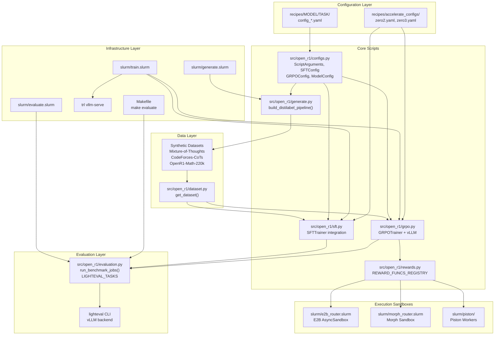
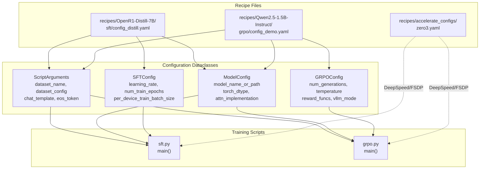
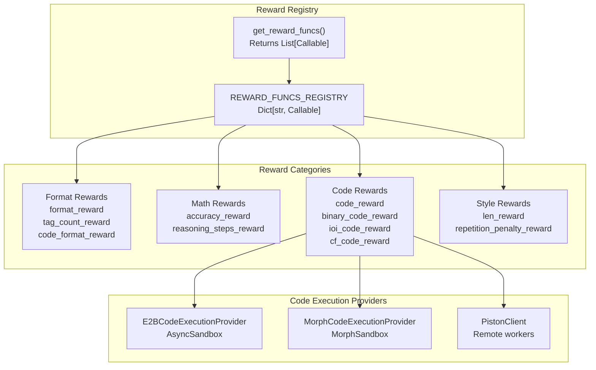
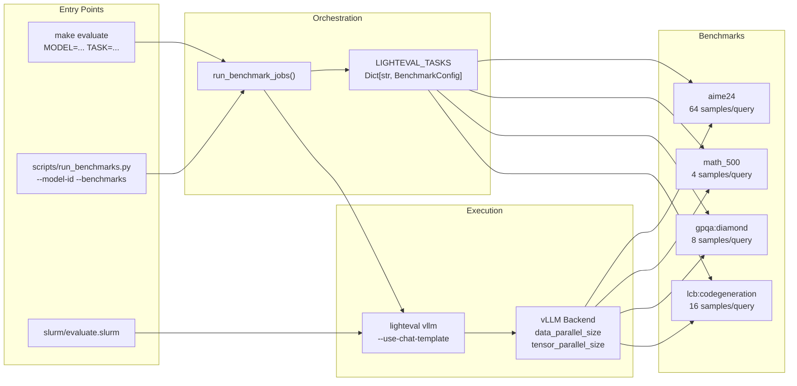

<!-- source: DeepWiki mcp.deepwiki.com · repo huggingface/open-r1 · page 1 Overview · fetched 2026-10-26 -->

# Overview

<details>
<summary>Relevant source files</summary>

The following files were used as context for generating this wiki page:

- [README.md](README.md)

</details>


This page introduces the Open R1 repository, its goals, and provides a high-level architecture overview of the system. For detailed information on specific subsystems, see:
- Installation and setup: [Installation and Setup](#1.1)
- Training pipelines: [Training Pipeline](#2)
- Reward functions: [Reward Functions](#3)
- Evaluation system: [Evaluation System](#4)
- Data generation: [Data Generation and Processing](#5)
- Infrastructure: [Infrastructure and Operations](#6)

## Purpose and Goals

Open R1 is a complete reproduction of DeepSeek-R1 that enables training language models to reason through problems step-by-step. The repository implements three complementary approaches to teaching reasoning:

1. **Distillation (R1-Distill)**: Learn from high-quality reasoning traces via supervised fine-tuning
2. **Pure RL (R1-Zero)**: Learn from verification signals via reinforcement learning
3. **Multi-stage training**: Combine distillation and RL for maximum effectiveness

The codebase is designed to be simple and extensible, with most functionality contained in three core scripts: `sft.py` for supervised fine-tuning, `grpo.py` for reinforcement learning, and `generate.py` for synthetic data creation.

**Sources:** [README.md:19-36]()

## System Architecture

The Open R1 system consists of five major subsystems that work together to produce reasoning-capable language models:



**Key Components:**

| Component | Entry Point | Purpose |
|-----------|-------------|---------|
| **Supervised Fine-Tuning** | `src/open_r1/sft.py` | Distill reasoning from synthetic datasets using TRL's `SFTTrainer` |
| **GRPO Training** | `src/open_r1/grpo.py` | Reinforcement learning with vLLM generation and multi-objective rewards |
| **Data Generation** | `src/open_r1/generate.py` | Create synthetic datasets using Distilabel and vLLM on Ray clusters |
| **Reward System** | `src/open_r1/rewards.py` | Registry of 12+ reward functions for format, math, code execution, and style |
| **Evaluation** | `src/open_r1/evaluation.py` | Benchmark runner using lighteval with AIME, MATH-500, GPQA, LiveCodeBench |
| **Configuration** | `src/open_r1/configs.py` | Dataclasses for training parameters, managed via YAML files in `recipes/` |

**Sources:** [README.md:21-29](), [README.md:101-155]()

## Training Pipeline Flow

The following diagram shows how data flows through the training pipeline from raw datasets to trained models, with specific code entry points:

```mermaid
graph LR
    subgraph "Input Data"
        BASE["Base Datasets<br/>NuminaMath-TIR<br/>Codeforces"]
        R1_TRACES["DeepSeek-R1<br/>Reasoning Traces"]
    end
    
    subgraph "Data Generation"
        GEN_SCRIPT["generate.py"]
        BUILD_PIPE["build_distilabel_pipeline()"]
        VLLM_MODEL["vLLM Model Server<br/>tensor_parallel_size"]
        RAY_CLUSTER["Ray Cluster<br/>Distributed execution"]
        
        GEN_SCRIPT --> BUILD_PIPE
        BUILD_PIPE --> VLLM_MODEL
        BUILD_PIPE --> RAY_CLUSTER
    end
    
    subgraph "Synthetic Datasets"
        MIX["open-r1/Mixture-of-Thoughts<br/>350k samples"]
        CODE["open-r1/codeforces-cots<br/>100k samples"]
        MATH["open-r1/OpenR1-Math-220k<br/>220k samples"]
    end
    
    subgraph "Stage 1: Distillation"
        SFT_SCRIPT["sft.py<br/>accelerate launch"]
        GET_DATASET["get_dataset()"]
        SFT_TRAINER["trl.SFTTrainer"]
        SFT_CONFIG["SFTConfig<br/>learning_rate, num_epochs<br/>max_seq_length"]
        
        SFT_SCRIPT --> GET_DATASET
        SFT_SCRIPT --> SFT_CONFIG
        GET_DATASET --> SFT_TRAINER
        SFT_CONFIG --> SFT_TRAINER
    end
    
    subgraph "Stage 2: RL Training"
        GRPO_SCRIPT["grpo.py<br/>accelerate launch"]
        GRPO_CONFIG["GRPOConfig<br/>num_generations<br/>temperature, top_p"]
        GRPO_TRAINER["trl.GRPOTrainer"]
        VLLM_GEN["vLLM generation<br/>16-64 samples"]
        GET_REWARD["get_reward_funcs()"]
        REWARD_REG["REWARD_FUNCS_REGISTRY"]
        
        GRPO_SCRIPT --> GRPO_CONFIG
        GRPO_SCRIPT --> GET_DATASET
        GRPO_CONFIG --> GRPO_TRAINER
        GET_DATASET --> GRPO_TRAINER
        GRPO_TRAINER --> VLLM_GEN
        VLLM_GEN --> GET_REWARD
        GET_REWARD --> REWARD_REG
        REWARD_REG --> GRPO_TRAINER
    end
    
    subgraph "Output Models"
        DISTILL["R1-Distill Models<br/>7B, 14B, 32B variants"]
        RL_MODEL["R1-Zero Models<br/>RL-tuned"]
    end
    
    BASE --> GEN_SCRIPT
    R1_TRACES -.inspire.-> GEN_SCRIPT
    VLLM_MODEL --> MIX
    VLLM_MODEL --> CODE
    VLLM_MODEL --> MATH
    
    MIX --> GET_DATASET
    CODE --> GET_DATASET
    MATH --> GET_DATASET
    
    SFT_TRAINER --> DISTILL
    DISTILL -.optional.-> GRPO_SCRIPT
    GRPO_TRAINER --> RL_MODEL
```



**Training Stages:**

1. **Data Generation** ([generate.py:1-100]()): Uses `build_distilabel_pipeline()` to create synthetic datasets by sampling from models served via vLLM on Ray clusters
2. **Supervised Fine-Tuning** ([sft.py:1-200]()): Loads datasets with `get_dataset()`, configures training with `SFTConfig`, and trains using TRL's `SFTTrainer`
3. **RL Training** ([grpo.py:1-300]()): Generates multiple completions per prompt using vLLM, evaluates them with `get_reward_funcs()`, and updates policy via `GRPOTrainer`

**Sources:** [README.md:106-127](), [README.md:216-236]()

## Configuration System

All training runs are configured through YAML files in the `recipes/` directory, which instantiate dataclasses defined in `configs.py`:



Configuration parameters can be overridden from the command line:

```bash
accelerate launch --config_file recipes/accelerate_configs/zero3.yaml \
    src/open_r1/sft.py \
    --config recipes/OpenR1-Distill-7B/sft/config_distill.yaml \
    --model_name_or_path Qwen/Qwen3-0.6B-Base \
    --learning_rate 5.0e-5
```

**Sources:** [README.md:124-155](), [README.md:419-442]()

## Reward System Architecture

The GRPO training process uses a flexible reward system defined in `rewards.py`:



Reward functions are specified in the GRPO configuration YAML:

```yaml
reward_funcs:
  - name: format_reward
    weight: 1.0
  - name: accuracy_reward
    weight: 5.0
  - name: code_reward
    weight: 10.0
    provider_type: e2b
```

The `get_reward_funcs()` function instantiates the specified rewards from `REWARD_FUNCS_REGISTRY` and returns them as a list of callables that evaluate model outputs.

**Sources:** [README.md:242-393]()

## Evaluation Pipeline

Model evaluation uses the `lighteval` library with vLLM backend for efficient inference:



The `LIGHTEVAL_TASKS` registry in [evaluation.py]() maps benchmark names to their configuration, including number of samples per query and evaluation parameters. Evaluation results are saved as JSON (aggregate metrics) and Parquet (detailed logs).

**Sources:** [README.md:444-525](), [README.md:527-665]()

## Infrastructure and Orchestration

The repository provides Slurm scripts and Makefile targets to orchestrate distributed training and evaluation:

| Script | Purpose | Key Features |
|--------|---------|--------------|
| `slurm/train.slurm` | Launch training jobs | N+1 node setup for GRPO (1 vLLM server, N training nodes) |
| `slurm/evaluate.slurm` | Launch evaluation jobs | Configurable parallelism (data/tensor parallel) |
| `slurm/generate.slurm` | Launch data generation | Ray cluster setup with vLLM server |
| `slurm/e2b_router.slurm` | E2B router service | Rate limiting for code execution |
| `slurm/morph_router.slurm` | Morph router service | Multi-language code execution |
| `slurm/piston/` | Piston worker setup | Competitive programming execution |

**Training Example (GRPO on 2 nodes):**
```bash
sbatch --nodes=2 slurm/train.slurm \
    --model Qwen2.5-1.5B-Instruct \
    --task grpo \
    --config demo \
    --accelerator zero2 \
    --dp 8 --tp 1
```

**Evaluation Example:**
```bash
python scripts/run_benchmarks.py \
    --model-id deepseek-ai/DeepSeek-R1-Distill-Qwen-7B \
    --benchmarks aime24 math_500 gpqa lcb
```

The `Makefile` provides convenient targets for local development:
- `make install`: Setup environment and dependencies
- `make evaluate MODEL=... TASK=...`: Run single benchmark
- Code quality: `make quality`, `make style`, `make test`

**Sources:** [README.md:394-417](), [README.md:49-100]()

## Key Dependencies

The system relies on several critical libraries:

| Dependency | Version | Purpose |
|------------|---------|---------|
| `vllm` | 0.8.5.post1 | Fast inference for generation and evaluation |
| `flash-attn` | Latest | Efficient attention computation |
| `trl` | Latest | Training utilities (SFTTrainer, GRPOTrainer) |
| `distilabel` | ≥1.5.2 | Synthetic data generation pipelines |
| `lighteval` | Latest | Standardized benchmark evaluation |
| `accelerate` | Latest | Multi-GPU/multi-node training orchestration |
| `deepspeed` | Latest | ZeRO optimization stages |

All dependencies are managed via `uv` package manager and require CUDA 12.4.

**Sources:** [README.md:49-100]()

## Next Steps

For detailed information on specific components:
- **Getting Started**: See [Installation and Setup](#1.1) for environment configuration
- **Training Models**: See [Training Pipeline](#2) for SFT and GRPO workflows
- **Reward Design**: See [Reward Functions](#3) for available reward functions
- **Running Evaluations**: See [Evaluation System](#4) for benchmark execution
- **Creating Datasets**: See [Data Generation and Processing](#5) for synthetic data creation
- **Infrastructure Setup**: See [Infrastructure and Operations](#6) for Slurm and vLLM configuration

---

