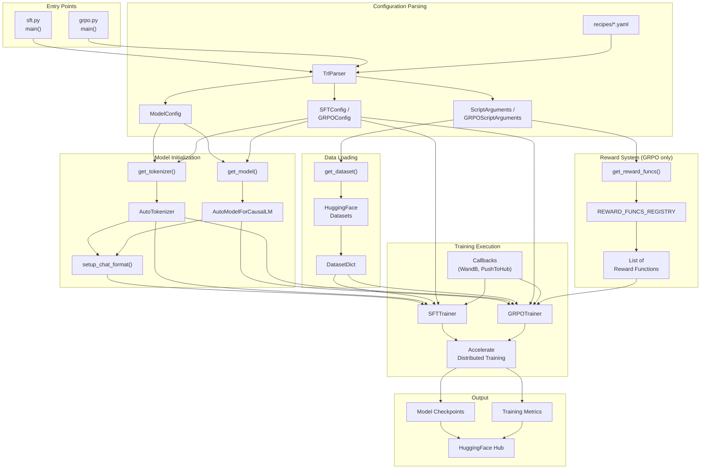
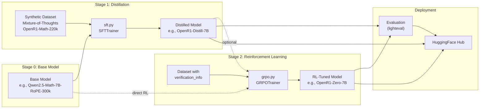

<!-- source: DeepWiki mcp.deepwiki.com · repo huggingface/open-r1 · page 2 Training Pipeline · fetched 2026-10-26 -->

# Training Pipeline

<details>
<summary>Relevant source files</summary>

The following files were used as context for generating this wiki page:

- [README.md](README.md)
- [src/open_r1/grpo.py](src/open_r1/grpo.py)
- [src/open_r1/sft.py](src/open_r1/sft.py)
- [src/open_r1/utils/__init__.py](src/open_r1/utils/__init__.py)
- [src/open_r1/utils/data.py](src/open_r1/utils/data.py)
- [src/open_r1/utils/model_utils.py](src/open_r1/utils/model_utils.py)
- [tests/utils/test_data.py](tests/utils/test_data.py)

</details>


## Purpose and Scope

The training pipeline implements the core workflow for creating Open R1 models through two distinct training stages: supervised fine-tuning (distillation) and reinforcement learning. This document provides an overview of the training architecture, entry points, and how the two stages work together to produce models with reasoning capabilities.

For detailed implementation of each stage, see:
- Supervised Fine-Tuning (distillation): [2.1](#2.1)
- Group Relative Policy Optimization (reinforcement learning): [2.2](#2.2)
- Configuration system details: [2.3](#2.3)
- Pre-configured training recipes: [2.4](#2.4)

For data generation and evaluation, see:
- Data generation pipeline: [5](#5)
- Model evaluation system: [4](#4)

---

## Training Stages Overview

Open R1 supports three training approaches, following the DeepSeek-R1 methodology:

### Stage 1: Distillation (SFT)

The first stage uses supervised fine-tuning to distill reasoning capabilities from high-quality traces (either from DeepSeek-R1 or from previously trained models). The model learns to replicate the reasoning patterns present in the training data.

**Typical workflow:**
- Start from a base model (e.g., `Qwen2.5-Math-7B-RoPE-300k`)
- Train on synthetic datasets with reasoning traces (e.g., `Mixture-of-Thoughts`, `OpenR1-Math-220k`)
- Produce a distilled model (e.g., `OpenR1-Distill-7B`)

### Stage 2: Reinforcement Learning (GRPO)

The second stage uses Group Relative Policy Optimization with a multi-objective reward system to improve model performance through trial-and-error learning. The model generates multiple completions per prompt and learns from reward signals based on correctness, format, and style.

**Typical workflow:**
- Start from a base model or distilled model
- Train on datasets with verification information (ground truth answers, test cases)
- Use vLLM to generate 16-64 completions per prompt
- Evaluate completions using 12+ reward functions
- Update policy based on rewards

### Stage 3: Multi-Stage Training (Optional)

Models can be trained through both stages sequentially: distillation first to learn reasoning patterns, then RL to refine performance through verification feedback.

**Sources:** [README.md:30-36](), [README.md:197-215](), [README.md:216-236]()

---

## Entry Points and Command-Line Interface

### Script Structure

Both training stages are implemented as standalone Python scripts with identical command-line interfaces:

| Script | Purpose | Trainer Class |
|--------|---------|---------------|
| `src/open_r1/sft.py` | Supervised fine-tuning | `trl.SFTTrainer` |
| `src/open_r1/grpo.py` | Reinforcement learning | `trl.GRPOTrainer` |

Each script follows the same structure:
1. Parse configuration from command-line or YAML file
2. Load dataset, tokenizer, and model
3. Initialize trainer with configuration
4. Execute training loop
5. Save model and metrics
6. Optionally evaluate and push to Hub

### Configuration Parsing

Both scripts use `TrlParser` to parse three configuration dataclasses:

```
TrlParser((ScriptArguments, SFTConfig/GRPOConfig, ModelConfig))
```

- `ScriptArguments` / `GRPOScriptArguments`: Dataset and reward configuration
- `SFTConfig` / `GRPOConfig`: Training hyperparameters
- `ModelConfig`: Model loading parameters

Configuration can be provided via:
- Command-line arguments: `--arg_name value`
- YAML configuration file: `--config path/to/config.yaml`
- Both (command-line overrides YAML)

### Basic Usage Examples

**Supervised Fine-Tuning:**
```bash
accelerate launch --config_file recipes/accelerate_configs/zero3.yaml \
    src/open_r1/sft.py \
    --config recipes/OpenR1-Distill-7B/sft/config_distill.yaml
```

**GRPO Training:**
```bash
accelerate launch --config_file recipes/accelerate_configs/zero3.yaml \
    src/open_r1/grpo.py \
    --config recipes/Qwen2.5-1.5B-Instruct/grpo/config_demo.yaml
```

**Overriding YAML parameters:**
```bash
accelerate launch --config_file recipes/accelerate_configs/zero3.yaml \
    src/open_r1/sft.py \
    --config recipes/OpenR1-Distill-7B/sft/config_distill.yaml \
    --model_name_or_path Qwen/Qwen3-0.6B-Base \
    --output_dir data/OpenR1-Distill-0.6B
```

**Sources:** [README.md:101-155](), [src/open_r1/sft.py:15-34](), [src/open_r1/sft.py:166-169](), [src/open_r1/grpo.py:178-181]()

---

## Training Architecture

The following diagram shows how training scripts, configuration, and supporting utilities work together:

### Training Component Architecture



**Sources:** [src/open_r1/sft.py:55-164](), [src/open_r1/grpo.py:35-176](), [src/open_r1/utils/__init__.py:1-6]()

---

## Training Execution Flow

### Supervised Fine-Tuning Flow

```mermaid
graph LR
    subgraph "Initialization"
        PARSE_SFT["Parse config<br/>(TrlParser)"]
        LOAD_DATA_SFT["Load dataset<br/>(get_dataset)"]
        LOAD_TOK_SFT["Load tokenizer<br/>(get_tokenizer)"]
        LOAD_MODEL_SFT["Load model<br/>(get_model)"]
    end
    
    subgraph "Training Setup"
        CHECK_CHAT["Check chat template"]
        SETUP_CHAT_SFT["Setup ChatML<br/>if needed"]
        INIT_TRAINER_SFT["Initialize SFTTrainer"]
    end
    
    subgraph "Training Loop"
        TRAIN_SFT["trainer.train()"]
        CHECKPOINT_SFT["Save checkpoints"]
        METRICS_SFT["Log metrics"]
    end
    
    subgraph "Finalization"
        SAVE_MODEL_SFT["Save final model"]
        EVAL_SFT["Evaluate<br/>(optional)"]
        PUSH_HUB_SFT["Push to Hub<br/>(optional)"]
    end
    
    PARSE_SFT --> LOAD_DATA_SFT
    LOAD_DATA_SFT --> LOAD_TOK_SFT
    LOAD_TOK_SFT --> LOAD_MODEL_SFT
    LOAD_MODEL_SFT --> CHECK_CHAT
    CHECK_CHAT --> SETUP_CHAT_SFT
    SETUP_CHAT_SFT --> INIT_TRAINER_SFT
    INIT_TRAINER_SFT --> TRAIN_SFT
    TRAIN_SFT --> CHECKPOINT_SFT
    CHECKPOINT_SFT --> METRICS_SFT
    METRICS_SFT --> SAVE_MODEL_SFT
    SAVE_MODEL_SFT --> EVAL_SFT
    EVAL_SFT --> PUSH_HUB_SFT
```



**Sources:** [src/open_r1/sft.py:55-164]()

### GRPO Training Flow

```mermaid
graph LR
    subgraph "Initialization"
        PARSE_GRPO["Parse config<br/>(TrlParser)"]
        LOAD_DATA_GRPO["Load dataset<br/>(get_dataset)"]
        LOAD_TOK_GRPO["Load tokenizer<br/>(get_tokenizer)"]
        LOAD_MODEL_GRPO["Load model<br/>(get_model)"]
    end
    
    subgraph "Reward Setup"
        GET_REWARDS["Get reward functions<br/>(get_reward_funcs)"]
        PREPARE_CONV["Prepare conversations<br/>(make_conversation)"]
    end
    
    subgraph "Training Setup"
        INIT_TRAINER_GRPO["Initialize GRPOTrainer<br/>with reward_funcs"]
    end
    
    subgraph "Training Loop"
        TRAIN_GRPO["trainer.train()<br/>- Generate completions<br/>- Compute rewards<br/>- Update policy"]
        CHECKPOINT_GRPO["Save checkpoints"]
        METRICS_GRPO["Log metrics"]
    end
    
    subgraph "Finalization"
        SAVE_MODEL_GRPO["Save final model"]
        EVAL_GRPO["Evaluate<br/>(optional)"]
        PUSH_HUB_GRPO["Push to Hub<br/>(optional)"]
    end
    
    PARSE_GRPO --> LOAD_DATA_GRPO
    LOAD_DATA_GRPO --> LOAD_TOK_GRPO
    LOAD_TOK_GRPO --> LOAD_MODEL_GRPO
    LOAD_MODEL_GRPO --> GET_REWARDS
    GET_REWARDS --> PREPARE_CONV
    PREPARE_CONV --> INIT_TRAINER_GRPO
    INIT_TRAINER_GRPO --> TRAIN_GRPO
    TRAIN_GRPO --> CHECKPOINT_GRPO
    CHECKPOINT_GRPO --> METRICS_GRPO
    METRICS_GRPO --> SAVE_MODEL_GRPO
    SAVE_MODEL_GRPO --> EVAL_GRPO
    EVAL_GRPO --> PUSH_HUB_GRPO
```



**Sources:** [src/open_r1/grpo.py:35-176]()

---

## Model and Data Loading

### Tokenizer Loading

The `get_tokenizer()` function loads a tokenizer from HuggingFace Hub and optionally applies a custom chat template:

- Loads tokenizer using `AutoTokenizer.from_pretrained()`
- Applies custom chat template if provided in training config
- Returns `PreTrainedTokenizer` instance

For SFT, if no chat template exists, the script defaults to ChatML format using `setup_chat_format()`.

**Sources:** [src/open_r1/utils/model_utils.py:9-20](), [src/open_r1/sft.py:94-96]()

### Model Loading

The `get_model()` function loads a causal language model with appropriate configuration:

- Loads model using `AutoModelForCausalLM.from_pretrained()`
- Applies quantization if configured (via `get_quantization_config()`)
- Sets `use_cache=False` if gradient checkpointing is enabled
- Configures attention implementation and dtype
- Returns `AutoModelForCausalLM` instance

**Sources:** [src/open_r1/utils/model_utils.py:23-42]()

### Dataset Loading

The `get_dataset()` function supports two modes:

**Single dataset mode:**
- Loads dataset using `datasets.load_dataset()`
- Specified via `dataset_name` and `dataset_config`
- Returns `DatasetDict` with train/test splits

**Dataset mixture mode:**
- Loads multiple datasets with optional weighting
- Combines datasets using `concatenate_datasets()`
- Supports column selection and train/test splitting
- Specified via `dataset_mixture` configuration

**Sources:** [src/open_r1/utils/data.py:12-65](), [tests/utils/test_data.py:30-51]()

---

## Configuration System Overview

### Configuration Dataclasses

Training behavior is controlled by three configuration dataclasses:

| Dataclass | Inherits From | Purpose |
|-----------|---------------|---------|
| `ScriptArguments` | - | Dataset loading, prompt column, splits |
| `GRPOScriptArguments` | `ScriptArguments` | Adds reward function configuration |
| `SFTConfig` | `trl.SFTConfig` | SFT hyperparameters, chat template, system prompt |
| `GRPOConfig` | `trl.GRPOConfig` | GRPO hyperparameters, vLLM settings, generation params |
| `ModelConfig` | `trl.ModelConfig` | Model loading, quantization, PEFT config |

### YAML Configuration Files

Pre-configured recipes are stored in `recipes/` directory with the following structure:

```
recipes/
├── {MODEL_NAME}/
│   ├── sft/
│   │   └── config_{variant}.yaml
│   └── grpo/
│       └── config_{variant}.yaml
└── accelerate_configs/
    ├── zero2.yaml
    ├── zero3.yaml
    └── fsdp.yaml
```

Each YAML file contains all three configuration dataclasses. Command-line arguments override YAML values.

For detailed configuration parameters, see [2.3](#2.3). For pre-configured recipes, see [2.4](#2.4).

**Sources:** [README.md:124-155](), [README.md:421-442]()

---

## Distributed Training Integration

### Accelerate Integration

Both training scripts use HuggingFace Accelerate for distributed training:

- Launch via `accelerate launch --config_file {accelerate_config}`
- Accelerate configs specify parallelism strategy (DDP, ZeRO, FSDP)
- Trainer automatically handles multi-GPU/multi-node training
- Supports gradient accumulation and mixed precision training

### Supported Parallelism Strategies

| Strategy | Configuration File | Use Case |
|----------|-------------------|----------|
| DDP | `zero2.yaml` | Single-node, small models |
| ZeRO-3 | `zero3.yaml` | Single-node, 7B-14B models |
| FSDP | `fsdp.yaml` | Multi-node, 32B+ models |

### GRPO Multi-Node Setup

GRPO training uses an N+1 node configuration:
- **Node 0:** Runs vLLM server for generation
- **Nodes 1-N:** Run training processes

The vLLM server generates multiple completions per prompt, which are evaluated and used to update the policy on training nodes.

**Sources:** [README.md:101-136](), [README.md:216-236](), [README.md:394-417]()

---

## Checkpoint Management and Resumption

### Automatic Checkpoint Detection

Both scripts automatically detect and resume from checkpoints:

```python
last_checkpoint = get_last_checkpoint(training_args.output_dir)
if last_checkpoint is not None and training_args.resume_from_checkpoint is None:
    logger.info(f"Checkpoint detected, resuming training at {last_checkpoint=}.")
```

### Checkpoint Saving

Trainers save checkpoints at regular intervals configured by:
- `save_strategy`: "steps", "epoch", or "no"
- `save_steps`: Number of steps between checkpoints
- `save_total_limit`: Maximum number of checkpoints to keep

### Model Saving and Hub Upload

After training completes:
1. Final model saved to `output_dir`
2. Generation config aligned with tokenizer EOS token
3. Model card created with metadata
4. Optionally pushed to HuggingFace Hub if `push_to_hub=True`

**Sources:** [src/open_r1/sft.py:77-82](), [src/open_r1/sft.py:111-147](), [src/open_r1/grpo.py:64-68](), [src/open_r1/grpo.py:125-159]()

---

## Model Lifecycle

### Three-Stage Model Evolution



### Training Paths

**Path 1: Distillation Only**
- Base model → SFT with reasoning traces → Distilled model
- Replicates reasoning patterns from synthetic data
- Example: `OpenR1-Distill-7B`

**Path 2: Pure RL**
- Base model → GRPO with verification → RL-tuned model
- Learns from trial-and-error with reward signals
- Example: `OpenR1-Zero-7B` (planned)

**Path 3: Multi-Stage**
- Base model → SFT → GRPO → RL-tuned model
- Combines benefits of both approaches
- Distillation provides initial reasoning capability
- RL refines through verification feedback

**Sources:** [README.md:30-40](), [README.md:197-215]()

---

## Training Metrics and Logging

### Metrics Collection

Both trainers log metrics at regular intervals:
- Training loss per step/epoch
- Learning rate schedule
- Gradient norms
- GRPO-specific: reward statistics, KL divergence, policy entropy

### Logging Backends

Metrics can be logged to multiple backends via `report_to` parameter:
- **Weights & Biases (wandb):** Full experiment tracking with visualization
- **TensorBoard:** Local logging and visualization
- **None:** Disable external logging

### Weights & Biases Integration

When using wandb, the training script:
1. Initializes run with `init_wandb_training()`
2. Logs metrics automatically via trainer callbacks
3. Can be configured with custom `wandb_entity`, `wandb_project`, `run_name`

**Sources:** [src/open_r1/sft.py:84-85](), [src/open_r1/grpo.py:70-71](), [README.md:148-154]()

---

## Summary

The training pipeline provides a flexible, two-stage approach to building reasoning models:

1. **Distillation (SFT)** teaches models to replicate reasoning patterns from high-quality traces
2. **Reinforcement Learning (GRPO)** refines models through trial-and-error with multi-objective rewards
3. Both stages share a common configuration system and command-line interface
4. Models can be trained via either stage individually or combined in multi-stage training
5. Integration with Accelerate enables distributed training from single-node to multi-node clusters
6. Checkpointing, logging, and Hub integration are built-in for production workflows

For implementation details of each stage, configuration options, and pre-built recipes, see the child pages of this section.

---

