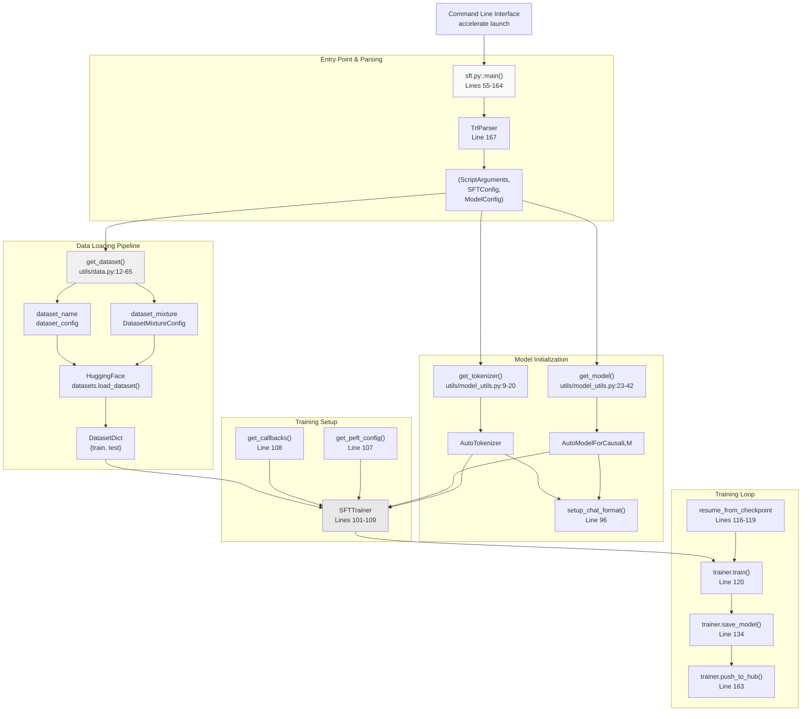
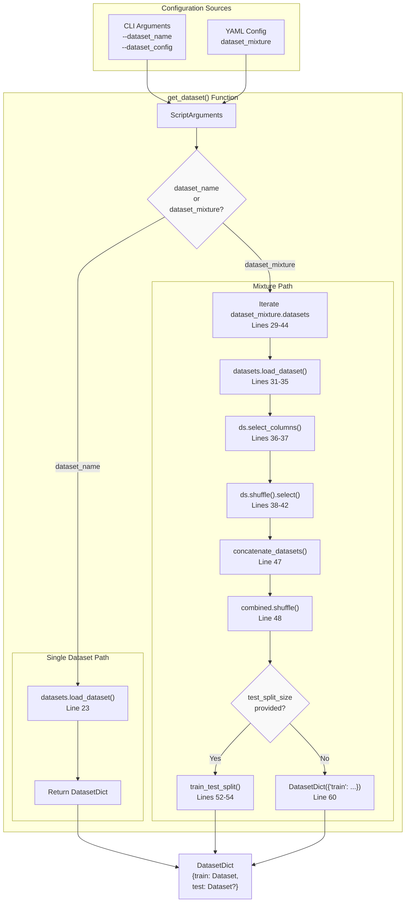
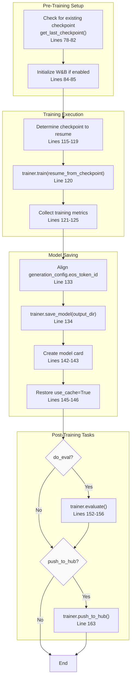

<!-- source: DeepWiki mcp.deepwiki.com · repo huggingface/open-r1 · page 2.1 Supervised Fine-Tuning (SFT) · fetched 2026-10-26 -->

# Supervised Fine-Tuning (SFT)

<details>
<summary>Relevant source files</summary>

The following files were used as context for generating this wiki page:

- [README.md](README.md)
- [src/open_r1/sft.py](src/open_r1/sft.py)
- [src/open_r1/utils/__init__.py](src/open_r1/utils/__init__.py)
- [src/open_r1/utils/data.py](src/open_r1/utils/data.py)
- [src/open_r1/utils/model_utils.py](src/open_r1/utils/model_utils.py)
- [tests/utils/test_data.py](tests/utils/test_data.py)

</details>


## Purpose and Scope

This document describes the Supervised Fine-Tuning (SFT) component of the Open R1 training pipeline. SFT is the first stage of the training process, used to distill reasoning capabilities from synthetic datasets into smaller language models. This page covers the `sft.py` script, its configuration system, data loading mechanisms, model initialization, and the complete training workflow.

For reinforcement learning training with GRPO, see [Group Relative Policy Optimization (GRPO)](#2.2). For configuration details shared across both SFT and GRPO, see [Configuration System](#2.3). For pre-built training recipes, see [Training Recipes](#2.4).

## Overview

The SFT system performs standard supervised fine-tuning on datasets containing reasoning traces. It is designed to distill knowledge from large reasoning models (like DeepSeek-R1) into smaller, more efficient models. The primary use case is training R1-Distill models that replicate the reasoning capabilities of their larger counterparts.

**Key Components:**
- **Entry Point**: `src/open_r1/sft.py` - Main training script
- **Configuration**: `ScriptArguments`, `SFTConfig`, `ModelConfig` dataclasses
- **Data Loading**: `get_dataset()` function with support for single datasets or mixtures
- **Model Management**: `get_model()` and `get_tokenizer()` utilities
- **Training Engine**: TRL's `SFTTrainer` with Accelerate for distributed training

Sources: [README.md:1-214](), [src/open_r1/sft.py:1-170]()

## System Architecture



**Diagram: SFT System Architecture**

This diagram shows the complete execution flow from command-line invocation through configuration parsing, data loading, model initialization, and the training loop. The system uses TRL's `TrlParser` to handle three configuration objects simultaneously, `get_dataset()` to load either single datasets or mixtures, and `SFTTrainer` from TRL to orchestrate the training process.

Sources: [src/open_r1/sft.py:55-170](), [src/open_r1/utils/data.py:12-65](), [src/open_r1/utils/model_utils.py:9-42]()

## Configuration System

### Configuration Dataclasses

The SFT script uses three configuration objects parsed together:

| Configuration Class | Purpose | Key Parameters |
|---------------------|---------|----------------|
| `ScriptArguments` | Dataset configuration | `dataset_name`, `dataset_config`, `dataset_mixture`, `dataset_train_split`, `dataset_test_split` |
| `SFTConfig` | Training parameters | `learning_rate`, `num_train_epochs`, `per_device_train_batch_size`, `max_seq_length`, `gradient_checkpointing` |
| `ModelConfig` | Model loading parameters | `model_name_or_path`, `torch_dtype`, `attn_implementation`, `trust_remote_code` |

Sources: [src/open_r1/sft.py:167-169]()

### SFTConfig Parameters

The `SFTConfig` extends TRL's base configuration with SFT-specific parameters:

| Parameter | Type | Description | Default |
|-----------|------|-------------|---------|
| `learning_rate` | float | Learning rate for optimizer | - |
| `num_train_epochs` | int | Number of training epochs | - |
| `per_device_train_batch_size` | int | Batch size per device | - |
| `max_seq_length` | int | Maximum sequence length for training | - |
| `gradient_checkpointing` | bool | Enable gradient checkpointing to save memory | False |
| `bf16` | bool | Use bfloat16 mixed precision | False |
| `use_liger_kernel` | bool | Use Liger kernel optimizations | False |
| `output_dir` | str | Directory to save model checkpoints | - |
| `chat_template` | str | Optional custom chat template | None |
| `eos_token` | str | End-of-sequence token | `<|endoftext|>` |

Sources: [README.md:106-127]()

## Data Loading Pipeline



**Diagram: Data Loading Logic Flow**

The data loading system supports two modes: single dataset loading and dataset mixture composition. The `get_dataset()` function branches based on the configuration provided, either loading a dataset directly from HuggingFace Hub or assembling multiple datasets with optional column selection, weighting, and train/test splitting.

Sources: [src/open_r1/utils/data.py:12-65]()

### Single Dataset Loading

For simple cases, specify `dataset_name` and optionally `dataset_config`:

```yaml
dataset_name: open-r1/Mixture-of-Thoughts
dataset_config: all
```

The function calls `datasets.load_dataset()` directly at [src/open_r1/utils/data.py:23]().

### Dataset Mixture Loading

For complex training scenarios, define a `dataset_mixture` configuration:

```yaml
dataset_mixture:
  datasets:
    - id: open-r1/Mixture-of-Thoughts
      config: math
      split: train
      columns: [prompt, chosen]
      weight: 0.5
    - id: open-r1/CodeForces-CoTs
      config: default
      split: train
      columns: [prompt, chosen]
      weight: 0.3
  seed: 42
  test_split_size: 0.1
```

**Processing Steps:**
1. Iterate through each dataset configuration [src/open_r1/utils/data.py:29-44]()
2. Load each dataset using `datasets.load_dataset()` [src/open_r1/utils/data.py:31-35]()
3. Select specified columns if provided [src/open_r1/utils/data.py:36-37]()
4. Subsample based on weight [src/open_r1/utils/data.py:38-42]()
5. Concatenate all datasets [src/open_r1/utils/data.py:47]()
6. Shuffle combined dataset [src/open_r1/utils/data.py:48]()
7. Optionally create train/test split [src/open_r1/utils/data.py:51-57]()

Sources: [src/open_r1/utils/data.py:24-62](), [tests/utils/test_data.py:37-83]()

## Model and Tokenizer Initialization

### Tokenizer Loading

The `get_tokenizer()` function loads the tokenizer and optionally applies a custom chat template:

```python
# src/open_r1/utils/model_utils.py:9-20
def get_tokenizer(model_args, training_args):
    tokenizer = AutoTokenizer.from_pretrained(
        model_args.model_name_or_path,
        revision=model_args.model_revision,
        trust_remote_code=model_args.trust_remote_code,
    )
    if training_args.chat_template is not None:
        tokenizer.chat_template = training_args.chat_template
    return tokenizer
```

**Chat Template Handling:**
- If `training_args.chat_template` is provided, it overrides the tokenizer's default [src/open_r1/utils/model_utils.py:17-18]()
- If no chat template exists after loading, the script defaults to ChatML format [src/open_r1/sft.py:94-96]()

Sources: [src/open_r1/utils/model_utils.py:9-20](), [src/open_r1/sft.py:91-96]()

### Model Loading

The `get_model()` function loads the model with appropriate configuration:

**Key Features:**
- **Dtype Configuration**: Supports `auto`, `bfloat16`, `float16`, or `float32` [src/open_r1/utils/model_utils.py:25-27]()
- **Quantization**: Optional quantization via `get_quantization_config()` [src/open_r1/utils/model_utils.py:28]()
- **Attention Implementation**: Configurable attention mechanism (e.g., `flash_attention_2`) [src/open_r1/utils/model_utils.py:32]()
- **Cache Management**: Disables cache when gradient checkpointing is enabled [src/open_r1/utils/model_utils.py:34]()

| Model Parameter | Purpose | Configuration Source |
|-----------------|---------|---------------------|
| `model_name_or_path` | Base model identifier | `ModelConfig.model_name_or_path` |
| `torch_dtype` | Precision mode | `ModelConfig.torch_dtype` |
| `attn_implementation` | Attention kernel | `ModelConfig.attn_implementation` |
| `use_cache` | KV cache for inference | Disabled if `gradient_checkpointing=True` |
| `quantization_config` | Quantization settings | `ModelConfig` (LoRA, QLoRA) |

Sources: [src/open_r1/utils/model_utils.py:23-42]()

## Training Process

### SFTTrainer Initialization

The training process uses TRL's `SFTTrainer`:

```python
# src/open_r1/sft.py:101-109
trainer = SFTTrainer(
    model=model,
    args=training_args,
    train_dataset=dataset[script_args.dataset_train_split],
    eval_dataset=(dataset[script_args.dataset_test_split] 
                  if training_args.eval_strategy != "no" else None),
    processing_class=tokenizer,
    peft_config=get_peft_config(model_args),
    callbacks=get_callbacks(training_args, model_args),
)
```

**Components:**
- **PEFT Integration**: Supports LoRA/QLoRA via `get_peft_config()` [src/open_r1/sft.py:107]()
- **Callbacks**: Custom callbacks for logging and monitoring [src/open_r1/sft.py:108]()
- **Evaluation**: Optional evaluation dataset based on `eval_strategy` [src/open_r1/sft.py:105]()

Sources: [src/open_r1/sft.py:101-109]()

### Training Loop Execution



**Diagram: Training Loop Workflow**

The training loop handles checkpoint resumption, executes training, saves the model with proper configuration, and optionally performs evaluation and model upload to HuggingFace Hub.

Sources: [src/open_r1/sft.py:77-164]()

### Checkpoint Management

**Automatic Checkpoint Detection:**
- Checks `output_dir` for existing checkpoints [src/open_r1/sft.py:79-80]()
- Uses `get_last_checkpoint()` to find most recent checkpoint [src/open_r1/sft.py:80]()
- Resumes training if checkpoint found and `resume_from_checkpoint` not explicitly set [src/open_r1/sft.py:81-82]()

**Manual Checkpoint Specification:**
- Override automatic detection via `--resume_from_checkpoint` flag [src/open_r1/sft.py:116-117]()

Sources: [src/open_r1/sft.py:77-119]()

### Model Saving and Publishing

**Saving Process:**
1. Align `generation_config.eos_token_id` with tokenizer [src/open_r1/sft.py:133]()
2. Save model files to `output_dir` [src/open_r1/sft.py:134]()
3. Create model card with dataset metadata [src/open_r1/sft.py:142-143]()
4. Restore `use_cache=True` for fast inference [src/open_r1/sft.py:145-146]()

**Publishing to Hub:**
- Controlled by `--push_to_hub` flag [src/open_r1/sft.py:161-163]()
- Includes dataset name and "open-r1" tag [src/open_r1/sft.py:139-141]()

Sources: [src/open_r1/sft.py:130-164]()

## Command-Line Usage

### Basic Training Command

```bash
accelerate launch --config_file=recipes/accelerate_configs/zero3.yaml \
    src/open_r1/sft.py \
    --model_name_or_path open-r1/Qwen2.5-Math-7B-RoPE-300k \
    --dataset_name open-r1/Mixture-of-Thoughts \
    --dataset_config all \
    --eos_token '<|im_end|>' \
    --learning_rate 4.0e-5 \
    --num_train_epochs 5 \
    --max_seq_length 32768 \
    --per_device_train_batch_size 2 \
    --gradient_checkpointing \
    --bf16 \
    --use_liger_kernel \
    --output_dir data/OpenR1-Distill-7B
```

Sources: [README.md:108-123](), [src/open_r1/sft.py:18-34]()

### YAML Configuration Usage

```bash
accelerate launch --config_file recipes/accelerate_configs/zero3.yaml \
    src/open_r1/sft.py \
    --config recipes/OpenR1-Distill-7B/sft/config_distill.yaml
```

**Overriding YAML Parameters:**
```bash
accelerate launch --config_file recipes/accelerate_configs/zero3.yaml \
    src/open_r1/sft.py \
    --config recipes/OpenR1-Distill-7B/sft/config_distill.yaml \
    --model_name_or_path Qwen/Qwen3-0.6B-Base \
    --hub_model_id OpenR1-Distill-0.6B \
    --output_dir data/OpenR1-Distill-0.6B
```

Sources: [README.md:124-146]()

### Slurm Cluster Usage

```bash
sbatch --job-name=open_r1 --nodes=1 slurm/train.slurm \
    --model OpenR1-Distill-7B \
    --task sft \
    --config distill \
    --accelerator zero3
```

**Multi-Node Scaling:**
```bash
sbatch --job-name=open_r1 --nodes=4 slurm/train.slurm \
    --model OpenR1-Distill-7B \
    --task sft \
    --config distill \
    --accelerator zero3
```

Sources: [README.md:394-417]()

## Chat Template Configuration

### Default Behavior

The script applies the following logic for chat templates:

1. Load tokenizer from pretrained model [src/open_r1/utils/model_utils.py:11-15]()
2. Override with `training_args.chat_template` if provided [src/open_r1/utils/model_utils.py:17-18]()
3. If no chat template exists, default to ChatML [src/open_r1/sft.py:94-96]()

Sources: [src/open_r1/sft.py:91-96](), [src/open_r1/utils/model_utils.py:17-18]()

### Qwen Models

Qwen base models include a predefined chat template. The EOS token must align with this template:

```bash
accelerate launch --config_file=recipes/accelerate_configs/zero3.yaml \
    src/open_r1/sft.py \
    --model_name_or_path Qwen/Qwen2.5-1.5B \
    --eos_token '<|im_end|>' \
    --dataset_name open-r1/Mixture-of-Thoughts \
    --dataset_config all \
    # ... additional parameters
```

**Key Point**: Qwen models use `<|im_end|>` as the EOS token, not the default `<|endoftext|>`.

Sources: [README.md:156-175]()

### Custom Chat Templates

For models without predefined templates (e.g., Llama, Gemma), provide both the template and EOS token:

```bash
accelerate launch --config_file=recipes/accelerate_configs/zero3.yaml \
    src/open_r1/sft.py \
    --model_name_or_path meta-llama/Llama-3.2-1B \
    --chat_template "$(cat llama_chat_template.jinja)" \
    --eos_token '<|eot_id|>' \
    --dataset_name open-r1/Mixture-of-Thoughts \
    # ... additional parameters
```

**Template Format**: Jinja2 format, typically stored in a `.jinja` file and loaded via shell substitution.

Sources: [README.md:177-195]()

## Advanced Features

### Dataset Mixture Specification

The system supports complex dataset compositions through the `dataset_mixture` configuration:

**Mixture Configuration Schema:**
```yaml
dataset_mixture:
  datasets:
    - id: str                # HuggingFace dataset ID
      config: str            # Dataset configuration name
      split: str             # Split specification (e.g., "train", "train[:1000]")
      columns: List[str]     # Columns to retain (optional)
      weight: float          # Sampling fraction (optional, 0.0-1.0)
  seed: int                  # Random seed for shuffling
  test_split_size: float     # Fraction for test split (optional)
```

**Example Multi-Dataset Mixture:**
```yaml
dataset_mixture:
  datasets:
    - id: open-r1/Mixture-of-Thoughts
      config: math
      split: train
      columns: [prompt, chosen]
      weight: 0.25
    - id: open-r1/CodeForces-CoTs
      config: default
      split: train
      columns: [prompt, chosen]
      weight: 0.5
    - id: open-r1/OpenR1-Math-220k
      config: default
      split: train
      columns: [prompt, chosen]
      weight: 0.25
  seed: 42
  test_split_size: 0.1
```

Sources: [README.md:419-442](), [tests/utils/test_data.py:52-67]()

### Weights & Biases Integration

**Automatic Detection:**
- W&B initialization triggered if `"wandb"` in `training_args.report_to` [src/open_r1/sft.py:84-85]()

**Custom Configuration:**
```bash
accelerate launch --config_file recipes/accelerate_configs/zero3.yaml \
    src/open_r1/sft.py \
    --config recipes/OpenR1-Distill-7B/sft/config_distill.yaml \
    --wandb_entity huggingface \
    --wandb_project open-r1 \
    --run_name Qwen2.5-7B-SFT
```

Sources: [README.md:148-154](), [src/open_r1/sft.py:84-85]()

### Memory Optimization

| Technique | Configuration | Memory Impact |
|-----------|---------------|---------------|
| **Gradient Checkpointing** | `--gradient_checkpointing` | Reduces activation memory by ~50% |
| **Mixed Precision (BF16)** | `--bf16` | Reduces memory by ~50%, requires A100/H100 |
| **Liger Kernels** | `--use_liger_kernel` | Reduces memory by ~20% with fused operations |
| **ZeRO Stage 3** | `accelerate_configs/zero3.yaml` | Shards optimizer states, gradients, and parameters |
| **PEFT (LoRA)** | Configure via `ModelConfig` | Reduces trainable parameters by ~90% |

**Example High-Memory Configuration:**
```bash
# For large models on single node (8x H100 80GB)
accelerate launch --config_file=recipes/accelerate_configs/zero3.yaml \
    src/open_r1/sft.py \
    --model_name_or_path open-r1/Qwen2.5-Math-7B-RoPE-300k \
    --per_device_train_batch_size 1 \
    --gradient_accumulation_steps 8 \
    --gradient_checkpointing \
    --bf16 \
    --use_liger_kernel \
    # ...
```

Sources: [README.md:102-136]()

## Output Artifacts

### Model Checkpoint Structure

After training completes, the `output_dir` contains:

```
output_dir/
├── config.json                    # Model configuration
├── model.safetensors             # Model weights (safetensors format)
├── generation_config.json        # Generation parameters
├── tokenizer_config.json         # Tokenizer configuration
├── tokenizer.json                # Tokenizer vocabulary
├── special_tokens_map.json       # Special token mappings
├── trainer_state.json            # Training state for resumption
├── training_args.bin             # Training arguments
├── all_results.json              # Final metrics
└── README.md                     # Auto-generated model card
```

### Metrics and Logging

**Training Metrics** (saved to `all_results.json`):
- `train_loss`: Final training loss
- `train_samples`: Number of training samples
- `train_runtime`: Total training time
- `train_samples_per_second`: Training throughput
- `train_steps_per_second`: Step throughput
- `total_flos`: Total floating point operations

**Evaluation Metrics** (if `do_eval=True`):
- `eval_loss`: Evaluation loss
- `eval_samples`: Number of evaluation samples
- `eval_runtime`: Evaluation time
- `perplexity`: Model perplexity on eval set

Sources: [src/open_r1/sft.py:121-156]()

### Model Card Generation

The system automatically generates a model card including:
- Base model information
- Training dataset name(s)
- Training hyperparameters
- "open-r1" tag for discoverability

Generated via `trainer.create_model_card()` at [src/open_r1/sft.py:143]().

Sources: [src/open_r1/sft.py:138-146]()

---

