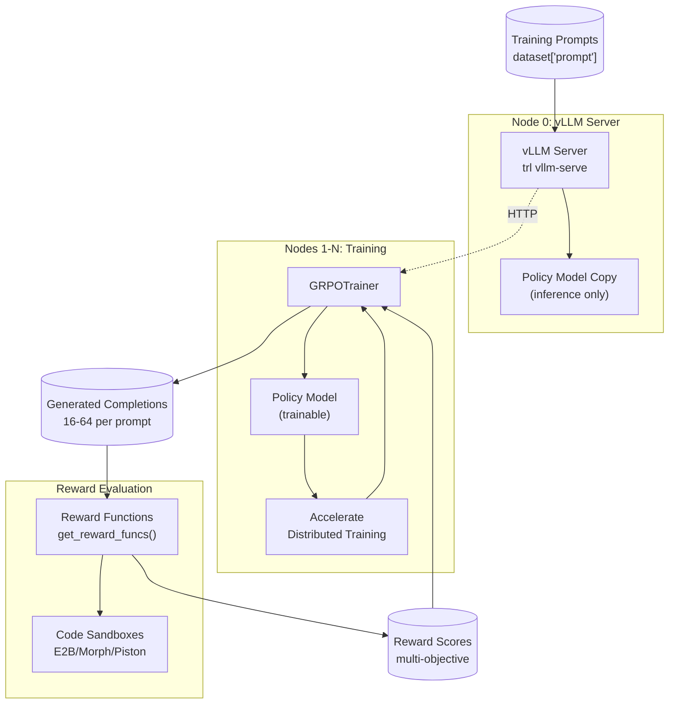
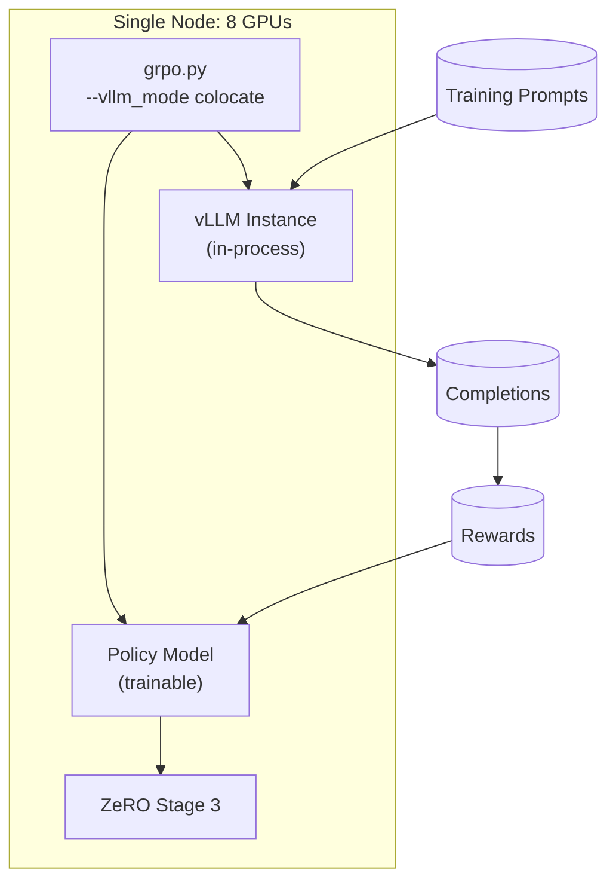
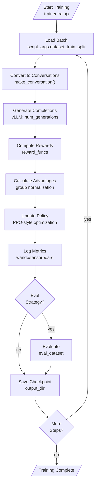
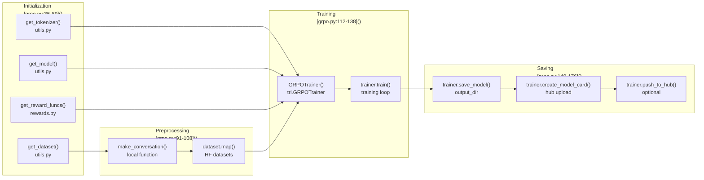
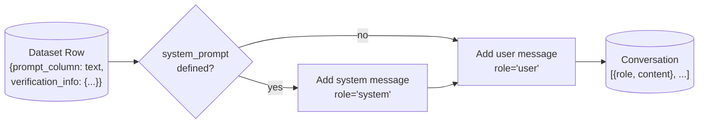
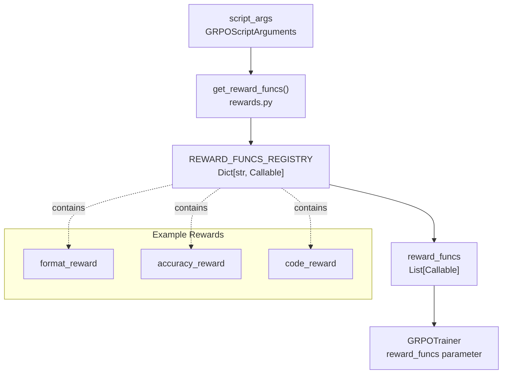
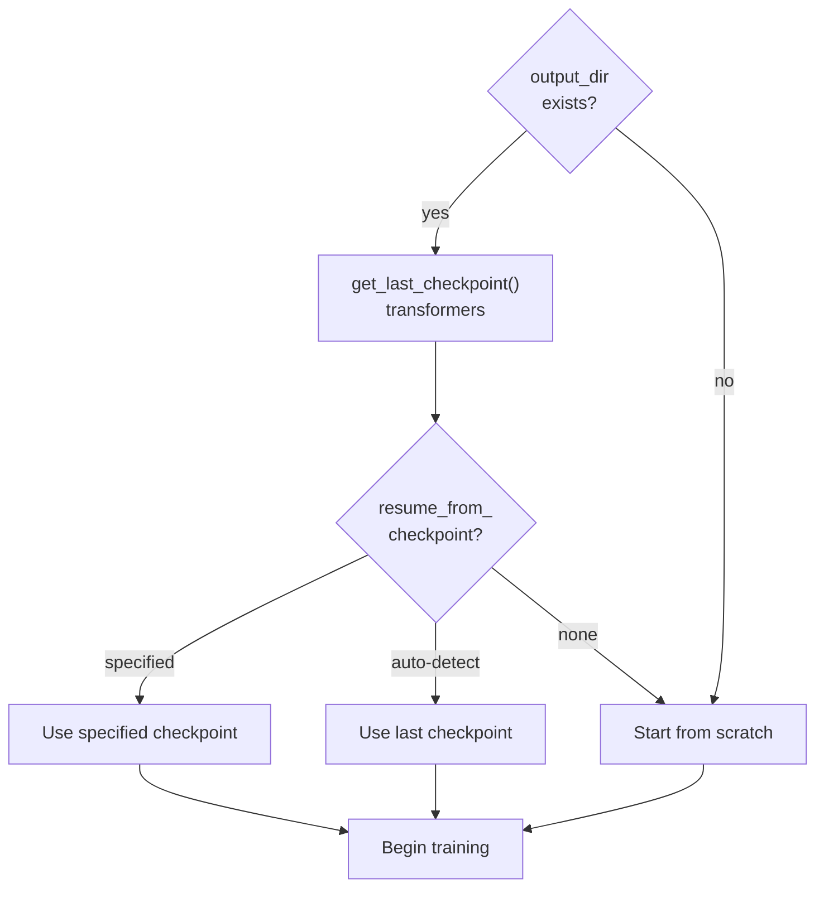

<!-- source: DeepWiki mcp.deepwiki.com · repo huggingface/open-r1 · page 2.2 Group Relative Policy Optimization (GRPO) · fetched 2026-10-26 -->

# Group Relative Policy Optimization (GRPO)

<details>
<summary>Relevant source files</summary>

The following files were used as context for generating this wiki page:

- [README.md](README.md)
- [src/open_r1/grpo.py](src/open_r1/grpo.py)

</details>


This document describes the Group Relative Policy Optimization (GRPO) implementation in the Open R1 repository, which enables reinforcement learning training of language models using verifiable rewards. GRPO is the second stage of the training pipeline, producing R1-Zero models from either base models or distilled checkpoints.

For supervised fine-tuning (distillation), see [Supervised Fine-Tuning (SFT)](#2.1). For reward function details, see [Reward Functions](#3). For configuration parameters, see [Configuration System](#2.3).

## Overview

GRPO training optimizes a policy model by generating multiple completions per prompt, evaluating them with reward functions, and updating the policy to maximize expected reward. The implementation in [src/open_r1/grpo.py]() uses TRL's `GRPOTrainer` with vLLM for fast generation.

**Key characteristics:**
- Generates 16-64 completions per prompt using vLLM
- Evaluates completions with multi-objective reward functions
- Supports single-node (7B models) and multi-node (32B+ models) training
- Integrates with external code execution sandboxes
- Uses group-based advantage normalization

Sources: [README.md:216-243](), [src/open_r1/grpo.py:1-182]()

## Training Architecture

### N+1 Node Configuration

GRPO uses an N+1 node architecture for multi-node training:



**Node 0** runs the vLLM server (`trl vllm-serve`) which handles generation requests. **Nodes 1-N** run the training script with Accelerate for distributed optimization. The policy model on Node 0 is automatically synchronized with training nodes.

Sources: [README.md:230-236](), [slurm/train.slurm]()

### Colocated Mode

For single-node training of smaller models, use `vllm_mode="colocate"` to run vLLM in the same process:



Sources: [README.md:218-225]()

## Training Loop

### Main Training Flow

The GRPO training loop follows this sequence:



Sources: [src/open_r1/grpo.py:112-138]()

### Code Entity Flow

The main script coordinates these components:



Sources: [src/open_r1/grpo.py:35-181]()

## Data Preprocessing

### Conversation Formatting

The `make_conversation` function converts dataset examples into chat format:



The function is defined at [src/open_r1/grpo.py:91-101]() and applied via `dataset.map()` at [src/open_r1/grpo.py:103]().

**Key parameters:**
- `script_args.dataset_prompt_column`: Column name containing the prompt (default: "problem")
- `training_args.system_prompt`: Optional system message
- Output: Dictionary with "prompt" key containing conversation list

Sources: [src/open_r1/grpo.py:91-108]()

## Configuration Parameters

### GRPOConfig Parameters

The `GRPOConfig` class extends TRL's training configuration:

| Parameter | Type | Description |
|-----------|------|-------------|
| `num_generations` | int | Number of completions to generate per prompt (default: 16) |
| `temperature` | float | Sampling temperature for generation (default: 0.6) |
| `top_p` | float | Nucleus sampling parameter (default: 0.95) |
| `max_new_tokens` | int | Maximum tokens per completion (default: 32768) |
| `system_prompt` | str | System message for conversations (optional) |
| `kl_coef` | float | KL divergence penalty coefficient (default: 0.001) |
| `vllm_mode` | str | "standalone" or "colocate" for vLLM integration |

See [Configuration System](#2.3) for complete parameter documentation.

Sources: [src/open_r1/configs.py]()

### GRPOScriptArguments Parameters

Dataset and reward configuration:

| Parameter | Type | Description |
|-----------|------|-------------|
| `dataset_name` | str | HuggingFace dataset identifier |
| `dataset_prompt_column` | str | Column containing prompts (default: "problem") |
| `reward_funcs` | List[str] | List of reward function names from registry |
| `reward_weights` | List[float] | Weights for each reward function |
| `e2b_router_url` | str | URL for E2B code execution router (optional) |
| `morph_router_url` | str | URL for Morph code execution router (optional) |

Sources: [src/open_r1/configs.py]()

## Reward Integration

### Reward Function Loading

Rewards are loaded from the registry and passed to the trainer:



The `get_reward_funcs` function is called at [src/open_r1/grpo.py:88]() and passed to `GRPOTrainer` at [src/open_r1/grpo.py:114]().

Sources: [src/open_r1/grpo.py:88](), [src/open_r1/rewards.py]()

### Verification Info Schema

Datasets must include a `verification_info` column for code execution rewards:

```python
{
    "language": "python",  # Programming language
    "test_cases": [
        {
            "input": "test input",
            "output": "expected output",
            "type": "stdin_stdout"  # or "function_call"
        }
    ]
}
```

This schema is required for `code_reward`, `ioi_code_reward`, and `cf_code_reward`. See [Code Execution Rewards](#3.2) and [Competitive Programming Evaluation](#3.3) for details.

Sources: [README.md:289-302]()

## Usage Examples

### Single-Node Training (Colocated Mode)

For 7B models on a single 8-GPU node:

```bash
ACCELERATE_LOG_LEVEL=info \
    accelerate launch --config_file recipes/accelerate_configs/zero3.yaml \
    src/open_r1/grpo.py \
    --config recipes/Qwen2.5-1.5B-Instruct/grpo/config_demo.yaml \
    --vllm_mode colocate
```

**Key points:**
- Uses ZeRO Stage 3 for memory efficiency
- vLLM runs in the same process as training
- Suitable for models up to 7B parameters

Sources: [README.md:218-225]()

### Multi-Node Training (Standalone Mode)

For 32B models across 2 nodes (1 for vLLM, 1 for training):

```bash
sbatch --nodes=2 slurm/train.slurm \
    --model Qwen2.5-1.5B-Instruct \
    --task grpo \
    --config demo \
    --accelerator zero2 \
    --dp 8 \
    --tp 1
```

**Parameters:**
- `--nodes=2`: Total nodes (1 for vLLM + 1 for training)
- `--dp 8`: Data parallelism across 8 GPUs
- `--tp 1`: Tensor parallelism (1 = no sharding)
- `--accelerator zero2`: Use ZeRO Stage 2

Sources: [README.md:230-236]()

### Training with Code Execution

For code generation with Python execution via E2B:

**Step 1:** Start vLLM server on GPU 0:
```bash
CUDA_VISIBLE_DEVICES=0 trl vllm-serve --model Qwen/Qwen2.5-1.5B-Instruct
```

**Step 2:** Run training on GPUs 1-7:
```bash
CUDA_VISIBLE_DEVICES=1,2,3,4,5,6,7 ACCELERATE_LOG_LEVEL=info \
    accelerate launch --config_file recipes/accelerate_configs/zero2.yaml \
    --num_processes=7 \
    src/open_r1/grpo.py \
    --config recipes/Qwen2.5-1.5B-Instruct/grpo/config_demo_code.yaml
```

**Configuration requirements:**
- Add `e2b_router_url` or `morph_router_url` to YAML config
- Include `code_reward` in `reward_funcs` list
- Dataset must have `verification_info` column

Sources: [README.md:304-316]()

### Competitive Programming (IOI/CodeForces)

For IOI problems with Piston execution:

```bash
ACCELERATE_LOG_LEVEL=info \
    accelerate launch --config_file recipes/accelerate_configs/zero2.yaml \
    --num_processes=7 \
    src/open_r1/grpo.py \
    --config recipes/Qwen2.5-1.5B-Instruct/grpo/config_demo_code_ioi.yaml
```

**Prerequisites:**
- Set `PISTON_ENDPOINTS` environment variable
- Start Piston workers (see [slurm/piston/README.md]())
- Use `ioi_code_reward` in config

Sources: [README.md:378-386]()

## Model Saving and Checkpointing

### Checkpoint Management

The training script handles checkpoints automatically:



Implemented at [src/open_r1/grpo.py:64-68]() and [src/open_r1/grpo.py:127-132]().

Sources: [src/open_r1/grpo.py:64-68](), [src/open_r1/grpo.py:127-132]()

### Final Model Saving

After training completes, the model is saved with proper configuration:

```mermaid
graph LR
    TRAINING_DONE["Training Complete"]
    SYNC_EOS["Sync EOS Token<br/>generation_config.eos_token_id"]
    SAVE_MODEL["trainer.save_model()<br/>output_dir"]
    CREATE_CARD["trainer.create_model_card()<br/>main process only"]
    RESTORE_CACHE["config.use_cache = True"]
    SAVE_CONFIG["config.save_pretrained()"]
    PUSH_HUB["trainer.push_to_hub()"]
    
    TRAINING_DONE --> SYNC_EOS
    SYNC_EOS --> SAVE_MODEL
    SAVE_MODEL --> CREATE_CARD
    CREATE_CARD --> RESTORE_CACHE
    RESTORE_CACHE --> SAVE_CONFIG
    SAVE_CONFIG --> PUSH_HUB
```



**Key operations:**
1. Align generation config with tokenizer EOS token ([grpo.py:145]())
2. Save model weights ([grpo.py:146]())
3. Create model card with metadata ([grpo.py:155]())
4. Restore `use_cache=True` for inference ([grpo.py:157]())
5. Optionally push to HuggingFace Hub ([grpo.py:173-175]())

Sources: [src/open_r1/grpo.py:140-176]()

## Chat Template Configuration

### Template Override

DeepSeek distilled models have a chat template that omits reasoning content. Override it in your config:

```yaml
chat_template: |
  
  <|im_start|>{{ message['role'] }}
  {{ message['content'] }}<|im_end|>
  
  <|im_start|>assistant
```

**Important:** The template must not prefill `<think>` tags, as this interferes with the `format_reward` function.

Sources: [README.md:227-229](), [recipes/DeepSeek-R1-Distill-Qwen-1.5B/grpo/config_demo.yaml]()

### EOS Token Alignment

For Qwen models, set the EOS token to match the chat template:

```yaml
eos_token: '<|im_end|>'
```

This ensures proper conversation termination during generation.

Sources: [README.md:156-175]()

## Performance Optimization

### Memory Optimization Strategies

| Model Size | Configuration | Hardware | Memory Strategy |
|------------|--------------|----------|-----------------|
| 7B | Single-node | 8×H100 | ZeRO Stage 3 |
| 14B | Single-node | 8×H100 | ZeRO Stage 3 + gradient checkpointing |
| 32B | Multi-node | 16×8 H100 | FSDP + Paged AdamW 8-bit |

**Gradient checkpointing** (`--gradient_checkpointing`) trades computation for memory by recomputing activations during backward pass.

Sources: [README.md:102-105]()

### Batch Size Scaling

Maintain constant global batch size when scaling GPUs:

```
global_batch_size = per_device_batch_size × num_gpus × gradient_accumulation_steps
```

**Example:** When scaling from 8 to 16 GPUs, either:
- Double `per_device_batch_size`, or
- Double `gradient_accumulation_steps`

Sources: [README.md:134-136]()

## Logging and Monitoring

### Weights & Biases Integration

Initialize W&B tracking at [src/open_r1/grpo.py:70-71]():

```python
if "wandb" in training_args.report_to:
    init_wandb_training(training_args)
```

**Override W&B settings:**
```bash
accelerate launch ... src/open_r1/grpo.py \
    --config recipes/model/task/config.yaml \
    --wandb_entity huggingface \
    --wandb_project open-r1 \
    --run_name Qwen2.5-1.5B-GRPO
```

Sources: [src/open_r1/grpo.py:70-71](), [README.md:148-154]()

### Logged Metrics

The trainer automatically logs:
- `train/loss`: Policy gradient loss
- `train/reward`: Mean reward across completions
- `train/kl`: KL divergence from reference policy
- `train/entropy`: Policy entropy
- Individual reward components (e.g., `train/reward/accuracy`, `train/reward/format`)

Sources: [src/open_r1/grpo.py:135-136]()

## Integration with Evaluation

After training, models can be evaluated using the evaluation pipeline:

```bash
python scripts/run_benchmarks.py \
    --model-id {output_dir} \
    --benchmarks aime24,math_500,gpqa,lcb
```

See [Evaluation System](#4) for complete documentation on benchmark evaluation.

Sources: [README.md:527-665]()

---

