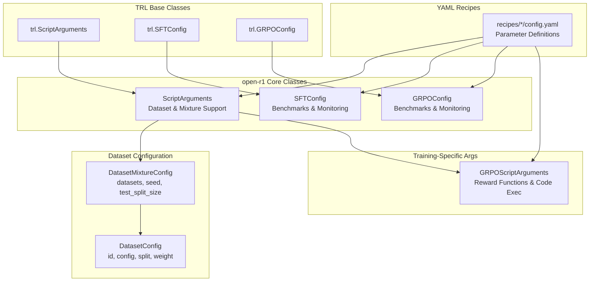
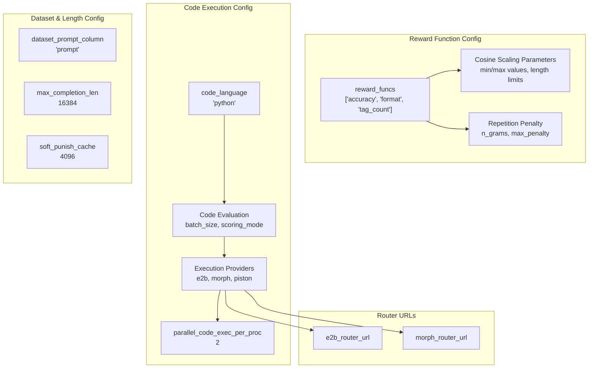
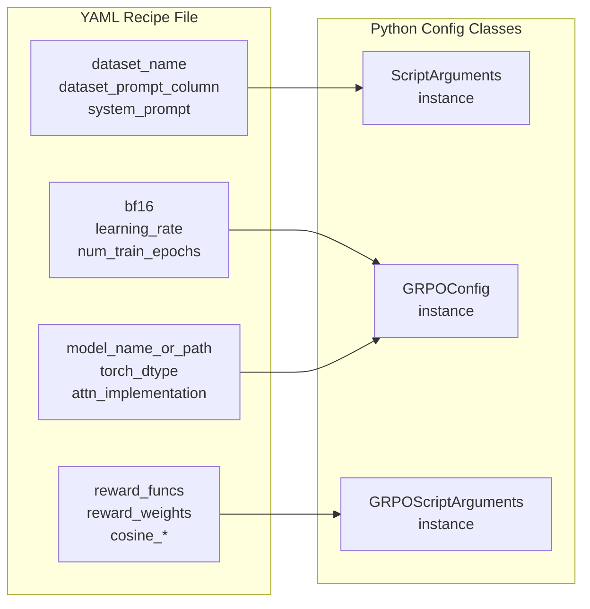

<!-- source: DeepWiki mcp.deepwiki.com · repo huggingface/open-r1 · page 2.3 Configuration System · fetched 2026-10-26 -->

# Configuration System

<details>
<summary>Relevant source files</summary>

The following files were used as context for generating this wiki page:

- [src/open_r1/configs.py](src/open_r1/configs.py)

</details>


The configuration system in open-r1 provides a centralized and type-safe approach to managing parameters across different training scenarios, dataset configurations, and experiment settings. It extends the TRL (Transformers Reinforcement Learning) library's configuration classes with domain-specific parameters for supervised fine-tuning (SFT) and Group Relative Policy Optimization (GRPO) training workflows.

This document covers the configuration classes, YAML recipe system, and parameter validation mechanisms. For information about specific training implementations that use these configurations, see [Supervised Fine-Tuning (SFT)](#2.1) and [Group Relative Policy Optimization (GRPO)](#2.2). For details about the reward functions configured through this system, see [Reward Functions](#3).

## Configuration Architecture

The configuration system is built around Python dataclasses that extend TRL's base configuration classes, providing additional functionality for dataset mixtures, reward function management, and experiment tracking integration.



**Sources:** [src/open_r1/configs.py:22-332]()

## Core Configuration Classes

### ScriptArguments

The `ScriptArguments` class extends TRL's base script arguments with support for dataset mixtures, making the `dataset_name` parameter optional when using dataset mixtures.

| Parameter | Type | Default | Description |
|-----------|------|---------|-------------|
| `dataset_name` | `Optional[str]` | `None` | Single dataset name (optional if using mixtures) |
| `dataset_mixture` | `Optional[dict[str, Any]]` | `None` | Configuration for dataset mixtures |

The class performs validation in `__post_init__()` to ensure either `dataset_name` or `dataset_mixture` is provided, and validates the structure of dataset mixture configurations.

**Sources:** [src/open_r1/configs.py:43-121]()

### Dataset Configuration Classes

#### DatasetConfig

Represents configuration for individual datasets within a mixture:

| Parameter | Type | Default | Description |
|-----------|------|---------|-------------|
| `id` | `str` | - | Dataset identifier |
| `config` | `Optional[str]` | `None` | Dataset configuration name |
| `split` | `str` | `"train"` | Dataset split to use |
| `columns` | `Optional[list[str]]` | `None` | Specific columns to extract |
| `weight` | `Optional[float]` | `None` | Sampling weight in mixture |

#### DatasetMixtureConfig

Manages collections of datasets with mixing strategies:

| Parameter | Type | Default | Description |
|-----------|------|---------|-------------|
| `datasets` | `list[DatasetConfig]` | - | List of dataset configurations |
| `seed` | `int` | `0` | Random seed for mixture sampling |
| `test_split_size` | `Optional[float]` | `None` | Fraction for test split creation |

**Sources:** [src/open_r1/configs.py:22-40]()

## Training-Specific Configurations

### SFTConfig

Extends `trl.SFTConfig` with additional parameters for benchmarking, monitoring, and Hub integration:

| Parameter | Type | Default | Description |
|-----------|------|---------|-------------|
| `benchmarks` | `list[str]` | `[]` | Benchmarks to run after training |
| `callbacks` | `list[str]` | `[]` | Training callbacks to enable |
| `chat_template` | `Optional[str]` | `None` | Chat template for conversation formatting |
| `system_prompt` | `Optional[str]` | `None` | System prompt for benchmarking |
| `hub_model_revision` | `Optional[str]` | `"main"` | Hub model branch for pushing |
| `wandb_entity` | `Optional[str]` | `None` | Weights & Biases entity |
| `wandb_project` | `Optional[str]` | `None` | Weights & Biases project |

**Sources:** [src/open_r1/configs.py:169-206]()

### GRPOConfig

Extends `trl.GRPOConfig` with similar monitoring and Hub integration parameters, plus GRPO-specific options:

| Parameter | Type | Default | Description |
|-----------|------|---------|-------------|
| `num_completions_to_print` | `int` | `0` | Number of completions to log |
| `wandb_log_unique_prompts` | `bool` | `True` | Log unique prompts to W&B |
| `wandb_run_group` | `Optional[str]` | `None` | W&B run group for organization |

**Sources:** [src/open_r1/configs.py:124-167]()

## GRPO-Specific Configuration

### GRPOScriptArguments

The most complex configuration class, extending `ScriptArguments` with comprehensive reward function and code execution parameters:



#### Key Parameters

**Reward Function Configuration:**
- `reward_funcs`: List of reward functions to apply (default: `["accuracy", "format", "tag_count"]`)
- Cosine scaling parameters for length-based reward adjustment
- Repetition penalty settings for n-gram detection

**Code Execution Configuration:**
- `code_language`: Target programming language (default: `"python"`)
- `code_provider`: Execution environment (`"e2b"`, `"local"`, `"morph"`)
- `ioi_provider`: IOI problem execution provider (`"piston"`, `"morph"`)
- `parallel_code_exec_per_proc`: Parallel executions per process (default: `2`)

**Sources:** [src/open_r1/configs.py:208-332]()

## YAML Recipe System

The configuration system integrates with YAML-based recipes that define complete training setups. These recipes are located in the `recipes/` directory and follow a hierarchical structure.

### Recipe Structure Example

```yaml
# Model configuration
model_name_or_path: deepseek-ai/DeepSeek-R1-Distill-Qwen-1.5B
torch_dtype: bfloat16
attn_implementation: flash_attention_2

# Dataset configuration
dataset_name: open-r1/OpenR1-Math-220k
dataset_prompt_column: problem
system_prompt: "You are a helpful AI Assistant..."

# Training configuration
bf16: true
learning_rate: 1.0e-06
num_train_epochs: 1
per_device_train_batch_size: 16

# GRPO-specific configuration
reward_funcs:
- accuracy
- format
- tag_count
reward_weights:
- 1.0
- 1.0
- 1.0
```

### YAML to Configuration Class Mapping



**Sources:** [recipes/DeepSeek-R1-Distill-Qwen-1.5B/grpo/config_demo.yaml:1-59]()

## Parameter Validation and Error Handling

The configuration system implements several validation mechanisms:

### Dataset Mixture Validation

1. **Mutual Exclusivity Check**: Ensures either `dataset_name` or `dataset_mixture` is provided, but not both
2. **Structure Validation**: Validates that `dataset_mixture` contains a `datasets` key with a list of configurations
3. **Column Consistency**: Ensures all datasets in a mixture have consistent column specifications

### Runtime Validation

The `__post_init__()` method in `ScriptArguments` performs comprehensive validation:

```python
# Example validation logic from the codebase
if self.dataset_name is None and self.dataset_mixture is None:
    raise ValueError("Either `dataset_name` or `dataset_mixture` must be provided")

# Column consistency check
columns_sets = [set(dataset.columns) for dataset in datasets_list if dataset.columns is not None]
if columns_sets:
    if not all(columns == first_columns for columns in columns_sets):
        raise ValueError("Column names must be consistent across all dataset configurations")
```

**Sources:** [src/open_r1/configs.py:78-120]()

## Integration with Training Systems

The configuration system serves as the central parameter management layer for both training pipelines:

- **SFT Training**: Uses `ScriptArguments` and `SFTConfig` for dataset loading, model configuration, and training parameters
- **GRPO Training**: Uses `GRPOScriptArguments` and `GRPOConfig` for reward function setup, code execution environments, and reinforcement learning parameters

The configurations are parsed from YAML files and instantiated as dataclass objects that provide type safety and validation throughout the training process.

**Sources:** [src/open_r1/configs.py:1-332](), [recipes/DeepSeek-R1-Distill-Qwen-1.5B/grpo/config_demo.yaml:1-59]()

---

