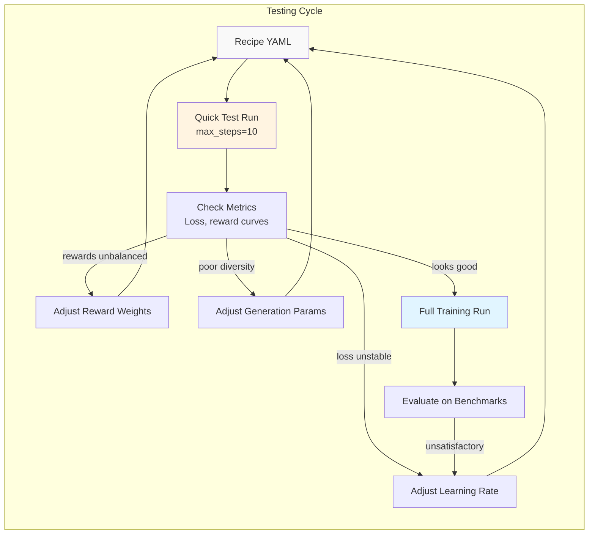

<!-- source: DeepWiki mcp.deepwiki.com · repo huggingface/open-r1 · page 2.4 Training Recipes · fetched 2026-10-26 -->

# Training Recipes

<details>
<summary>Relevant source files</summary>

The following files were used as context for generating this wiki page:

- [recipes/OpenR1-Distill-7B/sft/config_distill.yaml](recipes/OpenR1-Distill-7B/sft/config_distill.yaml)
- [recipes/Qwen2.5-1.5B-Instruct/grpo/config_demo.yaml](recipes/Qwen2.5-1.5B-Instruct/grpo/config_demo.yaml)
- [recipes/Qwen2.5-1.5B-Instruct/grpo/config_demo_code.yaml](recipes/Qwen2.5-1.5B-Instruct/grpo/config_demo_code.yaml)
- [recipes/Qwen2.5-1.5B-Instruct/grpo/config_demo_code_ioi.yaml](recipes/Qwen2.5-1.5B-Instruct/grpo/config_demo_code_ioi.yaml)
- [recipes/README.md](recipes/README.md)
- [scripts/get_tensor_parallel_size.py](scripts/get_tensor_parallel_size.py)

</details>


Training recipes are pre-configured YAML files that specify all parameters needed to reproduce specific training runs. Each recipe combines model selection, dataset configuration, chat templates, hyperparameters, and reward functions into a single declarative configuration file. Recipes are organized by model family and training task (SFT or GRPO) in the `recipes/` directory.

For information about the configuration dataclasses that recipes populate, see [Configuration System](#2.3). For details on how recipes are used by training scripts, see [Supervised Fine-Tuning](#2.1) and [Group Relative Policy Optimization](#2.2).

## Recipe Organization

Recipes follow a hierarchical directory structure that maps to training configurations:

```
recipes/
├── {MODEL_NAME}/
│   ├── sft/
│   │   └── config_{VARIANT}.yaml
│   └── grpo/
│       └── config_{VARIANT}.yaml
└── README.md
```

Each recipe file is loaded by training scripts using the pattern `recipes/{MODEL_NAME}/{TASK}/config_{VARIANT}.yaml`, where:
- `MODEL_NAME` identifies the base model or training target (e.g., `OpenR1-Distill-7B`, `Qwen2.5-1.5B-Instruct`)
- `TASK` is either `sft` or `grpo`
- `VARIANT` distinguishes different configurations (e.g., `distill`, `demo`, `demo_code`, `demo_code_ioi`)

**Sources:** [recipes/README.md:1-23]()

### Recipe File Structure

```mermaid
graph TB
    subgraph "Recipe YAML File"
        YAML["config_{variant}.yaml"]
        
        subgraph "Model Arguments Section"
            MODEL_NAME["model_name_or_path"]
            MODEL_REV["model_revision"]
            DTYPE["torch_dtype"]
            ATTN["attn_implementation"]
        end
        
        subgraph "Data Training Arguments"
            DATASET["dataset_name"]
            DATASET_COL["dataset_prompt_column"]
            SYS_PROMPT["system_prompt"]
            CHAT_TMPL["chat_template"]
            EOS["eos_token"]
        end
        
        subgraph "Trainer Configuration"
            TRAIN_PARAMS["Training Hyperparameters<br/>learning_rate, batch_size, etc"]
            REWARD_CFG["Reward Configuration<br/>reward_funcs, reward_weights"]
            SAVE_CFG["Checkpoint Configuration<br/>save_strategy, output_dir"]
            HARDWARE["Hardware Configuration<br/>bf16, gradient_checkpointing"]
        end
    end
    
    subgraph "Configuration Dataclasses"
        MODEL_CONFIG["ModelConfig"]
        SCRIPT_ARGS["ScriptArguments"]
        SFT_CONFIG["SFTConfig"]
        GRPO_CONFIG["GRPOConfig"]
    end
    
    MODEL_NAME --> MODEL_CONFIG
    MODEL_REV --> MODEL_CONFIG
    DTYPE --> MODEL_CONFIG
    ATTN --> MODEL_CONFIG
    
    DATASET --> SCRIPT_ARGS
    DATASET_COL --> SCRIPT_ARGS
    SYS_PROMPT --> SCRIPT_ARGS
    CHAT_TMPL --> SCRIPT_ARGS
    EOS --> SCRIPT_ARGS
    
    TRAIN_PARAMS --> SFT_CONFIG
    TRAIN_PARAMS --> GRPO_CONFIG
    REWARD_CFG --> GRPO_CONFIG
    SAVE_CFG --> SFT_CONFIG
    SAVE_CFG --> GRPO_CONFIG
    HARDWARE --> SFT_CONFIG
    HARDWARE --> GRPO_CONFIG
    
    style YAML fill:#f9f9f9
    style MODEL_CONFIG fill:#e1f5ff
    style SCRIPT_ARGS fill:#e1f5ff
    style SFT_CONFIG fill:#ffe1f5
    style GRPO_CONFIG fill:#ffe1f5
```



**Sources:** [recipes/Qwen2.5-1.5B-Instruct/grpo/config_demo.yaml:1-53](), [recipes/OpenR1-Distill-7B/sft/config_distill.yaml:1-48]()

## Model Arguments Section

The model arguments section specifies which model to load and how to configure its architecture and precision:

| Parameter | Type | Purpose | Example Values |
|-----------|------|---------|----------------|
| `model_name_or_path` | String | HuggingFace model ID or local path | `Qwen/Qwen2.5-1.5B-Instruct`, `open-r1/Qwen2.5-Math-7B-RoPE-300k` |
| `model_revision` | String | Git revision/branch to load | `main` |
| `torch_dtype` | String | Model precision | `bfloat16`, `float16` |
| `attn_implementation` | String | Attention mechanism | `flash_attention_2` |

All recipes in the codebase use `bfloat16` precision and Flash Attention 2 for optimal memory efficiency and training speed. The model name determines the base architecture and tokenizer configuration that will be loaded by the training script.

**Example from demo GRPO recipe:**
```yaml
model_name_or_path: Qwen/Qwen2.5-1.5B-Instruct
model_revision: main
torch_dtype: bfloat16
attn_implementation: flash_attention_2
```

**Sources:** [recipes/Qwen2.5-1.5B-Instruct/grpo/config_demo.yaml:1-5](), [recipes/OpenR1-Distill-7B/sft/config_distill.yaml:2-6]()

## Data Training Arguments Section

The data training arguments specify the dataset, formatting, and prompting configuration:

| Parameter | Type | Purpose | Example Values |
|-----------|------|---------|----------------|
| `dataset_name` | String | HuggingFace dataset ID | `open-r1/OpenR1-Math-220k`, `open-r1/Mixture-of-Thoughts` |
| `dataset_config` | String | Dataset configuration subset | `all`, `default` |
| `dataset_prompt_column` | String | Column name containing prompts | `problem`, `problem_statement` |
| `system_prompt` | String | System message prepended to conversations | See below |
| `chat_template` | String | Jinja2 template for conversation formatting | See below |
| `eos_token` | String | End-of-sequence token | `<|im_end|>` |

### System Prompts

System prompts define the model's behavior and output format. The standard system prompt used across recipes instructs the model to use structured thinking:

```yaml
system_prompt: "You are a helpful AI Assistant that provides well-reasoned and detailed responses. You first think about the reasoning process as an internal monologue and then provide the user with the answer. Respond in the following format: \n<answer>\n...\n</answer>"
```

This prompt enforces the `\n<answer>\n...\n</answer>"
```

The `<think>` / `<answer>` structure is required for `format_reward` to work correctly.

#### Step 4: Select Reward Functions (GRPO Only)

Choose reward functions based on your task:

**For Math:**
```yaml
reward_funcs:
- accuracy
- format
- reasoning_steps
reward_weights:
- 1.0
- 0.5
- 0.2
```

**For Code (General):**
```yaml
reward_funcs:
- code
- format
- len
reward_weights:
- 1.0
- 0.1
- -0.01
```

**For Code (IOI/Codeforces):**
```yaml
reward_funcs:
- ioi_code  # or cf_code
- code_format
reward_weights:
- 1.0
- 0.1
code_language: cpp  # or python, java, etc.
```

See [Reward Functions](#3) for complete documentation of available rewards.

#### Step 5: Set Training Hyperparameters

**SFT Recommendations:**
- Learning rate: `3e-5` to `5e-5`
- Warmup ratio: `0.03`
- Epochs: `3` to `5`
- Gradient accumulation: Adjust for effective batch size of 128-256

**GRPO Recommendations:**
- Learning rate: `5e-6` to `2e-5` (lower than SFT)
- Beta: `0.01` (KL penalty)
- Generations: `16` (math), `14` (code)
- Temperature: `1.0` (exploration)

#### Step 6: Configure Hardware Settings

Calculate tensor parallel size for vLLM server (GRPO only):
```bash
python scripts/get_tensor_parallel_size.py --model_name your-model --default_tp 8
```

This script computes the GCD between the model's attention heads and available GPUs to ensure even sharding. The result determines the `--tensor-parallel-size` argument for vLLM server launch.

Set memory optimization flags:
```yaml
bf16: true
gradient_checkpointing: true
gradient_checkpointing_kwargs:
  use_reentrant: false
```

**Sources:** [scripts/get_tensor_parallel_size.py:1-29]()

#### Step 7: Configure Checkpointing and Logging

```yaml
output_dir: data/{MODEL_NAME}-{VARIANT}
save_strategy: epoch  # or "steps"
save_total_limit: 1  # Keep only last checkpoint
hub_model_id: {ORG}/{MODEL_NAME}-{VARIANT}
hub_strategy: every_save
push_to_hub: true
report_to:
- wandb
```

Ensure `hub_model_id` follows HuggingFace Hub naming conventions and you have write permissions.

### Recipe Usage Patterns

#### Local Testing

Test your recipe locally before submitting Slurm jobs:
```bash
# SFT
python src/sft.py recipes/{MODEL}/{sft}/config_{VARIANT}.yaml

# GRPO (requires vLLM server)
trl vllm-serve --model {MODEL} --tensor-parallel-size {TP} &
python src/grpo.py recipes/{MODEL}/{grpo}/config_{VARIANT}.yaml
```

#### Slurm Execution

Submit training jobs using the standardized Slurm script:
```bash
# SFT with ZeRO-3 (single node)
sbatch --nodes=1 slurm/train.slurm \
  --model {MODEL} \
  --task sft \
  --config {VARIANT} \
  --accelerator zero3

# GRPO with vLLM (single node)
sbatch --nodes=1 slurm/train.slurm \
  --model {MODEL} \
  --task grpo \
  --config {VARIANT} \
  --accelerator zero3

# SFT with FSDP (multi-node, large models)
sbatch --nodes=16 slurm/train.slurm \
  --model {MODEL} \
  --task sft \
  --config {VARIANT} \
  --accelerator fsdp
```

The `slurm/train.slurm` script automatically:
- Loads the specified recipe YAML
- Configures distributed training (ZeRO-3 or FSDP)
- Launches vLLM server on node 0 (for GRPO)
- Executes training on remaining nodes
- Manages checkpoint saving and Hub uploads

**Sources:** [recipes/README.md:1-23]()

### Recipe Testing and Iteration



**Testing Strategy:**

1. **Quick validation run** with `max_steps: 10` to verify configuration loads correctly
2. **Monitor initial metrics** in W&B:
   - Loss should decrease smoothly
   - Rewards should show reasonable values (not all 0 or 1)
   - Generations should show structural diversity
3. **Adjust hyperparameters** based on observations:
   - High loss variance → Reduce learning rate
   - Dominant single reward → Rebalance reward weights
   - Low generation diversity → Increase temperature or reduce beta
4. **Full training run** once configuration is stable
5. **Benchmark evaluation** to measure downstream performance

**Sources:** [recipes/Qwen2.5-1.5B-Instruct/grpo/config_demo.yaml:1-53]()

## Advanced Recipe Features

### Multi-Dataset Mixtures

For SFT, you can train on multiple datasets by specifying a dataset mixture in code rather than in the recipe. The recipe specifies a single `dataset_name`, but the `get_dataset` function in `src/utils.py` supports mixing multiple datasets with custom sampling weights.

**Sources:** [recipes/OpenR1-Distill-7B/sft/config_distill.yaml:10-12]()

### Code Language Specification

For competitive programming tasks, specify the target programming language:
```yaml
code_language: cpp  # or python, java, etc.
code_eval_test_batch_size: 3  # Optional: batch size for test evaluation
```

The `code_language` parameter controls how the reward system extracts code from completions. The `code_eval_test_batch_size` enables early stopping during test case evaluation to save computation.

**Sources:** [recipes/Qwen2.5-1.5B-Instruct/grpo/config_demo_code_ioi.yaml:49-61]()

### Learning Rate Scheduling

Advanced learning rate schedules can be configured with additional parameters:
```yaml
lr_scheduler_type: cosine_with_min_lr
lr_scheduler_kwargs:
  min_lr_rate: 0.1  # End at 10% of peak LR
```

The `cosine_with_min_lr` scheduler prevents learning rate from decaying to zero, maintaining stable updates throughout training.

**Sources:** [recipes/OpenR1-Distill-7B/sft/config_distill.yaml:29-31]()

### Checkpoint Management

Control checkpoint saving behavior:
```yaml
save_strategy: "steps"  # or "epoch"
save_steps: 50  # If save_strategy is "steps"
save_total_limit: 1  # Keep only N most recent checkpoints
```

For long training runs, use step-based saving with `save_total_limit` to avoid filling disk space.

**Sources:** [recipes/Qwen2.5-1.5B-Instruct/grpo/config_demo_code.yaml:49-51]()

---

