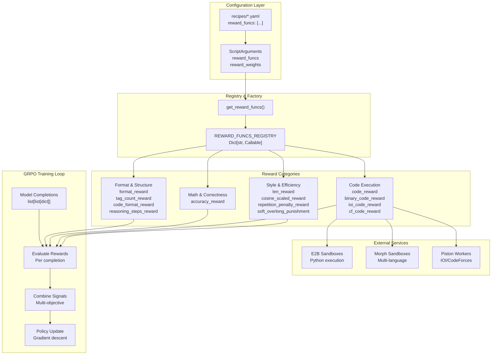
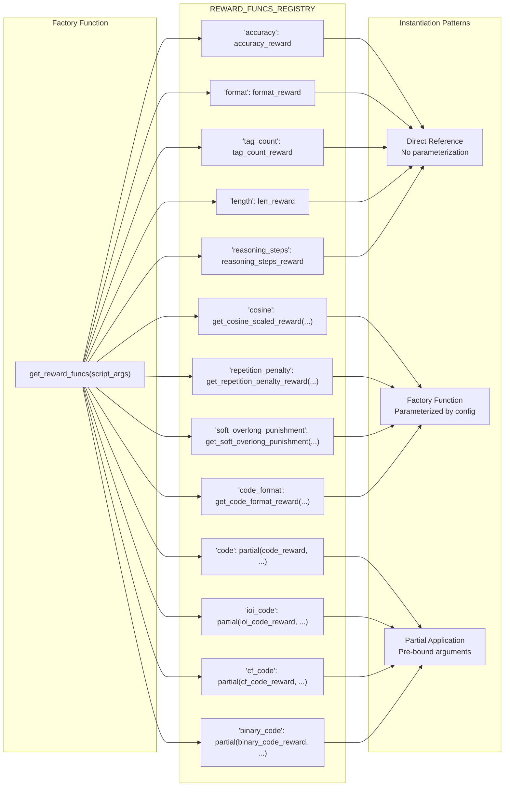
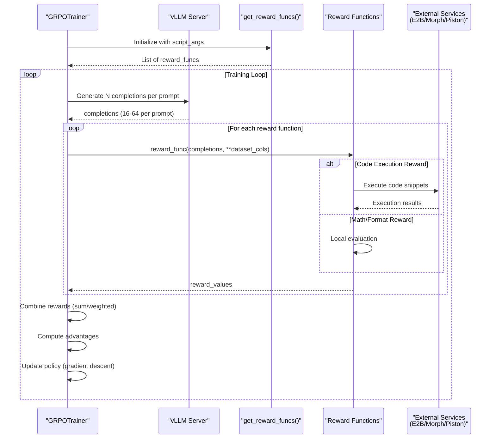

<!-- source: DeepWiki mcp.deepwiki.com · repo huggingface/open-r1 · page 3 Reward Functions · fetched 2026-10-26 -->

# Reward Functions

<details>
<summary>Relevant source files</summary>

The following files were used as context for generating this wiki page:

- [README.md](README.md)
- [src/open_r1/rewards.py](src/open_r1/rewards.py)
- [tests/test_rewards.py](tests/test_rewards.py)

</details>


## Purpose and Scope

This page documents the reward function system used in GRPO training to guide model behavior through multi-objective optimization. Reward functions evaluate model completions across multiple dimensions including correctness, format, code execution, and stylistic preferences. The system implements a flexible registry pattern that allows dynamic composition of reward signals through configuration files.

For detailed implementation of specific reward categories, see:
- Mathematical and formatting rewards: [Mathematical and Formatting Rewards](#3.1)
- Code execution with sandboxes: [Code Execution Rewards](#3.2)
- Competitive programming evaluation: [Competitive Programming Evaluation](#3.3)

For configuration of rewards in training scripts, see [Configuration System](#2.3).

Sources: [src/open_r1/rewards.py:1-707](), [README.md:244-343]()

## Architecture Overview

The reward system is organized around a central registry that maps string identifiers to reward functions. During GRPO training, the system evaluates each generated completion using multiple reward functions specified in the configuration, then combines the scores to produce a final reward signal for policy updates.



**Architecture**: The reward system uses a factory pattern where `get_reward_funcs()` instantiates reward functions based on string identifiers from configuration files. The `REWARD_FUNCS_REGISTRY` dictionary maps these identifiers to either direct function references or parameterized factory functions. During training, GRPO generates multiple completions per prompt, evaluates each with the configured reward functions, then updates the policy based on the combined reward signals.

Sources: [src/open_r1/rewards.py:646-707](), [src/open_r1/grpo.py]()

## Reward Registry System

The core of the reward system is the `REWARD_FUNCS_REGISTRY` dictionary and the `get_reward_funcs()` factory function. This pattern enables flexible composition of reward signals through configuration without code changes.



**Registry Pattern**: The system supports three instantiation patterns. **Direct references** are used for simple reward functions with no configuration parameters (e.g., `format_reward`, `tag_count_reward`). **Factory functions** return configured reward functions based on parameters from `script_args` (e.g., `get_cosine_scaled_reward()` configures min/max values and length scaling). **Partial application** pre-binds configuration parameters to base functions using `functools.partial()` (e.g., `code_reward` is bound with `num_parallel` and `provider_type` from configuration).

Sources: [src/open_r1/rewards.py:646-707]()

### Registry Implementation

The `REWARD_FUNCS_REGISTRY` dictionary at [src/open_r1/rewards.py:647-703]() maps string keys to reward function implementations:

| Registry Key | Implementation | Parameterization | Primary Use Case |
|-------------|----------------|------------------|------------------|
| `accuracy` | `accuracy_reward` | None | Math problem verification |
| `format` | `format_reward` | None | XML tag validation |
| `tag_count` | `tag_count_reward` | None | Partial credit for tags |
| `reasoning_steps` | `reasoning_steps_reward` | None | Step-by-step reasoning |
| `length` | `len_reward` | None | Length-based rewards |
| `code_format` | `get_code_format_reward(language)` | `code_language` | Code block format |
| `cosine` | `get_cosine_scaled_reward(...)` | 5 parameters | Length-scaled correctness |
| `repetition_penalty` | `get_repetition_penalty_reward(...)` | 2 parameters | N-gram repetition |
| `soft_overlong_punishment` | `get_soft_overlong_punishment(...)` | 2 parameters | Piecewise length penalty |
| `code` | `partial(code_reward, ...)` | 3 parameters | General code execution |
| `binary_code` | `partial(binary_code_reward, ...)` | 3 parameters | Pass/fail code evaluation |
| `ioi_code` | `partial(ioi_code_reward, ...)` | 2 parameters | IOI problem evaluation |
| `cf_code` | `partial(cf_code_reward, ...)` | 2 parameters | CodeForces evaluation |

Sources: [src/open_r1/rewards.py:647-703]()

### Factory Function

The `get_reward_funcs()` function at [src/open_r1/rewards.py:646-707]() instantiates the configured reward functions:

```python
def get_reward_funcs(script_args) -> list[Callable]:
    REWARD_FUNCS_REGISTRY = {
        "accuracy": accuracy_reward,
        "format": format_reward,
        # ... other mappings
    }
    reward_funcs = [REWARD_FUNCS_REGISTRY[func] for func in script_args.reward_funcs]
    return reward_funcs
```

This function:
1. Reads the `reward_funcs` list from `script_args` (e.g., `["accuracy", "format", "code"]`)
2. Looks up each string identifier in `REWARD_FUNCS_REGISTRY`
3. Returns a list of callable functions ready for evaluation
4. Raises `KeyError` if an unknown reward function is specified

Sources: [src/open_r1/rewards.py:646-707]()

## Reward Function Categories

The system provides 13 reward functions organized into four categories:

| Category | Functions | Purpose | Typical Usage |
|----------|-----------|---------|---------------|
| **Format & Structure** | `format_reward`<br/>`tag_count_reward`<br/>`code_format_reward`<br/>`reasoning_steps_reward` | Validate output structure and encourage clear reasoning | All tasks requiring structured output |
| **Math & Correctness** | `accuracy_reward` | Verify mathematical correctness using symbolic comparison | Math problems with verifiable answers |
| **Code Execution** | `code_reward`<br/>`binary_code_reward`<br/>`ioi_code_reward`<br/>`cf_code_reward` | Execute generated code in sandboxed environments | Code generation tasks |
| **Style & Efficiency** | `len_reward`<br/>`cosine_scaled_reward`<br/>`repetition_penalty_reward`<br/>`soft_overlong_punishment` | Penalize verbosity, repetition, and excessive length | All tasks to improve output quality |

Detailed documentation for each category:
- Format & Structure rewards: [Mathematical and Formatting Rewards](#3.1)
- Math & Correctness rewards: [Mathematical and Formatting Rewards](#3.1)
- Code Execution rewards: [Code Execution Rewards](#3.2), [Competitive Programming Evaluation](#3.3)
- Style & Efficiency rewards: [Mathematical and Formatting Rewards](#3.1)

Sources: [src/open_r1/rewards.py:1-707]()

## Reward Function Interface

All reward functions follow a consistent interface to enable uniform evaluation within GRPO training:

### Function Signature

```python
def reward_function(
    completions: list[list[dict[str, str]]],  # Model outputs
    solution: list[str] = None,                # Ground truth (optional)
    completion_ids: list[list[int]] = None,    # Token IDs (optional)
    **kwargs                                    # Dataset columns
) -> list[Optional[float]]                     # Reward per completion
```

**Parameters**:
- `completions`: List of completions, where each completion is a list of message dictionaries with `content` field
- `solution`: Ground truth solutions for correctness evaluation (used by `accuracy_reward`, `len_reward`, etc.)
- `completion_ids`: Token ID sequences for length-based rewards (used by `soft_overlong_punishment`)
- `**kwargs`: Additional dataset columns passed through (e.g., `verification_info`, `test_cases`, `language`, `id`)

**Returns**:
- List of reward values (one per completion)
- Values typically range from -1.0 to 1.0
- `None` indicates the example should be skipped (e.g., unparseable ground truth)

Sources: [src/open_r1/rewards.py:40-83](), [src/open_r1/rewards.py:85-91]()

### Completion Structure

Model completions follow the chat message format:

```python
completions = [
    [{"role": "assistant", "content": "\n<answer>\n...\n</answer>"}],
    [{"role": "assistant", "content": "\n<answer>\n...\n</answer>"}],
    # ... more completions
]
```

Reward functions typically extract content with:
```python
contents = [completion[0]["content"] for completion in completions]
```

This supports multi-turn conversations, though most GRPO training uses single-turn completions.

Sources: [src/open_r1/rewards.py:42-43](), [src/open_r1/rewards.py:88]()

## Configuration Parameters

Reward functions are configured through `ScriptArguments` fields that control behavior and external service integration:

### Core Configuration

| Parameter | Type | Default | Purpose |
|-----------|------|---------|---------|
| `reward_funcs` | `list[str]` | `["accuracy"]` | List of reward function identifiers to use |
| `reward_weights` | `list[float]` | `None` | Optional weights for combining rewards |

### Format Rewards

| Parameter | Type | Default | Purpose |
|-----------|------|---------|---------|
| `code_language` | `str` | `"python"` | Language for `code_format_reward` validation |

### Math Rewards

No additional configuration required for `accuracy_reward` - uses default `latex2sympy2_extended` settings.

### Length & Scaling Rewards

| Parameter | Type | Default | Purpose |
|-----------|------|---------|---------|
| `cosine_min_value_wrong` | `float` | `-1.0` | Minimum reward for incorrect answers |
| `cosine_max_value_wrong` | `float` | `-0.5` | Maximum reward for incorrect answers |
| `cosine_min_value_correct` | `float` | `0.5` | Minimum reward for correct answers |
| `cosine_max_value_correct` | `float` | `1.0` | Maximum reward for correct answers |
| `cosine_max_len` | `int` | `1000` | Maximum length for cosine scaling |
| `max_completion_len` | `int` | `32768` | Maximum completion length |
| `soft_punish_cache` | `int` | `2048` | Soft penalty threshold for overlong completions |

### Repetition Penalty

| Parameter | Type | Default | Purpose |
|-----------|------|---------|---------|
| `repetition_n_grams` | `int` | `3` | N-gram size for repetition detection |
| `repetition_max_penalty` | `float` | `-1.0` | Maximum penalty for repetitive text |

### Code Execution

| Parameter | Type | Default | Purpose |
|-----------|------|---------|---------|
| `code_provider` | `str` | `"e2b"` | Code execution provider: `"e2b"`, `"morph"` |
| `parallel_code_exec_per_proc` | `int` | `2` | Parallel executions per process |
| `e2b_router_url` | `str` | `None` | E2B router service URL |
| `morph_router_url` | `str` | `None` | Morph router service URL |
| `code_eval_test_batch_size` | `int` | `1` | Test cases to evaluate in parallel |
| `code_eval_scoring_mode` | `str` | `"weighted_sum"` | CodeForces scoring: `"pass_fail"`, `"partial"`, `"weighted_sum"` |
| `ioi_provider` | `str` | `"piston"` | IOI execution provider: `"piston"`, `"morph"` |
| `enforce_same_language` | `bool` | `False` | Require all problems use same language |

Sources: [src/open_r1/configs.py](), [src/open_r1/rewards.py:646-707]()

## Configuration Examples

### Mathematical Reasoning

For math problems with step-by-step reasoning and format validation:

```yaml
reward_funcs:
  - accuracy          # Verify correctness
  - format            # Validate <think>/<answer> tags
  - tag_count         # Partial credit for tags
  - reasoning_steps   # Encourage step-by-step reasoning
  - length            # Penalize excessive verbosity
```

### Code Generation (Python)

For Python code generation with execution verification:

```yaml
reward_funcs:
  - code              # Execute against test cases
  - code_format       # Validate format
  - repetition_penalty  # Penalize repetitive code

code_provider: e2b
code_language: python
parallel_code_exec_per_proc: 2
e2b_router_url: "192.168.1.100:8000"
```

### Competitive Programming (CodeForces)

For CodeForces problems with complex test suites:

```yaml
reward_funcs:
  - cf_code           # CodeForces evaluation
  - format            # Validate structure
  - soft_overlong_punishment  # Penalize overlong solutions

code_eval_test_batch_size: 4
code_eval_scoring_mode: "weighted_sum"
max_completion_len: 8192
soft_punish_cache: 1024
```

### Multi-Objective Optimization

Combining multiple reward signals with explicit weights:

```yaml
reward_funcs:
  - accuracy
  - format
  - cosine
  - repetition_penalty

# Optional: weight each reward
reward_weights: [1.0, 0.5, 0.3, 0.2]

# Configure cosine scaling
cosine_min_value_wrong: -1.0
cosine_max_value_wrong: -0.5
cosine_min_value_correct: 0.5
cosine_max_value_correct: 1.0
cosine_max_len: 2000

# Configure repetition penalty
repetition_n_grams: 3
repetition_max_penalty: -0.5
```

Sources: [recipes/](), [src/open_r1/configs.py]()

## Integration with GRPO Training

During GRPO training, reward functions are evaluated in the training loop to compute advantages for policy updates:



**Evaluation Flow**: At each training step, the GRPO trainer generates multiple completions using vLLM, then evaluates each completion with all configured reward functions. Rewards are combined (simple sum or weighted average) to produce a single scalar per completion. The trainer computes advantages by comparing rewards within each batch, then updates the policy via gradient descent.

Sources: [src/open_r1/grpo.py](), [src/open_r1/rewards.py:646-707]()

### Initialization in GRPO

The GRPO script initializes reward functions at [src/open_r1/grpo.py]():

```python
from open_r1.rewards import get_reward_funcs

# Initialize reward functions from configuration
reward_funcs = get_reward_funcs(script_args)

# Pass to GRPOTrainer
trainer = GRPOTrainer(
    model=model,
    reward_funcs=reward_funcs,
    # ... other arguments
)
```

Sources: [src/open_r1/grpo.py]()

### Dataset Column Passing

Reward functions receive all dataset columns as `**kwargs`, enabling flexible evaluation:

```python
# Example dataset with verification_info
dataset = {
    "prompt": ["Write a function to sum two numbers"],
    "solution": ["def sum(a, b): return a + b"],
    "verification_info": [{
        "language": "python",
        "test_cases": [{"input": "1 2", "output": "3"}]
    }]
}

# Reward function receives all columns
code_reward(
    completions=completions,
    solution=dataset["solution"],
    verification_info=dataset["verification_info"]
)
```

This design allows reward functions to access any dataset field (test cases, problem IDs, language specifications, etc.) without modifying the trainer.

Sources: [src/open_r1/rewards.py:511-593]()

## External Service Integration

Code execution rewards integrate with external sandbox services to safely evaluate generated code:

| Service | Purpose | Supported Languages | Setup |
|---------|---------|---------------------|-------|
| **E2B** | General Python code execution | Python | See [Code Execution Rewards](#3.2) |
| **Morph** | Multi-language code execution | Python, JavaScript, C++, Rust, Java | See [Code Execution Rewards](#3.2) |
| **Piston** | Competitive programming problems | C++, Python (via cms_ioi, codeforces packages) | See [Competitive Programming Evaluation](#3.3) |

### Router Services

To handle rate limiting when multiple training jobs share sandbox resources, router services provide a central coordination layer:

- **E2B Router**: Launched via [slurm/e2b_router.slurm]() on port 8000
- **Morph Router**: Launched via [slurm/morph_router.slurm]() on port 8001
- **Piston Workers**: Launched via [slurm/piston/launch_piston_workers.sh]() on ports 1234-N

Configuration:
```yaml
# Point reward functions to router services
e2b_router_url: "192.168.1.100:8000"
morph_router_url: "192.168.1.101:8001"
```

All training jobs can share the same router endpoints. The routers manage concurrent executions using semaphores and rate limiting.

Sources: [README.md:318-343](), [slurm/e2b_router.slurm](), [slurm/morph_router.slurm]()

## Testing

The reward system includes comprehensive unit tests at [tests/test_rewards.py:1-569](). Key test coverage:

| Test Class | Coverage | Key Tests |
|------------|----------|-----------|
| `TestGetRewardFuncs` | Registry system | Verify all reward functions instantiate correctly |
| `TestRewards` | Math & format rewards | Correct/incorrect answers, format validation, multiple completions |
| `TestRepetitionPenaltyReward` | Repetition detection | N-gram analysis, edge cases, language support |
| `TestCodeFormat` | Code structure validation | Python/JavaScript formats, multiline code, incorrect formats |

Example test structure:
```python
def test_accuracy_reward_correct_answer(self):
    completion = [[{"content": r"\boxed{\frac{63}{400}}"}]]
    solution = [r"\frac{63}{400}"]
    rewards = accuracy_reward(completion, solution)
    self.assertEqual(rewards[0], 1.0)
```

To run tests:
```shell
python -m pytest tests/test_rewards.py -v
```

Sources: [tests/test_rewards.py:1-569]()

---

