<!-- source: DeepWiki mcp.deepwiki.com · repo huggingface/open-r1 · page 3.1 Mathematical and Formatting Rewards · fetched 2026-10-26 -->

# Mathematical and Formatting Rewards

<details>
<summary>Relevant source files</summary>

The following files were used as context for generating this wiki page:

- [src/open_r1/rewards.py](src/open_r1/rewards.py)
- [tests/test_rewards.py](tests/test_rewards.py)

</details>


## Purpose and Scope

This page documents the mathematical and formatting reward functions in the Open-R1 system. These reward functions are central to the Group Relative Policy Optimization (GRPO) training process, providing signals that guide model optimization toward better mathematical accuracy, proper formatting, and high-quality reasoning steps.

This document covers rewards related to mathematical verification, reasoning format requirements, and text quality metrics. For code execution rewards, see page 3.2. For competitive programming evaluation, see page 3.3.

## Overview of Reward Functions

The mathematical and formatting reward functions evaluate different aspects of model responses during GRPO training. These functions return numerical values (typically in the range [-1.0, 1.0]) that indicate the quality of a response along specific dimensions.

**GRPO Training with Reward Functions**
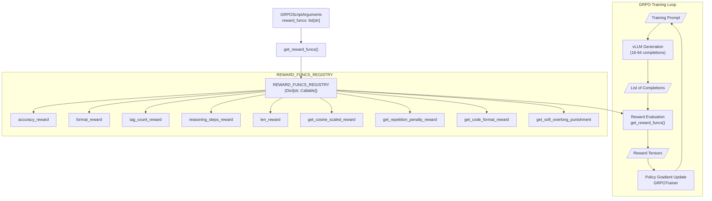

Sources: [src/open_r1/rewards.py:646-706]()

## Mathematical Accuracy Rewards

### Accuracy Reward

The `accuracy_reward` function verifies mathematical equivalence between model-generated answers and ground truth solutions using symbolic math verification.

**Mathematical Verification Pipeline**
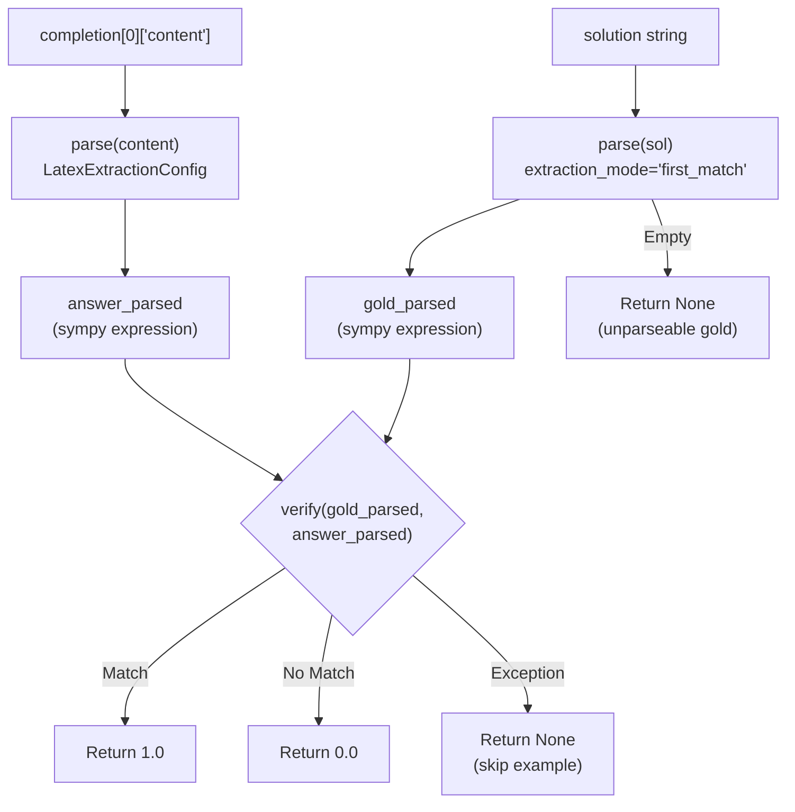

**Implementation Details:**

The function uses strict LaTeX parsing configuration to ensure high-quality answers:

| Configuration Parameter | Value | Purpose |
|------------------------|-------|---------|
| `nits` | False | Reject non-standard notation |
| `malformed_operators` | False | Reject malformed LaTeX operators |
| `basic_latex` | True | Apply basic LaTeX normalization |
| `equations` | True | Parse equation environments |
| `boxed` | "all" | Extract from `\boxed{}` commands |
| `boxed_match_priority` | 0 | Prioritize boxed answers |
| `try_extract_without_anchor` | False | Require explicit answer markers |

**Return Values:**
- `1.0`: Mathematical equivalence verified
- `0.0`: Answers are not equivalent
- `None`: Parsing failed (example skipped in training)

Sources: [src/open_r1/rewards.py:40-82]()

### Length-Based Rewards

#### Length Reward

The `len_reward` function encourages token efficiency following the Kimi 1.5 approach. It rewards shorter correct answers while penalizing incorrect answers more heavily if they are longer.

**Length-Based Reward Calculation**
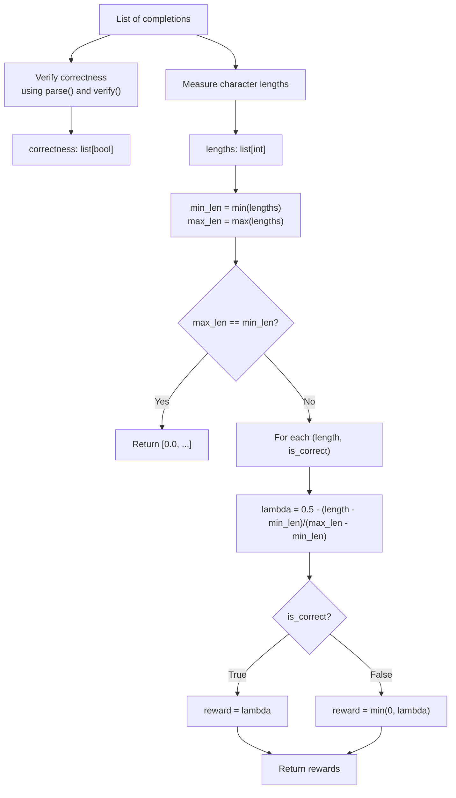

**Reward Formula:**

For each completion with length `L`:
- `λ = 0.5 - (L - min_len)/(max_len - min_len)`
- If correct: `reward = λ`
- If incorrect: `reward = min(0, λ)`

**Key Properties:**
- Shortest correct answer gets maximum reward (0.5)
- Longest correct answer gets minimum reward (-0.5 to 0.5 depending on relative position)
- Incorrect answers receive non-positive rewards
- Returns `[0.0, ...]` if all completions have identical length
- Uses same verification pipeline as `accuracy_reward`

Sources: [src/open_r1/rewards.py:132-202]()

#### Cosine Scaled Reward

`get_cosine_scaled_reward` returns a configured reward function that uses cosine scheduling to scale rewards smoothly based on completion length.

**Cosine Scaling Algorithm**
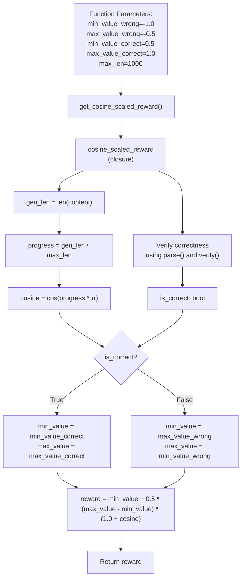

**Cosine Reward Properties:**

| Completion Length | Correct Answer Reward | Incorrect Answer Reward |
|-------------------|----------------------|-------------------------|
| Short (progress ≈ 0) | `max_value_correct` (1.0) | `min_value_wrong` (-1.0) |
| Medium (progress ≈ 0.5) | `(max + min)/2` (0.75) | `(max + min)/2` (-0.75) |
| Long (progress ≈ 1.0) | `min_value_correct` (0.5) | `max_value_wrong` (-0.5) |

**Configuration Parameters:**
- `min_value_wrong`: Minimum reward for incorrect answers (default: -1.0)
- `max_value_wrong`: Maximum reward for incorrect answers (default: -0.5)
- `min_value_correct`: Minimum reward for correct answers (default: 0.5)
- `max_value_correct`: Maximum reward for correct answers (default: 1.0)
- `max_len`: Maximum length for scaling normalization (default: 1000)

Sources: [src/open_r1/rewards.py:205-282]()

## Text Formatting Rewards

### Basic Format Rewards

#### Format Reward

The `format_reward` function validates that responses follow the required XML-like tag structure for reasoning and answer sections.

**Expected Format Structure**
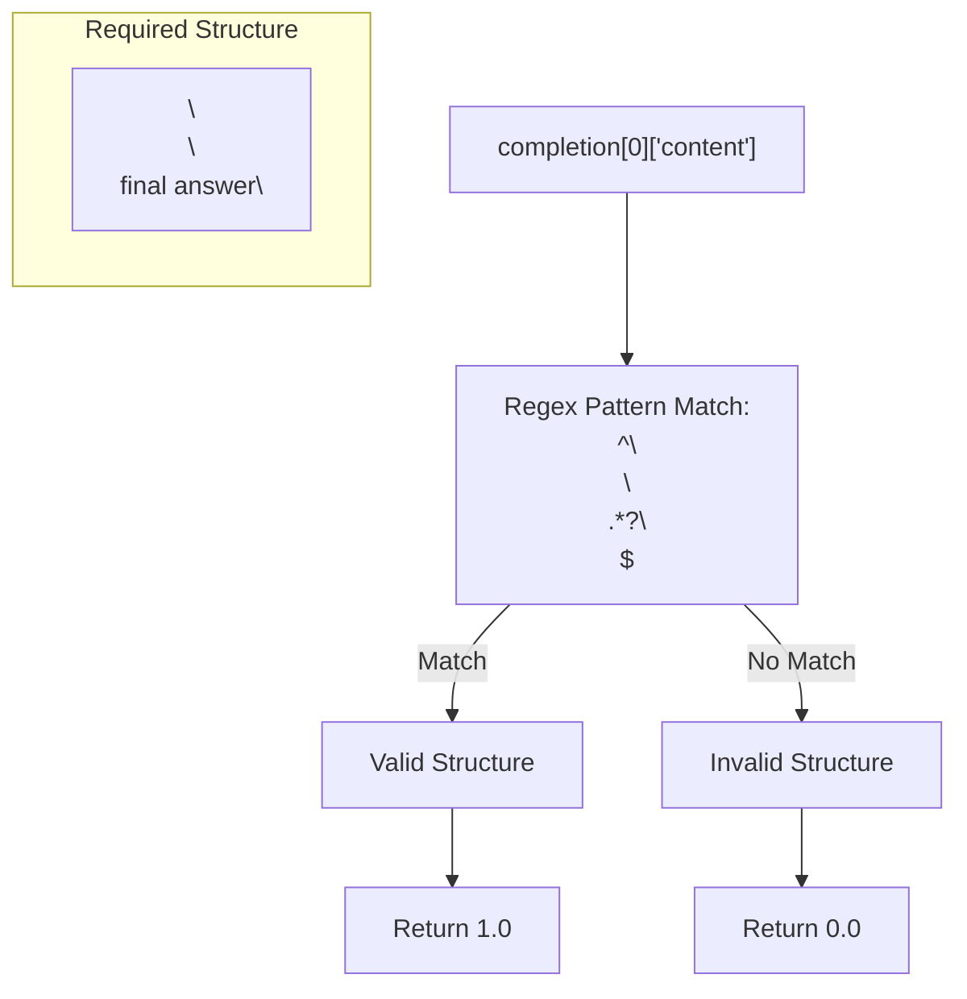

**Pattern Requirements:**
- Must start with `\n` (closing think tag with newlines)
- Must have `\n<answer>\n` (opening answer tag with newlines)
- Must contain answer content
- Must end with `\n</answer>` (closing answer tag with newline)

**Implementation:**
Uses `re.match()` with `re.DOTALL | re.MULTILINE` flags to match across multiple lines.

Sources: [src/open_r1/rewards.py:85-90]()

#### Tag Count Reward

`tag_count_reward` provides partial credit for format compliance by checking each required tag individually.

**Tag Counting Algorithm**
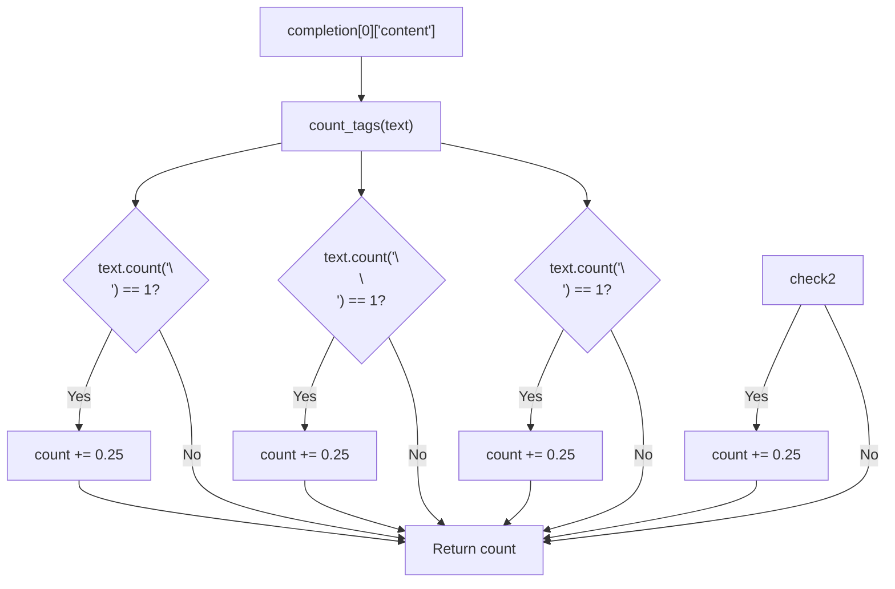

**Scoring Table:**

| Tag Present | Points | Condition |
|-------------|--------|-----------|
| `\n` | +0.25 | Exactly 1 occurrence |
| `\n<answer>\n` | +0.25 | Exactly 1 occurrence |
| `\n</answer>` | +0.25 | Exactly 1 occurrence |

**Possible Scores:**
- `1.0`: All four tags present correctly
- `0.75`: Three tags present
- `0.5`: Two tags present
- `0.25`: One tag present
- `0.0`: No tags present

**Use Case:**
Provides softer training signal than `format_reward` by allowing partial credit during early training when models haven't fully learned the format.

Sources: [src/open_r1/rewards.py:93-112]()

### Reasoning Quality Rewards

#### Reasoning Steps Reward

`reasoning_steps_reward` encourages structured reasoning by detecting and counting explicit step markers in the completion.

**Step Detection Patterns**
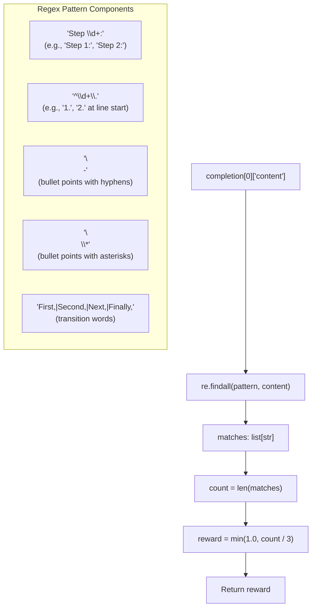

**Detected Patterns:**

| Pattern Type | Regex | Example |
|-------------|-------|---------|
| Step labels | `Step \d+:` | "Step 1:", "Step 2:" |
| Numbered lists | `^\d+\.` | "1.", "2.", "3." at line start |
| Hyphen bullets | `\n-` | "\n- First point" |
| Asterisk bullets | `\n\*` | "\n* Second point" |
| Transitions | `First,\|Second,\|Next,\|Finally,` | "First, we...", "Next, we..." |

**Scoring:**
- Counts all matching patterns in the text
- Normalizes by dividing by 3 (capped at 1.0)
- 3 or more step indicators → reward = 1.0
- 1 step indicator → reward ≈ 0.33
- 0 step indicators → reward = 0.0

Sources: [src/open_r1/rewards.py:115-129]()

### Text Quality Rewards

#### Repetition Penalty Reward

`get_repetition_penalty_reward` returns a configured penalty function that detects and penalizes n-gram repetition in completions.

**N-gram Repetition Analysis**
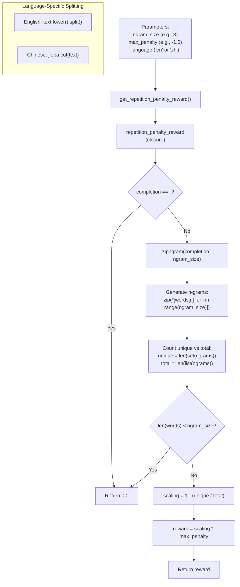

**Repetition Calculation:**

For n-gram size `N` and max penalty `P`:
1. Split text into words and generate all N-grams
2. Calculate unique ratio: `unique_ratio = len(unique_ngrams) / len(total_ngrams)`
3. Compute scaling: `scaling = 1 - unique_ratio`
4. Apply penalty: `reward = scaling × max_penalty`

**Example (ngram_size=3, max_penalty=-1.0):**

| Text | Unique N-grams | Total N-grams | Scaling | Reward |
|------|----------------|---------------|---------|--------|
| "this is a test" | 2 | 2 | 0.0 | 0.0 |
| "this this this this" | 1 | 2 | 0.5 | -0.5 |
| "A B C A B C" | 3 | 4 | 0.25 | -0.25 |

**Configuration:**
- `ngram_size`: Size of n-grams to analyze (default: 3)
- `max_penalty`: Maximum negative penalty (must be ≤ 0)
- `language`: "en" for English word splitting, "zh" for Chinese (requires jieba)

Sources: [src/open_r1/rewards.py:285-354]()

## Code-Specific Format Rewards

### Code Format Reward

`get_code_format_reward` returns a configured reward function that validates code responses follow the required tag structure with language-specific code blocks.

**Code Format Validation**
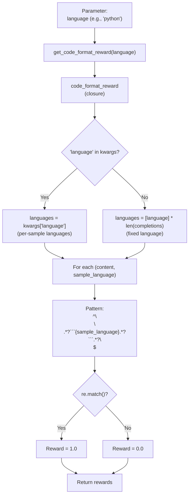

**Valid Code Format Structure:**
```

<answer>
```python
def solution():
    return 42
```
</answer>
```

**Supported Languages:**
Any language identifier supported by E2B code execution (e.g., "python", "javascript", "java", "cpp", "rust").

**Mixed-Language Training:**
When `kwargs["language"]` is provided, each sample can specify its own language. This enables training on mixed-language datasets.

Sources: [src/open_r1/rewards.py:595-617]()

## Additional Reward Functions

### Binary Code Reward

`binary_code_reward` wraps `code_reward` to convert continuous execution success rates into binary pass/fail signals.

**Binary Thresholding**
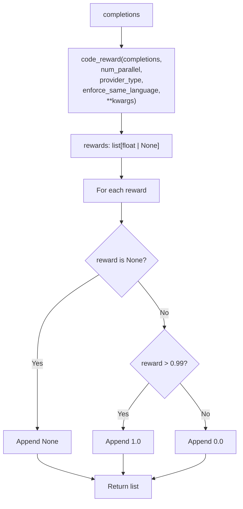

**Configuration:**
- `num_parallel`: Number of parallel test case executions (default: 2)
- `provider_type`: Code execution provider - "e2b" or "morph" (default: "e2b")
- `enforce_same_language`: Verify all problems use same language (default: False)

**Threshold:** `BINARY_THRESHOLD = 0.99`

**Use Case:**
Simplifies reward signal for GRPO when only pass/fail distinction is needed, reducing variance compared to continuous success rates.

Sources: [src/open_r1/rewards.py:485-508]()

### Soft Overlong Punishment

`get_soft_overlong_punishment` returns a configured reward function that penalizes excessively long completions using a piecewise linear schedule.

**Piecewise Length Penalty**
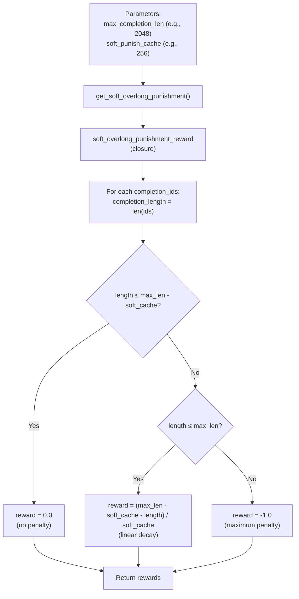

**Penalty Zones:**

| Completion Length | Reward | Region |
|-------------------|--------|--------|
| ≤ `max_len - soft_cache` | 0.0 | Safe zone (no penalty) |
| `max_len - soft_cache` to `max_len` | Linear decay from 0.0 to -1.0 | Soft punishment zone |
| > `max_len` | -1.0 | Hard cutoff |

**Example (max_len=2048, soft_cache=256):**
- Length 1792: reward = 0.0
- Length 1920: reward = -0.5
- Length 2048: reward ≈ -1.0
- Length 2100: reward = -1.0

**Implementation Notes:**
- Uses token count from `completion_ids` rather than character count
- Based on Equation (13) from DAPO paper (https://huggingface.co/papers/2503.14476)
- Prevents extreme verbosity while allowing reasonable length variation

Sources: [src/open_r1/rewards.py:620-643]()

## Integration with GRPO Training

The reward functions are registered in `REWARD_FUNCS_REGISTRY` and accessed through `get_reward_funcs`, which returns a list of configured reward functions based on script arguments.

**Reward Function Registry**
```mermaid
flowchart TD
    script_args["GRPOScriptArguments"] --> get_reward_funcs["get_reward_funcs(script_args)"]
    
    get_reward_funcs --> registry_lookup["REWARD_FUNCS_REGISTRY lookup"]
    
    subgraph "REWARD_FUNCS_REGISTRY"
        reg_dict["Dict[str, Callable]"]
        
        reg_dict --> acc["'accuracy' → accuracy_reward"]
        reg_dict --> fmt["'format' → format_reward"]
        reg_dict --> reason["'reasoning_steps' → reasoning_steps_reward"]
        reg_dict --> cos["'cosine' → get_cosine_scaled_reward(...)"]
        reg_dict --> rep["'repetition_penalty' → get_repetition_penalty_reward(...)"]
        reg_dict --> len["'length' → len_reward"]
        reg_dict --> code["'code' → partial(code_reward, ...)"]
        reg_dict --> bin_code["'binary_code' → partial(binary_code_reward, ...)"]
        reg_dict --> ioi["'ioi_code' → partial(ioi_code_reward, ...)"]
        reg_dict --> cf["'cf_code' → partial(cf_code_reward, ...)"]
        reg_dict --> code_fmt["'code_format' → get_code_format_reward(...)"]
        reg_dict --> tag["'tag_count' → tag_count_reward"]
        reg_dict --> overlong["'soft_overlong_punishment' → get_soft_overlong_punishment(...)"]
    end
    
    registry_lookup --> reward_funcs["reward_funcs: list[Callable]"]
    
    subgraph "Configuration from script_args"
        sa_reward_funcs["reward_funcs: list[str]<br/>e.g., ['accuracy', 'format', 'length']"]
        sa_cosine["cosine_min_value_wrong<br/>cosine_max_value_wrong<br/>cosine_min_value_correct<br/>cosine_max_value_correct<br/>cosine_max_len"]
        sa_rep["repetition_n_grams<br/>repetition_max_penalty"]
        sa_code["code_language<br/>parallel_code_exec_per_proc<br/>code_provider<br/>enforce_same_language"]
        sa_overlong["max_completion_len<br/>soft_punish_cache"]
    end
    
    sa_reward_funcs --> get_reward_funcs
    sa_cosine --> cos
    sa_rep --> rep
    sa_code --> code
    sa_code --> bin_code
    sa_code --> code_fmt
    sa_overlong --> overlong
```

**Registry Population Logic:**

The registry is built dynamically in `get_reward_funcs()` using configuration from `GRPOScriptArguments`:

1. **Direct functions** (no configuration):
   - `accuracy_reward`, `format_reward`, `reasoning_steps_reward`, `len_reward`, `tag_count_reward`

2. **Factory functions** (return configured closures):
   - `get_cosine_scaled_reward(...)` returns `cosine_scaled_reward`
   - `get_repetition_penalty_reward(...)` returns `repetition_penalty_reward`
   - `get_code_format_reward(...)` returns `code_format_reward`
   - `get_soft_overlong_punishment(...)` returns `soft_overlong_punishment_reward`

3. **Partial application** (pre-configure parameters):
   - `partial(code_reward, num_parallel=..., provider_type=...)`
   - `partial(binary_code_reward, num_parallel=..., provider_type=...)`
   - `partial(ioi_code_reward, test_batch_size=..., provider_type=...)`
   - `partial(cf_code_reward, test_batch_size=..., scoring_mode=...)`

**Selection Process:**
```python
reward_funcs = [REWARD_FUNCS_REGISTRY[func] for func in script_args.reward_funcs]
```

**Return Value Semantics:**
- Reward functions return `float` or `None`
- `None` signals unparseable/unevaluable examples (skipped in training)
- Multiple rewards are combined in GRPO (typically averaged)

Sources: [src/open_r1/rewards.py:646-706]()

## Example Usage

The following tables show examples of inputs and corresponding reward scores for various reward functions:

### Mathematical Accuracy Examples

| Function | Input Content | Ground Truth | Reward | Explanation |
|----------|---------------|--------------|--------|-------------|
| `accuracy_reward` | `\boxed{\frac{63}{400}}` | `\frac{63}{400}` | 1.0 | Exact symbolic match |
| `accuracy_reward` | `\boxed{\frac{64}{400}}` | `\frac{63}{400}` | 0.0 | Different values |
| `accuracy_reward` | `\boxed{3}` | `6` | 0.0 | Incorrect answer |
| `accuracy_reward` | Invalid LaTeX | Any | None | Unparseable (skipped) |

### Format Validation Examples

| Function | Input Content | Reward | Explanation |
|----------|---------------|--------|-------------|
| `format_reward` | `\n<answer>\nAnswer\n</answer>` | 1.0 | Perfect format |
| `format_reward` | `` | 0.0 | Missing answer section |
| `tag_count_reward` | `\n<answer>\nAnswer\n</answer>` | 1.0 | All 4 tags present |
| `tag_count_reward` | `Reasoning\n</think>\n<answer>\nAnswer\n</answer>` | 0.75 | Missing opening think tag |
| `tag_count_reward` | `No tags` | 0.0 | No tags present |

### Reasoning Quality Examples

| Function | Input Content | Reward | Explanation |
|----------|---------------|--------|-------------|
| `reasoning_steps_reward` | `Step 1: First\nStep 2: Second\nStep 3: Third` | 1.0 | 3+ explicit steps |
| `reasoning_steps_reward` | `First, we...\nNext, we...` | 0.67 | 2 transition words |
| `reasoning_steps_reward` | `Plain explanation` | 0.0 | No step markers |

### Length-Based Reward Examples

| Function | Scenario | Reward | Explanation |
|----------|----------|--------|-------------|
| `len_reward` | Shortest correct answer (min_len) | 0.5 | Maximum for correct |
| `len_reward` | Longest correct answer (max_len) | -0.5 to 0.5 | Depends on relative position |
| `len_reward` | Shortest incorrect answer | 0.0 or negative | Non-positive for incorrect |

### Code Format Examples

| Function | Input Content | Language | Reward | Explanation |
|----------|---------------|----------|--------|-------------|
| `code_format_reward` | `\n<answer>\n```python\ncode\n```\n</answer>` | "python" | 1.0 | Correct format |
| `code_format_reward` | `\n<answer>\n```javascript\ncode\n```\n</answer>` | "python" | 0.0 | Wrong language |

### Length Penalty Examples

| Function | Length (tokens) | Max Len | Soft Cache | Reward | Zone |
|----------|----------------|---------|------------|--------|------|
| `soft_overlong_punishment` | 50 | 100 | 20 | 0.0 | Safe |
| `soft_overlong_punishment` | 90 | 100 | 20 | -0.5 | Soft penalty |
| `soft_overlong_punishment` | 110 | 100 | 20 | -1.0 | Hard cutoff |

### Code Execution Examples

| Function | Test Pass Rate | Reward | Explanation |
|----------|---------------|--------|-------------|
| `binary_code_reward` | 99.5% | 1.0 | Above 0.99 threshold |
| `binary_code_reward` | 95.0% | 0.0 | Below threshold |
| `binary_code_reward` | Execution error | None | Skipped |

Sources: [tests/test_rewards.py:79-565]()

## Configuring Reward Functions

Reward functions are specified and configured through command-line arguments to the GRPO training script. The following parameters can be customized:

For `get_cosine_scaled_reward`:
- `cosine_min_value_wrong`: Minimum reward for wrong answers (default: -1.0)
- `cosine_max_value_wrong`: Maximum reward for wrong answers (default: -0.5)
- `cosine_min_value_correct`: Minimum reward for correct answers (default: 0.5)
- `cosine_max_value_correct`: Maximum reward for correct answers (default: 1.0)
- `cosine_max_len`: Maximum length for scaling (default: 1000)

For `get_repetition_penalty_reward`:
- `repetition_n_grams`: Size of the n-grams (default: 3)
- `repetition_max_penalty`: Maximum (negative) penalty (default: -1.0)

For `get_code_format_reward`:
- `code_language`: Programming language for code blocks (default: "python")

Sources: [src/open_r1/rewards.py:566-607]()

---

