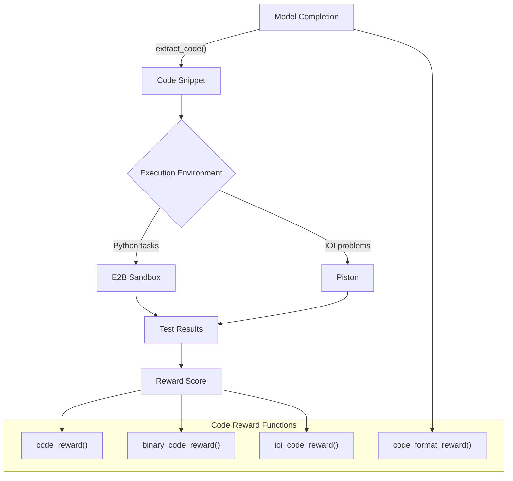
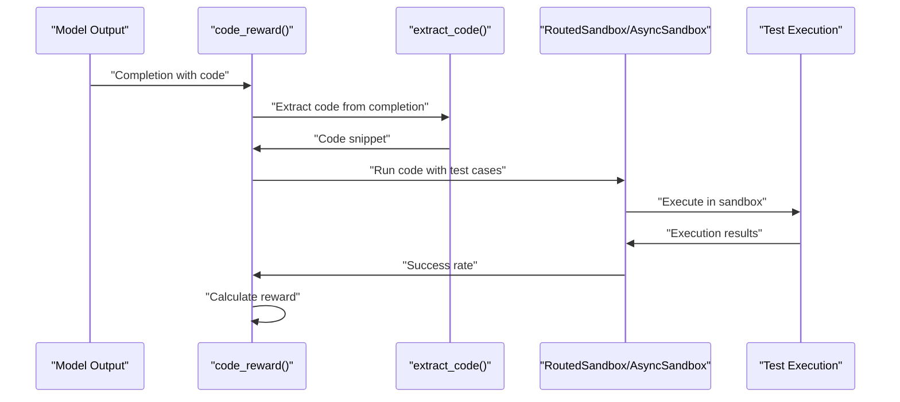
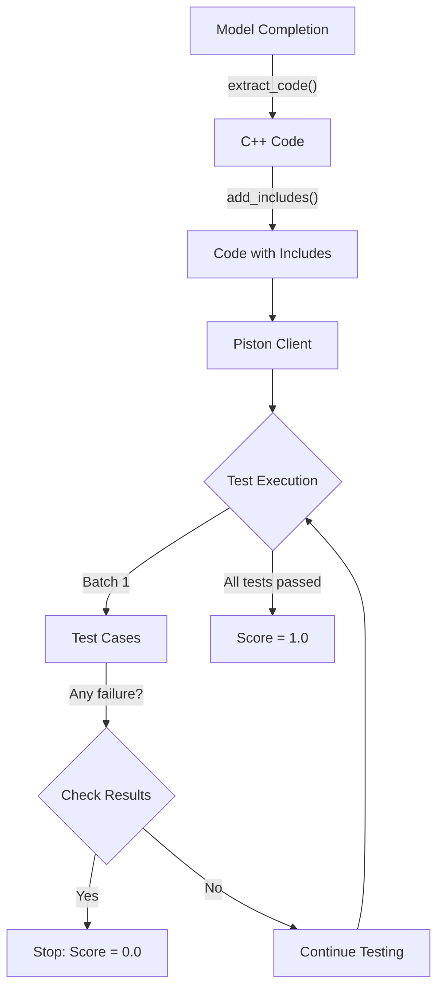
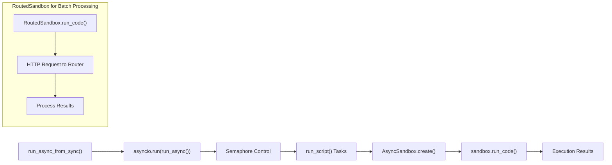
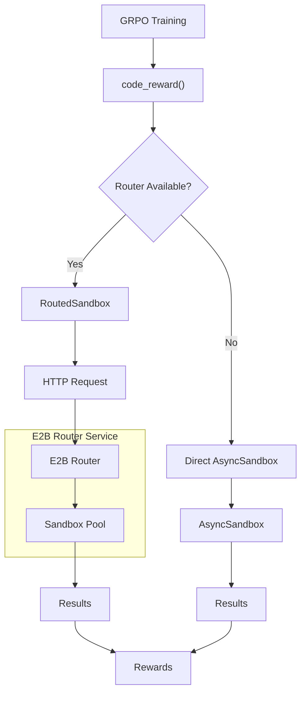

<!-- source: DeepWiki mcp.deepwiki.com · repo huggingface/open-r1 · page 3.2 Code Execution Rewards · fetched 2026-10-26 -->

# Code Execution Rewards

<details>
<summary>Relevant source files</summary>

The following files were used as context for generating this wiki page:

- [README.md](README.md)
- [scripts/e2b_router.py](scripts/e2b_router.py)
- [src/open_r1/rewards.py](src/open_r1/rewards.py)
- [src/open_r1/utils/routed_sandbox.py](src/open_r1/utils/routed_sandbox.py)
- [tests/slow/test_code_reward.py](tests/slow/test_code_reward.py)
- [tests/test_rewards.py](tests/test_rewards.py)

</details>


This page documents the code execution reward functions in Open-R1, which evaluate code generation quality by safely executing code in isolated environments. These rewards are critical components in the GRPO training pipeline for improving model performance on coding tasks. For information about other reward functions like mathematical and formatting rewards, see [Mathematical and Formatting Rewards](#3.1).

## Overview

Code execution rewards work by extracting code from model outputs, running it in secure sandboxed environments, and evaluating the results against test cases. Open-R1 supports two primary execution environments:

1. **E2B Sandbox** - For general Python code evaluation
2. **Piston** - For competitive programming problems (specifically IOI-style problems)



Sources: [src/open_r1/rewards.py:332-608]()

## Reward Functions

### Code Reward

The `code_reward` function evaluates code snippets using the E2B code interpreter. It extracts Python code from model completions and runs it against test cases specified in the dataset.



The function returns a float between 0.0 and 1.0 representing the proportion of test cases that passed.

Sources: [src/open_r1/rewards.py:401-489]()

### Binary Code Reward

The `binary_code_reward` function is a variant of `code_reward` that returns binary outcomes (0.0 or 1.0) based on a threshold:

```python
# If score > 0.99, return 1.0, otherwise return 0.0
output.append(1.0 if reward > BINARY_THRESHOLD else 0.0)
```

This provides clearer signals for learning by removing ambiguity around partial success.

Sources: [src/open_r1/rewards.py:387-398]()

### IOI Code Reward

The `ioi_code_reward` function specifically evaluates competitive programming problems from the International Olympiad in Informatics (IOI) format. It uses the Piston execution environment with a custom IOI package.



This function executes tests in batches and stops early if any test fails, providing efficiency in evaluation.

Sources: [src/open_r1/rewards.py:342-377](), [src/open_r1/utils/ioi/scoring.py:137-242]()

### Code Format Reward

The `code_format_reward` function checks if code responses follow the correct formatting pattern:

```

<answer>
```[language]
[code]
```
</answer>
```

This ensures models learn to provide well-structured responses with clear separation between reasoning and code solution.

Sources: [src/open_r1/rewards.py:492-505]()

## Execution Environments

### E2B Sandbox

The E2B Sandbox provides a secure isolated environment for executing Python code. It offers:

1. **Security** - Code runs in a containerized environment
2. **Timeout management** - Prevents infinite loops/long-running code
3. **Batch processing** - Multiple code snippets can be evaluated in parallel



For batch processing needs, the system includes a custom `RoutedSandbox` implementation that routes execution requests through a central server using FastAPI.

Sources: [src/open_r1/rewards.py:508-564](), [src/open_r1/utils/routed_sandbox.py:22-97]()

### Piston for IOI Problems

For competitive programming problems, Open-R1 uses Piston with a custom IOI package. This environment:

1. Supports C++ execution for algorithmic problems
2. Includes specialized grading for IOI-style competitions
3. Provides detailed feedback on failures

The system can run multiple Piston workers in parallel, either using Slurm in a cluster environment or with Docker containers locally.

Sources: [src/open_r1/utils/ioi/piston_client.py:12-225](), [slurm/piston/README.md:1-68]()

## Implementation Details

### Code Extraction

The `extract_code` function pulls code snippets from model completions using regular expressions:

```python
pattern = re.compile(rf"```{language}\n(.*?)```", re.DOTALL)
matches = pattern.findall(completion)
extracted_answer = matches[-1] if len(matches) >= 1 else ""
```

This extracts the last code block of the specified language, focusing on the final solution rather than any intermediate examples.

Sources: [src/open_r1/rewards.py:380-384]()

### Evaluation Process

Code evaluation follows these steps:

1. Extract code from model completion
2. Prepare test cases from the dataset's `verification_info`
3. Create an evaluation script that runs the code against test cases
4. Execute in a sandbox environment
5. Calculate success rate based on passing tests
6. Return the score (0.0-1.0)

The evaluation script runs each test case in isolation and compares outputs line by line.

Sources: [src/open_r1/rewards.py:414-452]()

### Batch Processing and Router

For efficient evaluation of multiple code snippets, Open-R1 includes a router system:



The E2B router can be launched as a standalone service or Slurm job, providing a centralized endpoint for code execution requests with configurable concurrency limits.

Sources: [scripts/e2b_router.py:16-161](), [slurm/e2b_router.slurm:1-16]()

### Error Handling and Timeouts

The system implements comprehensive error handling and timeouts to ensure reliability:

| Timeout Type | Default | Purpose |
|--------------|---------|---------|
| SANDBOX_TIMEOUT | 30 seconds | Maximum time allowed for sandbox operation |
| REQUEST_TIMEOUT | 28 seconds | Maximum time for HTTP request completion |
| ASYNCIO_TIMEOUT | 32 seconds | Overall timeout for async operations |

Errors during execution (e.g., syntax errors, runtime errors) are captured and translated into appropriate reward scores.

Sources: [src/open_r1/rewards.py:535-544]()

## Configuration and Usage

### Registering Reward Functions

Code execution rewards are registered in the `REWARD_FUNCS_REGISTRY` for use in GRPO training:

```python
REWARD_FUNCS_REGISTRY = {
    # Other rewards...
    "code": update_wrapper(
        partial(code_reward, num_parallel=script_args.parallel_code_exec_per_proc),
        code_reward,
    ),
    "binary_code": update_wrapper(
        partial(binary_code_reward, num_parallel=script_args.parallel_code_exec_per_proc),
        binary_code_reward,
    ),
    "ioi_code": update_wrapper(
        partial(ioi_code_reward, test_batch_size=script_args.code_eval_test_batch_size),
        ioi_code_reward
    ),
    "code_format": get_code_format_reward(language=script_args.code_language),
}
```

Sources: [src/open_r1/rewards.py:566-607]()

### Required Environment Setup

#### E2B Setup

For E2B code execution:
1. Install E2B: `pip install e2b-code-interpreter`
2. Add E2B API key to `.env` file
3. Optionally run an E2B router for batch processing: `python scripts/e2b_router.py`

#### Piston Setup

For IOI code execution:
1. Set up Piston workers (see [slurm/piston/README.md]())
2. Configure `PISTON_ENDPOINTS` environment variable
3. Install the IOI package on Piston workers

Sources: [src/open_r1/rewards.py:406-410](), [slurm/piston/README.md:1-68]()

## Integration with GRPO Training

To use code execution rewards in GRPO training, specify them in the `reward_funcs` argument:

```bash
python src/open_r1/grpo.py --reward_funcs code binary_code code_format
```

Multiple rewards can be combined, and weights adjusted through the training configuration to emphasize different aspects of code quality.

Sources: [src/open_r1/rewards.py:566-607]()

---

