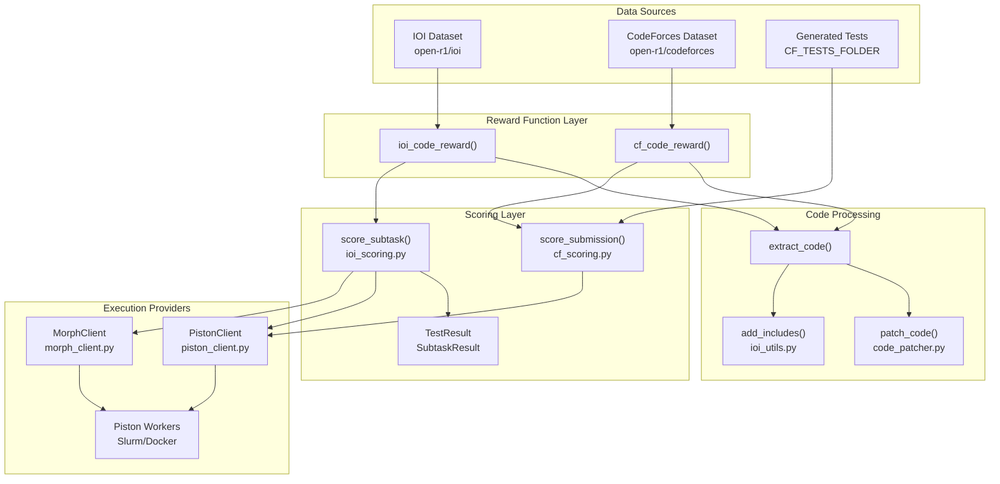
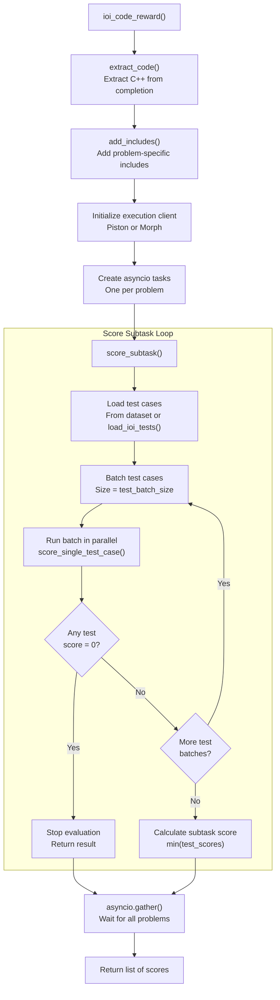
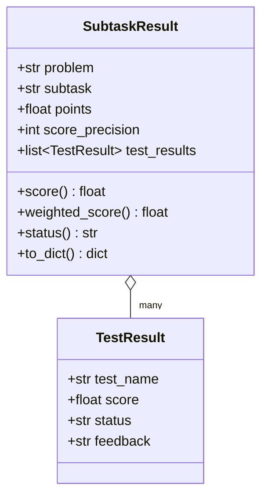
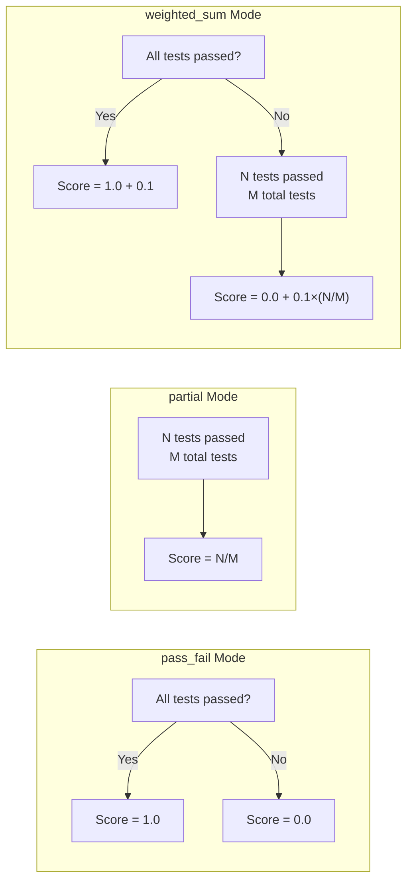
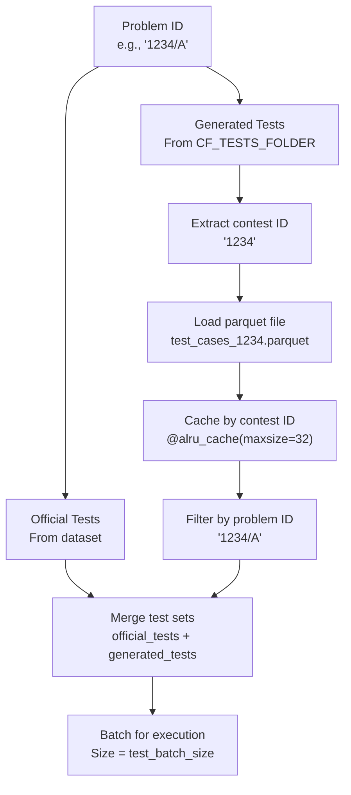
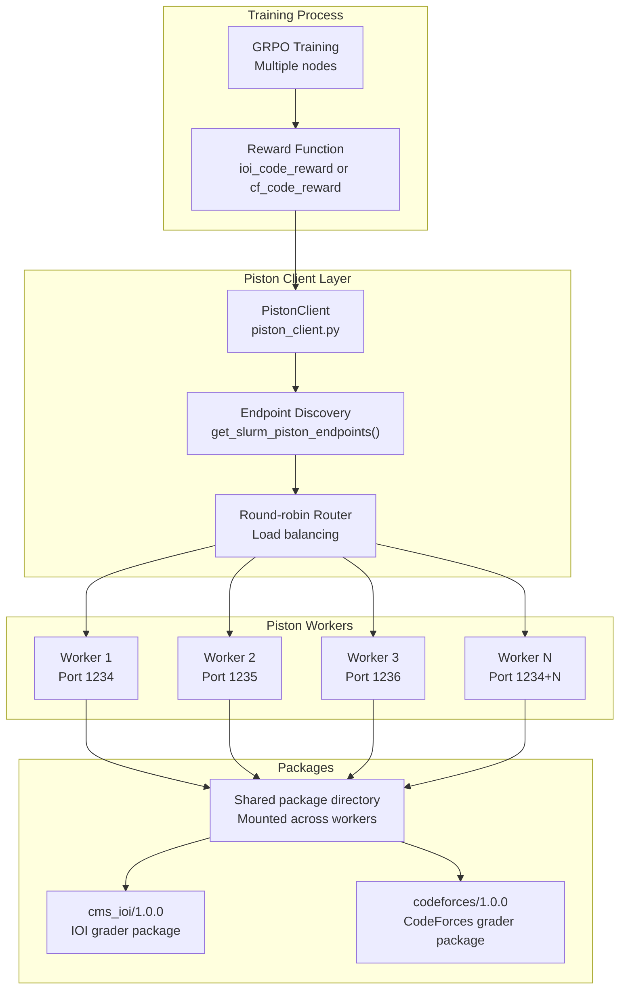
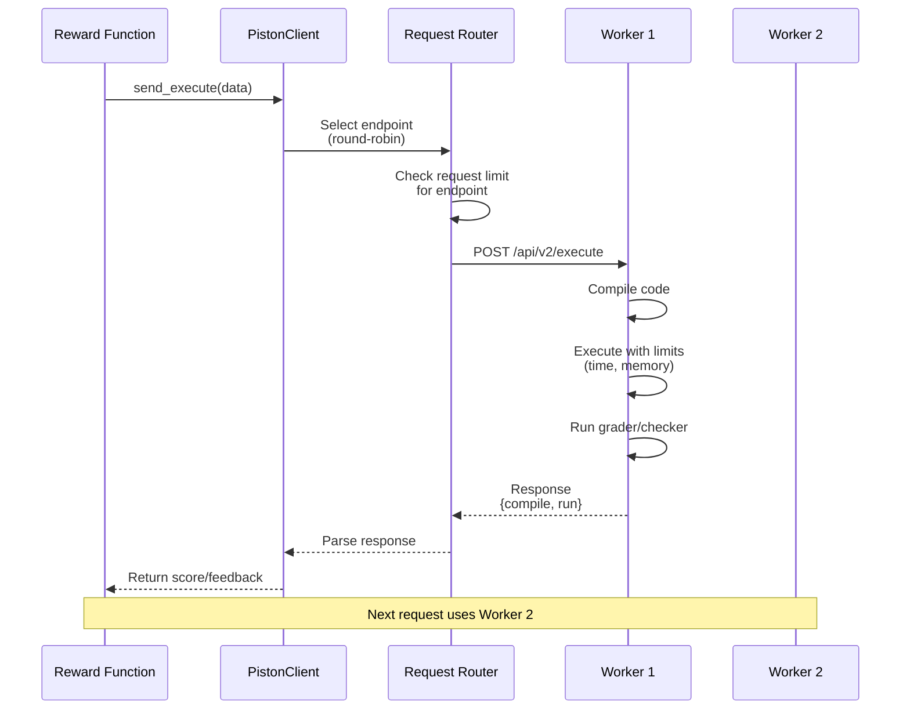
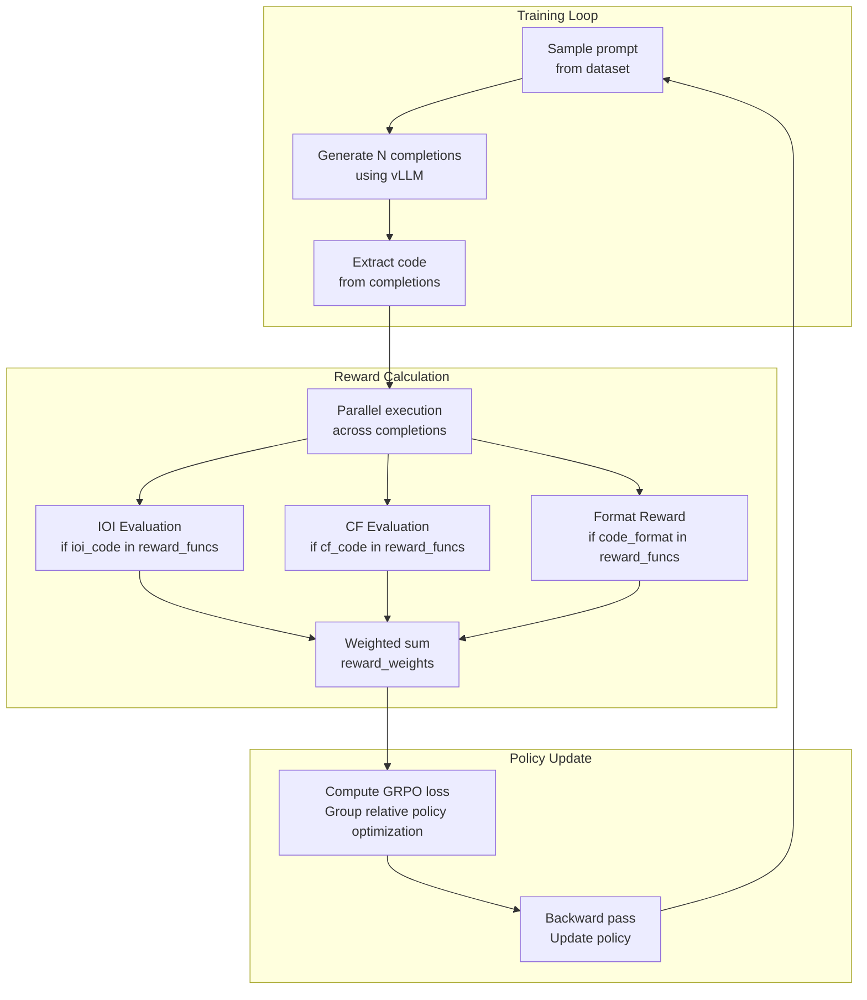

<!-- source: DeepWiki mcp.deepwiki.com · repo huggingface/open-r1 · page 3.3 Competitive Programming Evaluation · fetched 2026-10-26 -->

# Competitive Programming Evaluation

<details>
<summary>Relevant source files</summary>

The following files were used as context for generating this wiki page:

- [README.md](README.md)
- [recipes/Qwen2.5-Coder-7B-Instruct/grpo/config_codeforces.yaml](recipes/Qwen2.5-Coder-7B-Instruct/grpo/config_codeforces.yaml)
- [slurm/piston/README.md](slurm/piston/README.md)
- [src/open_r1/rewards.py](src/open_r1/rewards.py)
- [src/open_r1/utils/competitive_programming/__init__.py](src/open_r1/utils/competitive_programming/__init__.py)
- [src/open_r1/utils/competitive_programming/cf_scoring.py](src/open_r1/utils/competitive_programming/cf_scoring.py)
- [src/open_r1/utils/competitive_programming/code_patcher.py](src/open_r1/utils/competitive_programming/code_patcher.py)
- [src/open_r1/utils/competitive_programming/ioi_scoring.py](src/open_r1/utils/competitive_programming/ioi_scoring.py)
- [tests/test_rewards.py](tests/test_rewards.py)

</details>


This page documents the competitive programming evaluation system used for training models on coding problems from IOI (International Olympiad in Informatics) and CodeForces competitions. These reward functions evaluate generated code by executing it against test cases in sandboxed environments.

For general code execution rewards that support custom test cases, see [Code Execution Rewards](#3.2). For mathematical and formatting rewards, see [Mathematical and Formatting Rewards](#3.1).

## Purpose and Scope

The competitive programming evaluation system provides two specialized reward functions: `ioi_code_reward` and `cf_code_reward`. These functions evaluate model-generated solutions to programming competition problems by running them against predefined test suites and computing scores based on correctness, execution time, and memory usage. The system handles multi-language support (C++, Python), automatic code patching, and distributed execution across multiple worker nodes.

**Sources:** [src/open_r1/rewards.py:367-474](), [README.md:344-393]()

## System Architecture

The competitive programming evaluation system consists of three main layers: reward function interfaces, scoring engines, and execution providers.



**Sources:** [src/open_r1/rewards.py:367-474](), [src/open_r1/utils/competitive_programming/__init__.py:1-20]()

## IOI Code Reward

The `ioi_code_reward` function evaluates solutions to IOI (International Olympiad in Informatics) problems. IOI problems are organized into subtasks, where each subtask contains multiple test cases and is worth a specific number of points.

### Function Signature and Parameters

```python
def ioi_code_reward(
    completions,
    test_batch_size: int = 1,
    provider_type: str = "piston",
    **kwargs
) -> list[float]
```

| Parameter | Type | Description |
|-----------|------|-------------|
| `completions` | list | Model-generated completions to evaluate |
| `test_batch_size` | int | Number of test cases to evaluate in parallel before stopping on failure (default: 1) |
| `provider_type` | str | Execution provider: `"piston"` or `"morph"` (default: `"piston"`) |
| `**kwargs` | dict | Dataset columns including `id`, test information |

**Sources:** [src/open_r1/rewards.py:367-418]()

### Dataset Format

The IOI reward function expects datasets with the following structure (compatible with `open-r1/ioi`):

```python
{
    "id": "ioi2024/message",              # Problem identifier
    "subtask": "0",                        # Subtask number
    "score": 25.0,                         # Points for this subtask
    "score_precision": 2,                  # Score rounding precision
    "test_names": ["1", "2", "3"],        # Test case identifiers
    "time_limit": 1.0,                     # Time limit in seconds
    "memory_limit": 524288,                # Memory limit in KB
    "grader_files": [...],                 # Grader file contents
    "year": 2024                           # Competition year
}
```

Test cases are loaded from the dataset or from an external source using `load_ioi_tests()`.

**Sources:** [src/open_r1/utils/competitive_programming/ioi_scoring.py:164-244]()

### Execution Flow

The following diagram shows the execution flow for IOI problem evaluation:



**Sources:** [src/open_r1/rewards.py:367-418](), [src/open_r1/utils/competitive_programming/ioi_scoring.py:164-244]()

### Test Result Structure

IOI evaluation uses a hierarchical result structure:



**Scoring Logic:**
- **Test score**: Individual test result (0.0 to 1.0)
- **Subtask score**: Minimum of all test scores in the subtask
- **Weighted score**: Subtask score × available points

**Status Codes:**

| Status | Description |
|--------|-------------|
| `AC` | Accepted (score = 1.0) |
| `PA` | Partially Accepted (0.0 < score < 1.0) |
| `WA` | Wrong Answer |
| `TLE` | Time Limit Exceeded |
| `MLE` | Memory Limit Exceeded |
| `RE` | Runtime Error |
| `CE` | Compilation Error |
| `SKIPPED` | Test not executed |

**Sources:** [src/open_r1/utils/competitive_programming/ioi_scoring.py:10-108]()

### Example Usage

```yaml
# In GRPO configuration file
reward_funcs:
  - ioi_code
reward_weights:
  - 1.0

# Execution provider configuration
ioi_provider: piston  # or "morph"
code_eval_test_batch_size: 1  # Batch size for test execution
```

**Sources:** [recipes/Qwen2.5-1.5B-Instruct/grpo/config_demo_code_ioi.yaml](), [README.md:378-386]()

## CodeForces Code Reward

The `cf_code_reward` function evaluates solutions to CodeForces problems. Unlike IOI problems, CodeForces uses a flat test structure with optional generated test cases for more thorough evaluation.

### Function Signature and Parameters

```python
def cf_code_reward(
    completions,
    test_batch_size: int = 1,
    patch_code: bool = False,
    scoring_mode: Literal["pass_fail", "partial", "weighted_sum"] = "weighted_sum",
    **kwargs
) -> list[float]
```

| Parameter | Type | Description |
|-----------|------|-------------|
| `completions` | list | Model-generated completions to evaluate |
| `test_batch_size` | int | Number of test cases to evaluate in parallel (default: 1, -1 for all) |
| `patch_code` | bool | Apply automatic code fixes for common issues (default: False) |
| `scoring_mode` | str | Scoring strategy: `"pass_fail"`, `"partial"`, or `"weighted_sum"` (default: `"weighted_sum"`) |
| `**kwargs` | dict | Dataset columns including test cases and problem metadata |

**Sources:** [src/open_r1/rewards.py:420-474]()

### Dataset Format

CodeForces datasets (compatible with `open-r1/codeforces`) include:

```python
{
    "id": "1234/A",                           # Contest/problem ID
    "language": "cpp",                        # Primary language (cpp or python)
    "official_tests": [                       # Official test cases
        {"input": "...", "output": "..."}
    ],
    "generated_checker": "...",               # Optional custom checker script
    "time_limit": 2.0,                        # Time limit in seconds
    "memory_limit": 262144,                   # Memory limit in KB
    "input_mode": "stdin"                     # Input method: stdin or file
}
```

**Generated Tests:** Additional test cases are loaded from `CF_TESTS_FOLDER` environment variable, which points to downloaded test files. These provide more comprehensive coverage than official tests.

**Sources:** [src/open_r1/utils/competitive_programming/cf_scoring.py:58-92](), [README.md:360-368]()

### Scoring Modes

The CodeForces reward function supports three scoring modes:



**Scoring Mode Details:**

| Mode | Formula | Description |
|------|---------|-------------|
| `pass_fail` | `1.0` if all pass else `0.0` | Binary reward, stops on first failure |
| `partial` | `passed/total` | Proportional to test pass rate |
| `weighted_sum` | `pass_fail + 0.1 × (passed/total)` | Rewards both correctness and partial progress |

**Special Cases:**
- **Compilation error:** Returns `no_compile_reward` (default: -0.1)
- **No code extracted:** Returns `no_submission_reward` (default: -1.0)

**Sources:** [src/open_r1/utils/competitive_programming/cf_scoring.py:94-147]()

### Test Case Management

CodeForces evaluation combines official and generated test cases:



**Test Case Loading:**
1. Official tests come from the dataset's `official_tests` field
2. Generated tests are loaded asynchronously from parquet files
3. The `get_generated_tests()` function caches results by contest ID
4. All tests are batched and executed in parallel

**Sources:** [src/open_r1/utils/competitive_programming/cf_scoring.py:58-92](), [src/open_r1/utils/competitive_programming/cf_scoring.py:94-147]()

### Code Patching

The `patch_code` parameter enables automatic fixes for common Python and C++ issues:

**Python Fixes (`fix_python3_imports`):**
- Replace deprecated `collections` imports with `collections.abc`
- Update `fractions.gcd` to `math.gcd`
- Fix `asyncio.async()` to `asyncio.ensure_future()`
- Replace deprecated `inspect.getargspec` with `inspect.getfullargspec`
- Add `sys.set_int_max_str_digits(0)` to prevent integer string conversion limits
- Replace `os.getlogin()` checks (used for local debugging detection) with `False`

**C++ Fixes (`fix_cpp_includes`):**
- Add `#include <bits/stdc++.h>` header
- Add `using namespace std;` if not present

**Sources:** [src/open_r1/utils/competitive_programming/code_patcher.py:4-97]()

### Example Configuration

```yaml
# recipes/Qwen2.5-Coder-7B-Instruct/grpo/config_codeforces.yaml

reward_funcs:
  - cf_code
  - code_format
reward_weights:
  - 1.0
  - 0.1

# CodeForces-specific parameters
code_eval_test_batch_size: -1  # Run all tests in parallel
code_eval_scoring_mode: weighted_sum
```

**Environment Setup:**
```bash
# Download generated test cases
huggingface-cli download open-r1/codeforces \
    --repo-type=dataset \
    --include='generated_tests/*.parquet' \
    --local-dir /path/to/tests

# Set environment variable
export CF_TESTS_FOLDER=/path/to/tests
```

**Sources:** [recipes/Qwen2.5-Coder-7B-Instruct/grpo/config_codeforces.yaml:1-80](), [README.md:360-368]()

## Piston Worker Infrastructure

Both IOI and CodeForces evaluation rely on Piston workers for code execution. Piston is a high-performance code execution engine that provides isolated sandboxes for running untrusted code.

### Architecture Overview



**Sources:** [slurm/piston/README.md:1-82](), [src/open_r1/utils/competitive_programming/piston_client.py]()

### Worker Deployment

**Slurm Cluster Deployment:**

```bash
# Launch multiple workers on Slurm
slurm/piston/launch_piston_workers.sh 8  # Launch 8 workers

# Workers are assigned sequential ports starting from 1234
# Job names: piston-worker-1234, piston-worker-1235, ...
```

**Docker Deployment (Single Worker):**

```bash
docker run -d \
  --name piston_worker \
  -v /path/to/packages:/piston/packages \
  -e PORT=2000 \
  -e PISTON_COMPILE_TIMEOUT=60000 \
  -e PISTON_RUN_TIMEOUT=60000 \
  -e PISTON_OUTPUT_MAX_SIZE=1000000000 \
  -e PISTON_MAX_FILE_SIZE=1000000000 \
  -e PISTON_DISABLE_NETWORKING=true \
  -e PISTON_REPO_URL=https://github.com/guipenedo/piston/releases/download/pkgs/index \
  -p 2000:2000 \
  --entrypoint /bin/bash \
  ghcr.io/engineer-man/piston@sha256:63b5654... \
  -c "sed -i '/app.use(body_parser.urlencoded/c\    app.use(body_parser.urlencoded({ extended: true, limit: \"512mb\" }));' src/index.js && \
      sed -i '/app.use(body_parser.json/c\    app.use(body_parser.json({ limit: \"512mb\" }));' src/index.js && \
      node src"
```

**Sources:** [slurm/piston/README.md:1-82]()

### Package Installation

After deploying workers, install the required execution packages:

**IOI Package:**
```bash
curl -X POST http://worker-host:1234/api/v2/packages \
  -H "Content-Type: application/json" \
  -d '{"language": "cms_ioi", "version": "1.0.0"}'
```

**CodeForces Package:**
```bash
curl -X POST http://worker-host:1234/api/v2/packages \
  -H "Content-Type: application/json" \
  -d '{"language": "codeforces", "version": "1.0.0"}'
```

**Note:** With shared package directories (Slurm), only one worker needs to install packages. Other workers automatically access them through the shared mount.

**Sources:** [slurm/piston/README.md:12-42]()

### Client Configuration

The `PistonClient` discovers and balances load across workers:

**Environment Variables:**

| Variable | Description | Example |
|----------|-------------|---------|
| `PISTON_ENDPOINTS` | Worker discovery mode or explicit list | `"slurm"` or `"http://host1:1234,http://host2:1235"` |
| `PISTON_MAX_REQUESTS_PER_ENDPOINT` | Max concurrent requests per worker | `1` (default) |
| `CF_TESTS_FOLDER` | Path to CodeForces generated tests | `/path/to/tests` |

**Automatic Discovery (Slurm):**
```bash
export PISTON_ENDPOINTS=slurm
# Client queries Slurm for all running piston-worker-* jobs
# Constructs endpoint list automatically
```

**Manual Configuration:**
```bash
export PISTON_ENDPOINTS=http://10.0.1.1:1234,http://10.0.1.2:1235,http://10.0.1.3:1236
```

**Sources:** [slurm/piston/README.md:33-40]()

### Request Execution Flow



**Request Limits:** The client tracks concurrent requests per endpoint to prevent overload. When an endpoint reaches its limit (`PISTON_MAX_REQUESTS_PER_ENDPOINT`), the next available endpoint is selected.

**Sources:** [src/open_r1/utils/competitive_programming/piston_client.py]()

## Integration with GRPO Training

The competitive programming rewards integrate seamlessly with the GRPO training pipeline:



**Configuration Example:**

```yaml
# Multiple reward functions with weights
reward_funcs:
  - cf_code        # CodeForces correctness
  - code_format    # Output structure validation
reward_weights:
  - 1.0            # Primary reward
  - 0.1            # Secondary reward

# Generation parameters
num_generations: 16
temperature: 0.7
max_completion_length: 8192

# Evaluation parameters
code_eval_test_batch_size: -1  # Run all tests
code_eval_scoring_mode: weighted_sum
```

**Sources:** [recipes/Qwen2.5-Coder-7B-Instruct/grpo/config_codeforces.yaml:1-80](), [src/open_r1/grpo.py]()

## Error Handling and Edge Cases

The evaluation system handles various failure modes gracefully:

### Code Extraction Failures

```python
# If no code is extracted (empty string)
if not submission:
    return no_submission_reward  # Default: -1.0 for CF, skip for IOI
```

**Extraction Logic:**
- Uses regex to find code blocks: ` ```{language}\n...\n``` `
- Returns last matching block if multiple exist
- Returns empty string if no blocks found

**Sources:** [src/open_r1/rewards.py:476-483]()

### Execution Errors

| Error Type | IOI Handling | CF Handling |
|------------|--------------|-------------|
| Compilation Error | `TestResult(status="CE", score=0.0)` | Return `no_compile_reward` (-0.1) |
| Runtime Error | `TestResult(status="RE", score=0.0)` | Continue to next test |
| Time Limit | `TestResult(status="TLE", score=0.0)` | Continue to next test |
| Memory Limit | `TestResult(status="MLE", score=0.0)` | Continue to next test |
| Worker Error | Catch exception, return `SubtaskResult()` | Catch exception, return None |

**Async Error Handling:**

```python
async def run_catch_exceptions(task):
    try:
        return await task
    except Exception as e:
        print(f"Error from piston worker: {e}")
        return SubtaskResult()  # or None for CF
```

**Sources:** [src/open_r1/rewards.py:392-418](), [src/open_r1/rewards.py:445-474]()

### Missing Test Cases

**IOI:** If `test_cases` not in dataset, load from external source using `load_ioi_tests(year, problem_id)`

**CodeForces:** If generated tests not found in `CF_TESTS_FOLDER`, only use official tests

**Sources:** [src/open_r1/utils/competitive_programming/ioi_scoring.py:215-221](), [src/open_r1/utils/competitive_programming/cf_scoring.py:74-76]()

### Test Batching and Early Stopping

Both reward functions support early stopping to avoid wasting compute on obviously incorrect solutions:

```python
# test_batch_size=1: Sequential execution, stop on first failure
# test_batch_size=N: Run N tests in parallel, stop if any fail
# test_batch_size=-1: Run all tests in parallel (no early stopping)

for test_batch in batched(tests, test_batch_size):
    results = await asyncio.gather(*[evaluate(test) for test in test_batch])
    if any(result.score == 0.0 for result in results):
        break  # Stop evaluation
```

**Trade-offs:**
- **Small batch sizes:** Faster for incorrect solutions, slower for correct ones
- **Large batch sizes:** More parallelism, but may waste compute on failing solutions
- **Batch size -1:** Maximum parallelism, useful when solutions are likely correct

**Sources:** [src/open_r1/utils/competitive_programming/ioi_scoring.py:222-242](), [src/open_r1/utils/competitive_programming/cf_scoring.py:116-136]()

## Performance Considerations

### Throughput Optimization

**Worker Scaling:**
- Deploy multiple Piston workers (8-16 recommended)
- Each worker handles 1 request at a time by default
- Total throughput = num_workers × avg_requests_per_second

**Parallelism:**
- `asyncio.gather()` enables parallel evaluation across problems
- Batch size controls parallelism within a single problem
- Multiple training nodes share the same worker pool

**Caching:**
- Test cases cached per contest ID: `@alru_cache(maxsize=32)`
- Previously executed tests cached within subtask evaluation
- Reduces redundant file I/O and parsing

**Sources:** [src/open_r1/utils/competitive_programming/cf_scoring.py:58-61](), [src/open_r1/utils/competitive_programming/ioi_scoring.py:192-206]()

### Resource Management

**Memory:**
- Piston workers enforce per-execution memory limits
- IOI: Specified in dataset (`memory_limit` field)
- CF: Specified in dataset (`memory_limit` field)

**Time:**
- Hard timeouts prevent hung executions
- Soft timeouts (problem time limits) handled by graders
- Worker-level timeout = problem_timeout + buffer (3-10 seconds)

**Disk:**
- Large test cases (up to 512MB) supported via increased body parser limits
- Shared package directory reduces redundant installations

**Sources:** [slurm/piston/README.md:53-57](), [src/open_r1/utils/competitive_programming/cf_scoring.py:46-50]()

### Monitoring and Debugging

**Logging:**
```python
# Worker errors are caught and printed
print(f"Error from piston worker: {e}")

# Compilation errors include stderr
feedback = "Compilation error exit code " + str(code) + "\n" + stderr
```

**Request Tracking:**
- Each worker has a unique port (1234, 1235, ...)
- Slurm job names: `piston-worker-{port}`
- Round-robin routing enables load distribution tracking

**Sources:** [src/open_r1/rewards.py:396-398](), [src/open_r1/utils/competitive_programming/ioi_scoring.py:312-315]()

---

