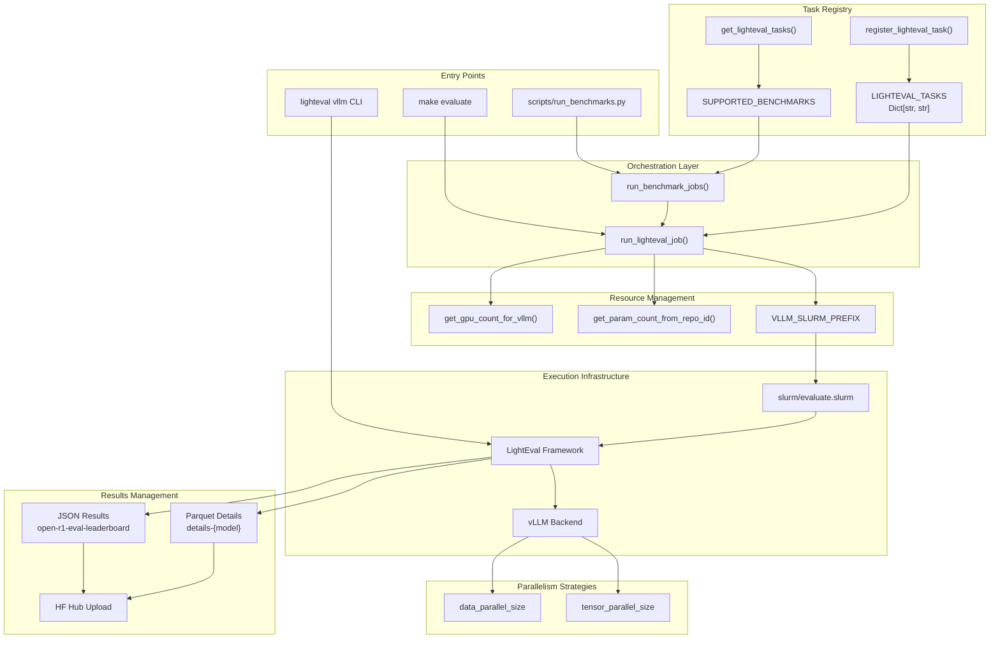
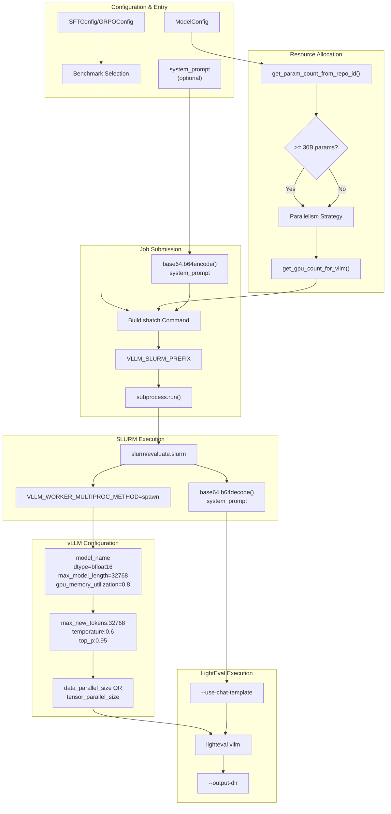

<!-- source: DeepWiki mcp.deepwiki.com · repo huggingface/open-r1 · page 4 Evaluation System · fetched 2026-10-26 -->

# Evaluation System

<details>
<summary>Relevant source files</summary>

The following files were used as context for generating this wiki page:

- [README.md](README.md)
- [src/open_r1/utils/evaluation.py](src/open_r1/utils/evaluation.py)

</details>


The evaluation system provides a comprehensive framework for benchmarking trained models across various tasks including mathematical reasoning, code generation, and domain-specific challenges. The system orchestrates model evaluation using the LightEval framework with vLLM backend, manages GPU resources dynamically based on model size, and handles result collection and publishing to Hugging Face Hub.

The evaluation system supports three entry points: direct `lighteval` CLI commands, the `make evaluate` development target, and batch evaluation via `scripts/run_benchmarks.py`. All approaches use vLLM for efficient inference with configurable parallelism strategies.

For information about the reward functions used during training evaluation, see [Reward Functions](#3). For details about benchmark execution and SLURM job management, see [Benchmark Execution](#4.1). For supported benchmarks and their configurations, see [Supported Benchmarks](#4.2).

## Architecture Overview

The evaluation system consists of several interconnected components that handle task registration, model serving, distributed evaluation, and result management. The system supports multiple entry points that converge on a common execution path through LightEval and vLLM.

**Evaluation System Architecture**


Sources: [src/open_r1/utils/evaluation.py:1-119](), [README.md:444-525]()

## Benchmark Registry System

The evaluation system maintains a centralized registry of supported benchmarks through the `LIGHTEVAL_TASKS` dictionary. Each benchmark is registered with specific task configurations that define the evaluation parameters and sampling strategies.

| Benchmark Key | Task Format | Evaluation Suite | Description | Sampling Strategy |
|---------------|-------------|------------------|-------------|-------------------|
| `math_500` | `lighteval\|math_500\|0\|0` | lighteval | MATH-500 benchmark | 4 samples per query |
| `aime24` | `lighteval\|aime24\|0\|0` | lighteval | AIME 2024 competition | 64 samples per query |
| `aime25` | `lighteval\|aime25\|0\|0` | lighteval | AIME 2025 competition | 64 samples per query |
| `gpqa` | `lighteval\|gpqa:diamond\|0\|0` | lighteval | GPQA Diamond science Q&A | 8 samples per query |
| `lcb` | `extended\|lcb:codegeneration\|0\|0` | extended | LiveCodeBench v5 code generation | 16 samples per query |
| `lcb_v4` | `extended\|lcb:codegeneration_v4\|0\|0` | extended | LiveCodeBench v4 code generation | 16 samples per query |

### Task Registration

The `register_lighteval_task()` function formats task specifications according to LightEval's expected format: `{eval_suite}|{task_name}|{num_fewshot}|0`. The function accepts multiple tasks as a comma-separated list and converts them to the appropriate format:

```python
# Example from evaluation.py:48
task_list = ",".join(f"{eval_suite}|{task}|{num_fewshot}|0" for task in task_list.split(","))
```

Tasks are organized into two categories:
- **Core tasks** (`lighteval` suite): Standard benchmarks from LightEval's main task table
- **Extended tasks** (`extended` suite): Custom tasks with specialized metrics stored in `scripts/evaluation/extended_lighteval_tasks`

The `get_lighteval_tasks()` function returns the list of all registered benchmark keys, which is used to populate `SUPPORTED_BENCHMARKS` for validation in the orchestration layer.

Sources: [src/open_r1/utils/evaluation.py:27-66](), [README.md:529-536]()

## Evaluation Execution Pipeline

The evaluation pipeline handles model serving, resource allocation, and distributed evaluation execution through SLURM job orchestration. The system automatically determines optimal GPU allocation and parallelism strategies based on model size.

**Evaluation Execution Flow**


Sources: [src/open_r1/utils/evaluation.py:69-118](), [README.md:446-505]()

## Resource Management and GPU Allocation

The system dynamically allocates GPU resources based on model size and benchmark requirements. The allocation strategy uses two key helper functions from `utils/hub.py`: `get_param_count_from_repo_id()` to determine model size and `get_gpu_count_for_vllm()` to calculate required GPU count.

### Parallelism Strategy Selection

Models with 30 billion parameters or more automatically use tensor parallelism to distribute the model across multiple GPUs and avoid out-of-memory errors:

```python
# From evaluation.py:79-83
if get_param_count_from_repo_id(model_name) >= 30_000_000_000:
    tensor_parallel = True
else:
    num_gpus = 2  # Hack while cluster is full
    tensor_parallel = False
```

### vLLM Configuration

The SLURM evaluation script configures vLLM with different parallelism strategies based on the model size decision:

| Parallelism Mode | vLLM Parameter | Description | Use Case |
|------------------|----------------|-------------|----------|
| **Tensor Parallel** | `tensor_parallel_size=$NUM_GPUS` | Model sharded across GPUs | Large models (≥30B params) |
| **Data Parallel** | `data_parallel_size=$NUM_GPUS` | Multiple model replicas | Smaller models for throughput |

### Standard vLLM Parameters

All evaluations use consistent vLLM configuration regardless of parallelism strategy:

| Parameter | Value | Purpose |
|-----------|-------|---------|
| `dtype` | `bfloat16` | Mixed precision for memory efficiency |
| `max_model_length` | `32768` | Maximum sequence length |
| `gpu_memory_utilization` | `0.8` | GPU memory allocation target |
| `max_new_tokens` | `32768` | Maximum generation length |
| `temperature` | `0.6` | Sampling temperature |
| `top_p` | `0.95` | Nucleus sampling threshold |

### Environment Configuration

The evaluation system requires specific environment setup for vLLM execution within SLURM jobs:

```python
# From evaluation.py:18-24
VLLM_SLURM_PREFIX = [
    "env", "-i", "bash", "-c",
    f"for f in /etc/profile.d/*.sh; do source $f; done; export HOME={user_home_directory}; sbatch ",
]
```

This prefix ensures proper environment initialization when launching vLLM from within SLURM training jobs, sourcing all profile scripts and setting the home directory correctly.

Sources: [src/open_r1/utils/evaluation.py:14-24,77-83](), [README.md:478-505]()

## Entry Points and Usage Patterns

The evaluation system provides three distinct entry points for different use cases:

### 1. Direct LightEval CLI

For single-GPU evaluation or quick tests, use the `lighteval` CLI directly:

```shell
export VLLM_WORKER_MULTIPROC_METHOD=spawn
MODEL=deepseek-ai/DeepSeek-R1-Distill-Qwen-1.5B
MODEL_ARGS="model_name=$MODEL,dtype=bfloat16,max_model_length=32768,gpu_memory_utilization=0.8"
lighteval vllm $MODEL_ARGS "lighteval|aime24|0|0" \
    --use-chat-template \
    --output-dir data/evals/$MODEL
```

### 2. Makefile Target

For development workflows, use the `make evaluate` target:

```shell
# Single GPU
make evaluate MODEL=deepseek-ai/DeepSeek-R1-Distill-Qwen-7B TASK=aime24

# Data Parallelism
make evaluate MODEL=deepseek-ai/DeepSeek-R1-Distill-Qwen-7B TASK=aime24 PARALLEL=data NUM_GPUS=8

# Tensor Parallelism
make evaluate MODEL=deepseek-ai/DeepSeek-R1-Distill-Qwen-32B TASK=aime24 PARALLEL=tensor NUM_GPUS=8
```

### 3. Batch SLURM Evaluation

For batch evaluation across multiple benchmarks, use `scripts/run_benchmarks.py`:

```shell
python scripts/run_benchmarks.py --model-id {model_id} --benchmarks aime24 math_500 gpqa
```

This script calls `run_benchmark_jobs()` from `evaluation.py`, which iterates through the specified benchmarks and submits a separate SLURM job for each via `run_lighteval_job()`.

Sources: [README.md:444-525,567-604](), [src/open_r1/utils/evaluation.py:106-118]()

## Results Management

The evaluation system generates two types of outputs and automatically uploads them to Hugging Face Hub repositories:

### JSON Results
Evaluation scores and metrics are saved as JSON files in the format `results_{timestamp}.json` and uploaded to the `open-r1/open-r1-eval-leaderboard` space repository. The upload process includes retry logic with up to 20 attempts and 5-second delays between retries to handle transient failures.

### Detailed Outputs
Comprehensive evaluation details including model responses and intermediate results are saved as Parquet files and uploaded to model-specific repositories following the pattern `open-r1/details-{model_name}`. Each upload is tagged with a configuration name format: `{model_revision}.{task_name}.{timestamp}`.

### Upload Process

The upload logic in `slurm/evaluate.slurm` performs the following steps:

1. **Results Upload**: Attempts to upload JSON results to the leaderboard repository with retry logic
2. **Details Upload**: Uploads Parquet files to the model-specific details repository
3. **Cleanup**: Removes local result directories after successful uploads to manage disk space

The system automatically creates repository names by sanitizing model names (replacing `/` with `-`).

Sources: [README.md:444-505]()

## Integration with Training Pipeline

The evaluation system integrates with both SFT and GRPO training pipelines through the `benchmarks` parameter in training configurations. When `benchmarks: ["all"]` is specified, the system automatically evaluates the model on all supported benchmarks after training completion.

The system handles optional system prompts by base64 encoding them in the SLURM job submission to avoid issues with special characters, then decoding them during evaluation execution.

Sources: [src/open_r1/utils/evaluation.py:106-118](), [slurm/evaluate.slurm:97-101]()

---

