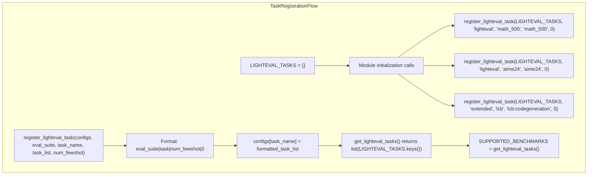
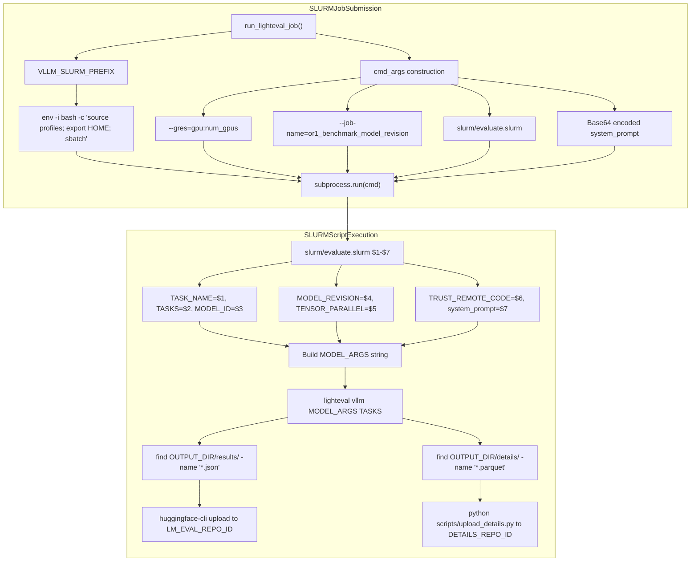
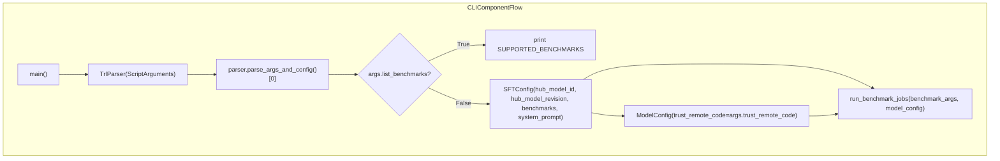
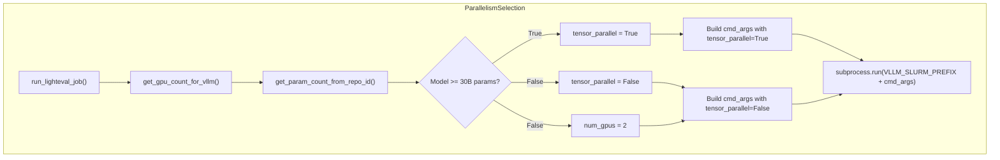
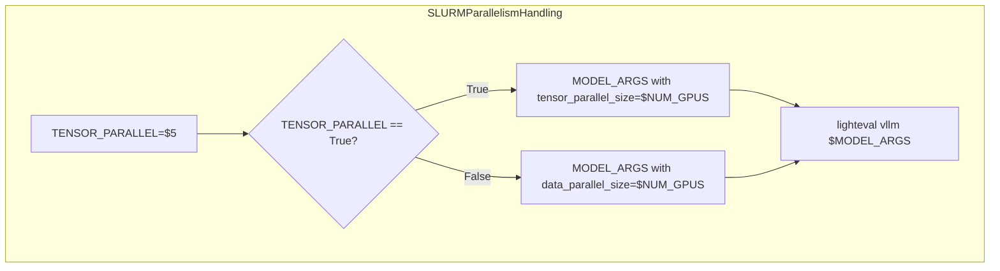
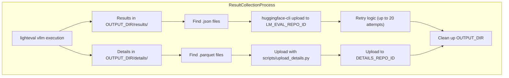

<!-- source: DeepWiki mcp.deepwiki.com · repo huggingface/open-r1 · page 4.1 Benchmark Execution · fetched 2026-10-26 -->

# Benchmark Execution

<details>
<summary>Relevant source files</summary>

The following files were used as context for generating this wiki page:

- [README.md](README.md)
- [slurm/evaluate.slurm](slurm/evaluate.slurm)
- [slurm/train.slurm](slurm/train.slurm)
- [src/open_r1/utils/evaluation.py](src/open_r1/utils/evaluation.py)

</details>


## Purpose and Overview

This document explains how to run benchmarks on trained models in the Open-R1 system and interpret the results. The benchmark execution system allows users to evaluate model performance across various tasks, including mathematical reasoning, physics questions, and code generation capabilities.

For information about the specific benchmarks supported by the system, see [Supported Benchmarks](#4.2).

Sources: [src/open_r1/utils/evaluation.py:1-114]()

## Task Registration System

The benchmark system uses a registry pattern with `LIGHTEVAL_TASKS` dictionary and `register_lighteval_task()` function:



Registered benchmark configurations:

| Task Key | Eval Suite | Task List Format | LightEval Format |
|----------|------------|------------------|------------------|
| `math_500` | lighteval | "math_500" | "lighteval\|math_500\|0\|0" |
| `aime24` | lighteval | "aime24" | "lighteval\|aime24\|0\|0" |
| `aime25` | lighteval | "aime25" | "lighteval\|aime25\|0\|0" |
| `gpqa` | lighteval | "gpqa:diamond" | "lighteval\|gpqa:diamond\|0\|0" |
| `lcb` | extended | "lcb:codegeneration" | "extended\|lcb:codegeneration\|0\|0" |
| `lcb_v4` | extended | "lcb:codegeneration_v4" | "extended\|lcb:codegeneration_v4\|0\|0" |

The `extended` suite requires custom task definitions in `scripts/evaluation/extended_lighteval_tasks/`, while `lighteval` suite uses core LightEval tasks from the main tasks table.

Sources: [src/open_r1/utils/evaluation.py:27-66]()

## Benchmark Execution Flow

The benchmark execution process follows a multi-stage workflow from job submission to result collection:

```mermaid
flowchart TD
    subgraph "BenchmarkExecutionPipeline"
        A["run_benchmark_jobs()"] --> B{"benchmarks == ['all']?"}
        B -->|"True"| C["get_lighteval_tasks()"]
        B -->|"False"| D["Use provided benchmarks list"]
        C --> E["for benchmark in benchmarks"]
        D --> E
        
        E --> F["run_lighteval_job(benchmark, training_args, model_args)"]
        F --> G["LIGHTEVAL_TASKS[benchmark]"]
        G --> H["get_gpu_count_for_vllm(model_name, model_revision)"]
        H --> I["get_param_count_from_repo_id(model_name)"]
        I --> J["Build cmd_args array"]
        J --> K["subprocess.run(VLLM_SLURM_PREFIX + cmd_args)"]
        
        K --> L["slurm/evaluate.slurm"]
        L --> M["lighteval vllm MODEL_ARGS TASKS"]
        M --> N["Upload *.json to LM_EVAL_REPO_ID"]
        M --> O["Upload *.parquet to DETAILS_REPO_ID"]
        N --> P["rm -rf OUTPUT_DIR"]
        O --> P
    end
```



Sources: [src/open_r1/utils/evaluation.py:106-118](), [src/open_r1/utils/evaluation.py:69-103](), [slurm/evaluate.slurm:53-82]()

## SLURM Integration Architecture

The system uses SLURM for distributed execution with specific environment handling:



Key SLURM configuration variables:

| Variable | Source | Purpose |
|----------|--------|---------|
| `VLLM_SLURM_PREFIX` | [src/open_r1/utils/evaluation.py:18-24]() | Environment setup for vLLM in SLURM |
| `LM_EVAL_REPO_ID` | [slurm/evaluate.slurm:44]() | "open-r1/open-r1-eval-leaderboard" |
| `DETAILS_REPO_ID` | [slurm/evaluate.slurm:46]() | "open-r1/details-{MODEL_NAME}" |
| `OUTPUT_DIR` | [slurm/evaluate.slurm:47]() | "eval_results/{MODEL_ID}/{MODEL_REVISION}/{TASK_NAME}" |
| `VLLM_WORKER_MULTIPROC_METHOD` | [slurm/evaluate.slurm:20]() | Set to "spawn" for vLLM compatibility |

Sources: [src/open_r1/utils/evaluation.py:85-103](), [slurm/evaluate.slurm:27-78]()

## CLI Interface and Script Arguments

The `scripts/run_benchmarks.py` provides a standalone interface for benchmark execution:



The `ScriptArguments` dataclass defines the CLI interface:

| Field | Default | Type | Purpose |
|-------|---------|------|---------|
| `model_id` | "deepseek-ai/DeepSeek-R1-Distill-Qwen-1.5B" | str | Hub model identifier |
| `model_revision` | "main" | str | Model branch/revision |
| `trust_remote_code` | False | bool | Allow remote code execution |
| `benchmarks` | [] | List[str] | Benchmark names to run |
| `list_benchmarks` | False | bool | List available benchmarks |
| `system_prompt` | None | Optional[str] | Custom system prompt |

Example usage:

```bash
# Run specific benchmarks
python scripts/run_benchmarks.py \
    --model_id deepseek-ai/DeepSeek-R1-Distill-Qwen-1.5B \
    --benchmarks math_500 gpqa \
    --trust_remote_code

# List all supported benchmarks  
python scripts/run_benchmarks.py --list_benchmarks

# Run all benchmarks with custom system prompt
python scripts/run_benchmarks.py \
    --model_id my-org/my-model \
    --benchmarks all \
    --system_prompt "You are a helpful assistant."
```

Sources: [scripts/run_benchmarks.py:22-61]()

## Configuration Options

The benchmark execution system accepts the following configuration options:

| Option | Description | Default | Source |
|--------|-------------|---------|--------|
| `--model_id` | Hugging Face model ID | deepseek-ai/DeepSeek-R1-Distill-Qwen-1.5B | [scripts/run_benchmarks.py:24-27]() |
| `--model_revision` | Model revision/branch | main | [scripts/run_benchmarks.py:28]() |
| `--trust_remote_code` | Trust remote code | False | [scripts/run_benchmarks.py:29]() |
| `--benchmarks` | List of benchmarks | [] | [scripts/run_benchmarks.py:30-32]() |
| `--list_benchmarks` | List all supported benchmarks | False | [scripts/run_benchmarks.py:33]() |
| `--system_prompt` | System prompt for evaluation | None | [scripts/run_benchmarks.py:34-36]() |

Sources: [scripts/run_benchmarks.py:22-36]()

## Parallelism Strategy

The system dynamically selects parallelism strategy based on model parameter count:



The parallelism configuration is then handled in `slurm/evaluate.slurm`:



Sources: [src/open_r1/utils/evaluation.py:77-83](), [slurm/evaluate.slurm:32-42]()

## Result Collection Process

After benchmark execution, results are processed and uploaded to Hugging Face Hub:



Key repositories:
- Leaderboard: `open-r1/open-r1-eval-leaderboard` - Contains summary metrics
- Details: `open-r1/details-{model_name}` - Contains per-example results

Sources: [slurm/evaluate.slurm:48-77]()

## Output Structure

During execution, results are temporarily stored in the `eval_results/` directory with the following structure:

```
eval_results/
└── {model_id}/
    └── {model_revision}/
        └── {task_name}/
            ├── results/
            │   └── {benchmark}.json
            └── details/
                └── {benchmark}.parquet
```

This directory is cleaned up after successful upload to Hugging Face Hub, as shown by its inclusion in the `.gitignore` file.

Sources: [slurm/evaluate.slurm:41](), [.gitignore:177]()

## Troubleshooting

When running benchmarks, the following issues may occur:

1. **SLURM Job Failures**: Check the logs directory (`./logs/%x-%j.out` and `./logs/%x-%j.err`) for detailed error messages.
2. **Upload Failures**: The system implements retry logic (up to 20 attempts) for uploads to the Hugging Face Hub.
3. **Out of Memory Errors**: These may occur with very large models. The system uses tensor parallelism by default to mitigate this.

Sources: [slurm/evaluate.slurm:4-6](), [slurm/evaluate.slurm:59-67]()

---

