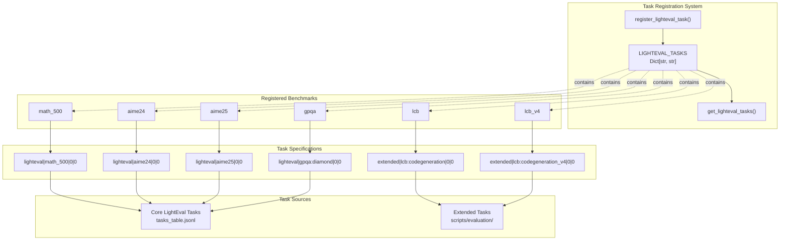
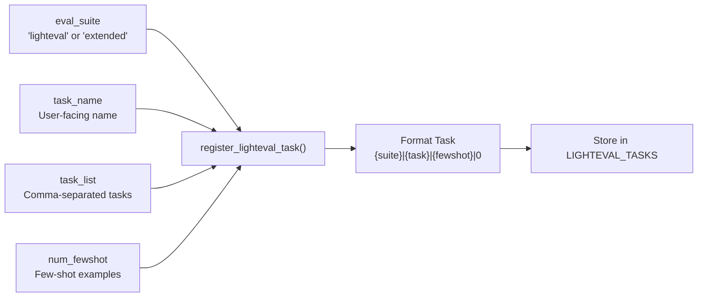
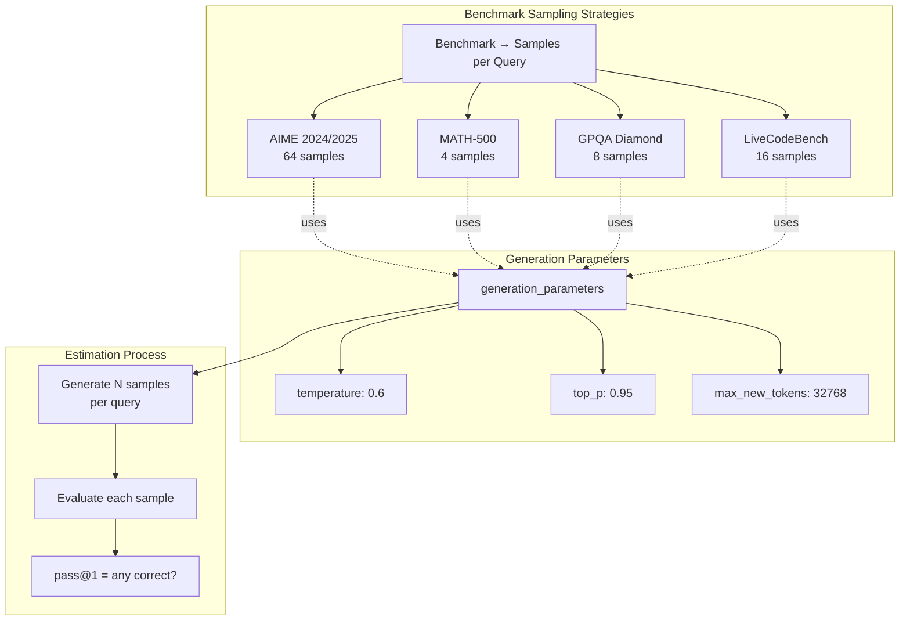
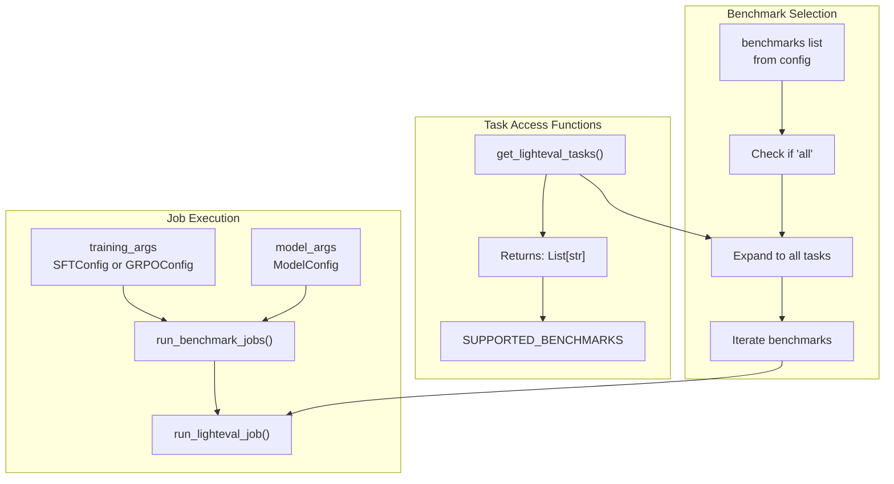

<!-- source: DeepWiki mcp.deepwiki.com · repo huggingface/open-r1 · page 4.2 Supported Benchmarks · fetched 2026-10-26 -->

# Supported Benchmarks

<details>
<summary>Relevant source files</summary>

The following files were used as context for generating this wiki page:

- [README.md](README.md)
- [src/open_r1/utils/evaluation.py](src/open_r1/utils/evaluation.py)

</details>


This document describes the benchmark tasks available in the Open R1 evaluation system. The benchmarks are defined in the `LIGHTEVAL_TASKS` registry and can be executed via the LightEval framework with vLLM backend. For information on how to run evaluations, see [Benchmark Execution](#4.1).

The system supports five primary benchmark suites: AIME 2024/2025 (mathematics competition), MATH-500 (mathematical problem solving), GPQA Diamond (graduate-level science questions), and LiveCodeBench (code generation). Each benchmark uses task-specific sampling strategies and generation parameters to estimate pass@1 accuracy.

---

## Benchmark Registry Architecture

The evaluation system uses a registry pattern to manage benchmark configurations. The `LIGHTEVAL_TASKS` dictionary maps human-readable benchmark names to LightEval task specifications.



**Sources:** [src/open_r1/utils/evaluation.py:27-59]()

---

## Benchmark Registration

The `register_lighteval_task()` function adds benchmarks to the registry. Each registration specifies the evaluation suite, task name, underlying task list, and number of few-shot examples.



The function formats task specifications as `{eval_suite}|{task_name}|{num_fewshot}|0`, where the final `0` indicates version. Tasks from LightEval's core library use `eval_suite="lighteval"`, while custom tasks use `eval_suite="extended"` and are loaded from `scripts/evaluation/extended_lighteval_tasks/`.

**Sources:** [src/open_r1/utils/evaluation.py:27-49]()

---

## Supported Benchmarks

### AIME 2024 and AIME 2025

The American Invitational Mathematics Examination (AIME) benchmarks test mathematical reasoning on competition-level problems. AIME 2024 contains 30 problems and is used for comprehensive evaluation, while AIME 2025 provides more recent test cases.

| Property | Value |
|----------|-------|
| Task Name | `aime24`, `aime25` |
| Evaluation Suite | `lighteval` |
| Few-shot Examples | 0 |
| Task Specification | `lighteval\|aime24\|0\|0` |
| Recommended Samples per Query | 64 |
| Problem Count | 30 (AIME 2024) |

AIME requires high sampling rates (64 responses per query) due to the small dataset size, which introduces variance. The benchmark evaluates models' ability to solve complex mathematical problems that require multiple reasoning steps.

**Configuration Example:**
```yaml
# Model arguments for AIME evaluation
model_args: "model_name=deepseek-ai/DeepSeek-R1-Distill-Qwen-7B,dtype=bfloat16,max_model_length=32768,gpu_memory_utilization=0.8,generation_parameters={max_new_tokens:32768,temperature:0.6,top_p:0.95}"
```

**Sources:** [src/open_r1/utils/evaluation.py:55-56](), [README.md:531-565]()

---

### MATH-500

MATH-500 is a subset of the MATH dataset containing 500 mathematical problems spanning algebra, geometry, probability, and other topics. It requires models to produce final answers in specific formats (often within `\boxed{}` notation).

| Property | Value |
|----------|-------|
| Task Name | `math_500` |
| Evaluation Suite | `lighteval` |
| Few-shot Examples | 0 |
| Task Specification | `lighteval\|math_500\|0\|0` |
| Recommended Samples per Query | 4 |

MATH-500 uses fewer samples per query (4) compared to AIME because it contains more problems, reducing variance in pass@1 estimation.

**Sources:** [src/open_r1/utils/evaluation.py:54](), [README.md:531-604]()

---

### GPQA Diamond

GPQA (Graduate-Level Google-Proof Q&A) Diamond is a subset of graduate-level science questions designed to be difficult for language models to answer correctly even with web search. It tests scientific reasoning across biology, chemistry, and physics.

| Property | Value |
|----------|-------|
| Task Name | `gpqa` |
| Evaluation Suite | `lighteval` |
| Task Configuration | `gpqa:diamond` |
| Few-shot Examples | 0 |
| Task Specification | `lighteval\|gpqa:diamond\|0\|0` |
| Recommended Samples per Query | 8 |

The task specification uses the `gpqa:diamond` configuration to select the Diamond subset, which contains the most challenging questions.

**Sources:** [src/open_r1/utils/evaluation.py:57](), [README.md:531-636]()

---

### LiveCodeBench

LiveCodeBench evaluates code generation capabilities using programming problems collected from recent competitive programming contests. The benchmark includes two versions: v5 (default) and v4.

| Property | Value |
|----------|-------|
| Task Name | `lcb`, `lcb_v4` |
| Evaluation Suite | `extended` |
| Task Configuration | `lcb:codegeneration`, `lcb:codegeneration_v4` |
| Few-shot Examples | 0 |
| Task Specification | `extended\|lcb:codegeneration\|0\|0` |
| Recommended Samples per Query | 16 |

LiveCodeBench is registered as an `extended` task, meaning it requires custom evaluation logic stored in `scripts/evaluation/extended_lighteval_tasks/`. The benchmark tests models' ability to generate correct code solutions for algorithmic problems.

**Sources:** [src/open_r1/utils/evaluation.py:58-59](), [README.md:531-665]()

---

## Sampling Strategy Configuration

The Open R1 evaluation pipeline uses sampling-based pass@1 estimation, where multiple responses are generated for each query and success is determined if any response is correct. The number of samples varies by benchmark to balance evaluation accuracy with computational cost.



### Sampling Configuration Table

| Benchmark | Samples per Query | Justification |
|-----------|-------------------|---------------|
| AIME 2024 | 64 | Small dataset (30 problems) requires high sampling to reduce variance |
| MATH-500 | 4 | Larger dataset allows lower sampling while maintaining statistical significance |
| GPQA Diamond | 8 | Medium sampling rate balances accuracy and compute for graduate-level problems |
| LiveCodeBench | 16 | Code generation benefits from higher sampling to explore solution space |

All benchmarks use consistent generation parameters: `temperature=0.6`, `top_p=0.95`, and `max_new_tokens=32768`. These values are specified in the model arguments string passed to vLLM.

**Sources:** [README.md:529-536]()

---

## Task Retrieval and Execution

The evaluation system provides helper functions to access registered benchmarks and execute evaluation jobs.



The `get_lighteval_tasks()` function returns a list of all registered benchmark names from the `LIGHTEVAL_TASKS` dictionary. This list is also available via the `SUPPORTED_BENCHMARKS` constant.

The `run_benchmark_jobs()` function orchestrates evaluation by:
1. Checking if `benchmarks=["all"]` is specified in training configuration
2. Expanding "all" to the full list from `get_lighteval_tasks()` if needed
3. Iterating through benchmarks and calling `run_lighteval_job()` for each
4. Validating that each benchmark name exists in the registry

The `run_lighteval_job()` function submits Slurm jobs with appropriate GPU allocation based on model size and benchmark requirements. Models with ≥30B parameters automatically enable tensor parallelism.

**Sources:** [src/open_r1/utils/evaluation.py:62-119]()

---

## Integration with Training Pipeline

Benchmarks can be automatically executed after training by specifying them in the training configuration.

```yaml
# Example training config with benchmark specification
benchmarks:
  - aime24
  - math_500
  - gpqa
  - lcb

# Or evaluate on all supported benchmarks
benchmarks:
  - all
```

When `benchmarks` is specified in `SFTConfig` or `GRPOConfig`, the training script calls `run_benchmark_jobs()` at the end of training. This submits separate Slurm jobs for each benchmark, allowing parallel evaluation across multiple nodes.

The evaluation system retrieves the model name from `training_args.hub_model_id` and model revision from `training_args.hub_model_revision`, ensuring that the exact checkpoint pushed to the Hub is evaluated.

**Sources:** [src/open_r1/utils/evaluation.py:106-119]()

---

## Task Specification Format

LightEval tasks follow a specific string format for execution:

```
{eval_suite}|{task_name}|{num_fewshot}|{version}
```

- `eval_suite`: Either `"lighteval"` (core tasks) or `"extended"` (custom tasks)
- `task_name`: The specific task or task configuration (e.g., `"math_500"`, `"gpqa:diamond"`)
- `num_fewshot`: Number of few-shot examples to provide (always `0` for Open R1)
- `version`: Task version number (always `0` in current implementation)

**Examples:**
- `lighteval|math_500|0|0` - Core MATH-500 task with zero-shot evaluation
- `extended|lcb:codegeneration|0|0` - Extended LiveCodeBench code generation task
- `lighteval|gpqa:diamond|0|0` - Core GPQA task using Diamond subset

The `register_lighteval_task()` function automatically formats task specifications correctly when tasks are registered, ensuring consistency across the codebase.

**Sources:** [src/open_r1/utils/evaluation.py:27-49]()

---

