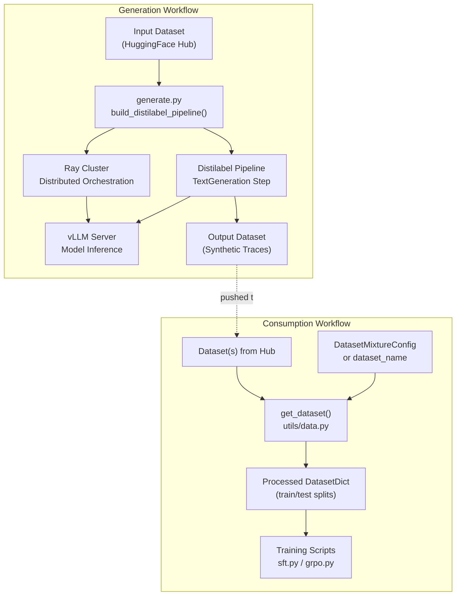
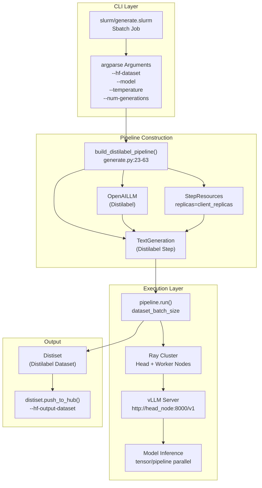
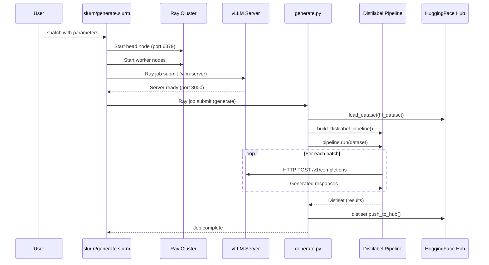
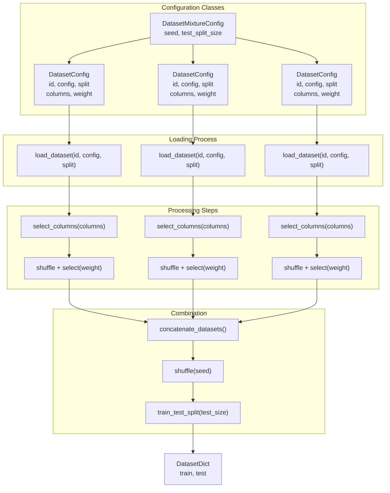
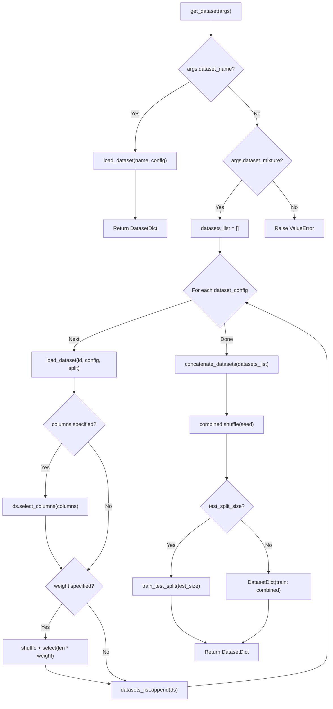

<!-- source: DeepWiki mcp.deepwiki.com · repo huggingface/open-r1 · page 5 Data Generation and Processing · fetched 2026-10-26 -->

# Data Generation and Processing

<details>
<summary>Relevant source files</summary>

The following files were used as context for generating this wiki page:

- [README.md](README.md)
- [slurm/generate.slurm](slurm/generate.slurm)
- [src/open_r1/generate.py](src/open_r1/generate.py)
- [src/open_r1/sft.py](src/open_r1/sft.py)
- [src/open_r1/utils/__init__.py](src/open_r1/utils/__init__.py)
- [src/open_r1/utils/data.py](src/open_r1/utils/data.py)
- [src/open_r1/utils/model_utils.py](src/open_r1/utils/model_utils.py)
- [tests/utils/test_data.py](tests/utils/test_data.py)

</details>


## Purpose and Scope

This document describes the synthetic data generation and dataset loading systems in Open R1. It covers two main areas:

1. **Synthetic Data Generation**: Using Distilabel and vLLM to generate reasoning traces from language models, distributed across Ray clusters for scalability
2. **Dataset Loading and Preprocessing**: Utilities for loading single datasets or mixtures of datasets with configurable weights, column selection, and train/test splitting

For details on specific generation pipeline configuration, see [Distilabel Pipeline](#5.1). For dataset utilities implementation details, see [Dataset Utilities](#5.2). For training with these datasets, see [Training Pipeline](#2).

## System Overview

The data generation and processing system supports two workflows:

1. **Generation Workflow**: Load a base dataset → Generate synthetic responses using a model → Push results to HuggingFace Hub
2. **Consumption Workflow**: Load dataset(s) from Hub → Apply mixture configuration → Split into train/test → Feed to training scripts



**Sources**: [src/open_r1/generate.py:1-209](), [src/open_r1/utils/data.py:1-66](), [README.md:667-765]()

## Data Generation Architecture

### Generation Pipeline Components

The generation system consists of four main components that work together to produce synthetic reasoning traces:



**Sources**: [src/open_r1/generate.py:23-209](), [slurm/generate.slurm:1-244]()

### Generation Configuration Parameters

The `build_distilabel_pipeline()` function accepts the following parameters:

| Parameter | Type | Default | Description |
|-----------|------|---------|-------------|
| `model` | `str` | required | Model name/path for generation |
| `base_url` | `str` | `"http://localhost:8000/v1"` | vLLM server URL |
| `prompt_column` | `Optional[str]` | `None` | Column name to map to `instruction` |
| `prompt_template` | `str` | `"{{ instruction }}"` | Jinja2 template for prompts |
| `temperature` | `Optional[float]` | `None` | Sampling temperature |
| `top_p` | `Optional[float]` | `None` | Nucleus sampling parameter |
| `max_new_tokens` | `int` | `8192` | Maximum tokens to generate |
| `num_generations` | `int` | `1` | Responses per prompt |
| `input_batch_size` | `int` | `64` | Batch size for processing |
| `client_replicas` | `int` | `1` | Number of parallel replicas |
| `timeout` | `int` | `900` | Request timeout in seconds |
| `retries` | `int` | `0` | Number of retry attempts |

**Sources**: [src/open_r1/generate.py:23-36]()

### Ray Cluster Setup

The Slurm script [slurm/generate.slurm:1-244]() orchestrates distributed generation across multiple nodes:

1. **Head Node Initialization** (lines 142-153):
   - Starts Ray head with dashboard on port 8265
   - Sets `ip_head=$head_node_ip:6379`
   - Enables remote access to dashboard

2. **Worker Node Registration** (lines 158-169):
   - Connects each worker to head node via `ray start --address "$ip_head"`
   - Staggered startup with 5-second delays

3. **vLLM Server Deployment** (lines 175-187):
   - Submitted as Ray job with ID `vllm-server`
   - Uses `--tensor-parallel-size $SLURM_GPUS_PER_NODE`
   - Uses `--pipeline-parallel-size $SLURM_JOB_NUM_NODES`
   - Enables chunked prefill for efficiency

4. **Health Checks** (lines 189-214):
   - Waits for HTTP 200 from `http://$head_node_ip:8000`
   - Validates available models via `/v1/models`
   - Executes sanity completion request

**Sources**: [slurm/generate.slurm:134-214]()

### Generation Execution Flow



**Sources**: [slurm/generate.slurm:175-239](), [src/open_r1/generate.py:66-209]()

## Dataset Loading System

### Single Dataset Loading

When `dataset_name` is provided without `dataset_mixture`, the system loads a dataset directly:

```python
# From get_dataset() in utils/data.py:21-23
if args.dataset_name and not args.dataset_mixture:
    logger.info(f"Loading dataset: {args.dataset_name}")
    return datasets.load_dataset(args.dataset_name, args.dataset_config)
```

Example usage in training scripts:

```python
# From sft.py:90
dataset = get_dataset(script_args)
# Returns a DatasetDict with splits like {"train": Dataset, "test": Dataset}
```

**Sources**: [src/open_r1/utils/data.py:12-23](), [src/open_r1/sft.py:90]()

### Dataset Mixture Configuration

The `DatasetMixtureConfig` class enables combining multiple datasets with configurable weights and column selection:



**Sources**: [src/open_r1/utils/data.py:24-62](), [src/open_r1/configs.py]()

### Dataset Mixture Example

Here's how to configure a dataset mixture in YAML:

```yaml
dataset_mixture:
  datasets:
    - id: open-r1/Mixture-of-Thoughts
      config: math
      split: train
      columns:
        - prompt
        - chosen
      weight: 0.5
    - id: open-r1/codeforces-cots
      config: default
      split: train
      columns:
        - prompt
        - chosen
      weight: 0.3
    - id: open-r1/OpenR1-Math-220k
      config: default
      split: train
      columns:
        - prompt
        - chosen
      weight: 0.2
  seed: 42
  test_split_size: 0.1
```

This configuration:
1. Loads three datasets with specified configs and splits
2. Selects only `prompt` and `chosen` columns from each
3. Samples 50% of first dataset, 30% of second, 20% of third
4. Concatenates and shuffles with seed 42
5. Splits result into 90% train, 10% test

**Sources**: [README.md:419-442](), [tests/utils/test_data.py:52-67]()

### Dataset Processing Pipeline

The `get_dataset()` function implements the following logic:



**Sources**: [src/open_r1/utils/data.py:12-66]()

### Column Selection and Validation

When using dataset mixtures, all datasets must have consistent column names after selection:

```python
# From ScriptArguments validation
if self.dataset_mixture is not None:
    first_columns = self.dataset_mixture.datasets[0].columns
    for config in self.dataset_mixture.datasets:
        if config.columns != first_columns:
            raise ValueError("Column names must be consistent across all datasets")
```

This ensures:
- All datasets in the mixture have the same schema
- Training scripts receive uniform data structures
- No runtime errors from missing columns

**Sources**: [tests/utils/test_data.py:106-120]()

## Integration with Training

### Training Script Usage

Training scripts load datasets using `get_dataset()` and access splits by name:

```python
# From sft.py:90-105
dataset = get_dataset(script_args)

trainer = SFTTrainer(
    model=model,
    args=training_args,
    train_dataset=dataset[script_args.dataset_train_split],  # Default: "train"
    eval_dataset=(
        dataset[script_args.dataset_test_split]  # Default: "test"
        if training_args.eval_strategy != "no" 
        else None
    ),
    processing_class=tokenizer,
    peft_config=get_peft_config(model_args),
    callbacks=get_callbacks(training_args, model_args),
)
```

**Sources**: [src/open_r1/sft.py:90-109]()

### ScriptArguments Dataset Parameters

The `ScriptArguments` class provides configuration options:

| Parameter | Type | Default | Description |
|-----------|------|---------|-------------|
| `dataset_name` | `Optional[str]` | `None` | HuggingFace dataset ID |
| `dataset_config` | `Optional[str]` | `None` | Dataset configuration name |
| `dataset_train_split` | `str` | `"train"` | Name of training split |
| `dataset_test_split` | `str` | `"test"` | Name of evaluation split |
| `dataset_mixture` | `Optional[DatasetMixtureConfig]` | `None` | Mixture configuration |

**Sources**: [src/open_r1/configs.py](), [src/open_r1/utils/data.py:16-18]()

## Practical Examples

### Example 1: Single Dataset Generation

Generate 4 responses per prompt using a 7B distilled model:

```bash
sbatch slurm/generate.slurm \
    --model deepseek-ai/DeepSeek-R1-Distill-Qwen-7B \
    --hf-dataset AI-MO/NuminaMath-TIR \
    --hf-dataset-split train \
    --prompt-column problem \
    --temperature 0.6 \
    --num-generations 4 \
    --max-new-tokens 8192 \
    --hf-output-dataset username/numina-r1-traces
```

**Sources**: [README.md:730-749]()

### Example 2: Large Model Generation

Generate from DeepSeek-R1-671B on 2 nodes with pipeline parallelism:

```bash
sbatch --nodes=2 slurm/generate.slurm \
    --model deepseek-ai/DeepSeek-R1 \
    --hf-dataset AI-MO/NuminaMath-TIR \
    --prompt-column problem \
    --temperature 0.6 \
    --hf-output-dataset username/r1-dataset
```

This automatically:
- Configures `--pipeline-parallel-size 2`
- Configures `--tensor-parallel-size 8` (GPUs per node)
- Enables chunked prefill for efficiency

**Sources**: [slurm/generate.slurm:180-187](), [README.md:730-749]()

### Example 3: Training with Dataset Mixture

Train on a mixture of reasoning datasets:

```yaml
# recipes/custom/sft/config_mixture.yaml
dataset_mixture:
  datasets:
    - id: open-r1/Mixture-of-Thoughts
      config: all
      split: train
      weight: 0.6
    - id: open-r1/OpenR1-Math-220k
      config: default
      split: train
      weight: 0.4
  seed: 42
  test_split_size: 0.05
```

```bash
accelerate launch --config_file recipes/accelerate_configs/zero3.yaml \
    src/open_r1/sft.py \
    --config recipes/custom/sft/config_mixture.yaml
```

**Sources**: [README.md:419-442](), [tests/utils/test_data.py:69-83]()

## Command-Line Interface

### generate.py Arguments

| Argument | Type | Required | Description |
|----------|------|----------|-------------|
| `--hf-dataset` | `str` | Yes | HuggingFace dataset to load |
| `--hf-dataset-config` | `str` | No | Dataset configuration name |
| `--hf-dataset-split` | `str` | No | Split to use (default: `"train"`) |
| `--prompt-column` | `str` | No | Column name for prompts (default: `"prompt"`) |
| `--prompt-template` | `str` | No | Jinja2 template (default: `"{{ instruction }}"`) |
| `--model` | `str` | Yes | Model name for generation |
| `--vllm-server-url` | `str` | No | vLLM URL (default: `"http://localhost:8000/v1"`) |
| `--temperature` | `float` | No | Sampling temperature |
| `--top-p` | `float` | No | Nucleus sampling parameter |
| `--max-new-tokens` | `int` | No | Max tokens to generate (default: 8192) |
| `--num-generations` | `int` | No | Responses per prompt (default: 1) |
| `--input-batch-size` | `int` | No | Batch size (default: 64) |
| `--client-replicas` | `int` | No | Parallel replicas (default: 1) |
| `--timeout` | `int` | No | Request timeout in seconds (default: 600) |
| `--retries` | `int` | No | Retry attempts (default: 0) |
| `--hf-output-dataset` | `str` | No | Output repository name |
| `--private` | flag | No | Make output dataset private |

**Sources**: [src/open_r1/generate.py:66-170]()

### Slurm Script Arguments

The [slurm/generate.slurm:12-84]() script accepts the same arguments as `generate.py` and sets defaults:

- `HF_DATASET_SPLIT="train"`
- `PROMPT_COLUMN="prompt"`
- `PROMPT_TEMPLATE="{{ instruction }}"`
- `MAX_NEW_TOKENS=8192`
- `NUM_GENERATIONS=1`
- `INPUT_BATCH_SIZE=64`
- `CLIENT_REPLICAS=1`
- `TIMEOUT=900`
- `RETRIES=0`
- `PRIVATE="false"`

**Sources**: [slurm/generate.slurm:91-101]()

---

