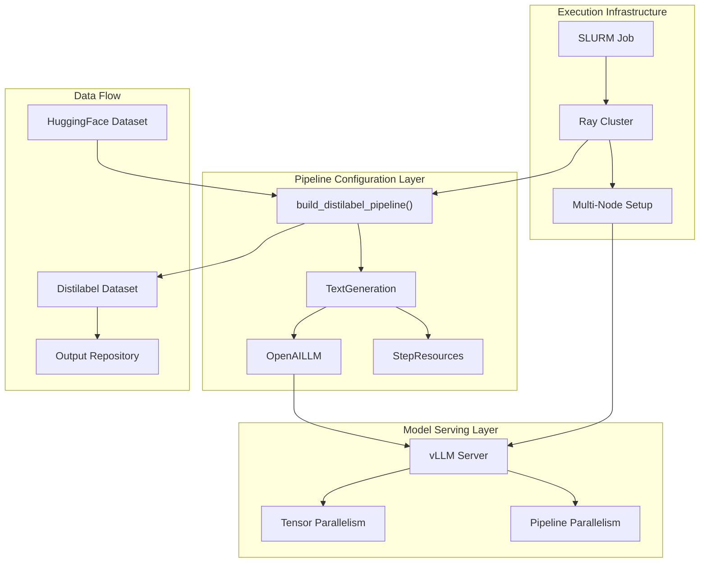
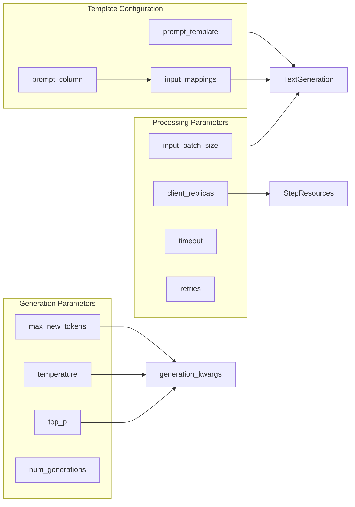
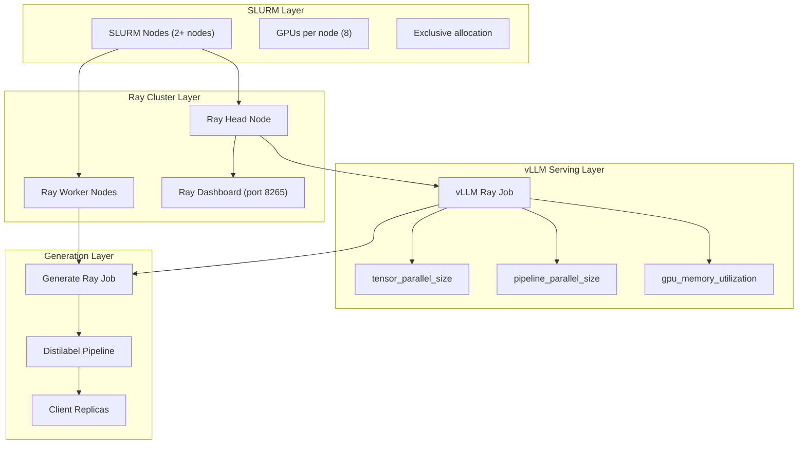
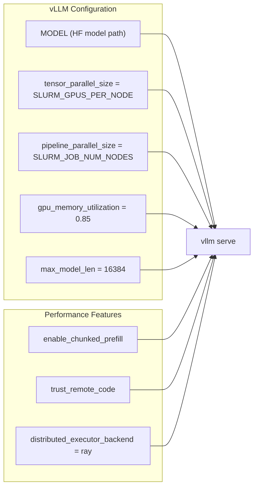
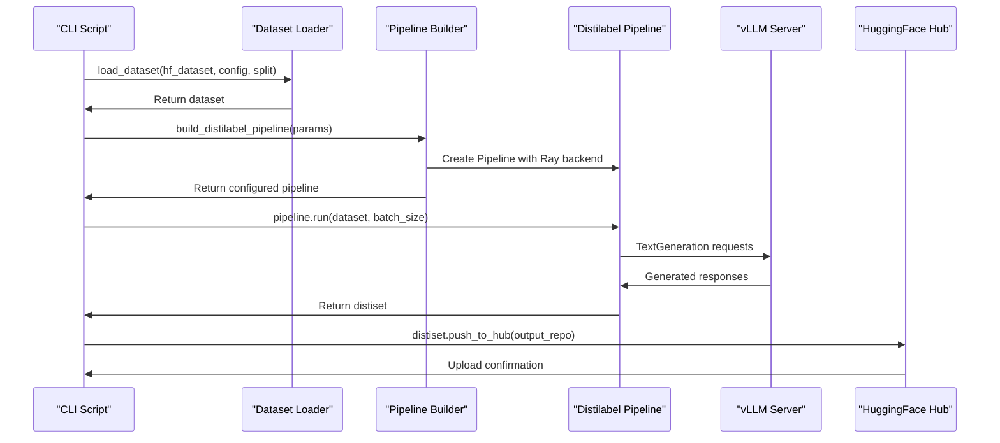

<!-- source: DeepWiki mcp.deepwiki.com · repo huggingface/open-r1 · page 5.1 Distilabel Pipeline · fetched 2026-10-26 -->

# Distilabel Pipeline

Relevant source files

The following files were used as context for generating this wiki page:

- [README.md](README.md)
- [slurm/generate.slurm](slurm/generate.slurm)
- [src/open_r1/generate.py](src/open_r1/generate.py)

The Distilabel Pipeline system provides a distributed text generation framework using the Distilabel library, integrated with vLLM for high-performance inference and Ray for distributed computing. This system enables large-scale synthetic data generation by orchestrating model serving, parallel processing, and dataset management across multiple compute nodes.

For information about data processing after generation, see [Data Processing and Filtering](#5.2). For SLURM job management details, see [SLURM Integration](#6.1).

## Architecture Overview

The Distilabel Pipeline system consists of three main layers: pipeline configuration, distributed execution infrastructure, and model serving components.

Sources: [src/open_r1/generate.py:1-209](), [slurm/generate.slurm:1-244]()

## Core Components

### Pipeline Builder Function

The `build_distilabel_pipeline` function creates and configures the text generation pipeline with the following key components:

| Component | Type | Purpose |
|-----------|------|---------|
| `OpenAILLM` | LLM Interface | Connects to vLLM server via OpenAI-compatible API |
| `TextGeneration` | Task Step | Handles text generation logic and prompt templating |
| `StepResources` | Resource Config | Manages client replicas for parallel processing |
| `Pipeline.ray()` | Execution Backend | Enables Ray-based distributed execution |

The pipeline configuration supports customizable generation parameters:

Sources: [src/open_r1/generate.py:23-63]()

### Text Generation Step Configuration

The `TextGeneration` step is configured with specific parameters for optimal performance:

- **Template Processing**: Uses Jinja2 templating with `{{ instruction }}` as default
- **Input Mapping**: Maps dataset columns to template variables via `input_mappings`
- **Batch Processing**: Processes inputs in configurable batch sizes
- **Generation Grouping**: Groups multiple generations per input when `num_generations > 1`

Sources: [src/open_r1/generate.py:46-61]()

## Distributed Execution Architecture

The system uses a multi-layered distributed architecture combining SLURM, Ray, and vLLM:

Sources: [slurm/generate.slurm:134-188](), [slurm/generate.slurm:216-238]()

### Ray Cluster Setup

The SLURM script establishes a Ray cluster with the following configuration:

1. **Head Node Initialization**: First node becomes Ray head with dashboard access
2. **Worker Node Connection**: Remaining nodes connect to head node address
3. **Job Submission**: Two Ray jobs are submitted - vLLM server and generation pipeline

| Ray Configuration | Value | Purpose |
|------------------|-------|---------|
| `head_node_ip` | Dynamic | IP address of first SLURM node |
| `port` | 6379 | Ray cluster communication port |
| `dashboard-port` | 8265 | Ray dashboard web interface |
| `dashboard-host` | 0.0.0.0 | Allow external dashboard access |

Sources: [slurm/generate.slurm:134-173]()

### vLLM Server Configuration

The vLLM server is launched as a Ray job with optimized settings for distributed inference:

Sources: [slurm/generate.slurm:176-187]()

## Command Line Interface

The generation script provides a comprehensive CLI for configuring dataset processing and generation parameters:

### Dataset Configuration

| Parameter | Type | Default | Purpose |
|-----------|------|---------|---------|
| `--hf-dataset` | str | required | HuggingFace dataset identifier |
| `--hf-dataset-config` | str | optional | Dataset configuration name |
| `--hf-dataset-split` | str | "train" | Dataset split to process |
| `--prompt-column` | str | "prompt" | Column containing input prompts |
| `--prompt-template` | str | "{{ instruction }}" | Jinja2 template for formatting |

### Generation Configuration

| Parameter | Type | Default | Purpose |
|-----------|------|---------|---------|
| `--model` | str | required | Model name for vLLM server |
| `--temperature` | float | optional | Generation temperature |
| `--top-p` | float | optional | Top-p sampling parameter |
| `--max-new-tokens` | int | 8192 | Maximum tokens to generate |
| `--num-generations` | int | 1 | Generations per input |

### Performance Configuration

| Parameter | Type | Default | Purpose |
|-----------|------|---------|---------|
| `--input-batch-size` | int | 64 | Batch size for processing |
| `--client-replicas` | int | 1 | Parallel client instances |
| `--timeout` | int | 600 | Request timeout seconds |
| `--retries` | int | 0 | Failed request retries |

Sources: [src/open_r1/generate.py:71-170]()

## Pipeline Execution Flow

The complete execution workflow involves dataset loading, pipeline creation, distributed generation, and result storage:

Sources: [src/open_r1/generate.py:178-208]()

### Dataset Processing Parameters

The pipeline execution uses specific batch processing configurations:

- **Input Batch Size**: Controls parallel processing granularity
- **Dataset Batch Size**: Set to `input_batch_size * 1000` for efficient memory usage
- **Cache Disabled**: `use_cache=False` ensures fresh generation runs
- **Generation Grouping**: Multiple generations per input are grouped together

Sources: [src/open_r1/generate.py:198-202]()

## Integration Points

### vLLM Server Communication

The pipeline communicates with vLLM through OpenAI-compatible API endpoints:

- **Base URL**: `http://head_node_ip:8000/v1` (configurable)
- **API Key**: Placeholder value "something" (vLLM doesn't require authentication)
- **Model Endpoint**: Uses `/v1/completions` for text generation
- **Health Check**: `/v1/models` endpoint for server readiness

Sources: [src/open_r1/generate.py:47-53](), [slurm/generate.slurm:203-214]()

### Ray Job Management

Two distinct Ray jobs handle different aspects of the pipeline:

1. **vLLM Server Job**: ID `vllm-server`, runs model serving infrastructure
2. **Generation Job**: ID `generate`, executes Distilabel pipeline

Both jobs use the same working directory (`src/open_r1`) and are managed through Ray's job submission API.

Sources: [slurm/generate.slurm:176-187](), [slurm/generate.slurm:218-238]()

---

