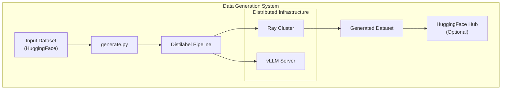
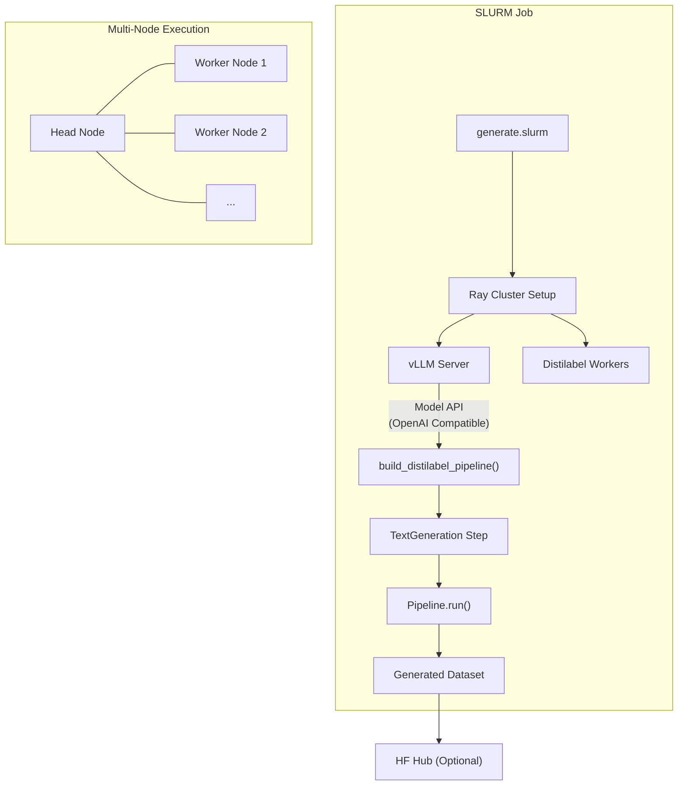
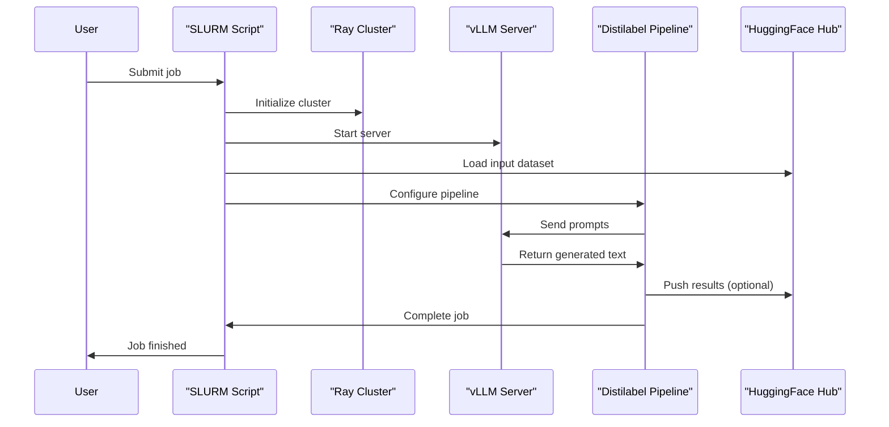
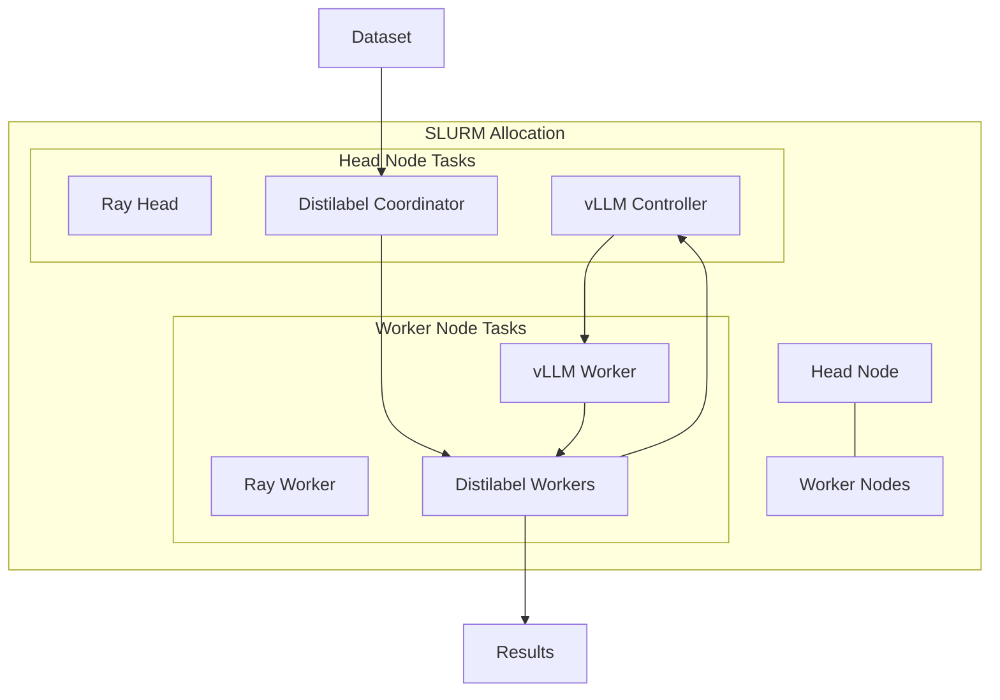

<!-- source: DeepWiki mcp.deepwiki.com · repo huggingface/open-r1 · page 5.2 Dataset Utilities · fetched 2026-10-26 -->

# Running Data Generation

<details>
<summary>Relevant source files</summary>

The following files were used as context for generating this wiki page:

- [src/open_r1/sft.py](src/open_r1/sft.py)
- [src/open_r1/utils/__init__.py](src/open_r1/utils/__init__.py)
- [src/open_r1/utils/data.py](src/open_r1/utils/data.py)
- [src/open_r1/utils/model_utils.py](src/open_r1/utils/model_utils.py)
- [tests/utils/test_data.py](tests/utils/test_data.py)

</details>


This page provides detailed instructions for executing data generation jobs in the Open-R1 framework. Data generation is a critical first step in the Open-R1 training pipeline where a source dataset is processed through a language model to create the synthetic training data used in subsequent stages. For information about the Distilabel pipeline components used in data generation, see [Distilabel Pipeline](#5.1).

## Generation System Overview

The Open-R1 data generation system provides a scalable way to generate synthetic data for model training. It uses Distilabel to manage the generation pipeline, vLLM for efficient model serving, and Ray for distributed computation. The entire process is automated through SLURM job scripts for cluster execution.



Sources: [src/open_r1/generate.py:1-209](), [slurm/generate.slurm:1-244]()

## Prerequisites

Before running data generation, ensure you have:

1. Access to a SLURM-based compute cluster
2. An input dataset available on the Hugging Face Hub
3. The Open-R1 repository correctly installed and configured
4. Sufficient permissions to write to Hugging Face Hub (if pushing results)

## Generation Architecture

The data generation system uses a distributed architecture to process large datasets efficiently.



Sources: [src/open_r1/generate.py:23-63](), [src/open_r1/generate.py:197-208](), [slurm/generate.slurm:127-238]()

## Running Generation Jobs

To run a data generation job, you'll use the SLURM script provided in the repository. There are two main methods to launch a job:

### Method 1: Direct SLURM Submission

```bash
sbatch slurm/generate.slurm \
  --model MODEL_NAME \
  --hf-dataset DATASET_NAME \
  --hf-dataset-config CONFIG_NAME \
  --hf-output-dataset OUTPUT_REPO_NAME
```

### Method 2: Using Makefile (Recommended)

The repository includes Makefile targets for common generation scenarios:

```bash
make generate-data \
  MODEL=MODEL_NAME \
  DATASET=DATASET_NAME \
  CONFIG=CONFIG_NAME \
  OUTPUT=OUTPUT_REPO_NAME
```

## Configuration Parameters

The data generation system accepts numerous parameters to customize the generation process:

| Parameter | Description | Default | Required |
|-----------|-------------|---------|----------|
| `--model` | Model name to use for generation | - | Yes |
| `--hf-dataset` | HuggingFace dataset to load | - | Yes |
| `--hf-dataset-config` | Dataset configuration name | None | No |
| `--hf-dataset-split` | Dataset split to use | "train" | No |
| `--prompt-column` | Column name containing prompts | "prompt" | No |
| `--prompt-template` | Template for formatting prompts | "{{ instruction }}" | No |
| `--temperature` | Sampling temperature | None | No |
| `--top-p` | Top-p sampling parameter | None | No |
| `--max-new-tokens` | Maximum tokens to generate | 8192 | No |
| `--num-generations` | Number of generations per input | 1 | No |
| `--input-batch-size` | Batch size for processing | 64 | No |
| `--client-replicas` | Distilabel client replicas | 1 | No |
| `--timeout` | Request timeout in seconds | 900 | No |
| `--retries` | Number of retries for failed requests | 0 | No |
| `--hf-output-dataset` | HF repo to push results to | None | No |
| `--private` | Make output dataset private | false | No |

Sources: [src/open_r1/generate.py:72-169](), [slurm/generate.slurm:13-100]()

## Generation Pipeline Details

The generation pipeline is built around the Distilabel framework, which orchestrates the process of sending prompts to the language model and collecting results.



Sources: [src/open_r1/generate.py:197-208](), [slurm/generate.slurm:217-238]()

## Distributed Execution

The SLURM script automatically configures distributed execution based on the allocated resources:

1. **Ray Cluster Setup**: The script starts a Ray cluster with one head node and multiple worker nodes
2. **Tensor Parallelism**: vLLM is configured to use tensor parallelism across GPUs on each node
3. **Pipeline Parallelism**: Model execution is distributed across nodes for larger models
4. **Client Replicas**: Multiple Distilabel clients process inputs in parallel



Sources: [slurm/generate.slurm:134-169](), [slurm/generate.slurm:176-187]()

## Monitoring and Logging

The SLURM script provides several ways to monitor progress:

1. SLURM output and error logs (`logs/%x-%j.out` and `logs/%x-%j.err`)
2. Ray dashboard accessible at `http://<head-node-ip>:8265`
3. vLLM server logs saved to `ray_logs/vllm-server-<job-id>.log`
4. Generation job logs saved to `ray_logs/generate-<job-id>.log`

You can monitor the job status using standard SLURM commands:

```bash
squeue -u <username>
sacct -j <job-id>
```

Sources: [slurm/generate.slurm:8-9](), [slurm/generate.slurm:151-152](), [slurm/generate.slurm:243-244]()

## Output Dataset Structure

The generated dataset follows the Distilabel format, which includes:

- Original prompt data
- Generated responses from the model
- Metadata about the generation process

This dataset can be pushed directly to the Hugging Face Hub if the `--hf-output-dataset` parameter is provided, and will be accessible at `https://huggingface.co/<username>/<dataset-name>`. This generated dataset serves as input for the Supervised Fine-Tuning (SFT) phase of the Open-R1 pipeline.

Sources: [src/open_r1/generate.py:205-208]()

## Example Usage

Here's a complete example of running a data generation job:

```bash
sbatch slurm/generate.slurm \
  --model "deepseek-ai/deepseek-llm-67b-base" \
  --hf-dataset "HuggingFaceH4/ultrachat_200k" \
  --prompt-column "messages" \
  --prompt-template "<｜begin▁of▁sentence｜><｜User｜>{{ instruction }}<｜Assistant｜>" \
  --temperature 0.7 \
  --top-p 0.9 \
  --max-new-tokens 4096 \
  --num-generations 1 \
  --input-batch-size 64 \
  --client-replicas 4 \
  --timeout 900 \
  --retries 3 \
  --hf-output-dataset "your-username/generated-deepseek-r1-dataset"
```

Sources: [src/open_r1/generate.py:72-169](), [slurm/generate.slurm:13-100]()

---

