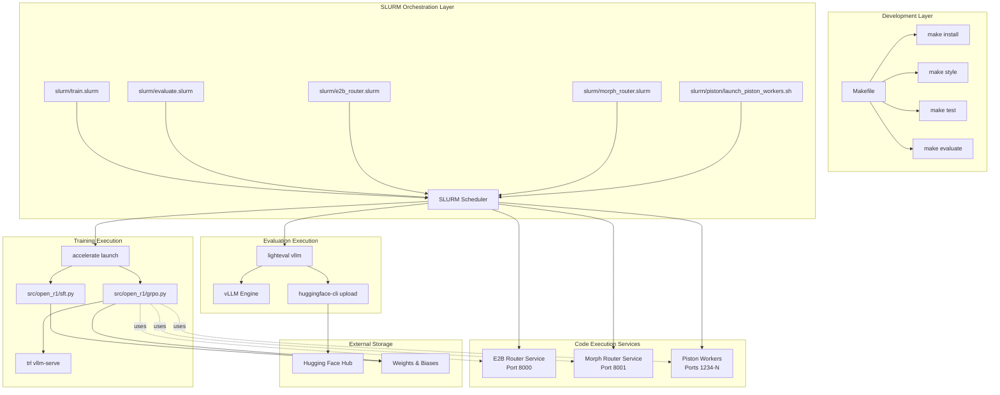
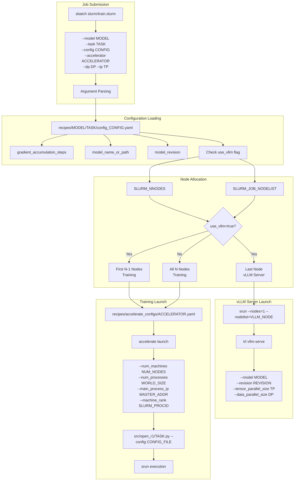
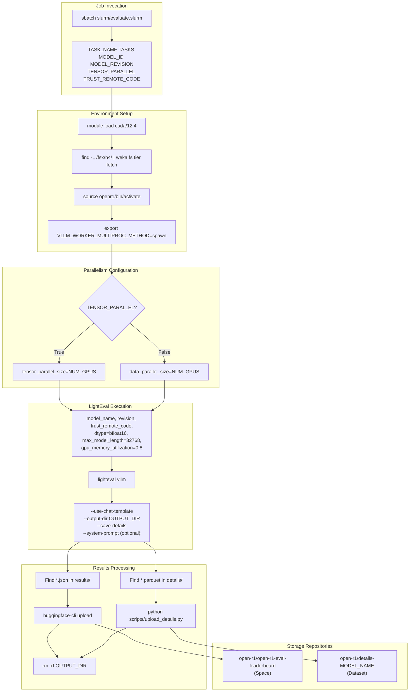
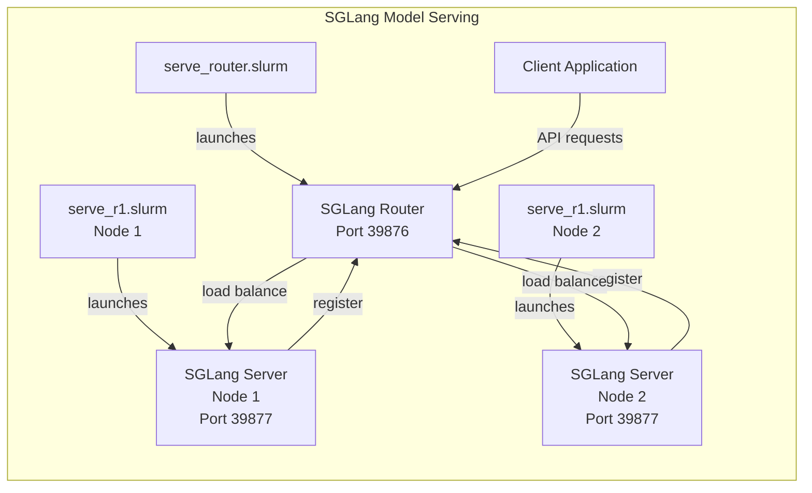
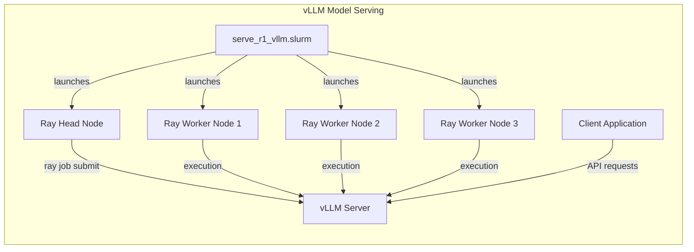
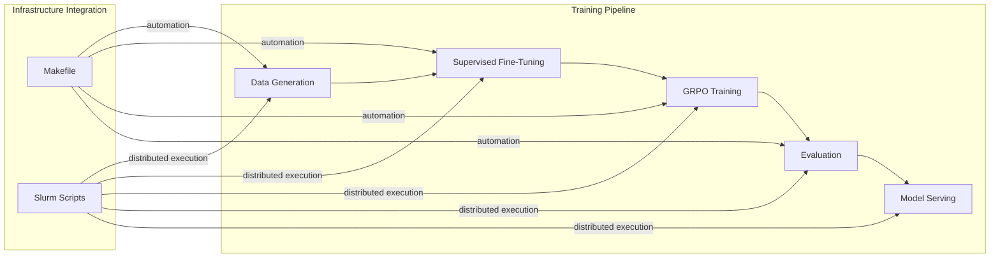

<!-- source: DeepWiki mcp.deepwiki.com · repo huggingface/open-r1 · page 6 Infrastructure and Operations · fetched 2026-10-26 -->

# Infrastructure and Operations

<details>
<summary>Relevant source files</summary>

The following files were used as context for generating this wiki page:

- [Makefile](Makefile)
- [README.md](README.md)
- [slurm/evaluate.slurm](slurm/evaluate.slurm)
- [slurm/train.slurm](slurm/train.slurm)

</details>


This page documents the operational framework that enables large-scale training, evaluation, and deployment in the Open-R1 system. The infrastructure layer includes SLURM-based distributed computing orchestration, development automation tools, vLLM-based model serving, and external code execution services.

The infrastructure supports three primary workloads:
1. **Training Jobs** - Multi-node SFT and GRPO training with vLLM integration
2. **Evaluation Jobs** - Distributed benchmark evaluation with result tracking
3. **Code Execution** - Sandboxed code evaluation for reward functions

For detailed information on specific components, see subsections on SLURM Integration (6.1), Development Tools (6.2), and Model Serving with vLLM (6.3).

## Infrastructure Architecture

Infrastructure components and their relationships in the Open-R1 system


Sources: [Makefile:1-54](), [slurm/train.slurm:1-183](), [slurm/evaluate.slurm:1-84](), [README.md:324-368]()

## SLURM Training Orchestration

The [slurm/train.slurm:1-183]() script orchestrates distributed training jobs across GPU clusters. It handles resource allocation, distributed setup, and optional vLLM server deployment for GRPO training.

### Training Job Execution Flow

Training job architecture with node allocation and distributed configuration


Sources: [slurm/train.slurm:1-183]()

### Key Configuration Variables

The training script extracts and uses the following configuration:

| Variable | Source | Purpose |
|----------|--------|---------|
| `SLURM_NNODES` | SLURM environment | Total number of allocated nodes |
| `SLURM_JOB_NODELIST` | SLURM environment | List of allocated node names |
| `MASTER_ADDR` | First node in `NODELIST` | IP address for distributed training coordination |
| `MASTER_PORT` | Fixed at `6000` | Port for distributed training coordination |
| `WORLD_SIZE` | `NUM_NODES * GPUS_PER_NODE` | Total number of processes across all nodes |
| `USE_VLLM` | Extracted from config YAML | Whether to launch separate vLLM server |

Sources: [slurm/train.slurm:115-136]()

### GRPO with vLLM Server

For GRPO training with `use_vllm: true` in the config, the script implements an N+1 node architecture:

1. **vLLM Server Node**: Last node in allocation runs `trl vllm-serve` with tensor and data parallelism
2. **Training Nodes**: Remaining N-1 nodes run the training script
3. **Communication**: Training nodes connect to vLLM server via `--vllm_server_host` argument

This separation enables efficient generation during GRPO without blocking training processes.

Sources: [slurm/train.slurm:128-136](), [README.md:230-236]()

## SLURM Evaluation Orchestration

The [slurm/evaluate.slurm:1-84]() script manages distributed model evaluation using `lighteval` and `vLLM`. It handles parallelism configuration, result collection, and automatic upload to Hugging Face Hub.

### Evaluation Job Execution Flow

Evaluation job workflow from launch to results upload


Sources: [slurm/evaluate.slurm:1-84]()

### Parallelism Strategies

The evaluation script supports two parallelism modes determined by the `TENSOR_PARALLEL` argument:

| Mode | Configuration | Use Case |
|------|---------------|----------|
| Data Parallel | `data_parallel_size=NUM_GPUS` | Smaller models that fit on single GPU; increases throughput |
| Tensor Parallel | `tensor_parallel_size=NUM_GPUS` | Large models requiring sharding across multiple GPUs |

When tensor parallelism is enabled, the environment variable `VLLM_WORKER_MULTIPROC_METHOD=spawn` is set to avoid process spawn issues with vLLM.

Sources: [slurm/evaluate.slurm:37-42]()

### Results Upload

Evaluation results are automatically uploaded to two Hugging Face repositories:

1. **Leaderboard Space** (`open-r1/open-r1-eval-leaderboard`): JSON files containing aggregate metrics
2. **Details Dataset** (`open-r1/details-{model_name}`): Parquet files with per-sample predictions

The upload includes retry logic with up to 20 attempts per file to handle transient failures.

Sources: [slurm/evaluate.slurm:44-78]()

## Development Automation

The [Makefile:1-54]() provides standardized commands for development environment setup, code quality checks, testing, and local evaluation.

### Development Targets

Development workflow operations and their implementations

```mermaid
graph TB
    subgraph "Environment Setup"
        MAKE_INSTALL["make install"]
        UV_VENV["uv venv openr1 --python 3.11"]
        UV_PIP["uv pip install --upgrade pip"]
        VLLM_INSTALL["uv pip install vllm==0.8.5.post1"]
        FLASH_ATTN["uv pip install flash-attn --no-build-isolation"]
        DEV_INSTALL["uv pip install -e .[dev]"]
    end

    subgraph "Code Quality"
        MAKE_STYLE["make style"]
        RUFF_FORMAT["ruff format --line-length 119"]
        ISORT["isort check_dirs"]
        MAKE_QUALITY["make quality"]
        RUFF_CHECK["ruff check"]
        ISORT_CHECK["isort --check-only"]
        FLAKE8["flake8 --max-line-length 119"]
    end

    subgraph "Testing"
        MAKE_TEST["make test"]
        PYTEST["pytest -sv --ignore=tests/slow/"]
        MAKE_SLOW["make slow_test"]
        PYTEST_SLOW["pytest -sv -vv tests/slow/"]
    end

    subgraph "Local Evaluation"
        MAKE_EVAL["make evaluate"]
        PARALLEL_LOGIC["Parallelism configuration"]
        LIGHTEVAL["lighteval vllm"]
    end

    MAKE_INSTALL --> UV_VENV
    UV_VENV --> UV_PIP
    UV_PIP --> VLLM_INSTALL
    VLLM_INSTALL --> FLASH_ATTN
    FLASH_ATTN --> DEV_INSTALL

    MAKE_STYLE --> RUFF_FORMAT
    MAKE_STYLE --> ISORT

    MAKE_QUALITY --> RUFF_CHECK
    MAKE_QUALITY --> ISORT_CHECK
    MAKE_QUALITY --> FLAKE8

    MAKE_TEST --> PYTEST
    MAKE_SLOW --> PYTEST_SLOW

    MAKE_EVAL --> PARALLEL_LOGIC
    PARALLEL_LOGIC --> LIGHTEVAL
```


Sources: [Makefile:1-54]()

### Makefile Target Reference

| Target | Command | Purpose |
|--------|---------|---------|
| `install` | `make install` | Creates Python 3.11 virtual environment and installs all dependencies including vLLM 0.8.5.post1 and Flash Attention |
| `style` | `make style` | Formats code with ruff (line length 119) and organizes imports with isort |
| `quality` | `make quality` | Runs ruff, isort, and flake8 checks without modifying files |
| `test` | `make test` | Executes fast unit tests, excluding slow tests |
| `slow_test` | `make slow_test` | Runs complete test suite including slow integration tests |
| `evaluate` | `make evaluate MODEL=... TASK=...` | Runs local evaluation with configurable parallelism |

Sources: [Makefile:10-53]()

### Local Evaluation Usage

The `evaluate` target provides flexible evaluation on local machines with support for data and tensor parallelism:

```bash
# Single GPU evaluation
make evaluate MODEL=deepseek-ai/DeepSeek-R1-Distill-Qwen-1.5B TASK=aime24

# Data parallelism (model replicated across GPUs)
make evaluate MODEL=deepseek-ai/DeepSeek-R1-Distill-Qwen-7B TASK=math_500 PARALLEL=data NUM_GPUS=8

# Tensor parallelism (model sharded across GPUs)
make evaluate MODEL=deepseek-ai/DeepSeek-R1-Distill-Qwen-32B TASK=gpqa PARALLEL=tensor NUM_GPUS=8

# LiveCodeBench (special case)
make evaluate MODEL=open-r1/OpenR1-Distill-7B TASK=lcb PARALLEL=data NUM_GPUS=8
```

The target automatically constructs appropriate `MODEL_ARGS` for `lighteval vllm` based on the parallelism mode.

Sources: [Makefile:35-53](), [README.md:507-525]()

## Distributed Computing with Slurm

Open-R1 utilizes Slurm for orchestrating distributed training, evaluation, and model serving across GPU clusters. The repository includes several Slurm scripts to automate these operations.

### Model Serving Infrastructure

The infrastructure includes scripts for serving fine-tuned models using SGLang and vLLM. Two primary serving architectures are supported:

#### SGLang Serving Architecture



The SGLang serving architecture consists of:
- A router component running on a CPU node (launched by `serve_router.slurm`)
- Multiple model server instances running across GPU nodes (launched by `serve_r1.slurm`)
- Tensor parallelism (TP=16) across 2 nodes with 8 GPUs each
- Health check system to ensure continuous operation

Sources: [slurm/serve_r1.slurm:1-109](), [slurm/serve_router.slurm:1-45]()

#### vLLM Serving Architecture



The vLLM serving architecture is built on Ray, providing:
- A distributed Ray cluster across multiple nodes
- Tensor parallelism (TP=8) and pipeline parallelism (PP=4)
- Support for very long sequences (up to 32k tokens)
- Health check and monitoring system

Sources: [slurm/experimental/serve_r1_vllm.slurm:1-132]()

## Infrastructure Configuration Options

The infrastructure components support various configuration options for different deployment scenarios:

### Model Serving Configuration

| Parameter | SGLang | vLLM | Description |
|-----------|--------|------|-------------|
| Tensor Parallelism | 16 | 8 | Number of GPUs to split model tensor across |
| Pipeline Parallelism | N/A | 4 | Number of pipeline stages |
| Max Context Length | 32768 | 32768 | Maximum context window size |
| Max Running Requests | 56 | 128 | Number of concurrent requests |
| Memory Utilization | N/A | 0.90 | GPU memory utilization factor |
| Distributed Backend | Custom | Ray | Framework for distributed execution |

Sources: [slurm/serve_r1.slurm:46-58](), [slurm/experimental/serve_r1_vllm.slurm:72-88]()

## Integration with Training Pipeline

The infrastructure components are designed to support the entire model training and evaluation pipeline:



Sources: [Makefile:1-52](), [slurm/serve_r1.slurm:1-109](), [slurm/experimental/serve_r1_vllm.slurm:1-132]()

## Usage Examples

### Running Evaluation with Tensor Parallelism

To evaluate a model using tensor parallelism across 8 GPUs:

```bash
make evaluate PARALLEL=tensor NUM_GPUS=8 MODEL="deepseek-ai/DeepSeek-R1" TASK="gpqa"
```

This command:
1. Sets up the appropriate tensor parallelism arguments
2. Configures vLLM to use multiprocess worker method
3. Runs LightEval with the specified model and task

Sources: [Makefile:33-52]()

### Serving a Model with SGLang

To serve a DeepSeek-R1 model across 2 nodes with 8 GPUs each:

```bash
sbatch slurm/serve_r1.slurm -m "/path/to/model/checkpoint" -e "sglang_env_name"
```

Sources: [slurm/serve_r1.slurm:1-109](), [slurm/README.md:1-30]()

## Summary

The infrastructure components of Open-R1 provide the foundation for running large-scale LLM training and serving operations. They include:

1. Makefile automation for common development and evaluation tasks
2. Slurm scripts for distributed computing across GPU clusters
3. Model serving capabilities using both SGLang and vLLM
4. Configuration options for different deployment scenarios

This infrastructure enables efficient training, evaluation, and serving of large language models like DeepSeek-R1 at scale.

---

