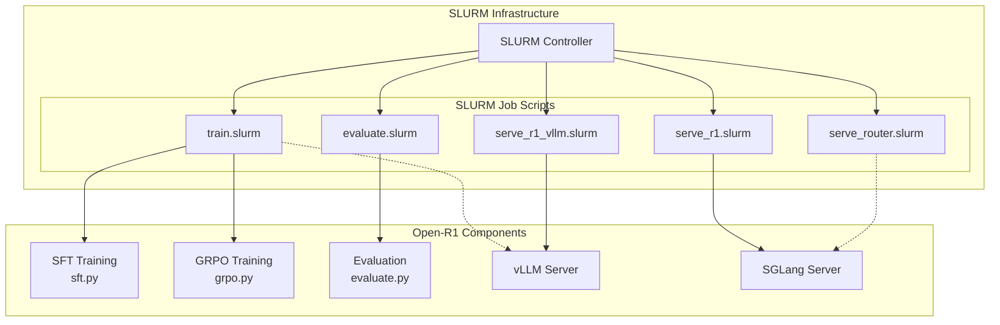
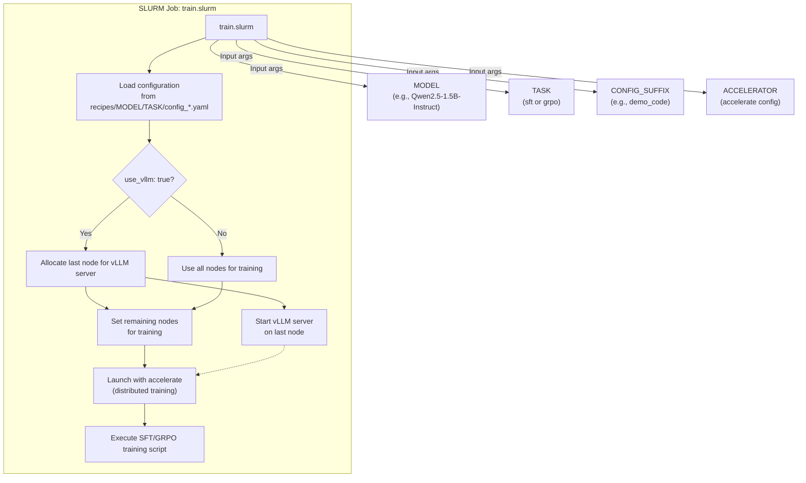
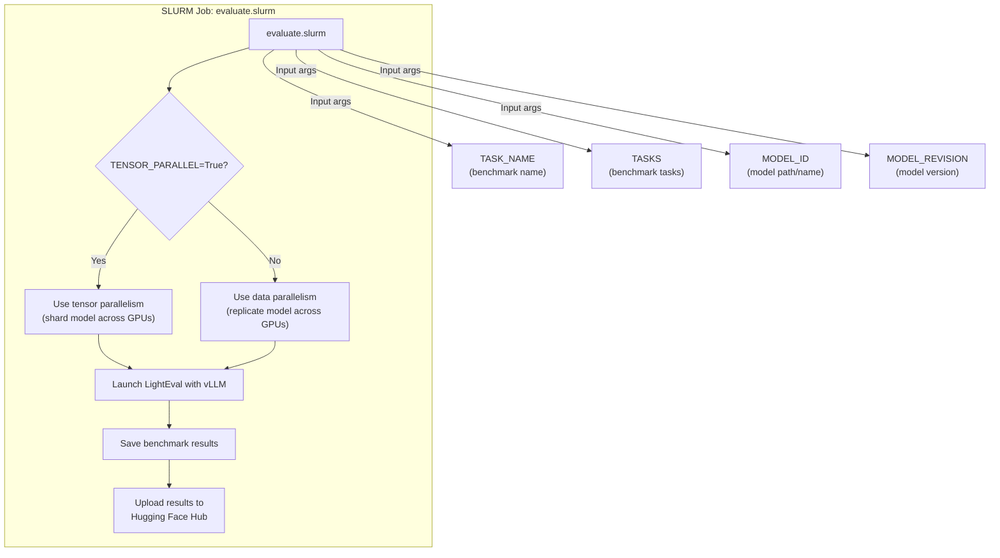
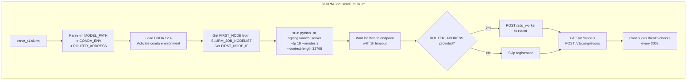
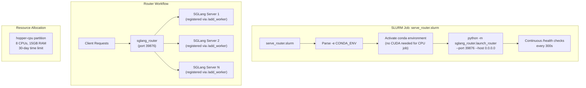
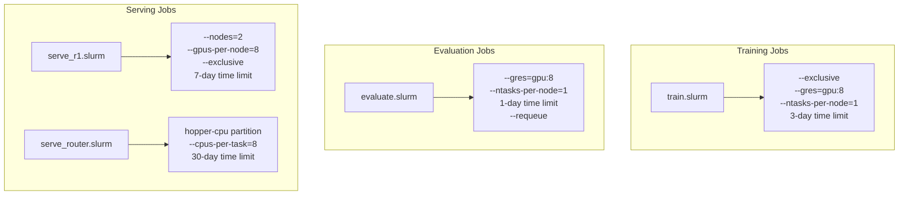

<!-- source: DeepWiki mcp.deepwiki.com · repo huggingface/open-r1 · page 6.1 SLURM Integration · fetched 2026-10-26 -->

# SLURM Integration

<details>
<summary>Relevant source files</summary>

The following files were used as context for generating this wiki page:

- [README.md](README.md)
- [slurm/evaluate.slurm](slurm/evaluate.slurm)
- [slurm/train.slurm](slurm/train.slurm)

</details>


This document explains how the Open-R1 system integrates with SLURM (Simple Linux Utility for Resource Management) for distributed training, evaluation, and model serving across multiple nodes and GPUs. The SLURM integration enables efficient resource allocation and job management for compute-intensive tasks in the Open-R1 pipeline.

For information about training configuration, see [Training Pipeline](#2). For details on logging and monitoring, see [Logging and Monitoring](#6.2).

## 1. SLURM Integration Overview

The Open-R1 system uses SLURM for three main purposes:

1. **Distributed Training** - Running SFT and GRPO training jobs across multiple nodes
2. **Model Evaluation** - Executing benchmarks on trained models
3. **Model Serving** - Deploying models for inference via SGLang or vLLM

The following diagram illustrates the SLURM integration architecture:



Sources: [slurm/train.slurm](), [slurm/evaluate.slurm](), [slurm/serve_r1.slurm](), [slurm/experimental/serve_r1_vllm.slurm](), [slurm/serve_router.slurm]()

## 2. SLURM Job Scripts

Open-R1 provides several SLURM job scripts for different purposes:

| Script | Purpose | Key Features |
|--------|---------|--------------|
| `train.slurm` | Runs distributed training jobs (SFT/GRPO) | Supports vLLM integration, configurable via YAML |
| `evaluate.slurm` | Executes model benchmarks | Supports both tensor and data parallelism |
| `serve_r1.slurm` | Serves models with SGLang | Tensor parallelism across nodes |
| `serve_r1_vllm.slurm` | Serves models with vLLM | Ray-based distributed serving |
| `serve_router.slurm` | Manages load balancing for servers | Works with SGLang servers |

Sources: [slurm/train.slurm](), [slurm/evaluate.slurm](), [slurm/serve_r1.slurm](), [slurm/experimental/serve_r1_vllm.slurm](), [slurm/serve_router.slurm]()

## 3. Distributed Training with SLURM

### 3.1 Training Job Architecture

The `train.slurm` script is the central component for running distributed training jobs. It orchestrates training across multiple nodes and GPUs using the Accelerate library.



Sources: [slurm/train.slurm:1-104]()

### 3.2 Training Script Usage

The `train.slurm` script accepts command-line arguments with specific flags:

```bash
sbatch slurm/train.slurm --model MODEL --task TASK --config CONFIG_SUFFIX --accelerator ACCELERATE_CONFIG [--dp N] [--tp N] [--args "ADDITIONAL_ARGS"]
```

Example:
```bash
sbatch slurm/train.slurm --model Qwen2.5-1.5B-Instruct --task grpo --config demo_code --accelerator zero3 --args "--gradient_accumulation_steps=8"
```

Key components of the training job:

1. **Argument Parsing**: The script uses a while loop to parse named arguments like `--model`, `--task`, `--config`, `--accelerator` [slurm/train.slurm:49-85]()
2. **Configuration Loading**: Loads configuration from `recipes/$MODEL/$TASK/config_$CONFIG_SUFFIX.yaml` and extracts gradient accumulation steps [slurm/train.slurm:95-96]()
3. **vLLM Integration**: If `use_vllm: true` is detected in the config, reserves the last node for vLLM server using `trl vllm-serve` [slurm/train.slurm:124-136]()
4. **Distributed Setup**: Configures NCCL, sets up node lists, master address, and world size for distributed training [slurm/train.slurm:115-122]()
5. **Accelerate Launch**: Uses the Accelerate library with the specified config file and distributed parameters [slurm/train.slurm:150-161]()

Sources: [slurm/train.slurm]()

## 4. Model Evaluation with SLURM

### 4.1 Evaluation Architecture

The `evaluate.slurm` script runs benchmark evaluations on trained models. It supports both tensor parallelism and data parallelism for efficient resource utilization.



Sources: [slurm/evaluate.slurm:1-80]()

### 4.2 Evaluation Script Usage

The `evaluate.slurm` script takes positional arguments:

```bash
sbatch slurm/evaluate.slurm TASK_NAME TASKS MODEL_ID MODEL_REVISION [TENSOR_PARALLEL] [TRUST_REMOTE_CODE] [SYSTEM_PROMPT_BASE64]
```

Example:
```bash
sbatch slurm/evaluate.slurm MATH "lighteval|math" open-r1/Qwen2.5-1.5B-GRPO main True True
```

Key components of the evaluation job:

1. **Environment Setup**: Loads CUDA 12.4, activates virtual environment, and refreshes Weka filesystem for HF compute cluster [slurm/evaluate.slurm:13-25]()
2. **Parallelism Mode**: Configures `MODEL_ARGS` for either tensor parallelism or data parallelism based on the `TENSOR_PARALLEL` flag [slurm/evaluate.slurm:38-42]()
3. **LightEval Execution**: Uses `lighteval vllm` with chat template, saves details, and supports optional system prompt [slurm/evaluate.slurm:53-57]()
4. **Result Upload**: Uploads JSON results to `open-r1/open-r1-eval-leaderboard` space and parquet details to model-specific repos with retry logic [slurm/evaluate.slurm:59-78]()

Sources: [slurm/evaluate.slurm]()

## 5. Model Serving with SLURM

### 5.1 SGLang Server

The `serve_r1.slurm` script deploys models for inference using SGLang with tensor parallelism across multiple nodes.

SGLang Server Deployment Flow


Sources: [slurm/serve_r1.slurm]()

### 5.2 vLLM Server

The `serve_r1_vllm.slurm` script deploys models using vLLM with Ray for distributed serving.

vLLM Ray Cluster Deployment Flow

```mermaid
flowchart TD
    subgraph "SLURM Job: serve_r1_vllm.slurm"
        VLLMScript["serve_r1_vllm.slurm"] --> ParseArgs["Parse -m MODEL_PATH\n-e CONDA_ENV"]
        ParseArgs --> SetupEnv["Load CUDA 12.1\nActivate conda environment"]
        SetupEnv --> GetNodes["Extract HEAD_NODE and WORKER_NODES\nfrom SLURM_JOB_NODELIST"]
        GetNodes --> StartRayHead["srun ray start --head\n--node-ip-address HEAD_NODE_IP\n--port 6379"]
        StartRayHead --> StartRayWorkers["Loop: srun ray start\n--address HEAD_NODE_IP:6379\nfor each worker node"]
        StartRayWorkers --> SubmitVLLM["ray job submit --job-id vllm-server\nvllm serve --tensor-parallel-size 8\n--pipeline-parallel-size 4"]
        SubmitVLLM --> WaitHealth["Wait for /health endpoint\nwith 1h timeout"]
        WaitHealth --> SanityCheck["GET /v1/models\nPOST /v1/completions"]
        SanityCheck --> HealthLoop["Continuous /health checks\nevery 300s"]
    end
```


Sources: [slurm/experimental/serve_r1_vllm.slurm]()

### 5.3 Router Integration

The `serve_router.slurm` script sets up a router for load balancing across multiple model servers.

SGLang Router Architecture


Sources: [slurm/serve_router.slurm]()

## 6. Environment and Resource Management

### 6.1 HuggingFace Compute Cluster Optimizations

The SLURM scripts include specific optimizations for the HuggingFace compute cluster:

| Optimization | Purpose | Implementation |
|--------------|---------|----------------|
| **Weka Filesystem Refresh** | Ensure cached data availability | `find -L /fsx/h4/ -type f \| xargs -d '\n' -r -n512 -P64 weka fs tier fetch` |
| **CUDA Module Loading** | Load specific CUDA version | `module load cuda/12.4` |
| **VLLM Worker Process** | Fix multiprocessing issues | `export VLLM_WORKER_MULTIPROC_METHOD=spawn` |
| **NCCL Error Handling** | Crash on NCCL issues | `export NCCL_ASYNC_ERROR_HANDLING=1` |

### 6.2 Resource Allocation Patterns

The scripts use different resource allocation strategies:

SLURM Resource Allocation by Job Type


Sources: [slurm/train.slurm:1-11](), [slurm/evaluate.slurm:1-8](), [slurm/serve_r1.slurm:1-11](), [slurm/serve_router.slurm:1-11]()

## 7. Example Usage Patterns

### 7.1 Complete Training Workflow

```bash
# 1. Submit training job
sbatch slurm/train.slurm --model Qwen2.5-1.5B-Instruct --task grpo --config demo_code --accelerator zero3

# 2. Submit evaluation job after training
sbatch slurm/evaluate.slurm MATH "lighteval|math" open-r1/Qwen2.5-1.5B-GRPO main True True

# 3. Serve the trained model
sbatch slurm/serve_r1.slurm -m "open-r1/Qwen2.5-1.5B-GRPO" -e "sglang124"
```

### 7.2 Model Serving with Router

As documented in the [slurm/README.md](), the typical serving workflow involves:

```bash
# 1. Start router
sbatch slurm/serve_router.slurm -e "sglang124"

# 2. Start multiple servers that auto-register with router
sbatch slurm/serve_r1.slurm -m "/fsx/deepseek-r1-checkpoint" -e "sglang124" -r "ROUTER_ADDRESS"

# 3. Use for data generation
python scripts/generate_reasoning.py \
    --dataset-name "AI-MO/NuminaMath-1.5" \
    --api-addr "ROUTER_ADDRESS:39876" \
    --num-generations 2 \
    --max-tokens 16384
```

Sources: [slurm/README.md]()

## 8. Conclusion

The SLURM integration in Open-R1 provides a robust framework for distributed training, evaluation, and model serving across a cluster of machines. By utilizing SLURM for resource management, Open-R1 can efficiently scale to handle large language models with tensor parallelism, data parallelism, and distributed inference.

For related infrastructure components, see [Logging and Monitoring](#6.2) and [Model Serving](#6.3).

---

