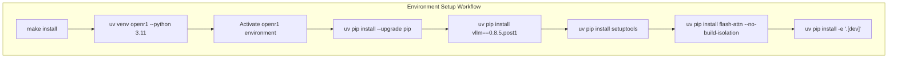
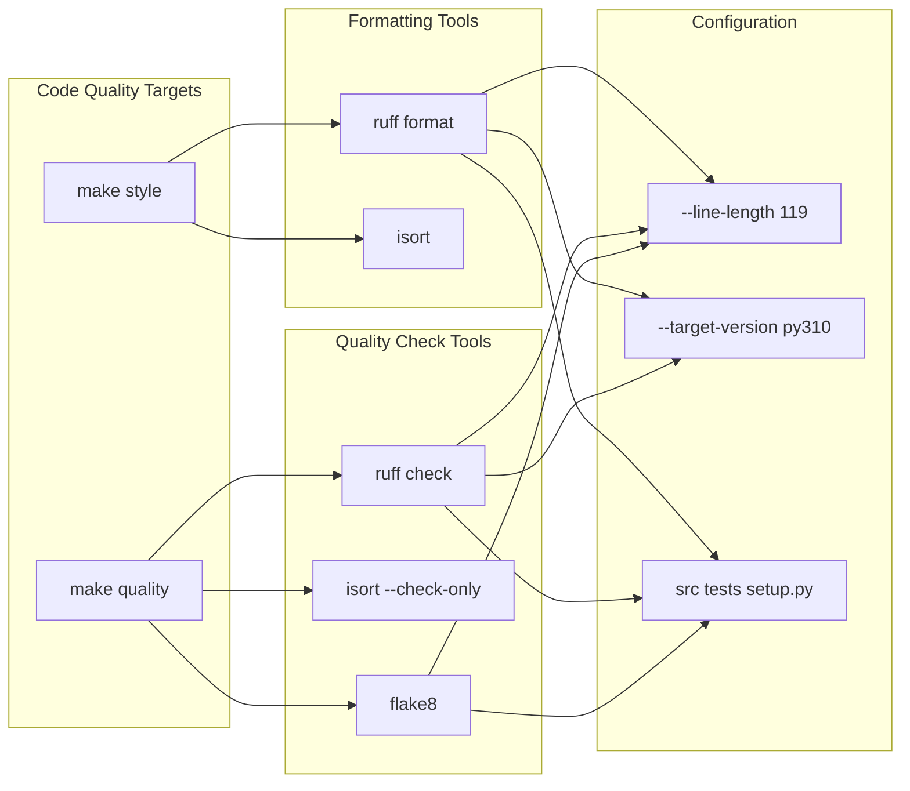
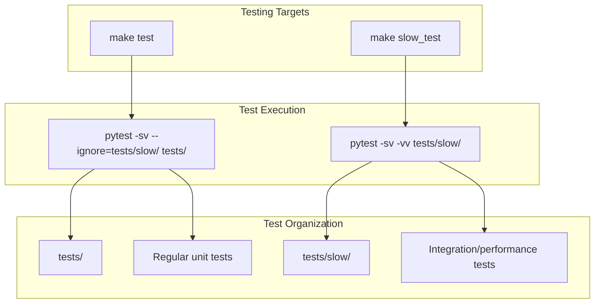
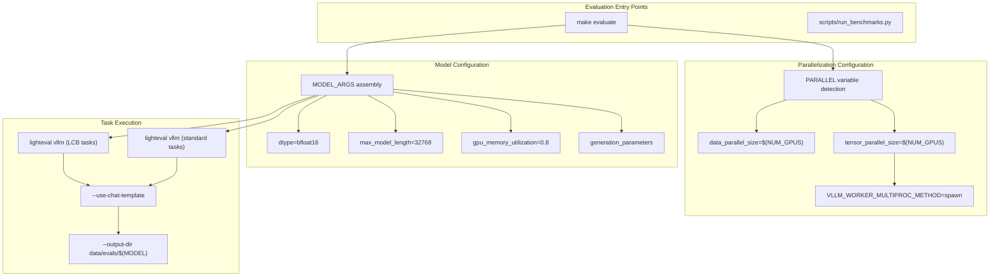
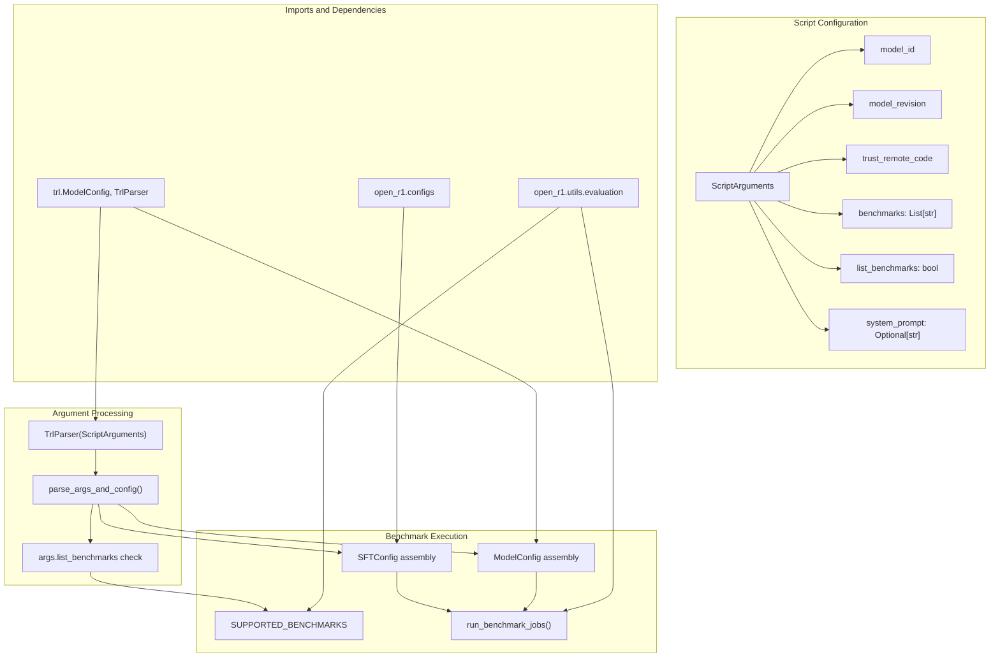
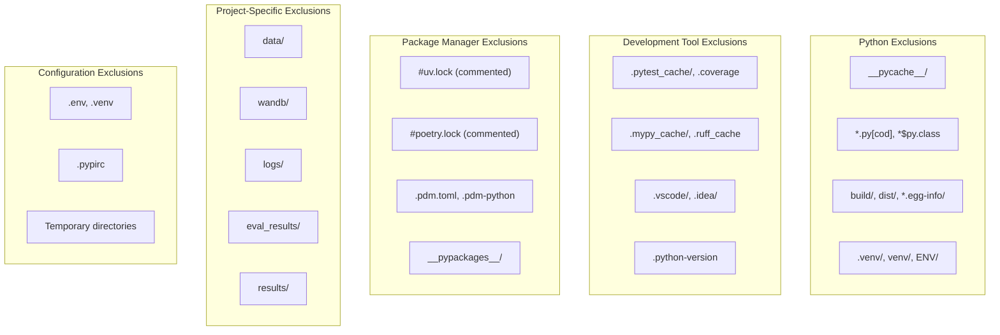

<!-- source: DeepWiki mcp.deepwiki.com · repo huggingface/open-r1 · page 6.2 Development Tools · fetched 2026-10-26 -->

# Development Tools

Relevant source files

The following files were used as context for generating this wiki page:

- [Makefile](Makefile)

This document covers the development tools and workflows used in the open-r1 project, including environment setup, code quality enforcement, testing infrastructure, and evaluation utilities. These tools are primarily orchestrated through the project's `Makefile` and support the development lifecycle from initial setup through model evaluation.

For information about SLURM job orchestration and cluster-based workflows, see [SLURM Integration](#6.1). For monitoring and logging tools used during training and evaluation, see [Logging and Monitoring](#6.3).

## Development Environment Setup

The project uses `uv` as the primary package manager and environment management tool. The development environment is configured through the `install` target in the Makefile.

### Environment Installation Process

**Development Environment Installation**

The installation process creates a dedicated Python 3.11 virtual environment named `openr1` and installs key dependencies in a specific order to handle complex compilation requirements.

| Component | Purpose | Installation Notes |
|-----------|---------|-------------------|
| `vllm==0.8.5.post1` | High-performance inference engine | Installed before other dependencies |
| `setuptools` | Build system dependency | Required for flash-attn compilation |
| `flash-attn` | Optimized attention implementation | Built without isolation for compatibility |
| Development dependencies | Testing, linting, formatting tools | Installed via `.[dev]` extras |

Sources: [Makefile:10-16]()

## Code Quality and Formatting

The project enforces consistent code style and quality through automated tools integrated into the development workflow. The tools are configured with specific parameters to maintain compatibility across the codebase.

### Code Formatting Pipeline

**Code Quality Tool Configuration**

### Style Enforcement (`make style`)

The `style` target applies automatic formatting to the codebase using two complementary tools:

- **Ruff Formatter**: Modern Python formatter configured with 119-character line length and Python 3.10 target compatibility
- **isort**: Import statement organizer that ensures consistent import ordering

### Quality Validation (`make quality`)

The `quality` target performs static analysis and validation without modifying files:

- **Ruff Linter**: Comprehensive linting with the same configuration as formatting
- **isort Check Mode**: Validates import organization without changes
- **Flake8**: Additional style and complexity checking

All tools operate on the `src`, `tests` directories and `setup.py` file with consistent configuration parameters.

Sources: [Makefile:18-25]()

## Testing Infrastructure

The project implements a two-tier testing strategy with separate targets for regular and computationally expensive tests.

### Testing Architecture

**Testing Strategy Implementation**

### Regular Tests (`make test`)

The standard test suite excludes the `tests/slow/` directory and runs with verbose output (`-sv` flags). This provides quick feedback during development cycles.

### Slow Tests (`make slow_test`)

Integration and performance tests are isolated in `tests/slow/` and run with enhanced verbosity (`-sv -vv` flags). These tests typically involve model loading, distributed training scenarios, or extensive data processing.

The separation allows developers to run fast unit tests frequently while reserving comprehensive integration testing for specific validation cycles.

Sources: [Makefile:27-31]()

## Evaluation Tools Integration

The development environment includes integrated model evaluation capabilities that support various parallelization strategies and benchmark configurations.

### Evaluation Pipeline Architecture

**Evaluation Tool Configuration**

### Parallelization Strategy Selection

The evaluation system automatically configures parallelization based on the `PARALLEL` environment variable:

| Strategy | Configuration | Environment Setup |
|----------|---------------|-------------------|
| Data Parallel | `data_parallel_size=$(NUM_GPUS)` | Standard multiprocessing |
| Tensor Parallel | `tensor_parallel_size=$(NUM_GPUS)` | `VLLM_WORKER_MULTIPROC_METHOD=spawn` |

### Model Configuration Assembly

The `MODEL_ARGS` variable dynamically assembles vLLM configuration parameters:

- **Model Identity**: `pretrained=$(MODEL)` with configurable model path
- **Precision**: `dtype=bfloat16` for memory efficiency
- **Context**: `max_model_length=32768` for long-sequence support
- **Resource Management**: `gpu_memory_utilization=0.8` for optimal GPU usage
- **Generation Parameters**: Temperature 0.6, top-p 0.95, max tokens 32768

### Task-Specific Execution Paths

The evaluation system handles different benchmark categories:

- **LiveCodeBench (LCB)**: `extended|lcb:codegeneration|0|0` task specification
- **Standard Benchmarks**: `lighteval|$(TASK)|0|0` task specification

Both execution paths use chat templates and output results to `data/evals/$(MODEL)` directory structure.

Sources: [Makefile:35-53]()

## Benchmark Orchestration

The `scripts/run_benchmarks.py` provides a higher-level interface for benchmark execution with support for multiple evaluation targets and configuration management.

### Benchmark Script Architecture

**Benchmark Script Components**

### Configuration Management

The `ScriptArguments` dataclass defines the benchmark execution parameters:

- **Model Specification**: `model_id` with default DeepSeek-R1-Distill-Qwen-1.5B, configurable `model_revision`
- **Security**: `trust_remote_code` flag for handling remote model code
- **Benchmark Selection**: `benchmarks` list for targeted evaluation
- **Utility Features**: `list_benchmarks` for discovering available benchmarks
- **Customization**: Optional `system_prompt` for evaluation context

### Execution Flow

The script follows a structured execution pattern:

1. **Argument Parsing**: Uses `TrlParser` for configuration management
2. **Benchmark Discovery**: Supports listing available benchmarks via `SUPPORTED_BENCHMARKS`
3. **Configuration Assembly**: Creates `SFTConfig` and `ModelConfig` instances
4. **Job Orchestration**: Delegates to `run_benchmark_jobs` for actual execution

The integration with the evaluation system allows for consistent configuration management across different evaluation contexts.

Sources: [scripts/run_benchmarks.py:22-61]()

## Project Structure and Version Control

The project maintains a clean development environment through comprehensive `.gitignore` configuration that excludes temporary files, build artifacts, and runtime data.

### Version Control Exclusions

**Version Control Strategy**

### Standard Python Exclusions

The `.gitignore` includes comprehensive coverage of Python development artifacts:

- **Compilation Artifacts**: Bytecode files, compiled extensions, distribution packages
- **Virtual Environments**: Various virtual environment directory patterns
- **Package Metadata**: Installation metadata and temporary build directories

### Development Tool Integration

Development tool artifacts are excluded to maintain clean repositories:

- **Testing Frameworks**: pytest cache, coverage reports, hypothesis temporary files
- **Code Quality Tools**: mypy cache, type checking artifacts
- **Editor Configurations**: VSCode, PyCharm settings directories

### Project-Specific Data Exclusions

Runtime data and experimental outputs are excluded from version control:

| Directory | Purpose | Exclusion Reason |
|-----------|---------|------------------|
| `data/` | Dataset storage, evaluation outputs | Large files, frequently changing |
| `wandb/` | Weights & Biases logging | Runtime artifacts, sensitive data |
| `logs/` | Training and evaluation logs | Temporary, machine-specific |
| `eval_results/` | Benchmark evaluation results | Generated outputs |
| `results/` | General result outputs | Derived data |

### Package Manager Compatibility

The configuration supports multiple package management approaches while maintaining flexibility:

- **UV**: `#uv.lock` commented to allow project-specific decisions
- **Poetry**: `#poetry.lock` commented for optional use
- **PDM**: Configuration files excluded, build artifacts ignored

This approach allows teams to choose their preferred package management strategy while maintaining consistent exclusion patterns.

Sources: [.gitignore:1-181]()

---

