<!-- source: DeepWiki mcp.deepwiki.com · repo huggingface/open-r1 · page 6.3 Model Serving with vLLM · fetched 2026-10-26 -->

# Model Serving with vLLM

<details>
<summary>Relevant source files</summary>

The following files were used as context for generating this wiki page:

- [README.md](README.md)
- [slurm/generate.slurm](slurm/generate.slurm)
- [src/open_r1/generate.py](src/open_r1/generate.py)
- [src/open_r1/grpo.py](src/open_r1/grpo.py)

</details>


This document covers vLLM integration in open-r1, which provides high-performance inference for three distinct workflows: GRPO training, model evaluation, and data generation. vLLM enables efficient GPU utilization through tensor parallelism and data parallelism strategies.

For information about GRPO training configuration, see [Group Relative Policy Optimization (GRPO)](#2.2). For evaluation orchestration, see [Evaluation System](#4). For data generation pipelines, see [Data Generation and Processing](#5).

## Overview

vLLM serves as the inference engine for three primary workflows in the open-r1 system:

1. **GRPO Training** - Generates 16-64 completions per prompt during reinforcement learning using `GRPOTrainer` with vLLM backend
2. **Model Evaluation** - Runs benchmark evaluations via `lighteval` CLI with vLLM backend for fast parallel inference
3. **Data Generation** - Powers synthetic data creation through Distilabel pipelines with vLLM server providing OpenAI-compatible API

Each workflow uses vLLM differently depending on scale requirements and infrastructure constraints.

## vLLM Integration Architecture

vLLM integrates into the open-r1 system through three distinct deployment patterns, each optimized for specific workload characteristics.

### System-Wide vLLM Usage

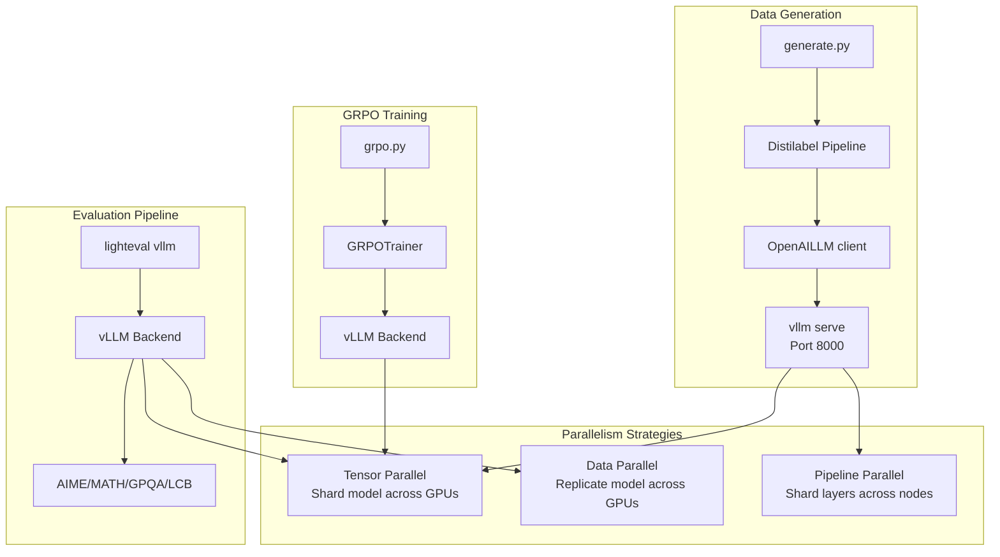

**Sources:** [src/open_r1/grpo.py:1-182](), [README.md:446-505](), [src/open_r1/generate.py:1-209](), [slurm/generate.slurm:175-187]()

## GRPO Training with vLLM

The `GRPOTrainer` uses vLLM to generate multiple completions per prompt during reinforcement learning. TRL provides vLLM integration through two modes: colocated (single-node) and distributed (multi-node).

### Colocated Mode (Single Node)

For small models that fit on a single node, vLLM runs in the same process as the training script using `vllm_mode="colocate"`.

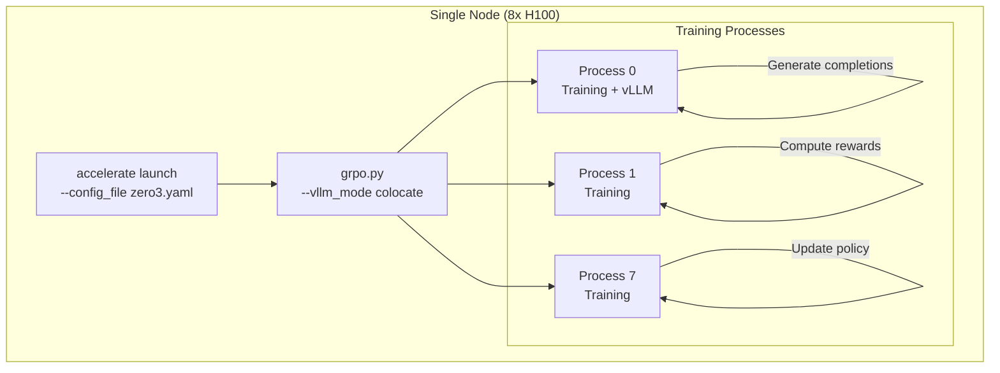

Command example from single-node GRPO training:

```bash
ACCELERATE_LOG_LEVEL=info \
    accelerate launch --config_file recipes/accelerate_configs/zero3.yaml \
    src/open_r1/grpo.py --config recipes/DeepSeek-R1-Distill-Qwen-1.5B/grpo/config_demo.yaml \
    --vllm_mode colocate
```

**Sources:** [README.md:218-225]()

### Distributed Mode (Multi-Node)

For large-scale training, vLLM runs on a dedicated node using `trl vllm-serve`, with training processes on separate nodes communicating via HTTP.

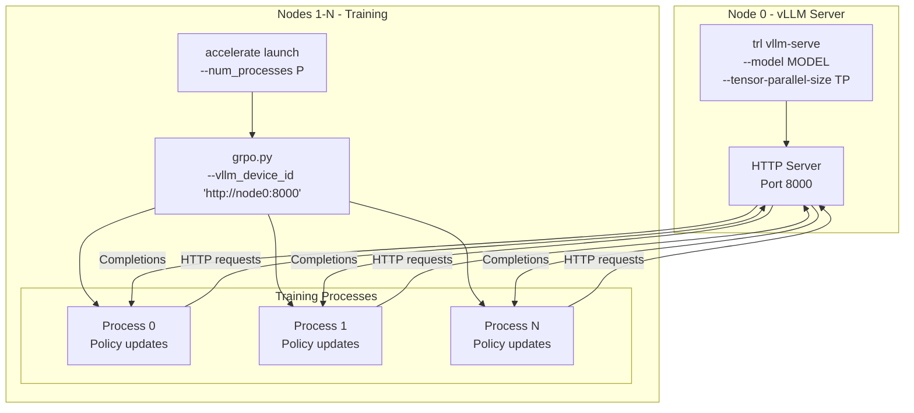

SLURM deployment for multi-node GRPO with 1 vLLM node + 1 training node:

```bash
sbatch --nodes=2 slurm/train.slurm \
    --model Qwen2.5-1.5B-Instruct \
    --task grpo \
    --config demo \
    --accelerator zero2 \
    --dp 8 \
    --tp 1
```

The `slurm/train.slurm` script automatically:
1. Launches `trl vllm-serve` on node 0 with specified tensor parallelism
2. Waits for vLLM server to become healthy
3. Launches training on remaining nodes with vLLM endpoint URL

**Sources:** [README.md:230-236](), [slurm/train.slurm:1-200]()

### GRPO Generation Configuration

The `GRPOTrainer` generates multiple completions using these vLLM parameters:

| Parameter | Default | Purpose |
|-----------|---------|---------|
| `num_generations` | 16-64 | Completions per prompt for reward estimation |
| `temperature` | 0.6-0.8 | Sampling temperature for diversity |
| `top_p` | 0.95 | Nucleus sampling parameter |
| `max_new_tokens` | 8192-32768 | Maximum completion length |
| `vllm_device_id` | "colocate" or URL | vLLM deployment mode |

**Sources:** [src/open_r1/grpo.py:112-121]()

## Evaluation with vLLM

The `lighteval` framework uses vLLM as its inference backend for benchmark evaluation. vLLM supports both data parallelism and tensor parallelism depending on model size.

### Single GPU Evaluation

For small models on a single GPU, specify the model directly without parallelism:

```bash
export VLLM_WORKER_MULTIPROC_METHOD=spawn
MODEL=deepseek-ai/DeepSeek-R1-Distill-Qwen-1.5B
MODEL_ARGS="model_name=$MODEL,dtype=bfloat16,max_model_length=32768,gpu_memory_utilization=0.8,generation_parameters={max_new_tokens:32768,temperature:0.6,top_p:0.95}"
TASK=aime24
OUTPUT_DIR=data/evals/$MODEL

lighteval vllm $MODEL_ARGS "lighteval|$TASK|0|0" \
    --use-chat-template \
    --output-dir $OUTPUT_DIR
```

**Sources:** [README.md:449-475]()

### Data Parallelism

For faster throughput on small models, use data parallelism to replicate the model across multiple GPUs and process different prompts in parallel:

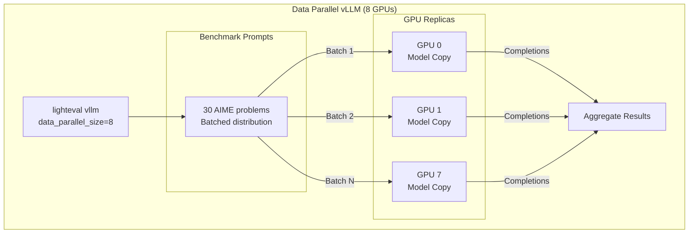

Command for data parallel evaluation:

```bash
NUM_GPUS=8
MODEL=deepseek-ai/DeepSeek-R1-Distill-Qwen-1.5B
MODEL_ARGS="model_name=$MODEL,dtype=bfloat16,data_parallel_size=$NUM_GPUS,max_model_length=32768,gpu_memory_utilization=0.8,generation_parameters={max_new_tokens:32768,temperature:0.6,top_p:0.95}"
TASK=aime24
OUTPUT_DIR=data/evals/$MODEL

lighteval vllm $MODEL_ARGS "lighteval|$TASK|0|0" \
    --use-chat-template \
    --output-dir $OUTPUT_DIR
```

**Sources:** [README.md:478-490]()

### Tensor Parallelism

For large models that don't fit on a single GPU, use tensor parallelism to shard model weights across multiple GPUs:

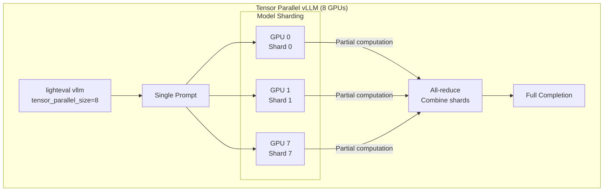

Command for tensor parallel evaluation:

```bash
NUM_GPUS=8
MODEL=deepseek-ai/DeepSeek-R1-Distill-Qwen-32B
MODEL_ARGS="model_name=$MODEL,dtype=bfloat16,tensor_parallel_size=$NUM_GPUS,max_model_length=32768,gpu_memory_utilization=0.8,generation_parameters={max_new_tokens:32768,temperature:0.6,top_p:0.95}"
TASK=aime24
OUTPUT_DIR=data/evals/$MODEL

export VLLM_WORKER_MULTIPROC_METHOD=spawn
lighteval vllm $MODEL_ARGS "lighteval|$TASK|0|0" \
    --use-chat-template \
    --output-dir $OUTPUT_DIR
```

**Sources:** [README.md:493-505]()

### Evaluation Makefile Targets

The `Makefile` provides convenience commands for evaluation:

```bash
# Single GPU
make evaluate MODEL=deepseek-ai/DeepSeek-R1-Distill-Qwen-7B TASK=aime24

# Data Parallelism
make evaluate MODEL=deepseek-ai/DeepSeek-R1-Distill-Qwen-7B TASK=aime24 PARALLEL=data NUM_GPUS=8

# Tensor Parallelism
make evaluate MODEL=deepseek-ai/DeepSeek-R1-Distill-Qwen-32B TASK=aime24 PARALLEL=tensor NUM_GPUS=8
```

**Sources:** [README.md:507-525]()

## Data Generation with vLLM

Data generation pipelines use vLLM server deployed on Ray clusters with Distilabel handling the generation logic. The vLLM server provides an OpenAI-compatible API endpoint.

### Ray Cluster Architecture

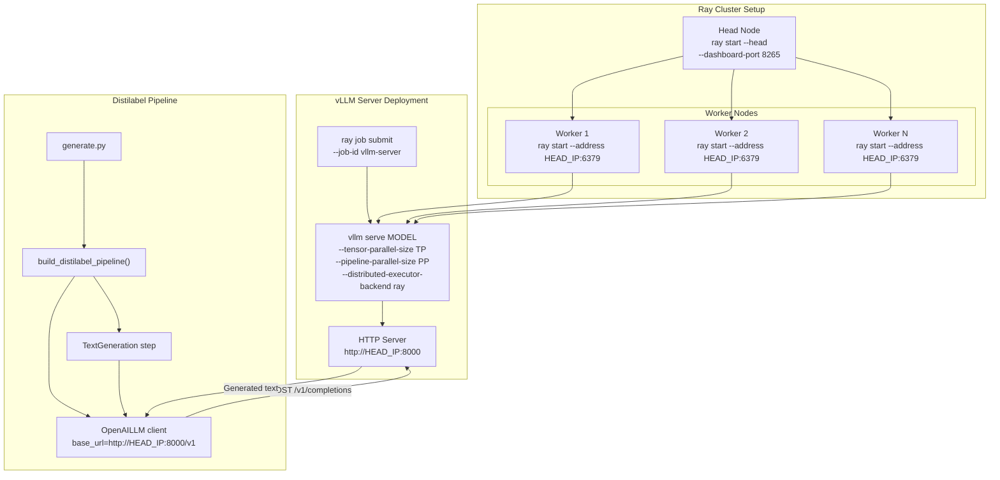

**Sources:** [slurm/generate.slurm:134-187](), [src/open_r1/generate.py:23-63]()

### vLLM Server Configuration for Generation

The `slurm/generate.slurm` script launches vLLM server with these configuration parameters:

| Parameter | Value | Purpose |
|-----------|---------|---------|
| `--tensor-parallel-size` | `$SLURM_GPUS_PER_NODE` | Tensor parallelism within each node (e.g., 8) |
| `--pipeline-parallel-size` | `$SLURM_JOB_NUM_NODES` | Pipeline parallelism across nodes (e.g., 2) |
| `--gpu-memory-utilization` | 0.85 | Percentage of GPU memory to allocate |
| `--max-model-len` | 16384 | Maximum sequence length |
| `--enable-chunked-prefill` | - | Enable chunked prefill for long contexts |
| `--distributed-executor-backend` | ray | Use Ray for distributed execution |

The launch sequence:

1. **Ray cluster initialization** - Head node starts on port 6379, workers connect
2. **vLLM server deployment** - Ray job submission launches `vllm serve` across all nodes
3. **Health checks** - Wait for HTTP endpoint to respond on port 8000
4. **Distilabel job submission** - Launch generation pipeline as separate Ray job

**Sources:** [slurm/generate.slurm:175-201]()

### Distilabel Pipeline Integration

The `build_distilabel_pipeline()` function in `generate.py` creates a Distilabel pipeline that uses vLLM server as its LLM backend:

```python
# Simplified structure from generate.py
from distilabel.llms import OpenAILLM
from distilabel.pipeline import Pipeline
from distilabel.steps.tasks import TextGeneration

def build_distilabel_pipeline(
    model: str,
    base_url: str = "http://localhost:8000/v1",  # vLLM server endpoint
    prompt_column: str = "prompt",
    temperature: float = 0.6,
    max_new_tokens: int = 8192,
    num_generations: int = 1,
    input_batch_size: int = 64,
    client_replicas: int = 1,
):
    with Pipeline().ray() as pipeline:
        TextGeneration(
            llm=OpenAILLM(
                base_url=base_url,  # Points to vLLM server
                model=model,
                generation_kwargs={
                    "max_new_tokens": max_new_tokens,
                    "temperature": temperature,
                },
            ),
            num_generations=num_generations,
            input_batch_size=input_batch_size,
        )
    return pipeline
```

The `OpenAILLM` client communicates with vLLM server using OpenAI-compatible API, enabling seamless integration without vLLM-specific client code.

**Sources:** [src/open_r1/generate.py:23-63]()

### Running Data Generation

SLURM command for launching distributed data generation:

```bash
sbatch slurm/generate.slurm \
    --hf-dataset AI-MO/NuminaMath-TIR \
    --temperature 0.6 \
    --prompt-column problem \
    --model deepseek-ai/DeepSeek-R1 \
    --hf-output-dataset username/r1-dataset \
    --num-generations 4 \
    --input-batch-size 64
```

The script handles:
- Ray cluster setup across all allocated nodes
- vLLM server deployment with automatic parallelism configuration
- Distilabel pipeline execution with client replicas for parallel processing
- Dataset output to HuggingFace Hub

**Sources:** [README.md:729-749](), [slurm/generate.slurm:216-239]()

## Parallelism Strategies

vLLM supports three parallelism strategies that can be combined based on model size and hardware configuration.

### Parallelism Comparison

| Strategy | Use Case | GPU Requirements | Communication Overhead |
|----------|----------|------------------|------------------------|
| **Data Parallel** | Small models, high throughput | Model fits on single GPU | Minimal (independent replicas) |
| **Tensor Parallel** | Large models, single-node | Model too large for single GPU | High (all-reduce per layer) |
| **Pipeline Parallel** | Very large models, multi-node | Model too large for single node | Medium (activation passing) |

### Tensor Parallelism

Shards model weights and activations across GPUs, with all GPUs computing different parts of the same layer simultaneously.

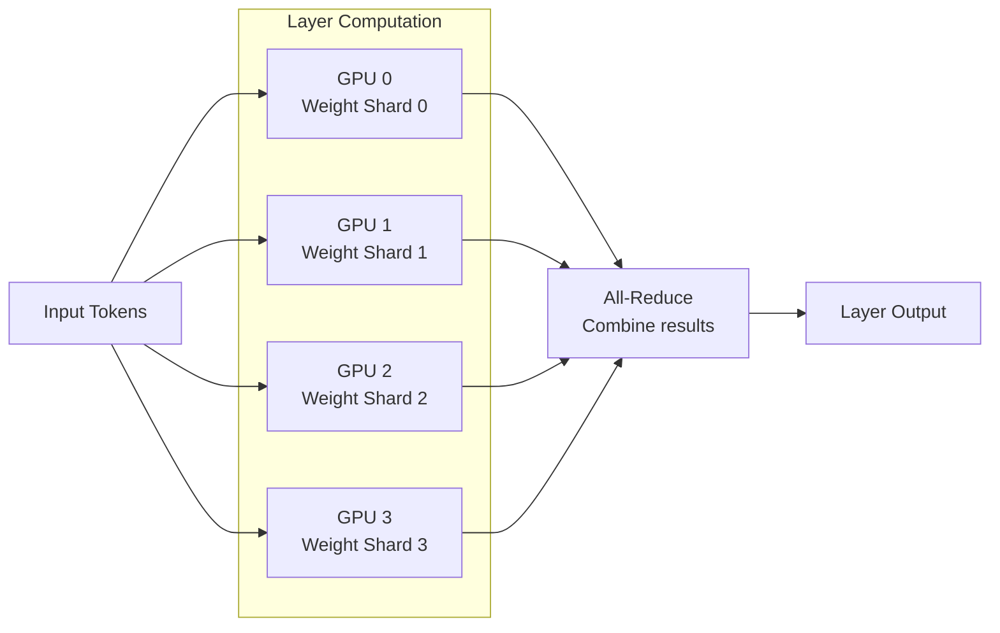

Configuration: `tensor_parallel_size=N` where N is number of GPUs to shard across (typically 2, 4, or 8).

**Sources:** [slurm/generate.slurm:181]()

### Data Parallelism

Replicates the full model on each GPU, processing different prompts in parallel.

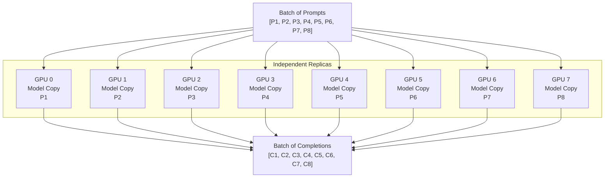

Configuration: `data_parallel_size=N` where N is number of GPU replicas (must match number of available GPUs).

**Sources:** [README.md:480-490]()

### Pipeline Parallelism

Shards model layers across nodes, with activations flowing through a pipeline.

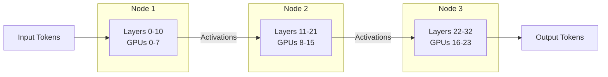

Configuration: `pipeline_parallel_size=N` where N is number of nodes to pipeline across.

**Sources:** [slurm/generate.slurm:182]()

## Service Health Monitoring

Both serving approaches implement comprehensive health monitoring:

### Health Check Implementation

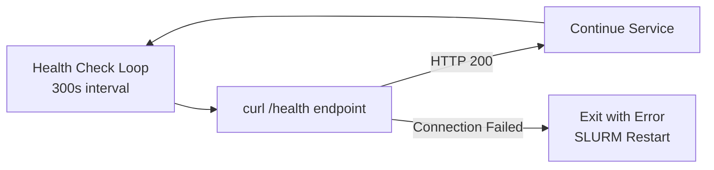

The health monitoring performs:
1. **Startup verification** - Wait up to 3600 seconds for model loading
2. **Periodic checks** - Health endpoint polling every 300 seconds  
3. **Automatic recovery** - SLURM job exit triggers restart mechanisms
4. **Sanity testing** - Initial completions API validation

**Sources:** [slurm/serve_r1.slurm:60-79](), [slurm/serve_r1.slurm:102-109](), [slurm/experimental/serve_r1_vllm.slurm:90-132]()

## Integration with Generation Pipeline

The serving infrastructure integrates directly with data generation workflows through standardized API endpoints:

### Generation Client Integration

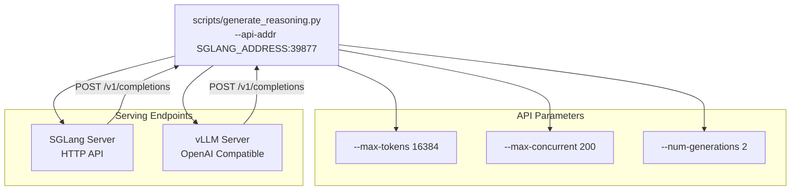

The generation integration supports:
- **High concurrency** - Up to 200 concurrent requests for batch processing
- **Configurable generation** - Multiple completions per prompt with temperature control
- **Dataset processing** - Direct integration with Hugging Face datasets through column mapping
- **Output formatting** - JSONL output with UUID tracking for deduplication

**Sources:** [slurm/README.md:19-30]()

## Deployment Commands

### SGLang Deployment

```bash
# Start SGLang server on 2x8 H100 nodes
sbatch slurm/serve_r1.slurm -m "/path/to/model" -e "sglang124"

# Start router for load balancing
sbatch slurm/serve_router.slurm -e "sglang124"
```

### vLLM Deployment

```bash
# Start vLLM server with Ray (experimental)
sbatch slurm/experimental/serve_r1_vllm.slurm -m "deepseek-ai/DeepSeek-R1" -e "vllm7"
```

**Sources:** [slurm/README.md:14-17](), [slurm/serve_r1.slurm:27-34](), [slurm/experimental/serve_r1_vllm.slurm:21-27]()