# Page: Overview

# Overview

<details>
<summary>Relevant source files</summary>

The following files were used as context for generating this wiki page:

- [README.md](README.md)

</details>


This page introduces the Open R1 repository, its goals, and provides a high-level architecture overview of the system. For detailed information on specific subsystems, see:
- Installation and setup: [Installation and Setup](#1.1)
- Training pipelines: [Training Pipeline](#2)
- Reward functions: [Reward Functions](#3)
- Evaluation system: [Evaluation System](#4)
- Data generation: [Data Generation and Processing](#5)
- Infrastructure: [Infrastructure and Operations](#6)

## Purpose and Goals

Open R1 is a complete reproduction of DeepSeek-R1 that enables training language models to reason through problems step-by-step. The repository implements three complementary approaches to teaching reasoning:

1. **Distillation (R1-Distill)**: Learn from high-quality reasoning traces via supervised fine-tuning
2. **Pure RL (R1-Zero)**: Learn from verification signals via reinforcement learning
3. **Multi-stage training**: Combine distillation and RL for maximum effectiveness

The codebase is designed to be simple and extensible, with most functionality contained in three core scripts: `sft.py` for supervised fine-tuning, `grpo.py` for reinforcement learning, and `generate.py` for synthetic data creation.

**Sources:** [README.md:19-36]()

## System Architecture

The Open R1 system consists of five major subsystems that work together to produce reasoning-capable language models:

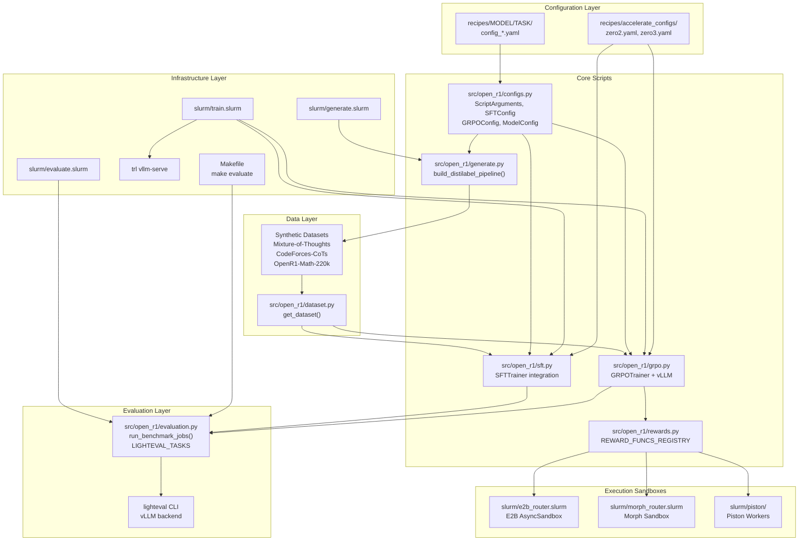

**Key Components:**

| Component | Entry Point | Purpose |
|-----------|-------------|---------|
| **Supervised Fine-Tuning** | `src/open_r1/sft.py` | Distill reasoning from synthetic datasets using TRL's `SFTTrainer` |
| **GRPO Training** | `src/open_r1/grpo.py` | Reinforcement learning with vLLM generation and multi-objective rewards |
| **Data Generation** | `src/open_r1/generate.py` | Create synthetic datasets using Distilabel and vLLM on Ray clusters |
| **Reward System** | `src/open_r1/rewards.py` | Registry of 12+ reward functions for format, math, code execution, and style |
| **Evaluation** | `src/open_r1/evaluation.py` | Benchmark runner using lighteval with AIME, MATH-500, GPQA, LiveCodeBench |
| **Configuration** | `src/open_r1/configs.py` | Dataclasses for training parameters, managed via YAML files in `recipes/` |

**Sources:** [README.md:21-29](), [README.md:101-155]()

## Training Pipeline Flow

The following diagram shows how data flows through the training pipeline from raw datasets to trained models, with specific code entry points:

```mermaid
graph LR
    subgraph "Input Data"
        BASE["Base Datasets<br/>NuminaMath-TIR<br/>Codeforces"]
        R1_TRACES["DeepSeek-R1<br/>Reasoning Traces"]
    end
    
    subgraph "Data Generation"
        GEN_SCRIPT["generate.py"]
        BUILD_PIPE["build_distilabel_pipeline()"]
        VLLM_MODEL["vLLM Model Server<br/>tensor_parallel_size"]
        RAY_CLUSTER["Ray Cluster<br/>Distributed execution"]
        
        GEN_SCRIPT --> BUILD_PIPE
        BUILD_PIPE --> VLLM_MODEL
        BUILD_PIPE --> RAY_CLUSTER
    end
    
    subgraph "Synthetic Datasets"
        MIX["open-r1/Mixture-of-Thoughts<br/>350k samples"]
        CODE["open-r1/codeforces-cots<br/>100k samples"]
        MATH["open-r1/OpenR1-Math-220k<br/>220k samples"]
    end
    
    subgraph "Stage 1: Distillation"
        SFT_SCRIPT["sft.py<br/>accelerate launch"]
        GET_DATASET["get_dataset()"]
        SFT_TRAINER["trl.SFTTrainer"]
        SFT_CONFIG["SFTConfig<br/>learning_rate, num_epochs<br/>max_seq_length"]
        
        SFT_SCRIPT --> GET_DATASET
        SFT_SCRIPT --> SFT_CONFIG
        GET_DATASET --> SFT_TRAINER
        SFT_CONFIG --> SFT_TRAINER
    end
    
    subgraph "Stage 2: RL Training"
        GRPO_SCRIPT["grpo.py<br/>accelerate launch"]
        GRPO_CONFIG["GRPOConfig<br/>num_generations<br/>temperature, top_p"]
        GRPO_TRAINER["trl.GRPOTrainer"]
        VLLM_GEN["vLLM generation<br/>16-64 samples"]
        GET_REWARD["get_reward_funcs()"]
        REWARD_REG["REWARD_FUNCS_REGISTRY"]
        
        GRPO_SCRIPT --> GRPO_CONFIG
        GRPO_SCRIPT --> GET_DATASET
        GRPO_CONFIG --> GRPO_TRAINER
        GET_DATASET --> GRPO_TRAINER
        GRPO_TRAINER --> VLLM_GEN
        VLLM_GEN --> GET_REWARD
        GET_REWARD --> REWARD_REG
        REWARD_REG --> GRPO_TRAINER
    end
    
    subgraph "Output Models"
        DISTILL["R1-Distill Models<br/>7B, 14B, 32B variants"]
        RL_MODEL["R1-Zero Models<br/>RL-tuned"]
    end
    
    BASE --> GEN_SCRIPT
    R1_TRACES -.inspire.-> GEN_SCRIPT
    VLLM_MODEL --> MIX
    VLLM_MODEL --> CODE
    VLLM_MODEL --> MATH
    
    MIX --> GET_DATASET
    CODE --> GET_DATASET
    MATH --> GET_DATASET
    
    SFT_TRAINER --> DISTILL
    DISTILL -.optional.-> GRPO_SCRIPT
    GRPO_TRAINER --> RL_MODEL
```

**Training Stages:**

1. **Data Generation** ([generate.py:1-100]()): Uses `build_distilabel_pipeline()` to create synthetic datasets by sampling from models served via vLLM on Ray clusters
2. **Supervised Fine-Tuning** ([sft.py:1-200]()): Loads datasets with `get_dataset()`, configures training with `SFTConfig`, and trains using TRL's `SFTTrainer`
3. **RL Training** ([grpo.py:1-300]()): Generates multiple completions per prompt using vLLM, evaluates them with `get_reward_funcs()`, and updates policy via `GRPOTrainer`

**Sources:** [README.md:106-127](), [README.md:216-236]()

## Configuration System

All training runs are configured through YAML files in the `recipes/` directory, which instantiate dataclasses defined in `configs.py`:

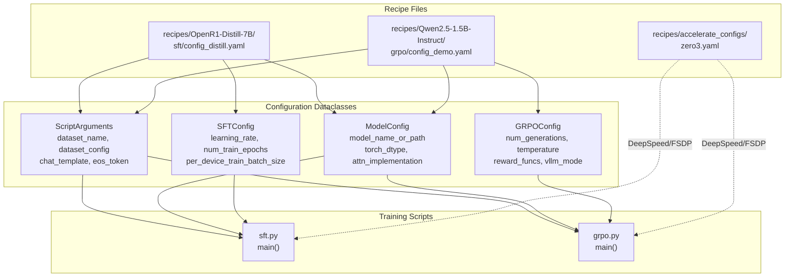

Configuration parameters can be overridden from the command line:

```bash
accelerate launch --config_file recipes/accelerate_configs/zero3.yaml \
    src/open_r1/sft.py \
    --config recipes/OpenR1-Distill-7B/sft/config_distill.yaml \
    --model_name_or_path Qwen/Qwen3-0.6B-Base \
    --learning_rate 5.0e-5
```

**Sources:** [README.md:124-155](), [README.md:419-442]()

## Reward System Architecture

The GRPO training process uses a flexible reward system defined in `rewards.py`:

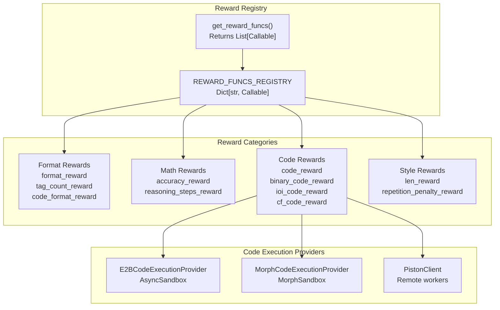

Reward functions are specified in the GRPO configuration YAML:

```yaml
reward_funcs:
  - name: format_reward
    weight: 1.0
  - name: accuracy_reward
    weight: 5.0
  - name: code_reward
    weight: 10.0
    provider_type: e2b
```

The `get_reward_funcs()` function instantiates the specified rewards from `REWARD_FUNCS_REGISTRY` and returns them as a list of callables that evaluate model outputs.

**Sources:** [README.md:242-393]()

## Evaluation Pipeline

Model evaluation uses the `lighteval` library with vLLM backend for efficient inference:

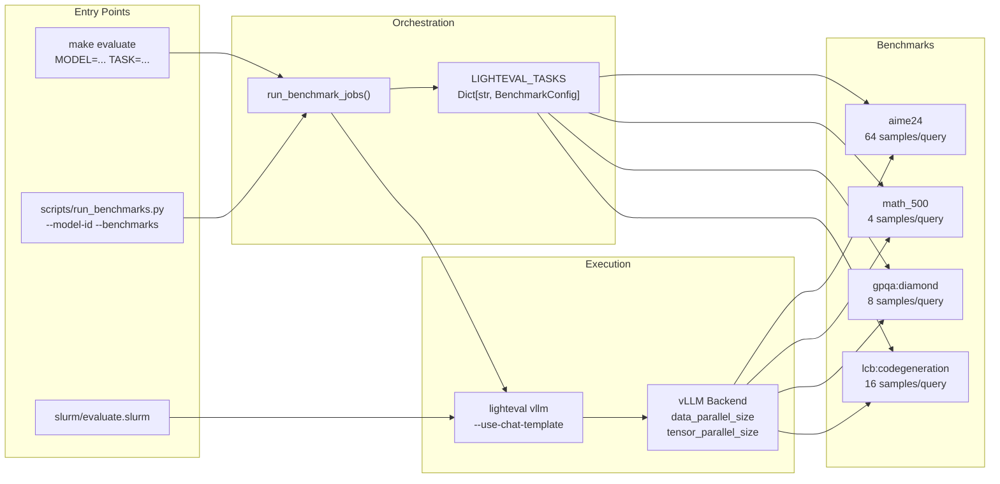

The `LIGHTEVAL_TASKS` registry in [evaluation.py]() maps benchmark names to their configuration, including number of samples per query and evaluation parameters. Evaluation results are saved as JSON (aggregate metrics) and Parquet (detailed logs).

**Sources:** [README.md:444-525](), [README.md:527-665]()

## Infrastructure and Orchestration

The repository provides Slurm scripts and Makefile targets to orchestrate distributed training and evaluation:

| Script | Purpose | Key Features |
|--------|---------|--------------|
| `slurm/train.slurm` | Launch training jobs | N+1 node setup for GRPO (1 vLLM server, N training nodes) |
| `slurm/evaluate.slurm` | Launch evaluation jobs | Configurable parallelism (data/tensor parallel) |
| `slurm/generate.slurm` | Launch data generation | Ray cluster setup with vLLM server |
| `slurm/e2b_router.slurm` | E2B router service | Rate limiting for code execution |
| `slurm/morph_router.slurm` | Morph router service | Multi-language code execution |
| `slurm/piston/` | Piston worker setup | Competitive programming execution |

**Training Example (GRPO on 2 nodes):**
```bash
sbatch --nodes=2 slurm/train.slurm \
    --model Qwen2.5-1.5B-Instruct \
    --task grpo \
    --config demo \
    --accelerator zero2 \
    --dp 8 --tp 1
```

**Evaluation Example:**
```bash
python scripts/run_benchmarks.py \
    --model-id deepseek-ai/DeepSeek-R1-Distill-Qwen-7B \
    --benchmarks aime24 math_500 gpqa lcb
```

The `Makefile` provides convenient targets for local development:
- `make install`: Setup environment and dependencies
- `make evaluate MODEL=... TASK=...`: Run single benchmark
- Code quality: `make quality`, `make style`, `make test`

**Sources:** [README.md:394-417](), [README.md:49-100]()

## Key Dependencies

The system relies on several critical libraries:

| Dependency | Version | Purpose |
|------------|---------|---------|
| `vllm` | 0.8.5.post1 | Fast inference for generation and evaluation |
| `flash-attn` | Latest | Efficient attention computation |
| `trl` | Latest | Training utilities (SFTTrainer, GRPOTrainer) |
| `distilabel` | ≥1.5.2 | Synthetic data generation pipelines |
| `lighteval` | Latest | Standardized benchmark evaluation |
| `accelerate` | Latest | Multi-GPU/multi-node training orchestration |
| `deepspeed` | Latest | ZeRO optimization stages |

All dependencies are managed via `uv` package manager and require CUDA 12.4.

**Sources:** [README.md:49-100]()

## Next Steps

For detailed information on specific components:
- **Getting Started**: See [Installation and Setup](#1.1) for environment configuration
- **Training Models**: See [Training Pipeline](#2) for SFT and GRPO workflows
- **Reward Design**: See [Reward Functions](#3) for available reward functions
- **Running Evaluations**: See [Evaluation System](#4) for benchmark execution
- **Creating Datasets**: See [Data Generation and Processing](#5) for synthetic data creation
- **Infrastructure Setup**: See [Infrastructure and Operations](#6) for Slurm and vLLM configuration

---

# Page: Installation and Setup

# Installation and Setup

<details>
<summary>Relevant source files</summary>

The following files were used as context for generating this wiki page:

- [README.md](README.md)
- [setup.py](setup.py)

</details>


This document provides comprehensive instructions for installing and configuring the Open R1 development environment. It covers creating a Python virtual environment, installing core dependencies (vLLM, Flash Attention, etc.), configuring authentication with external services, and verifying the installation. For information about deploying infrastructure components on a Slurm cluster, see [SLURM Integration](#6.1). For model serving configuration, see [Model Serving with vLLM](#6.3).

## Prerequisites

Before beginning installation, ensure your system meets the following requirements:

| Requirement | Specification | Verification Command |
|-------------|---------------|---------------------|
| CUDA | 12.4 | `nvcc --version` |
| Python | ≥3.10.9 | `python --version` |
| Git LFS | Any version | `git-lfs --version` |
| GPU Memory | 80GB recommended (H100) | `nvidia-smi` |

**Critical**: The project dependencies are compiled for CUDA 12.4. Mismatched CUDA versions will cause segmentation faults during execution.

Sources: [README.md:51-53](), [setup.py:137]()

## Installation Modes

The project supports multiple installation profiles depending on your use case:

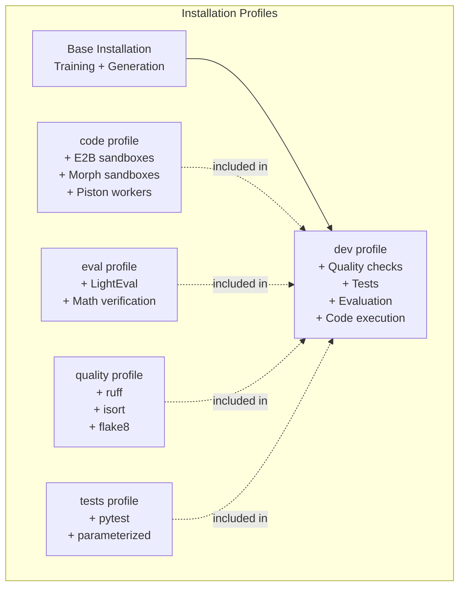

**Installation Profile Breakdown**

Sources: [setup.py:92-98]()

## Step 1: Create Python Virtual Environment

The project uses `uv` for fast Python environment management. Install `uv` following the [UV Installation Guide](https://docs.astral.sh/uv/getting-started/installation/), then create the environment:

```bash
uv venv openr1 --python 3.11 && source openr1/bin/activate && uv pip install --upgrade pip
```

**For Hugging Face cluster users**: Add `export UV_LINK_MODE=copy` to your `.bashrc` to suppress cache warnings from `uv`.

Sources: [README.md:54-67]()

## Step 2: Install Core Dependencies

### 2.1 Install vLLM and Flash Attention

These are the foundational dependencies for fast inference and memory-efficient attention:

```bash
uv pip install vllm==0.8.5.post1
uv pip install setuptools && uv pip install flash-attn --no-build-isolation
```

This installation also brings in PyTorch `v2.6.0`, which is **critical** because vLLM binaries are compiled specifically for this version.

Sources: [README.md:69-74](), [setup.py:70-72]()

### 2.2 Install Project Dependencies

Choose the appropriate installation mode based on your use case:

```bash
# For contributors (recommended - includes all tools)
GIT_LFS_SKIP_SMUDGE=1 uv pip install -e ".[dev]"

# For training only
GIT_LFS_SKIP_SMUDGE=1 uv pip install -e .

# For code execution rewards only
uv pip install -e ".[code]"

# For evaluation only
uv pip install -e ".[eval]"
```

The `GIT_LFS_SKIP_SMUDGE=1` flag prevents Git LFS from downloading large model files during package installation.

**Shortcut**: Run `make install` to automatically setup all development libraries.

Sources: [README.md:76-80](), [setup.py:92-120]()

### Dependency Version Table

| Dependency | Version | Purpose |
|------------|---------|---------|
| `accelerate` | 1.4.0 | Multi-GPU training orchestration |
| `torch` | 2.6.0 | Deep learning framework |
| `vllm` | 0.8.5.post1 | Fast inference engine |
| `trl` | 0.18.0 | Reinforcement learning trainer |
| `deepspeed` | 0.16.8 | ZeRO optimization |
| `transformers` | 4.52.3 | Model loading and tokenization |
| `liger-kernel` | ≥0.5.10 | Memory-efficient kernels |
| `datasets` | ≥3.2.0 | Dataset loading and processing |
| `wandb` | ≥0.19.1 | Experiment tracking |
| `lighteval` | git+... | Model evaluation framework |
| `math-verify` | 0.5.2 | Math answer verification |
| `e2b-code-interpreter` | ≥1.0.5 | Python code execution |
| `morphcloud` | 0.1.67 | Multi-language code execution |
| `distilabel` | ≥1.5.2 | Data generation pipeline |

Sources: [setup.py:43-77]()

## Step 3: Authentication Setup

### 3.1 Hugging Face Hub Authentication

Authenticate with Hugging Face Hub for model/dataset downloads and uploads:

```bash
huggingface-cli login
```

This command will prompt for your Hugging Face access token. The token is stored in `~/.cache/huggingface/token` and used automatically by all scripts.

**Required permissions**: Your token must have `write` access to push models and datasets to the Hub.

Sources: [README.md:84-86]()

### 3.2 Weights & Biases Authentication

Authenticate with Weights & Biases for experiment tracking:

```bash
wandb login
```

Override default W&B settings in training commands:

```bash
accelerate launch --config_file recipes/accelerate_configs/zero3.yaml src/open_r1/sft.py \
    --config recipes/OpenR1-Distill-7B/sft/config_distill.yaml \
    --wandb_entity your_entity --wandb_project your_project --run_name your_run
```

Sources: [README.md:84-87](), [README.md:148-154]()

### 3.3 Code Execution Service Authentication

For training with code execution rewards, create a `.env` file in the project root:

```bash
# E2B API key (for Python sandboxes)
E2B_API_KEY="e2b_xxx"

# Morph API key (for multi-language sandboxes)
MORPH_API_KEY="YOUR_MORPH_API_KEY"

# Codeforces test cases path (for competitive programming)
CF_TESTS_FOLDER=/path/to/codeforces/tests
```

**E2B Setup**: Sign up at [e2b.dev](https://e2b.dev) to obtain an API key.

**Morph Setup**: Install the client (`pip install morphcloud`) and sign up at [cloud.morph.so](https://cloud.morph.so/web/) for an API key.

**Piston Setup**: For self-hosted execution workers, set `PISTON_ENDPOINTS=slurm` or provide a comma-separated list of worker URLs. See [SLURM Integration](#6.1) for deployment instructions.

Sources: [README.md:256-275](), [README.md:350-375]()

## Step 4: Install Git LFS

Git LFS is required for pushing large model checkpoints and datasets to Hugging Face Hub:

```bash
# Check if already installed
git-lfs --version

# Install if missing (Debian/Ubuntu)
sudo apt-get install git-lfs
```

Sources: [README.md:89-99]()

## Installation Verification

### Verify Core Installation

Create a test script `verify_install.py`:

```python
import torch
import vllm
import transformers
import trl
import accelerate

print(f"PyTorch: {torch.__version__}")
print(f"vLLM: {vllm.__version__}")
print(f"Transformers: {transformers.__version__}")
print(f"TRL: {trl.__version__}")
print(f"Accelerate: {accelerate.__version__}")
print(f"CUDA Available: {torch.cuda.is_available()}")
print(f"CUDA Version: {torch.version.cuda}")
print(f"GPU Count: {torch.cuda.device_count()}")
```

Expected output:
```
PyTorch: 2.6.0
vLLM: 0.8.5.post1
Transformers: 4.52.3
TRL: 0.18.0
Accelerate: 1.4.0
CUDA Available: True
CUDA Version: 12.4
GPU Count: 8
```

### Verify Authentication

```bash
# Test Hugging Face Hub access
huggingface-cli whoami

# Test Weights & Biases access
wandb verify
```

### Verify Installation Modes

Test specific installation profiles:

```bash
# Test evaluation tools
python -c "import lighteval; from open_r1.evaluation import LIGHTEVAL_TASKS; print('Evaluation OK')"

# Test code execution
python -c "from e2b_code_interpreter import AsyncSandbox; print('E2B OK')"

# Test quality tools
ruff check src/ --select I
isort --check-only src/
flake8 src/
```

Sources: [README.md:59](), [setup.py:92-98]()

## Dependency Installation Flow

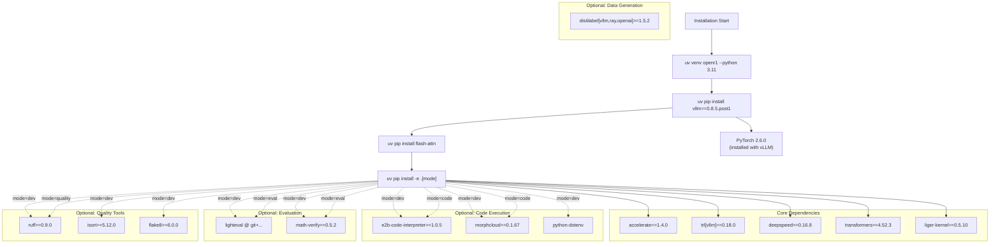

**Installation Order is Critical**: vLLM must be installed before project dependencies because it determines the PyTorch version. Installing PyTorch separately may cause version conflicts.

Sources: [README.md:49-99](), [setup.py:43-120]()

## Environment Variables Reference

| Variable | Purpose | Required For | Example Value |
|----------|---------|--------------|---------------|
| `UV_LINK_MODE` | Suppress uv cache warnings | HF cluster users | `copy` |
| `VLLM_WORKER_MULTIPROC_METHOD` | vLLM process spawning | Evaluation | `spawn` |
| `CUDA_VISIBLE_DEVICES` | GPU selection | Multi-GPU setups | `0,1,2,3` |
| `ACCELERATE_LOG_LEVEL` | Training log verbosity | Training | `info` |
| `GIT_LFS_SKIP_SMUDGE` | Skip LFS downloads | Installation | `1` |
| `E2B_API_KEY` | E2B authentication | Code rewards | `e2b_xxx` |
| `MORPH_API_KEY` | Morph authentication | Code rewards | `YOUR_KEY` |
| `CF_TESTS_FOLDER` | Codeforces tests path | CF rewards | `/data/cf_tests` |
| `PISTON_ENDPOINTS` | Piston workers | IOI/CF rewards | `slurm` or `ip:port,ip:port` |
| `HF_TOKEN` | HF Hub access | Hub operations | `hf_xxx` |
| `WANDB_API_KEY` | W&B tracking | Experiment logging | `wandb_xxx` |

Sources: [README.md:66-67](), [README.md:256-368](), [README.md:449]()

## Common Installation Issues

### Issue: Segmentation Fault During Training

**Cause**: CUDA version mismatch. vLLM binaries are compiled for CUDA 12.4.

**Solution**: Verify CUDA version with `nvcc --version`. If using a different version, rebuild vLLM from source or switch to CUDA 12.4.

Sources: [README.md:51-53]()

### Issue: Flash Attention Build Failure

**Cause**: Missing `setuptools` or build isolation issues.

**Solution**: Install setuptools before flash-attn and disable build isolation:
```bash
uv pip install setuptools && uv pip install flash-attn --no-build-isolation
```

Sources: [README.md:72-74]()

### Issue: Git LFS Not Fetching Files

**Cause**: Git LFS not installed or not initialized in repository.

**Solution**: Install Git LFS system-wide (`sudo apt-get install git-lfs`), then run `git lfs install` in the repository.

Sources: [README.md:89-99]()

### Issue: Import Error for lighteval

**Cause**: lighteval must be installed from Git with specific bug fixes.

**Solution**: The correct version is specified in setup.py and will be installed automatically with `.[eval]` or `.[dev]` profiles.

Sources: [setup.py:59]()

## Next Steps

After completing installation:

1. **Training**: Proceed to [Supervised Fine-Tuning (SFT)](#2.1) or [Group Relative Policy Optimization (GRPO)](#2.2) to train models.
2. **Evaluation**: See [Benchmark Execution](#4.1) to evaluate models on standard benchmarks.
3. **Data Generation**: See [Distilabel Pipeline](#5.1) to generate synthetic training data.
4. **Infrastructure**: See [SLURM Integration](#6.1) to deploy training and evaluation jobs on a cluster.

For development workflows including code quality checks and testing, see [Development Tools](#6.2).

Sources: [README.md:101-196](), [README.md:444-666]()

---

# Page: Training Pipeline

# Training Pipeline

<details>
<summary>Relevant source files</summary>

The following files were used as context for generating this wiki page:

- [README.md](README.md)
- [src/open_r1/grpo.py](src/open_r1/grpo.py)
- [src/open_r1/sft.py](src/open_r1/sft.py)
- [src/open_r1/utils/__init__.py](src/open_r1/utils/__init__.py)
- [src/open_r1/utils/data.py](src/open_r1/utils/data.py)
- [src/open_r1/utils/model_utils.py](src/open_r1/utils/model_utils.py)
- [tests/utils/test_data.py](tests/utils/test_data.py)

</details>


## Purpose and Scope

The training pipeline implements the core workflow for creating Open R1 models through two distinct training stages: supervised fine-tuning (distillation) and reinforcement learning. This document provides an overview of the training architecture, entry points, and how the two stages work together to produce models with reasoning capabilities.

For detailed implementation of each stage, see:
- Supervised Fine-Tuning (distillation): [2.1](#2.1)
- Group Relative Policy Optimization (reinforcement learning): [2.2](#2.2)
- Configuration system details: [2.3](#2.3)
- Pre-configured training recipes: [2.4](#2.4)

For data generation and evaluation, see:
- Data generation pipeline: [5](#5)
- Model evaluation system: [4](#4)

---

## Training Stages Overview

Open R1 supports three training approaches, following the DeepSeek-R1 methodology:

### Stage 1: Distillation (SFT)

The first stage uses supervised fine-tuning to distill reasoning capabilities from high-quality traces (either from DeepSeek-R1 or from previously trained models). The model learns to replicate the reasoning patterns present in the training data.

**Typical workflow:**
- Start from a base model (e.g., `Qwen2.5-Math-7B-RoPE-300k`)
- Train on synthetic datasets with reasoning traces (e.g., `Mixture-of-Thoughts`, `OpenR1-Math-220k`)
- Produce a distilled model (e.g., `OpenR1-Distill-7B`)

### Stage 2: Reinforcement Learning (GRPO)

The second stage uses Group Relative Policy Optimization with a multi-objective reward system to improve model performance through trial-and-error learning. The model generates multiple completions per prompt and learns from reward signals based on correctness, format, and style.

**Typical workflow:**
- Start from a base model or distilled model
- Train on datasets with verification information (ground truth answers, test cases)
- Use vLLM to generate 16-64 completions per prompt
- Evaluate completions using 12+ reward functions
- Update policy based on rewards

### Stage 3: Multi-Stage Training (Optional)

Models can be trained through both stages sequentially: distillation first to learn reasoning patterns, then RL to refine performance through verification feedback.

**Sources:** [README.md:30-36](), [README.md:197-215](), [README.md:216-236]()

---

## Entry Points and Command-Line Interface

### Script Structure

Both training stages are implemented as standalone Python scripts with identical command-line interfaces:

| Script | Purpose | Trainer Class |
|--------|---------|---------------|
| `src/open_r1/sft.py` | Supervised fine-tuning | `trl.SFTTrainer` |
| `src/open_r1/grpo.py` | Reinforcement learning | `trl.GRPOTrainer` |

Each script follows the same structure:
1. Parse configuration from command-line or YAML file
2. Load dataset, tokenizer, and model
3. Initialize trainer with configuration
4. Execute training loop
5. Save model and metrics
6. Optionally evaluate and push to Hub

### Configuration Parsing

Both scripts use `TrlParser` to parse three configuration dataclasses:

```
TrlParser((ScriptArguments, SFTConfig/GRPOConfig, ModelConfig))
```

- `ScriptArguments` / `GRPOScriptArguments`: Dataset and reward configuration
- `SFTConfig` / `GRPOConfig`: Training hyperparameters
- `ModelConfig`: Model loading parameters

Configuration can be provided via:
- Command-line arguments: `--arg_name value`
- YAML configuration file: `--config path/to/config.yaml`
- Both (command-line overrides YAML)

### Basic Usage Examples

**Supervised Fine-Tuning:**
```bash
accelerate launch --config_file recipes/accelerate_configs/zero3.yaml \
    src/open_r1/sft.py \
    --config recipes/OpenR1-Distill-7B/sft/config_distill.yaml
```

**GRPO Training:**
```bash
accelerate launch --config_file recipes/accelerate_configs/zero3.yaml \
    src/open_r1/grpo.py \
    --config recipes/Qwen2.5-1.5B-Instruct/grpo/config_demo.yaml
```

**Overriding YAML parameters:**
```bash
accelerate launch --config_file recipes/accelerate_configs/zero3.yaml \
    src/open_r1/sft.py \
    --config recipes/OpenR1-Distill-7B/sft/config_distill.yaml \
    --model_name_or_path Qwen/Qwen3-0.6B-Base \
    --output_dir data/OpenR1-Distill-0.6B
```

**Sources:** [README.md:101-155](), [src/open_r1/sft.py:15-34](), [src/open_r1/sft.py:166-169](), [src/open_r1/grpo.py:178-181]()

---

## Training Architecture

The following diagram shows how training scripts, configuration, and supporting utilities work together:

### Training Component Architecture

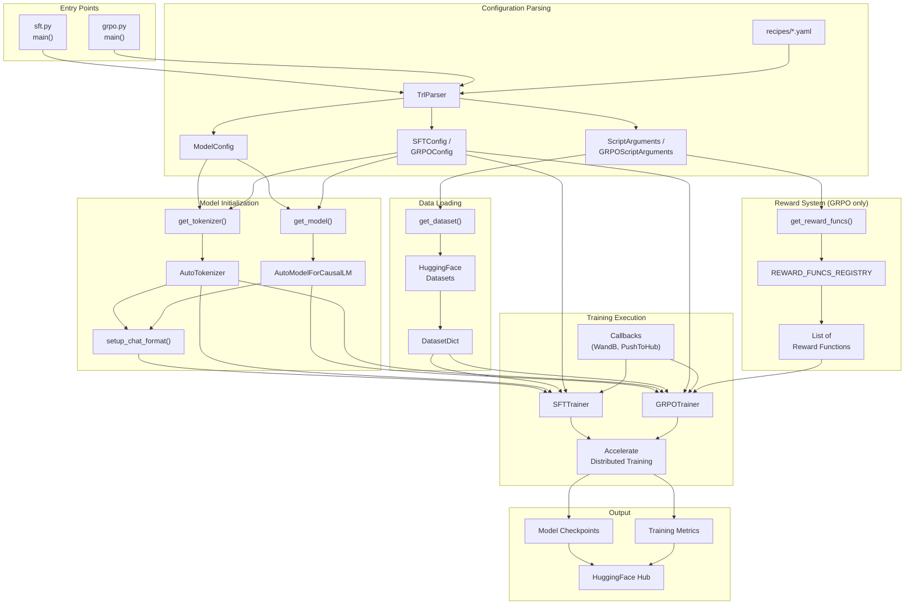

**Sources:** [src/open_r1/sft.py:55-164](), [src/open_r1/grpo.py:35-176](), [src/open_r1/utils/__init__.py:1-6]()

---

## Training Execution Flow

### Supervised Fine-Tuning Flow


**Sources:** [src/open_r1/sft.py:55-164]()

### GRPO Training Flow

```mermaid
graph LR
    subgraph "Initialization"
        PARSE_GRPO["Parse config<br/>(TrlParser)"]
        LOAD_DATA_GRPO["Load dataset<br/>(get_dataset)"]
        LOAD_TOK_GRPO["Load tokenizer<br/>(get_tokenizer)"]
        LOAD_MODEL_GRPO["Load model<br/>(get_model)"]
    end
    
    subgraph "Reward Setup"
        GET_REWARDS["Get reward functions<br/>(get_reward_funcs)"]
        PREPARE_CONV["Prepare conversations<br/>(make_conversation)"]
    end
    
    subgraph "Training Setup"
        INIT_TRAINER_GRPO["Initialize GRPOTrainer<br/>with reward_funcs"]
    end
    
    subgraph "Training Loop"
        TRAIN_GRPO["trainer.train()<br/>- Generate completions<br/>- Compute rewards<br/>- Update policy"]
        CHECKPOINT_GRPO["Save checkpoints"]
        METRICS_GRPO["Log metrics"]
    end
    
    subgraph "Finalization"
        SAVE_MODEL_GRPO["Save final model"]
        EVAL_GRPO["Evaluate<br/>(optional)"]
        PUSH_HUB_GRPO["Push to Hub<br/>(optional)"]
    end
    
    PARSE_GRPO --> LOAD_DATA_GRPO
    LOAD_DATA_GRPO --> LOAD_TOK_GRPO
    LOAD_TOK_GRPO --> LOAD_MODEL_GRPO
    LOAD_MODEL_GRPO --> GET_REWARDS
    GET_REWARDS --> PREPARE_CONV
    PREPARE_CONV --> INIT_TRAINER_GRPO
    INIT_TRAINER_GRPO --> TRAIN_GRPO
    TRAIN_GRPO --> CHECKPOINT_GRPO
    CHECKPOINT_GRPO --> METRICS_GRPO
    METRICS_GRPO --> SAVE_MODEL_GRPO
    SAVE_MODEL_GRPO --> EVAL_GRPO
    EVAL_GRPO --> PUSH_HUB_GRPO
```

**Sources:** [src/open_r1/grpo.py:35-176]()

---

## Model and Data Loading

### Tokenizer Loading

The `get_tokenizer()` function loads a tokenizer from HuggingFace Hub and optionally applies a custom chat template:

- Loads tokenizer using `AutoTokenizer.from_pretrained()`
- Applies custom chat template if provided in training config
- Returns `PreTrainedTokenizer` instance

For SFT, if no chat template exists, the script defaults to ChatML format using `setup_chat_format()`.

**Sources:** [src/open_r1/utils/model_utils.py:9-20](), [src/open_r1/sft.py:94-96]()

### Model Loading

The `get_model()` function loads a causal language model with appropriate configuration:

- Loads model using `AutoModelForCausalLM.from_pretrained()`
- Applies quantization if configured (via `get_quantization_config()`)
- Sets `use_cache=False` if gradient checkpointing is enabled
- Configures attention implementation and dtype
- Returns `AutoModelForCausalLM` instance

**Sources:** [src/open_r1/utils/model_utils.py:23-42]()

### Dataset Loading

The `get_dataset()` function supports two modes:

**Single dataset mode:**
- Loads dataset using `datasets.load_dataset()`
- Specified via `dataset_name` and `dataset_config`
- Returns `DatasetDict` with train/test splits

**Dataset mixture mode:**
- Loads multiple datasets with optional weighting
- Combines datasets using `concatenate_datasets()`
- Supports column selection and train/test splitting
- Specified via `dataset_mixture` configuration

**Sources:** [src/open_r1/utils/data.py:12-65](), [tests/utils/test_data.py:30-51]()

---

## Configuration System Overview

### Configuration Dataclasses

Training behavior is controlled by three configuration dataclasses:

| Dataclass | Inherits From | Purpose |
|-----------|---------------|---------|
| `ScriptArguments` | - | Dataset loading, prompt column, splits |
| `GRPOScriptArguments` | `ScriptArguments` | Adds reward function configuration |
| `SFTConfig` | `trl.SFTConfig` | SFT hyperparameters, chat template, system prompt |
| `GRPOConfig` | `trl.GRPOConfig` | GRPO hyperparameters, vLLM settings, generation params |
| `ModelConfig` | `trl.ModelConfig` | Model loading, quantization, PEFT config |

### YAML Configuration Files

Pre-configured recipes are stored in `recipes/` directory with the following structure:

```
recipes/
├── {MODEL_NAME}/
│   ├── sft/
│   │   └── config_{variant}.yaml
│   └── grpo/
│       └── config_{variant}.yaml
└── accelerate_configs/
    ├── zero2.yaml
    ├── zero3.yaml
    └── fsdp.yaml
```

Each YAML file contains all three configuration dataclasses. Command-line arguments override YAML values.

For detailed configuration parameters, see [2.3](#2.3). For pre-configured recipes, see [2.4](#2.4).

**Sources:** [README.md:124-155](), [README.md:421-442]()

---

## Distributed Training Integration

### Accelerate Integration

Both training scripts use HuggingFace Accelerate for distributed training:

- Launch via `accelerate launch --config_file {accelerate_config}`
- Accelerate configs specify parallelism strategy (DDP, ZeRO, FSDP)
- Trainer automatically handles multi-GPU/multi-node training
- Supports gradient accumulation and mixed precision training

### Supported Parallelism Strategies

| Strategy | Configuration File | Use Case |
|----------|-------------------|----------|
| DDP | `zero2.yaml` | Single-node, small models |
| ZeRO-3 | `zero3.yaml` | Single-node, 7B-14B models |
| FSDP | `fsdp.yaml` | Multi-node, 32B+ models |

### GRPO Multi-Node Setup

GRPO training uses an N+1 node configuration:
- **Node 0:** Runs vLLM server for generation
- **Nodes 1-N:** Run training processes

The vLLM server generates multiple completions per prompt, which are evaluated and used to update the policy on training nodes.

**Sources:** [README.md:101-136](), [README.md:216-236](), [README.md:394-417]()

---

## Checkpoint Management and Resumption

### Automatic Checkpoint Detection

Both scripts automatically detect and resume from checkpoints:

```python
last_checkpoint = get_last_checkpoint(training_args.output_dir)
if last_checkpoint is not None and training_args.resume_from_checkpoint is None:
    logger.info(f"Checkpoint detected, resuming training at {last_checkpoint=}.")
```

### Checkpoint Saving

Trainers save checkpoints at regular intervals configured by:
- `save_strategy`: "steps", "epoch", or "no"
- `save_steps`: Number of steps between checkpoints
- `save_total_limit`: Maximum number of checkpoints to keep

### Model Saving and Hub Upload

After training completes:
1. Final model saved to `output_dir`
2. Generation config aligned with tokenizer EOS token
3. Model card created with metadata
4. Optionally pushed to HuggingFace Hub if `push_to_hub=True`

**Sources:** [src/open_r1/sft.py:77-82](), [src/open_r1/sft.py:111-147](), [src/open_r1/grpo.py:64-68](), [src/open_r1/grpo.py:125-159]()

---

## Model Lifecycle

### Three-Stage Model Evolution

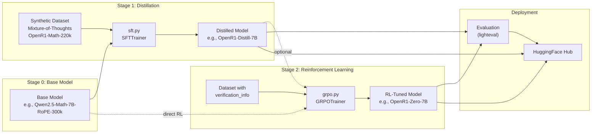

### Training Paths

**Path 1: Distillation Only**
- Base model → SFT with reasoning traces → Distilled model
- Replicates reasoning patterns from synthetic data
- Example: `OpenR1-Distill-7B`

**Path 2: Pure RL**
- Base model → GRPO with verification → RL-tuned model
- Learns from trial-and-error with reward signals
- Example: `OpenR1-Zero-7B` (planned)

**Path 3: Multi-Stage**
- Base model → SFT → GRPO → RL-tuned model
- Combines benefits of both approaches
- Distillation provides initial reasoning capability
- RL refines through verification feedback

**Sources:** [README.md:30-40](), [README.md:197-215]()

---

## Training Metrics and Logging

### Metrics Collection

Both trainers log metrics at regular intervals:
- Training loss per step/epoch
- Learning rate schedule
- Gradient norms
- GRPO-specific: reward statistics, KL divergence, policy entropy

### Logging Backends

Metrics can be logged to multiple backends via `report_to` parameter:
- **Weights & Biases (wandb):** Full experiment tracking with visualization
- **TensorBoard:** Local logging and visualization
- **None:** Disable external logging

### Weights & Biases Integration

When using wandb, the training script:
1. Initializes run with `init_wandb_training()`
2. Logs metrics automatically via trainer callbacks
3. Can be configured with custom `wandb_entity`, `wandb_project`, `run_name`

**Sources:** [src/open_r1/sft.py:84-85](), [src/open_r1/grpo.py:70-71](), [README.md:148-154]()

---

## Summary

The training pipeline provides a flexible, two-stage approach to building reasoning models:

1. **Distillation (SFT)** teaches models to replicate reasoning patterns from high-quality traces
2. **Reinforcement Learning (GRPO)** refines models through trial-and-error with multi-objective rewards
3. Both stages share a common configuration system and command-line interface
4. Models can be trained via either stage individually or combined in multi-stage training
5. Integration with Accelerate enables distributed training from single-node to multi-node clusters
6. Checkpointing, logging, and Hub integration are built-in for production workflows

For implementation details of each stage, configuration options, and pre-built recipes, see the child pages of this section.

---

# Page: Supervised Fine-Tuning (SFT)

# Supervised Fine-Tuning (SFT)

<details>
<summary>Relevant source files</summary>

The following files were used as context for generating this wiki page:

- [README.md](README.md)
- [src/open_r1/sft.py](src/open_r1/sft.py)
- [src/open_r1/utils/__init__.py](src/open_r1/utils/__init__.py)
- [src/open_r1/utils/data.py](src/open_r1/utils/data.py)
- [src/open_r1/utils/model_utils.py](src/open_r1/utils/model_utils.py)
- [tests/utils/test_data.py](tests/utils/test_data.py)

</details>


## Purpose and Scope

This document describes the Supervised Fine-Tuning (SFT) component of the Open R1 training pipeline. SFT is the first stage of the training process, used to distill reasoning capabilities from synthetic datasets into smaller language models. This page covers the `sft.py` script, its configuration system, data loading mechanisms, model initialization, and the complete training workflow.

For reinforcement learning training with GRPO, see [Group Relative Policy Optimization (GRPO)](#2.2). For configuration details shared across both SFT and GRPO, see [Configuration System](#2.3). For pre-built training recipes, see [Training Recipes](#2.4).

## Overview

The SFT system performs standard supervised fine-tuning on datasets containing reasoning traces. It is designed to distill knowledge from large reasoning models (like DeepSeek-R1) into smaller, more efficient models. The primary use case is training R1-Distill models that replicate the reasoning capabilities of their larger counterparts.

**Key Components:**
- **Entry Point**: `src/open_r1/sft.py` - Main training script
- **Configuration**: `ScriptArguments`, `SFTConfig`, `ModelConfig` dataclasses
- **Data Loading**: `get_dataset()` function with support for single datasets or mixtures
- **Model Management**: `get_model()` and `get_tokenizer()` utilities
- **Training Engine**: TRL's `SFTTrainer` with Accelerate for distributed training

Sources: [README.md:1-214](), [src/open_r1/sft.py:1-170]()

## System Architecture

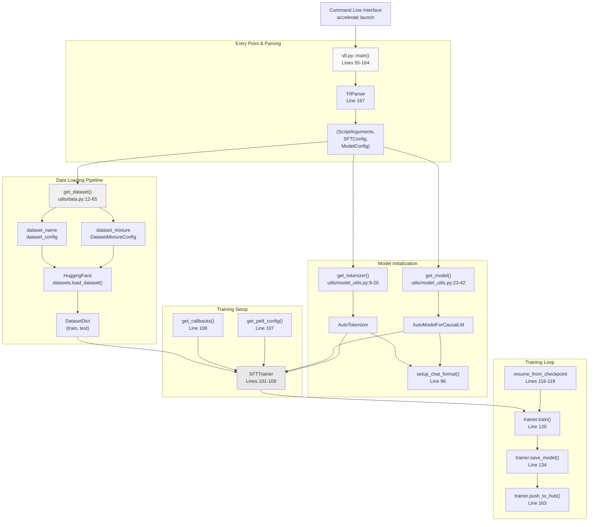

**Diagram: SFT System Architecture**

This diagram shows the complete execution flow from command-line invocation through configuration parsing, data loading, model initialization, and the training loop. The system uses TRL's `TrlParser` to handle three configuration objects simultaneously, `get_dataset()` to load either single datasets or mixtures, and `SFTTrainer` from TRL to orchestrate the training process.

Sources: [src/open_r1/sft.py:55-170](), [src/open_r1/utils/data.py:12-65](), [src/open_r1/utils/model_utils.py:9-42]()

## Configuration System

### Configuration Dataclasses

The SFT script uses three configuration objects parsed together:

| Configuration Class | Purpose | Key Parameters |
|---------------------|---------|----------------|
| `ScriptArguments` | Dataset configuration | `dataset_name`, `dataset_config`, `dataset_mixture`, `dataset_train_split`, `dataset_test_split` |
| `SFTConfig` | Training parameters | `learning_rate`, `num_train_epochs`, `per_device_train_batch_size`, `max_seq_length`, `gradient_checkpointing` |
| `ModelConfig` | Model loading parameters | `model_name_or_path`, `torch_dtype`, `attn_implementation`, `trust_remote_code` |

Sources: [src/open_r1/sft.py:167-169]()

### SFTConfig Parameters

The `SFTConfig` extends TRL's base configuration with SFT-specific parameters:

| Parameter | Type | Description | Default |
|-----------|------|-------------|---------|
| `learning_rate` | float | Learning rate for optimizer | - |
| `num_train_epochs` | int | Number of training epochs | - |
| `per_device_train_batch_size` | int | Batch size per device | - |
| `max_seq_length` | int | Maximum sequence length for training | - |
| `gradient_checkpointing` | bool | Enable gradient checkpointing to save memory | False |
| `bf16` | bool | Use bfloat16 mixed precision | False |
| `use_liger_kernel` | bool | Use Liger kernel optimizations | False |
| `output_dir` | str | Directory to save model checkpoints | - |
| `chat_template` | str | Optional custom chat template | None |
| `eos_token` | str | End-of-sequence token | `<|endoftext|>` |

Sources: [README.md:106-127]()

## Data Loading Pipeline

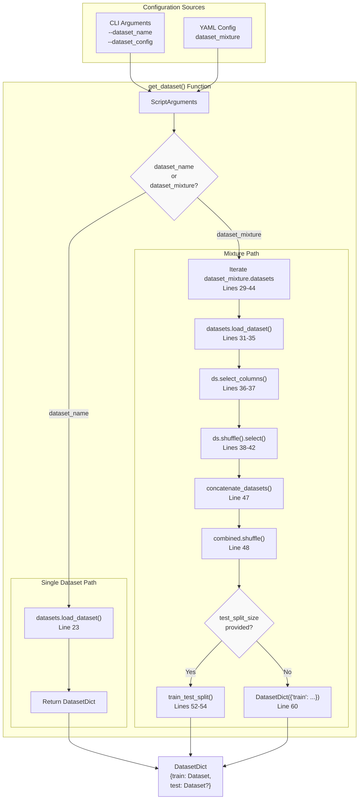

**Diagram: Data Loading Logic Flow**

The data loading system supports two modes: single dataset loading and dataset mixture composition. The `get_dataset()` function branches based on the configuration provided, either loading a dataset directly from HuggingFace Hub or assembling multiple datasets with optional column selection, weighting, and train/test splitting.

Sources: [src/open_r1/utils/data.py:12-65]()

### Single Dataset Loading

For simple cases, specify `dataset_name` and optionally `dataset_config`:

```yaml
dataset_name: open-r1/Mixture-of-Thoughts
dataset_config: all
```

The function calls `datasets.load_dataset()` directly at [src/open_r1/utils/data.py:23]().

### Dataset Mixture Loading

For complex training scenarios, define a `dataset_mixture` configuration:

```yaml
dataset_mixture:
  datasets:
    - id: open-r1/Mixture-of-Thoughts
      config: math
      split: train
      columns: [prompt, chosen]
      weight: 0.5
    - id: open-r1/CodeForces-CoTs
      config: default
      split: train
      columns: [prompt, chosen]
      weight: 0.3
  seed: 42
  test_split_size: 0.1
```

**Processing Steps:**
1. Iterate through each dataset configuration [src/open_r1/utils/data.py:29-44]()
2. Load each dataset using `datasets.load_dataset()` [src/open_r1/utils/data.py:31-35]()
3. Select specified columns if provided [src/open_r1/utils/data.py:36-37]()
4. Subsample based on weight [src/open_r1/utils/data.py:38-42]()
5. Concatenate all datasets [src/open_r1/utils/data.py:47]()
6. Shuffle combined dataset [src/open_r1/utils/data.py:48]()
7. Optionally create train/test split [src/open_r1/utils/data.py:51-57]()

Sources: [src/open_r1/utils/data.py:24-62](), [tests/utils/test_data.py:37-83]()

## Model and Tokenizer Initialization

### Tokenizer Loading

The `get_tokenizer()` function loads the tokenizer and optionally applies a custom chat template:

```python
# src/open_r1/utils/model_utils.py:9-20
def get_tokenizer(model_args, training_args):
    tokenizer = AutoTokenizer.from_pretrained(
        model_args.model_name_or_path,
        revision=model_args.model_revision,
        trust_remote_code=model_args.trust_remote_code,
    )
    if training_args.chat_template is not None:
        tokenizer.chat_template = training_args.chat_template
    return tokenizer
```

**Chat Template Handling:**
- If `training_args.chat_template` is provided, it overrides the tokenizer's default [src/open_r1/utils/model_utils.py:17-18]()
- If no chat template exists after loading, the script defaults to ChatML format [src/open_r1/sft.py:94-96]()

Sources: [src/open_r1/utils/model_utils.py:9-20](), [src/open_r1/sft.py:91-96]()

### Model Loading

The `get_model()` function loads the model with appropriate configuration:

**Key Features:**
- **Dtype Configuration**: Supports `auto`, `bfloat16`, `float16`, or `float32` [src/open_r1/utils/model_utils.py:25-27]()
- **Quantization**: Optional quantization via `get_quantization_config()` [src/open_r1/utils/model_utils.py:28]()
- **Attention Implementation**: Configurable attention mechanism (e.g., `flash_attention_2`) [src/open_r1/utils/model_utils.py:32]()
- **Cache Management**: Disables cache when gradient checkpointing is enabled [src/open_r1/utils/model_utils.py:34]()

| Model Parameter | Purpose | Configuration Source |
|-----------------|---------|---------------------|
| `model_name_or_path` | Base model identifier | `ModelConfig.model_name_or_path` |
| `torch_dtype` | Precision mode | `ModelConfig.torch_dtype` |
| `attn_implementation` | Attention kernel | `ModelConfig.attn_implementation` |
| `use_cache` | KV cache for inference | Disabled if `gradient_checkpointing=True` |
| `quantization_config` | Quantization settings | `ModelConfig` (LoRA, QLoRA) |

Sources: [src/open_r1/utils/model_utils.py:23-42]()

## Training Process

### SFTTrainer Initialization

The training process uses TRL's `SFTTrainer`:

```python
# src/open_r1/sft.py:101-109
trainer = SFTTrainer(
    model=model,
    args=training_args,
    train_dataset=dataset[script_args.dataset_train_split],
    eval_dataset=(dataset[script_args.dataset_test_split] 
                  if training_args.eval_strategy != "no" else None),
    processing_class=tokenizer,
    peft_config=get_peft_config(model_args),
    callbacks=get_callbacks(training_args, model_args),
)
```

**Components:**
- **PEFT Integration**: Supports LoRA/QLoRA via `get_peft_config()` [src/open_r1/sft.py:107]()
- **Callbacks**: Custom callbacks for logging and monitoring [src/open_r1/sft.py:108]()
- **Evaluation**: Optional evaluation dataset based on `eval_strategy` [src/open_r1/sft.py:105]()

Sources: [src/open_r1/sft.py:101-109]()

### Training Loop Execution

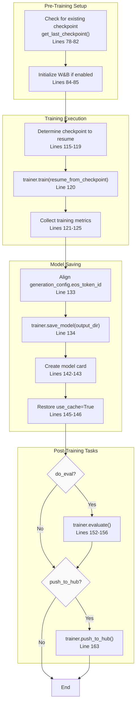

**Diagram: Training Loop Workflow**

The training loop handles checkpoint resumption, executes training, saves the model with proper configuration, and optionally performs evaluation and model upload to HuggingFace Hub.

Sources: [src/open_r1/sft.py:77-164]()

### Checkpoint Management

**Automatic Checkpoint Detection:**
- Checks `output_dir` for existing checkpoints [src/open_r1/sft.py:79-80]()
- Uses `get_last_checkpoint()` to find most recent checkpoint [src/open_r1/sft.py:80]()
- Resumes training if checkpoint found and `resume_from_checkpoint` not explicitly set [src/open_r1/sft.py:81-82]()

**Manual Checkpoint Specification:**
- Override automatic detection via `--resume_from_checkpoint` flag [src/open_r1/sft.py:116-117]()

Sources: [src/open_r1/sft.py:77-119]()

### Model Saving and Publishing

**Saving Process:**
1. Align `generation_config.eos_token_id` with tokenizer [src/open_r1/sft.py:133]()
2. Save model files to `output_dir` [src/open_r1/sft.py:134]()
3. Create model card with dataset metadata [src/open_r1/sft.py:142-143]()
4. Restore `use_cache=True` for fast inference [src/open_r1/sft.py:145-146]()

**Publishing to Hub:**
- Controlled by `--push_to_hub` flag [src/open_r1/sft.py:161-163]()
- Includes dataset name and "open-r1" tag [src/open_r1/sft.py:139-141]()

Sources: [src/open_r1/sft.py:130-164]()

## Command-Line Usage

### Basic Training Command

```bash
accelerate launch --config_file=recipes/accelerate_configs/zero3.yaml \
    src/open_r1/sft.py \
    --model_name_or_path open-r1/Qwen2.5-Math-7B-RoPE-300k \
    --dataset_name open-r1/Mixture-of-Thoughts \
    --dataset_config all \
    --eos_token '<|im_end|>' \
    --learning_rate 4.0e-5 \
    --num_train_epochs 5 \
    --max_seq_length 32768 \
    --per_device_train_batch_size 2 \
    --gradient_checkpointing \
    --bf16 \
    --use_liger_kernel \
    --output_dir data/OpenR1-Distill-7B
```

Sources: [README.md:108-123](), [src/open_r1/sft.py:18-34]()

### YAML Configuration Usage

```bash
accelerate launch --config_file recipes/accelerate_configs/zero3.yaml \
    src/open_r1/sft.py \
    --config recipes/OpenR1-Distill-7B/sft/config_distill.yaml
```

**Overriding YAML Parameters:**
```bash
accelerate launch --config_file recipes/accelerate_configs/zero3.yaml \
    src/open_r1/sft.py \
    --config recipes/OpenR1-Distill-7B/sft/config_distill.yaml \
    --model_name_or_path Qwen/Qwen3-0.6B-Base \
    --hub_model_id OpenR1-Distill-0.6B \
    --output_dir data/OpenR1-Distill-0.6B
```

Sources: [README.md:124-146]()

### Slurm Cluster Usage

```bash
sbatch --job-name=open_r1 --nodes=1 slurm/train.slurm \
    --model OpenR1-Distill-7B \
    --task sft \
    --config distill \
    --accelerator zero3
```

**Multi-Node Scaling:**
```bash
sbatch --job-name=open_r1 --nodes=4 slurm/train.slurm \
    --model OpenR1-Distill-7B \
    --task sft \
    --config distill \
    --accelerator zero3
```

Sources: [README.md:394-417]()

## Chat Template Configuration

### Default Behavior

The script applies the following logic for chat templates:

1. Load tokenizer from pretrained model [src/open_r1/utils/model_utils.py:11-15]()
2. Override with `training_args.chat_template` if provided [src/open_r1/utils/model_utils.py:17-18]()
3. If no chat template exists, default to ChatML [src/open_r1/sft.py:94-96]()

Sources: [src/open_r1/sft.py:91-96](), [src/open_r1/utils/model_utils.py:17-18]()

### Qwen Models

Qwen base models include a predefined chat template. The EOS token must align with this template:

```bash
accelerate launch --config_file=recipes/accelerate_configs/zero3.yaml \
    src/open_r1/sft.py \
    --model_name_or_path Qwen/Qwen2.5-1.5B \
    --eos_token '<|im_end|>' \
    --dataset_name open-r1/Mixture-of-Thoughts \
    --dataset_config all \
    # ... additional parameters
```

**Key Point**: Qwen models use `<|im_end|>` as the EOS token, not the default `<|endoftext|>`.

Sources: [README.md:156-175]()

### Custom Chat Templates

For models without predefined templates (e.g., Llama, Gemma), provide both the template and EOS token:

```bash
accelerate launch --config_file=recipes/accelerate_configs/zero3.yaml \
    src/open_r1/sft.py \
    --model_name_or_path meta-llama/Llama-3.2-1B \
    --chat_template "$(cat llama_chat_template.jinja)" \
    --eos_token '<|eot_id|>' \
    --dataset_name open-r1/Mixture-of-Thoughts \
    # ... additional parameters
```

**Template Format**: Jinja2 format, typically stored in a `.jinja` file and loaded via shell substitution.

Sources: [README.md:177-195]()

## Advanced Features

### Dataset Mixture Specification

The system supports complex dataset compositions through the `dataset_mixture` configuration:

**Mixture Configuration Schema:**
```yaml
dataset_mixture:
  datasets:
    - id: str                # HuggingFace dataset ID
      config: str            # Dataset configuration name
      split: str             # Split specification (e.g., "train", "train[:1000]")
      columns: List[str]     # Columns to retain (optional)
      weight: float          # Sampling fraction (optional, 0.0-1.0)
  seed: int                  # Random seed for shuffling
  test_split_size: float     # Fraction for test split (optional)
```

**Example Multi-Dataset Mixture:**
```yaml
dataset_mixture:
  datasets:
    - id: open-r1/Mixture-of-Thoughts
      config: math
      split: train
      columns: [prompt, chosen]
      weight: 0.25
    - id: open-r1/CodeForces-CoTs
      config: default
      split: train
      columns: [prompt, chosen]
      weight: 0.5
    - id: open-r1/OpenR1-Math-220k
      config: default
      split: train
      columns: [prompt, chosen]
      weight: 0.25
  seed: 42
  test_split_size: 0.1
```

Sources: [README.md:419-442](), [tests/utils/test_data.py:52-67]()

### Weights & Biases Integration

**Automatic Detection:**
- W&B initialization triggered if `"wandb"` in `training_args.report_to` [src/open_r1/sft.py:84-85]()

**Custom Configuration:**
```bash
accelerate launch --config_file recipes/accelerate_configs/zero3.yaml \
    src/open_r1/sft.py \
    --config recipes/OpenR1-Distill-7B/sft/config_distill.yaml \
    --wandb_entity huggingface \
    --wandb_project open-r1 \
    --run_name Qwen2.5-7B-SFT
```

Sources: [README.md:148-154](), [src/open_r1/sft.py:84-85]()

### Memory Optimization

| Technique | Configuration | Memory Impact |
|-----------|---------------|---------------|
| **Gradient Checkpointing** | `--gradient_checkpointing` | Reduces activation memory by ~50% |
| **Mixed Precision (BF16)** | `--bf16` | Reduces memory by ~50%, requires A100/H100 |
| **Liger Kernels** | `--use_liger_kernel` | Reduces memory by ~20% with fused operations |
| **ZeRO Stage 3** | `accelerate_configs/zero3.yaml` | Shards optimizer states, gradients, and parameters |
| **PEFT (LoRA)** | Configure via `ModelConfig` | Reduces trainable parameters by ~90% |

**Example High-Memory Configuration:**
```bash
# For large models on single node (8x H100 80GB)
accelerate launch --config_file=recipes/accelerate_configs/zero3.yaml \
    src/open_r1/sft.py \
    --model_name_or_path open-r1/Qwen2.5-Math-7B-RoPE-300k \
    --per_device_train_batch_size 1 \
    --gradient_accumulation_steps 8 \
    --gradient_checkpointing \
    --bf16 \
    --use_liger_kernel \
    # ...
```

Sources: [README.md:102-136]()

## Output Artifacts

### Model Checkpoint Structure

After training completes, the `output_dir` contains:

```
output_dir/
├── config.json                    # Model configuration
├── model.safetensors             # Model weights (safetensors format)
├── generation_config.json        # Generation parameters
├── tokenizer_config.json         # Tokenizer configuration
├── tokenizer.json                # Tokenizer vocabulary
├── special_tokens_map.json       # Special token mappings
├── trainer_state.json            # Training state for resumption
├── training_args.bin             # Training arguments
├── all_results.json              # Final metrics
└── README.md                     # Auto-generated model card
```

### Metrics and Logging

**Training Metrics** (saved to `all_results.json`):
- `train_loss`: Final training loss
- `train_samples`: Number of training samples
- `train_runtime`: Total training time
- `train_samples_per_second`: Training throughput
- `train_steps_per_second`: Step throughput
- `total_flos`: Total floating point operations

**Evaluation Metrics** (if `do_eval=True`):
- `eval_loss`: Evaluation loss
- `eval_samples`: Number of evaluation samples
- `eval_runtime`: Evaluation time
- `perplexity`: Model perplexity on eval set

Sources: [src/open_r1/sft.py:121-156]()

### Model Card Generation

The system automatically generates a model card including:
- Base model information
- Training dataset name(s)
- Training hyperparameters
- "open-r1" tag for discoverability

Generated via `trainer.create_model_card()` at [src/open_r1/sft.py:143]().

Sources: [src/open_r1/sft.py:138-146]()

---

# Page: Group Relative Policy Optimization (GRPO)

# Group Relative Policy Optimization (GRPO)

<details>
<summary>Relevant source files</summary>

The following files were used as context for generating this wiki page:

- [README.md](README.md)
- [src/open_r1/grpo.py](src/open_r1/grpo.py)

</details>


This document describes the Group Relative Policy Optimization (GRPO) implementation in the Open R1 repository, which enables reinforcement learning training of language models using verifiable rewards. GRPO is the second stage of the training pipeline, producing R1-Zero models from either base models or distilled checkpoints.

For supervised fine-tuning (distillation), see [Supervised Fine-Tuning (SFT)](#2.1). For reward function details, see [Reward Functions](#3). For configuration parameters, see [Configuration System](#2.3).

## Overview

GRPO training optimizes a policy model by generating multiple completions per prompt, evaluating them with reward functions, and updating the policy to maximize expected reward. The implementation in [src/open_r1/grpo.py]() uses TRL's `GRPOTrainer` with vLLM for fast generation.

**Key characteristics:**
- Generates 16-64 completions per prompt using vLLM
- Evaluates completions with multi-objective reward functions
- Supports single-node (7B models) and multi-node (32B+ models) training
- Integrates with external code execution sandboxes
- Uses group-based advantage normalization

Sources: [README.md:216-243](), [src/open_r1/grpo.py:1-182]()

## Training Architecture

### N+1 Node Configuration

GRPO uses an N+1 node architecture for multi-node training:

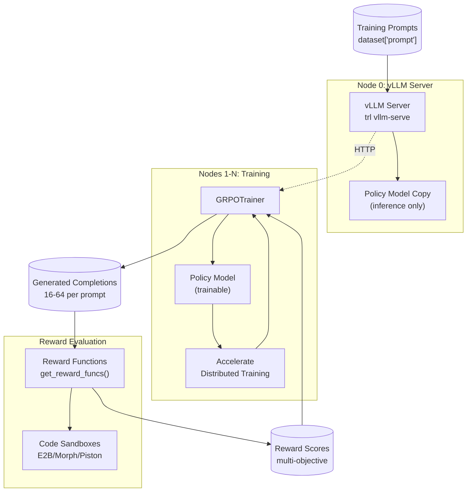

**Node 0** runs the vLLM server (`trl vllm-serve`) which handles generation requests. **Nodes 1-N** run the training script with Accelerate for distributed optimization. The policy model on Node 0 is automatically synchronized with training nodes.

Sources: [README.md:230-236](), [slurm/train.slurm]()

### Colocated Mode

For single-node training of smaller models, use `vllm_mode="colocate"` to run vLLM in the same process:

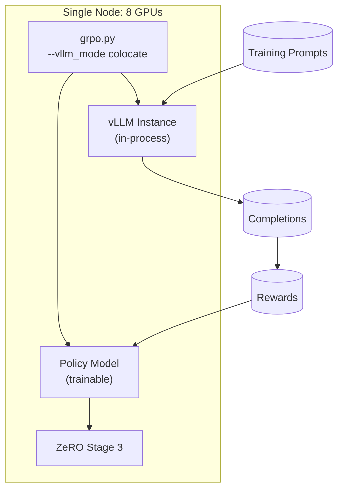

Sources: [README.md:218-225]()

## Training Loop

### Main Training Flow

The GRPO training loop follows this sequence:

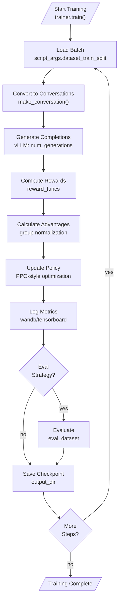

Sources: [src/open_r1/grpo.py:112-138]()

### Code Entity Flow

The main script coordinates these components:

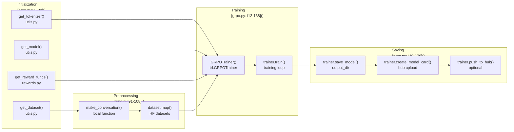

Sources: [src/open_r1/grpo.py:35-181]()

## Data Preprocessing

### Conversation Formatting

The `make_conversation` function converts dataset examples into chat format:

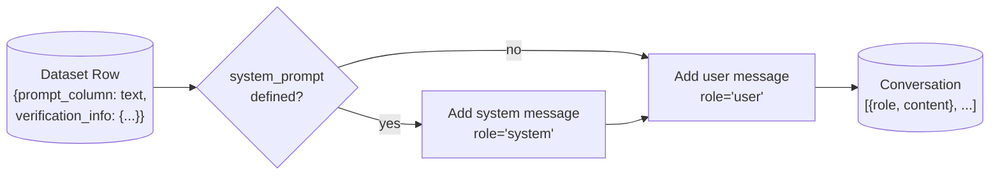

The function is defined at [src/open_r1/grpo.py:91-101]() and applied via `dataset.map()` at [src/open_r1/grpo.py:103]().

**Key parameters:**
- `script_args.dataset_prompt_column`: Column name containing the prompt (default: "problem")
- `training_args.system_prompt`: Optional system message
- Output: Dictionary with "prompt" key containing conversation list

Sources: [src/open_r1/grpo.py:91-108]()

## Configuration Parameters

### GRPOConfig Parameters

The `GRPOConfig` class extends TRL's training configuration:

| Parameter | Type | Description |
|-----------|------|-------------|
| `num_generations` | int | Number of completions to generate per prompt (default: 16) |
| `temperature` | float | Sampling temperature for generation (default: 0.6) |
| `top_p` | float | Nucleus sampling parameter (default: 0.95) |
| `max_new_tokens` | int | Maximum tokens per completion (default: 32768) |
| `system_prompt` | str | System message for conversations (optional) |
| `kl_coef` | float | KL divergence penalty coefficient (default: 0.001) |
| `vllm_mode` | str | "standalone" or "colocate" for vLLM integration |

See [Configuration System](#2.3) for complete parameter documentation.

Sources: [src/open_r1/configs.py]()

### GRPOScriptArguments Parameters

Dataset and reward configuration:

| Parameter | Type | Description |
|-----------|------|-------------|
| `dataset_name` | str | HuggingFace dataset identifier |
| `dataset_prompt_column` | str | Column containing prompts (default: "problem") |
| `reward_funcs` | List[str] | List of reward function names from registry |
| `reward_weights` | List[float] | Weights for each reward function |
| `e2b_router_url` | str | URL for E2B code execution router (optional) |
| `morph_router_url` | str | URL for Morph code execution router (optional) |

Sources: [src/open_r1/configs.py]()

## Reward Integration

### Reward Function Loading

Rewards are loaded from the registry and passed to the trainer:

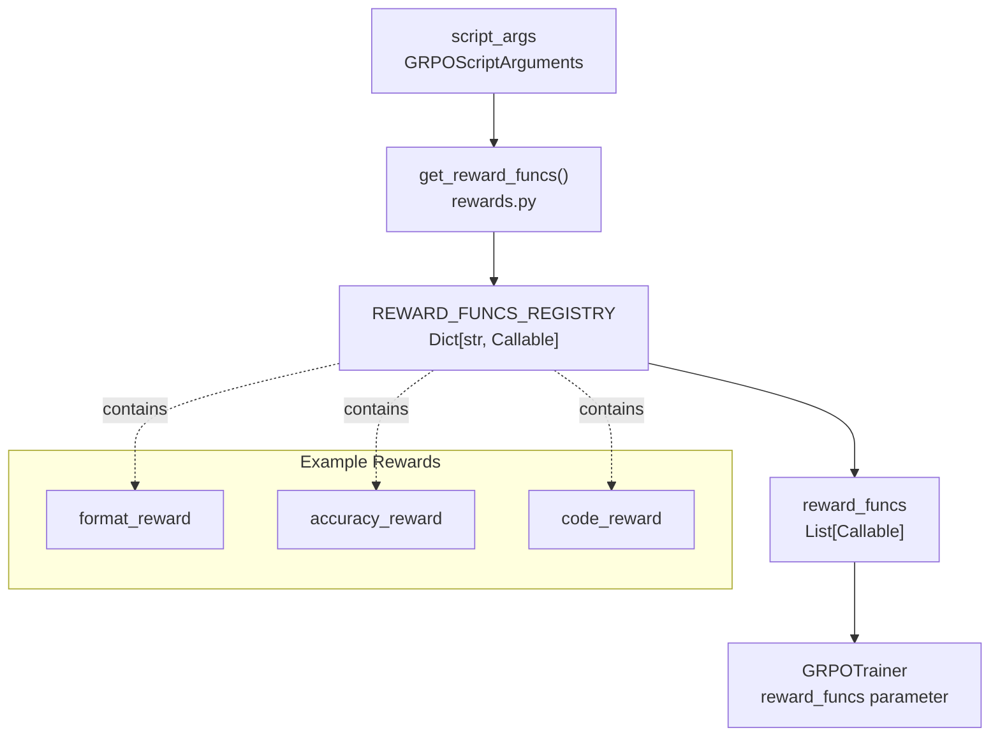

The `get_reward_funcs` function is called at [src/open_r1/grpo.py:88]() and passed to `GRPOTrainer` at [src/open_r1/grpo.py:114]().

Sources: [src/open_r1/grpo.py:88](), [src/open_r1/rewards.py]()

### Verification Info Schema

Datasets must include a `verification_info` column for code execution rewards:

```python
{
    "language": "python",  # Programming language
    "test_cases": [
        {
            "input": "test input",
            "output": "expected output",
            "type": "stdin_stdout"  # or "function_call"
        }
    ]
}
```

This schema is required for `code_reward`, `ioi_code_reward`, and `cf_code_reward`. See [Code Execution Rewards](#3.2) and [Competitive Programming Evaluation](#3.3) for details.

Sources: [README.md:289-302]()

## Usage Examples

### Single-Node Training (Colocated Mode)

For 7B models on a single 8-GPU node:

```bash
ACCELERATE_LOG_LEVEL=info \
    accelerate launch --config_file recipes/accelerate_configs/zero3.yaml \
    src/open_r1/grpo.py \
    --config recipes/Qwen2.5-1.5B-Instruct/grpo/config_demo.yaml \
    --vllm_mode colocate
```

**Key points:**
- Uses ZeRO Stage 3 for memory efficiency
- vLLM runs in the same process as training
- Suitable for models up to 7B parameters

Sources: [README.md:218-225]()

### Multi-Node Training (Standalone Mode)

For 32B models across 2 nodes (1 for vLLM, 1 for training):

```bash
sbatch --nodes=2 slurm/train.slurm \
    --model Qwen2.5-1.5B-Instruct \
    --task grpo \
    --config demo \
    --accelerator zero2 \
    --dp 8 \
    --tp 1
```

**Parameters:**
- `--nodes=2`: Total nodes (1 for vLLM + 1 for training)
- `--dp 8`: Data parallelism across 8 GPUs
- `--tp 1`: Tensor parallelism (1 = no sharding)
- `--accelerator zero2`: Use ZeRO Stage 2

Sources: [README.md:230-236]()

### Training with Code Execution

For code generation with Python execution via E2B:

**Step 1:** Start vLLM server on GPU 0:
```bash
CUDA_VISIBLE_DEVICES=0 trl vllm-serve --model Qwen/Qwen2.5-1.5B-Instruct
```

**Step 2:** Run training on GPUs 1-7:
```bash
CUDA_VISIBLE_DEVICES=1,2,3,4,5,6,7 ACCELERATE_LOG_LEVEL=info \
    accelerate launch --config_file recipes/accelerate_configs/zero2.yaml \
    --num_processes=7 \
    src/open_r1/grpo.py \
    --config recipes/Qwen2.5-1.5B-Instruct/grpo/config_demo_code.yaml
```

**Configuration requirements:**
- Add `e2b_router_url` or `morph_router_url` to YAML config
- Include `code_reward` in `reward_funcs` list
- Dataset must have `verification_info` column

Sources: [README.md:304-316]()

### Competitive Programming (IOI/CodeForces)

For IOI problems with Piston execution:

```bash
ACCELERATE_LOG_LEVEL=info \
    accelerate launch --config_file recipes/accelerate_configs/zero2.yaml \
    --num_processes=7 \
    src/open_r1/grpo.py \
    --config recipes/Qwen2.5-1.5B-Instruct/grpo/config_demo_code_ioi.yaml
```

**Prerequisites:**
- Set `PISTON_ENDPOINTS` environment variable
- Start Piston workers (see [slurm/piston/README.md]())
- Use `ioi_code_reward` in config

Sources: [README.md:378-386]()

## Model Saving and Checkpointing

### Checkpoint Management

The training script handles checkpoints automatically:

```mermaid
graph TB
    CHECK_DIR{"output_dir<br/>exists?"}
    GET_LAST_CKPT["get_last_checkpoint()<br/>transformers"]
    CHECK_RESUME{"resume_from_<br/>checkpoint?"}
    USE_SPECIFIED["Use specified checkpoint"]
    USE_LAST["Use last checkpoint"]
    START_FRESH["Start from scratch"]
    TRAIN["Begin training"]
    
    CHECK_DIR -->|yes| GET_LAST_CKPT
    CHECK_DIR -->|no| START_FRESH
    GET_LAST_CKPT --> CHECK_RESUME
    CHECK_RESUME -->|specified| USE_SPECIFIED
    CHECK_RESUME -->|auto-detect| USE_LAST
    CHECK_RESUME -->|none| START_FRESH
    USE_SPECIFIED --> TRAIN
    USE_LAST --> TRAIN
    START_FRESH --> TRAIN
```

Implemented at [src/open_r1/grpo.py:64-68]() and [src/open_r1/grpo.py:127-132]().

Sources: [src/open_r1/grpo.py:64-68](), [src/open_r1/grpo.py:127-132]()

### Final Model Saving

After training completes, the model is saved with proper configuration:

```mermaid
graph LR
    TRAINING_DONE["Training Complete"]
    SYNC_EOS["Sync EOS Token<br/>generation_config.eos_token_id"]
    SAVE_MODEL["trainer.save_model()<br/>output_dir"]
    CREATE_CARD["trainer.create_model_card()<br/>main process only"]
    RESTORE_CACHE["config.use_cache = True"]
    SAVE_CONFIG["config.save_pretrained()"]
    PUSH_HUB["trainer.push_to_hub()"]
    
    TRAINING_DONE --> SYNC_EOS
    SYNC_EOS --> SAVE_MODEL
    SAVE_MODEL --> CREATE_CARD
    CREATE_CARD --> RESTORE_CACHE
    RESTORE_CACHE --> SAVE_CONFIG
    SAVE_CONFIG --> PUSH_HUB
```

**Key operations:**
1. Align generation config with tokenizer EOS token ([grpo.py:145]())
2. Save model weights ([grpo.py:146]())
3. Create model card with metadata ([grpo.py:155]())
4. Restore `use_cache=True` for inference ([grpo.py:157]())
5. Optionally push to HuggingFace Hub ([grpo.py:173-175]())

Sources: [src/open_r1/grpo.py:140-176]()

## Chat Template Configuration

### Template Override

DeepSeek distilled models have a chat template that omits reasoning content. Override it in your config:

```yaml
chat_template: |
  
  <|im_start|>{{ message['role'] }}
  {{ message['content'] }}<|im_end|>
  
  <|im_start|>assistant
```

**Important:** The template must not prefill `<think>` tags, as this interferes with the `format_reward` function.

Sources: [README.md:227-229](), [recipes/DeepSeek-R1-Distill-Qwen-1.5B/grpo/config_demo.yaml]()

### EOS Token Alignment

For Qwen models, set the EOS token to match the chat template:

```yaml
eos_token: '<|im_end|>'
```

This ensures proper conversation termination during generation.

Sources: [README.md:156-175]()

## Performance Optimization

### Memory Optimization Strategies

| Model Size | Configuration | Hardware | Memory Strategy |
|------------|--------------|----------|-----------------|
| 7B | Single-node | 8×H100 | ZeRO Stage 3 |
| 14B | Single-node | 8×H100 | ZeRO Stage 3 + gradient checkpointing |
| 32B | Multi-node | 16×8 H100 | FSDP + Paged AdamW 8-bit |

**Gradient checkpointing** (`--gradient_checkpointing`) trades computation for memory by recomputing activations during backward pass.

Sources: [README.md:102-105]()

### Batch Size Scaling

Maintain constant global batch size when scaling GPUs:

```
global_batch_size = per_device_batch_size × num_gpus × gradient_accumulation_steps
```

**Example:** When scaling from 8 to 16 GPUs, either:
- Double `per_device_batch_size`, or
- Double `gradient_accumulation_steps`

Sources: [README.md:134-136]()

## Logging and Monitoring

### Weights & Biases Integration

Initialize W&B tracking at [src/open_r1/grpo.py:70-71]():

```python
if "wandb" in training_args.report_to:
    init_wandb_training(training_args)
```

**Override W&B settings:**
```bash
accelerate launch ... src/open_r1/grpo.py \
    --config recipes/model/task/config.yaml \
    --wandb_entity huggingface \
    --wandb_project open-r1 \
    --run_name Qwen2.5-1.5B-GRPO
```

Sources: [src/open_r1/grpo.py:70-71](), [README.md:148-154]()

### Logged Metrics

The trainer automatically logs:
- `train/loss`: Policy gradient loss
- `train/reward`: Mean reward across completions
- `train/kl`: KL divergence from reference policy
- `train/entropy`: Policy entropy
- Individual reward components (e.g., `train/reward/accuracy`, `train/reward/format`)

Sources: [src/open_r1/grpo.py:135-136]()

## Integration with Evaluation

After training, models can be evaluated using the evaluation pipeline:

```bash
python scripts/run_benchmarks.py \
    --model-id {output_dir} \
    --benchmarks aime24,math_500,gpqa,lcb
```

See [Evaluation System](#4) for complete documentation on benchmark evaluation.

Sources: [README.md:527-665]()

---

# Page: Configuration System

# Configuration System

<details>
<summary>Relevant source files</summary>

The following files were used as context for generating this wiki page:

- [src/open_r1/configs.py](src/open_r1/configs.py)

</details>


The configuration system in open-r1 provides a centralized and type-safe approach to managing parameters across different training scenarios, dataset configurations, and experiment settings. It extends the TRL (Transformers Reinforcement Learning) library's configuration classes with domain-specific parameters for supervised fine-tuning (SFT) and Group Relative Policy Optimization (GRPO) training workflows.

This document covers the configuration classes, YAML recipe system, and parameter validation mechanisms. For information about specific training implementations that use these configurations, see [Supervised Fine-Tuning (SFT)](#2.1) and [Group Relative Policy Optimization (GRPO)](#2.2). For details about the reward functions configured through this system, see [Reward Functions](#3).

## Configuration Architecture

The configuration system is built around Python dataclasses that extend TRL's base configuration classes, providing additional functionality for dataset mixtures, reward function management, and experiment tracking integration.

```mermaid
graph TB
    subgraph "TRL Base Classes"
        TRL_SCRIPT["trl.ScriptArguments"]
        TRL_SFT["trl.SFTConfig"] 
        TRL_GRPO["trl.GRPOConfig"]
    end
    
    subgraph "open-r1 Core Classes"
        SCRIPT_ARGS["ScriptArguments<br/>Dataset & Mixture Support"]
        SFT_CONFIG["SFTConfig<br/>Benchmarks & Monitoring"]
        GRPO_CONFIG["GRPOConfig<br/>Benchmarks & Monitoring"]
    end
    
    subgraph "Dataset Configuration"
        DATASET_CONFIG["DatasetConfig<br/>id, config, split, weight"]
        MIXTURE_CONFIG["DatasetMixtureConfig<br/>datasets, seed, test_split_size"]
    end
    
    subgraph "Training-Specific Args"
        GRPO_SCRIPT_ARGS["GRPOScriptArguments<br/>Reward Functions & Code Exec"]
    end
    
    subgraph "YAML Recipes"
        YAML_FILES["recipes/*/config.yaml<br/>Parameter Definitions"]
    end
    
    TRL_SCRIPT --> SCRIPT_ARGS
    TRL_SFT --> SFT_CONFIG
    TRL_GRPO --> GRPO_CONFIG
    
    SCRIPT_ARGS --> MIXTURE_CONFIG
    MIXTURE_CONFIG --> DATASET_CONFIG
    SCRIPT_ARGS --> GRPO_SCRIPT_ARGS
    
    YAML_FILES --> SCRIPT_ARGS
    YAML_FILES --> SFT_CONFIG
    YAML_FILES --> GRPO_CONFIG
    YAML_FILES --> GRPO_SCRIPT_ARGS
```

**Sources:** [src/open_r1/configs.py:22-332]()

## Core Configuration Classes

### ScriptArguments

The `ScriptArguments` class extends TRL's base script arguments with support for dataset mixtures, making the `dataset_name` parameter optional when using dataset mixtures.

| Parameter | Type | Default | Description |
|-----------|------|---------|-------------|
| `dataset_name` | `Optional[str]` | `None` | Single dataset name (optional if using mixtures) |
| `dataset_mixture` | `Optional[dict[str, Any]]` | `None` | Configuration for dataset mixtures |

The class performs validation in `__post_init__()` to ensure either `dataset_name` or `dataset_mixture` is provided, and validates the structure of dataset mixture configurations.

**Sources:** [src/open_r1/configs.py:43-121]()

### Dataset Configuration Classes

#### DatasetConfig

Represents configuration for individual datasets within a mixture:

| Parameter | Type | Default | Description |
|-----------|------|---------|-------------|
| `id` | `str` | - | Dataset identifier |
| `config` | `Optional[str]` | `None` | Dataset configuration name |
| `split` | `str` | `"train"` | Dataset split to use |
| `columns` | `Optional[list[str]]` | `None` | Specific columns to extract |
| `weight` | `Optional[float]` | `None` | Sampling weight in mixture |

#### DatasetMixtureConfig

Manages collections of datasets with mixing strategies:

| Parameter | Type | Default | Description |
|-----------|------|---------|-------------|
| `datasets` | `list[DatasetConfig]` | - | List of dataset configurations |
| `seed` | `int` | `0` | Random seed for mixture sampling |
| `test_split_size` | `Optional[float]` | `None` | Fraction for test split creation |

**Sources:** [src/open_r1/configs.py:22-40]()

## Training-Specific Configurations

### SFTConfig

Extends `trl.SFTConfig` with additional parameters for benchmarking, monitoring, and Hub integration:

| Parameter | Type | Default | Description |
|-----------|------|---------|-------------|
| `benchmarks` | `list[str]` | `[]` | Benchmarks to run after training |
| `callbacks` | `list[str]` | `[]` | Training callbacks to enable |
| `chat_template` | `Optional[str]` | `None` | Chat template for conversation formatting |
| `system_prompt` | `Optional[str]` | `None` | System prompt for benchmarking |
| `hub_model_revision` | `Optional[str]` | `"main"` | Hub model branch for pushing |
| `wandb_entity` | `Optional[str]` | `None` | Weights & Biases entity |
| `wandb_project` | `Optional[str]` | `None` | Weights & Biases project |

**Sources:** [src/open_r1/configs.py:169-206]()

### GRPOConfig

Extends `trl.GRPOConfig` with similar monitoring and Hub integration parameters, plus GRPO-specific options:

| Parameter | Type | Default | Description |
|-----------|------|---------|-------------|
| `num_completions_to_print` | `int` | `0` | Number of completions to log |
| `wandb_log_unique_prompts` | `bool` | `True` | Log unique prompts to W&B |
| `wandb_run_group` | `Optional[str]` | `None` | W&B run group for organization |

**Sources:** [src/open_r1/configs.py:124-167]()

## GRPO-Specific Configuration

### GRPOScriptArguments

The most complex configuration class, extending `ScriptArguments` with comprehensive reward function and code execution parameters:

```mermaid
graph TB
    subgraph "Reward Function Config"
        REWARD_FUNCS["reward_funcs<br/>['accuracy', 'format', 'tag_count']"]
        COSINE_PARAMS["Cosine Scaling Parameters<br/>min/max values, length limits"]
        REPETITION_PARAMS["Repetition Penalty<br/>n_grams, max_penalty"]
    end
    
    subgraph "Code Execution Config"
        CODE_LANG["code_language<br/>'python'"]
        CODE_EVAL["Code Evaluation<br/>batch_size, scoring_mode"]
        CODE_PROVIDERS["Execution Providers<br/>e2b, morph, piston"]
        PARALLEL_EXEC["parallel_code_exec_per_proc<br/>2"]
    end
    
    subgraph "Dataset & Length Config"
        PROMPT_COL["dataset_prompt_column<br/>'prompt'"]
        MAX_LEN["max_completion_len<br/>16384"]
        SOFT_PUNISH["soft_punish_cache<br/>4096"]
    end
    
    subgraph "Router URLs"
        E2B_URL["e2b_router_url"]
        MORPH_URL["morph_router_url"]
    end
    
    REWARD_FUNCS --> COSINE_PARAMS
    REWARD_FUNCS --> REPETITION_PARAMS
    CODE_LANG --> CODE_EVAL
    CODE_EVAL --> CODE_PROVIDERS
    CODE_PROVIDERS --> PARALLEL_EXEC
    CODE_PROVIDERS --> E2B_URL
    CODE_PROVIDERS --> MORPH_URL
```

#### Key Parameters

**Reward Function Configuration:**
- `reward_funcs`: List of reward functions to apply (default: `["accuracy", "format", "tag_count"]`)
- Cosine scaling parameters for length-based reward adjustment
- Repetition penalty settings for n-gram detection

**Code Execution Configuration:**
- `code_language`: Target programming language (default: `"python"`)
- `code_provider`: Execution environment (`"e2b"`, `"local"`, `"morph"`)
- `ioi_provider`: IOI problem execution provider (`"piston"`, `"morph"`)
- `parallel_code_exec_per_proc`: Parallel executions per process (default: `2`)

**Sources:** [src/open_r1/configs.py:208-332]()

## YAML Recipe System

The configuration system integrates with YAML-based recipes that define complete training setups. These recipes are located in the `recipes/` directory and follow a hierarchical structure.

### Recipe Structure Example

```yaml
# Model configuration
model_name_or_path: deepseek-ai/DeepSeek-R1-Distill-Qwen-1.5B
torch_dtype: bfloat16
attn_implementation: flash_attention_2

# Dataset configuration
dataset_name: open-r1/OpenR1-Math-220k
dataset_prompt_column: problem
system_prompt: "You are a helpful AI Assistant..."

# Training configuration
bf16: true
learning_rate: 1.0e-06
num_train_epochs: 1
per_device_train_batch_size: 16

# GRPO-specific configuration
reward_funcs:
- accuracy
- format
- tag_count
reward_weights:
- 1.0
- 1.0
- 1.0
```

### YAML to Configuration Class Mapping

```mermaid
graph LR
    subgraph "YAML Recipe File"
        YAML_MODEL["model_name_or_path<br/>torch_dtype<br/>attn_implementation"]
        YAML_DATA["dataset_name<br/>dataset_prompt_column<br/>system_prompt"]
        YAML_TRAIN["bf16<br/>learning_rate<br/>num_train_epochs"]
        YAML_REWARD["reward_funcs<br/>reward_weights<br/>cosine_*"]
    end
    
    subgraph "Python Config Classes"
        SCRIPT_ARGS_INST["ScriptArguments<br/>instance"]
        GRPO_CONFIG_INST["GRPOConfig<br/>instance"]
        GRPO_SCRIPT_INST["GRPOScriptArguments<br/>instance"]
    end
    
    YAML_DATA --> SCRIPT_ARGS_INST
    YAML_TRAIN --> GRPO_CONFIG_INST
    YAML_REWARD --> GRPO_SCRIPT_INST
    YAML_MODEL --> GRPO_CONFIG_INST
```

**Sources:** [recipes/DeepSeek-R1-Distill-Qwen-1.5B/grpo/config_demo.yaml:1-59]()

## Parameter Validation and Error Handling

The configuration system implements several validation mechanisms:

### Dataset Mixture Validation

1. **Mutual Exclusivity Check**: Ensures either `dataset_name` or `dataset_mixture` is provided, but not both
2. **Structure Validation**: Validates that `dataset_mixture` contains a `datasets` key with a list of configurations
3. **Column Consistency**: Ensures all datasets in a mixture have consistent column specifications

### Runtime Validation

The `__post_init__()` method in `ScriptArguments` performs comprehensive validation:

```python
# Example validation logic from the codebase
if self.dataset_name is None and self.dataset_mixture is None:
    raise ValueError("Either `dataset_name` or `dataset_mixture` must be provided")

# Column consistency check
columns_sets = [set(dataset.columns) for dataset in datasets_list if dataset.columns is not None]
if columns_sets:
    if not all(columns == first_columns for columns in columns_sets):
        raise ValueError("Column names must be consistent across all dataset configurations")
```

**Sources:** [src/open_r1/configs.py:78-120]()

## Integration with Training Systems

The configuration system serves as the central parameter management layer for both training pipelines:

- **SFT Training**: Uses `ScriptArguments` and `SFTConfig` for dataset loading, model configuration, and training parameters
- **GRPO Training**: Uses `GRPOScriptArguments` and `GRPOConfig` for reward function setup, code execution environments, and reinforcement learning parameters

The configurations are parsed from YAML files and instantiated as dataclass objects that provide type safety and validation throughout the training process.

**Sources:** [src/open_r1/configs.py:1-332](), [recipes/DeepSeek-R1-Distill-Qwen-1.5B/grpo/config_demo.yaml:1-59]()

---

# Page: Training Recipes

# Training Recipes

<details>
<summary>Relevant source files</summary>

The following files were used as context for generating this wiki page:

- [recipes/OpenR1-Distill-7B/sft/config_distill.yaml](recipes/OpenR1-Distill-7B/sft/config_distill.yaml)
- [recipes/Qwen2.5-1.5B-Instruct/grpo/config_demo.yaml](recipes/Qwen2.5-1.5B-Instruct/grpo/config_demo.yaml)
- [recipes/Qwen2.5-1.5B-Instruct/grpo/config_demo_code.yaml](recipes/Qwen2.5-1.5B-Instruct/grpo/config_demo_code.yaml)
- [recipes/Qwen2.5-1.5B-Instruct/grpo/config_demo_code_ioi.yaml](recipes/Qwen2.5-1.5B-Instruct/grpo/config_demo_code_ioi.yaml)
- [recipes/README.md](recipes/README.md)
- [scripts/get_tensor_parallel_size.py](scripts/get_tensor_parallel_size.py)

</details>


Training recipes are pre-configured YAML files that specify all parameters needed to reproduce specific training runs. Each recipe combines model selection, dataset configuration, chat templates, hyperparameters, and reward functions into a single declarative configuration file. Recipes are organized by model family and training task (SFT or GRPO) in the `recipes/` directory.

For information about the configuration dataclasses that recipes populate, see [Configuration System](#2.3). For details on how recipes are used by training scripts, see [Supervised Fine-Tuning](#2.1) and [Group Relative Policy Optimization](#2.2).

## Recipe Organization

Recipes follow a hierarchical directory structure that maps to training configurations:

```
recipes/
├── {MODEL_NAME}/
│   ├── sft/
│   │   └── config_{VARIANT}.yaml
│   └── grpo/
│       └── config_{VARIANT}.yaml
└── README.md
```

Each recipe file is loaded by training scripts using the pattern `recipes/{MODEL_NAME}/{TASK}/config_{VARIANT}.yaml`, where:
- `MODEL_NAME` identifies the base model or training target (e.g., `OpenR1-Distill-7B`, `Qwen2.5-1.5B-Instruct`)
- `TASK` is either `sft` or `grpo`
- `VARIANT` distinguishes different configurations (e.g., `distill`, `demo`, `demo_code`, `demo_code_ioi`)

**Sources:** [recipes/README.md:1-23]()

### Recipe File Structure

```mermaid
graph TB
    subgraph "Recipe YAML File"
        YAML["config_{variant}.yaml"]
        
        subgraph "Model Arguments Section"
            MODEL_NAME["model_name_or_path"]
            MODEL_REV["model_revision"]
            DTYPE["torch_dtype"]
            ATTN["attn_implementation"]
        end
        
        subgraph "Data Training Arguments"
            DATASET["dataset_name"]
            DATASET_COL["dataset_prompt_column"]
            SYS_PROMPT["system_prompt"]
            CHAT_TMPL["chat_template"]
            EOS["eos_token"]
        end
        
        subgraph "Trainer Configuration"
            TRAIN_PARAMS["Training Hyperparameters<br/>learning_rate, batch_size, etc"]
            REWARD_CFG["Reward Configuration<br/>reward_funcs, reward_weights"]
            SAVE_CFG["Checkpoint Configuration<br/>save_strategy, output_dir"]
            HARDWARE["Hardware Configuration<br/>bf16, gradient_checkpointing"]
        end
    end
    
    subgraph "Configuration Dataclasses"
        MODEL_CONFIG["ModelConfig"]
        SCRIPT_ARGS["ScriptArguments"]
        SFT_CONFIG["SFTConfig"]
        GRPO_CONFIG["GRPOConfig"]
    end
    
    MODEL_NAME --> MODEL_CONFIG
    MODEL_REV --> MODEL_CONFIG
    DTYPE --> MODEL_CONFIG
    ATTN --> MODEL_CONFIG
    
    DATASET --> SCRIPT_ARGS
    DATASET_COL --> SCRIPT_ARGS
    SYS_PROMPT --> SCRIPT_ARGS
    CHAT_TMPL --> SCRIPT_ARGS
    EOS --> SCRIPT_ARGS
    
    TRAIN_PARAMS --> SFT_CONFIG
    TRAIN_PARAMS --> GRPO_CONFIG
    REWARD_CFG --> GRPO_CONFIG
    SAVE_CFG --> SFT_CONFIG
    SAVE_CFG --> GRPO_CONFIG
    HARDWARE --> SFT_CONFIG
    HARDWARE --> GRPO_CONFIG
    
    style YAML fill:#f9f9f9
    style MODEL_CONFIG fill:#e1f5ff
    style SCRIPT_ARGS fill:#e1f5ff
    style SFT_CONFIG fill:#ffe1f5
    style GRPO_CONFIG fill:#ffe1f5
```

**Sources:** [recipes/Qwen2.5-1.5B-Instruct/grpo/config_demo.yaml:1-53](), [recipes/OpenR1-Distill-7B/sft/config_distill.yaml:1-48]()

## Model Arguments Section

The model arguments section specifies which model to load and how to configure its architecture and precision:

| Parameter | Type | Purpose | Example Values |
|-----------|------|---------|----------------|
| `model_name_or_path` | String | HuggingFace model ID or local path | `Qwen/Qwen2.5-1.5B-Instruct`, `open-r1/Qwen2.5-Math-7B-RoPE-300k` |
| `model_revision` | String | Git revision/branch to load | `main` |
| `torch_dtype` | String | Model precision | `bfloat16`, `float16` |
| `attn_implementation` | String | Attention mechanism | `flash_attention_2` |

All recipes in the codebase use `bfloat16` precision and Flash Attention 2 for optimal memory efficiency and training speed. The model name determines the base architecture and tokenizer configuration that will be loaded by the training script.

**Example from demo GRPO recipe:**
```yaml
model_name_or_path: Qwen/Qwen2.5-1.5B-Instruct
model_revision: main
torch_dtype: bfloat16
attn_implementation: flash_attention_2
```

**Sources:** [recipes/Qwen2.5-1.5B-Instruct/grpo/config_demo.yaml:1-5](), [recipes/OpenR1-Distill-7B/sft/config_distill.yaml:2-6]()

## Data Training Arguments Section

The data training arguments specify the dataset, formatting, and prompting configuration:

| Parameter | Type | Purpose | Example Values |
|-----------|------|---------|----------------|
| `dataset_name` | String | HuggingFace dataset ID | `open-r1/OpenR1-Math-220k`, `open-r1/Mixture-of-Thoughts` |
| `dataset_config` | String | Dataset configuration subset | `all`, `default` |
| `dataset_prompt_column` | String | Column name containing prompts | `problem`, `problem_statement` |
| `system_prompt` | String | System message prepended to conversations | See below |
| `chat_template` | String | Jinja2 template for conversation formatting | See below |
| `eos_token` | String | End-of-sequence token | `<|im_end|>` |

### System Prompts

System prompts define the model's behavior and output format. The standard system prompt used across recipes instructs the model to use structured thinking:

```yaml
system_prompt: "You are a helpful AI Assistant that provides well-reasoned and detailed responses. You first think about the reasoning process as an internal monologue and then provide the user with the answer. Respond in the following format: \n<answer>\n...\n</answer>"
```

This prompt enforces the `\n<answer>\n...\n</answer>"
```

The `<think>` / `<answer>` structure is required for `format_reward` to work correctly.

#### Step 4: Select Reward Functions (GRPO Only)

Choose reward functions based on your task:

**For Math:**
```yaml
reward_funcs:
- accuracy
- format
- reasoning_steps
reward_weights:
- 1.0
- 0.5
- 0.2
```

**For Code (General):**
```yaml
reward_funcs:
- code
- format
- len
reward_weights:
- 1.0
- 0.1
- -0.01
```

**For Code (IOI/Codeforces):**
```yaml
reward_funcs:
- ioi_code  # or cf_code
- code_format
reward_weights:
- 1.0
- 0.1
code_language: cpp  # or python, java, etc.
```

See [Reward Functions](#3) for complete documentation of available rewards.

#### Step 5: Set Training Hyperparameters

**SFT Recommendations:**
- Learning rate: `3e-5` to `5e-5`
- Warmup ratio: `0.03`
- Epochs: `3` to `5`
- Gradient accumulation: Adjust for effective batch size of 128-256

**GRPO Recommendations:**
- Learning rate: `5e-6` to `2e-5` (lower than SFT)
- Beta: `0.01` (KL penalty)
- Generations: `16` (math), `14` (code)
- Temperature: `1.0` (exploration)

#### Step 6: Configure Hardware Settings

Calculate tensor parallel size for vLLM server (GRPO only):
```bash
python scripts/get_tensor_parallel_size.py --model_name your-model --default_tp 8
```

This script computes the GCD between the model's attention heads and available GPUs to ensure even sharding. The result determines the `--tensor-parallel-size` argument for vLLM server launch.

Set memory optimization flags:
```yaml
bf16: true
gradient_checkpointing: true
gradient_checkpointing_kwargs:
  use_reentrant: false
```

**Sources:** [scripts/get_tensor_parallel_size.py:1-29]()

#### Step 7: Configure Checkpointing and Logging

```yaml
output_dir: data/{MODEL_NAME}-{VARIANT}
save_strategy: epoch  # or "steps"
save_total_limit: 1  # Keep only last checkpoint
hub_model_id: {ORG}/{MODEL_NAME}-{VARIANT}
hub_strategy: every_save
push_to_hub: true
report_to:
- wandb
```

Ensure `hub_model_id` follows HuggingFace Hub naming conventions and you have write permissions.

### Recipe Usage Patterns

#### Local Testing

Test your recipe locally before submitting Slurm jobs:
```bash
# SFT
python src/sft.py recipes/{MODEL}/{sft}/config_{VARIANT}.yaml

# GRPO (requires vLLM server)
trl vllm-serve --model {MODEL} --tensor-parallel-size {TP} &
python src/grpo.py recipes/{MODEL}/{grpo}/config_{VARIANT}.yaml
```

#### Slurm Execution

Submit training jobs using the standardized Slurm script:
```bash
# SFT with ZeRO-3 (single node)
sbatch --nodes=1 slurm/train.slurm \
  --model {MODEL} \
  --task sft \
  --config {VARIANT} \
  --accelerator zero3

# GRPO with vLLM (single node)
sbatch --nodes=1 slurm/train.slurm \
  --model {MODEL} \
  --task grpo \
  --config {VARIANT} \
  --accelerator zero3

# SFT with FSDP (multi-node, large models)
sbatch --nodes=16 slurm/train.slurm \
  --model {MODEL} \
  --task sft \
  --config {VARIANT} \
  --accelerator fsdp
```

The `slurm/train.slurm` script automatically:
- Loads the specified recipe YAML
- Configures distributed training (ZeRO-3 or FSDP)
- Launches vLLM server on node 0 (for GRPO)
- Executes training on remaining nodes
- Manages checkpoint saving and Hub uploads

**Sources:** [recipes/README.md:1-23]()

### Recipe Testing and Iteration

```mermaid
graph LR
    subgraph "Testing Cycle"
        RECIPE["Recipe YAML"]
        QUICK_TEST["Quick Test Run<br/>max_steps=10"]
        CHECK_METRICS["Check Metrics<br/>Loss, reward curves"]
        
        ADJUST_LR["Adjust Learning Rate"]
        ADJUST_REWARDS["Adjust Reward Weights"]
        ADJUST_GEN["Adjust Generation Params"]
        
        FULL_RUN["Full Training Run"]
        EVAL["Evaluate on Benchmarks"]
        
        RECIPE --> QUICK_TEST
        QUICK_TEST --> CHECK_METRICS
        
        CHECK_METRICS -->|"loss unstable"| ADJUST_LR
        CHECK_METRICS -->|"rewards unbalanced"| ADJUST_REWARDS
        CHECK_METRICS -->|"poor diversity"| ADJUST_GEN
        
        ADJUST_LR --> RECIPE
        ADJUST_REWARDS --> RECIPE
        ADJUST_GEN --> RECIPE
        
        CHECK_METRICS -->|"looks good"| FULL_RUN
        FULL_RUN --> EVAL
        EVAL -->|"unsatisfactory"| ADJUST_LR
    end
    
    style RECIPE fill:#f9f9f9
    style QUICK_TEST fill:#fff4e1
    style FULL_RUN fill:#e1f5ff
```

**Testing Strategy:**

1. **Quick validation run** with `max_steps: 10` to verify configuration loads correctly
2. **Monitor initial metrics** in W&B:
   - Loss should decrease smoothly
   - Rewards should show reasonable values (not all 0 or 1)
   - Generations should show structural diversity
3. **Adjust hyperparameters** based on observations:
   - High loss variance → Reduce learning rate
   - Dominant single reward → Rebalance reward weights
   - Low generation diversity → Increase temperature or reduce beta
4. **Full training run** once configuration is stable
5. **Benchmark evaluation** to measure downstream performance

**Sources:** [recipes/Qwen2.5-1.5B-Instruct/grpo/config_demo.yaml:1-53]()

## Advanced Recipe Features

### Multi-Dataset Mixtures

For SFT, you can train on multiple datasets by specifying a dataset mixture in code rather than in the recipe. The recipe specifies a single `dataset_name`, but the `get_dataset` function in `src/utils.py` supports mixing multiple datasets with custom sampling weights.

**Sources:** [recipes/OpenR1-Distill-7B/sft/config_distill.yaml:10-12]()

### Code Language Specification

For competitive programming tasks, specify the target programming language:
```yaml
code_language: cpp  # or python, java, etc.
code_eval_test_batch_size: 3  # Optional: batch size for test evaluation
```

The `code_language` parameter controls how the reward system extracts code from completions. The `code_eval_test_batch_size` enables early stopping during test case evaluation to save computation.

**Sources:** [recipes/Qwen2.5-1.5B-Instruct/grpo/config_demo_code_ioi.yaml:49-61]()

### Learning Rate Scheduling

Advanced learning rate schedules can be configured with additional parameters:
```yaml
lr_scheduler_type: cosine_with_min_lr
lr_scheduler_kwargs:
  min_lr_rate: 0.1  # End at 10% of peak LR
```

The `cosine_with_min_lr` scheduler prevents learning rate from decaying to zero, maintaining stable updates throughout training.

**Sources:** [recipes/OpenR1-Distill-7B/sft/config_distill.yaml:29-31]()

### Checkpoint Management

Control checkpoint saving behavior:
```yaml
save_strategy: "steps"  # or "epoch"
save_steps: 50  # If save_strategy is "steps"
save_total_limit: 1  # Keep only N most recent checkpoints
```

For long training runs, use step-based saving with `save_total_limit` to avoid filling disk space.

**Sources:** [recipes/Qwen2.5-1.5B-Instruct/grpo/config_demo_code.yaml:49-51]()

---

# Page: Reward Functions

# Reward Functions

<details>
<summary>Relevant source files</summary>

The following files were used as context for generating this wiki page:

- [README.md](README.md)
- [src/open_r1/rewards.py](src/open_r1/rewards.py)
- [tests/test_rewards.py](tests/test_rewards.py)

</details>


## Purpose and Scope

This page documents the reward function system used in GRPO training to guide model behavior through multi-objective optimization. Reward functions evaluate model completions across multiple dimensions including correctness, format, code execution, and stylistic preferences. The system implements a flexible registry pattern that allows dynamic composition of reward signals through configuration files.

For detailed implementation of specific reward categories, see:
- Mathematical and formatting rewards: [Mathematical and Formatting Rewards](#3.1)
- Code execution with sandboxes: [Code Execution Rewards](#3.2)
- Competitive programming evaluation: [Competitive Programming Evaluation](#3.3)

For configuration of rewards in training scripts, see [Configuration System](#2.3).

Sources: [src/open_r1/rewards.py:1-707](), [README.md:244-343]()

## Architecture Overview

The reward system is organized around a central registry that maps string identifiers to reward functions. During GRPO training, the system evaluates each generated completion using multiple reward functions specified in the configuration, then combines the scores to produce a final reward signal for policy updates.

```mermaid
graph TB
    subgraph "Configuration Layer"
        YAML["recipes/*.yaml<br/>reward_funcs: [...]"]
        SCRIPT_ARGS["ScriptArguments<br/>reward_funcs<br/>reward_weights"]
    end
    
    subgraph "Registry & Factory"
        GET_REWARD["get_reward_funcs()"]
        REGISTRY["REWARD_FUNCS_REGISTRY<br/>Dict[str, Callable]"]
    end
    
    subgraph "Reward Categories"
        FORMAT_CAT["Format & Structure<br/>format_reward<br/>tag_count_reward<br/>code_format_reward<br/>reasoning_steps_reward"]
        MATH_CAT["Math & Correctness<br/>accuracy_reward"]
        CODE_CAT["Code Execution<br/>code_reward<br/>binary_code_reward<br/>ioi_code_reward<br/>cf_code_reward"]
        STYLE_CAT["Style & Efficiency<br/>len_reward<br/>cosine_scaled_reward<br/>repetition_penalty_reward<br/>soft_overlong_punishment"]
    end
    
    subgraph "External Services"
        E2B["E2B Sandboxes<br/>Python execution"]
        MORPH["Morph Sandboxes<br/>Multi-language"]
        PISTON["Piston Workers<br/>IOI/CodeForces"]
    end
    
    subgraph "GRPO Training Loop"
        COMPLETIONS["Model Completions<br/>list[list[dict]]"]
        EVALUATE["Evaluate Rewards<br/>Per completion"]
        COMBINE["Combine Signals<br/>Multi-objective"]
        POLICY["Policy Update<br/>Gradient descent"]
    end
    
    YAML --> SCRIPT_ARGS
    SCRIPT_ARGS --> GET_REWARD
    GET_REWARD --> REGISTRY
    
    REGISTRY --> FORMAT_CAT
    REGISTRY --> MATH_CAT
    REGISTRY --> CODE_CAT
    REGISTRY --> STYLE_CAT
    
    CODE_CAT --> E2B
    CODE_CAT --> MORPH
    CODE_CAT --> PISTON
    
    COMPLETIONS --> EVALUATE
    FORMAT_CAT --> EVALUATE
    MATH_CAT --> EVALUATE
    CODE_CAT --> EVALUATE
    STYLE_CAT --> EVALUATE
    
    EVALUATE --> COMBINE
    COMBINE --> POLICY
```

**Architecture**: The reward system uses a factory pattern where `get_reward_funcs()` instantiates reward functions based on string identifiers from configuration files. The `REWARD_FUNCS_REGISTRY` dictionary maps these identifiers to either direct function references or parameterized factory functions. During training, GRPO generates multiple completions per prompt, evaluates each with the configured reward functions, then updates the policy based on the combined reward signals.

Sources: [src/open_r1/rewards.py:646-707](), [src/open_r1/grpo.py]()

## Reward Registry System

The core of the reward system is the `REWARD_FUNCS_REGISTRY` dictionary and the `get_reward_funcs()` factory function. This pattern enables flexible composition of reward signals through configuration without code changes.

```mermaid
graph LR
    subgraph "Factory Function"
        GET_REWARD_FUNCS["get_reward_funcs(script_args)"]
    end
    
    subgraph "REWARD_FUNCS_REGISTRY"
        REG_ACCURACY["'accuracy': accuracy_reward"]
        REG_FORMAT["'format': format_reward"]
        REG_COSINE["'cosine': get_cosine_scaled_reward(...)"]
        REG_CODE["'code': partial(code_reward, ...)"]
        REG_IOI["'ioi_code': partial(ioi_code_reward, ...)"]
        REG_CF["'cf_code': partial(cf_code_reward, ...)"]
        REG_REP["'repetition_penalty': get_repetition_penalty_reward(...)"]
        REG_SOFT["'soft_overlong_punishment': get_soft_overlong_punishment(...)"]
        REG_TAG["'tag_count': tag_count_reward"]
        REG_LEN["'length': len_reward"]
        REG_STEPS["'reasoning_steps': reasoning_steps_reward"]
        REG_CODE_FMT["'code_format': get_code_format_reward(...)"]
        REG_BINARY["'binary_code': partial(binary_code_reward, ...)"]
    end
    
    subgraph "Instantiation Patterns"
        DIRECT["Direct Reference<br/>No parameterization"]
        FACTORY["Factory Function<br/>Parameterized by config"]
        PARTIAL["Partial Application<br/>Pre-bound arguments"]
    end
    
    GET_REWARD_FUNCS --> REG_ACCURACY
    GET_REWARD_FUNCS --> REG_FORMAT
    GET_REWARD_FUNCS --> REG_COSINE
    GET_REWARD_FUNCS --> REG_CODE
    GET_REWARD_FUNCS --> REG_IOI
    GET_REWARD_FUNCS --> REG_CF
    GET_REWARD_FUNCS --> REG_REP
    GET_REWARD_FUNCS --> REG_SOFT
    GET_REWARD_FUNCS --> REG_TAG
    GET_REWARD_FUNCS --> REG_LEN
    GET_REWARD_FUNCS --> REG_STEPS
    GET_REWARD_FUNCS --> REG_CODE_FMT
    GET_REWARD_FUNCS --> REG_BINARY
    
    REG_ACCURACY --> DIRECT
    REG_FORMAT --> DIRECT
    REG_TAG --> DIRECT
    REG_LEN --> DIRECT
    REG_STEPS --> DIRECT
    
    REG_COSINE --> FACTORY
    REG_REP --> FACTORY
    REG_SOFT --> FACTORY
    REG_CODE_FMT --> FACTORY
    
    REG_CODE --> PARTIAL
    REG_IOI --> PARTIAL
    REG_CF --> PARTIAL
    REG_BINARY --> PARTIAL
```

**Registry Pattern**: The system supports three instantiation patterns. **Direct references** are used for simple reward functions with no configuration parameters (e.g., `format_reward`, `tag_count_reward`). **Factory functions** return configured reward functions based on parameters from `script_args` (e.g., `get_cosine_scaled_reward()` configures min/max values and length scaling). **Partial application** pre-binds configuration parameters to base functions using `functools.partial()` (e.g., `code_reward` is bound with `num_parallel` and `provider_type` from configuration).

Sources: [src/open_r1/rewards.py:646-707]()

### Registry Implementation

The `REWARD_FUNCS_REGISTRY` dictionary at [src/open_r1/rewards.py:647-703]() maps string keys to reward function implementations:

| Registry Key | Implementation | Parameterization | Primary Use Case |
|-------------|----------------|------------------|------------------|
| `accuracy` | `accuracy_reward` | None | Math problem verification |
| `format` | `format_reward` | None | XML tag validation |
| `tag_count` | `tag_count_reward` | None | Partial credit for tags |
| `reasoning_steps` | `reasoning_steps_reward` | None | Step-by-step reasoning |
| `length` | `len_reward` | None | Length-based rewards |
| `code_format` | `get_code_format_reward(language)` | `code_language` | Code block format |
| `cosine` | `get_cosine_scaled_reward(...)` | 5 parameters | Length-scaled correctness |
| `repetition_penalty` | `get_repetition_penalty_reward(...)` | 2 parameters | N-gram repetition |
| `soft_overlong_punishment` | `get_soft_overlong_punishment(...)` | 2 parameters | Piecewise length penalty |
| `code` | `partial(code_reward, ...)` | 3 parameters | General code execution |
| `binary_code` | `partial(binary_code_reward, ...)` | 3 parameters | Pass/fail code evaluation |
| `ioi_code` | `partial(ioi_code_reward, ...)` | 2 parameters | IOI problem evaluation |
| `cf_code` | `partial(cf_code_reward, ...)` | 2 parameters | CodeForces evaluation |

Sources: [src/open_r1/rewards.py:647-703]()

### Factory Function

The `get_reward_funcs()` function at [src/open_r1/rewards.py:646-707]() instantiates the configured reward functions:

```python
def get_reward_funcs(script_args) -> list[Callable]:
    REWARD_FUNCS_REGISTRY = {
        "accuracy": accuracy_reward,
        "format": format_reward,
        # ... other mappings
    }
    reward_funcs = [REWARD_FUNCS_REGISTRY[func] for func in script_args.reward_funcs]
    return reward_funcs
```

This function:
1. Reads the `reward_funcs` list from `script_args` (e.g., `["accuracy", "format", "code"]`)
2. Looks up each string identifier in `REWARD_FUNCS_REGISTRY`
3. Returns a list of callable functions ready for evaluation
4. Raises `KeyError` if an unknown reward function is specified

Sources: [src/open_r1/rewards.py:646-707]()

## Reward Function Categories

The system provides 13 reward functions organized into four categories:

| Category | Functions | Purpose | Typical Usage |
|----------|-----------|---------|---------------|
| **Format & Structure** | `format_reward`<br/>`tag_count_reward`<br/>`code_format_reward`<br/>`reasoning_steps_reward` | Validate output structure and encourage clear reasoning | All tasks requiring structured output |
| **Math & Correctness** | `accuracy_reward` | Verify mathematical correctness using symbolic comparison | Math problems with verifiable answers |
| **Code Execution** | `code_reward`<br/>`binary_code_reward`<br/>`ioi_code_reward`<br/>`cf_code_reward` | Execute generated code in sandboxed environments | Code generation tasks |
| **Style & Efficiency** | `len_reward`<br/>`cosine_scaled_reward`<br/>`repetition_penalty_reward`<br/>`soft_overlong_punishment` | Penalize verbosity, repetition, and excessive length | All tasks to improve output quality |

Detailed documentation for each category:
- Format & Structure rewards: [Mathematical and Formatting Rewards](#3.1)
- Math & Correctness rewards: [Mathematical and Formatting Rewards](#3.1)
- Code Execution rewards: [Code Execution Rewards](#3.2), [Competitive Programming Evaluation](#3.3)
- Style & Efficiency rewards: [Mathematical and Formatting Rewards](#3.1)

Sources: [src/open_r1/rewards.py:1-707]()

## Reward Function Interface

All reward functions follow a consistent interface to enable uniform evaluation within GRPO training:

### Function Signature

```python
def reward_function(
    completions: list[list[dict[str, str]]],  # Model outputs
    solution: list[str] = None,                # Ground truth (optional)
    completion_ids: list[list[int]] = None,    # Token IDs (optional)
    **kwargs                                    # Dataset columns
) -> list[Optional[float]]                     # Reward per completion
```

**Parameters**:
- `completions`: List of completions, where each completion is a list of message dictionaries with `content` field
- `solution`: Ground truth solutions for correctness evaluation (used by `accuracy_reward`, `len_reward`, etc.)
- `completion_ids`: Token ID sequences for length-based rewards (used by `soft_overlong_punishment`)
- `**kwargs`: Additional dataset columns passed through (e.g., `verification_info`, `test_cases`, `language`, `id`)

**Returns**:
- List of reward values (one per completion)
- Values typically range from -1.0 to 1.0
- `None` indicates the example should be skipped (e.g., unparseable ground truth)

Sources: [src/open_r1/rewards.py:40-83](), [src/open_r1/rewards.py:85-91]()

### Completion Structure

Model completions follow the chat message format:

```python
completions = [
    [{"role": "assistant", "content": "\n<answer>\n...\n</answer>"}],
    [{"role": "assistant", "content": "\n<answer>\n...\n</answer>"}],
    # ... more completions
]
```

Reward functions typically extract content with:
```python
contents = [completion[0]["content"] for completion in completions]
```

This supports multi-turn conversations, though most GRPO training uses single-turn completions.

Sources: [src/open_r1/rewards.py:42-43](), [src/open_r1/rewards.py:88]()

## Configuration Parameters

Reward functions are configured through `ScriptArguments` fields that control behavior and external service integration:

### Core Configuration

| Parameter | Type | Default | Purpose |
|-----------|------|---------|---------|
| `reward_funcs` | `list[str]` | `["accuracy"]` | List of reward function identifiers to use |
| `reward_weights` | `list[float]` | `None` | Optional weights for combining rewards |

### Format Rewards

| Parameter | Type | Default | Purpose |
|-----------|------|---------|---------|
| `code_language` | `str` | `"python"` | Language for `code_format_reward` validation |

### Math Rewards

No additional configuration required for `accuracy_reward` - uses default `latex2sympy2_extended` settings.

### Length & Scaling Rewards

| Parameter | Type | Default | Purpose |
|-----------|------|---------|---------|
| `cosine_min_value_wrong` | `float` | `-1.0` | Minimum reward for incorrect answers |
| `cosine_max_value_wrong` | `float` | `-0.5` | Maximum reward for incorrect answers |
| `cosine_min_value_correct` | `float` | `0.5` | Minimum reward for correct answers |
| `cosine_max_value_correct` | `float` | `1.0` | Maximum reward for correct answers |
| `cosine_max_len` | `int` | `1000` | Maximum length for cosine scaling |
| `max_completion_len` | `int` | `32768` | Maximum completion length |
| `soft_punish_cache` | `int` | `2048` | Soft penalty threshold for overlong completions |

### Repetition Penalty

| Parameter | Type | Default | Purpose |
|-----------|------|---------|---------|
| `repetition_n_grams` | `int` | `3` | N-gram size for repetition detection |
| `repetition_max_penalty` | `float` | `-1.0` | Maximum penalty for repetitive text |

### Code Execution

| Parameter | Type | Default | Purpose |
|-----------|------|---------|---------|
| `code_provider` | `str` | `"e2b"` | Code execution provider: `"e2b"`, `"morph"` |
| `parallel_code_exec_per_proc` | `int` | `2` | Parallel executions per process |
| `e2b_router_url` | `str` | `None` | E2B router service URL |
| `morph_router_url` | `str` | `None` | Morph router service URL |
| `code_eval_test_batch_size` | `int` | `1` | Test cases to evaluate in parallel |
| `code_eval_scoring_mode` | `str` | `"weighted_sum"` | CodeForces scoring: `"pass_fail"`, `"partial"`, `"weighted_sum"` |
| `ioi_provider` | `str` | `"piston"` | IOI execution provider: `"piston"`, `"morph"` |
| `enforce_same_language` | `bool` | `False` | Require all problems use same language |

Sources: [src/open_r1/configs.py](), [src/open_r1/rewards.py:646-707]()

## Configuration Examples

### Mathematical Reasoning

For math problems with step-by-step reasoning and format validation:

```yaml
reward_funcs:
  - accuracy          # Verify correctness
  - format            # Validate <think>/<answer> tags
  - tag_count         # Partial credit for tags
  - reasoning_steps   # Encourage step-by-step reasoning
  - length            # Penalize excessive verbosity
```

### Code Generation (Python)

For Python code generation with execution verification:

```yaml
reward_funcs:
  - code              # Execute against test cases
  - code_format       # Validate format
  - repetition_penalty  # Penalize repetitive code

code_provider: e2b
code_language: python
parallel_code_exec_per_proc: 2
e2b_router_url: "192.168.1.100:8000"
```

### Competitive Programming (CodeForces)

For CodeForces problems with complex test suites:

```yaml
reward_funcs:
  - cf_code           # CodeForces evaluation
  - format            # Validate structure
  - soft_overlong_punishment  # Penalize overlong solutions

code_eval_test_batch_size: 4
code_eval_scoring_mode: "weighted_sum"
max_completion_len: 8192
soft_punish_cache: 1024
```

### Multi-Objective Optimization

Combining multiple reward signals with explicit weights:

```yaml
reward_funcs:
  - accuracy
  - format
  - cosine
  - repetition_penalty

# Optional: weight each reward
reward_weights: [1.0, 0.5, 0.3, 0.2]

# Configure cosine scaling
cosine_min_value_wrong: -1.0
cosine_max_value_wrong: -0.5
cosine_min_value_correct: 0.5
cosine_max_value_correct: 1.0
cosine_max_len: 2000

# Configure repetition penalty
repetition_n_grams: 3
repetition_max_penalty: -0.5
```

Sources: [recipes/](), [src/open_r1/configs.py]()

## Integration with GRPO Training

During GRPO training, reward functions are evaluated in the training loop to compute advantages for policy updates:

```mermaid
sequenceDiagram
    participant Trainer as "GRPOTrainer"
    participant vLLM as "vLLM Server"
    participant Registry as "get_reward_funcs()"
    participant Rewards as "Reward Functions"
    participant Services as "External Services<br/>(E2B/Morph/Piston)"
    
    Trainer->>Registry: Initialize with script_args
    Registry-->>Trainer: List of reward_funcs
    
    loop Training Loop
        Trainer->>vLLM: Generate N completions per prompt
        vLLM-->>Trainer: completions (16-64 per prompt)
        
        loop For each reward function
            Trainer->>Rewards: reward_func(completions, **dataset_cols)
            
            alt Code Execution Reward
                Rewards->>Services: Execute code snippets
                Services-->>Rewards: Execution results
            else Math/Format Reward
                Rewards->>Rewards: Local evaluation
            end
            
            Rewards-->>Trainer: reward_values
        end
        
        Trainer->>Trainer: Combine rewards (sum/weighted)
        Trainer->>Trainer: Compute advantages
        Trainer->>Trainer: Update policy (gradient descent)
    end
```

**Evaluation Flow**: At each training step, the GRPO trainer generates multiple completions using vLLM, then evaluates each completion with all configured reward functions. Rewards are combined (simple sum or weighted average) to produce a single scalar per completion. The trainer computes advantages by comparing rewards within each batch, then updates the policy via gradient descent.

Sources: [src/open_r1/grpo.py](), [src/open_r1/rewards.py:646-707]()

### Initialization in GRPO

The GRPO script initializes reward functions at [src/open_r1/grpo.py]():

```python
from open_r1.rewards import get_reward_funcs

# Initialize reward functions from configuration
reward_funcs = get_reward_funcs(script_args)

# Pass to GRPOTrainer
trainer = GRPOTrainer(
    model=model,
    reward_funcs=reward_funcs,
    # ... other arguments
)
```

Sources: [src/open_r1/grpo.py]()

### Dataset Column Passing

Reward functions receive all dataset columns as `**kwargs`, enabling flexible evaluation:

```python
# Example dataset with verification_info
dataset = {
    "prompt": ["Write a function to sum two numbers"],
    "solution": ["def sum(a, b): return a + b"],
    "verification_info": [{
        "language": "python",
        "test_cases": [{"input": "1 2", "output": "3"}]
    }]
}

# Reward function receives all columns
code_reward(
    completions=completions,
    solution=dataset["solution"],
    verification_info=dataset["verification_info"]
)
```

This design allows reward functions to access any dataset field (test cases, problem IDs, language specifications, etc.) without modifying the trainer.

Sources: [src/open_r1/rewards.py:511-593]()

## External Service Integration

Code execution rewards integrate with external sandbox services to safely evaluate generated code:

| Service | Purpose | Supported Languages | Setup |
|---------|---------|---------------------|-------|
| **E2B** | General Python code execution | Python | See [Code Execution Rewards](#3.2) |
| **Morph** | Multi-language code execution | Python, JavaScript, C++, Rust, Java | See [Code Execution Rewards](#3.2) |
| **Piston** | Competitive programming problems | C++, Python (via cms_ioi, codeforces packages) | See [Competitive Programming Evaluation](#3.3) |

### Router Services

To handle rate limiting when multiple training jobs share sandbox resources, router services provide a central coordination layer:

- **E2B Router**: Launched via [slurm/e2b_router.slurm]() on port 8000
- **Morph Router**: Launched via [slurm/morph_router.slurm]() on port 8001
- **Piston Workers**: Launched via [slurm/piston/launch_piston_workers.sh]() on ports 1234-N

Configuration:
```yaml
# Point reward functions to router services
e2b_router_url: "192.168.1.100:8000"
morph_router_url: "192.168.1.101:8001"
```

All training jobs can share the same router endpoints. The routers manage concurrent executions using semaphores and rate limiting.

Sources: [README.md:318-343](), [slurm/e2b_router.slurm](), [slurm/morph_router.slurm]()

## Testing

The reward system includes comprehensive unit tests at [tests/test_rewards.py:1-569](). Key test coverage:

| Test Class | Coverage | Key Tests |
|------------|----------|-----------|
| `TestGetRewardFuncs` | Registry system | Verify all reward functions instantiate correctly |
| `TestRewards` | Math & format rewards | Correct/incorrect answers, format validation, multiple completions |
| `TestRepetitionPenaltyReward` | Repetition detection | N-gram analysis, edge cases, language support |
| `TestCodeFormat` | Code structure validation | Python/JavaScript formats, multiline code, incorrect formats |

Example test structure:
```python
def test_accuracy_reward_correct_answer(self):
    completion = [[{"content": r"\boxed{\frac{63}{400}}"}]]
    solution = [r"\frac{63}{400}"]
    rewards = accuracy_reward(completion, solution)
    self.assertEqual(rewards[0], 1.0)
```

To run tests:
```shell
python -m pytest tests/test_rewards.py -v
```

Sources: [tests/test_rewards.py:1-569]()

---

# Page: Mathematical and Formatting Rewards

# Mathematical and Formatting Rewards

<details>
<summary>Relevant source files</summary>

The following files were used as context for generating this wiki page:

- [src/open_r1/rewards.py](src/open_r1/rewards.py)
- [tests/test_rewards.py](tests/test_rewards.py)

</details>


## Purpose and Scope

This page documents the mathematical and formatting reward functions in the Open-R1 system. These reward functions are central to the Group Relative Policy Optimization (GRPO) training process, providing signals that guide model optimization toward better mathematical accuracy, proper formatting, and high-quality reasoning steps.

This document covers rewards related to mathematical verification, reasoning format requirements, and text quality metrics. For code execution rewards, see page 3.2. For competitive programming evaluation, see page 3.3.

## Overview of Reward Functions

The mathematical and formatting reward functions evaluate different aspects of model responses during GRPO training. These functions return numerical values (typically in the range [-1.0, 1.0]) that indicate the quality of a response along specific dimensions.

**GRPO Training with Reward Functions**
```mermaid
flowchart TD
    subgraph "GRPO Training Loop"
        prompt[/"Training Prompt"/] --> vllm["vLLM Generation<br/>(16-64 completions)"]
        vllm --> completions[/"List of Completions"/]
        completions --> reward_eval["Reward Evaluation<br/>get_reward_funcs()"]
        reward_eval --> rewards[/"Reward Tensors"/]
        rewards --> policy_update["Policy Gradient Update<br/>GRPOTrainer"]
        policy_update --> prompt
    end
    
    subgraph "REWARD_FUNCS_REGISTRY"
        registry["REWARD_FUNCS_REGISTRY<br/>(Dict[str, Callable])"]
        
        registry --> accuracy_reward["accuracy_reward"]
        registry --> format_reward["format_reward"]
        registry --> tag_count_reward["tag_count_reward"]
        registry --> reasoning_steps_reward["reasoning_steps_reward"]
        registry --> len_reward["len_reward"]
        registry --> get_cosine_scaled_reward["get_cosine_scaled_reward"]
        registry --> get_repetition_penalty_reward["get_repetition_penalty_reward"]
        registry --> get_code_format_reward["get_code_format_reward"]
        registry --> get_soft_overlong_punishment["get_soft_overlong_punishment"]
    end
    
    script_args["GRPOScriptArguments<br/>reward_funcs: list[str]"] --> get_reward_funcs["get_reward_funcs()"]
    get_reward_funcs --> registry
    registry --> reward_eval
```

Sources: [src/open_r1/rewards.py:646-706]()

## Mathematical Accuracy Rewards

### Accuracy Reward

The `accuracy_reward` function verifies mathematical equivalence between model-generated answers and ground truth solutions using symbolic math verification.

**Mathematical Verification Pipeline**
```mermaid
flowchart TD
    completion["completion[0]['content']"] --> parse_answer["parse(content)<br/>LatexExtractionConfig"]
    solution["solution string"] --> parse_gold["parse(sol)<br/>extraction_mode='first_match'"]
    
    parse_answer --> answer_parsed["answer_parsed<br/>(sympy expression)"]
    parse_gold --> gold_parsed["gold_parsed<br/>(sympy expression)"]
    
    answer_parsed --> verify_check{"verify(gold_parsed,<br/>answer_parsed)"}
    gold_parsed --> verify_check
    
    verify_check -->|"Match"| reward_1["Return 1.0"]
    verify_check -->|"No Match"| reward_0["Return 0.0"]
    verify_check -->|"Exception"| reward_none["Return None<br/>(skip example)"]
    
    parse_gold -->|"Empty"| skip["Return None<br/>(unparseable gold)"]
```

**Implementation Details:**

The function uses strict LaTeX parsing configuration to ensure high-quality answers:

| Configuration Parameter | Value | Purpose |
|------------------------|-------|---------|
| `nits` | False | Reject non-standard notation |
| `malformed_operators` | False | Reject malformed LaTeX operators |
| `basic_latex` | True | Apply basic LaTeX normalization |
| `equations` | True | Parse equation environments |
| `boxed` | "all" | Extract from `\boxed{}` commands |
| `boxed_match_priority` | 0 | Prioritize boxed answers |
| `try_extract_without_anchor` | False | Require explicit answer markers |

**Return Values:**
- `1.0`: Mathematical equivalence verified
- `0.0`: Answers are not equivalent
- `None`: Parsing failed (example skipped in training)

Sources: [src/open_r1/rewards.py:40-82]()

### Length-Based Rewards

#### Length Reward

The `len_reward` function encourages token efficiency following the Kimi 1.5 approach. It rewards shorter correct answers while penalizing incorrect answers more heavily if they are longer.

**Length-Based Reward Calculation**
```mermaid
flowchart TD
    completions["List of completions"] --> verify["Verify correctness<br/>using parse() and verify()"]
    completions --> measure["Measure character lengths"]
    
    verify --> correctness["correctness: list[bool]"]
    measure --> lengths["lengths: list[int]"]
    
    lengths --> minmax["min_len = min(lengths)<br/>max_len = max(lengths)"]
    
    minmax --> check_same{"max_len == min_len?"}
    check_same -->|"Yes"| zero["Return [0.0, ...]"]
    
    check_same -->|"No"| compute["For each (length, is_correct)"]
    compute --> lambda["lambda = 0.5 - (length - min_len)/(max_len - min_len)"]
    
    lambda --> branch{"is_correct?"}
    branch -->|"True"| reward_correct["reward = lambda"]
    branch -->|"False"| reward_wrong["reward = min(0, lambda)"]
    
    reward_correct --> output["Return rewards"]
    reward_wrong --> output
```

**Reward Formula:**

For each completion with length `L`:
- `λ = 0.5 - (L - min_len)/(max_len - min_len)`
- If correct: `reward = λ`
- If incorrect: `reward = min(0, λ)`

**Key Properties:**
- Shortest correct answer gets maximum reward (0.5)
- Longest correct answer gets minimum reward (-0.5 to 0.5 depending on relative position)
- Incorrect answers receive non-positive rewards
- Returns `[0.0, ...]` if all completions have identical length
- Uses same verification pipeline as `accuracy_reward`

Sources: [src/open_r1/rewards.py:132-202]()

#### Cosine Scaled Reward

`get_cosine_scaled_reward` returns a configured reward function that uses cosine scheduling to scale rewards smoothly based on completion length.

**Cosine Scaling Algorithm**
```mermaid
flowchart TD
    params["Function Parameters:<br/>min_value_wrong=-1.0<br/>max_value_wrong=-0.5<br/>min_value_correct=0.5<br/>max_value_correct=1.0<br/>max_len=1000"] --> factory["get_cosine_scaled_reward()"]
    
    factory --> fn["cosine_scaled_reward<br/>(closure)"]
    
    fn --> verify["Verify correctness<br/>using parse() and verify()"]
    fn --> measure["gen_len = len(content)"]
    
    verify --> is_correct["is_correct: bool"]
    measure --> progress["progress = gen_len / max_len"]
    
    progress --> cosine["cosine = cos(progress * π)"]
    
    cosine --> select{"is_correct?"}
    is_correct --> select
    
    select -->|"True"| bounds_correct["min_value = min_value_correct<br/>max_value = max_value_correct"]
    select -->|"False"| bounds_wrong["min_value = max_value_wrong<br/>max_value = min_value_wrong"]
    
    bounds_correct --> formula["reward = min_value + 0.5 * (max_value - min_value) * (1.0 + cosine)"]
    bounds_wrong --> formula
    
    formula --> return["Return reward"]
```

**Cosine Reward Properties:**

| Completion Length | Correct Answer Reward | Incorrect Answer Reward |
|-------------------|----------------------|-------------------------|
| Short (progress ≈ 0) | `max_value_correct` (1.0) | `min_value_wrong` (-1.0) |
| Medium (progress ≈ 0.5) | `(max + min)/2` (0.75) | `(max + min)/2` (-0.75) |
| Long (progress ≈ 1.0) | `min_value_correct` (0.5) | `max_value_wrong` (-0.5) |

**Configuration Parameters:**
- `min_value_wrong`: Minimum reward for incorrect answers (default: -1.0)
- `max_value_wrong`: Maximum reward for incorrect answers (default: -0.5)
- `min_value_correct`: Minimum reward for correct answers (default: 0.5)
- `max_value_correct`: Maximum reward for correct answers (default: 1.0)
- `max_len`: Maximum length for scaling normalization (default: 1000)

Sources: [src/open_r1/rewards.py:205-282]()

## Text Formatting Rewards

### Basic Format Rewards

#### Format Reward

The `format_reward` function validates that responses follow the required XML-like tag structure for reasoning and answer sections.

**Expected Format Structure**
```mermaid
flowchart TD
    content["completion[0]['content']"] --> regex["Regex Pattern Match:<br/>^\\n<answer>\\n.*?\\n</answer>$"]
    
    regex -->|"Match"| valid["Valid Structure"]
    regex -->|"No Match"| invalid["Invalid Structure"]
    
    valid --> reward_1["Return 1.0"]
    invalid --> reward_0["Return 0.0"]
    
    subgraph "Required Structure"
        structure["\\n<answer>\\nfinal answer\\n</answer>"]
    end
```

**Pattern Requirements:**
- Must start with `\n` (closing think tag with newlines)
- Must have `\n<answer>\n` (opening answer tag with newlines)
- Must contain answer content
- Must end with `\n</answer>` (closing answer tag with newline)

**Implementation:**
Uses `re.match()` with `re.DOTALL | re.MULTILINE` flags to match across multiple lines.

Sources: [src/open_r1/rewards.py:85-90]()

#### Tag Count Reward

`tag_count_reward` provides partial credit for format compliance by checking each required tag individually.

**Tag Counting Algorithm**
```mermaid
flowchart TD
    content["completion[0]['content']"] --> count_func["count_tags(text)"]
    
    count_func --> check1{"text.count('\\n') == 1?"}
    count_func --> check3{"text.count('\\n<answer>\\n') == 1?"}
    count_func --> check4{"text.count('\\n</answer>') == 1?"}
    
    check1 -->|"Yes"| add1["count += 0.25"]
    check2 -->|"Yes"| add2["count += 0.25"]
    check3 -->|"Yes"| add3["count += 0.25"]
    check4 -->|"Yes"| add4["count += 0.25"]
    
    add1 --> total["Return count"]
    add2 --> total
    add3 --> total
    add4 --> total
    
    check1 -->|"No"| total
    check2 -->|"No"| total
    check3 -->|"No"| total
    check4 -->|"No"| total
```

**Scoring Table:**

| Tag Present | Points | Condition |
|-------------|--------|-----------|
| `\n` | +0.25 | Exactly 1 occurrence |
| `\n<answer>\n` | +0.25 | Exactly 1 occurrence |
| `\n</answer>` | +0.25 | Exactly 1 occurrence |

**Possible Scores:**
- `1.0`: All four tags present correctly
- `0.75`: Three tags present
- `0.5`: Two tags present
- `0.25`: One tag present
- `0.0`: No tags present

**Use Case:**
Provides softer training signal than `format_reward` by allowing partial credit during early training when models haven't fully learned the format.

Sources: [src/open_r1/rewards.py:93-112]()

### Reasoning Quality Rewards

#### Reasoning Steps Reward

`reasoning_steps_reward` encourages structured reasoning by detecting and counting explicit step markers in the completion.

**Step Detection Patterns**
```mermaid
flowchart TD
    content["completion[0]['content']"] --> findall["re.findall(pattern, content)"]
    
    subgraph "Regex Pattern Components"
        pattern1["'Step \\d+:'<br/>(e.g., 'Step 1:', 'Step 2:')"]
        pattern2["'^\\d+\\.'<br/>(e.g., '1.', '2.' at line start)"]
        pattern3["'\\n-'<br/>(bullet points with hyphens)"]
        pattern4["'\\n\\*'<br/>(bullet points with asterisks)"]
        pattern5["'First,|Second,|Next,|Finally,'<br/>(transition words)"]
    end
    
    findall --> matches["matches: list[str]"]
    matches --> count["count = len(matches)"]
    
    count --> normalize["reward = min(1.0, count / 3)"]
    normalize --> return["Return reward"]
```

**Detected Patterns:**

| Pattern Type | Regex | Example |
|-------------|-------|---------|
| Step labels | `Step \d+:` | "Step 1:", "Step 2:" |
| Numbered lists | `^\d+\.` | "1.", "2.", "3." at line start |
| Hyphen bullets | `\n-` | "\n- First point" |
| Asterisk bullets | `\n\*` | "\n* Second point" |
| Transitions | `First,\|Second,\|Next,\|Finally,` | "First, we...", "Next, we..." |

**Scoring:**
- Counts all matching patterns in the text
- Normalizes by dividing by 3 (capped at 1.0)
- 3 or more step indicators → reward = 1.0
- 1 step indicator → reward ≈ 0.33
- 0 step indicators → reward = 0.0

Sources: [src/open_r1/rewards.py:115-129]()

### Text Quality Rewards

#### Repetition Penalty Reward

`get_repetition_penalty_reward` returns a configured penalty function that detects and penalizes n-gram repetition in completions.

**N-gram Repetition Analysis**
```mermaid
flowchart TD
    params["Parameters:<br/>ngram_size (e.g., 3)<br/>max_penalty (e.g., -1.0)<br/>language ('en' or 'zh')"] --> factory["get_repetition_penalty_reward()"]
    
    factory --> fn["repetition_penalty_reward<br/>(closure)"]
    
    fn --> check_empty{"completion == ''?"}
    check_empty -->|"Yes"| zero["Return 0.0"]
    
    check_empty -->|"No"| split["zipngram(completion, ngram_size)"]
    
    subgraph "Language-Specific Splitting"
        split_en["English: text.lower().split()"]
        split_zh["Chinese: jieba.cut(text)"]
    end
    
    split --> ngram_gen["Generate n-grams:<br/>zip(*[words[i:] for i in range(ngram_size)])"]
    
    ngram_gen --> count["Count unique vs total:<br/>unique = len(set(ngrams))<br/>total = len(list(ngrams))"]
    
    count --> check_len{"len(words) < ngram_size?"}
    check_len -->|"Yes"| zero
    
    check_len -->|"No"| scaling["scaling = 1 - (unique / total)"]
    scaling --> penalty["reward = scaling * max_penalty"]
    penalty --> return["Return reward"]
```

**Repetition Calculation:**

For n-gram size `N` and max penalty `P`:
1. Split text into words and generate all N-grams
2. Calculate unique ratio: `unique_ratio = len(unique_ngrams) / len(total_ngrams)`
3. Compute scaling: `scaling = 1 - unique_ratio`
4. Apply penalty: `reward = scaling × max_penalty`

**Example (ngram_size=3, max_penalty=-1.0):**

| Text | Unique N-grams | Total N-grams | Scaling | Reward |
|------|----------------|---------------|---------|--------|
| "this is a test" | 2 | 2 | 0.0 | 0.0 |
| "this this this this" | 1 | 2 | 0.5 | -0.5 |
| "A B C A B C" | 3 | 4 | 0.25 | -0.25 |

**Configuration:**
- `ngram_size`: Size of n-grams to analyze (default: 3)
- `max_penalty`: Maximum negative penalty (must be ≤ 0)
- `language`: "en" for English word splitting, "zh" for Chinese (requires jieba)

Sources: [src/open_r1/rewards.py:285-354]()

## Code-Specific Format Rewards

### Code Format Reward

`get_code_format_reward` returns a configured reward function that validates code responses follow the required tag structure with language-specific code blocks.

**Code Format Validation**
```mermaid
flowchart TD
    params["Parameter:<br/>language (e.g., 'python')"] --> factory["get_code_format_reward(language)"]
    
    factory --> fn["code_format_reward<br/>(closure)"]
    
    fn --> check_kwargs{"'language' in kwargs?"}
    check_kwargs -->|"Yes"| use_kwargs["languages = kwargs['language']<br/>(per-sample languages)"]
    check_kwargs -->|"No"| use_default["languages = [language] * len(completions)<br/>(fixed language)"]
    
    use_kwargs --> regex["For each (content, sample_language)"]
    use_default --> regex
    
    regex --> pattern["Pattern:<br/>^\\n<answer>\\n.*?```{sample_language}.*?```.*?\\n</answer>$"]
    
    pattern --> match{"re.match()?"}
    match -->|"Yes"| one["Reward = 1.0"]
    match -->|"No"| zero["Reward = 0.0"]
    
    one --> results["Return rewards"]
    zero --> results
```

**Valid Code Format Structure:**
```

<answer>
```python
def solution():
    return 42
```
</answer>
```

**Supported Languages:**
Any language identifier supported by E2B code execution (e.g., "python", "javascript", "java", "cpp", "rust").

**Mixed-Language Training:**
When `kwargs["language"]` is provided, each sample can specify its own language. This enables training on mixed-language datasets.

Sources: [src/open_r1/rewards.py:595-617]()

## Additional Reward Functions

### Binary Code Reward

`binary_code_reward` wraps `code_reward` to convert continuous execution success rates into binary pass/fail signals.

**Binary Thresholding**
```mermaid
flowchart TD
    completions["completions"] --> code_reward["code_reward(completions,<br/>num_parallel,<br/>provider_type,<br/>enforce_same_language,<br/>**kwargs)"]
    
    code_reward --> rewards["rewards: list[float | None]"]
    
    rewards --> process["For each reward"]
    process --> check{"reward is None?"}
    
    check -->|"Yes"| none["Append None"]
    check -->|"No"| threshold{"reward > 0.99?"}
    
    threshold -->|"Yes"| pass["Append 1.0"]
    threshold -->|"No"| fail["Append 0.0"]
    
    none --> output["Return list"]
    pass --> output
    fail --> output
```

**Configuration:**
- `num_parallel`: Number of parallel test case executions (default: 2)
- `provider_type`: Code execution provider - "e2b" or "morph" (default: "e2b")
- `enforce_same_language`: Verify all problems use same language (default: False)

**Threshold:** `BINARY_THRESHOLD = 0.99`

**Use Case:**
Simplifies reward signal for GRPO when only pass/fail distinction is needed, reducing variance compared to continuous success rates.

Sources: [src/open_r1/rewards.py:485-508]()

### Soft Overlong Punishment

`get_soft_overlong_punishment` returns a configured reward function that penalizes excessively long completions using a piecewise linear schedule.

**Piecewise Length Penalty**
```mermaid
flowchart TD
    params["Parameters:<br/>max_completion_len (e.g., 2048)<br/>soft_punish_cache (e.g., 256)"] --> factory["get_soft_overlong_punishment()"]
    
    factory --> fn["soft_overlong_punishment_reward<br/>(closure)"]
    
    fn --> measure["For each completion_ids:<br/>completion_length = len(ids)"]
    
    measure --> zone1{"length ≤ max_len - soft_cache?"}
    zone1 -->|"Yes"| reward_0["reward = 0.0<br/>(no penalty)"]
    
    zone1 -->|"No"| zone2{"length ≤ max_len?"}
    zone2 -->|"Yes"| reward_linear["reward = (max_len - soft_cache - length) / soft_cache<br/>(linear decay)"]
    
    zone2 -->|"No"| reward_max["reward = -1.0<br/>(maximum penalty)"]
    
    reward_0 --> output["Return rewards"]
    reward_linear --> output
    reward_max --> output
```

**Penalty Zones:**

| Completion Length | Reward | Region |
|-------------------|--------|--------|
| ≤ `max_len - soft_cache` | 0.0 | Safe zone (no penalty) |
| `max_len - soft_cache` to `max_len` | Linear decay from 0.0 to -1.0 | Soft punishment zone |
| > `max_len` | -1.0 | Hard cutoff |

**Example (max_len=2048, soft_cache=256):**
- Length 1792: reward = 0.0
- Length 1920: reward = -0.5
- Length 2048: reward ≈ -1.0
- Length 2100: reward = -1.0

**Implementation Notes:**
- Uses token count from `completion_ids` rather than character count
- Based on Equation (13) from DAPO paper (https://huggingface.co/papers/2503.14476)
- Prevents extreme verbosity while allowing reasonable length variation

Sources: [src/open_r1/rewards.py:620-643]()

## Integration with GRPO Training

The reward functions are registered in `REWARD_FUNCS_REGISTRY` and accessed through `get_reward_funcs`, which returns a list of configured reward functions based on script arguments.

**Reward Function Registry**
```mermaid
flowchart TD
    script_args["GRPOScriptArguments"] --> get_reward_funcs["get_reward_funcs(script_args)"]
    
    get_reward_funcs --> registry_lookup["REWARD_FUNCS_REGISTRY lookup"]
    
    subgraph "REWARD_FUNCS_REGISTRY"
        reg_dict["Dict[str, Callable]"]
        
        reg_dict --> acc["'accuracy' → accuracy_reward"]
        reg_dict --> fmt["'format' → format_reward"]
        reg_dict --> reason["'reasoning_steps' → reasoning_steps_reward"]
        reg_dict --> cos["'cosine' → get_cosine_scaled_reward(...)"]
        reg_dict --> rep["'repetition_penalty' → get_repetition_penalty_reward(...)"]
        reg_dict --> len["'length' → len_reward"]
        reg_dict --> code["'code' → partial(code_reward, ...)"]
        reg_dict --> bin_code["'binary_code' → partial(binary_code_reward, ...)"]
        reg_dict --> ioi["'ioi_code' → partial(ioi_code_reward, ...)"]
        reg_dict --> cf["'cf_code' → partial(cf_code_reward, ...)"]
        reg_dict --> code_fmt["'code_format' → get_code_format_reward(...)"]
        reg_dict --> tag["'tag_count' → tag_count_reward"]
        reg_dict --> overlong["'soft_overlong_punishment' → get_soft_overlong_punishment(...)"]
    end
    
    registry_lookup --> reward_funcs["reward_funcs: list[Callable]"]
    
    subgraph "Configuration from script_args"
        sa_reward_funcs["reward_funcs: list[str]<br/>e.g., ['accuracy', 'format', 'length']"]
        sa_cosine["cosine_min_value_wrong<br/>cosine_max_value_wrong<br/>cosine_min_value_correct<br/>cosine_max_value_correct<br/>cosine_max_len"]
        sa_rep["repetition_n_grams<br/>repetition_max_penalty"]
        sa_code["code_language<br/>parallel_code_exec_per_proc<br/>code_provider<br/>enforce_same_language"]
        sa_overlong["max_completion_len<br/>soft_punish_cache"]
    end
    
    sa_reward_funcs --> get_reward_funcs
    sa_cosine --> cos
    sa_rep --> rep
    sa_code --> code
    sa_code --> bin_code
    sa_code --> code_fmt
    sa_overlong --> overlong
```

**Registry Population Logic:**

The registry is built dynamically in `get_reward_funcs()` using configuration from `GRPOScriptArguments`:

1. **Direct functions** (no configuration):
   - `accuracy_reward`, `format_reward`, `reasoning_steps_reward`, `len_reward`, `tag_count_reward`

2. **Factory functions** (return configured closures):
   - `get_cosine_scaled_reward(...)` returns `cosine_scaled_reward`
   - `get_repetition_penalty_reward(...)` returns `repetition_penalty_reward`
   - `get_code_format_reward(...)` returns `code_format_reward`
   - `get_soft_overlong_punishment(...)` returns `soft_overlong_punishment_reward`

3. **Partial application** (pre-configure parameters):
   - `partial(code_reward, num_parallel=..., provider_type=...)`
   - `partial(binary_code_reward, num_parallel=..., provider_type=...)`
   - `partial(ioi_code_reward, test_batch_size=..., provider_type=...)`
   - `partial(cf_code_reward, test_batch_size=..., scoring_mode=...)`

**Selection Process:**
```python
reward_funcs = [REWARD_FUNCS_REGISTRY[func] for func in script_args.reward_funcs]
```

**Return Value Semantics:**
- Reward functions return `float` or `None`
- `None` signals unparseable/unevaluable examples (skipped in training)
- Multiple rewards are combined in GRPO (typically averaged)

Sources: [src/open_r1/rewards.py:646-706]()

## Example Usage

The following tables show examples of inputs and corresponding reward scores for various reward functions:

### Mathematical Accuracy Examples

| Function | Input Content | Ground Truth | Reward | Explanation |
|----------|---------------|--------------|--------|-------------|
| `accuracy_reward` | `\boxed{\frac{63}{400}}` | `\frac{63}{400}` | 1.0 | Exact symbolic match |
| `accuracy_reward` | `\boxed{\frac{64}{400}}` | `\frac{63}{400}` | 0.0 | Different values |
| `accuracy_reward` | `\boxed{3}` | `6` | 0.0 | Incorrect answer |
| `accuracy_reward` | Invalid LaTeX | Any | None | Unparseable (skipped) |

### Format Validation Examples

| Function | Input Content | Reward | Explanation |
|----------|---------------|--------|-------------|
| `format_reward` | `\n<answer>\nAnswer\n</answer>` | 1.0 | Perfect format |
| `format_reward` | `` | 0.0 | Missing answer section |
| `tag_count_reward` | `\n<answer>\nAnswer\n</answer>` | 1.0 | All 4 tags present |
| `tag_count_reward` | `Reasoning\n</think>\n<answer>\nAnswer\n</answer>` | 0.75 | Missing opening think tag |
| `tag_count_reward` | `No tags` | 0.0 | No tags present |

### Reasoning Quality Examples

| Function | Input Content | Reward | Explanation |
|----------|---------------|--------|-------------|
| `reasoning_steps_reward` | `Step 1: First\nStep 2: Second\nStep 3: Third` | 1.0 | 3+ explicit steps |
| `reasoning_steps_reward` | `First, we...\nNext, we...` | 0.67 | 2 transition words |
| `reasoning_steps_reward` | `Plain explanation` | 0.0 | No step markers |

### Length-Based Reward Examples

| Function | Scenario | Reward | Explanation |
|----------|----------|--------|-------------|
| `len_reward` | Shortest correct answer (min_len) | 0.5 | Maximum for correct |
| `len_reward` | Longest correct answer (max_len) | -0.5 to 0.5 | Depends on relative position |
| `len_reward` | Shortest incorrect answer | 0.0 or negative | Non-positive for incorrect |

### Code Format Examples

| Function | Input Content | Language | Reward | Explanation |
|----------|---------------|----------|--------|-------------|
| `code_format_reward` | `\n<answer>\n```python\ncode\n```\n</answer>` | "python" | 1.0 | Correct format |
| `code_format_reward` | `\n<answer>\n```javascript\ncode\n```\n</answer>` | "python" | 0.0 | Wrong language |

### Length Penalty Examples

| Function | Length (tokens) | Max Len | Soft Cache | Reward | Zone |
|----------|----------------|---------|------------|--------|------|
| `soft_overlong_punishment` | 50 | 100 | 20 | 0.0 | Safe |
| `soft_overlong_punishment` | 90 | 100 | 20 | -0.5 | Soft penalty |
| `soft_overlong_punishment` | 110 | 100 | 20 | -1.0 | Hard cutoff |

### Code Execution Examples

| Function | Test Pass Rate | Reward | Explanation |
|----------|---------------|--------|-------------|
| `binary_code_reward` | 99.5% | 1.0 | Above 0.99 threshold |
| `binary_code_reward` | 95.0% | 0.0 | Below threshold |
| `binary_code_reward` | Execution error | None | Skipped |

Sources: [tests/test_rewards.py:79-565]()

## Configuring Reward Functions

Reward functions are specified and configured through command-line arguments to the GRPO training script. The following parameters can be customized:

For `get_cosine_scaled_reward`:
- `cosine_min_value_wrong`: Minimum reward for wrong answers (default: -1.0)
- `cosine_max_value_wrong`: Maximum reward for wrong answers (default: -0.5)
- `cosine_min_value_correct`: Minimum reward for correct answers (default: 0.5)
- `cosine_max_value_correct`: Maximum reward for correct answers (default: 1.0)
- `cosine_max_len`: Maximum length for scaling (default: 1000)

For `get_repetition_penalty_reward`:
- `repetition_n_grams`: Size of the n-grams (default: 3)
- `repetition_max_penalty`: Maximum (negative) penalty (default: -1.0)

For `get_code_format_reward`:
- `code_language`: Programming language for code blocks (default: "python")

Sources: [src/open_r1/rewards.py:566-607]()

---

# Page: Code Execution Rewards

# Code Execution Rewards

<details>
<summary>Relevant source files</summary>

The following files were used as context for generating this wiki page:

- [README.md](README.md)
- [scripts/e2b_router.py](scripts/e2b_router.py)
- [src/open_r1/rewards.py](src/open_r1/rewards.py)
- [src/open_r1/utils/routed_sandbox.py](src/open_r1/utils/routed_sandbox.py)
- [tests/slow/test_code_reward.py](tests/slow/test_code_reward.py)
- [tests/test_rewards.py](tests/test_rewards.py)

</details>


This page documents the code execution reward functions in Open-R1, which evaluate code generation quality by safely executing code in isolated environments. These rewards are critical components in the GRPO training pipeline for improving model performance on coding tasks. For information about other reward functions like mathematical and formatting rewards, see [Mathematical and Formatting Rewards](#3.1).

## Overview

Code execution rewards work by extracting code from model outputs, running it in secure sandboxed environments, and evaluating the results against test cases. Open-R1 supports two primary execution environments:

1. **E2B Sandbox** - For general Python code evaluation
2. **Piston** - For competitive programming problems (specifically IOI-style problems)

```mermaid
flowchart TD
    A["Model Completion"] -->|"extract_code()"| B["Code Snippet"]
    B --> C{"Execution Environment"}
    C -->|"Python tasks"| D["E2B Sandbox"]
    C -->|"IOI problems"| E["Piston"]
    D --> F["Test Results"]
    E --> F
    F --> G["Reward Score"]
    
    subgraph "Code Reward Functions"
        H["code_reward()"]
        I["binary_code_reward()"]
        J["ioi_code_reward()"]
        K["code_format_reward()"]
    end
    
    G --> H
    G --> I
    G --> J
    A --> K
```

Sources: [src/open_r1/rewards.py:332-608]()

## Reward Functions

### Code Reward

The `code_reward` function evaluates code snippets using the E2B code interpreter. It extracts Python code from model completions and runs it against test cases specified in the dataset.

```mermaid
sequenceDiagram
    participant M as "Model Output"
    participant R as "code_reward()"
    participant E as "extract_code()"
    participant S as "RoutedSandbox/AsyncSandbox"
    participant T as "Test Execution"
    
    M ->> R: "Completion with code"
    R ->> E: "Extract code from completion"
    E ->> R: "Code snippet"
    R ->> S: "Run code with test cases"
    S ->> T: "Execute in sandbox"
    T ->> S: "Execution results"
    S ->> R: "Success rate"
    R ->> R: "Calculate reward"
```

The function returns a float between 0.0 and 1.0 representing the proportion of test cases that passed.

Sources: [src/open_r1/rewards.py:401-489]()

### Binary Code Reward

The `binary_code_reward` function is a variant of `code_reward` that returns binary outcomes (0.0 or 1.0) based on a threshold:

```python
# If score > 0.99, return 1.0, otherwise return 0.0
output.append(1.0 if reward > BINARY_THRESHOLD else 0.0)
```

This provides clearer signals for learning by removing ambiguity around partial success.

Sources: [src/open_r1/rewards.py:387-398]()

### IOI Code Reward

The `ioi_code_reward` function specifically evaluates competitive programming problems from the International Olympiad in Informatics (IOI) format. It uses the Piston execution environment with a custom IOI package.

```mermaid
flowchart TD
    A["Model Completion"] -->|"extract_code()"| B["C++ Code"]
    B -->|"add_includes()"| C["Code with Includes"]
    C --> D["Piston Client"]
    D --> E{"Test Execution"}
    E -->|"Batch 1"| F["Test Cases"]
    F -->|"Any failure?"| G{"Check Results"}
    G -->|"Yes"| H["Stop: Score = 0.0"]
    G -->|"No"| I["Continue Testing"]
    I --> E
    E -->|"All tests passed"| J["Score = 1.0"]
```

This function executes tests in batches and stops early if any test fails, providing efficiency in evaluation.

Sources: [src/open_r1/rewards.py:342-377](), [src/open_r1/utils/ioi/scoring.py:137-242]()

### Code Format Reward

The `code_format_reward` function checks if code responses follow the correct formatting pattern:

```

<answer>
```[language]
[code]
```
</answer>
```

This ensures models learn to provide well-structured responses with clear separation between reasoning and code solution.

Sources: [src/open_r1/rewards.py:492-505]()

## Execution Environments

### E2B Sandbox

The E2B Sandbox provides a secure isolated environment for executing Python code. It offers:

1. **Security** - Code runs in a containerized environment
2. **Timeout management** - Prevents infinite loops/long-running code
3. **Batch processing** - Multiple code snippets can be evaluated in parallel

```mermaid
flowchart LR
    A["run_async_from_sync()"] --> B["asyncio.run(run_async())"]
    B --> C["Semaphore Control"]
    C --> D["run_script() Tasks"]
    D --> E["AsyncSandbox.create()"]
    E --> F["sandbox.run_code()"]
    F --> G["Execution Results"]
    
    subgraph "RoutedSandbox for Batch Processing"
        H["RoutedSandbox.run_code()"]
        I["HTTP Request to Router"]
        J["Process Results"]
    end
    
    H --> I
    I --> J
```

For batch processing needs, the system includes a custom `RoutedSandbox` implementation that routes execution requests through a central server using FastAPI.

Sources: [src/open_r1/rewards.py:508-564](), [src/open_r1/utils/routed_sandbox.py:22-97]()

### Piston for IOI Problems

For competitive programming problems, Open-R1 uses Piston with a custom IOI package. This environment:

1. Supports C++ execution for algorithmic problems
2. Includes specialized grading for IOI-style competitions
3. Provides detailed feedback on failures

The system can run multiple Piston workers in parallel, either using Slurm in a cluster environment or with Docker containers locally.

Sources: [src/open_r1/utils/ioi/piston_client.py:12-225](), [slurm/piston/README.md:1-68]()

## Implementation Details

### Code Extraction

The `extract_code` function pulls code snippets from model completions using regular expressions:

```python
pattern = re.compile(rf"```{language}\n(.*?)```", re.DOTALL)
matches = pattern.findall(completion)
extracted_answer = matches[-1] if len(matches) >= 1 else ""
```

This extracts the last code block of the specified language, focusing on the final solution rather than any intermediate examples.

Sources: [src/open_r1/rewards.py:380-384]()

### Evaluation Process

Code evaluation follows these steps:

1. Extract code from model completion
2. Prepare test cases from the dataset's `verification_info`
3. Create an evaluation script that runs the code against test cases
4. Execute in a sandbox environment
5. Calculate success rate based on passing tests
6. Return the score (0.0-1.0)

The evaluation script runs each test case in isolation and compares outputs line by line.

Sources: [src/open_r1/rewards.py:414-452]()

### Batch Processing and Router

For efficient evaluation of multiple code snippets, Open-R1 includes a router system:

```mermaid
flowchart TD
    A["GRPO Training"] --> B["code_reward()"]
    B --> C{"Router Available?"}
    C -->|"Yes"| D["RoutedSandbox"]
    C -->|"No"| E["Direct AsyncSandbox"]
    
    D --> F["HTTP Request"]
    F --> G["E2B Router"]
    G --> H["Sandbox Pool"]
    H --> I["Results"]
    I --> J["Rewards"]
    
    E --> K["AsyncSandbox"]
    K --> L["Results"]
    L --> J
    
    subgraph "E2B Router Service"
        G
        H
    end
```

The E2B router can be launched as a standalone service or Slurm job, providing a centralized endpoint for code execution requests with configurable concurrency limits.

Sources: [scripts/e2b_router.py:16-161](), [slurm/e2b_router.slurm:1-16]()

### Error Handling and Timeouts

The system implements comprehensive error handling and timeouts to ensure reliability:

| Timeout Type | Default | Purpose |
|--------------|---------|---------|
| SANDBOX_TIMEOUT | 30 seconds | Maximum time allowed for sandbox operation |
| REQUEST_TIMEOUT | 28 seconds | Maximum time for HTTP request completion |
| ASYNCIO_TIMEOUT | 32 seconds | Overall timeout for async operations |

Errors during execution (e.g., syntax errors, runtime errors) are captured and translated into appropriate reward scores.

Sources: [src/open_r1/rewards.py:535-544]()

## Configuration and Usage

### Registering Reward Functions

Code execution rewards are registered in the `REWARD_FUNCS_REGISTRY` for use in GRPO training:

```python
REWARD_FUNCS_REGISTRY = {
    # Other rewards...
    "code": update_wrapper(
        partial(code_reward, num_parallel=script_args.parallel_code_exec_per_proc),
        code_reward,
    ),
    "binary_code": update_wrapper(
        partial(binary_code_reward, num_parallel=script_args.parallel_code_exec_per_proc),
        binary_code_reward,
    ),
    "ioi_code": update_wrapper(
        partial(ioi_code_reward, test_batch_size=script_args.code_eval_test_batch_size),
        ioi_code_reward
    ),
    "code_format": get_code_format_reward(language=script_args.code_language),
}
```

Sources: [src/open_r1/rewards.py:566-607]()

### Required Environment Setup

#### E2B Setup

For E2B code execution:
1. Install E2B: `pip install e2b-code-interpreter`
2. Add E2B API key to `.env` file
3. Optionally run an E2B router for batch processing: `python scripts/e2b_router.py`

#### Piston Setup

For IOI code execution:
1. Set up Piston workers (see [slurm/piston/README.md]())
2. Configure `PISTON_ENDPOINTS` environment variable
3. Install the IOI package on Piston workers

Sources: [src/open_r1/rewards.py:406-410](), [slurm/piston/README.md:1-68]()

## Integration with GRPO Training

To use code execution rewards in GRPO training, specify them in the `reward_funcs` argument:

```bash
python src/open_r1/grpo.py --reward_funcs code binary_code code_format
```

Multiple rewards can be combined, and weights adjusted through the training configuration to emphasize different aspects of code quality.

Sources: [src/open_r1/rewards.py:566-607]()

---

# Page: Competitive Programming Evaluation

# Competitive Programming Evaluation

<details>
<summary>Relevant source files</summary>

The following files were used as context for generating this wiki page:

- [README.md](README.md)
- [recipes/Qwen2.5-Coder-7B-Instruct/grpo/config_codeforces.yaml](recipes/Qwen2.5-Coder-7B-Instruct/grpo/config_codeforces.yaml)
- [slurm/piston/README.md](slurm/piston/README.md)
- [src/open_r1/rewards.py](src/open_r1/rewards.py)
- [src/open_r1/utils/competitive_programming/__init__.py](src/open_r1/utils/competitive_programming/__init__.py)
- [src/open_r1/utils/competitive_programming/cf_scoring.py](src/open_r1/utils/competitive_programming/cf_scoring.py)
- [src/open_r1/utils/competitive_programming/code_patcher.py](src/open_r1/utils/competitive_programming/code_patcher.py)
- [src/open_r1/utils/competitive_programming/ioi_scoring.py](src/open_r1/utils/competitive_programming/ioi_scoring.py)
- [tests/test_rewards.py](tests/test_rewards.py)

</details>


This page documents the competitive programming evaluation system used for training models on coding problems from IOI (International Olympiad in Informatics) and CodeForces competitions. These reward functions evaluate generated code by executing it against test cases in sandboxed environments.

For general code execution rewards that support custom test cases, see [Code Execution Rewards](#3.2). For mathematical and formatting rewards, see [Mathematical and Formatting Rewards](#3.1).

## Purpose and Scope

The competitive programming evaluation system provides two specialized reward functions: `ioi_code_reward` and `cf_code_reward`. These functions evaluate model-generated solutions to programming competition problems by running them against predefined test suites and computing scores based on correctness, execution time, and memory usage. The system handles multi-language support (C++, Python), automatic code patching, and distributed execution across multiple worker nodes.

**Sources:** [src/open_r1/rewards.py:367-474](), [README.md:344-393]()

## System Architecture

The competitive programming evaluation system consists of three main layers: reward function interfaces, scoring engines, and execution providers.

```mermaid
graph TB
    subgraph "Reward Function Layer"
        IOI_REWARD["ioi_code_reward()"]
        CF_REWARD["cf_code_reward()"]
    end
    
    subgraph "Scoring Layer"
        IOI_SCORING["score_subtask()<br/>ioi_scoring.py"]
        CF_SCORING["score_submission()<br/>cf_scoring.py"]
        TEST_RESULT["TestResult<br/>SubtaskResult"]
    end
    
    subgraph "Code Processing"
        EXTRACT["extract_code()"]
        PATCH["patch_code()<br/>code_patcher.py"]
        ADD_INCLUDES["add_includes()<br/>ioi_utils.py"]
    end
    
    subgraph "Execution Providers"
        PISTON["PistonClient<br/>piston_client.py"]
        MORPH["MorphClient<br/>morph_client.py"]
        WORKERS["Piston Workers<br/>Slurm/Docker"]
    end
    
    subgraph "Data Sources"
        IOI_DATASET["IOI Dataset<br/>open-r1/ioi"]
        CF_DATASET["CodeForces Dataset<br/>open-r1/codeforces"]
        CF_TESTS["Generated Tests<br/>CF_TESTS_FOLDER"]
    end
    
    IOI_REWARD --> EXTRACT
    CF_REWARD --> EXTRACT
    
    EXTRACT --> PATCH
    EXTRACT --> ADD_INCLUDES
    
    IOI_REWARD --> IOI_SCORING
    CF_REWARD --> CF_SCORING
    
    IOI_SCORING --> TEST_RESULT
    CF_SCORING --> PISTON
    
    IOI_SCORING --> PISTON
    IOI_SCORING --> MORPH
    
    PISTON --> WORKERS
    MORPH --> WORKERS
    
    IOI_DATASET --> IOI_REWARD
    CF_DATASET --> CF_REWARD
    CF_TESTS --> CF_SCORING
```

**Sources:** [src/open_r1/rewards.py:367-474](), [src/open_r1/utils/competitive_programming/__init__.py:1-20]()

## IOI Code Reward

The `ioi_code_reward` function evaluates solutions to IOI (International Olympiad in Informatics) problems. IOI problems are organized into subtasks, where each subtask contains multiple test cases and is worth a specific number of points.

### Function Signature and Parameters

```python
def ioi_code_reward(
    completions,
    test_batch_size: int = 1,
    provider_type: str = "piston",
    **kwargs
) -> list[float]
```

| Parameter | Type | Description |
|-----------|------|-------------|
| `completions` | list | Model-generated completions to evaluate |
| `test_batch_size` | int | Number of test cases to evaluate in parallel before stopping on failure (default: 1) |
| `provider_type` | str | Execution provider: `"piston"` or `"morph"` (default: `"piston"`) |
| `**kwargs` | dict | Dataset columns including `id`, test information |

**Sources:** [src/open_r1/rewards.py:367-418]()

### Dataset Format

The IOI reward function expects datasets with the following structure (compatible with `open-r1/ioi`):

```python
{
    "id": "ioi2024/message",              # Problem identifier
    "subtask": "0",                        # Subtask number
    "score": 25.0,                         # Points for this subtask
    "score_precision": 2,                  # Score rounding precision
    "test_names": ["1", "2", "3"],        # Test case identifiers
    "time_limit": 1.0,                     # Time limit in seconds
    "memory_limit": 524288,                # Memory limit in KB
    "grader_files": [...],                 # Grader file contents
    "year": 2024                           # Competition year
}
```

Test cases are loaded from the dataset or from an external source using `load_ioi_tests()`.

**Sources:** [src/open_r1/utils/competitive_programming/ioi_scoring.py:164-244]()

### Execution Flow

The following diagram shows the execution flow for IOI problem evaluation:

```mermaid
graph TB
    START["ioi_code_reward()"] --> EXTRACT["extract_code()<br/>Extract C++ from completion"]
    EXTRACT --> ADD_INC["add_includes()<br/>Add problem-specific includes"]
    ADD_INC --> INIT_CLIENT["Initialize execution client<br/>Piston or Morph"]
    
    INIT_CLIENT --> ASYNC_LOOP["Create asyncio tasks<br/>One per problem"]
    
    ASYNC_LOOP --> SCORE_SUBTASK["score_subtask()"]
    
    subgraph "Score Subtask Loop"
        SCORE_SUBTASK --> LOAD_TESTS["Load test cases<br/>From dataset or load_ioi_tests()"]
        LOAD_TESTS --> BATCH_TESTS["Batch test cases<br/>Size = test_batch_size"]
        BATCH_TESTS --> RUN_BATCH["Run batch in parallel<br/>score_single_test_case()"]
        RUN_BATCH --> CHECK_FAIL{"Any test<br/>score = 0?"}
        CHECK_FAIL -->|Yes| STOP["Stop evaluation<br/>Return result"]
        CHECK_FAIL -->|No| MORE_TESTS{"More test<br/>batches?"}
        MORE_TESTS -->|Yes| BATCH_TESTS
        MORE_TESTS -->|No| CALC_SCORE["Calculate subtask score<br/>min(test_scores)"]
    end
    
    CALC_SCORE --> GATHER["asyncio.gather()<br/>Wait for all problems"]
    GATHER --> RETURN["Return list of scores"]
    
    STOP --> GATHER
```

**Sources:** [src/open_r1/rewards.py:367-418](), [src/open_r1/utils/competitive_programming/ioi_scoring.py:164-244]()

### Test Result Structure

IOI evaluation uses a hierarchical result structure:

```mermaid
classDiagram
    class TestResult {
        +str test_name
        +float score
        +str status
        +str feedback
    }
    
    class SubtaskResult {
        +str problem
        +str subtask
        +float points
        +int score_precision
        +list~TestResult~ test_results
        +score() float
        +weighted_score() float
        +status() str
        +to_dict() dict
    }
    
    SubtaskResult o-- "many" TestResult
```

**Scoring Logic:**
- **Test score**: Individual test result (0.0 to 1.0)
- **Subtask score**: Minimum of all test scores in the subtask
- **Weighted score**: Subtask score × available points

**Status Codes:**

| Status | Description |
|--------|-------------|
| `AC` | Accepted (score = 1.0) |
| `PA` | Partially Accepted (0.0 < score < 1.0) |
| `WA` | Wrong Answer |
| `TLE` | Time Limit Exceeded |
| `MLE` | Memory Limit Exceeded |
| `RE` | Runtime Error |
| `CE` | Compilation Error |
| `SKIPPED` | Test not executed |

**Sources:** [src/open_r1/utils/competitive_programming/ioi_scoring.py:10-108]()

### Example Usage

```yaml
# In GRPO configuration file
reward_funcs:
  - ioi_code
reward_weights:
  - 1.0

# Execution provider configuration
ioi_provider: piston  # or "morph"
code_eval_test_batch_size: 1  # Batch size for test execution
```

**Sources:** [recipes/Qwen2.5-1.5B-Instruct/grpo/config_demo_code_ioi.yaml](), [README.md:378-386]()

## CodeForces Code Reward

The `cf_code_reward` function evaluates solutions to CodeForces problems. Unlike IOI problems, CodeForces uses a flat test structure with optional generated test cases for more thorough evaluation.

### Function Signature and Parameters

```python
def cf_code_reward(
    completions,
    test_batch_size: int = 1,
    patch_code: bool = False,
    scoring_mode: Literal["pass_fail", "partial", "weighted_sum"] = "weighted_sum",
    **kwargs
) -> list[float]
```

| Parameter | Type | Description |
|-----------|------|-------------|
| `completions` | list | Model-generated completions to evaluate |
| `test_batch_size` | int | Number of test cases to evaluate in parallel (default: 1, -1 for all) |
| `patch_code` | bool | Apply automatic code fixes for common issues (default: False) |
| `scoring_mode` | str | Scoring strategy: `"pass_fail"`, `"partial"`, or `"weighted_sum"` (default: `"weighted_sum"`) |
| `**kwargs` | dict | Dataset columns including test cases and problem metadata |

**Sources:** [src/open_r1/rewards.py:420-474]()

### Dataset Format

CodeForces datasets (compatible with `open-r1/codeforces`) include:

```python
{
    "id": "1234/A",                           # Contest/problem ID
    "language": "cpp",                        # Primary language (cpp or python)
    "official_tests": [                       # Official test cases
        {"input": "...", "output": "..."}
    ],
    "generated_checker": "...",               # Optional custom checker script
    "time_limit": 2.0,                        # Time limit in seconds
    "memory_limit": 262144,                   # Memory limit in KB
    "input_mode": "stdin"                     # Input method: stdin or file
}
```

**Generated Tests:** Additional test cases are loaded from `CF_TESTS_FOLDER` environment variable, which points to downloaded test files. These provide more comprehensive coverage than official tests.

**Sources:** [src/open_r1/utils/competitive_programming/cf_scoring.py:58-92](), [README.md:360-368]()

### Scoring Modes

The CodeForces reward function supports three scoring modes:

```mermaid
graph LR
    subgraph "pass_fail Mode"
        PF_INPUT["All tests passed?"] -->|Yes| PF_SCORE["Score = 1.0"]
        PF_INPUT -->|No| PF_ZERO["Score = 0.0"]
    end
    
    subgraph "partial Mode"
        P_INPUT["N tests passed<br/>M total tests"] --> P_SCORE["Score = N/M"]
    end
    
    subgraph "weighted_sum Mode"
        WS_INPUT["All tests passed?"] -->|Yes| WS_FULL["Score = 1.0 + 0.1"]
        WS_INPUT -->|No| WS_PARTIAL["N tests passed<br/>M total tests"]
        WS_PARTIAL --> WS_SCORE["Score = 0.0 + 0.1×(N/M)"]
    end
```

**Scoring Mode Details:**

| Mode | Formula | Description |
|------|---------|-------------|
| `pass_fail` | `1.0` if all pass else `0.0` | Binary reward, stops on first failure |
| `partial` | `passed/total` | Proportional to test pass rate |
| `weighted_sum` | `pass_fail + 0.1 × (passed/total)` | Rewards both correctness and partial progress |

**Special Cases:**
- **Compilation error:** Returns `no_compile_reward` (default: -0.1)
- **No code extracted:** Returns `no_submission_reward` (default: -1.0)

**Sources:** [src/open_r1/utils/competitive_programming/cf_scoring.py:94-147]()

### Test Case Management

CodeForces evaluation combines official and generated test cases:

```mermaid
graph TB
    PROBLEM["Problem ID<br/>e.g., '1234/A'"] --> OFFICIAL["Official Tests<br/>From dataset"]
    PROBLEM --> GENERATED["Generated Tests<br/>From CF_TESTS_FOLDER"]
    
    GENERATED --> EXTRACT_CONTEST["Extract contest ID<br/>'1234'"]
    EXTRACT_CONTEST --> LOAD_FILE["Load parquet file<br/>test_cases_1234.parquet"]
    LOAD_FILE --> CACHE["Cache by contest ID<br/>@alru_cache(maxsize=32)"]
    CACHE --> FILTER["Filter by problem ID<br/>'1234/A'"]
    
    OFFICIAL --> MERGE["Merge test sets<br/>official_tests + generated_tests"]
    FILTER --> MERGE
    
    MERGE --> BATCH["Batch for execution<br/>Size = test_batch_size"]
```

**Test Case Loading:**
1. Official tests come from the dataset's `official_tests` field
2. Generated tests are loaded asynchronously from parquet files
3. The `get_generated_tests()` function caches results by contest ID
4. All tests are batched and executed in parallel

**Sources:** [src/open_r1/utils/competitive_programming/cf_scoring.py:58-92](), [src/open_r1/utils/competitive_programming/cf_scoring.py:94-147]()

### Code Patching

The `patch_code` parameter enables automatic fixes for common Python and C++ issues:

**Python Fixes (`fix_python3_imports`):**
- Replace deprecated `collections` imports with `collections.abc`
- Update `fractions.gcd` to `math.gcd`
- Fix `asyncio.async()` to `asyncio.ensure_future()`
- Replace deprecated `inspect.getargspec` with `inspect.getfullargspec`
- Add `sys.set_int_max_str_digits(0)` to prevent integer string conversion limits
- Replace `os.getlogin()` checks (used for local debugging detection) with `False`

**C++ Fixes (`fix_cpp_includes`):**
- Add `#include <bits/stdc++.h>` header
- Add `using namespace std;` if not present

**Sources:** [src/open_r1/utils/competitive_programming/code_patcher.py:4-97]()

### Example Configuration

```yaml
# recipes/Qwen2.5-Coder-7B-Instruct/grpo/config_codeforces.yaml

reward_funcs:
  - cf_code
  - code_format
reward_weights:
  - 1.0
  - 0.1

# CodeForces-specific parameters
code_eval_test_batch_size: -1  # Run all tests in parallel
code_eval_scoring_mode: weighted_sum
```

**Environment Setup:**
```bash
# Download generated test cases
huggingface-cli download open-r1/codeforces \
    --repo-type=dataset \
    --include='generated_tests/*.parquet' \
    --local-dir /path/to/tests

# Set environment variable
export CF_TESTS_FOLDER=/path/to/tests
```

**Sources:** [recipes/Qwen2.5-Coder-7B-Instruct/grpo/config_codeforces.yaml:1-80](), [README.md:360-368]()

## Piston Worker Infrastructure

Both IOI and CodeForces evaluation rely on Piston workers for code execution. Piston is a high-performance code execution engine that provides isolated sandboxes for running untrusted code.

### Architecture Overview

```mermaid
graph TB
    subgraph "Training Process"
        GRPO["GRPO Training<br/>Multiple nodes"]
        REWARD["Reward Function<br/>ioi_code_reward or cf_code_reward"]
    end
    
    subgraph "Piston Client Layer"
        CLIENT["PistonClient<br/>piston_client.py"]
        ENDPOINTS["Endpoint Discovery<br/>get_slurm_piston_endpoints()"]
        ROUTER["Round-robin Router<br/>Load balancing"]
    end
    
    subgraph "Piston Workers"
        W1["Worker 1<br/>Port 1234"]
        W2["Worker 2<br/>Port 1235"]
        W3["Worker 3<br/>Port 1236"]
        WN["Worker N<br/>Port 1234+N"]
    end
    
    subgraph "Packages"
        IOI_PKG["cms_ioi/1.0.0<br/>IOI grader package"]
        CF_PKG["codeforces/1.0.0<br/>CodeForces grader package"]
        SHARED["Shared package directory<br/>Mounted across workers"]
    end
    
    GRPO --> REWARD
    REWARD --> CLIENT
    CLIENT --> ENDPOINTS
    ENDPOINTS --> ROUTER
    
    ROUTER --> W1
    ROUTER --> W2
    ROUTER --> W3
    ROUTER --> WN
    
    W1 --> SHARED
    W2 --> SHARED
    W3 --> SHARED
    WN --> SHARED
    
    SHARED --> IOI_PKG
    SHARED --> CF_PKG
```

**Sources:** [slurm/piston/README.md:1-82](), [src/open_r1/utils/competitive_programming/piston_client.py]()

### Worker Deployment

**Slurm Cluster Deployment:**

```bash
# Launch multiple workers on Slurm
slurm/piston/launch_piston_workers.sh 8  # Launch 8 workers

# Workers are assigned sequential ports starting from 1234
# Job names: piston-worker-1234, piston-worker-1235, ...
```

**Docker Deployment (Single Worker):**

```bash
docker run -d \
  --name piston_worker \
  -v /path/to/packages:/piston/packages \
  -e PORT=2000 \
  -e PISTON_COMPILE_TIMEOUT=60000 \
  -e PISTON_RUN_TIMEOUT=60000 \
  -e PISTON_OUTPUT_MAX_SIZE=1000000000 \
  -e PISTON_MAX_FILE_SIZE=1000000000 \
  -e PISTON_DISABLE_NETWORKING=true \
  -e PISTON_REPO_URL=https://github.com/guipenedo/piston/releases/download/pkgs/index \
  -p 2000:2000 \
  --entrypoint /bin/bash \
  ghcr.io/engineer-man/piston@sha256:63b5654... \
  -c "sed -i '/app.use(body_parser.urlencoded/c\    app.use(body_parser.urlencoded({ extended: true, limit: \"512mb\" }));' src/index.js && \
      sed -i '/app.use(body_parser.json/c\    app.use(body_parser.json({ limit: \"512mb\" }));' src/index.js && \
      node src"
```

**Sources:** [slurm/piston/README.md:1-82]()

### Package Installation

After deploying workers, install the required execution packages:

**IOI Package:**
```bash
curl -X POST http://worker-host:1234/api/v2/packages \
  -H "Content-Type: application/json" \
  -d '{"language": "cms_ioi", "version": "1.0.0"}'
```

**CodeForces Package:**
```bash
curl -X POST http://worker-host:1234/api/v2/packages \
  -H "Content-Type: application/json" \
  -d '{"language": "codeforces", "version": "1.0.0"}'
```

**Note:** With shared package directories (Slurm), only one worker needs to install packages. Other workers automatically access them through the shared mount.

**Sources:** [slurm/piston/README.md:12-42]()

### Client Configuration

The `PistonClient` discovers and balances load across workers:

**Environment Variables:**

| Variable | Description | Example |
|----------|-------------|---------|
| `PISTON_ENDPOINTS` | Worker discovery mode or explicit list | `"slurm"` or `"http://host1:1234,http://host2:1235"` |
| `PISTON_MAX_REQUESTS_PER_ENDPOINT` | Max concurrent requests per worker | `1` (default) |
| `CF_TESTS_FOLDER` | Path to CodeForces generated tests | `/path/to/tests` |

**Automatic Discovery (Slurm):**
```bash
export PISTON_ENDPOINTS=slurm
# Client queries Slurm for all running piston-worker-* jobs
# Constructs endpoint list automatically
```

**Manual Configuration:**
```bash
export PISTON_ENDPOINTS=http://10.0.1.1:1234,http://10.0.1.2:1235,http://10.0.1.3:1236
```

**Sources:** [slurm/piston/README.md:33-40]()

### Request Execution Flow

```mermaid
sequenceDiagram
    participant Reward as Reward Function
    participant Client as PistonClient
    participant Router as Request Router
    participant Worker1 as Worker 1
    participant Worker2 as Worker 2
    
    Reward->>Client: send_execute(data)
    Client->>Router: Select endpoint<br/>(round-robin)
    Router->>Router: Check request limit<br/>for endpoint
    Router->>Worker1: POST /api/v2/execute
    
    Worker1->>Worker1: Compile code
    Worker1->>Worker1: Execute with limits<br/>(time, memory)
    Worker1->>Worker1: Run grader/checker
    Worker1-->>Router: Response<br/>{compile, run}
    Router-->>Client: Parse response
    Client-->>Reward: Return score/feedback
    
    Note over Reward,Worker2: Next request uses Worker 2
```

**Request Limits:** The client tracks concurrent requests per endpoint to prevent overload. When an endpoint reaches its limit (`PISTON_MAX_REQUESTS_PER_ENDPOINT`), the next available endpoint is selected.

**Sources:** [src/open_r1/utils/competitive_programming/piston_client.py]()

## Integration with GRPO Training

The competitive programming rewards integrate seamlessly with the GRPO training pipeline:

```mermaid
graph TB
    subgraph "Training Loop"
        PROMPT["Sample prompt<br/>from dataset"]
        GENERATE["Generate N completions<br/>using vLLM"]
        EXTRACT["Extract code<br/>from completions"]
    end
    
    subgraph "Reward Calculation"
        PARALLEL["Parallel execution<br/>across completions"]
        IOI_EVAL["IOI Evaluation<br/>if ioi_code in reward_funcs"]
        CF_EVAL["CF Evaluation<br/>if cf_code in reward_funcs"]
        FORMAT["Format Reward<br/>if code_format in reward_funcs"]
        COMBINE["Weighted sum<br/>reward_weights"]
    end
    
    subgraph "Policy Update"
        GRPO_LOSS["Compute GRPO loss<br/>Group relative policy optimization"]
        BACKPROP["Backward pass<br/>Update policy"]
    end
    
    PROMPT --> GENERATE
    GENERATE --> EXTRACT
    EXTRACT --> PARALLEL
    
    PARALLEL --> IOI_EVAL
    PARALLEL --> CF_EVAL
    PARALLEL --> FORMAT
    
    IOI_EVAL --> COMBINE
    CF_EVAL --> COMBINE
    FORMAT --> COMBINE
    
    COMBINE --> GRPO_LOSS
    GRPO_LOSS --> BACKPROP
    BACKPROP --> PROMPT
```

**Configuration Example:**

```yaml
# Multiple reward functions with weights
reward_funcs:
  - cf_code        # CodeForces correctness
  - code_format    # Output structure validation
reward_weights:
  - 1.0            # Primary reward
  - 0.1            # Secondary reward

# Generation parameters
num_generations: 16
temperature: 0.7
max_completion_length: 8192

# Evaluation parameters
code_eval_test_batch_size: -1  # Run all tests
code_eval_scoring_mode: weighted_sum
```

**Sources:** [recipes/Qwen2.5-Coder-7B-Instruct/grpo/config_codeforces.yaml:1-80](), [src/open_r1/grpo.py]()

## Error Handling and Edge Cases

The evaluation system handles various failure modes gracefully:

### Code Extraction Failures

```python
# If no code is extracted (empty string)
if not submission:
    return no_submission_reward  # Default: -1.0 for CF, skip for IOI
```

**Extraction Logic:**
- Uses regex to find code blocks: ` ```{language}\n...\n``` `
- Returns last matching block if multiple exist
- Returns empty string if no blocks found

**Sources:** [src/open_r1/rewards.py:476-483]()

### Execution Errors

| Error Type | IOI Handling | CF Handling |
|------------|--------------|-------------|
| Compilation Error | `TestResult(status="CE", score=0.0)` | Return `no_compile_reward` (-0.1) |
| Runtime Error | `TestResult(status="RE", score=0.0)` | Continue to next test |
| Time Limit | `TestResult(status="TLE", score=0.0)` | Continue to next test |
| Memory Limit | `TestResult(status="MLE", score=0.0)` | Continue to next test |
| Worker Error | Catch exception, return `SubtaskResult()` | Catch exception, return None |

**Async Error Handling:**

```python
async def run_catch_exceptions(task):
    try:
        return await task
    except Exception as e:
        print(f"Error from piston worker: {e}")
        return SubtaskResult()  # or None for CF
```

**Sources:** [src/open_r1/rewards.py:392-418](), [src/open_r1/rewards.py:445-474]()

### Missing Test Cases

**IOI:** If `test_cases` not in dataset, load from external source using `load_ioi_tests(year, problem_id)`

**CodeForces:** If generated tests not found in `CF_TESTS_FOLDER`, only use official tests

**Sources:** [src/open_r1/utils/competitive_programming/ioi_scoring.py:215-221](), [src/open_r1/utils/competitive_programming/cf_scoring.py:74-76]()

### Test Batching and Early Stopping

Both reward functions support early stopping to avoid wasting compute on obviously incorrect solutions:

```python
# test_batch_size=1: Sequential execution, stop on first failure
# test_batch_size=N: Run N tests in parallel, stop if any fail
# test_batch_size=-1: Run all tests in parallel (no early stopping)

for test_batch in batched(tests, test_batch_size):
    results = await asyncio.gather(*[evaluate(test) for test in test_batch])
    if any(result.score == 0.0 for result in results):
        break  # Stop evaluation
```

**Trade-offs:**
- **Small batch sizes:** Faster for incorrect solutions, slower for correct ones
- **Large batch sizes:** More parallelism, but may waste compute on failing solutions
- **Batch size -1:** Maximum parallelism, useful when solutions are likely correct

**Sources:** [src/open_r1/utils/competitive_programming/ioi_scoring.py:222-242](), [src/open_r1/utils/competitive_programming/cf_scoring.py:116-136]()

## Performance Considerations

### Throughput Optimization

**Worker Scaling:**
- Deploy multiple Piston workers (8-16 recommended)
- Each worker handles 1 request at a time by default
- Total throughput = num_workers × avg_requests_per_second

**Parallelism:**
- `asyncio.gather()` enables parallel evaluation across problems
- Batch size controls parallelism within a single problem
- Multiple training nodes share the same worker pool

**Caching:**
- Test cases cached per contest ID: `@alru_cache(maxsize=32)`
- Previously executed tests cached within subtask evaluation
- Reduces redundant file I/O and parsing

**Sources:** [src/open_r1/utils/competitive_programming/cf_scoring.py:58-61](), [src/open_r1/utils/competitive_programming/ioi_scoring.py:192-206]()

### Resource Management

**Memory:**
- Piston workers enforce per-execution memory limits
- IOI: Specified in dataset (`memory_limit` field)
- CF: Specified in dataset (`memory_limit` field)

**Time:**
- Hard timeouts prevent hung executions
- Soft timeouts (problem time limits) handled by graders
- Worker-level timeout = problem_timeout + buffer (3-10 seconds)

**Disk:**
- Large test cases (up to 512MB) supported via increased body parser limits
- Shared package directory reduces redundant installations

**Sources:** [slurm/piston/README.md:53-57](), [src/open_r1/utils/competitive_programming/cf_scoring.py:46-50]()

### Monitoring and Debugging

**Logging:**
```python
# Worker errors are caught and printed
print(f"Error from piston worker: {e}")

# Compilation errors include stderr
feedback = "Compilation error exit code " + str(code) + "\n" + stderr
```

**Request Tracking:**
- Each worker has a unique port (1234, 1235, ...)
- Slurm job names: `piston-worker-{port}`
- Round-robin routing enables load distribution tracking

**Sources:** [src/open_r1/rewards.py:396-398](), [src/open_r1/utils/competitive_programming/ioi_scoring.py:312-315]()

---

# Page: Evaluation System

# Evaluation System

<details>
<summary>Relevant source files</summary>

The following files were used as context for generating this wiki page:

- [README.md](README.md)
- [src/open_r1/utils/evaluation.py](src/open_r1/utils/evaluation.py)

</details>


The evaluation system provides a comprehensive framework for benchmarking trained models across various tasks including mathematical reasoning, code generation, and domain-specific challenges. The system orchestrates model evaluation using the LightEval framework with vLLM backend, manages GPU resources dynamically based on model size, and handles result collection and publishing to Hugging Face Hub.

The evaluation system supports three entry points: direct `lighteval` CLI commands, the `make evaluate` development target, and batch evaluation via `scripts/run_benchmarks.py`. All approaches use vLLM for efficient inference with configurable parallelism strategies.

For information about the reward functions used during training evaluation, see [Reward Functions](#3). For details about benchmark execution and SLURM job management, see [Benchmark Execution](#4.1). For supported benchmarks and their configurations, see [Supported Benchmarks](#4.2).

## Architecture Overview

The evaluation system consists of several interconnected components that handle task registration, model serving, distributed evaluation, and result management. The system supports multiple entry points that converge on a common execution path through LightEval and vLLM.

**Evaluation System Architecture**
```mermaid
graph TB
    subgraph "Entry Points"
        make_evaluate["make evaluate"]
        run_benchmarks_py["scripts/run_benchmarks.py"]
        lighteval_cli["lighteval vllm CLI"]
    end
    
    subgraph "Task Registry"
        LIGHTEVAL_TASKS["LIGHTEVAL_TASKS<br/>Dict[str, str]"]
        register_lighteval_task["register_lighteval_task()"]
        get_lighteval_tasks["get_lighteval_tasks()"]
        SUPPORTED_BENCHMARKS["SUPPORTED_BENCHMARKS"]
    end
    
    subgraph "Orchestration Layer"
        run_benchmark_jobs["run_benchmark_jobs()"]
        run_lighteval_job["run_lighteval_job()"]
    end
    
    subgraph "Resource Management"
        get_gpu_count_for_vllm["get_gpu_count_for_vllm()"]
        get_param_count_from_repo_id["get_param_count_from_repo_id()"]
        VLLM_SLURM_PREFIX["VLLM_SLURM_PREFIX"]
    end
    
    subgraph "Execution Infrastructure"
        evaluate_slurm["slurm/evaluate.slurm"]
        lighteval_framework["LightEval Framework"]
        vllm_backend["vLLM Backend"]
    end
    
    subgraph "Parallelism Strategies"
        data_parallel["data_parallel_size"]
        tensor_parallel["tensor_parallel_size"]
    end
    
    subgraph "Results Management"
        json_results["JSON Results<br/>open-r1-eval-leaderboard"]
        parquet_details["Parquet Details<br/>details-{model}"]
        hf_upload["HF Hub Upload"]
    end
    
    make_evaluate --> run_lighteval_job
    run_benchmarks_py --> run_benchmark_jobs
    run_benchmark_jobs --> run_lighteval_job
    lighteval_cli --> lighteval_framework
    
    register_lighteval_task --> LIGHTEVAL_TASKS
    get_lighteval_tasks --> SUPPORTED_BENCHMARKS
    LIGHTEVAL_TASKS --> run_lighteval_job
    SUPPORTED_BENCHMARKS --> run_benchmark_jobs
    
    run_lighteval_job --> get_param_count_from_repo_id
    run_lighteval_job --> get_gpu_count_for_vllm
    run_lighteval_job --> VLLM_SLURM_PREFIX
    
    VLLM_SLURM_PREFIX --> evaluate_slurm
    evaluate_slurm --> lighteval_framework
    lighteval_framework --> vllm_backend
    
    vllm_backend --> data_parallel
    vllm_backend --> tensor_parallel
    
    lighteval_framework --> json_results
    lighteval_framework --> parquet_details
    json_results --> hf_upload
    parquet_details --> hf_upload
```

Sources: [src/open_r1/utils/evaluation.py:1-119](), [README.md:444-525]()

## Benchmark Registry System

The evaluation system maintains a centralized registry of supported benchmarks through the `LIGHTEVAL_TASKS` dictionary. Each benchmark is registered with specific task configurations that define the evaluation parameters and sampling strategies.

| Benchmark Key | Task Format | Evaluation Suite | Description | Sampling Strategy |
|---------------|-------------|------------------|-------------|-------------------|
| `math_500` | `lighteval\|math_500\|0\|0` | lighteval | MATH-500 benchmark | 4 samples per query |
| `aime24` | `lighteval\|aime24\|0\|0` | lighteval | AIME 2024 competition | 64 samples per query |
| `aime25` | `lighteval\|aime25\|0\|0` | lighteval | AIME 2025 competition | 64 samples per query |
| `gpqa` | `lighteval\|gpqa:diamond\|0\|0` | lighteval | GPQA Diamond science Q&A | 8 samples per query |
| `lcb` | `extended\|lcb:codegeneration\|0\|0` | extended | LiveCodeBench v5 code generation | 16 samples per query |
| `lcb_v4` | `extended\|lcb:codegeneration_v4\|0\|0` | extended | LiveCodeBench v4 code generation | 16 samples per query |

### Task Registration

The `register_lighteval_task()` function formats task specifications according to LightEval's expected format: `{eval_suite}|{task_name}|{num_fewshot}|0`. The function accepts multiple tasks as a comma-separated list and converts them to the appropriate format:

```python
# Example from evaluation.py:48
task_list = ",".join(f"{eval_suite}|{task}|{num_fewshot}|0" for task in task_list.split(","))
```

Tasks are organized into two categories:
- **Core tasks** (`lighteval` suite): Standard benchmarks from LightEval's main task table
- **Extended tasks** (`extended` suite): Custom tasks with specialized metrics stored in `scripts/evaluation/extended_lighteval_tasks`

The `get_lighteval_tasks()` function returns the list of all registered benchmark keys, which is used to populate `SUPPORTED_BENCHMARKS` for validation in the orchestration layer.

Sources: [src/open_r1/utils/evaluation.py:27-66](), [README.md:529-536]()

## Evaluation Execution Pipeline

The evaluation pipeline handles model serving, resource allocation, and distributed evaluation execution through SLURM job orchestration. The system automatically determines optimal GPU allocation and parallelism strategies based on model size.

**Evaluation Execution Flow**
```mermaid
graph TB
    subgraph "Configuration & Entry"
        training_args["SFTConfig/GRPOConfig"]
        model_args["ModelConfig"]
        benchmark_selection["Benchmark Selection"]
        system_prompt["system_prompt<br/>(optional)"]
    end
    
    subgraph "Resource Allocation"
        get_param_count["get_param_count_from_repo_id()"]
        param_threshold{">= 30B params?"}
        gpu_count["get_gpu_count_for_vllm()"]
        parallelism_decision["Parallelism Strategy"]
    end
    
    subgraph "Job Submission"
        encode_prompt["base64.b64encode()<br/>system_prompt"]
        build_cmd["Build sbatch Command"]
        VLLM_SLURM_PREFIX_build["VLLM_SLURM_PREFIX"]
        subprocess_run["subprocess.run()"]
    end
    
    subgraph "SLURM Execution"
        evaluate_slurm_script["slurm/evaluate.slurm"]
        decode_prompt["base64.b64decode()<br/>system_prompt"]
        set_vllm_env["VLLM_WORKER_MULTIPROC_METHOD=spawn"]
    end
    
    subgraph "vLLM Configuration"
        model_args_build["model_name<br/>dtype=bfloat16<br/>max_model_length=32768<br/>gpu_memory_utilization=0.8"]
        gen_params["max_new_tokens:32768<br/>temperature:0.6<br/>top_p:0.95"]
        parallel_config["data_parallel_size OR<br/>tensor_parallel_size"]
    end
    
    subgraph "LightEval Execution"
        lighteval_vllm["lighteval vllm"]
        use_chat_template["--use-chat-template"]
        output_dir["--output-dir"]
    end
    
    training_args --> benchmark_selection
    model_args --> get_param_count
    get_param_count --> param_threshold
    param_threshold -->|Yes| parallelism_decision
    param_threshold -->|No| parallelism_decision
    parallelism_decision --> gpu_count
    
    system_prompt --> encode_prompt
    benchmark_selection --> build_cmd
    gpu_count --> build_cmd
    encode_prompt --> build_cmd
    build_cmd --> VLLM_SLURM_PREFIX_build
    VLLM_SLURM_PREFIX_build --> subprocess_run
    
    subprocess_run --> evaluate_slurm_script
    evaluate_slurm_script --> decode_prompt
    evaluate_slurm_script --> set_vllm_env
    set_vllm_env --> model_args_build
    
    model_args_build --> gen_params
    gen_params --> parallel_config
    parallel_config --> lighteval_vllm
    
    decode_prompt --> use_chat_template
    use_chat_template --> lighteval_vllm
    lighteval_vllm --> output_dir
```

Sources: [src/open_r1/utils/evaluation.py:69-118](), [README.md:446-505]()

## Resource Management and GPU Allocation

The system dynamically allocates GPU resources based on model size and benchmark requirements. The allocation strategy uses two key helper functions from `utils/hub.py`: `get_param_count_from_repo_id()` to determine model size and `get_gpu_count_for_vllm()` to calculate required GPU count.

### Parallelism Strategy Selection

Models with 30 billion parameters or more automatically use tensor parallelism to distribute the model across multiple GPUs and avoid out-of-memory errors:

```python
# From evaluation.py:79-83
if get_param_count_from_repo_id(model_name) >= 30_000_000_000:
    tensor_parallel = True
else:
    num_gpus = 2  # Hack while cluster is full
    tensor_parallel = False
```

### vLLM Configuration

The SLURM evaluation script configures vLLM with different parallelism strategies based on the model size decision:

| Parallelism Mode | vLLM Parameter | Description | Use Case |
|------------------|----------------|-------------|----------|
| **Tensor Parallel** | `tensor_parallel_size=$NUM_GPUS` | Model sharded across GPUs | Large models (≥30B params) |
| **Data Parallel** | `data_parallel_size=$NUM_GPUS` | Multiple model replicas | Smaller models for throughput |

### Standard vLLM Parameters

All evaluations use consistent vLLM configuration regardless of parallelism strategy:

| Parameter | Value | Purpose |
|-----------|-------|---------|
| `dtype` | `bfloat16` | Mixed precision for memory efficiency |
| `max_model_length` | `32768` | Maximum sequence length |
| `gpu_memory_utilization` | `0.8` | GPU memory allocation target |
| `max_new_tokens` | `32768` | Maximum generation length |
| `temperature` | `0.6` | Sampling temperature |
| `top_p` | `0.95` | Nucleus sampling threshold |

### Environment Configuration

The evaluation system requires specific environment setup for vLLM execution within SLURM jobs:

```python
# From evaluation.py:18-24
VLLM_SLURM_PREFIX = [
    "env", "-i", "bash", "-c",
    f"for f in /etc/profile.d/*.sh; do source $f; done; export HOME={user_home_directory}; sbatch ",
]
```

This prefix ensures proper environment initialization when launching vLLM from within SLURM training jobs, sourcing all profile scripts and setting the home directory correctly.

Sources: [src/open_r1/utils/evaluation.py:14-24,77-83](), [README.md:478-505]()

## Entry Points and Usage Patterns

The evaluation system provides three distinct entry points for different use cases:

### 1. Direct LightEval CLI

For single-GPU evaluation or quick tests, use the `lighteval` CLI directly:

```shell
export VLLM_WORKER_MULTIPROC_METHOD=spawn
MODEL=deepseek-ai/DeepSeek-R1-Distill-Qwen-1.5B
MODEL_ARGS="model_name=$MODEL,dtype=bfloat16,max_model_length=32768,gpu_memory_utilization=0.8"
lighteval vllm $MODEL_ARGS "lighteval|aime24|0|0" \
    --use-chat-template \
    --output-dir data/evals/$MODEL
```

### 2. Makefile Target

For development workflows, use the `make evaluate` target:

```shell
# Single GPU
make evaluate MODEL=deepseek-ai/DeepSeek-R1-Distill-Qwen-7B TASK=aime24

# Data Parallelism
make evaluate MODEL=deepseek-ai/DeepSeek-R1-Distill-Qwen-7B TASK=aime24 PARALLEL=data NUM_GPUS=8

# Tensor Parallelism
make evaluate MODEL=deepseek-ai/DeepSeek-R1-Distill-Qwen-32B TASK=aime24 PARALLEL=tensor NUM_GPUS=8
```

### 3. Batch SLURM Evaluation

For batch evaluation across multiple benchmarks, use `scripts/run_benchmarks.py`:

```shell
python scripts/run_benchmarks.py --model-id {model_id} --benchmarks aime24 math_500 gpqa
```

This script calls `run_benchmark_jobs()` from `evaluation.py`, which iterates through the specified benchmarks and submits a separate SLURM job for each via `run_lighteval_job()`.

Sources: [README.md:444-525,567-604](), [src/open_r1/utils/evaluation.py:106-118]()

## Results Management

The evaluation system generates two types of outputs and automatically uploads them to Hugging Face Hub repositories:

### JSON Results
Evaluation scores and metrics are saved as JSON files in the format `results_{timestamp}.json` and uploaded to the `open-r1/open-r1-eval-leaderboard` space repository. The upload process includes retry logic with up to 20 attempts and 5-second delays between retries to handle transient failures.

### Detailed Outputs
Comprehensive evaluation details including model responses and intermediate results are saved as Parquet files and uploaded to model-specific repositories following the pattern `open-r1/details-{model_name}`. Each upload is tagged with a configuration name format: `{model_revision}.{task_name}.{timestamp}`.

### Upload Process

The upload logic in `slurm/evaluate.slurm` performs the following steps:

1. **Results Upload**: Attempts to upload JSON results to the leaderboard repository with retry logic
2. **Details Upload**: Uploads Parquet files to the model-specific details repository
3. **Cleanup**: Removes local result directories after successful uploads to manage disk space

The system automatically creates repository names by sanitizing model names (replacing `/` with `-`).

Sources: [README.md:444-505]()

## Integration with Training Pipeline

The evaluation system integrates with both SFT and GRPO training pipelines through the `benchmarks` parameter in training configurations. When `benchmarks: ["all"]` is specified, the system automatically evaluates the model on all supported benchmarks after training completion.

The system handles optional system prompts by base64 encoding them in the SLURM job submission to avoid issues with special characters, then decoding them during evaluation execution.

Sources: [src/open_r1/utils/evaluation.py:106-118](), [slurm/evaluate.slurm:97-101]()

---

# Page: Benchmark Execution

# Benchmark Execution

<details>
<summary>Relevant source files</summary>

The following files were used as context for generating this wiki page:

- [README.md](README.md)
- [slurm/evaluate.slurm](slurm/evaluate.slurm)
- [slurm/train.slurm](slurm/train.slurm)
- [src/open_r1/utils/evaluation.py](src/open_r1/utils/evaluation.py)

</details>


## Purpose and Overview

This document explains how to run benchmarks on trained models in the Open-R1 system and interpret the results. The benchmark execution system allows users to evaluate model performance across various tasks, including mathematical reasoning, physics questions, and code generation capabilities.

For information about the specific benchmarks supported by the system, see [Supported Benchmarks](#4.2).

Sources: [src/open_r1/utils/evaluation.py:1-114]()

## Task Registration System

The benchmark system uses a registry pattern with `LIGHTEVAL_TASKS` dictionary and `register_lighteval_task()` function:

```mermaid
graph TD
    subgraph "TaskRegistrationFlow"
        A["register_lighteval_task(configs, eval_suite, task_name, task_list, num_fewshot)"] --> B["Format: eval_suite|task|num_fewshot|0"]
        B --> C["configs[task_name] = formatted_task_list"]
        
        D["LIGHTEVAL_TASKS = {}"] --> E["Module initialization calls"]
        E --> F["register_lighteval_task(LIGHTEVAL_TASKS, 'lighteval', 'math_500', 'math_500', 0)"]
        E --> G["register_lighteval_task(LIGHTEVAL_TASKS, 'lighteval', 'aime24', 'aime24', 0)"]
        E --> H["register_lighteval_task(LIGHTEVAL_TASKS, 'extended', 'lcb', 'lcb:codegeneration', 0)"]
        
        C --> I["get_lighteval_tasks() returns list(LIGHTEVAL_TASKS.keys())"]
        I --> J["SUPPORTED_BENCHMARKS = get_lighteval_tasks()"]
    end
```

Registered benchmark configurations:

| Task Key | Eval Suite | Task List Format | LightEval Format |
|----------|------------|------------------|------------------|
| `math_500` | lighteval | "math_500" | "lighteval\|math_500\|0\|0" |
| `aime24` | lighteval | "aime24" | "lighteval\|aime24\|0\|0" |
| `aime25` | lighteval | "aime25" | "lighteval\|aime25\|0\|0" |
| `gpqa` | lighteval | "gpqa:diamond" | "lighteval\|gpqa:diamond\|0\|0" |
| `lcb` | extended | "lcb:codegeneration" | "extended\|lcb:codegeneration\|0\|0" |
| `lcb_v4` | extended | "lcb:codegeneration_v4" | "extended\|lcb:codegeneration_v4\|0\|0" |

The `extended` suite requires custom task definitions in `scripts/evaluation/extended_lighteval_tasks/`, while `lighteval` suite uses core LightEval tasks from the main tasks table.

Sources: [src/open_r1/utils/evaluation.py:27-66]()

## Benchmark Execution Flow

The benchmark execution process follows a multi-stage workflow from job submission to result collection:

```mermaid
flowchart TD
    subgraph "BenchmarkExecutionPipeline"
        A["run_benchmark_jobs()"] --> B{"benchmarks == ['all']?"}
        B -->|"True"| C["get_lighteval_tasks()"]
        B -->|"False"| D["Use provided benchmarks list"]
        C --> E["for benchmark in benchmarks"]
        D --> E
        
        E --> F["run_lighteval_job(benchmark, training_args, model_args)"]
        F --> G["LIGHTEVAL_TASKS[benchmark]"]
        G --> H["get_gpu_count_for_vllm(model_name, model_revision)"]
        H --> I["get_param_count_from_repo_id(model_name)"]
        I --> J["Build cmd_args array"]
        J --> K["subprocess.run(VLLM_SLURM_PREFIX + cmd_args)"]
        
        K --> L["slurm/evaluate.slurm"]
        L --> M["lighteval vllm MODEL_ARGS TASKS"]
        M --> N["Upload *.json to LM_EVAL_REPO_ID"]
        M --> O["Upload *.parquet to DETAILS_REPO_ID"]
        N --> P["rm -rf OUTPUT_DIR"]
        O --> P
    end
```

Sources: [src/open_r1/utils/evaluation.py:106-118](), [src/open_r1/utils/evaluation.py:69-103](), [slurm/evaluate.slurm:53-82]()

## SLURM Integration Architecture

The system uses SLURM for distributed execution with specific environment handling:

```mermaid
graph TD
    subgraph "SLURMJobSubmission"
        A["run_lighteval_job()"] --> B["VLLM_SLURM_PREFIX"]
        A --> C["cmd_args construction"]
        
        B --> D["env -i bash -c 'source profiles; export HOME; sbatch'"]
        C --> E["--gres=gpu:num_gpus"]
        C --> F["--job-name=or1_benchmark_model_revision"]
        C --> G["slurm/evaluate.slurm"]
        C --> H["Base64 encoded system_prompt"]
        
        D --> I["subprocess.run(cmd)"]
        E --> I
        F --> I
        G --> I
        H --> I
    end
    
    subgraph "SLURMScriptExecution"
        I --> J["slurm/evaluate.slurm $1-$7"]
        J --> K["TASK_NAME=$1, TASKS=$2, MODEL_ID=$3"]
        J --> L["MODEL_REVISION=$4, TENSOR_PARALLEL=$5"]
        J --> M["TRUST_REMOTE_CODE=$6, system_prompt=$7"]
        
        K --> N["Build MODEL_ARGS string"]
        L --> N
        M --> N
        N --> O["lighteval vllm MODEL_ARGS TASKS"]
        
        O --> P["find OUTPUT_DIR/results/ -name '*.json'"]
        O --> Q["find OUTPUT_DIR/details/ -name '*.parquet'"]
        P --> R["huggingface-cli upload to LM_EVAL_REPO_ID"]
        Q --> S["python scripts/upload_details.py to DETAILS_REPO_ID"]
    end
```

Key SLURM configuration variables:

| Variable | Source | Purpose |
|----------|--------|---------|
| `VLLM_SLURM_PREFIX` | [src/open_r1/utils/evaluation.py:18-24]() | Environment setup for vLLM in SLURM |
| `LM_EVAL_REPO_ID` | [slurm/evaluate.slurm:44]() | "open-r1/open-r1-eval-leaderboard" |
| `DETAILS_REPO_ID` | [slurm/evaluate.slurm:46]() | "open-r1/details-{MODEL_NAME}" |
| `OUTPUT_DIR` | [slurm/evaluate.slurm:47]() | "eval_results/{MODEL_ID}/{MODEL_REVISION}/{TASK_NAME}" |
| `VLLM_WORKER_MULTIPROC_METHOD` | [slurm/evaluate.slurm:20]() | Set to "spawn" for vLLM compatibility |

Sources: [src/open_r1/utils/evaluation.py:85-103](), [slurm/evaluate.slurm:27-78]()

## CLI Interface and Script Arguments

The `scripts/run_benchmarks.py` provides a standalone interface for benchmark execution:

```mermaid
flowchart TD
    subgraph "CLIComponentFlow"
        A["main()"] --> B["TrlParser(ScriptArguments)"]
        B --> C["parser.parse_args_and_config()[0]"]
        C --> D{"args.list_benchmarks?"}
        
        D -->|"True"| E["print SUPPORTED_BENCHMARKS"]
        D -->|"False"| F["SFTConfig(hub_model_id, hub_model_revision, benchmarks, system_prompt)"]
        
        F --> G["ModelConfig(trust_remote_code=args.trust_remote_code)"]
        F --> H["run_benchmark_jobs(benchmark_args, model_config)"]
        G --> H
    end
```

The `ScriptArguments` dataclass defines the CLI interface:

| Field | Default | Type | Purpose |
|-------|---------|------|---------|
| `model_id` | "deepseek-ai/DeepSeek-R1-Distill-Qwen-1.5B" | str | Hub model identifier |
| `model_revision` | "main" | str | Model branch/revision |
| `trust_remote_code` | False | bool | Allow remote code execution |
| `benchmarks` | [] | List[str] | Benchmark names to run |
| `list_benchmarks` | False | bool | List available benchmarks |
| `system_prompt` | None | Optional[str] | Custom system prompt |

Example usage:

```bash
# Run specific benchmarks
python scripts/run_benchmarks.py \
    --model_id deepseek-ai/DeepSeek-R1-Distill-Qwen-1.5B \
    --benchmarks math_500 gpqa \
    --trust_remote_code

# List all supported benchmarks  
python scripts/run_benchmarks.py --list_benchmarks

# Run all benchmarks with custom system prompt
python scripts/run_benchmarks.py \
    --model_id my-org/my-model \
    --benchmarks all \
    --system_prompt "You are a helpful assistant."
```

Sources: [scripts/run_benchmarks.py:22-61]()

## Configuration Options

The benchmark execution system accepts the following configuration options:

| Option | Description | Default | Source |
|--------|-------------|---------|--------|
| `--model_id` | Hugging Face model ID | deepseek-ai/DeepSeek-R1-Distill-Qwen-1.5B | [scripts/run_benchmarks.py:24-27]() |
| `--model_revision` | Model revision/branch | main | [scripts/run_benchmarks.py:28]() |
| `--trust_remote_code` | Trust remote code | False | [scripts/run_benchmarks.py:29]() |
| `--benchmarks` | List of benchmarks | [] | [scripts/run_benchmarks.py:30-32]() |
| `--list_benchmarks` | List all supported benchmarks | False | [scripts/run_benchmarks.py:33]() |
| `--system_prompt` | System prompt for evaluation | None | [scripts/run_benchmarks.py:34-36]() |

Sources: [scripts/run_benchmarks.py:22-36]()

## Parallelism Strategy

The system dynamically selects parallelism strategy based on model parameter count:

```mermaid
flowchart TD
    subgraph "ParallelismSelection"
        A["run_lighteval_job()"] --> B["get_gpu_count_for_vllm()"]
        B --> C["get_param_count_from_repo_id()"]
        C --> D{"Model >= 30B params?"}
        
        D -->|"True"| E["tensor_parallel = True"]
        D -->|"False"| F["tensor_parallel = False"]
        D -->|"False"| G["num_gpus = 2"]
        
        E --> H["Build cmd_args with tensor_parallel=True"]
        F --> I["Build cmd_args with tensor_parallel=False"]
        G --> I
        
        H --> J["subprocess.run(VLLM_SLURM_PREFIX + cmd_args)"]
        I --> J
    end
```

The parallelism configuration is then handled in `slurm/evaluate.slurm`:

```mermaid
flowchart TD
    subgraph "SLURMParallelismHandling"
        A["TENSOR_PARALLEL=$5"] --> B{"TENSOR_PARALLEL == True?"}
        B -->|"True"| C["MODEL_ARGS with tensor_parallel_size=$NUM_GPUS"]
        B -->|"False"| D["MODEL_ARGS with data_parallel_size=$NUM_GPUS"]
        
        C --> E["lighteval vllm $MODEL_ARGS"]
        D --> E
    end
```

Sources: [src/open_r1/utils/evaluation.py:77-83](), [slurm/evaluate.slurm:32-42]()

## Result Collection Process

After benchmark execution, results are processed and uploaded to Hugging Face Hub:

```mermaid
flowchart TD
    subgraph "ResultCollectionProcess"
        A["lighteval vllm execution"] --> B["Results in OUTPUT_DIR/results/"]
        A --> C["Details in OUTPUT_DIR/details/"]
        
        B --> D["Find .json files"]
        D --> E["huggingface-cli upload to LM_EVAL_REPO_ID"]
        E --> F["Retry logic (up to 20 attempts)"]
        
        C --> G["Find .parquet files"]
        G --> H["Upload with scripts/upload_details.py"]
        H --> I["Upload to DETAILS_REPO_ID"]
        
        F --> J["Clean up OUTPUT_DIR"]
        I --> J
    end
```

Key repositories:
- Leaderboard: `open-r1/open-r1-eval-leaderboard` - Contains summary metrics
- Details: `open-r1/details-{model_name}` - Contains per-example results

Sources: [slurm/evaluate.slurm:48-77]()

## Output Structure

During execution, results are temporarily stored in the `eval_results/` directory with the following structure:

```
eval_results/
└── {model_id}/
    └── {model_revision}/
        └── {task_name}/
            ├── results/
            │   └── {benchmark}.json
            └── details/
                └── {benchmark}.parquet
```

This directory is cleaned up after successful upload to Hugging Face Hub, as shown by its inclusion in the `.gitignore` file.

Sources: [slurm/evaluate.slurm:41](), [.gitignore:177]()

## Troubleshooting

When running benchmarks, the following issues may occur:

1. **SLURM Job Failures**: Check the logs directory (`./logs/%x-%j.out` and `./logs/%x-%j.err`) for detailed error messages.
2. **Upload Failures**: The system implements retry logic (up to 20 attempts) for uploads to the Hugging Face Hub.
3. **Out of Memory Errors**: These may occur with very large models. The system uses tensor parallelism by default to mitigate this.

Sources: [slurm/evaluate.slurm:4-6](), [slurm/evaluate.slurm:59-67]()

---

# Page: Supported Benchmarks

# Supported Benchmarks

<details>
<summary>Relevant source files</summary>

The following files were used as context for generating this wiki page:

- [README.md](README.md)
- [src/open_r1/utils/evaluation.py](src/open_r1/utils/evaluation.py)

</details>


This document describes the benchmark tasks available in the Open R1 evaluation system. The benchmarks are defined in the `LIGHTEVAL_TASKS` registry and can be executed via the LightEval framework with vLLM backend. For information on how to run evaluations, see [Benchmark Execution](#4.1).

The system supports five primary benchmark suites: AIME 2024/2025 (mathematics competition), MATH-500 (mathematical problem solving), GPQA Diamond (graduate-level science questions), and LiveCodeBench (code generation). Each benchmark uses task-specific sampling strategies and generation parameters to estimate pass@1 accuracy.

---

## Benchmark Registry Architecture

The evaluation system uses a registry pattern to manage benchmark configurations. The `LIGHTEVAL_TASKS` dictionary maps human-readable benchmark names to LightEval task specifications.

```mermaid
graph TB
    subgraph "Task Registration System"
        REG_FUNC["register_lighteval_task()"]
        TASKS_DICT["LIGHTEVAL_TASKS<br/>Dict[str, str]"]
        GET_TASKS["get_lighteval_tasks()"]
    end
    
    subgraph "Registered Benchmarks"
        MATH500["math_500"]
        AIME24["aime24"]
        AIME25["aime25"]
        GPQA["gpqa"]
        LCB["lcb"]
        LCB_V4["lcb_v4"]
    end
    
    subgraph "Task Specifications"
        SPEC1["lighteval|math_500|0|0"]
        SPEC2["lighteval|aime24|0|0"]
        SPEC3["lighteval|aime25|0|0"]
        SPEC4["lighteval|gpqa:diamond|0|0"]
        SPEC5["extended|lcb:codegeneration|0|0"]
        SPEC6["extended|lcb:codegeneration_v4|0|0"]
    end
    
    subgraph "Task Sources"
        CORE["Core LightEval Tasks<br/>tasks_table.jsonl"]
        EXTENDED["Extended Tasks<br/>scripts/evaluation/"]
    end
    
    REG_FUNC --> TASKS_DICT
    TASKS_DICT --> GET_TASKS
    
    MATH500 --> SPEC1
    AIME24 --> SPEC2
    AIME25 --> SPEC3
    GPQA --> SPEC4
    LCB --> SPEC5
    LCB_V4 --> SPEC6
    
    SPEC1 --> CORE
    SPEC2 --> CORE
    SPEC3 --> CORE
    SPEC4 --> CORE
    SPEC5 --> EXTENDED
    SPEC6 --> EXTENDED
    
    TASKS_DICT -.contains.-> MATH500
    TASKS_DICT -.contains.-> AIME24
    TASKS_DICT -.contains.-> AIME25
    TASKS_DICT -.contains.-> GPQA
    TASKS_DICT -.contains.-> LCB
    TASKS_DICT -.contains.-> LCB_V4
```

**Sources:** [src/open_r1/utils/evaluation.py:27-59]()

---

## Benchmark Registration

The `register_lighteval_task()` function adds benchmarks to the registry. Each registration specifies the evaluation suite, task name, underlying task list, and number of few-shot examples.

```mermaid
graph LR
    INPUT_SUITE["eval_suite<br/>'lighteval' or 'extended'"]
    INPUT_NAME["task_name<br/>User-facing name"]
    INPUT_LIST["task_list<br/>Comma-separated tasks"]
    INPUT_FEWSHOT["num_fewshot<br/>Few-shot examples"]
    
    FUNC["register_lighteval_task()"]
    
    FORMAT["Format Task<br/>{suite}|{task}|{fewshot}|0"]
    STORE["Store in LIGHTEVAL_TASKS"]
    
    INPUT_SUITE --> FUNC
    INPUT_NAME --> FUNC
    INPUT_LIST --> FUNC
    INPUT_FEWSHOT --> FUNC
    
    FUNC --> FORMAT
    FORMAT --> STORE
```

The function formats task specifications as `{eval_suite}|{task_name}|{num_fewshot}|0`, where the final `0` indicates version. Tasks from LightEval's core library use `eval_suite="lighteval"`, while custom tasks use `eval_suite="extended"` and are loaded from `scripts/evaluation/extended_lighteval_tasks/`.

**Sources:** [src/open_r1/utils/evaluation.py:27-49]()

---

## Supported Benchmarks

### AIME 2024 and AIME 2025

The American Invitational Mathematics Examination (AIME) benchmarks test mathematical reasoning on competition-level problems. AIME 2024 contains 30 problems and is used for comprehensive evaluation, while AIME 2025 provides more recent test cases.

| Property | Value |
|----------|-------|
| Task Name | `aime24`, `aime25` |
| Evaluation Suite | `lighteval` |
| Few-shot Examples | 0 |
| Task Specification | `lighteval\|aime24\|0\|0` |
| Recommended Samples per Query | 64 |
| Problem Count | 30 (AIME 2024) |

AIME requires high sampling rates (64 responses per query) due to the small dataset size, which introduces variance. The benchmark evaluates models' ability to solve complex mathematical problems that require multiple reasoning steps.

**Configuration Example:**
```yaml
# Model arguments for AIME evaluation
model_args: "model_name=deepseek-ai/DeepSeek-R1-Distill-Qwen-7B,dtype=bfloat16,max_model_length=32768,gpu_memory_utilization=0.8,generation_parameters={max_new_tokens:32768,temperature:0.6,top_p:0.95}"
```

**Sources:** [src/open_r1/utils/evaluation.py:55-56](), [README.md:531-565]()

---

### MATH-500

MATH-500 is a subset of the MATH dataset containing 500 mathematical problems spanning algebra, geometry, probability, and other topics. It requires models to produce final answers in specific formats (often within `\boxed{}` notation).

| Property | Value |
|----------|-------|
| Task Name | `math_500` |
| Evaluation Suite | `lighteval` |
| Few-shot Examples | 0 |
| Task Specification | `lighteval\|math_500\|0\|0` |
| Recommended Samples per Query | 4 |

MATH-500 uses fewer samples per query (4) compared to AIME because it contains more problems, reducing variance in pass@1 estimation.

**Sources:** [src/open_r1/utils/evaluation.py:54](), [README.md:531-604]()

---

### GPQA Diamond

GPQA (Graduate-Level Google-Proof Q&A) Diamond is a subset of graduate-level science questions designed to be difficult for language models to answer correctly even with web search. It tests scientific reasoning across biology, chemistry, and physics.

| Property | Value |
|----------|-------|
| Task Name | `gpqa` |
| Evaluation Suite | `lighteval` |
| Task Configuration | `gpqa:diamond` |
| Few-shot Examples | 0 |
| Task Specification | `lighteval\|gpqa:diamond\|0\|0` |
| Recommended Samples per Query | 8 |

The task specification uses the `gpqa:diamond` configuration to select the Diamond subset, which contains the most challenging questions.

**Sources:** [src/open_r1/utils/evaluation.py:57](), [README.md:531-636]()

---

### LiveCodeBench

LiveCodeBench evaluates code generation capabilities using programming problems collected from recent competitive programming contests. The benchmark includes two versions: v5 (default) and v4.

| Property | Value |
|----------|-------|
| Task Name | `lcb`, `lcb_v4` |
| Evaluation Suite | `extended` |
| Task Configuration | `lcb:codegeneration`, `lcb:codegeneration_v4` |
| Few-shot Examples | 0 |
| Task Specification | `extended\|lcb:codegeneration\|0\|0` |
| Recommended Samples per Query | 16 |

LiveCodeBench is registered as an `extended` task, meaning it requires custom evaluation logic stored in `scripts/evaluation/extended_lighteval_tasks/`. The benchmark tests models' ability to generate correct code solutions for algorithmic problems.

**Sources:** [src/open_r1/utils/evaluation.py:58-59](), [README.md:531-665]()

---

## Sampling Strategy Configuration

The Open R1 evaluation pipeline uses sampling-based pass@1 estimation, where multiple responses are generated for each query and success is determined if any response is correct. The number of samples varies by benchmark to balance evaluation accuracy with computational cost.

```mermaid
graph TB
    subgraph "Benchmark Sampling Strategies"
        BENCH_TABLE["Benchmark → Samples per Query"]
        
        AIME["AIME 2024/2025<br/>64 samples"]
        MATH["MATH-500<br/>4 samples"]
        GPQA_B["GPQA Diamond<br/>8 samples"]
        LCB_B["LiveCodeBench<br/>16 samples"]
        
        BENCH_TABLE --> AIME
        BENCH_TABLE --> MATH
        BENCH_TABLE --> GPQA_B
        BENCH_TABLE --> LCB_B
    end
    
    subgraph "Generation Parameters"
        TEMP["temperature: 0.6"]
        TOP_P["top_p: 0.95"]
        MAX_TOKENS["max_new_tokens: 32768"]
        
        PARAMS["generation_parameters"]
        PARAMS --> TEMP
        PARAMS --> TOP_P
        PARAMS --> MAX_TOKENS
    end
    
    subgraph "Estimation Process"
        GEN["Generate N samples<br/>per query"]
        EVAL["Evaluate each sample"]
        PASS["pass@1 = any correct?"]
        
        GEN --> EVAL
        EVAL --> PASS
    end
    
    AIME -.uses.-> PARAMS
    MATH -.uses.-> PARAMS
    GPQA_B -.uses.-> PARAMS
    LCB_B -.uses.-> PARAMS
    
    PARAMS --> GEN
```

### Sampling Configuration Table

| Benchmark | Samples per Query | Justification |
|-----------|-------------------|---------------|
| AIME 2024 | 64 | Small dataset (30 problems) requires high sampling to reduce variance |
| MATH-500 | 4 | Larger dataset allows lower sampling while maintaining statistical significance |
| GPQA Diamond | 8 | Medium sampling rate balances accuracy and compute for graduate-level problems |
| LiveCodeBench | 16 | Code generation benefits from higher sampling to explore solution space |

All benchmarks use consistent generation parameters: `temperature=0.6`, `top_p=0.95`, and `max_new_tokens=32768`. These values are specified in the model arguments string passed to vLLM.

**Sources:** [README.md:529-536]()

---

## Task Retrieval and Execution

The evaluation system provides helper functions to access registered benchmarks and execute evaluation jobs.

```mermaid
graph TB
    subgraph "Task Access Functions"
        GET_TASKS["get_lighteval_tasks()"]
        TASKS_LIST["Returns: List[str]"]
        SUPPORTED["SUPPORTED_BENCHMARKS"]
        
        GET_TASKS --> TASKS_LIST
        TASKS_LIST --> SUPPORTED
    end
    
    subgraph "Job Execution"
        RUN_BENCH["run_benchmark_jobs()"]
        RUN_LIGHT["run_lighteval_job()"]
        
        CONFIG_ARGS["training_args<br/>SFTConfig or GRPOConfig"]
        MODEL_ARGS["model_args<br/>ModelConfig"]
        
        CONFIG_ARGS --> RUN_BENCH
        MODEL_ARGS --> RUN_BENCH
        
        RUN_BENCH --> RUN_LIGHT
    end
    
    subgraph "Benchmark Selection"
        USER_LIST["benchmarks list<br/>from config"]
        CHECK_ALL["Check if 'all'"]
        EXPAND["Expand to all tasks"]
        ITERATE["Iterate benchmarks"]
        
        USER_LIST --> CHECK_ALL
        CHECK_ALL --> EXPAND
        EXPAND --> ITERATE
        ITERATE --> RUN_LIGHT
    end
    
    GET_TASKS --> EXPAND
```

The `get_lighteval_tasks()` function returns a list of all registered benchmark names from the `LIGHTEVAL_TASKS` dictionary. This list is also available via the `SUPPORTED_BENCHMARKS` constant.

The `run_benchmark_jobs()` function orchestrates evaluation by:
1. Checking if `benchmarks=["all"]` is specified in training configuration
2. Expanding "all" to the full list from `get_lighteval_tasks()` if needed
3. Iterating through benchmarks and calling `run_lighteval_job()` for each
4. Validating that each benchmark name exists in the registry

The `run_lighteval_job()` function submits Slurm jobs with appropriate GPU allocation based on model size and benchmark requirements. Models with ≥30B parameters automatically enable tensor parallelism.

**Sources:** [src/open_r1/utils/evaluation.py:62-119]()

---

## Integration with Training Pipeline

Benchmarks can be automatically executed after training by specifying them in the training configuration.

```yaml
# Example training config with benchmark specification
benchmarks:
  - aime24
  - math_500
  - gpqa
  - lcb

# Or evaluate on all supported benchmarks
benchmarks:
  - all
```

When `benchmarks` is specified in `SFTConfig` or `GRPOConfig`, the training script calls `run_benchmark_jobs()` at the end of training. This submits separate Slurm jobs for each benchmark, allowing parallel evaluation across multiple nodes.

The evaluation system retrieves the model name from `training_args.hub_model_id` and model revision from `training_args.hub_model_revision`, ensuring that the exact checkpoint pushed to the Hub is evaluated.

**Sources:** [src/open_r1/utils/evaluation.py:106-119]()

---

## Task Specification Format

LightEval tasks follow a specific string format for execution:

```
{eval_suite}|{task_name}|{num_fewshot}|{version}
```

- `eval_suite`: Either `"lighteval"` (core tasks) or `"extended"` (custom tasks)
- `task_name`: The specific task or task configuration (e.g., `"math_500"`, `"gpqa:diamond"`)
- `num_fewshot`: Number of few-shot examples to provide (always `0` for Open R1)
- `version`: Task version number (always `0` in current implementation)

**Examples:**
- `lighteval|math_500|0|0` - Core MATH-500 task with zero-shot evaluation
- `extended|lcb:codegeneration|0|0` - Extended LiveCodeBench code generation task
- `lighteval|gpqa:diamond|0|0` - Core GPQA task using Diamond subset

The `register_lighteval_task()` function automatically formats task specifications correctly when tasks are registered, ensuring consistency across the codebase.

**Sources:** [src/open_r1/utils/evaluation.py:27-49]()

---

# Page: Data Generation and Processing

# Data Generation and Processing

<details>
<summary>Relevant source files</summary>

The following files were used as context for generating this wiki page:

- [README.md](README.md)
- [slurm/generate.slurm](slurm/generate.slurm)
- [src/open_r1/generate.py](src/open_r1/generate.py)
- [src/open_r1/sft.py](src/open_r1/sft.py)
- [src/open_r1/utils/__init__.py](src/open_r1/utils/__init__.py)
- [src/open_r1/utils/data.py](src/open_r1/utils/data.py)
- [src/open_r1/utils/model_utils.py](src/open_r1/utils/model_utils.py)
- [tests/utils/test_data.py](tests/utils/test_data.py)

</details>


## Purpose and Scope

This document describes the synthetic data generation and dataset loading systems in Open R1. It covers two main areas:

1. **Synthetic Data Generation**: Using Distilabel and vLLM to generate reasoning traces from language models, distributed across Ray clusters for scalability
2. **Dataset Loading and Preprocessing**: Utilities for loading single datasets or mixtures of datasets with configurable weights, column selection, and train/test splitting

For details on specific generation pipeline configuration, see [Distilabel Pipeline](#5.1). For dataset utilities implementation details, see [Dataset Utilities](#5.2). For training with these datasets, see [Training Pipeline](#2).

## System Overview

The data generation and processing system supports two workflows:

1. **Generation Workflow**: Load a base dataset → Generate synthetic responses using a model → Push results to HuggingFace Hub
2. **Consumption Workflow**: Load dataset(s) from Hub → Apply mixture configuration → Split into train/test → Feed to training scripts

```mermaid
graph TB
    subgraph "Generation Workflow"
        INPUT_DS["Input Dataset<br/>(HuggingFace Hub)"]
        GEN_SCRIPT["generate.py<br/>build_distilabel_pipeline()"]
        RAY["Ray Cluster<br/>Distributed Orchestration"]
        VLLM["vLLM Server<br/>Model Inference"]
        DISTILABEL["Distilabel Pipeline<br/>TextGeneration Step"]
        OUTPUT_DS["Output Dataset<br/>(Synthetic Traces)"]
        
        INPUT_DS --> GEN_SCRIPT
        GEN_SCRIPT --> RAY
        GEN_SCRIPT --> DISTILABEL
        DISTILABEL --> VLLM
        RAY --> VLLM
        DISTILABEL --> OUTPUT_DS
    end
    
    subgraph "Consumption Workflow"
        LOADED_DS["Dataset(s) from Hub"]
        GET_DATASET["get_dataset()<br/>utils/data.py"]
        MIXTURE_CONFIG["DatasetMixtureConfig<br/>or dataset_name"]
        PROCESSED_DS["Processed DatasetDict<br/>(train/test splits)"]
        TRAINING["Training Scripts<br/>sft.py / grpo.py"]
        
        LOADED_DS --> GET_DATASET
        MIXTURE_CONFIG --> GET_DATASET
        GET_DATASET --> PROCESSED_DS
        PROCESSED_DS --> TRAINING
    end
    
    OUTPUT_DS -.pushed to.-> LOADED_DS
```

**Sources**: [src/open_r1/generate.py:1-209](), [src/open_r1/utils/data.py:1-66](), [README.md:667-765]()

## Data Generation Architecture

### Generation Pipeline Components

The generation system consists of four main components that work together to produce synthetic reasoning traces:

```mermaid
graph TB
    subgraph "CLI Layer"
        ARGPARSE["argparse Arguments<br/>--hf-dataset<br/>--model<br/>--temperature<br/>--num-generations"]
        SLURM_SCRIPT["slurm/generate.slurm<br/>Sbatch Job"]
    end
    
    subgraph "Pipeline Construction"
        BUILD_PIPELINE["build_distilabel_pipeline()<br/>generate.py:23-63"]
        OPENAI_LLM["OpenAILLM<br/>(Distilabel)"]
        TEXT_GEN["TextGeneration<br/>(Distilabel Step)"]
        STEP_RESOURCES["StepResources<br/>replicas=client_replicas"]
    end
    
    subgraph "Execution Layer"
        PIPELINE_RUN["pipeline.run()<br/>dataset_batch_size"]
        RAY_CLUSTER["Ray Cluster<br/>Head + Worker Nodes"]
        VLLM_SERVER["vLLM Server<br/>http://head_node:8000/v1"]
        MODEL_INFERENCE["Model Inference<br/>tensor/pipeline parallel"]
    end
    
    subgraph "Output"
        DISTISET["Distiset<br/>(Distilabel Dataset)"]
        HF_PUSH["distiset.push_to_hub()<br/>--hf-output-dataset"]
    end
    
    ARGPARSE --> BUILD_PIPELINE
    SLURM_SCRIPT --> ARGPARSE
    
    BUILD_PIPELINE --> OPENAI_LLM
    BUILD_PIPELINE --> TEXT_GEN
    BUILD_PIPELINE --> STEP_RESOURCES
    
    OPENAI_LLM --> TEXT_GEN
    TEXT_GEN --> PIPELINE_RUN
    STEP_RESOURCES --> TEXT_GEN
    
    PIPELINE_RUN --> RAY_CLUSTER
    RAY_CLUSTER --> VLLM_SERVER
    VLLM_SERVER --> MODEL_INFERENCE
    
    PIPELINE_RUN --> DISTISET
    DISTISET --> HF_PUSH
```

**Sources**: [src/open_r1/generate.py:23-209](), [slurm/generate.slurm:1-244]()

### Generation Configuration Parameters

The `build_distilabel_pipeline()` function accepts the following parameters:

| Parameter | Type | Default | Description |
|-----------|------|---------|-------------|
| `model` | `str` | required | Model name/path for generation |
| `base_url` | `str` | `"http://localhost:8000/v1"` | vLLM server URL |
| `prompt_column` | `Optional[str]` | `None` | Column name to map to `instruction` |
| `prompt_template` | `str` | `"{{ instruction }}"` | Jinja2 template for prompts |
| `temperature` | `Optional[float]` | `None` | Sampling temperature |
| `top_p` | `Optional[float]` | `None` | Nucleus sampling parameter |
| `max_new_tokens` | `int` | `8192` | Maximum tokens to generate |
| `num_generations` | `int` | `1` | Responses per prompt |
| `input_batch_size` | `int` | `64` | Batch size for processing |
| `client_replicas` | `int` | `1` | Number of parallel replicas |
| `timeout` | `int` | `900` | Request timeout in seconds |
| `retries` | `int` | `0` | Number of retry attempts |

**Sources**: [src/open_r1/generate.py:23-36]()

### Ray Cluster Setup

The Slurm script [slurm/generate.slurm:1-244]() orchestrates distributed generation across multiple nodes:

1. **Head Node Initialization** (lines 142-153):
   - Starts Ray head with dashboard on port 8265
   - Sets `ip_head=$head_node_ip:6379`
   - Enables remote access to dashboard

2. **Worker Node Registration** (lines 158-169):
   - Connects each worker to head node via `ray start --address "$ip_head"`
   - Staggered startup with 5-second delays

3. **vLLM Server Deployment** (lines 175-187):
   - Submitted as Ray job with ID `vllm-server`
   - Uses `--tensor-parallel-size $SLURM_GPUS_PER_NODE`
   - Uses `--pipeline-parallel-size $SLURM_JOB_NUM_NODES`
   - Enables chunked prefill for efficiency

4. **Health Checks** (lines 189-214):
   - Waits for HTTP 200 from `http://$head_node_ip:8000`
   - Validates available models via `/v1/models`
   - Executes sanity completion request

**Sources**: [slurm/generate.slurm:134-214]()

### Generation Execution Flow

```mermaid
sequenceDiagram
    participant User
    participant Slurm as slurm/generate.slurm
    participant Ray as Ray Cluster
    participant vLLM as vLLM Server
    participant GenScript as generate.py
    participant Distilabel as Distilabel Pipeline
    participant Hub as HuggingFace Hub
    
    User->>Slurm: sbatch with parameters
    Slurm->>Ray: Start head node (port 6379)
    Slurm->>Ray: Start worker nodes
    Slurm->>vLLM: Ray job submit (vllm-server)
    vLLM-->>Slurm: Server ready (port 8000)
    
    Slurm->>GenScript: Ray job submit (generate)
    GenScript->>Hub: load_dataset(hf_dataset)
    GenScript->>Distilabel: build_distilabel_pipeline()
    GenScript->>Distilabel: pipeline.run(dataset)
    
    loop For each batch
        Distilabel->>vLLM: HTTP POST /v1/completions
        vLLM-->>Distilabel: Generated responses
    end
    
    Distilabel-->>GenScript: Distiset (results)
    GenScript->>Hub: distiset.push_to_hub()
    GenScript-->>Slurm: Job complete
```

**Sources**: [slurm/generate.slurm:175-239](), [src/open_r1/generate.py:66-209]()

## Dataset Loading System

### Single Dataset Loading

When `dataset_name` is provided without `dataset_mixture`, the system loads a dataset directly:

```python
# From get_dataset() in utils/data.py:21-23
if args.dataset_name and not args.dataset_mixture:
    logger.info(f"Loading dataset: {args.dataset_name}")
    return datasets.load_dataset(args.dataset_name, args.dataset_config)
```

Example usage in training scripts:

```python
# From sft.py:90
dataset = get_dataset(script_args)
# Returns a DatasetDict with splits like {"train": Dataset, "test": Dataset}
```

**Sources**: [src/open_r1/utils/data.py:12-23](), [src/open_r1/sft.py:90]()

### Dataset Mixture Configuration

The `DatasetMixtureConfig` class enables combining multiple datasets with configurable weights and column selection:

```mermaid
graph TB
    subgraph "Configuration Classes"
        DMC["DatasetMixtureConfig<br/>seed, test_split_size"]
        DC1["DatasetConfig<br/>id, config, split<br/>columns, weight"]
        DC2["DatasetConfig<br/>id, config, split<br/>columns, weight"]
        DC3["DatasetConfig<br/>id, config, split<br/>columns, weight"]
        
        DMC --> DC1
        DMC --> DC2
        DMC --> DC3
    end
    
    subgraph "Loading Process"
        LOAD1["load_dataset(id, config, split)"]
        LOAD2["load_dataset(id, config, split)"]
        LOAD3["load_dataset(id, config, split)"]
        
        DC1 --> LOAD1
        DC2 --> LOAD2
        DC3 --> LOAD3
    end
    
    subgraph "Processing Steps"
        SELECT1["select_columns(columns)"]
        SELECT2["select_columns(columns)"]
        SELECT3["select_columns(columns)"]
        
        SAMPLE1["shuffle + select(weight)"]
        SAMPLE2["shuffle + select(weight)"]
        SAMPLE3["shuffle + select(weight)"]
        
        LOAD1 --> SELECT1
        LOAD2 --> SELECT2
        LOAD3 --> SELECT3
        
        SELECT1 --> SAMPLE1
        SELECT2 --> SAMPLE2
        SELECT3 --> SAMPLE3
    end
    
    subgraph "Combination"
        CONCAT["concatenate_datasets()"]
        SHUFFLE["shuffle(seed)"]
        SPLIT["train_test_split(test_size)"]
        
        SAMPLE1 --> CONCAT
        SAMPLE2 --> CONCAT
        SAMPLE3 --> CONCAT
        
        CONCAT --> SHUFFLE
        SHUFFLE --> SPLIT
    end
    
    FINAL["DatasetDict<br/>train, test"]
    SPLIT --> FINAL
```

**Sources**: [src/open_r1/utils/data.py:24-62](), [src/open_r1/configs.py]()

### Dataset Mixture Example

Here's how to configure a dataset mixture in YAML:

```yaml
dataset_mixture:
  datasets:
    - id: open-r1/Mixture-of-Thoughts
      config: math
      split: train
      columns:
        - prompt
        - chosen
      weight: 0.5
    - id: open-r1/codeforces-cots
      config: default
      split: train
      columns:
        - prompt
        - chosen
      weight: 0.3
    - id: open-r1/OpenR1-Math-220k
      config: default
      split: train
      columns:
        - prompt
        - chosen
      weight: 0.2
  seed: 42
  test_split_size: 0.1
```

This configuration:
1. Loads three datasets with specified configs and splits
2. Selects only `prompt` and `chosen` columns from each
3. Samples 50% of first dataset, 30% of second, 20% of third
4. Concatenates and shuffles with seed 42
5. Splits result into 90% train, 10% test

**Sources**: [README.md:419-442](), [tests/utils/test_data.py:52-67]()

### Dataset Processing Pipeline

The `get_dataset()` function implements the following logic:

```mermaid
flowchart TD
    START["get_dataset(args)"]
    CHECK_NAME{"args.dataset_name?"}
    CHECK_MIX{"args.dataset_mixture?"}
    
    LOAD_SINGLE["load_dataset(name, config)"]
    RETURN_SINGLE["Return DatasetDict"]
    
    INIT_LIST["datasets_list = []"]
    LOOP_START{"For each dataset_config"}
    LOAD_DS["load_dataset(id, config, split)"]
    SELECT_COLS{"columns specified?"}
    APPLY_SELECT["ds.select_columns(columns)"]
    CHECK_WEIGHT{"weight specified?"}
    APPLY_WEIGHT["shuffle + select(len * weight)"]
    APPEND["datasets_list.append(ds)"]
    
    CONCATENATE["concatenate_datasets(datasets_list)"]
    SHUFFLE["combined.shuffle(seed)"]
    CHECK_SPLIT{"test_split_size?"}
    TRAIN_TEST_SPLIT["train_test_split(test_size)"]
    WRAP_DICT["DatasetDict(train: combined)"]
    RETURN_MIX["Return DatasetDict"]
    
    ERROR["Raise ValueError"]
    
    START --> CHECK_NAME
    CHECK_NAME -->|Yes| LOAD_SINGLE
    CHECK_NAME -->|No| CHECK_MIX
    LOAD_SINGLE --> RETURN_SINGLE
    
    CHECK_MIX -->|Yes| INIT_LIST
    CHECK_MIX -->|No| ERROR
    
    INIT_LIST --> LOOP_START
    LOOP_START -->|Next| LOAD_DS
    LOOP_START -->|Done| CONCATENATE
    
    LOAD_DS --> SELECT_COLS
    SELECT_COLS -->|Yes| APPLY_SELECT
    SELECT_COLS -->|No| CHECK_WEIGHT
    APPLY_SELECT --> CHECK_WEIGHT
    
    CHECK_WEIGHT -->|Yes| APPLY_WEIGHT
    CHECK_WEIGHT -->|No| APPEND
    APPLY_WEIGHT --> APPEND
    APPEND --> LOOP_START
    
    CONCATENATE --> SHUFFLE
    SHUFFLE --> CHECK_SPLIT
    CHECK_SPLIT -->|Yes| TRAIN_TEST_SPLIT
    CHECK_SPLIT -->|No| WRAP_DICT
    TRAIN_TEST_SPLIT --> RETURN_MIX
    WRAP_DICT --> RETURN_MIX
```

**Sources**: [src/open_r1/utils/data.py:12-66]()

### Column Selection and Validation

When using dataset mixtures, all datasets must have consistent column names after selection:

```python
# From ScriptArguments validation
if self.dataset_mixture is not None:
    first_columns = self.dataset_mixture.datasets[0].columns
    for config in self.dataset_mixture.datasets:
        if config.columns != first_columns:
            raise ValueError("Column names must be consistent across all datasets")
```

This ensures:
- All datasets in the mixture have the same schema
- Training scripts receive uniform data structures
- No runtime errors from missing columns

**Sources**: [tests/utils/test_data.py:106-120]()

## Integration with Training

### Training Script Usage

Training scripts load datasets using `get_dataset()` and access splits by name:

```python
# From sft.py:90-105
dataset = get_dataset(script_args)

trainer = SFTTrainer(
    model=model,
    args=training_args,
    train_dataset=dataset[script_args.dataset_train_split],  # Default: "train"
    eval_dataset=(
        dataset[script_args.dataset_test_split]  # Default: "test"
        if training_args.eval_strategy != "no" 
        else None
    ),
    processing_class=tokenizer,
    peft_config=get_peft_config(model_args),
    callbacks=get_callbacks(training_args, model_args),
)
```

**Sources**: [src/open_r1/sft.py:90-109]()

### ScriptArguments Dataset Parameters

The `ScriptArguments` class provides configuration options:

| Parameter | Type | Default | Description |
|-----------|------|---------|-------------|
| `dataset_name` | `Optional[str]` | `None` | HuggingFace dataset ID |
| `dataset_config` | `Optional[str]` | `None` | Dataset configuration name |
| `dataset_train_split` | `str` | `"train"` | Name of training split |
| `dataset_test_split` | `str` | `"test"` | Name of evaluation split |
| `dataset_mixture` | `Optional[DatasetMixtureConfig]` | `None` | Mixture configuration |

**Sources**: [src/open_r1/configs.py](), [src/open_r1/utils/data.py:16-18]()

## Practical Examples

### Example 1: Single Dataset Generation

Generate 4 responses per prompt using a 7B distilled model:

```bash
sbatch slurm/generate.slurm \
    --model deepseek-ai/DeepSeek-R1-Distill-Qwen-7B \
    --hf-dataset AI-MO/NuminaMath-TIR \
    --hf-dataset-split train \
    --prompt-column problem \
    --temperature 0.6 \
    --num-generations 4 \
    --max-new-tokens 8192 \
    --hf-output-dataset username/numina-r1-traces
```

**Sources**: [README.md:730-749]()

### Example 2: Large Model Generation

Generate from DeepSeek-R1-671B on 2 nodes with pipeline parallelism:

```bash
sbatch --nodes=2 slurm/generate.slurm \
    --model deepseek-ai/DeepSeek-R1 \
    --hf-dataset AI-MO/NuminaMath-TIR \
    --prompt-column problem \
    --temperature 0.6 \
    --hf-output-dataset username/r1-dataset
```

This automatically:
- Configures `--pipeline-parallel-size 2`
- Configures `--tensor-parallel-size 8` (GPUs per node)
- Enables chunked prefill for efficiency

**Sources**: [slurm/generate.slurm:180-187](), [README.md:730-749]()

### Example 3: Training with Dataset Mixture

Train on a mixture of reasoning datasets:

```yaml
# recipes/custom/sft/config_mixture.yaml
dataset_mixture:
  datasets:
    - id: open-r1/Mixture-of-Thoughts
      config: all
      split: train
      weight: 0.6
    - id: open-r1/OpenR1-Math-220k
      config: default
      split: train
      weight: 0.4
  seed: 42
  test_split_size: 0.05
```

```bash
accelerate launch --config_file recipes/accelerate_configs/zero3.yaml \
    src/open_r1/sft.py \
    --config recipes/custom/sft/config_mixture.yaml
```

**Sources**: [README.md:419-442](), [tests/utils/test_data.py:69-83]()

## Command-Line Interface

### generate.py Arguments

| Argument | Type | Required | Description |
|----------|------|----------|-------------|
| `--hf-dataset` | `str` | Yes | HuggingFace dataset to load |
| `--hf-dataset-config` | `str` | No | Dataset configuration name |
| `--hf-dataset-split` | `str` | No | Split to use (default: `"train"`) |
| `--prompt-column` | `str` | No | Column name for prompts (default: `"prompt"`) |
| `--prompt-template` | `str` | No | Jinja2 template (default: `"{{ instruction }}"`) |
| `--model` | `str` | Yes | Model name for generation |
| `--vllm-server-url` | `str` | No | vLLM URL (default: `"http://localhost:8000/v1"`) |
| `--temperature` | `float` | No | Sampling temperature |
| `--top-p` | `float` | No | Nucleus sampling parameter |
| `--max-new-tokens` | `int` | No | Max tokens to generate (default: 8192) |
| `--num-generations` | `int` | No | Responses per prompt (default: 1) |
| `--input-batch-size` | `int` | No | Batch size (default: 64) |
| `--client-replicas` | `int` | No | Parallel replicas (default: 1) |
| `--timeout` | `int` | No | Request timeout in seconds (default: 600) |
| `--retries` | `int` | No | Retry attempts (default: 0) |
| `--hf-output-dataset` | `str` | No | Output repository name |
| `--private` | flag | No | Make output dataset private |

**Sources**: [src/open_r1/generate.py:66-170]()

### Slurm Script Arguments

The [slurm/generate.slurm:12-84]() script accepts the same arguments as `generate.py` and sets defaults:

- `HF_DATASET_SPLIT="train"`
- `PROMPT_COLUMN="prompt"`
- `PROMPT_TEMPLATE="{{ instruction }}"`
- `MAX_NEW_TOKENS=8192`
- `NUM_GENERATIONS=1`
- `INPUT_BATCH_SIZE=64`
- `CLIENT_REPLICAS=1`
- `TIMEOUT=900`
- `RETRIES=0`
- `PRIVATE="false"`

**Sources**: [slurm/generate.slurm:91-101]()

---

# Page: Distilabel Pipeline

# Distilabel Pipeline

<details>
<summary>Relevant source files</summary>

The following files were used as context for generating this wiki page:

- [README.md](README.md)
- [slurm/generate.slurm](slurm/generate.slurm)
- [src/open_r1/generate.py](src/open_r1/generate.py)

</details>


The Distilabel Pipeline system provides a distributed text generation framework using the Distilabel library, integrated with vLLM for high-performance inference and Ray for distributed computing. This system enables large-scale synthetic data generation by orchestrating model serving, parallel processing, and dataset management across multiple compute nodes.

For information about data processing after generation, see [Data Processing and Filtering](#5.2). For SLURM job management details, see [SLURM Integration](#6.1).

## Architecture Overview

The Distilabel Pipeline system consists of three main layers: pipeline configuration, distributed execution infrastructure, and model serving components.

```mermaid
graph TB
    subgraph "Pipeline Configuration Layer"
        BuildPipeline["build_distilabel_pipeline()"]
        TextGenStep["TextGeneration"]
        OpenAILLM["OpenAILLM"]
        StepResources["StepResources"]
    end
    
    subgraph "Execution Infrastructure"
        RayCluster["Ray Cluster"]
        SlurmJob["SLURM Job"]
        MultiNode["Multi-Node Setup"]
    end
    
    subgraph "Model Serving Layer"
        VLLMServer["vLLM Server"]
        TensorParallel["Tensor Parallelism"]
        PipelineParallel["Pipeline Parallelism"]
    end
    
    subgraph "Data Flow"
        HFDataset["HuggingFace Dataset"]
        Distiset["Distilabel Dataset"]
        OutputRepo["Output Repository"]
    end
    
    BuildPipeline --> TextGenStep
    TextGenStep --> OpenAILLM
    TextGenStep --> StepResources
    
    SlurmJob --> RayCluster
    RayCluster --> MultiNode
    
    OpenAILLM --> VLLMServer
    VLLMServer --> TensorParallel
    VLLMServer --> PipelineParallel
    
    HFDataset --> BuildPipeline
    BuildPipeline --> Distiset
    Distiset --> OutputRepo
    
    RayCluster --> BuildPipeline
    MultiNode --> VLLMServer
```

Sources: [src/open_r1/generate.py:1-209](), [slurm/generate.slurm:1-244]()

## Core Components

### Pipeline Builder Function

The `build_distilabel_pipeline` function creates and configures the text generation pipeline with the following key components:

| Component | Type | Purpose |
|-----------|------|---------|
| `OpenAILLM` | LLM Interface | Connects to vLLM server via OpenAI-compatible API |
| `TextGeneration` | Task Step | Handles text generation logic and prompt templating |
| `StepResources` | Resource Config | Manages client replicas for parallel processing |
| `Pipeline.ray()` | Execution Backend | Enables Ray-based distributed execution |

The pipeline configuration supports customizable generation parameters:

```mermaid
graph LR
    subgraph "Generation Parameters"
        MaxTokens["max_new_tokens"]
        Temperature["temperature"]
        TopP["top_p"]
        NumGen["num_generations"]
    end
    
    subgraph "Processing Parameters"
        BatchSize["input_batch_size"]
        Replicas["client_replicas"]
        Timeout["timeout"]
        Retries["retries"]
    end
    
    subgraph "Template Configuration"
        PromptTemplate["prompt_template"]
        PromptColumn["prompt_column"]
        InputMappings["input_mappings"]
    end
    
    MaxTokens --> GenerationKwargs["generation_kwargs"]
    Temperature --> GenerationKwargs
    TopP --> GenerationKwargs
    
    BatchSize --> TextGeneration
    Replicas --> StepResources
    
    PromptTemplate --> TextGeneration
    PromptColumn --> InputMappings
    InputMappings --> TextGeneration
```

Sources: [src/open_r1/generate.py:23-63]()

### Text Generation Step Configuration

The `TextGeneration` step is configured with specific parameters for optimal performance:

- **Template Processing**: Uses Jinja2 templating with `{{ instruction }}` as default
- **Input Mapping**: Maps dataset columns to template variables via `input_mappings`
- **Batch Processing**: Processes inputs in configurable batch sizes
- **Generation Grouping**: Groups multiple generations per input when `num_generations > 1`

Sources: [src/open_r1/generate.py:46-61]()

## Distributed Execution Architecture

The system uses a multi-layered distributed architecture combining SLURM, Ray, and vLLM:

```mermaid
graph TB
    subgraph "SLURM Layer"
        SlurmNodes["SLURM Nodes (2+ nodes)"]
        SlurmGPUs["GPUs per node (8)"]
        SlurmExclusive["Exclusive allocation"]
    end
    
    subgraph "Ray Cluster Layer"
        RayHead["Ray Head Node"]
        RayWorkers["Ray Worker Nodes"]
        RayDashboard["Ray Dashboard (port 8265)"]
    end
    
    subgraph "vLLM Serving Layer"
        VLLMJob["vLLM Ray Job"]
        TensorParallel["tensor_parallel_size"]
        PipelineParallel["pipeline_parallel_size"]
        GPUMemUtil["gpu_memory_utilization"]
    end
    
    subgraph "Generation Layer"
        GenerateJob["Generate Ray Job"]
        DistilabelPipeline["Distilabel Pipeline"]
        ClientReplicas["Client Replicas"]
    end
    
    SlurmNodes --> RayHead
    SlurmNodes --> RayWorkers
    RayHead --> RayDashboard
    
    RayHead --> VLLMJob
    VLLMJob --> TensorParallel
    VLLMJob --> PipelineParallel
    VLLMJob --> GPUMemUtil
    
    RayWorkers --> GenerateJob
    GenerateJob --> DistilabelPipeline
    DistilabelPipeline --> ClientReplicas
    
    VLLMJob --> GenerateJob
```

Sources: [slurm/generate.slurm:134-188](), [slurm/generate.slurm:216-238]()

### Ray Cluster Setup

The SLURM script establishes a Ray cluster with the following configuration:

1. **Head Node Initialization**: First node becomes Ray head with dashboard access
2. **Worker Node Connection**: Remaining nodes connect to head node address
3. **Job Submission**: Two Ray jobs are submitted - vLLM server and generation pipeline

| Ray Configuration | Value | Purpose |
|------------------|-------|---------|
| `head_node_ip` | Dynamic | IP address of first SLURM node |
| `port` | 6379 | Ray cluster communication port |
| `dashboard-port` | 8265 | Ray dashboard web interface |
| `dashboard-host` | 0.0.0.0 | Allow external dashboard access |

Sources: [slurm/generate.slurm:134-173]()

### vLLM Server Configuration

The vLLM server is launched as a Ray job with optimized settings for distributed inference:

```mermaid
graph LR
    subgraph "vLLM Configuration"
        ModelPath["MODEL (HF model path)"]
        TensorPar["tensor_parallel_size = SLURM_GPUS_PER_NODE"]
        PipelinePar["pipeline_parallel_size = SLURM_JOB_NUM_NODES"]
        MemUtil["gpu_memory_utilization = 0.85"]
        MaxLen["max_model_len = 16384"]
    end
    
    subgraph "Performance Features"
        ChunkedPrefill["enable_chunked_prefill"]
        TrustCode["trust_remote_code"]
        RayBackend["distributed_executor_backend = ray"]
    end
    
    ModelPath --> VLLMServe["vllm serve"]
    TensorPar --> VLLMServe
    PipelinePar --> VLLMServe
    MemUtil --> VLLMServe
    MaxLen --> VLLMServe
    
    ChunkedPrefill --> VLLMServe
    TrustCode --> VLLMServe
    RayBackend --> VLLMServe
```

Sources: [slurm/generate.slurm:176-187]()

## Command Line Interface

The generation script provides a comprehensive CLI for configuring dataset processing and generation parameters:

### Dataset Configuration

| Parameter | Type | Default | Purpose |
|-----------|------|---------|---------|
| `--hf-dataset` | str | required | HuggingFace dataset identifier |
| `--hf-dataset-config` | str | optional | Dataset configuration name |
| `--hf-dataset-split` | str | "train" | Dataset split to process |
| `--prompt-column` | str | "prompt" | Column containing input prompts |
| `--prompt-template` | str | "{{ instruction }}" | Jinja2 template for formatting |

### Generation Configuration

| Parameter | Type | Default | Purpose |
|-----------|------|---------|---------|
| `--model` | str | required | Model name for vLLM server |
| `--temperature` | float | optional | Generation temperature |
| `--top-p` | float | optional | Top-p sampling parameter |
| `--max-new-tokens` | int | 8192 | Maximum tokens to generate |
| `--num-generations` | int | 1 | Generations per input |

### Performance Configuration

| Parameter | Type | Default | Purpose |
|-----------|------|---------|---------|
| `--input-batch-size` | int | 64 | Batch size for processing |
| `--client-replicas` | int | 1 | Parallel client instances |
| `--timeout` | int | 600 | Request timeout seconds |
| `--retries` | int | 0 | Failed request retries |

Sources: [src/open_r1/generate.py:71-170]()

## Pipeline Execution Flow

The complete execution workflow involves dataset loading, pipeline creation, distributed generation, and result storage:

```mermaid
sequenceDiagram
    participant CLI as "CLI Script"
    participant DS as "Dataset Loader"
    participant PB as "Pipeline Builder"
    participant DP as "Distilabel Pipeline"
    participant VLLM as "vLLM Server"
    participant HF as "HuggingFace Hub"
    
    CLI->>DS: load_dataset(hf_dataset, config, split)
    DS->>CLI: Return dataset
    
    CLI->>PB: build_distilabel_pipeline(params)
    PB->>DP: Create Pipeline with Ray backend
    PB->>CLI: Return configured pipeline
    
    CLI->>DP: pipeline.run(dataset, batch_size)
    DP->>VLLM: TextGeneration requests
    VLLM->>DP: Generated responses
    DP->>CLI: Return distiset
    
    CLI->>HF: distiset.push_to_hub(output_repo)
    HF->>CLI: Upload confirmation
```

Sources: [src/open_r1/generate.py:178-208]()

### Dataset Processing Parameters

The pipeline execution uses specific batch processing configurations:

- **Input Batch Size**: Controls parallel processing granularity
- **Dataset Batch Size**: Set to `input_batch_size * 1000` for efficient memory usage
- **Cache Disabled**: `use_cache=False` ensures fresh generation runs
- **Generation Grouping**: Multiple generations per input are grouped together

Sources: [src/open_r1/generate.py:198-202]()

## Integration Points

### vLLM Server Communication

The pipeline communicates with vLLM through OpenAI-compatible API endpoints:

- **Base URL**: `http://head_node_ip:8000/v1` (configurable)
- **API Key**: Placeholder value "something" (vLLM doesn't require authentication)
- **Model Endpoint**: Uses `/v1/completions` for text generation
- **Health Check**: `/v1/models` endpoint for server readiness

Sources: [src/open_r1/generate.py:47-53](), [slurm/generate.slurm:203-214]()

### Ray Job Management

Two distinct Ray jobs handle different aspects of the pipeline:

1. **vLLM Server Job**: ID `vllm-server`, runs model serving infrastructure
2. **Generation Job**: ID `generate`, executes Distilabel pipeline

Both jobs use the same working directory (`src/open_r1`) and are managed through Ray's job submission API.

Sources: [slurm/generate.slurm:176-187](), [slurm/generate.slurm:218-238]()

---

# Page: Dataset Utilities

# Running Data Generation

<details>
<summary>Relevant source files</summary>

The following files were used as context for generating this wiki page:

- [src/open_r1/sft.py](src/open_r1/sft.py)
- [src/open_r1/utils/__init__.py](src/open_r1/utils/__init__.py)
- [src/open_r1/utils/data.py](src/open_r1/utils/data.py)
- [src/open_r1/utils/model_utils.py](src/open_r1/utils/model_utils.py)
- [tests/utils/test_data.py](tests/utils/test_data.py)

</details>


This page provides detailed instructions for executing data generation jobs in the Open-R1 framework. Data generation is a critical first step in the Open-R1 training pipeline where a source dataset is processed through a language model to create the synthetic training data used in subsequent stages. For information about the Distilabel pipeline components used in data generation, see [Distilabel Pipeline](#5.1).

## Generation System Overview

The Open-R1 data generation system provides a scalable way to generate synthetic data for model training. It uses Distilabel to manage the generation pipeline, vLLM for efficient model serving, and Ray for distributed computation. The entire process is automated through SLURM job scripts for cluster execution.

```mermaid
flowchart TD
    subgraph "Data Generation System"
        A["Input Dataset<br>(HuggingFace)"] --> B["generate.py"]
        B --> C["Distilabel Pipeline"]
        
        subgraph "Distributed Infrastructure"
            D["Ray Cluster"]
            E["vLLM Server"]
        end
        
        C --> D
        C --> E
        
        D --> F["Generated Dataset"]
        F --> G["HuggingFace Hub<br>(Optional)"]
    end
```

Sources: [src/open_r1/generate.py:1-209](), [slurm/generate.slurm:1-244]()

## Prerequisites

Before running data generation, ensure you have:

1. Access to a SLURM-based compute cluster
2. An input dataset available on the Hugging Face Hub
3. The Open-R1 repository correctly installed and configured
4. Sufficient permissions to write to Hugging Face Hub (if pushing results)

## Generation Architecture

The data generation system uses a distributed architecture to process large datasets efficiently.

```mermaid
flowchart TD
    subgraph "SLURM Job"
        A["generate.slurm"] --> B["Ray Cluster Setup"]
        B --> C["vLLM Server"]
        B --> D["Distilabel Workers"]
        
        C -- "Model API<br>(OpenAI Compatible)" --> E["build_distilabel_pipeline()"]
        E --> F["TextGeneration Step"]
        
        F --> G["Pipeline.run()"]
        G --> H["Generated Dataset"]
    end
    
    subgraph "Multi-Node Execution"
        I["Head Node"] --- J["Worker Node 1"]
        I --- K["Worker Node 2"]
        I --- L["..."]
    end
    
    H --> M["HF Hub (Optional)"]
```

Sources: [src/open_r1/generate.py:23-63](), [src/open_r1/generate.py:197-208](), [slurm/generate.slurm:127-238]()

## Running Generation Jobs

To run a data generation job, you'll use the SLURM script provided in the repository. There are two main methods to launch a job:

### Method 1: Direct SLURM Submission

```bash
sbatch slurm/generate.slurm \
  --model MODEL_NAME \
  --hf-dataset DATASET_NAME \
  --hf-dataset-config CONFIG_NAME \
  --hf-output-dataset OUTPUT_REPO_NAME
```

### Method 2: Using Makefile (Recommended)

The repository includes Makefile targets for common generation scenarios:

```bash
make generate-data \
  MODEL=MODEL_NAME \
  DATASET=DATASET_NAME \
  CONFIG=CONFIG_NAME \
  OUTPUT=OUTPUT_REPO_NAME
```

## Configuration Parameters

The data generation system accepts numerous parameters to customize the generation process:

| Parameter | Description | Default | Required |
|-----------|-------------|---------|----------|
| `--model` | Model name to use for generation | - | Yes |
| `--hf-dataset` | HuggingFace dataset to load | - | Yes |
| `--hf-dataset-config` | Dataset configuration name | None | No |
| `--hf-dataset-split` | Dataset split to use | "train" | No |
| `--prompt-column` | Column name containing prompts | "prompt" | No |
| `--prompt-template` | Template for formatting prompts | "{{ instruction }}" | No |
| `--temperature` | Sampling temperature | None | No |
| `--top-p` | Top-p sampling parameter | None | No |
| `--max-new-tokens` | Maximum tokens to generate | 8192 | No |
| `--num-generations` | Number of generations per input | 1 | No |
| `--input-batch-size` | Batch size for processing | 64 | No |
| `--client-replicas` | Distilabel client replicas | 1 | No |
| `--timeout` | Request timeout in seconds | 900 | No |
| `--retries` | Number of retries for failed requests | 0 | No |
| `--hf-output-dataset` | HF repo to push results to | None | No |
| `--private` | Make output dataset private | false | No |

Sources: [src/open_r1/generate.py:72-169](), [slurm/generate.slurm:13-100]()

## Generation Pipeline Details

The generation pipeline is built around the Distilabel framework, which orchestrates the process of sending prompts to the language model and collecting results.

```mermaid
sequenceDiagram
    participant User
    participant SLURM as "SLURM Script"
    participant Ray as "Ray Cluster"
    participant vLLM as "vLLM Server"
    participant DL as "Distilabel Pipeline"
    participant HF as "HuggingFace Hub"
    
    User->>SLURM: Submit job
    SLURM->>Ray: Initialize cluster
    SLURM->>vLLM: Start server
    SLURM->>HF: Load input dataset
    SLURM->>DL: Configure pipeline
    
    DL->>vLLM: Send prompts
    vLLM->>DL: Return generated text
    
    DL->>HF: Push results (optional)
    DL->>SLURM: Complete job
    SLURM->>User: Job finished
```

Sources: [src/open_r1/generate.py:197-208](), [slurm/generate.slurm:217-238]()

## Distributed Execution

The SLURM script automatically configures distributed execution based on the allocated resources:

1. **Ray Cluster Setup**: The script starts a Ray cluster with one head node and multiple worker nodes
2. **Tensor Parallelism**: vLLM is configured to use tensor parallelism across GPUs on each node
3. **Pipeline Parallelism**: Model execution is distributed across nodes for larger models
4. **Client Replicas**: Multiple Distilabel clients process inputs in parallel

```mermaid
flowchart TD
    subgraph "SLURM Allocation"
        A["Head Node"] --- B["Worker Nodes"]
        
        subgraph "Head Node Tasks"
            C["Ray Head"]
            D["vLLM Controller"]
            E["Distilabel Coordinator"]
        end
        
        subgraph "Worker Node Tasks"
            F["Ray Worker"]
            G["vLLM Worker"]
            H["Distilabel Workers"]
        end
    end
    
    I["Dataset"] --> E
    E --> H
    H --> D
    D --> G
    G --> H
    H --> J["Results"]
```

Sources: [slurm/generate.slurm:134-169](), [slurm/generate.slurm:176-187]()

## Monitoring and Logging

The SLURM script provides several ways to monitor progress:

1. SLURM output and error logs (`logs/%x-%j.out` and `logs/%x-%j.err`)
2. Ray dashboard accessible at `http://<head-node-ip>:8265`
3. vLLM server logs saved to `ray_logs/vllm-server-<job-id>.log`
4. Generation job logs saved to `ray_logs/generate-<job-id>.log`

You can monitor the job status using standard SLURM commands:

```bash
squeue -u <username>
sacct -j <job-id>
```

Sources: [slurm/generate.slurm:8-9](), [slurm/generate.slurm:151-152](), [slurm/generate.slurm:243-244]()

## Output Dataset Structure

The generated dataset follows the Distilabel format, which includes:

- Original prompt data
- Generated responses from the model
- Metadata about the generation process

This dataset can be pushed directly to the Hugging Face Hub if the `--hf-output-dataset` parameter is provided, and will be accessible at `https://huggingface.co/<username>/<dataset-name>`. This generated dataset serves as input for the Supervised Fine-Tuning (SFT) phase of the Open-R1 pipeline.

Sources: [src/open_r1/generate.py:205-208]()

## Example Usage

Here's a complete example of running a data generation job:

```bash
sbatch slurm/generate.slurm \
  --model "deepseek-ai/deepseek-llm-67b-base" \
  --hf-dataset "HuggingFaceH4/ultrachat_200k" \
  --prompt-column "messages" \
  --prompt-template "<｜begin▁of▁sentence｜><｜User｜>{{ instruction }}<｜Assistant｜>" \
  --temperature 0.7 \
  --top-p 0.9 \
  --max-new-tokens 4096 \
  --num-generations 1 \
  --input-batch-size 64 \
  --client-replicas 4 \
  --timeout 900 \
  --retries 3 \
  --hf-output-dataset "your-username/generated-deepseek-r1-dataset"
```

Sources: [src/open_r1/generate.py:72-169](), [slurm/generate.slurm:13-100]()

---

# Page: Infrastructure and Operations

# Infrastructure and Operations

<details>
<summary>Relevant source files</summary>

The following files were used as context for generating this wiki page:

- [Makefile](Makefile)
- [README.md](README.md)
- [slurm/evaluate.slurm](slurm/evaluate.slurm)
- [slurm/train.slurm](slurm/train.slurm)

</details>


This page documents the operational framework that enables large-scale training, evaluation, and deployment in the Open-R1 system. The infrastructure layer includes SLURM-based distributed computing orchestration, development automation tools, vLLM-based model serving, and external code execution services.

The infrastructure supports three primary workloads:
1. **Training Jobs** - Multi-node SFT and GRPO training with vLLM integration
2. **Evaluation Jobs** - Distributed benchmark evaluation with result tracking
3. **Code Execution** - Sandboxed code evaluation for reward functions

For detailed information on specific components, see subsections on SLURM Integration (6.1), Development Tools (6.2), and Model Serving with vLLM (6.3).

## Infrastructure Architecture

Infrastructure components and their relationships in the Open-R1 system
```mermaid
graph TB
    subgraph "Development Layer"
        MAKE["Makefile"]
        INSTALL["make install"]
        STYLE["make style"]
        TEST["make test"]
        EVALUATE["make evaluate"]
    end

    subgraph "SLURM Orchestration Layer"
        TRAIN_SLURM["slurm/train.slurm"]
        EVAL_SLURM["slurm/evaluate.slurm"]
        E2B_ROUTER["slurm/e2b_router.slurm"]
        MORPH_ROUTER["slurm/morph_router.slurm"]
        PISTON_LAUNCHER["slurm/piston/launch_piston_workers.sh"]
        SLURM_SCHEDULER["SLURM Scheduler"]
    end

    subgraph "Training Execution"
        ACCEL_LAUNCH["accelerate launch"]
        SFT_PY["src/open_r1/sft.py"]
        GRPO_PY["src/open_r1/grpo.py"]
        VLLM_SERVE["trl vllm-serve"]
    end

    subgraph "Evaluation Execution"
        LIGHTEVAL["lighteval vllm"]
        VLLM_ENGINE["vLLM Engine"]
        HF_UPLOAD["huggingface-cli upload"]
    end

    subgraph "Code Execution Services"
        E2B_SERVICE["E2B Router Service\nPort 8000"]
        MORPH_SERVICE["Morph Router Service\nPort 8001"]
        PISTON_WORKERS["Piston Workers\nPorts 1234-N"]
    end

    subgraph "External Storage"
        HF_HUB["Hugging Face Hub"]
        WANDB["Weights & Biases"]
    end

    MAKE --> INSTALL
    MAKE --> STYLE
    MAKE --> TEST
    MAKE --> EVALUATE

    TRAIN_SLURM --> SLURM_SCHEDULER
    EVAL_SLURM --> SLURM_SCHEDULER
    E2B_ROUTER --> SLURM_SCHEDULER
    MORPH_ROUTER --> SLURM_SCHEDULER
    PISTON_LAUNCHER --> SLURM_SCHEDULER

    SLURM_SCHEDULER --> ACCEL_LAUNCH
    SLURM_SCHEDULER --> LIGHTEVAL
    SLURM_SCHEDULER --> E2B_SERVICE
    SLURM_SCHEDULER --> MORPH_SERVICE
    SLURM_SCHEDULER --> PISTON_WORKERS

    ACCEL_LAUNCH --> SFT_PY
    ACCEL_LAUNCH --> GRPO_PY
    GRPO_PY --> VLLM_SERVE

    LIGHTEVAL --> VLLM_ENGINE
    LIGHTEVAL --> HF_UPLOAD

    GRPO_PY -.uses.-> E2B_SERVICE
    GRPO_PY -.uses.-> MORPH_SERVICE
    GRPO_PY -.uses.-> PISTON_WORKERS

    SFT_PY --> WANDB
    GRPO_PY --> WANDB
    HF_UPLOAD --> HF_HUB
```

Sources: [Makefile:1-54](), [slurm/train.slurm:1-183](), [slurm/evaluate.slurm:1-84](), [README.md:324-368]()

## SLURM Training Orchestration

The [slurm/train.slurm:1-183]() script orchestrates distributed training jobs across GPU clusters. It handles resource allocation, distributed setup, and optional vLLM server deployment for GRPO training.

### Training Job Execution Flow

Training job architecture with node allocation and distributed configuration
```mermaid
graph TB
    subgraph "Job Submission"
        SBATCH["sbatch slurm/train.slurm"]
        ARGS["--model MODEL\n--task TASK\n--config CONFIG\n--accelerator ACCELERATOR\n--dp DP --tp TP"]
        PARSE["Argument Parsing"]
    end

    subgraph "Configuration Loading"
        CONFIG_FILE["recipes/MODEL/TASK/config_CONFIG.yaml"]
        GRAD_ACC["gradient_accumulation_steps"]
        MODEL_PATH["model_name_or_path"]
        MODEL_REV["model_revision"]
        USE_VLLM_CHECK["Check use_vllm flag"]
    end

    subgraph "Node Allocation"
        SLURM_NNODES["SLURM_NNODES"]
        SLURM_NODELIST["SLURM_JOB_NODELIST"]
        NODE_SPLIT{"use_vllm=true?"}
        VLLM_NODE["Last Node\nvLLM Server"]
        TRAIN_NODES["First N-1 Nodes\nTraining"]
        ALL_NODES["All N Nodes\nTraining"]
    end

    subgraph "vLLM Server Launch"
        SRUN_VLLM["srun --nodes=1 --nodelist=VLLM_NODE"]
        TRL_VLLM["trl vllm-serve"]
        VLLM_ARGS["--model MODEL\n--revision REVISION\n--tensor_parallel_size TP\n--data_parallel_size DP"]
    end

    subgraph "Training Launch"
        ACCEL_CONFIG["recipes/accelerate_configs/ACCELERATOR.yaml"]
        ACCEL_LAUNCH["accelerate launch"]
        DIST_ARGS["--num_machines NUM_NODES\n--num_processes WORLD_SIZE\n--main_process_ip MASTER_ADDR\n--machine_rank SLURM_PROCID"]
        TASK_SCRIPT["src/open_r1/TASK.py --config CONFIG_FILE"]
        SRUN_TRAIN["srun execution"]
    end

    SBATCH --> ARGS
    ARGS --> PARSE
    PARSE --> CONFIG_FILE
    CONFIG_FILE --> GRAD_ACC
    CONFIG_FILE --> MODEL_PATH
    CONFIG_FILE --> MODEL_REV
    CONFIG_FILE --> USE_VLLM_CHECK

    USE_VLLM_CHECK --> SLURM_NNODES
    USE_VLLM_CHECK --> SLURM_NODELIST
    SLURM_NNODES --> NODE_SPLIT
    SLURM_NODELIST --> NODE_SPLIT

    NODE_SPLIT -->|"Yes"| VLLM_NODE
    NODE_SPLIT -->|"Yes"| TRAIN_NODES
    NODE_SPLIT -->|"No"| ALL_NODES

    VLLM_NODE --> SRUN_VLLM
    SRUN_VLLM --> TRL_VLLM
    TRL_VLLM --> VLLM_ARGS

    TRAIN_NODES --> ACCEL_CONFIG
    ALL_NODES --> ACCEL_CONFIG
    ACCEL_CONFIG --> ACCEL_LAUNCH
    ACCEL_LAUNCH --> DIST_ARGS
    DIST_ARGS --> TASK_SCRIPT
    TASK_SCRIPT --> SRUN_TRAIN
```

Sources: [slurm/train.slurm:1-183]()

### Key Configuration Variables

The training script extracts and uses the following configuration:

| Variable | Source | Purpose |
|----------|--------|---------|
| `SLURM_NNODES` | SLURM environment | Total number of allocated nodes |
| `SLURM_JOB_NODELIST` | SLURM environment | List of allocated node names |
| `MASTER_ADDR` | First node in `NODELIST` | IP address for distributed training coordination |
| `MASTER_PORT` | Fixed at `6000` | Port for distributed training coordination |
| `WORLD_SIZE` | `NUM_NODES * GPUS_PER_NODE` | Total number of processes across all nodes |
| `USE_VLLM` | Extracted from config YAML | Whether to launch separate vLLM server |

Sources: [slurm/train.slurm:115-136]()

### GRPO with vLLM Server

For GRPO training with `use_vllm: true` in the config, the script implements an N+1 node architecture:

1. **vLLM Server Node**: Last node in allocation runs `trl vllm-serve` with tensor and data parallelism
2. **Training Nodes**: Remaining N-1 nodes run the training script
3. **Communication**: Training nodes connect to vLLM server via `--vllm_server_host` argument

This separation enables efficient generation during GRPO without blocking training processes.

Sources: [slurm/train.slurm:128-136](), [README.md:230-236]()

## SLURM Evaluation Orchestration

The [slurm/evaluate.slurm:1-84]() script manages distributed model evaluation using `lighteval` and `vLLM`. It handles parallelism configuration, result collection, and automatic upload to Hugging Face Hub.

### Evaluation Job Execution Flow

Evaluation job workflow from launch to results upload
```mermaid
graph TB
    subgraph "Job Invocation"
        EVAL_SUBMIT["sbatch slurm/evaluate.slurm"]
        EVAL_ARGS["TASK_NAME TASKS MODEL_ID MODEL_REVISION\nTENSOR_PARALLEL TRUST_REMOTE_CODE"]
    end

    subgraph "Environment Setup"
        MODULE_LOAD["module load cuda/12.4"]
        WEKA_REFRESH["find -L /fsx/h4/ | weka fs tier fetch"]
        ENV_ACTIVATE["source openr1/bin/activate"]
        VLLM_ENV["export VLLM_WORKER_MULTIPROC_METHOD=spawn"]
    end

    subgraph "Parallelism Configuration"
        PARALLEL_CHECK{"TENSOR_PARALLEL?"}
        TENSOR_CONFIG["tensor_parallel_size=NUM_GPUS"]
        DATA_CONFIG["data_parallel_size=NUM_GPUS"]
    end

    subgraph "LightEval Execution"
        MODEL_ARGS["model_name, revision, trust_remote_code,\ndtype=bfloat16, max_model_length=32768,\ngpu_memory_utilization=0.8"]
        LIGHTEVAL_CMD["lighteval vllm"]
        LIGHTEVAL_FLAGS["--use-chat-template\n--output-dir OUTPUT_DIR\n--save-details\n--system-prompt (optional)"]
    end

    subgraph "Results Processing"
        JSON_RESULTS["Find *.json in results/"]
        PARQUET_DETAILS["Find *.parquet in details/"]
        HF_UPLOAD_JSON["huggingface-cli upload"]
        UPLOAD_DETAILS["python scripts/upload_details.py"]
        CLEANUP["rm -rf OUTPUT_DIR"]
    end

    subgraph "Storage Repositories"
        LEADERBOARD["open-r1/open-r1-eval-leaderboard\n(Space)"]
        DETAILS_REPO["open-r1/details-MODEL_NAME\n(Dataset)"]
    end

    EVAL_SUBMIT --> EVAL_ARGS
    EVAL_ARGS --> MODULE_LOAD
    MODULE_LOAD --> WEKA_REFRESH
    WEKA_REFRESH --> ENV_ACTIVATE
    ENV_ACTIVATE --> VLLM_ENV

    VLLM_ENV --> PARALLEL_CHECK
    PARALLEL_CHECK -->|"True"| TENSOR_CONFIG
    PARALLEL_CHECK -->|"False"| DATA_CONFIG

    TENSOR_CONFIG --> MODEL_ARGS
    DATA_CONFIG --> MODEL_ARGS
    MODEL_ARGS --> LIGHTEVAL_CMD
    LIGHTEVAL_CMD --> LIGHTEVAL_FLAGS

    LIGHTEVAL_FLAGS --> JSON_RESULTS
    LIGHTEVAL_FLAGS --> PARQUET_DETAILS

    JSON_RESULTS --> HF_UPLOAD_JSON
    PARQUET_DETAILS --> UPLOAD_DETAILS

    HF_UPLOAD_JSON --> LEADERBOARD
    UPLOAD_DETAILS --> DETAILS_REPO

    HF_UPLOAD_JSON --> CLEANUP
    UPLOAD_DETAILS --> CLEANUP
```

Sources: [slurm/evaluate.slurm:1-84]()

### Parallelism Strategies

The evaluation script supports two parallelism modes determined by the `TENSOR_PARALLEL` argument:

| Mode | Configuration | Use Case |
|------|---------------|----------|
| Data Parallel | `data_parallel_size=NUM_GPUS` | Smaller models that fit on single GPU; increases throughput |
| Tensor Parallel | `tensor_parallel_size=NUM_GPUS` | Large models requiring sharding across multiple GPUs |

When tensor parallelism is enabled, the environment variable `VLLM_WORKER_MULTIPROC_METHOD=spawn` is set to avoid process spawn issues with vLLM.

Sources: [slurm/evaluate.slurm:37-42]()

### Results Upload

Evaluation results are automatically uploaded to two Hugging Face repositories:

1. **Leaderboard Space** (`open-r1/open-r1-eval-leaderboard`): JSON files containing aggregate metrics
2. **Details Dataset** (`open-r1/details-{model_name}`): Parquet files with per-sample predictions

The upload includes retry logic with up to 20 attempts per file to handle transient failures.

Sources: [slurm/evaluate.slurm:44-78]()

## Development Automation

The [Makefile:1-54]() provides standardized commands for development environment setup, code quality checks, testing, and local evaluation.

### Development Targets

Development workflow operations and their implementations
```mermaid
graph TB
    subgraph "Environment Setup"
        MAKE_INSTALL["make install"]
        UV_VENV["uv venv openr1 --python 3.11"]
        UV_PIP["uv pip install --upgrade pip"]
        VLLM_INSTALL["uv pip install vllm==0.8.5.post1"]
        FLASH_ATTN["uv pip install flash-attn --no-build-isolation"]
        DEV_INSTALL["uv pip install -e .[dev]"]
    end

    subgraph "Code Quality"
        MAKE_STYLE["make style"]
        RUFF_FORMAT["ruff format --line-length 119"]
        ISORT["isort check_dirs"]
        MAKE_QUALITY["make quality"]
        RUFF_CHECK["ruff check"]
        ISORT_CHECK["isort --check-only"]
        FLAKE8["flake8 --max-line-length 119"]
    end

    subgraph "Testing"
        MAKE_TEST["make test"]
        PYTEST["pytest -sv --ignore=tests/slow/"]
        MAKE_SLOW["make slow_test"]
        PYTEST_SLOW["pytest -sv -vv tests/slow/"]
    end

    subgraph "Local Evaluation"
        MAKE_EVAL["make evaluate"]
        PARALLEL_LOGIC["Parallelism configuration"]
        LIGHTEVAL["lighteval vllm"]
    end

    MAKE_INSTALL --> UV_VENV
    UV_VENV --> UV_PIP
    UV_PIP --> VLLM_INSTALL
    VLLM_INSTALL --> FLASH_ATTN
    FLASH_ATTN --> DEV_INSTALL

    MAKE_STYLE --> RUFF_FORMAT
    MAKE_STYLE --> ISORT

    MAKE_QUALITY --> RUFF_CHECK
    MAKE_QUALITY --> ISORT_CHECK
    MAKE_QUALITY --> FLAKE8

    MAKE_TEST --> PYTEST
    MAKE_SLOW --> PYTEST_SLOW

    MAKE_EVAL --> PARALLEL_LOGIC
    PARALLEL_LOGIC --> LIGHTEVAL
```

Sources: [Makefile:1-54]()

### Makefile Target Reference

| Target | Command | Purpose |
|--------|---------|---------|
| `install` | `make install` | Creates Python 3.11 virtual environment and installs all dependencies including vLLM 0.8.5.post1 and Flash Attention |
| `style` | `make style` | Formats code with ruff (line length 119) and organizes imports with isort |
| `quality` | `make quality` | Runs ruff, isort, and flake8 checks without modifying files |
| `test` | `make test` | Executes fast unit tests, excluding slow tests |
| `slow_test` | `make slow_test` | Runs complete test suite including slow integration tests |
| `evaluate` | `make evaluate MODEL=... TASK=...` | Runs local evaluation with configurable parallelism |

Sources: [Makefile:10-53]()

### Local Evaluation Usage

The `evaluate` target provides flexible evaluation on local machines with support for data and tensor parallelism:

```bash
# Single GPU evaluation
make evaluate MODEL=deepseek-ai/DeepSeek-R1-Distill-Qwen-1.5B TASK=aime24

# Data parallelism (model replicated across GPUs)
make evaluate MODEL=deepseek-ai/DeepSeek-R1-Distill-Qwen-7B TASK=math_500 PARALLEL=data NUM_GPUS=8

# Tensor parallelism (model sharded across GPUs)
make evaluate MODEL=deepseek-ai/DeepSeek-R1-Distill-Qwen-32B TASK=gpqa PARALLEL=tensor NUM_GPUS=8

# LiveCodeBench (special case)
make evaluate MODEL=open-r1/OpenR1-Distill-7B TASK=lcb PARALLEL=data NUM_GPUS=8
```

The target automatically constructs appropriate `MODEL_ARGS` for `lighteval vllm` based on the parallelism mode.

Sources: [Makefile:35-53](), [README.md:507-525]()

## Distributed Computing with Slurm

Open-R1 utilizes Slurm for orchestrating distributed training, evaluation, and model serving across GPU clusters. The repository includes several Slurm scripts to automate these operations.

### Model Serving Infrastructure

The infrastructure includes scripts for serving fine-tuned models using SGLang and vLLM. Two primary serving architectures are supported:

#### SGLang Serving Architecture

```mermaid
graph TD
    subgraph "SGLang Model Serving"
        direction TB
        SR["serve_router.slurm"]
        S1["serve_r1.slurm\nNode 1"]
        S2["serve_r1.slurm\nNode 2"]
        ROUTER["SGLang Router\nPort 39876"]
        MODEL1["SGLang Server\nNode 1\nPort 39877"]
        MODEL2["SGLang Server\nNode 2\nPort 39877"]
        CLIENT["Client Application"]
    end
    
    SR -->|"launches"| ROUTER
    S1 -->|"launches"| MODEL1
    S2 -->|"launches"| MODEL2
    
    MODEL1 -->|"register"| ROUTER
    MODEL2 -->|"register"| ROUTER
    
    CLIENT -->|"API requests"| ROUTER
    ROUTER -->|"load balance"| MODEL1
    ROUTER -->|"load balance"| MODEL2
```

The SGLang serving architecture consists of:
- A router component running on a CPU node (launched by `serve_router.slurm`)
- Multiple model server instances running across GPU nodes (launched by `serve_r1.slurm`)
- Tensor parallelism (TP=16) across 2 nodes with 8 GPUs each
- Health check system to ensure continuous operation

Sources: [slurm/serve_r1.slurm:1-109](), [slurm/serve_router.slurm:1-45]()

#### vLLM Serving Architecture

```mermaid
graph TD
    subgraph "vLLM Model Serving"
        direction TB
        SLURM["serve_r1_vllm.slurm"]
        RAY_HEAD["Ray Head Node"]
        RAY_WORKER1["Ray Worker Node 1"]
        RAY_WORKER2["Ray Worker Node 2"]
        RAY_WORKER3["Ray Worker Node 3"]
        VLLM["vLLM Server"]
        CLIENT["Client Application"]
    end
    
    SLURM -->|"launches"| RAY_HEAD
    SLURM -->|"launches"| RAY_WORKER1
    SLURM -->|"launches"| RAY_WORKER2
    SLURM -->|"launches"| RAY_WORKER3
    
    RAY_HEAD -->|"ray job submit"| VLLM
    RAY_WORKER1 -->|"execution"| VLLM
    RAY_WORKER2 -->|"execution"| VLLM
    RAY_WORKER3 -->|"execution"| VLLM
    
    CLIENT -->|"API requests"| VLLM
```

The vLLM serving architecture is built on Ray, providing:
- A distributed Ray cluster across multiple nodes
- Tensor parallelism (TP=8) and pipeline parallelism (PP=4)
- Support for very long sequences (up to 32k tokens)
- Health check and monitoring system

Sources: [slurm/experimental/serve_r1_vllm.slurm:1-132]()

## Infrastructure Configuration Options

The infrastructure components support various configuration options for different deployment scenarios:

### Model Serving Configuration

| Parameter | SGLang | vLLM | Description |
|-----------|--------|------|-------------|
| Tensor Parallelism | 16 | 8 | Number of GPUs to split model tensor across |
| Pipeline Parallelism | N/A | 4 | Number of pipeline stages |
| Max Context Length | 32768 | 32768 | Maximum context window size |
| Max Running Requests | 56 | 128 | Number of concurrent requests |
| Memory Utilization | N/A | 0.90 | GPU memory utilization factor |
| Distributed Backend | Custom | Ray | Framework for distributed execution |

Sources: [slurm/serve_r1.slurm:46-58](), [slurm/experimental/serve_r1_vllm.slurm:72-88]()

## Integration with Training Pipeline

The infrastructure components are designed to support the entire model training and evaluation pipeline:

```mermaid
flowchart LR
    subgraph "Infrastructure Integration"
        direction TB
        MAKE["Makefile"]
        SLURM["Slurm Scripts"]
    end
    
    subgraph "Training Pipeline"
        direction TB
        GEN["Data Generation"]
        SFT["Supervised Fine-Tuning"]
        GRPO["GRPO Training"]
        EVAL["Evaluation"]
        SERVE["Model Serving"]
    end
    
    MAKE -->|"automation"| GEN
    MAKE -->|"automation"| SFT
    MAKE -->|"automation"| GRPO
    MAKE -->|"automation"| EVAL
    
    SLURM -->|"distributed execution"| GEN
    SLURM -->|"distributed execution"| SFT
    SLURM -->|"distributed execution"| GRPO
    SLURM -->|"distributed execution"| EVAL
    SLURM -->|"distributed execution"| SERVE
    
    GEN --> SFT
    SFT --> GRPO
    GRPO --> EVAL
    EVAL --> SERVE
```

Sources: [Makefile:1-52](), [slurm/serve_r1.slurm:1-109](), [slurm/experimental/serve_r1_vllm.slurm:1-132]()

## Usage Examples

### Running Evaluation with Tensor Parallelism

To evaluate a model using tensor parallelism across 8 GPUs:

```bash
make evaluate PARALLEL=tensor NUM_GPUS=8 MODEL="deepseek-ai/DeepSeek-R1" TASK="gpqa"
```

This command:
1. Sets up the appropriate tensor parallelism arguments
2. Configures vLLM to use multiprocess worker method
3. Runs LightEval with the specified model and task

Sources: [Makefile:33-52]()

### Serving a Model with SGLang

To serve a DeepSeek-R1 model across 2 nodes with 8 GPUs each:

```bash
sbatch slurm/serve_r1.slurm -m "/path/to/model/checkpoint" -e "sglang_env_name"
```

Sources: [slurm/serve_r1.slurm:1-109](), [slurm/README.md:1-30]()

## Summary

The infrastructure components of Open-R1 provide the foundation for running large-scale LLM training and serving operations. They include:

1. Makefile automation for common development and evaluation tasks
2. Slurm scripts for distributed computing across GPU clusters
3. Model serving capabilities using both SGLang and vLLM
4. Configuration options for different deployment scenarios

This infrastructure enables efficient training, evaluation, and serving of large language models like DeepSeek-R1 at scale.

---

# Page: SLURM Integration

# SLURM Integration

<details>
<summary>Relevant source files</summary>

The following files were used as context for generating this wiki page:

- [README.md](README.md)
- [slurm/evaluate.slurm](slurm/evaluate.slurm)
- [slurm/train.slurm](slurm/train.slurm)

</details>


This document explains how the Open-R1 system integrates with SLURM (Simple Linux Utility for Resource Management) for distributed training, evaluation, and model serving across multiple nodes and GPUs. The SLURM integration enables efficient resource allocation and job management for compute-intensive tasks in the Open-R1 pipeline.

For information about training configuration, see [Training Pipeline](#2). For details on logging and monitoring, see [Logging and Monitoring](#6.2).

## 1. SLURM Integration Overview

The Open-R1 system uses SLURM for three main purposes:

1. **Distributed Training** - Running SFT and GRPO training jobs across multiple nodes
2. **Model Evaluation** - Executing benchmarks on trained models
3. **Model Serving** - Deploying models for inference via SGLang or vLLM

The following diagram illustrates the SLURM integration architecture:

```mermaid
flowchart TD
    subgraph "SLURM Infrastructure"
        SlurmController["SLURM Controller"]
        
        subgraph "SLURM Job Scripts"
            TrainScript["train.slurm"]
            EvalScript["evaluate.slurm"]
            ServeScript["serve_r1.slurm"]
            ServeVLLMScript["serve_r1_vllm.slurm"]
            RouterScript["serve_router.slurm"]
        end
        
        SlurmController --> TrainScript
        SlurmController --> EvalScript
        SlurmController --> ServeScript
        SlurmController --> ServeVLLMScript
        SlurmController --> RouterScript
    end
    
    subgraph "Open-R1 Components"
        SFT["SFT Training\nsft.py"]
        GRPO["GRPO Training\ngrpo.py"]
        Eval["Evaluation\nevaluate.py"]
        VLLMServer["vLLM Server"]
        SGLangServer["SGLang Server"]
    end
    
    TrainScript --> SFT
    TrainScript --> GRPO
    TrainScript -.-> VLLMServer
    EvalScript --> Eval
    ServeScript --> SGLangServer
    ServeVLLMScript --> VLLMServer
    RouterScript -.-> SGLangServer
```

Sources: [slurm/train.slurm](), [slurm/evaluate.slurm](), [slurm/serve_r1.slurm](), [slurm/experimental/serve_r1_vllm.slurm](), [slurm/serve_router.slurm]()

## 2. SLURM Job Scripts

Open-R1 provides several SLURM job scripts for different purposes:

| Script | Purpose | Key Features |
|--------|---------|--------------|
| `train.slurm` | Runs distributed training jobs (SFT/GRPO) | Supports vLLM integration, configurable via YAML |
| `evaluate.slurm` | Executes model benchmarks | Supports both tensor and data parallelism |
| `serve_r1.slurm` | Serves models with SGLang | Tensor parallelism across nodes |
| `serve_r1_vllm.slurm` | Serves models with vLLM | Ray-based distributed serving |
| `serve_router.slurm` | Manages load balancing for servers | Works with SGLang servers |

Sources: [slurm/train.slurm](), [slurm/evaluate.slurm](), [slurm/serve_r1.slurm](), [slurm/experimental/serve_r1_vllm.slurm](), [slurm/serve_router.slurm]()

## 3. Distributed Training with SLURM

### 3.1 Training Job Architecture

The `train.slurm` script is the central component for running distributed training jobs. It orchestrates training across multiple nodes and GPUs using the Accelerate library.

```mermaid
flowchart TD
    subgraph "SLURM Job: train.slurm"
        TrainScript["train.slurm"] --> ConfigLoad["Load configuration\nfrom recipes/MODEL/TASK/config_*.yaml"]
        ConfigLoad --> UseVLLM{"use_vllm: true?"}
        
        UseVLLM -->|"Yes"| SplitNodes["Allocate last node for vLLM server"]
        UseVLLM -->|"No"| AllNodes["Use all nodes for training"]
        
        SplitNodes --> StartVLLM["Start vLLM server\non last node"]
        SplitNodes --> TrainingNodes["Set remaining nodes\nfor training"]
        AllNodes --> TrainingNodes
        
        TrainingNodes --> AccelerateLaunch["Launch with accelerate\n(distributed training)"]
        StartVLLM -.-> AccelerateLaunch
        
        AccelerateLaunch --> RunTraining["Execute SFT/GRPO training script"]
    end
    
    TrainScript -->|"Input args"| ModelArg["MODEL\n(e.g., Qwen2.5-1.5B-Instruct)"]
    TrainScript -->|"Input args"| TaskArg["TASK\n(sft or grpo)"]
    TrainScript -->|"Input args"| ConfigArg["CONFIG_SUFFIX\n(e.g., demo_code)"]
    TrainScript -->|"Input args"| AcceleratorArg["ACCELERATOR\n(accelerate config)"]
```

Sources: [slurm/train.slurm:1-104]()

### 3.2 Training Script Usage

The `train.slurm` script accepts command-line arguments with specific flags:

```bash
sbatch slurm/train.slurm --model MODEL --task TASK --config CONFIG_SUFFIX --accelerator ACCELERATE_CONFIG [--dp N] [--tp N] [--args "ADDITIONAL_ARGS"]
```

Example:
```bash
sbatch slurm/train.slurm --model Qwen2.5-1.5B-Instruct --task grpo --config demo_code --accelerator zero3 --args "--gradient_accumulation_steps=8"
```

Key components of the training job:

1. **Argument Parsing**: The script uses a while loop to parse named arguments like `--model`, `--task`, `--config`, `--accelerator` [slurm/train.slurm:49-85]()
2. **Configuration Loading**: Loads configuration from `recipes/$MODEL/$TASK/config_$CONFIG_SUFFIX.yaml` and extracts gradient accumulation steps [slurm/train.slurm:95-96]()
3. **vLLM Integration**: If `use_vllm: true` is detected in the config, reserves the last node for vLLM server using `trl vllm-serve` [slurm/train.slurm:124-136]()
4. **Distributed Setup**: Configures NCCL, sets up node lists, master address, and world size for distributed training [slurm/train.slurm:115-122]()
5. **Accelerate Launch**: Uses the Accelerate library with the specified config file and distributed parameters [slurm/train.slurm:150-161]()

Sources: [slurm/train.slurm]()

## 4. Model Evaluation with SLURM

### 4.1 Evaluation Architecture

The `evaluate.slurm` script runs benchmark evaluations on trained models. It supports both tensor parallelism and data parallelism for efficient resource utilization.

```mermaid
flowchart TD
    subgraph "SLURM Job: evaluate.slurm"
        EvalScript["evaluate.slurm"] --> TPCheck{"TENSOR_PARALLEL=True?"}
        
        TPCheck -->|"Yes"| TPMode["Use tensor parallelism\n(shard model across GPUs)"]
        TPCheck -->|"No"| DPMode["Use data parallelism\n(replicate model across GPUs)"]
        
        TPMode --> LightEval["Launch LightEval with vLLM"]
        DPMode --> LightEval
        
        LightEval --> SaveResults["Save benchmark results"]
        SaveResults --> UploadResults["Upload results to\nHugging Face Hub"]
    end
    
    EvalScript -->|"Input args"| TaskNameArg["TASK_NAME\n(benchmark name)"]
    EvalScript -->|"Input args"| TasksArg["TASKS\n(benchmark tasks)"]
    EvalScript -->|"Input args"| ModelIdArg["MODEL_ID\n(model path/name)"]
    EvalScript -->|"Input args"| RevisionArg["MODEL_REVISION\n(model version)"]
```

Sources: [slurm/evaluate.slurm:1-80]()

### 4.2 Evaluation Script Usage

The `evaluate.slurm` script takes positional arguments:

```bash
sbatch slurm/evaluate.slurm TASK_NAME TASKS MODEL_ID MODEL_REVISION [TENSOR_PARALLEL] [TRUST_REMOTE_CODE] [SYSTEM_PROMPT_BASE64]
```

Example:
```bash
sbatch slurm/evaluate.slurm MATH "lighteval|math" open-r1/Qwen2.5-1.5B-GRPO main True True
```

Key components of the evaluation job:

1. **Environment Setup**: Loads CUDA 12.4, activates virtual environment, and refreshes Weka filesystem for HF compute cluster [slurm/evaluate.slurm:13-25]()
2. **Parallelism Mode**: Configures `MODEL_ARGS` for either tensor parallelism or data parallelism based on the `TENSOR_PARALLEL` flag [slurm/evaluate.slurm:38-42]()
3. **LightEval Execution**: Uses `lighteval vllm` with chat template, saves details, and supports optional system prompt [slurm/evaluate.slurm:53-57]()
4. **Result Upload**: Uploads JSON results to `open-r1/open-r1-eval-leaderboard` space and parquet details to model-specific repos with retry logic [slurm/evaluate.slurm:59-78]()

Sources: [slurm/evaluate.slurm]()

## 5. Model Serving with SLURM

### 5.1 SGLang Server

The `serve_r1.slurm` script deploys models for inference using SGLang with tensor parallelism across multiple nodes.

SGLang Server Deployment Flow
```mermaid
flowchart TD
    subgraph "SLURM Job: serve_r1.slurm"
        ServeScript["serve_r1.slurm"] --> ParseArgs["Parse -m MODEL_PATH\n-e CONDA_ENV\n-r ROUTER_ADDRESS"]
        ParseArgs --> SetupEnv["Load CUDA 12.4\nActivate conda environment"]
        SetupEnv --> GetNodes["Get FIRST_NODE from SLURM_JOB_NODELIST\nGet FIRST_NODE_IP"]
        GetNodes --> LaunchServer["srun python -m sglang.launch_server\n--tp 16 --nnodes 2\n--context-length 32768"]
        LaunchServer --> WaitHealth["Wait for /health endpoint\nwith 1h timeout"]
        WaitHealth --> RouterCheck{"ROUTER_ADDRESS provided?"}
        
        RouterCheck -->|"Yes"| RegisterRouter["POST /add_worker\nto router"]
        RouterCheck -->|"No"| SkipRouter["Skip registration"]
        
        RegisterRouter --> SanityCheck["GET /v1/models\nPOST /v1/completions"]
        SkipRouter --> SanityCheck
        
        SanityCheck --> HealthLoop["Continuous /health checks\nevery 300s"]
    end
```

Sources: [slurm/serve_r1.slurm]()

### 5.2 vLLM Server

The `serve_r1_vllm.slurm` script deploys models using vLLM with Ray for distributed serving.

vLLM Ray Cluster Deployment Flow
```mermaid
flowchart TD
    subgraph "SLURM Job: serve_r1_vllm.slurm"
        VLLMScript["serve_r1_vllm.slurm"] --> ParseArgs["Parse -m MODEL_PATH\n-e CONDA_ENV"]
        ParseArgs --> SetupEnv["Load CUDA 12.1\nActivate conda environment"]
        SetupEnv --> GetNodes["Extract HEAD_NODE and WORKER_NODES\nfrom SLURM_JOB_NODELIST"]
        GetNodes --> StartRayHead["srun ray start --head\n--node-ip-address HEAD_NODE_IP\n--port 6379"]
        StartRayHead --> StartRayWorkers["Loop: srun ray start\n--address HEAD_NODE_IP:6379\nfor each worker node"]
        StartRayWorkers --> SubmitVLLM["ray job submit --job-id vllm-server\nvllm serve --tensor-parallel-size 8\n--pipeline-parallel-size 4"]
        SubmitVLLM --> WaitHealth["Wait for /health endpoint\nwith 1h timeout"]
        WaitHealth --> SanityCheck["GET /v1/models\nPOST /v1/completions"]
        SanityCheck --> HealthLoop["Continuous /health checks\nevery 300s"]
    end
```

Sources: [slurm/experimental/serve_r1_vllm.slurm]()

### 5.3 Router Integration

The `serve_router.slurm` script sets up a router for load balancing across multiple model servers.

SGLang Router Architecture
```mermaid
flowchart TD
    subgraph "SLURM Job: serve_router.slurm"
        RouterScript["serve_router.slurm"] --> ParseArgs["Parse -e CONDA_ENV"]
        ParseArgs --> SetupEnv["Activate conda environment\n(no CUDA needed for CPU job)"]
        SetupEnv --> LaunchRouter["python -m sglang_router.launch_router\n--port 39876 --host 0.0.0.0"]
        LaunchRouter --> HealthLoop["Continuous /health checks\nevery 300s"]
    end
    
    subgraph "Router Workflow"
        Client["Client Requests"] --> Router["sglang_router\n(port 39876)"]
        Router --> Worker1["SGLang Server 1\n(registered via /add_worker)"]
        Router --> Worker2["SGLang Server 2\n(registered via /add_worker)"]
        Router --> WorkerN["SGLang Server N\n(registered via /add_worker)"]
    end
    
    subgraph "Resource Allocation"
        CPUPartition["hopper-cpu partition\n8 CPUs, 15GB RAM\n30-day time limit"]
    end
```

Sources: [slurm/serve_router.slurm]()

## 6. Environment and Resource Management

### 6.1 HuggingFace Compute Cluster Optimizations

The SLURM scripts include specific optimizations for the HuggingFace compute cluster:

| Optimization | Purpose | Implementation |
|--------------|---------|----------------|
| **Weka Filesystem Refresh** | Ensure cached data availability | `find -L /fsx/h4/ -type f \| xargs -d '\n' -r -n512 -P64 weka fs tier fetch` |
| **CUDA Module Loading** | Load specific CUDA version | `module load cuda/12.4` |
| **VLLM Worker Process** | Fix multiprocessing issues | `export VLLM_WORKER_MULTIPROC_METHOD=spawn` |
| **NCCL Error Handling** | Crash on NCCL issues | `export NCCL_ASYNC_ERROR_HANDLING=1` |

### 6.2 Resource Allocation Patterns

The scripts use different resource allocation strategies:

SLURM Resource Allocation by Job Type
```mermaid
flowchart TD
    subgraph "Training Jobs"
        TrainJob["train.slurm"] --> TrainAlloc["--exclusive\n--gres=gpu:8\n--ntasks-per-node=1\n3-day time limit"]
    end
    
    subgraph "Evaluation Jobs"
        EvalJob["evaluate.slurm"] --> EvalAlloc["--gres=gpu:8\n--ntasks-per-node=1\n1-day time limit\n--requeue"]
    end
    
    subgraph "Serving Jobs"
        ServeJob["serve_r1.slurm"] --> ServeAlloc["--nodes=2\n--gpus-per-node=8\n--exclusive\n7-day time limit"]
        RouterJob["serve_router.slurm"] --> RouterAlloc["hopper-cpu partition\n--cpus-per-task=8\n30-day time limit"]
    end
```

Sources: [slurm/train.slurm:1-11](), [slurm/evaluate.slurm:1-8](), [slurm/serve_r1.slurm:1-11](), [slurm/serve_router.slurm:1-11]()

## 7. Example Usage Patterns

### 7.1 Complete Training Workflow

```bash
# 1. Submit training job
sbatch slurm/train.slurm --model Qwen2.5-1.5B-Instruct --task grpo --config demo_code --accelerator zero3

# 2. Submit evaluation job after training
sbatch slurm/evaluate.slurm MATH "lighteval|math" open-r1/Qwen2.5-1.5B-GRPO main True True

# 3. Serve the trained model
sbatch slurm/serve_r1.slurm -m "open-r1/Qwen2.5-1.5B-GRPO" -e "sglang124"
```

### 7.2 Model Serving with Router

As documented in the [slurm/README.md](), the typical serving workflow involves:

```bash
# 1. Start router
sbatch slurm/serve_router.slurm -e "sglang124"

# 2. Start multiple servers that auto-register with router
sbatch slurm/serve_r1.slurm -m "/fsx/deepseek-r1-checkpoint" -e "sglang124" -r "ROUTER_ADDRESS"

# 3. Use for data generation
python scripts/generate_reasoning.py \
    --dataset-name "AI-MO/NuminaMath-1.5" \
    --api-addr "ROUTER_ADDRESS:39876" \
    --num-generations 2 \
    --max-tokens 16384
```

Sources: [slurm/README.md]()

## 8. Conclusion

The SLURM integration in Open-R1 provides a robust framework for distributed training, evaluation, and model serving across a cluster of machines. By utilizing SLURM for resource management, Open-R1 can efficiently scale to handle large language models with tensor parallelism, data parallelism, and distributed inference.

For related infrastructure components, see [Logging and Monitoring](#6.2) and [Model Serving](#6.3).

---

# Page: Development Tools

# Development Tools

<details>
<summary>Relevant source files</summary>

The following files were used as context for generating this wiki page:

- [Makefile](Makefile)

</details>


This document covers the development tools and workflows used in the open-r1 project, including environment setup, code quality enforcement, testing infrastructure, and evaluation utilities. These tools are primarily orchestrated through the project's `Makefile` and support the development lifecycle from initial setup through model evaluation.

For information about SLURM job orchestration and cluster-based workflows, see [SLURM Integration](#6.1). For monitoring and logging tools used during training and evaluation, see [Logging and Monitoring](#6.3).

## Development Environment Setup

The project uses `uv` as the primary package manager and environment management tool. The development environment is configured through the `install` target in the Makefile.

### Environment Installation Process

```mermaid
graph TB
    subgraph "Environment Setup Workflow"
        START["make install"]
        VENV["uv venv openr1 --python 3.11"]
        ACTIVATE["Activate openr1 environment"]
        UPGRADE["uv pip install --upgrade pip"]
        VLLM["uv pip install vllm==0.8.5.post1"]
        SETUPTOOLS["uv pip install setuptools"]
        FLASH_ATTN["uv pip install flash-attn --no-build-isolation"]
        DEV_INSTALL["uv pip install -e '.[dev]'"]
    end
    
    START --> VENV
    VENV --> ACTIVATE
    ACTIVATE --> UPGRADE
    UPGRADE --> VLLM
    VLLM --> SETUPTOOLS
    SETUPTOOLS --> FLASH_ATTN
    FLASH_ATTN --> DEV_INSTALL
```

**Development Environment Installation**

The installation process creates a dedicated Python 3.11 virtual environment named `openr1` and installs key dependencies in a specific order to handle complex compilation requirements.

| Component | Purpose | Installation Notes |
|-----------|---------|-------------------|
| `vllm==0.8.5.post1` | High-performance inference engine | Installed before other dependencies |
| `setuptools` | Build system dependency | Required for flash-attn compilation |
| `flash-attn` | Optimized attention implementation | Built without isolation for compatibility |
| Development dependencies | Testing, linting, formatting tools | Installed via `.[dev]` extras |

Sources: [Makefile:10-16]()

## Code Quality and Formatting

The project enforces consistent code style and quality through automated tools integrated into the development workflow. The tools are configured with specific parameters to maintain compatibility across the codebase.

### Code Formatting Pipeline

```mermaid
graph LR
    subgraph "Code Quality Targets"
        STYLE["make style"]
        QUALITY["make quality"]
    end
    
    subgraph "Formatting Tools"
        RUFF_FORMAT["ruff format"]
        ISORT_FORMAT["isort"]
    end
    
    subgraph "Quality Check Tools"
        RUFF_CHECK["ruff check"]
        ISORT_CHECK["isort --check-only"]
        FLAKE8["flake8"]
    end
    
    subgraph "Configuration"
        LINE_LENGTH["--line-length 119"]
        TARGET_VERSION["--target-version py310"]
        CHECK_DIRS["src tests setup.py"]
    end
    
    STYLE --> RUFF_FORMAT
    STYLE --> ISORT_FORMAT
    QUALITY --> RUFF_CHECK
    QUALITY --> ISORT_CHECK
    QUALITY --> FLAKE8
    
    RUFF_FORMAT --> LINE_LENGTH
    RUFF_FORMAT --> TARGET_VERSION
    RUFF_FORMAT --> CHECK_DIRS
    RUFF_CHECK --> LINE_LENGTH
    RUFF_CHECK --> TARGET_VERSION
    RUFF_CHECK --> CHECK_DIRS
    FLAKE8 --> LINE_LENGTH
    FLAKE8 --> CHECK_DIRS
```

**Code Quality Tool Configuration**

### Style Enforcement (`make style`)

The `style` target applies automatic formatting to the codebase using two complementary tools:

- **Ruff Formatter**: Modern Python formatter configured with 119-character line length and Python 3.10 target compatibility
- **isort**: Import statement organizer that ensures consistent import ordering

### Quality Validation (`make quality`)

The `quality` target performs static analysis and validation without modifying files:

- **Ruff Linter**: Comprehensive linting with the same configuration as formatting
- **isort Check Mode**: Validates import organization without changes
- **Flake8**: Additional style and complexity checking

All tools operate on the `src`, `tests` directories and `setup.py` file with consistent configuration parameters.

Sources: [Makefile:18-25]()

## Testing Infrastructure

The project implements a two-tier testing strategy with separate targets for regular and computationally expensive tests.

### Testing Architecture

```mermaid
graph TB
    subgraph "Testing Targets"
        TEST["make test"]
        SLOW_TEST["make slow_test"]
    end
    
    subgraph "Test Execution"
        PYTEST_REGULAR["pytest -sv --ignore=tests/slow/ tests/"]
        PYTEST_SLOW["pytest -sv -vv tests/slow/"]
    end
    
    subgraph "Test Organization"
        TESTS_DIR["tests/"]
        TESTS_SLOW["tests/slow/"]
        REGULAR_TESTS["Regular unit tests"]
        SLOW_TESTS["Integration/performance tests"]
    end
    
    TEST --> PYTEST_REGULAR
    SLOW_TEST --> PYTEST_SLOW
    
    PYTEST_REGULAR --> TESTS_DIR
    PYTEST_REGULAR --> REGULAR_TESTS
    PYTEST_SLOW --> TESTS_SLOW
    PYTEST_SLOW --> SLOW_TESTS
```

**Testing Strategy Implementation**

### Regular Tests (`make test`)

The standard test suite excludes the `tests/slow/` directory and runs with verbose output (`-sv` flags). This provides quick feedback during development cycles.

### Slow Tests (`make slow_test`)

Integration and performance tests are isolated in `tests/slow/` and run with enhanced verbosity (`-sv -vv` flags). These tests typically involve model loading, distributed training scenarios, or extensive data processing.

The separation allows developers to run fast unit tests frequently while reserving comprehensive integration testing for specific validation cycles.

Sources: [Makefile:27-31]()

## Evaluation Tools Integration

The development environment includes integrated model evaluation capabilities that support various parallelization strategies and benchmark configurations.

### Evaluation Pipeline Architecture

```mermaid
graph TB
    subgraph "Evaluation Entry Points"
        MAKE_EVAL["make evaluate"]
        BENCHMARK_SCRIPT["scripts/run_benchmarks.py"]
    end
    
    subgraph "Parallelization Configuration"
        PARALLEL_DETECTION["PARALLEL variable detection"]
        DATA_PARALLEL["data_parallel_size=$(NUM_GPUS)"]
        TENSOR_PARALLEL["tensor_parallel_size=$(NUM_GPUS)"]
        VLLM_MULTIPROC["VLLM_WORKER_MULTIPROC_METHOD=spawn"]
    end
    
    subgraph "Model Configuration"
        MODEL_ARGS["MODEL_ARGS assembly"]
        DTYPE["dtype=bfloat16"]
        MAX_LENGTH["max_model_length=32768"]
        GPU_UTIL["gpu_memory_utilization=0.8"]
        GEN_PARAMS["generation_parameters"]
    end
    
    subgraph "Task Execution"
        LIGHTEVAL_LCB["lighteval vllm (LCB tasks)"]
        LIGHTEVAL_STANDARD["lighteval vllm (standard tasks)"]
        CHAT_TEMPLATE["--use-chat-template"]
        OUTPUT_DIR["--output-dir data/evals/$(MODEL)"]
    end
    
    MAKE_EVAL --> PARALLEL_DETECTION
    PARALLEL_DETECTION --> DATA_PARALLEL
    PARALLEL_DETECTION --> TENSOR_PARALLEL
    TENSOR_PARALLEL --> VLLM_MULTIPROC
    
    MAKE_EVAL --> MODEL_ARGS
    MODEL_ARGS --> DTYPE
    MODEL_ARGS --> MAX_LENGTH
    MODEL_ARGS --> GPU_UTIL
    MODEL_ARGS --> GEN_PARAMS
    
    MODEL_ARGS --> LIGHTEVAL_LCB
    MODEL_ARGS --> LIGHTEVAL_STANDARD
    LIGHTEVAL_LCB --> CHAT_TEMPLATE
    LIGHTEVAL_STANDARD --> CHAT_TEMPLATE
    CHAT_TEMPLATE --> OUTPUT_DIR
```

**Evaluation Tool Configuration**

### Parallelization Strategy Selection

The evaluation system automatically configures parallelization based on the `PARALLEL` environment variable:

| Strategy | Configuration | Environment Setup |
|----------|---------------|-------------------|
| Data Parallel | `data_parallel_size=$(NUM_GPUS)` | Standard multiprocessing |
| Tensor Parallel | `tensor_parallel_size=$(NUM_GPUS)` | `VLLM_WORKER_MULTIPROC_METHOD=spawn` |

### Model Configuration Assembly

The `MODEL_ARGS` variable dynamically assembles vLLM configuration parameters:

- **Model Identity**: `pretrained=$(MODEL)` with configurable model path
- **Precision**: `dtype=bfloat16` for memory efficiency
- **Context**: `max_model_length=32768` for long-sequence support
- **Resource Management**: `gpu_memory_utilization=0.8` for optimal GPU usage
- **Generation Parameters**: Temperature 0.6, top-p 0.95, max tokens 32768

### Task-Specific Execution Paths

The evaluation system handles different benchmark categories:

- **LiveCodeBench (LCB)**: `extended|lcb:codegeneration|0|0` task specification
- **Standard Benchmarks**: `lighteval|$(TASK)|0|0` task specification

Both execution paths use chat templates and output results to `data/evals/$(MODEL)` directory structure.

Sources: [Makefile:35-53]()

## Benchmark Orchestration

The `scripts/run_benchmarks.py` provides a higher-level interface for benchmark execution with support for multiple evaluation targets and configuration management.

### Benchmark Script Architecture

```mermaid
graph TB
    subgraph "Script Configuration"
        SCRIPT_ARGS["ScriptArguments"]
        MODEL_ID["model_id"]
        MODEL_REVISION["model_revision"]
        TRUST_REMOTE["trust_remote_code"]
        BENCHMARKS_LIST["benchmarks: List[str]"]
        LIST_BENCHMARKS["list_benchmarks: bool"]
        SYSTEM_PROMPT["system_prompt: Optional[str]"]
    end
    
    subgraph "Argument Processing"
        TRL_PARSER["TrlParser(ScriptArguments)"]
        PARSE_ARGS["parse_args_and_config()"]
        LIST_CHECK["args.list_benchmarks check"]
    end
    
    subgraph "Benchmark Execution"
        SUPPORTED_BENCHMARKS["SUPPORTED_BENCHMARKS"]
        SFT_CONFIG["SFTConfig assembly"]
        MODEL_CONFIG["ModelConfig assembly"]
        RUN_BENCHMARK_JOBS["run_benchmark_jobs()"]
    end
    
    subgraph "Imports and Dependencies"
        EVALUATION_UTILS["open_r1.utils.evaluation"]
        CONFIGS["open_r1.configs"]
        TRL["trl.ModelConfig, TrlParser"]
    end
    
    SCRIPT_ARGS --> MODEL_ID
    SCRIPT_ARGS --> MODEL_REVISION
    SCRIPT_ARGS --> TRUST_REMOTE
    SCRIPT_ARGS --> BENCHMARKS_LIST
    SCRIPT_ARGS --> LIST_BENCHMARKS
    SCRIPT_ARGS --> SYSTEM_PROMPT
    
    TRL_PARSER --> PARSE_ARGS
    PARSE_ARGS --> LIST_CHECK
    LIST_CHECK --> SUPPORTED_BENCHMARKS
    
    PARSE_ARGS --> SFT_CONFIG
    PARSE_ARGS --> MODEL_CONFIG
    SFT_CONFIG --> RUN_BENCHMARK_JOBS
    MODEL_CONFIG --> RUN_BENCHMARK_JOBS
    
    EVALUATION_UTILS --> SUPPORTED_BENCHMARKS
    EVALUATION_UTILS --> RUN_BENCHMARK_JOBS
    CONFIGS --> SFT_CONFIG
    TRL --> MODEL_CONFIG
    TRL --> TRL_PARSER
```

**Benchmark Script Components**

### Configuration Management

The `ScriptArguments` dataclass defines the benchmark execution parameters:

- **Model Specification**: `model_id` with default DeepSeek-R1-Distill-Qwen-1.5B, configurable `model_revision`
- **Security**: `trust_remote_code` flag for handling remote model code
- **Benchmark Selection**: `benchmarks` list for targeted evaluation
- **Utility Features**: `list_benchmarks` for discovering available benchmarks
- **Customization**: Optional `system_prompt` for evaluation context

### Execution Flow

The script follows a structured execution pattern:

1. **Argument Parsing**: Uses `TrlParser` for configuration management
2. **Benchmark Discovery**: Supports listing available benchmarks via `SUPPORTED_BENCHMARKS`
3. **Configuration Assembly**: Creates `SFTConfig` and `ModelConfig` instances
4. **Job Orchestration**: Delegates to `run_benchmark_jobs` for actual execution

The integration with the evaluation system allows for consistent configuration management across different evaluation contexts.

Sources: [scripts/run_benchmarks.py:22-61]()

## Project Structure and Version Control

The project maintains a clean development environment through comprehensive `.gitignore` configuration that excludes temporary files, build artifacts, and runtime data.

### Version Control Exclusions

```mermaid
graph TB
    subgraph "Python Exclusions"
        PYCACHE["__pycache__/"]
        COMPILED["*.py[cod], *$py.class"]
        DISTRIBUTIONS["build/, dist/, *.egg-info/"]
        VENVS[".venv/, venv/, ENV/"]
    end
    
    subgraph "Development Tool Exclusions"
        TESTING[".pytest_cache/, .coverage"]
        LINTING[".mypy_cache/, .ruff_cache"]
        EDITORS[".vscode/, .idea/"]
        PYTHON_VERSION[".python-version"]
    end
    
    subgraph "Package Manager Exclusions"
        UV_LOCK["#uv.lock (commented)"]
        POETRY_LOCK["#poetry.lock (commented)"]
        PDM_CONFIG[".pdm.toml, .pdm-python"]
        PYPACKAGES["__pypackages__/"]
    end
    
    subgraph "Project-Specific Exclusions"
        DATA["data/"]
        WANDB["wandb/"]
        LOGS["logs/"]
        EVAL_RESULTS["eval_results/"]
        RESULTS["results/"]
    end
    
    subgraph "Configuration Exclusions"
        ENV_FILES[".env, .venv"]
        PYPIRC[".pypirc"]
        TEMP_FOLDERS["Temporary directories"]
    end
```

**Version Control Strategy**

### Standard Python Exclusions

The `.gitignore` includes comprehensive coverage of Python development artifacts:

- **Compilation Artifacts**: Bytecode files, compiled extensions, distribution packages
- **Virtual Environments**: Various virtual environment directory patterns
- **Package Metadata**: Installation metadata and temporary build directories

### Development Tool Integration

Development tool artifacts are excluded to maintain clean repositories:

- **Testing Frameworks**: pytest cache, coverage reports, hypothesis temporary files
- **Code Quality Tools**: mypy cache, type checking artifacts
- **Editor Configurations**: VSCode, PyCharm settings directories

### Project-Specific Data Exclusions

Runtime data and experimental outputs are excluded from version control:

| Directory | Purpose | Exclusion Reason |
|-----------|---------|------------------|
| `data/` | Dataset storage, evaluation outputs | Large files, frequently changing |
| `wandb/` | Weights & Biases logging | Runtime artifacts, sensitive data |
| `logs/` | Training and evaluation logs | Temporary, machine-specific |
| `eval_results/` | Benchmark evaluation results | Generated outputs |
| `results/` | General result outputs | Derived data |

### Package Manager Compatibility

The configuration supports multiple package management approaches while maintaining flexibility:

- **UV**: `#uv.lock` commented to allow project-specific decisions
- **Poetry**: `#poetry.lock` commented for optional use
- **PDM**: Configuration files excluded, build artifacts ignored

This approach allows teams to choose their preferred package management strategy while maintaining consistent exclusion patterns.

Sources: [.gitignore:1-181]()

---

# Page: Model Serving with vLLM

# Model Serving with vLLM

<details>
<summary>Relevant source files</summary>

The following files were used as context for generating this wiki page:

- [README.md](README.md)
- [slurm/generate.slurm](slurm/generate.slurm)
- [src/open_r1/generate.py](src/open_r1/generate.py)
- [src/open_r1/grpo.py](src/open_r1/grpo.py)

</details>


This document covers vLLM integration in open-r1, which provides high-performance inference for three distinct workflows: GRPO training, model evaluation, and data generation. vLLM enables efficient GPU utilization through tensor parallelism and data parallelism strategies.

For information about GRPO training configuration, see [Group Relative Policy Optimization (GRPO)](#2.2). For evaluation orchestration, see [Evaluation System](#4). For data generation pipelines, see [Data Generation and Processing](#5).

## Overview

vLLM serves as the inference engine for three primary workflows in the open-r1 system:

1. **GRPO Training** - Generates 16-64 completions per prompt during reinforcement learning using `GRPOTrainer` with vLLM backend
2. **Model Evaluation** - Runs benchmark evaluations via `lighteval` CLI with vLLM backend for fast parallel inference
3. **Data Generation** - Powers synthetic data creation through Distilabel pipelines with vLLM server providing OpenAI-compatible API

Each workflow uses vLLM differently depending on scale requirements and infrastructure constraints.

## vLLM Integration Architecture

vLLM integrates into the open-r1 system through three distinct deployment patterns, each optimized for specific workload characteristics.

### System-Wide vLLM Usage

```mermaid
graph TB
    subgraph "GRPO Training"
        GRPOScript["grpo.py"]
        GRPOTrainer["GRPOTrainer"]
        VLLMBackend1["vLLM Backend"]
        
        GRPOScript --> GRPOTrainer
        GRPOTrainer --> VLLMBackend1
    end
    
    subgraph "Evaluation Pipeline"
        LightEval["lighteval vllm"]
        VLLMBackend2["vLLM Backend"]
        Benchmarks["AIME/MATH/GPQA/LCB"]
        
        LightEval --> VLLMBackend2
        VLLMBackend2 --> Benchmarks
    end
    
    subgraph "Data Generation"
        GenerateScript["generate.py"]
        Distilabel["Distilabel Pipeline"]
        OpenAILLM["OpenAILLM client"]
        VLLMServer["vllm serve<br/>Port 8000"]
        
        GenerateScript --> Distilabel
        Distilabel --> OpenAILLM
        OpenAILLM --> VLLMServer
    end
    
    subgraph "Parallelism Strategies"
        TensorParallel["Tensor Parallel<br/>Shard model across GPUs"]
        DataParallel["Data Parallel<br/>Replicate model across GPUs"]
        PipelineParallel["Pipeline Parallel<br/>Shard layers across nodes"]
    end
    
    VLLMBackend1 --> TensorParallel
    VLLMBackend2 --> DataParallel
    VLLMBackend2 --> TensorParallel
    VLLMServer --> TensorParallel
    VLLMServer --> PipelineParallel
```

**Sources:** [src/open_r1/grpo.py:1-182](), [README.md:446-505](), [src/open_r1/generate.py:1-209](), [slurm/generate.slurm:175-187]()

## GRPO Training with vLLM

The `GRPOTrainer` uses vLLM to generate multiple completions per prompt during reinforcement learning. TRL provides vLLM integration through two modes: colocated (single-node) and distributed (multi-node).

### Colocated Mode (Single Node)

For small models that fit on a single node, vLLM runs in the same process as the training script using `vllm_mode="colocate"`.

```mermaid
graph TB
    subgraph "Single Node (8x H100)"
        AccelerateLaunch["accelerate launch<br/>--config_file zero3.yaml"]
        GRPOScript["grpo.py<br/>--vllm_mode colocate"]
        
        subgraph "Training Processes"
            Process0["Process 0<br/>Training + vLLM"]
            Process1["Process 1<br/>Training"]
            Process7["Process 7<br/>Training"]
        end
        
        AccelerateLaunch --> GRPOScript
        GRPOScript --> Process0
        GRPOScript --> Process1
        GRPOScript --> Process7
        
        Process0 -->|"Generate completions"| Process0
        Process1 -->|"Compute rewards"| Process1
        Process7 -->|"Update policy"| Process7
    end
```

Command example from single-node GRPO training:

```bash
ACCELERATE_LOG_LEVEL=info \
    accelerate launch --config_file recipes/accelerate_configs/zero3.yaml \
    src/open_r1/grpo.py --config recipes/DeepSeek-R1-Distill-Qwen-1.5B/grpo/config_demo.yaml \
    --vllm_mode colocate
```

**Sources:** [README.md:218-225]()

### Distributed Mode (Multi-Node)

For large-scale training, vLLM runs on a dedicated node using `trl vllm-serve`, with training processes on separate nodes communicating via HTTP.

```mermaid
graph TB
    subgraph "Node 0 - vLLM Server"
        VLLMServe["trl vllm-serve<br/>--model MODEL<br/>--tensor-parallel-size TP"]
        HTTPServer["HTTP Server<br/>Port 8000"]
        
        VLLMServe --> HTTPServer
    end
    
    subgraph "Nodes 1-N - Training"
        AccelerateLaunch["accelerate launch<br/>--num_processes P"]
        GRPOScript["grpo.py<br/>--vllm_device_id 'http://node0:8000'"]
        
        subgraph "Training Processes"
            TrainProc1["Process 0<br/>Policy updates"]
            TrainProc2["Process 1<br/>Policy updates"]
            TrainProcN["Process N<br/>Policy updates"]
        end
        
        AccelerateLaunch --> GRPOScript
        GRPOScript --> TrainProc1
        GRPOScript --> TrainProc2
        GRPOScript --> TrainProcN
    end
    
    TrainProc1 -->|"HTTP requests"| HTTPServer
    TrainProc2 -->|"HTTP requests"| HTTPServer
    TrainProcN -->|"HTTP requests"| HTTPServer
    
    HTTPServer -->|"Completions"| TrainProc1
    HTTPServer -->|"Completions"| TrainProc2
    HTTPServer -->|"Completions"| TrainProcN
```

SLURM deployment for multi-node GRPO with 1 vLLM node + 1 training node:

```bash
sbatch --nodes=2 slurm/train.slurm \
    --model Qwen2.5-1.5B-Instruct \
    --task grpo \
    --config demo \
    --accelerator zero2 \
    --dp 8 \
    --tp 1
```

The `slurm/train.slurm` script automatically:
1. Launches `trl vllm-serve` on node 0 with specified tensor parallelism
2. Waits for vLLM server to become healthy
3. Launches training on remaining nodes with vLLM endpoint URL

**Sources:** [README.md:230-236](), [slurm/train.slurm:1-200]()

### GRPO Generation Configuration

The `GRPOTrainer` generates multiple completions using these vLLM parameters:

| Parameter | Default | Purpose |
|-----------|---------|---------|
| `num_generations` | 16-64 | Completions per prompt for reward estimation |
| `temperature` | 0.6-0.8 | Sampling temperature for diversity |
| `top_p` | 0.95 | Nucleus sampling parameter |
| `max_new_tokens` | 8192-32768 | Maximum completion length |
| `vllm_device_id` | "colocate" or URL | vLLM deployment mode |

**Sources:** [src/open_r1/grpo.py:112-121]()

## Evaluation with vLLM

The `lighteval` framework uses vLLM as its inference backend for benchmark evaluation. vLLM supports both data parallelism and tensor parallelism depending on model size.

### Single GPU Evaluation

For small models on a single GPU, specify the model directly without parallelism:

```bash
export VLLM_WORKER_MULTIPROC_METHOD=spawn
MODEL=deepseek-ai/DeepSeek-R1-Distill-Qwen-1.5B
MODEL_ARGS="model_name=$MODEL,dtype=bfloat16,max_model_length=32768,gpu_memory_utilization=0.8,generation_parameters={max_new_tokens:32768,temperature:0.6,top_p:0.95}"
TASK=aime24
OUTPUT_DIR=data/evals/$MODEL

lighteval vllm $MODEL_ARGS "lighteval|$TASK|0|0" \
    --use-chat-template \
    --output-dir $OUTPUT_DIR
```

**Sources:** [README.md:449-475]()

### Data Parallelism

For faster throughput on small models, use data parallelism to replicate the model across multiple GPUs and process different prompts in parallel:

```mermaid
graph TB
    subgraph "Data Parallel vLLM (8 GPUs)"
        LightEvalCLI["lighteval vllm<br/>data_parallel_size=8"]
        
        subgraph "GPU Replicas"
            GPU0["GPU 0<br/>Model Copy"]
            GPU1["GPU 1<br/>Model Copy"]
            GPU7["GPU 7<br/>Model Copy"]
        end
        
        subgraph "Benchmark Prompts"
            Prompts["30 AIME problems<br/>Batched distribution"]
        end
        
        LightEvalCLI --> Prompts
        Prompts -->|"Batch 1"| GPU0
        Prompts -->|"Batch 2"| GPU1
        Prompts -->|"Batch N"| GPU7
        
        GPU0 -->|"Completions"| Results["Aggregate Results"]
        GPU1 -->|"Completions"| Results
        GPU7 -->|"Completions"| Results
    end
```

Command for data parallel evaluation:

```bash
NUM_GPUS=8
MODEL=deepseek-ai/DeepSeek-R1-Distill-Qwen-1.5B
MODEL_ARGS="model_name=$MODEL,dtype=bfloat16,data_parallel_size=$NUM_GPUS,max_model_length=32768,gpu_memory_utilization=0.8,generation_parameters={max_new_tokens:32768,temperature:0.6,top_p:0.95}"
TASK=aime24
OUTPUT_DIR=data/evals/$MODEL

lighteval vllm $MODEL_ARGS "lighteval|$TASK|0|0" \
    --use-chat-template \
    --output-dir $OUTPUT_DIR
```

**Sources:** [README.md:478-490]()

### Tensor Parallelism

For large models that don't fit on a single GPU, use tensor parallelism to shard model weights across multiple GPUs:

```mermaid
graph TB
    subgraph "Tensor Parallel vLLM (8 GPUs)"
        LightEvalCLI["lighteval vllm<br/>tensor_parallel_size=8"]
        
        subgraph "Model Sharding"
            GPU0["GPU 0<br/>Shard 0"]
            GPU1["GPU 1<br/>Shard 1"]
            GPU7["GPU 7<br/>Shard 7"]
        end
        
        Prompt["Single Prompt"]
        
        LightEvalCLI --> Prompt
        Prompt --> GPU0
        Prompt --> GPU1
        Prompt --> GPU7
        
        GPU0 -->|"Partial computation"| Reduce["All-reduce<br/>Combine shards"]
        GPU1 -->|"Partial computation"| Reduce
        GPU7 -->|"Partial computation"| Reduce
        
        Reduce --> Output["Full Completion"]
    end
```

Command for tensor parallel evaluation:

```bash
NUM_GPUS=8
MODEL=deepseek-ai/DeepSeek-R1-Distill-Qwen-32B
MODEL_ARGS="model_name=$MODEL,dtype=bfloat16,tensor_parallel_size=$NUM_GPUS,max_model_length=32768,gpu_memory_utilization=0.8,generation_parameters={max_new_tokens:32768,temperature:0.6,top_p:0.95}"
TASK=aime24
OUTPUT_DIR=data/evals/$MODEL

export VLLM_WORKER_MULTIPROC_METHOD=spawn
lighteval vllm $MODEL_ARGS "lighteval|$TASK|0|0" \
    --use-chat-template \
    --output-dir $OUTPUT_DIR
```

**Sources:** [README.md:493-505]()

### Evaluation Makefile Targets

The `Makefile` provides convenience commands for evaluation:

```bash
# Single GPU
make evaluate MODEL=deepseek-ai/DeepSeek-R1-Distill-Qwen-7B TASK=aime24

# Data Parallelism
make evaluate MODEL=deepseek-ai/DeepSeek-R1-Distill-Qwen-7B TASK=aime24 PARALLEL=data NUM_GPUS=8

# Tensor Parallelism
make evaluate MODEL=deepseek-ai/DeepSeek-R1-Distill-Qwen-32B TASK=aime24 PARALLEL=tensor NUM_GPUS=8
```

**Sources:** [README.md:507-525]()

## Data Generation with vLLM

Data generation pipelines use vLLM server deployed on Ray clusters with Distilabel handling the generation logic. The vLLM server provides an OpenAI-compatible API endpoint.

### Ray Cluster Architecture

```mermaid
graph TB
    subgraph "Ray Cluster Setup"
        HeadNode["Head Node<br/>ray start --head<br/>--dashboard-port 8265"]
        
        subgraph "Worker Nodes"
            Worker1["Worker 1<br/>ray start --address HEAD_IP:6379"]
            Worker2["Worker 2<br/>ray start --address HEAD_IP:6379"]
            WorkerN["Worker N<br/>ray start --address HEAD_IP:6379"]
        end
        
        HeadNode --> Worker1
        HeadNode --> Worker2
        HeadNode --> WorkerN
    end
    
    subgraph "vLLM Server Deployment"
        RayJobSubmit["ray job submit<br/>--job-id vllm-server"]
        VLLMServe["vllm serve MODEL<br/>--tensor-parallel-size TP<br/>--pipeline-parallel-size PP<br/>--distributed-executor-backend ray"]
        HTTPEndpoint["HTTP Server<br/>http://HEAD_IP:8000"]
        
        RayJobSubmit --> VLLMServe
        VLLMServe --> HTTPEndpoint
    end
    
    subgraph "Distilabel Pipeline"
        GenerateScript["generate.py"]
        DistilabelPipeline["build_distilabel_pipeline()"]
        OpenAILLM["OpenAILLM client<br/>base_url=http://HEAD_IP:8000/v1"]
        TextGeneration["TextGeneration step"]
        
        GenerateScript --> DistilabelPipeline
        DistilabelPipeline --> OpenAILLM
        DistilabelPipeline --> TextGeneration
        TextGeneration --> OpenAILLM
    end
    
    Worker1 --> VLLMServe
    Worker2 --> VLLMServe
    WorkerN --> VLLMServe
    
    OpenAILLM -->|"POST /v1/completions"| HTTPEndpoint
    HTTPEndpoint -->|"Generated text"| OpenAILLM
```

**Sources:** [slurm/generate.slurm:134-187](), [src/open_r1/generate.py:23-63]()

### vLLM Server Configuration for Generation

The `slurm/generate.slurm` script launches vLLM server with these configuration parameters:

| Parameter | Value | Purpose |
|-----------|---------|---------|
| `--tensor-parallel-size` | `$SLURM_GPUS_PER_NODE` | Tensor parallelism within each node (e.g., 8) |
| `--pipeline-parallel-size` | `$SLURM_JOB_NUM_NODES` | Pipeline parallelism across nodes (e.g., 2) |
| `--gpu-memory-utilization` | 0.85 | Percentage of GPU memory to allocate |
| `--max-model-len` | 16384 | Maximum sequence length |
| `--enable-chunked-prefill` | - | Enable chunked prefill for long contexts |
| `--distributed-executor-backend` | ray | Use Ray for distributed execution |

The launch sequence:

1. **Ray cluster initialization** - Head node starts on port 6379, workers connect
2. **vLLM server deployment** - Ray job submission launches `vllm serve` across all nodes
3. **Health checks** - Wait for HTTP endpoint to respond on port 8000
4. **Distilabel job submission** - Launch generation pipeline as separate Ray job

**Sources:** [slurm/generate.slurm:175-201]()

### Distilabel Pipeline Integration

The `build_distilabel_pipeline()` function in `generate.py` creates a Distilabel pipeline that uses vLLM server as its LLM backend:

```python
# Simplified structure from generate.py
from distilabel.llms import OpenAILLM
from distilabel.pipeline import Pipeline
from distilabel.steps.tasks import TextGeneration

def build_distilabel_pipeline(
    model: str,
    base_url: str = "http://localhost:8000/v1",  # vLLM server endpoint
    prompt_column: str = "prompt",
    temperature: float = 0.6,
    max_new_tokens: int = 8192,
    num_generations: int = 1,
    input_batch_size: int = 64,
    client_replicas: int = 1,
):
    with Pipeline().ray() as pipeline:
        TextGeneration(
            llm=OpenAILLM(
                base_url=base_url,  # Points to vLLM server
                model=model,
                generation_kwargs={
                    "max_new_tokens": max_new_tokens,
                    "temperature": temperature,
                },
            ),
            num_generations=num_generations,
            input_batch_size=input_batch_size,
        )
    return pipeline
```

The `OpenAILLM` client communicates with vLLM server using OpenAI-compatible API, enabling seamless integration without vLLM-specific client code.

**Sources:** [src/open_r1/generate.py:23-63]()

### Running Data Generation

SLURM command for launching distributed data generation:

```bash
sbatch slurm/generate.slurm \
    --hf-dataset AI-MO/NuminaMath-TIR \
    --temperature 0.6 \
    --prompt-column problem \
    --model deepseek-ai/DeepSeek-R1 \
    --hf-output-dataset username/r1-dataset \
    --num-generations 4 \
    --input-batch-size 64
```

The script handles:
- Ray cluster setup across all allocated nodes
- vLLM server deployment with automatic parallelism configuration
- Distilabel pipeline execution with client replicas for parallel processing
- Dataset output to HuggingFace Hub

**Sources:** [README.md:729-749](), [slurm/generate.slurm:216-239]()

## Parallelism Strategies

vLLM supports three parallelism strategies that can be combined based on model size and hardware configuration.

### Parallelism Comparison

| Strategy | Use Case | GPU Requirements | Communication Overhead |
|----------|----------|------------------|------------------------|
| **Data Parallel** | Small models, high throughput | Model fits on single GPU | Minimal (independent replicas) |
| **Tensor Parallel** | Large models, single-node | Model too large for single GPU | High (all-reduce per layer) |
| **Pipeline Parallel** | Very large models, multi-node | Model too large for single node | Medium (activation passing) |

### Tensor Parallelism

Shards model weights and activations across GPUs, with all GPUs computing different parts of the same layer simultaneously.

```mermaid
graph LR
    Input["Input Tokens"]
    
    subgraph "Layer Computation"
        GPU0["GPU 0<br/>Weight Shard 0"]
        GPU1["GPU 1<br/>Weight Shard 1"]
        GPU2["GPU 2<br/>Weight Shard 2"]
        GPU3["GPU 3<br/>Weight Shard 3"]
    end
    
    AllReduce["All-Reduce<br/>Combine results"]
    Output["Layer Output"]
    
    Input --> GPU0
    Input --> GPU1
    Input --> GPU2
    Input --> GPU3
    
    GPU0 --> AllReduce
    GPU1 --> AllReduce
    GPU2 --> AllReduce
    GPU3 --> AllReduce
    
    AllReduce --> Output
```

Configuration: `tensor_parallel_size=N` where N is number of GPUs to shard across (typically 2, 4, or 8).

**Sources:** [slurm/generate.slurm:181]()

### Data Parallelism

Replicates the full model on each GPU, processing different prompts in parallel.

```mermaid
graph TB
    PromptBatch["Batch of Prompts<br/>[P1, P2, P3, P4, P5, P6, P7, P8]"]
    
    subgraph "Independent Replicas"
        GPU0["GPU 0<br/>Model Copy<br/>P1"]
        GPU1["GPU 1<br/>Model Copy<br/>P2"]
        GPU2["GPU 2<br/>Model Copy<br/>P3"]
        GPU3["GPU 3<br/>Model Copy<br/>P4"]
        GPU4["GPU 4<br/>Model Copy<br/>P5"]
        GPU5["GPU 5<br/>Model Copy<br/>P6"]
        GPU6["GPU 6<br/>Model Copy<br/>P7"]
        GPU7["GPU 7<br/>Model Copy<br/>P8"]
    end
    
    OutputBatch["Batch of Completions<br/>[C1, C2, C3, C4, C5, C6, C7, C8]"]
    
    PromptBatch --> GPU0
    PromptBatch --> GPU1
    PromptBatch --> GPU2
    PromptBatch --> GPU3
    PromptBatch --> GPU4
    PromptBatch --> GPU5
    PromptBatch --> GPU6
    PromptBatch --> GPU7
    
    GPU0 --> OutputBatch
    GPU1 --> OutputBatch
    GPU2 --> OutputBatch
    GPU3 --> OutputBatch
    GPU4 --> OutputBatch
    GPU5 --> OutputBatch
    GPU6 --> OutputBatch
    GPU7 --> OutputBatch
```

Configuration: `data_parallel_size=N` where N is number of GPU replicas (must match number of available GPUs).

**Sources:** [README.md:480-490]()

### Pipeline Parallelism

Shards model layers across nodes, with activations flowing through a pipeline.

```mermaid
graph LR
    Input["Input Tokens"]
    
    subgraph "Node 1"
        Layers1["Layers 0-10<br/>GPUs 0-7"]
    end
    
    subgraph "Node 2"
        Layers2["Layers 11-21<br/>GPUs 8-15"]
    end
    
    subgraph "Node 3"
        Layers3["Layers 22-32<br/>GPUs 16-23"]
    end
    
    Output["Output Tokens"]
    
    Input --> Layers1
    Layers1 -->|"Activations"| Layers2
    Layers2 -->|"Activations"| Layers3
    Layers3 --> Output
```

Configuration: `pipeline_parallel_size=N` where N is number of nodes to pipeline across.

**Sources:** [slurm/generate.slurm:182]()

## Service Health Monitoring

Both serving approaches implement comprehensive health monitoring:

### Health Check Implementation

```mermaid
graph LR
    HealthLoop["Health Check Loop<br/>300s interval"]
    CurlCheck["curl /health endpoint"]
    Success["Continue Service"]
    Failure["Exit with Error<br/>SLURM Restart"]
    
    HealthLoop --> CurlCheck
    CurlCheck -->|"HTTP 200"| Success
    CurlCheck -->|"Connection Failed"| Failure
    Success --> HealthLoop
```

The health monitoring performs:
1. **Startup verification** - Wait up to 3600 seconds for model loading
2. **Periodic checks** - Health endpoint polling every 300 seconds  
3. **Automatic recovery** - SLURM job exit triggers restart mechanisms
4. **Sanity testing** - Initial completions API validation

**Sources:** [slurm/serve_r1.slurm:60-79](), [slurm/serve_r1.slurm:102-109](), [slurm/experimental/serve_r1_vllm.slurm:90-132]()

## Integration with Generation Pipeline

The serving infrastructure integrates directly with data generation workflows through standardized API endpoints:

### Generation Client Integration

```mermaid
graph TB
    GenerateScript["scripts/generate_reasoning.py<br/>--api-addr SGLANG_ADDRESS:39877"]
    
    subgraph "API Parameters"
        MaxTokens["--max-tokens 16384"]
        MaxConcurrent["--max-concurrent 200"] 
        NumGen["--num-generations 2"]
    end
    
    subgraph "Serving Endpoints"
        SGLServing["SGLang Server<br/>HTTP API"]
        VLLMServing["vLLM Server<br/>OpenAI Compatible"]
    end
    
    GenerateScript --> MaxTokens
    GenerateScript --> MaxConcurrent
    GenerateScript --> NumGen
    
    GenerateScript --> SGLServing
    GenerateScript --> VLLMServing
    
    SGLServing -->|"POST /v1/completions"| GenerateScript
    VLLMServing -->|"POST /v1/completions"| GenerateScript
```

The generation integration supports:
- **High concurrency** - Up to 200 concurrent requests for batch processing
- **Configurable generation** - Multiple completions per prompt with temperature control
- **Dataset processing** - Direct integration with Hugging Face datasets through column mapping
- **Output formatting** - JSONL output with UUID tracking for deduplication

**Sources:** [slurm/README.md:19-30]()

## Deployment Commands

### SGLang Deployment

```bash
# Start SGLang server on 2x8 H100 nodes
sbatch slurm/serve_r1.slurm -m "/path/to/model" -e "sglang124"

# Start router for load balancing
sbatch slurm/serve_router.slurm -e "sglang124"
```

### vLLM Deployment

```bash
# Start vLLM server with Ray (experimental)
sbatch slurm/experimental/serve_r1_vllm.slurm -m "deepseek-ai/DeepSeek-R1" -e "vllm7"
```

**Sources:** [slurm/README.md:14-17](), [slurm/serve_r1.slurm:27-34](), [slurm/experimental/serve_r1_vllm.slurm:21-27]()