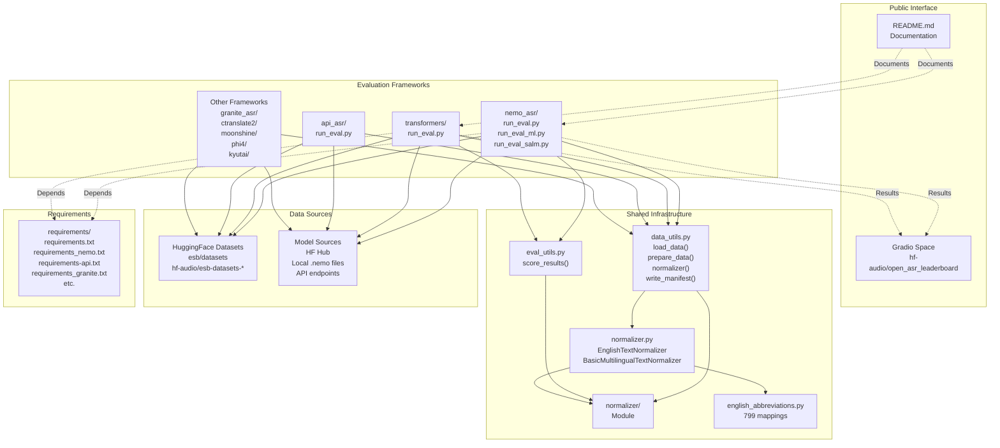
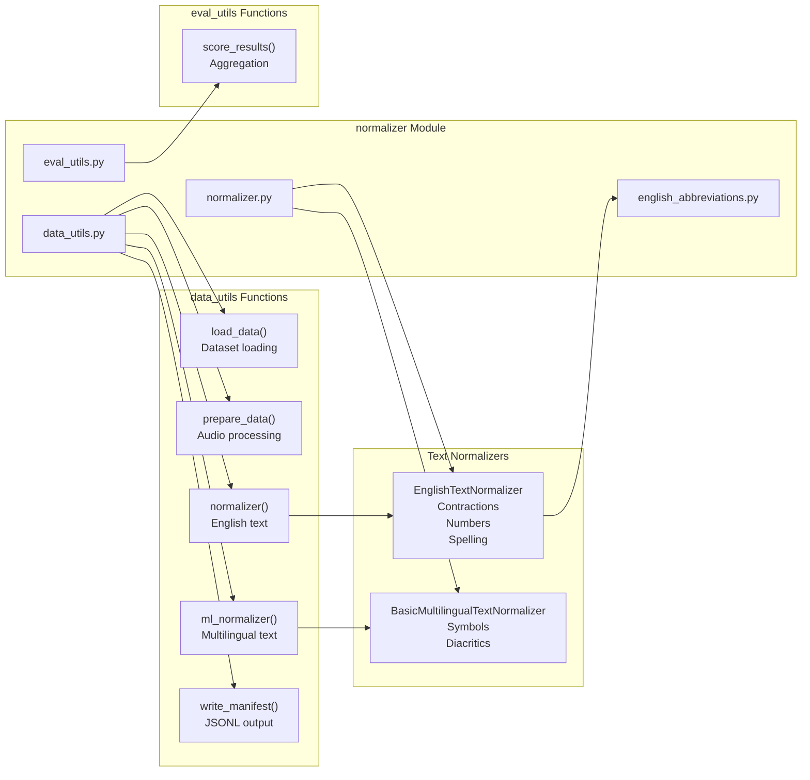
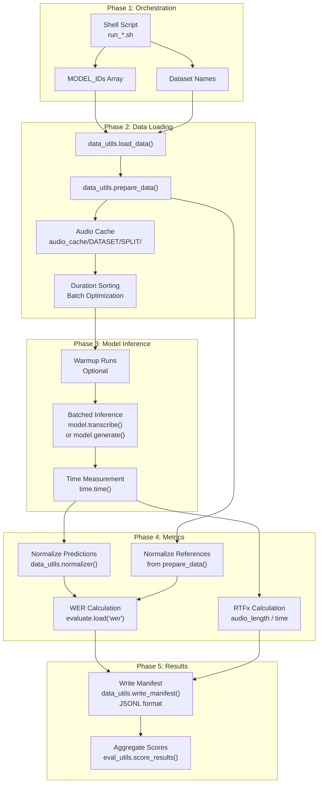
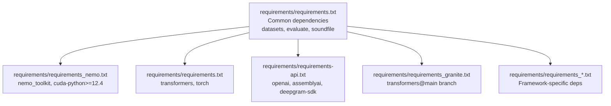

<!-- source: DeepWiki mcp.deepwiki.com · repo huggingface/open_asr_leaderboard · page 1 Overview · fetched 2026-10-26 -->

# Overview

<details>
<summary>Relevant source files</summary>

The following files were used as context for generating this wiki page:

- [README.md](README.md)
- [nemo_asr/run_eval.py](nemo_asr/run_eval.py)
- [transformers/run_eval.py](transformers/run_eval.py)

</details>


This document introduces the Open ASR Leaderboard repository, a comprehensive benchmarking system for evaluating Automatic Speech Recognition (ASR) models across multiple frameworks and datasets. The repository provides standardized evaluation pipelines, consistent metrics calculation, and unified result reporting through a public Gradio Space hosted at [hf-audio/open_asr_leaderboard](https://huggingface.co/spaces/hf-audio/open_asr_leaderboard).

For initial setup and running evaluations, see [Getting Started](#1.1). For detailed technical architecture, see [Architecture Overview](#1.2). For information about specific evaluation frameworks, see [Evaluation Frameworks](#4).

**Sources:** [README.md:1-3]()

---

## Repository Purpose and Scope

The Open ASR Leaderboard enables fair, reproducible comparison of ASR models by applying consistent evaluation protocols across diverse technologies. The system supports:

- **Multiple ASR Frameworks**: 8 distinct evaluation systems covering NVIDIA NeMo, Hugging Face Transformers, commercial APIs, and specialized frameworks
- **Standardized Benchmarking**: All models evaluated on the ESB (End-to-end Speech Benchmark) dataset suite using identical preprocessing and metrics
- **Consistent Metrics**: Word Error Rate (WER) and Real-Time Factor (RTFx) computed with unified text normalization
- **Reproducible Results**: Per-sample predictions stored in JSONL manifest files for auditing and analysis

Each evaluation framework implements the same 5-phase pipeline pattern while adapting to framework-specific model loading and inference APIs. The shared `normalizer` module ensures text normalization consistency regardless of the underlying ASR technology.

**Sources:** [README.md:1-19](), [README.md:29-37]()

---

## High-Level System Architecture

The repository follows a modular architecture with clear separation between framework-specific evaluation scripts and shared infrastructure components.

### System Component Diagram



The architecture consists of four primary layers:

1. **Framework Layer**: Directory-based organization where each ASR framework has its own folder containing `run_eval.py` and model-specific shell scripts
2. **Shared Infrastructure Layer**: The `normalizer` module providing common utilities for data handling, text normalization, and result aggregation
3. **Data Layer**: HuggingFace datasets for benchmarking and model sources (Hub, local, APIs)
4. **Public Interface Layer**: Documentation and Gradio Space for result presentation

**Sources:** [README.md:1-26](), [nemo_asr/run_eval.py:1-15](), [transformers/run_eval.py:1-13]()

---

## Evaluation Frameworks

The repository supports 8 evaluation frameworks, each targeting different ASR technologies and use cases:

| Framework | Directory | Primary Script | Key Features | Importance Score |
|-----------|-----------|----------------|--------------|------------------|
| **NeMo** | `nemo_asr/` | `run_eval.py` | NVIDIA NeMo models, Canary, Parakeet, SALM variants | 20.39 |
| **Transformers** | `transformers/` | `run_eval.py` | Whisper, Wav2Vec2, MMS, HuBERT, Data2Vec, Conformer | 19.49 |
| **API** | `api_asr/` | `run_eval.py` | OpenAI, AssemblyAI, Deepgram, Gladia APIs | 13.62 |
| **Granite** | `granite_asr/` | `run_eval.py` | IBM Granite speech models | 13.25 |
| **CTranslate2** | `ctranslate2/` | `run_eval.py` | Optimized Whisper via faster-whisper | 9.82 |
| **Moonshine** | `moonshine/` | `run_eval.py` | UsefulSensors lightweight models | 9.42 |
| **Phi-4** | `phi4/` | `run_eval.py` | Microsoft multimodal models | 8.35 |
| **Kyutai** | `kyutai/` | `run_eval.py` | Kyutai STT models | 6.62 |

Each framework implements the same evaluation pattern while adapting to its specific model loading and inference APIs. The NeMo and Transformers frameworks are the most comprehensive, supporting multiple model architectures and specialized variants.

For detailed documentation of each framework, see [Evaluation Frameworks](#4).

**Sources:** [README.md:7-26]()

---

## Shared Infrastructure Components

All evaluation frameworks converge on the `normalizer` module, which provides three critical services:

### Module Structure Diagram



### Key Components

**`data_utils.py`** - Core data handling functions:
- `load_data(args)`: Loads datasets from HuggingFace with streaming or full download
- `prepare_data(dataset)`: Computes audio durations and prepares normalized reference text
- `normalizer(text)`: Applies `EnglishTextNormalizer` for consistent text cleaning
- `ml_normalizer(text)`: Applies `BasicMultilingualTextNormalizer` for non-English text
- `write_manifest(...)`: Persists per-sample results in JSONL format

**`eval_utils.py`** - Result aggregation:
- `score_results(...)`: Aggregates per-dataset metrics into model-level scores

**`normalizer.py`** - Text normalization classes:
- `EnglishTextNormalizer`: Handles contractions, number conversion, British→American spelling (799 mappings from `english_abbreviations.py`)
- `BasicMultilingualTextNormalizer`: Symbol removal and diacritic handling for multilingual content

For detailed documentation, see [Shared Infrastructure](#3).

**Sources:** [nemo_asr/run_eval.py:10](), [transformers/run_eval.py:7](), [README.md:34-37]()

---

## Standard Evaluation Pipeline

All frameworks follow a consistent 5-phase evaluation pipeline, ensuring comparable results across different ASR technologies.

### Pipeline Flow Diagram



### Pipeline Phases

**Phase 1: Orchestration** - Shell scripts iterate through model and dataset lists, invoking `run_eval.py` for each combination.

**Phase 2: Data Loading** - Datasets are loaded via `data_utils.load_data()`, audio files cached locally in `audio_cache/`, and sorted by duration to optimize batching.

**Phase 3: Model Inference** - Optional warmup runs stabilize timing, followed by batched inference with precise time measurement using `time.time()`.

**Phase 4: Metrics** - Predictions and references are normalized using framework-appropriate normalizers, then WER is computed via HuggingFace `evaluate` library and RTFx via timing ratios.

**Phase 5: Results** - Per-sample results written to JSONL manifests via `data_utils.write_manifest()`, then aggregated across datasets using `eval_utils.score_results()`.

For detailed pipeline documentation, see [Core Evaluation Pipeline](#2).

**Sources:** [nemo_asr/run_eval.py:20-177](), [transformers/run_eval.py:14-156](), [README.md:17-19]()

---

## Code Entry Points

Each evaluation framework provides standardized entry points following consistent naming conventions:

### Primary Scripts

**Per-Framework Entry Point**: `<framework>/run_eval.py`
- NeMo: [nemo_asr/run_eval.py:20-225]()
- Transformers: [transformers/run_eval.py:14-237]()
- Similar structure across all 8 frameworks

**Model-Specific Shell Scripts**: `run_<model_type>.sh`
- Example: `run_whisper.sh`, `run_wav2vec2.sh`, `run_canary.sh`
- Each script defines model arrays and iterates through datasets
- Invokes `run_eval.py` with appropriate arguments

### Standard Arguments

All `run_eval.py` scripts accept common arguments:

| Argument | Type | Default | Description |
|----------|------|---------|-------------|
| `--model_id` | `str` | Required | Model identifier (HF Hub, local path, or API name) |
| `--dataset_path` | `str` | `esb/datasets` | Dataset path on HuggingFace |
| `--dataset` | `str` | Required | Dataset name (e.g., `librispeech_asr`) |
| `--split` | `str` | `test` | Dataset split (e.g., `validation`, `test`) |
| `--device` | `int` | `-1` | GPU device ID (-1 for CPU) |
| `--batch_size` | `int` | Varies | Batch size for inference |
| `--max_eval_samples` | `int` | `None` | Limit evaluation to N samples |
| `--streaming` | `bool` | Varies | Stream dataset vs. full download |

Framework-specific arguments extend this base set (e.g., `--max_new_tokens` for autoregressive models, `--torch_compile` for optimization).

**Sources:** [nemo_asr/run_eval.py:180-223](), [transformers/run_eval.py:158-236](), [README.md:29-37]()

---

## Requirements and Dependencies

The repository uses framework-specific requirement files to manage dependencies:

### Requirements Structure



### Installation Workflow

1. Install PyTorch following platform-specific instructions
2. Install common requirements: `pip install -r requirements/requirements.txt`
3. Install framework-specific requirements: `pip install -r requirements/requirements_<framework>.txt`
4. Authenticate with HuggingFace: `huggingface-cli login`

### Special Requirements

**NVIDIA NeMo**: Requires CUDA 12.6+ for RNN-T inference with cooperative kernels ([README.md:15]()). The `cuda-python>=12.4` dependency enables fast TDT and RNN-T inference.

**Granite**: Pins to transformers main branch for unreleased features required by IBM Granite models.

For complete requirements documentation, see [Requirements Management](#3.4).

**Sources:** [README.md:5-15]()

---

## Output Format and Results

Evaluation results are stored in two formats:

### JSONL Manifest Files

Per-sample results written by `data_utils.write_manifest()` in JSONL format:

```
results/<model_id>/<dataset_path>-<dataset>-<split>.jsonl
```

Each line contains:
- `audio_length_s`: Audio duration in seconds
- `transcription_time_s`: Inference time per sample
- `prediction`: Normalized transcription
- `reference`: Normalized ground truth
- Individual WER and RTFx metrics

### Aggregated Scores

Console output and final metrics:
- **WER (Word Error Rate)**: Percentage of word errors computed via `evaluate.load("wer")`
- **RTFx (Real-Time Factor)**: Ratio of audio duration to transcription time (higher is faster)

Example output:
```
Results saved at path: /path/to/results/model/dataset.jsonl
WER: 3.45 %
RTFx: 142.67
```

For result interpretation, see [Result Interpretation](#6.3).

**Sources:** [nemo_asr/run_eval.py:154-176](), [transformers/run_eval.py:138-155]()

---

## Extending the System

The repository is designed for extensibility through a template-based approach:

### Adding New Libraries

1. Create framework directory: `mkdir <library_name>`
2. Copy template `run_eval.py` from [README.md:38-213]()
3. Modify two sections:
   - Model loading in `main()` function
   - Inference logic in `benchmark()` function
4. Maintain identical data loading, normalization, and manifest writing
5. Create `run_<model_type>.sh` scripts for model variants

### Adding New Models

- **Existing framework**: Add model ID to appropriate shell script array
- **New model type**: Create new shell script following `run_<model_type>.sh` convention
- Must use identical hyperparameters across all benchmark datasets (per ESB requirements)

For step-by-step guides, see [Adding New Models](#6.1).

**Sources:** [README.md:28-230]()

---

## Next Steps

- **Initial Setup**: See [Getting Started](#1.1) for installation and authentication
- **Architecture Details**: See [Architecture Overview](#1.2) for in-depth technical design
- **Framework Usage**: See [Evaluation Frameworks](#4) for framework-specific guides
- **Core Pipeline**: See [Core Evaluation Pipeline](#2) for evaluation workflow details
- **Shared Components**: See [Shared Infrastructure](#3) for `normalizer` module documentation

---

