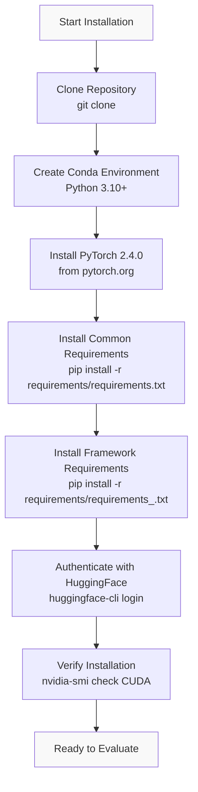
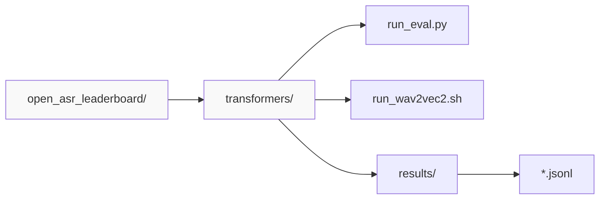
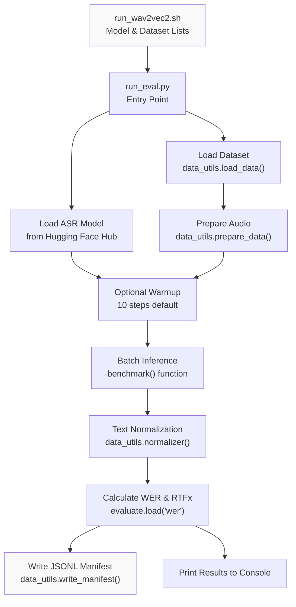
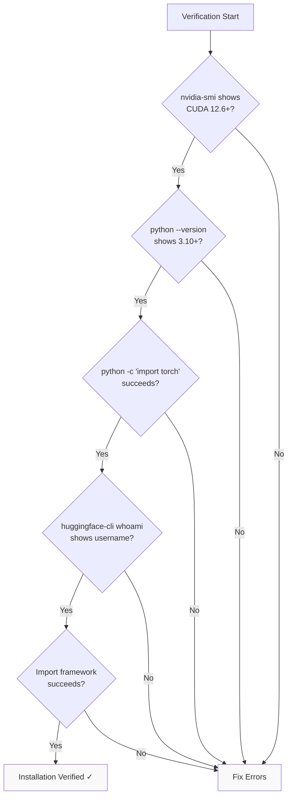

<!-- source: DeepWiki mcp.deepwiki.com · repo huggingface/open_asr_leaderboard · page 1.1 Getting Started · fetched 2026-10-26 -->

# Getting Started

<details>
<summary>Relevant source files</summary>

The following files were used as context for generating this wiki page:

- [README.md](README.md)
- [requirements/requirements_nemo.txt](requirements/requirements_nemo.txt)

</details>


This document guides you through setting up the Open ASR Leaderboard evaluation environment and running your first model evaluation. It covers system prerequisites, dependency installation, authentication, and executing a basic evaluation workflow. For information about the underlying architecture and evaluation pipeline, see [Architecture Overview](#1.2). For details on individual evaluation frameworks, see [Evaluation Frameworks](#4).

---

## Purpose and Scope

This guide enables you to:
- Configure a clean evaluation environment with Python 3.10+
- Install framework-specific dependencies for ASR model evaluation
- Authenticate with Hugging Face Hub for dataset and model access
- Execute your first evaluation using an existing bash script
- Interpret the resulting JSONL manifest and console output

---

## System Prerequisites

The Open ASR Leaderboard has specific hardware and software requirements to ensure reproducible results across submissions.

### Hardware Requirements

| Component | Specification | Notes |
|-----------|--------------|-------|
| GPU | NVIDIA A100-SXM4-80GB | All official evaluations use this GPU |
| CUDA Version | 12.6 or higher | Required for NeMo RNN-T cooperative kernels |
| Driver Version | 560.28.03 or higher | Verified configuration |

**Important:** If evaluating NeMo models, CUDA 12.6 is mandatory to fix RNN-T inference issues with cooperative kernels inside conditional nodes (see [README.md:15]()). Verify your CUDA version by running `nvidia-smi`.

### Software Requirements

| Component | Version | Purpose |
|-----------|---------|---------|
| Python | 3.10 or above | Recommended via conda |
| PyTorch | 2.4.0 | Deep learning framework |
| CUDA Toolkit | 12.6+ | GPU acceleration |

**Note:** The repository was tested with PyTorch 2.4.0. Other versions may work but are not officially supported.

**Sources:** [README.md:5-26]()

---

## Installation Process

The installation follows a phased approach: PyTorch first, then common dependencies, then framework-specific packages. This prevents dependency conflicts.



### Step 1: Clone Repository

```bash
git clone https://github.com/huggingface/open_asr_leaderboard.git
cd open_asr_leaderboard
```

### Step 2: Create Conda Environment

Create an isolated environment to prevent dependency conflicts:

```bash
conda create -n asr-leaderboard python=3.10
conda activate asr-leaderboard
```

### Step 3: Install PyTorch

Follow the official PyTorch installation instructions at https://pytorch.org/get-started/locally/ to install PyTorch 2.4.0 with CUDA 12.6 support. Example command:

```bash
pip install torch==2.4.0 torchvision torchaudio --index-url https://download.pytorch.org/whl/cu126
```

### Step 4: Install Common Requirements

Install shared dependencies used across all frameworks:

```bash
pip install -r requirements/requirements.txt
```

This installs the `normalizer` module and shared utilities like `evaluate`, `datasets`, and `soundfile`.

### Step 5: Install Framework-Specific Requirements

Each evaluation framework has dedicated requirements files. Install only the frameworks you intend to use:

| Framework | Requirements File | Key Dependencies |
|-----------|-------------------|------------------|
| NeMo | `requirements/requirements_nemo.txt` | `nemo_toolkit[asr]`, `cuda-python>=12.4` |
| Transformers | `requirements/requirements.txt` | `transformers`, `accelerate` |
| API | `requirements/requirements-api.txt` | `openai`, `assemblyai` |
| Granite | `requirements/requirements_granite.txt` | `transformers` (main branch) |
| Moonshine | `requirements/requirements_moonshine.txt` | `moonshine-onnx` |
| Kyutai | `requirements/requirements_kyutai.txt` | `moshi`, `julius` |

**Example:** To evaluate NeMo models:

```bash
pip install -r requirements/requirements_nemo.txt
```

**Note:** The NeMo requirements file pins to a specific commit `6294bc7708ce67522b92f5e9b6917ea0b2e23429` for stability and includes `cuda-python>=12.4` for fast TDT and RNN-T inference ([requirements/requirements_nemo.txt:1-6]()).

**Sources:** [README.md:7-14](), [requirements/requirements_nemo.txt:1-7]()

---

## Authentication

The leaderboard uses Hugging Face Hub to access datasets and models. Authentication is required for:
- Loading ESB benchmark datasets from `hf-audio/esb-datasets-*`
- Downloading model weights from Hugging Face Hub
- Submitting evaluation results (optional)

### Hugging Face CLI Login

Run the following command and provide your Hugging Face access token when prompted:

```bash
huggingface-cli login
```

You can generate an access token at https://huggingface.co/settings/tokens. The token needs `read` permissions for public datasets and models.

**Sources:** [README.md:13]()

---

## Running Your First Evaluation

Each framework follows a consistent directory structure and execution pattern. This example demonstrates evaluating a Wav2Vec2 model using the Transformers framework.

### Evaluation Directory Structure



### Execution Steps

#### 1. Navigate to Framework Directory

```bash
cd transformers
```

#### 2. Execute Bash Script

Run the pre-configured evaluation script for your target model family:

```bash
bash run_wav2vec2.sh
```

The bash script orchestrates multiple evaluations by:
- Defining an array of model IDs (e.g., `facebook/wav2vec2-base-960h`)
- Defining a list of datasets from the ESB benchmark
- Calling `run_eval.py` for each (model, dataset) pair
- Passing framework-specific parameters (batch size, device, etc.)

#### 3. Monitor Progress

The script displays progress through two phases:

1. **Warmup Phase** (optional): Runs a small number of samples to stabilize GPU state
2. **Evaluation Phase**: Processes the full dataset with per-sample progress bars

Console output shows:
- Dataset loading status
- Sample-by-sample transcription progress
- Final WER (Word Error Rate) and RTFx (Inverse Real-Time Factor) metrics

### Understanding the Evaluation Flow



**Sources:** [README.md:17-26]()

---

## Example Evaluation Run

Here's a concrete example of evaluating the `facebook/wav2vec2-base-960h` model on the LibriSpeech test-clean dataset:

### Command Structure

The bash script internally executes commands similar to:

```bash
python run_eval.py \
    --model_id facebook/wav2vec2-base-960h \
    --dataset_path esb/datasets \
    --dataset librispeech_asr \
    --split test.clean \
    --device 0 \
    --batch_size 32 \
    --warmup_steps 10
```

### Key Parameters

| Parameter | Value | Description |
|-----------|-------|-------------|
| `--model_id` | `facebook/wav2vec2-base-960h` | Hugging Face model identifier |
| `--dataset_path` | `esb/datasets` | ESB benchmark repository path |
| `--dataset` | `librispeech_asr` | Dataset name within ESB |
| `--split` | `test.clean` | Dataset split to evaluate |
| `--device` | `0` | GPU device index (-1 for CPU) |
| `--batch_size` | `32` | Number of samples per batch |
| `--warmup_steps` | `10` | Warmup iterations before timing |

**Sources:** [README.md:42-209]()

---

## Understanding the Output

### Console Output

During evaluation, you'll see:

```
Warming up...
100%|████████████████████| 10/10 [00:15<00:00, 1.52s/it]

Samples...
100%|████████████████████| 2620/2620 [08:23<00:00, 5.21it/s]

Results saved at path: /path/to/open_asr_leaderboard/transformers/results/facebook--wav2vec2-base-960h/esb_datasets_librispeech_asr_test.clean.jsonl

WER: 3.45 % RTFx: 245.67
```

### Metrics Explained

| Metric | Definition | Interpretation |
|--------|------------|----------------|
| **WER** | Word Error Rate (%) | Lower is better. 3.45% means 3.45 words incorrect per 100 words |
| **RTFx** | Inverse Real-Time Factor | Higher is better. 245.67 means processing 245x faster than real-time |

### JSONL Manifest Structure

The manifest file contains per-sample results in JSON Lines format. Each line represents one audio sample:

```json
{
  "audio_filepath": "sample_001.wav",
  "duration": 4.32,
  "text": "the quick brown fox",
  "pred_text": "the quick brown fox",
  "wer": 0.0,
  "transcription_time": 0.0176
}
```

**Key Fields:**
- `audio_filepath`: Audio file identifier
- `duration`: Audio length in seconds
- `text`: Normalized reference transcription
- `pred_text`: Normalized model prediction
- `wer`: Per-sample Word Error Rate
- `transcription_time`: Inference time for this sample

**Sources:** [README.md:128-138]()

---

## Verifying Installation

### Quick Verification Checklist

Use this checklist to verify your installation is correct:



### Verification Commands

| Check | Command | Expected Output |
|-------|---------|-----------------|
| CUDA Version | `nvidia-smi` | "CUDA Version: 12.6" or higher |
| Python Version | `python --version` | "Python 3.10.x" or higher |
| PyTorch | `python -c "import torch; print(torch.__version__)"` | "2.4.0" or compatible |
| CUDA Available | `python -c "import torch; print(torch.cuda.is_available())"` | "True" |
| Hugging Face | `huggingface-cli whoami` | Your HF username |
| NeMo (if installed) | `python -c "import nemo"` | No errors |

**Sources:** [README.md:15]()

---

## Common Issues and Solutions

### Issue: CUDA Version Mismatch

**Symptom:** NeMo evaluations fail with RNN-T kernel errors

**Solution:** Upgrade to CUDA 12.6 or higher. The cooperative kernels in RNN-T require driver fixes only available in CUDA 12.6+ (see [README.md:15]()).

### Issue: Dependency Conflicts

**Symptom:** `pip install` fails with version conflicts

**Solution:** 
1. Create a fresh conda environment
2. Install PyTorch first, before any other packages
3. Install framework-specific requirements in isolation

### Issue: Out of Memory

**Symptom:** CUDA out of memory errors during evaluation

**Solution:**
1. Reduce batch size in the bash script
2. Ensure no other processes are using GPU memory
3. Use the A100-80GB GPU configuration as specified

### Issue: Dataset Download Failures

**Symptom:** Streaming dataset times out or fails

**Solution:**
1. Verify `huggingface-cli login` completed successfully
2. Check internet connectivity
3. Try disabling streaming mode with `--no-streaming` flag

**Sources:** [README.md:15-26]()

---

## Next Steps

After completing your first evaluation, explore:

1. **Run Multiple Models:** Examine bash scripts to see how they iterate over model families (see [README.md:24]())
2. **Understand the Pipeline:** Learn about the 5-phase evaluation workflow in [Evaluation Workflow](#2.1)
3. **Explore Frameworks:** Try different evaluation systems documented in [Evaluation Frameworks](#4)
4. **Add Your Own Model:** Follow the contribution guide in [Adding New Models](#6.1)
5. **Interpret Results:** Understand WER and RTFx metrics in [Result Interpretation](#6.3)

### Template for Custom Evaluations

The repository provides a template script for adding new libraries. See the complete template at [README.md:38-211]() which demonstrates:
- Model loading patterns
- Dataset preparation using `data_utils`
- Inference timing with warmup steps
- Text normalization with `data_utils.normalizer()`
- Manifest writing with `data_utils.write_manifest()`

This template ensures consistency across all evaluation frameworks.

**Sources:** [README.md:17-231]()

---

## File Reference Summary

Key files for getting started:

| File Path | Purpose | When to Use |
|-----------|---------|-------------|
| `README.md` | Main documentation | Initial setup guidance |
| `requirements/requirements.txt` | Common dependencies | All installations |
| `requirements/requirements_nemo.txt` | NeMo framework | Evaluating NeMo models |
| `transformers/run_eval.py` | Transformers entry point | Evaluating HF models |
| `transformers/run_wav2vec2.sh` | Wav2Vec2 orchestration | Running Wav2Vec2 evaluations |

**Sources:** [README.md:1-244](), [requirements/requirements_nemo.txt:1-7]()

---

