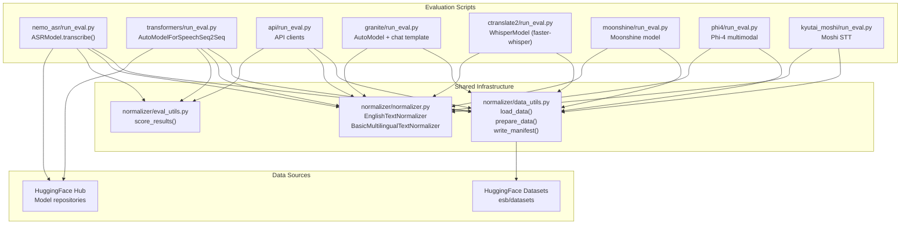
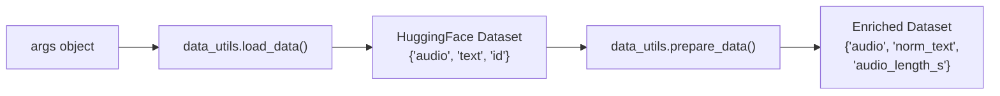
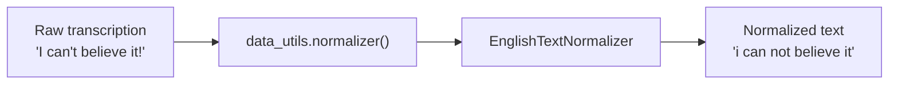
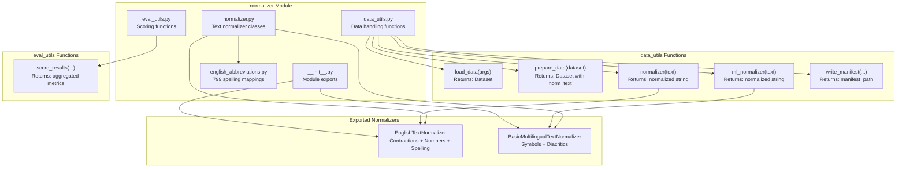
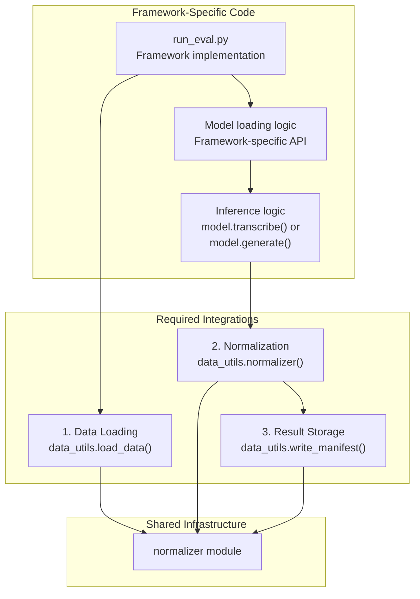

<!-- source: DeepWiki mcp.deepwiki.com · repo huggingface/open_asr_leaderboard · page 1.2 Architecture Overview · fetched 2026-10-26 -->

# Architecture Overview

<details>
<summary>Relevant source files</summary>

The following files were used as context for generating this wiki page:

- [nemo_asr/run_eval.py](nemo_asr/run_eval.py)
- [normalizer/__init__.py](normalizer/__init__.py)
- [normalizer/english_abbreviations.py](normalizer/english_abbreviations.py)
- [normalizer/normalizer.py](normalizer/normalizer.py)
- [transformers/run_eval.py](transformers/run_eval.py)

</details>


## Purpose and Scope

This document describes the high-level architecture of the Open ASR Leaderboard evaluation system. It covers the multi-framework design pattern, the common evaluation pipeline, and the shared infrastructure that enables consistent evaluation across diverse ASR technologies.

For specific guidance on running evaluations, see [Getting Started](#1.1). For details on individual evaluation frameworks (NeMo, Transformers, API-based, etc.), see [Evaluation Frameworks](#4).

---

## Multi-Framework Architecture

The repository implements a **plugin-style architecture** where multiple evaluation frameworks coexist independently while sharing common infrastructure. This design enables fair comparison of ASR models from different libraries by applying identical data handling, normalization, and metric computation.

### Framework Registry

The system supports eight distinct evaluation frameworks:

| Framework | Primary Script | Importance Score | Purpose |
|-----------|---------------|------------------|---------|
| **NeMo** | `nemo_asr/run_eval.py` | 20.39 | NVIDIA NeMo models (.nemo format and Hub) |
| **Transformers** | `transformers/run_eval.py` | 19.49 | HuggingFace Transformers models (Whisper, Wav2Vec2, etc.) |
| **API** | `api/run_eval.py` | 13.62 | Commercial ASR APIs (OpenAI, AssemblyAI, etc.) |
| **Granite** | `granite/run_eval.py` | 13.25 | IBM Granite speech models |
| **CTranslate2** | `ctranslate2/run_eval.py` | 9.82 | Optimized Whisper via faster-whisper |
| **Moonshine** | `moonshine/run_eval.py` | 9.42 | UsefulSensors edge models |
| **Phi-4** | `phi4/run_eval.py` | 8.35 | Microsoft multimodal models |
| **Kyutai** | `kyutai_moshi/run_eval.py` | 6.62 | Kyutai STT models |

### Architecture Diagram: Framework Organization



**Sources:** [nemo_asr/run_eval.py:1-226](), [transformers/run_eval.py:1-237](), [normalizer/__init__.py:1-1]()

---

## Common Evaluation Pattern

All frameworks implement a standardized **5-phase evaluation pipeline**. This pattern ensures that metrics (WER and RTFx) are computed identically regardless of the underlying ASR technology.

### Phase Breakdown

```mermaid
flowchart LR
    subgraph "Phase 1: Orchestration"
        ARGS["argparse arguments<br/>--model_id<br/>--dataset<br/>--batch_size"]
    end
    
    subgraph "Phase 2: Data Loading"
        LOAD["data_utils.load_data()<br/>Dataset streaming"]
        PREP["data_utils.prepare_data()<br/>Add audio_length_s"]
    end
    
    subgraph "Phase 3: Inference"
        CACHE["Audio caching<br/>audio_cache/ directory"]
        WARMUP["Warmup runs<br/>2-10 iterations"]
        TRANSCRIBE["Model transcription<br/>Batch processing"]
        TIME["Time measurement<br/>start_time, end_time"]
    end
    
    subgraph "Phase 4: Normalization"
        NORM_PRED["data_utils.normalizer()<br/>predictions"]
        NORM_REF["data_utils.normalizer()<br/>references"]
        WER["evaluate.load('wer')<br/>wer_metric.compute()"]
    end
    
    subgraph "Phase 5: Storage"
        MANIFEST["data_utils.write_manifest()<br/>JSONL results"]
        SCORE["eval_utils.score_results()<br/>Aggregate metrics"]
    end
    
    ARGS --> LOAD
    LOAD --> PREP
    PREP --> CACHE
    CACHE --> WARMUP
    WARMUP --> TRANSCRIBE
    TRANSCRIBE --> TIME
    TIME --> NORM_PRED
    PREP --> NORM_REF
    NORM_PRED --> WER
    NORM_REF --> WER
    WER --> MANIFEST
    MANIFEST --> SCORE
```



**Sources:** [nemo_asr/run_eval.py:20-177](), [transformers/run_eval.py:14-156]()

### Phase Implementation Details

#### Phase 1: Orchestration
Each evaluation script uses `argparse` to accept:
- `--model_id`: Model identifier (local path or Hub ID)
- `--dataset`: Dataset name from ESB benchmark suite
- `--split`: Dataset split (test, validation)
- `--batch_size`: Batch size for inference
- `--device`: GPU device index or -1 for CPU
- `--streaming`: Whether to stream data or download fully

**Sources:** [nemo_asr/run_eval.py:180-224](), [transformers/run_eval.py:158-236]()

#### Phase 2: Data Loading
The `data_utils.load_data()` function handles dataset loading with optional streaming:



The `prepare_data()` function adds:
- `norm_text`: Pre-normalized reference transcriptions
- `audio_length_s`: Audio duration for RTFx calculation

**Sources:** [nemo_asr/run_eval.py:46-95](), [transformers/run_eval.py:99-121]()

#### Phase 3: Inference
NeMo implementations cache audio files to disk for efficiency:

```python
# Audio caching pattern (NeMo)
CACHE_DIR = os.path.join(os.getcwd(), "audio_cache", DATASET_NAME, SPLIT_NAME)
audio_path = os.path.join(CACHE_DIR, f"{id}.wav")
soundfile.write(audio_path, audio_array, sample_rate)
```

Transformers implementations use in-memory processing with optional `torch.compile` optimization:

```python
# Torch compile pattern (Transformers)
if args.torch_compile:
    model.forward = torch.compile(model.forward, mode=args.compile_mode, fullgraph=True)
    model.generation_config.cache_implementation = "static"
```

**Sources:** [nemo_asr/run_eval.py:48-101](), [transformers/run_eval.py:30-35]()

#### Phase 4: Normalization
All predictions and references pass through `data_utils.normalizer()`, which delegates to `EnglishTextNormalizer`:



The normalizer performs:
1. Lowercasing
2. Contraction expansion (`can't` → `can not`)
3. British→American spelling (799 mappings)
4. Number standardization (`twenty` → `20`)
5. Symbol removal

**Sources:** [nemo_asr/run_eval.py:149](), [transformers/run_eval.py:95](), [normalizer/normalizer.py:528-614]()

#### Phase 5: Storage
Results are persisted in two formats:

1. **Manifest files** (JSONL): Per-sample results with WER and RTFx
2. **Aggregate scores**: Model-level metrics across all datasets

The `write_manifest()` function creates structured JSONL files:

```json
{
  "audio_filepath": "audio_cache/librispeech_asr/test/sample1.wav",
  "duration": 5.2,
  "text": "reference transcription",
  "pred_text": "predicted transcription",
  "wer": 0.0,
  "rtfx": 42.5
}
```

**Sources:** [nemo_asr/run_eval.py:154-165](), [transformers/run_eval.py:138-148]()

---

## Shared Infrastructure Components

The `normalizer` module provides the core shared functionality that ensures evaluation consistency.

### Component Architecture



**Sources:** [normalizer/__init__.py:1-1](), [normalizer/normalizer.py:1-614](), [normalizer/english_abbreviations.py:1-1743]()

### Text Normalization Classes

#### EnglishTextNormalizer

The `EnglishTextNormalizer` class ([normalizer/normalizer.py:528-614]()) implements comprehensive English text cleaning:

| Feature | Implementation | Example |
|---------|----------------|---------|
| **Contractions** | Regex replacements (46 patterns) | `won't` → `will not` |
| **Numbers** | `EnglishNumberNormalizer` | `twenty three` → `23` |
| **Spelling** | `EnglishSpellingNormalizer` | `colour` → `color` |
| **Symbols** | `remove_symbols_and_diacritics()` | `hello!` → `hello` |
| **Titles** | Expansion patterns | `Dr.` → `doctor` |

Key methods:
- `__init__(english_spelling_mapping)`: Initialize with 799 British→American mappings
- `__call__(s: str) -> str`: Apply full normalization pipeline

**Sources:** [normalizer/normalizer.py:528-614]()

#### BasicMultilingualTextNormalizer

The `BasicMultilingualTextNormalizer` class ([normalizer/normalizer.py:95-110]()) provides language-agnostic normalization:

1. Lowercasing
2. Bracket/parenthesis removal
3. Diacritic removal (optional)
4. Symbol/punctuation removal
5. Whitespace normalization

This normalizer is used for multilingual evaluations where English-specific rules don't apply.

**Sources:** [normalizer/normalizer.py:95-110]()

### Data Utilities

The `data_utils` module provides five core functions:

| Function | Purpose | Returns |
|----------|---------|---------|
| `load_data(args)` | Load dataset with streaming support | `Dataset` object |
| `prepare_data(dataset)` | Add `norm_text` and `audio_length_s` | Enriched `Dataset` |
| `normalizer(text)` | Apply English normalization | `str` |
| `ml_normalizer(text)` | Apply multilingual normalization | `str` |
| `write_manifest(...)` | Write JSONL results file | `str` (path) |

**Integration Pattern:**

```python
# Standard usage pattern across all frameworks
from normalizer import data_utils

dataset = data_utils.load_data(args)
dataset = data_utils.prepare_data(dataset)

# ... perform inference ...

predictions = [data_utils.normalizer(pred) for pred in raw_predictions]
manifest_path = data_utils.write_manifest(references, predictions, ...)
```

**Sources:** [nemo_asr/run_eval.py:10](), [transformers/run_eval.py:7]()

---

## Framework Integration Points

Each framework integrates with the shared infrastructure through **three required touchpoints**:

### Integration Touchpoints



**Sources:** [nemo_asr/run_eval.py:20-177](), [transformers/run_eval.py:14-156]()

### Example: NeMo Integration

The NeMo framework demonstrates the standard integration pattern:

```python
# 1. Data Loading Integration
dataset = data_utils.load_data(args)
dataset = data_utils.prepare_data(dataset)

# 2. Framework-specific model loading
if args.model_id.endswith(".nemo"):
    asr_model = ASRModel.restore_from(args.model_id, map_location=device)
else:
    asr_model = ASRModel.from_pretrained(args.model_id, map_location=device)

# 3. Framework-specific inference
transcriptions = asr_model.transcribe(audio_files, batch_size=args.batch_size)

# 4. Normalization Integration
predictions = [data_utils.normalizer(pred.text) for pred in transcriptions]

# 5. Result Storage Integration
manifest_path = data_utils.write_manifest(
    all_data["references"],
    predictions,
    args.model_id,
    args.dataset_path,
    args.dataset,
    args.split,
    audio_length=all_data["durations"],
    transcription_time=[avg_time] * len(all_data["audio_filepaths"]),
)
```

**Sources:** [nemo_asr/run_eval.py:38-165]()

### Example: Transformers Integration

The Transformers framework follows the same pattern with framework-specific model loading:

```python
# 1. Data Loading Integration
dataset = data_utils.load_data(args)
dataset = data_utils.prepare_data(dataset)

# 2. Framework-specific model loading
config = AutoConfig.from_pretrained(args.model_id)
cls_model = AutoModelForSpeechSeq2Seq if type(config) in MODEL_FOR_SPEECH_SEQ_2_SEQ_MAPPING else AutoModelForCTC
model = cls_model.from_pretrained(args.model_id, torch_dtype=torch.bfloat16, attn_implementation="sdpa")

# 3. Framework-specific inference with torch.compile support
if model.can_generate():
    pred_ids = model.generate(**inputs, **gen_kwargs)
else:
    logits = model(**inputs).logits
    pred_ids = logits.argmax(-1)

# 4. Normalization Integration
batch["predictions"] = [data_utils.normalizer(pred) for pred in pred_text]

# 5. Result Storage Integration
manifest_path = data_utils.write_manifest(
    all_results["references"],
    all_results["predictions"],
    args.model_id,
    args.dataset_path,
    args.dataset,
    args.split,
    audio_length=all_results["audio_length_s"],
    transcription_time=all_results["transcription_time_s"],
)
```

**Sources:** [transformers/run_eval.py:15-156]()

---

## Data Flow Architecture

The complete data transformation pipeline from raw datasets to final scores follows a **layered architecture**:

### End-to-End Data Flow

```mermaid
graph LR
    subgraph "Input Layer"
        HF_DS["HuggingFace Dataset<br/>{'audio', 'text', 'id'}"]
    end
    
    subgraph "Loading Layer"
        LOAD["data_utils.load_data()<br/>Streaming or full download"]
        PREP["data_utils.prepare_data()<br/>Add norm_text, audio_length_s"]
    end
    
    subgraph "Caching Layer (NeMo)"
        CACHE["audio_cache/ directory<br/>WAV files sorted by duration"]
    end
    
    subgraph "Inference Layer"
        MODEL["ASR Model<br/>Framework-specific API"]
        BATCH["Batch processing<br/>GPU acceleration"]
    end
    
    subgraph "Normalization Layer"
        NORM_PRED["data_utils.normalizer()<br/>EnglishTextNormalizer"]
        NORM_REF["Reference normalization<br/>From prepare_data()"]
    end
    
    subgraph "Metrics Layer"
        WER_COMP["evaluate.load('wer')<br/>wer_metric.compute()"]
        RTFX_COMP["RTFx = audio_length / time<br/>Per-sample calculation"]
    end
    
    subgraph "Storage Layer"
        MANIFEST["JSONL manifest<br/>results/ directory"]
        SCORES["eval_utils.score_results()<br/>Aggregated metrics"]
    end
    
    HF_DS --> LOAD
    LOAD --> PREP
    PREP --> CACHE
    CACHE --> MODEL
    MODEL --> BATCH
    BATCH --> NORM_PRED
    PREP --> NORM_REF
    NORM_PRED --> WER_COMP
    NORM_REF --> WER_COMP
    BATCH --> RTFX_COMP
    WER_COMP --> MANIFEST
    RTFX_COMP --> MANIFEST
    MANIFEST --> SCORES
```



**Sources:** [nemo_asr/run_eval.py:46-165](), [transformers/run_eval.py:36-156]()

### Layer Responsibilities

| Layer | Responsibility | Key Code Entities |
|-------|---------------|-------------------|
| **Input** | Provide raw dataset | `datasets.load_dataset()` |
| **Loading** | Enrich with metadata | `data_utils.load_data()`, `data_utils.prepare_data()` |
| **Caching** | Optimize audio access | `soundfile.write()`, duration-based sorting |
| **Inference** | Generate transcriptions | `ASRModel.transcribe()`, `model.generate()` |
| **Normalization** | Standardize text | `EnglishTextNormalizer.__call__()` |
| **Metrics** | Compute WER and RTFx | `wer_metric.compute()`, time measurement |
| **Storage** | Persist results | `data_utils.write_manifest()`, `eval_utils.score_results()` |

**Sources:** [nemo_asr/run_eval.py:1-226](), [transformers/run_eval.py:1-237](), [normalizer/normalizer.py:528-614]()

---

## Summary

The Open ASR Leaderboard architecture achieves **consistency through standardization**:

1. **Multi-framework support** via independent evaluation scripts that share common infrastructure
2. **Standardized evaluation** through a 5-phase pipeline (Orchestration → Data Loading → Inference → Normalization → Storage)
3. **Fair comparison** via the `normalizer` module that applies identical text processing to all frameworks
4. **Extensibility** through clear integration touchpoints that new frameworks must implement

The architecture's key insight is **separation of concerns**: framework-specific code handles model loading and inference, while shared infrastructure ensures that data handling, normalization, and metrics remain consistent across all evaluations.

**Sources:** All files referenced throughout this document

---

