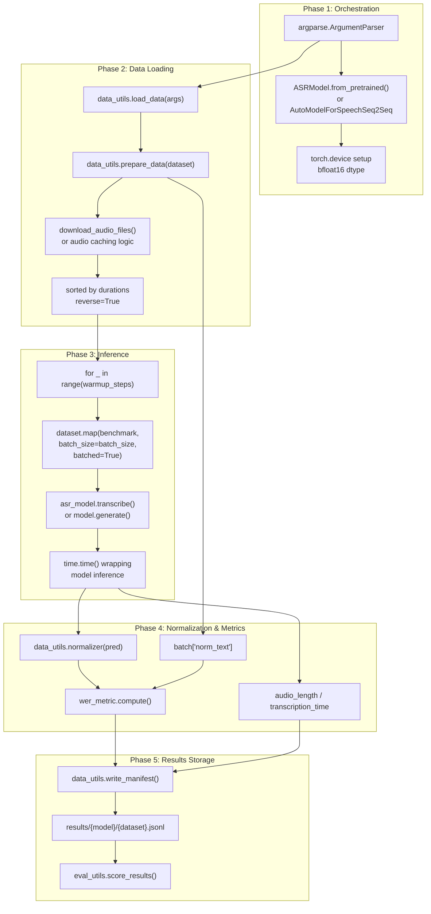
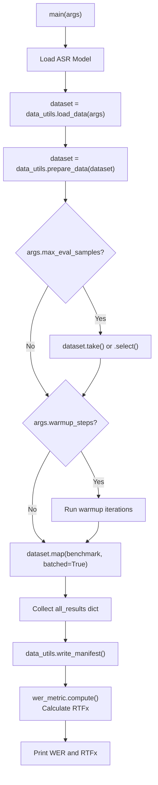
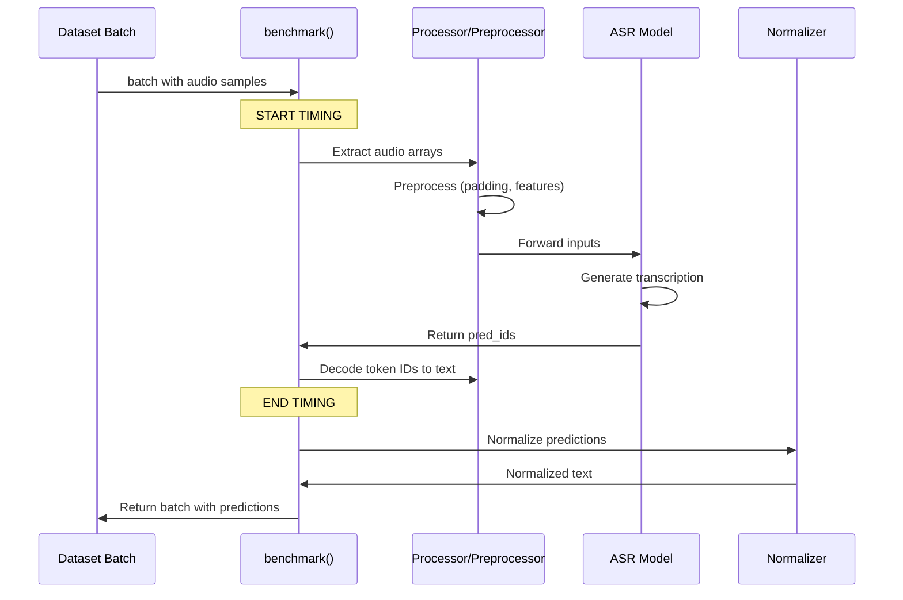
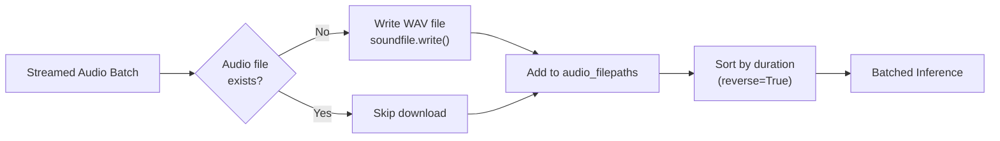
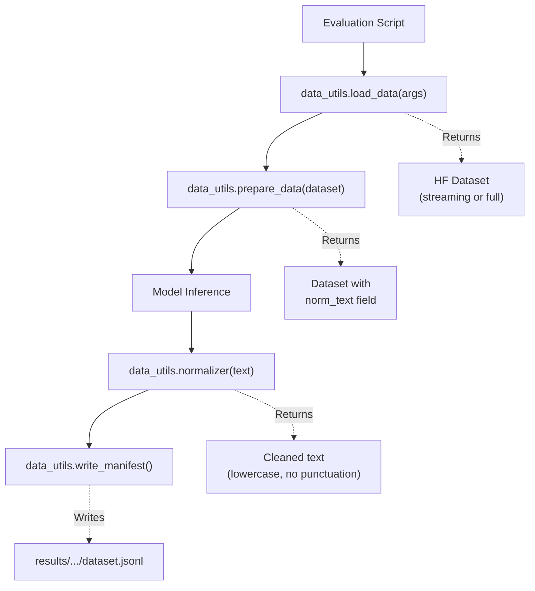

<!-- source: DeepWiki mcp.deepwiki.com · repo huggingface/open_asr_leaderboard · page 2 Core Evaluation Pipeline · fetched 2026-10-26 -->

# Core Evaluation Pipeline

<details>
<summary>Relevant source files</summary>

The following files were used as context for generating this wiki page:

- [README.md](README.md)
- [nemo_asr/run_eval.py](nemo_asr/run_eval.py)
- [transformers/run_eval.py](transformers/run_eval.py)

</details>


## Purpose and Scope

This document describes the standardized 5-phase evaluation pipeline that forms the foundation of all ASR model evaluations in the Open ASR Leaderboard. The pipeline defines the common structure, data flow, and metric computation used across all evaluation frameworks (NeMo, Transformers, API-based, etc.).

For framework-specific implementations, see [Evaluation Frameworks](#4). For details on the shared infrastructure components, see [Shared Infrastructure](#3). For orchestration and shell scripts, see [Evaluation Workflow](#2.1).

---

## Pipeline Overview

Every evaluation script in this repository follows an identical 5-phase pattern, regardless of the underlying ASR framework. This standardization ensures fair comparison across diverse model architectures and implementations.

### The Five Phases

| Phase | Purpose | Key Operations |
|-------|---------|----------------|
| **1. Orchestration** | Initialize evaluation parameters | Parse arguments, load model, configure device |
| **2. Data Loading** | Prepare evaluation dataset | Load from HuggingFace, cache audio, sort by duration |
| **3. Inference** | Generate transcriptions | Warmup runs, batched inference, timing measurement |
| **4. Normalization & Metrics** | Compute performance scores | Text normalization, WER calculation, RTFx computation |
| **5. Results Storage** | Persist evaluation results | Write JSONL manifest, aggregate scores |

Sources: [transformers/run_eval.py:1-237](), [nemo_asr/run_eval.py:1-226](), [README.md:38-213]()

---

## Pipeline Architecture

The following diagram maps the conceptual 5-phase pipeline to the actual code entities used in evaluation scripts:



Sources: [transformers/run_eval.py:14-156](), [nemo_asr/run_eval.py:20-177]()

---

## Common Entry Point Pattern

All evaluation scripts implement a similar structure with two key functions: `main()` for orchestration and `benchmark()` for per-batch inference.

### Main Function Structure

The `main()` function follows this standard pattern across all frameworks:



**Key implementation details:**

- **Model loading**: Framework-specific (e.g., `ASRModel.from_pretrained()` for NeMo, `AutoModelForSpeechSeq2Seq.from_pretrained()` for Transformers)
- **Device setup**: CPU or GPU with appropriate dtype (typically `torch.bfloat16` for GPU)
- **Data subsampling**: Optional via `max_eval_samples` for testing
- **Warmup**: Runs multiple batches to stabilize GPU timing before measurement

Sources: [transformers/run_eval.py:14-156](), [nemo_asr/run_eval.py:20-177](), [README.md:54-145]()

---

## Benchmark Function Pattern

The `benchmark()` function is where per-batch inference happens. It follows a strict 3-step timing protocol:



**Timing Protocol**:
1. Start timer immediately before preprocessing
2. Include preprocessing, inference, and postprocessing
3. Stop timer after text decoding
4. Normalize per minibatch size: `runtime / minibatch_size`

**Key operations in benchmark()**:
- Audio extraction: `[audio["array"] for audio in batch["audio"]]`
- Preprocessing: Framework-specific (e.g., `processor(audios, ...)`)
- Inference: `model.generate()` or `model.transcribe()`
- Postprocessing: `processor.batch_decode(pred_ids)`
- Normalization: `data_utils.normalizer(pred)`

Sources: [transformers/run_eval.py:36-97](), [nemo_asr/run_eval.py:124-149](), [README.md:59-86]()

---

## Data Structures

The evaluation pipeline operates on specific data structures at each phase:

### Input Arguments

```python
args = argparse.Namespace(
    model_id: str,          # HuggingFace model ID or .nemo file path
    dataset_path: str,      # Default: "esb/datasets"
    dataset: str,           # Dataset name (e.g., "librispeech_asr")
    split: str,             # Default: "test"
    device: int,            # GPU index or -1 for CPU
    batch_size: int,        # Samples per batch
    max_eval_samples: int,  # Optional limit for testing
    streaming: bool,        # Whether to stream dataset
    warmup_steps: int,      # Warmup iterations (Transformers only)
)
```

Sources: [transformers/run_eval.py:159-233](), [nemo_asr/run_eval.py:180-223]()

### Dataset Batch Structure

After `data_utils.prepare_data()`, each batch contains:

| Field | Type | Description |
|-------|------|-------------|
| `audio` | `dict` | Contains `"array"` (numpy array) and `"sampling_rate"` |
| `norm_text` | `str` | Reference transcription (pre-normalized) |
| `id` | `str` | Unique sample identifier |
| `audio_length_s` | `float` | Duration in seconds (added during inference) |

Sources: [transformers/run_eval.py:36-97](), [nemo_asr/run_eval.py:48-88]()

### Results Structure

The `all_results` dictionary accumulates evaluation outputs:

```python
all_results = {
    "audio_length_s": List[float],         # Duration of each sample
    "transcription_time_s": List[float],   # Per-sample inference time
    "predictions": List[str],              # Normalized model output
    "references": List[str],               # Normalized ground truth
}
```

This structure is passed to `data_utils.write_manifest()` to generate JSONL output.

Sources: [transformers/run_eval.py:126-136](), [nemo_asr/run_eval.py:105-120]()

---

## Audio Caching Strategy

The pipeline implements audio caching to optimize repeated evaluations and enable duration-based sorting for batch efficiency.

### NeMo Caching Implementation

The NeMo framework uses an explicit audio caching function:



**Key implementation details**:

- Cache directory: `audio_cache/{dataset}/{split}/`
- Unique IDs: Replace `/` with `_` to handle hierarchical datasets
- File format: 16kHz WAV files
- Sorting: Longest audio first to minimize padding waste

Sources: [nemo_asr/run_eval.py:48-88](), [nemo_asr/run_eval.py:116-121]()

### Transformers Streaming

The Transformers framework uses in-memory streaming without persistent caching:

- Audio loaded directly from `batch["audio"]` arrays
- No explicit sorting (relies on dataset order)
- Optional padding to `batch_size` for torch.compile compatibility

Sources: [transformers/run_eval.py:38-50]()

---

## Warmup Protocol

Warmup runs stabilize GPU performance and prevent timing artifacts from JIT compilation or kernel initialization.

### Implementation Differences

| Framework | Warmup Strategy | Implementation |
|-----------|----------------|----------------|
| **Transformers** | Separate warmup phase | Runs `warmup_steps * batch_size` samples through `benchmark()` before timed evaluation |
| **NeMo** | Inline warmup loop | Runs first `batch_size * 4` samples twice, only timing second iteration |

### Transformers Warmup

```python
# Separate warmup dataset
num_warmup_samples = args.warmup_steps * args.batch_size
warmup_dataset = dataset.take(num_warmup_samples)
warmup_dataset = iter(warmup_dataset.map(benchmark, batched=True))

for _ in tqdm(warmup_dataset, desc="Warming up..."):
    continue  # Discard results
```

Sources: [transformers/run_eval.py:99-111]()

### NeMo Warmup

```python
total_time = 0
for _ in range(2):  # warmup once and calculate rtf
    if _ == 0:
        audio_files = all_data["audio_filepaths"][:args.batch_size * 4]
    else:
        audio_files = all_data["audio_filepaths"]
    start_time = time.time()
    transcriptions = asr_model.transcribe(audio_files, batch_size=args.batch_size)
    end_time = time.time()
    if _ == 1:
        total_time += end_time - start_time
```

Sources: [nemo_asr/run_eval.py:124-144]()

---

## Shared Infrastructure Integration

The pipeline relies on the `normalizer` module for consistent data handling and metric computation across all frameworks.

### Data Utils Functions



**Function responsibilities**:

- `load_data()`: Loads dataset from HuggingFace with streaming or full download
- `prepare_data()`: Adds `norm_text` field with normalized reference transcriptions
- `normalizer()`: Applies English text normalization (contractions, spelling, numbers)
- `write_manifest()`: Persists per-sample results in JSONL format with WER and RTFx

For detailed documentation of these functions, see [Data Utils](#3.2).

Sources: [transformers/run_eval.py:7-10](), [nemo_asr/run_eval.py:10]()

---

## Metrics Computation

The pipeline computes two primary metrics: Word Error Rate (WER) and Real-Time Factor (RTFx).

### WER Calculation

```python
wer_metric = evaluate.load("wer")

# After all transcriptions complete
wer = wer_metric.compute(
    references=all_results["references"],
    predictions=all_results["predictions"]
)
wer = round(100 * wer, 2)  # Convert to percentage
```

**Normalization requirements**:
- Both references and predictions must be normalized via `data_utils.normalizer()`
- References are pre-normalized in `prepare_data()` as `norm_text`
- Predictions are normalized after model inference

Sources: [transformers/run_eval.py:150-153](), [nemo_asr/run_eval.py:167-168]()

### RTFx Calculation

Real-Time Factor measures how many times faster than real-time the model transcribes:

```
RTFx = total_audio_duration / total_transcription_time
```

**Higher is better**: RTFx of 10 means the model transcribes 10 seconds of audio in 1 second.

**Implementation**:
```python
audio_length = sum(all_results["audio_length_s"])
transcription_time = sum(all_results["transcription_time_s"])
rtfx = round(audio_length / transcription_time, 2)
```

Sources: [transformers/run_eval.py:154](), [nemo_asr/run_eval.py:172-173]()

---

## Results Persistence

The final phase writes evaluation results to JSONL manifest files for auditing and leaderboard aggregation.

### Manifest File Structure

```json
{
  "audio_filepath": "path/to/audio.wav",
  "duration": 12.5,
  "text": "ground truth transcription",
  "pred_text": "model prediction",
  "wer": 8.33,
  "rtfx": 42.5,
  "dataset": "librispeech_asr",
  "split": "test"
}
```

Each line in the JSONL file represents one audio sample with its results.

### File Path Convention

```
results/{model_name}/{dataset_name}-{split}.jsonl
```

Example: `results/openai_whisper-large-v3/librispeech_asr-test.jsonl`

Sources: [transformers/run_eval.py:138-148](), [nemo_asr/run_eval.py:154-165]()

---

## Framework Compatibility

The standardized pipeline pattern enables consistent evaluation across diverse ASR technologies:

| Framework | Model Loading | Inference Method | Special Handling |
|-----------|---------------|------------------|------------------|
| **NeMo** | `ASRModel.from_pretrained()` or `.restore_from()` | `model.transcribe()` | Canary pnc parameter, duration sorting |
| **Transformers** | `AutoModelForSpeechSeq2Seq` or `AutoModelForCTC` | `model.generate()` or forward pass | torch.compile support, static k/v cache |
| **API** | N/A (remote endpoint) | REST API calls | Concurrent request handling |
| **Others** | Framework-specific | Framework-specific | Custom preprocessing |

Despite these differences, all frameworks converge on the same:
- Data loading via `data_utils.load_data()`
- Text normalization via `data_utils.normalizer()`
- Manifest writing via `data_utils.write_manifest()`
- Metrics computation via `evaluate.load("wer")`

This standardization is critical for fair comparison on the leaderboard.

Sources: [README.md:29-36](), [transformers/run_eval.py:15-17](), [nemo_asr/run_eval.py:38-44]()

---

