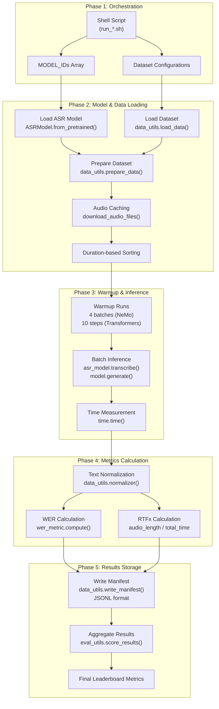
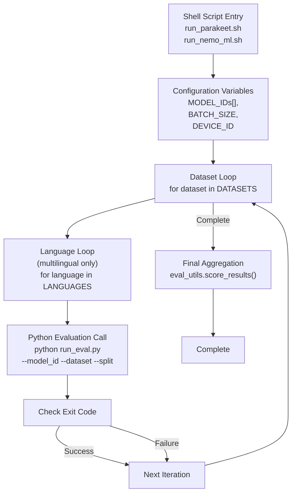
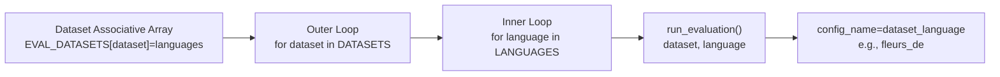
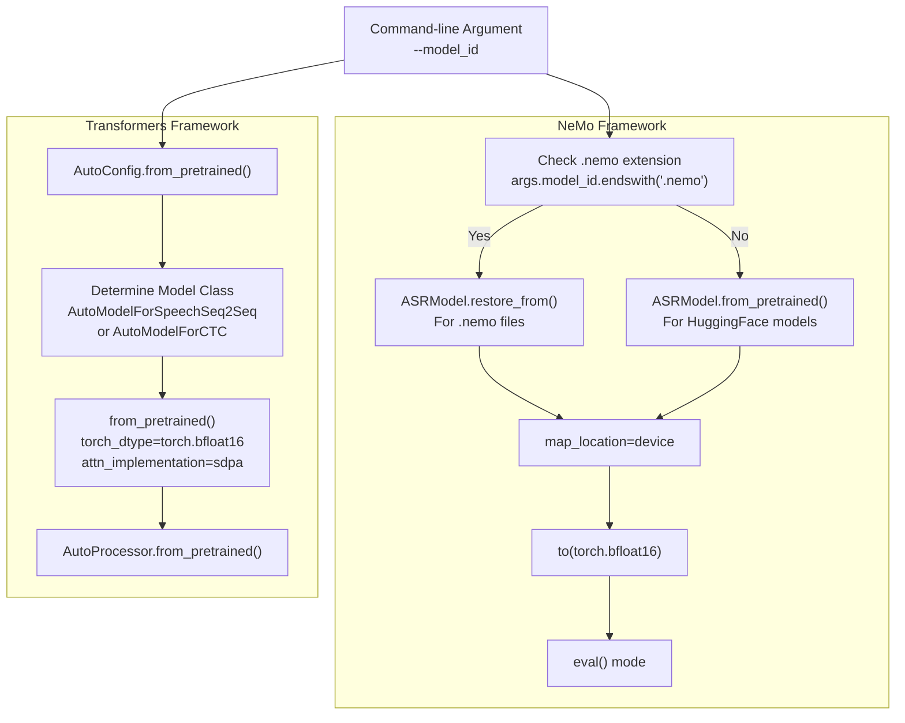
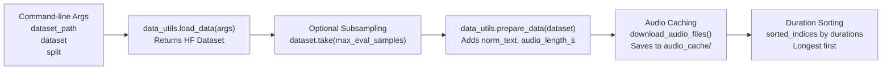
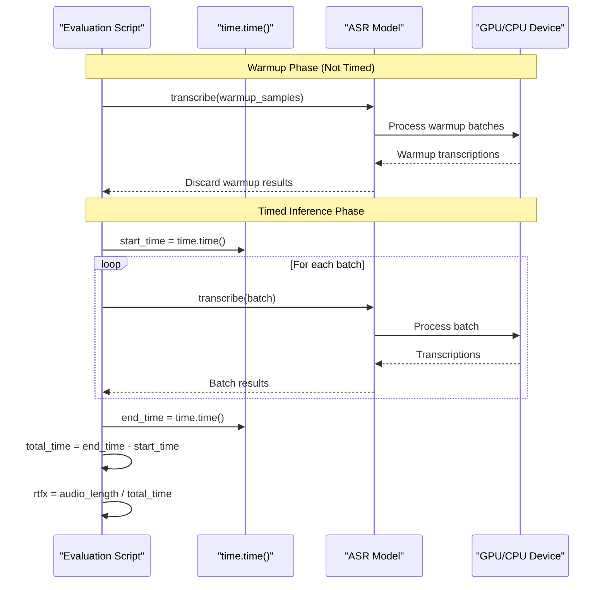
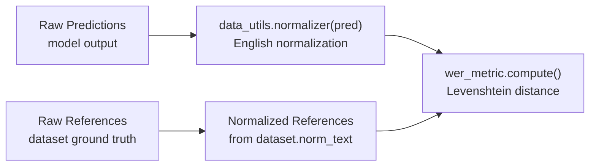
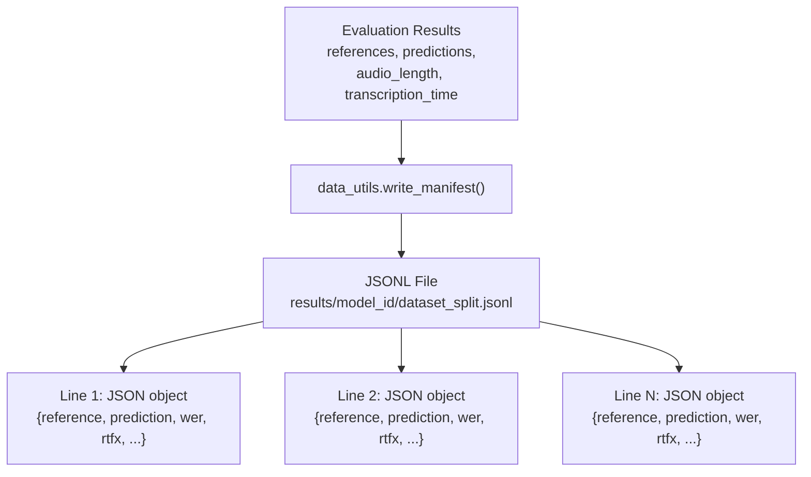

<!-- source: DeepWiki mcp.deepwiki.com · repo huggingface/open_asr_leaderboard · page 2.1 Evaluation Workflow · fetched 2026-10-26 -->

# Evaluation Workflow

<details>
<summary>Relevant source files</summary>

The following files were used as context for generating this wiki page:

- [nemo_asr/run_eval.py](nemo_asr/run_eval.py)
- [nemo_asr/run_nemo_ml.sh](nemo_asr/run_nemo_ml.sh)
- [nemo_asr/run_parakeet.sh](nemo_asr/run_parakeet.sh)
- [transformers/run_eval.py](transformers/run_eval.py)

</details>


## Purpose and Scope

This page describes the canonical evaluation workflow used across all ASR frameworks in the Open ASR Leaderboard. The workflow consists of five distinct phases: orchestration, model and data loading, warmup and inference, metrics calculation, and results aggregation. Each evaluation framework (NeMo, Transformers, API, etc.) follows this identical pattern to ensure consistent and reproducible benchmarking.

For information about the specific data processing utilities used in this workflow, see [Data Utils](#3.2). For details on metric calculation algorithms, see [Metrics Calculation](#2.3). For framework-specific implementation details, see [Evaluation Frameworks](#4).

---

## Workflow Overview

The evaluation workflow is designed as a multi-phase pipeline that processes one model against multiple datasets. Each phase has a specific responsibility, and all frameworks implement these phases in a consistent manner.

### Five-Phase Architecture



**Sources:** [nemo_asr/run_eval.py:1-226](), [transformers/run_eval.py:1-237](), [nemo_asr/run_parakeet.sh:1-104]()

---

## Phase 1: Orchestration

Shell scripts orchestrate the evaluation process by iterating through model IDs and dataset configurations. This phase determines which models and datasets to evaluate, and manages the execution flow.

### Shell Script Structure



**Sources:** [nemo_asr/run_parakeet.sh:1-104](), [nemo_asr/run_nemo_ml.sh:1-96]()

### Configuration Parameters

| Parameter | Description | Example Value | Location |
|-----------|-------------|---------------|----------|
| `MODEL_ID` | Model identifier (HF Hub or .nemo file) | `"nvidia/parakeet-tdt-0.6b-v3"` | [nemo_asr/run_nemo_ml.sh:10]() |
| `BATCH_SIZE` | Number of samples per batch | `64`, `128` | [nemo_asr/run_parakeet.sh:15]() |
| `DEVICE_ID` | GPU device index | `0`, `1`, etc. | [nemo_asr/run_parakeet.sh:16]() |
| `DATASETS` | Dataset repository path | `"hf-audio/esb-datasets-test-only-sorted"` | [nemo_asr/run_parakeet.sh:27]() |

**Sources:** [nemo_asr/run_parakeet.sh:1-20](), [nemo_asr/run_nemo_ml.sh:9-14]()

### Multilingual Orchestration

For multilingual evaluations, the orchestration script includes an additional loop over languages:



**Sources:** [nemo_asr/run_nemo_ml.sh:20-84]()

The `run_evaluation()` function constructs a configuration name by combining dataset and language (e.g., `fleurs_en`, `mcv_de`), which is passed to the Python evaluation script.

**Sources:** [nemo_asr/run_nemo_ml.sh:29-64]()

---

## Phase 2: Model and Data Loading

This phase loads the ASR model into memory and prepares the evaluation dataset. Both operations occur at the start of the Python evaluation script.

### Model Loading

#### Code Entity Mapping: Model Loading



**Sources:** [nemo_asr/run_eval.py:38-44](), [transformers/run_eval.py:14-19]()

#### NeMo Model Loading

NeMo supports loading models from two sources:
1. **Local .nemo files**: Restored using `ASRModel.restore_from()` at [nemo_asr/run_eval.py:39]()
2. **HuggingFace Hub**: Loaded using `ASRModel.from_pretrained()` at [nemo_asr/run_eval.py:41]()

Both paths convert the model to `torch.bfloat16` dtype for efficient inference and set the model to evaluation mode.

**Sources:** [nemo_asr/run_eval.py:38-44]()

#### Transformers Model Loading

Transformers models are loaded based on their configuration:
1. Load configuration using `AutoConfig.from_pretrained()` at [transformers/run_eval.py:15]()
2. Determine model class (encoder-decoder or CTC) at [transformers/run_eval.py:16]()
3. Load model with `bfloat16` dtype and SDPA attention at [transformers/run_eval.py:17]()
4. Load processor for audio preprocessing at [transformers/run_eval.py:18]()

**Sources:** [transformers/run_eval.py:14-19]()

### Dataset Loading and Preparation

#### Code Entity Flow: Data Processing



**Sources:** [nemo_asr/run_eval.py:46-120](), [transformers/run_eval.py:100-121]()

#### Dataset Loading

The `data_utils.load_data()` function loads datasets from HuggingFace, supporting both streaming and full download modes. The function is called at [nemo_asr/run_eval.py:46]() and [transformers/run_eval.py:100]().

**Sources:** [nemo_asr/run_eval.py:46](), [transformers/run_eval.py:113]()

#### Audio Caching (NeMo-specific)

NeMo evaluations cache audio files to disk for efficient repeated access. The `download_audio_files()` function at [nemo_asr/run_eval.py:48-88]() performs the following:

1. **ID sanitization**: Converts hierarchical IDs to flat filenames (e.g., `earnings22/test/4432298/281.wav` → `earnings22_test_4432298_281.wav`) at [nemo_asr/run_eval.py:61]()
2. **Audio extraction**: Handles both array and bytes formats at [nemo_asr/run_eval.py:65-74]()
3. **File writing**: Saves audio as WAV files using `soundfile.write()` at [nemo_asr/run_eval.py:78]()
4. **Duration calculation**: Computes duration as `len(audio_array) / sample_rate` at [nemo_asr/run_eval.py:81]()

Cache directory structure: `audio_cache/{DATASET_NAME}/{SPLIT_NAME}/{id}.wav`

**Sources:** [nemo_asr/run_eval.py:22-28, 48-88]()

#### Duration-based Sorting

To minimize padding waste and optimize GPU utilization, audio files are sorted by duration in descending order. This ensures that batches contain files of similar length:

```python
# Sort by duration (longest first)
sorted_indices = sorted(range(len(all_data["durations"])), 
                       key=lambda k: all_data["durations"][k], 
                       reverse=True)
```

This sorting operation occurs at [nemo_asr/run_eval.py:116-120]().

**Sources:** [nemo_asr/run_eval.py:116-120]()

---

## Phase 3: Warmup and Inference

This phase performs model inference to generate transcriptions. It includes optional warmup runs to stabilize timing measurements and ensure fair performance comparisons.

### Warmup Strategy

Different frameworks use different warmup approaches:

| Framework | Warmup Strategy | Code Location |
|-----------|-----------------|---------------|
| NeMo | 4 batches (fixed) | [nemo_asr/run_eval.py:124-126]() |
| Transformers | 10 steps × batch_size samples (configurable) | [transformers/run_eval.py:99-111]() |

#### NeMo Warmup

NeMo performs warmup using the first 4 batches of data:

```python
for _ in range(2):  # warmup once and calculate rtf
    if _ == 0:
        audio_files = all_data["audio_filepaths"][:args.batch_size * 4]  # warmup with 4 batches
    else:
        audio_files = all_data["audio_filepaths"]
```

The first iteration (warmup) uses only `batch_size * 4` samples, while the second iteration processes all samples for timing.

**Sources:** [nemo_asr/run_eval.py:124-144]()

#### Transformers Warmup

Transformers supports configurable warmup via `--warmup_steps` argument (default: 10):

```python
num_warmup_samples = args.warmup_steps * args.batch_size
warmup_dataset = dataset.take(num_warmup_samples)
warmup_dataset = iter(warmup_dataset.map(benchmark, batch_size=args.batch_size, ...))

for _ in tqdm(warmup_dataset, desc="Warming up..."):
    continue
```

**Sources:** [transformers/run_eval.py:99-111]()

### Inference Execution

#### Inference Timing Sequence



**Sources:** [nemo_asr/run_eval.py:124-144](), [transformers/run_eval.py:36-92]()

#### NeMo Inference

NeMo inference uses the `transcribe()` method with batch processing:

```python
with torch.inference_mode(), torch.no_grad():
    if 'canary' in args.model_id:
        # Canary models require pnc parameter
        transcriptions = asr_model.transcribe(
            audio_files, 
            batch_size=args.batch_size, 
            verbose=False, 
            pnc=pnc,  # 'nopnc' for v1, 'pnc' for v2
            num_workers=1
        )
    else:
        transcriptions = asr_model.transcribe(
            audio_files, 
            batch_size=args.batch_size, 
            verbose=False, 
            num_workers=1
        )
```

Timing wraps the entire transcription process at [nemo_asr/run_eval.py:129-143]().

**Sources:** [nemo_asr/run_eval.py:129-143]()

#### Transformers Inference

Transformers inference occurs within a `benchmark()` function that times each batch individually:

```python
def benchmark(batch, min_new_tokens=None):
    audios = [audio["array"] for audio in batch["audio"]]
    
    # START TIMING
    start_time = time.time()
    
    # 1. Pre-processing: audio -> input features
    inputs = processor(audios, sampling_rate=16_000, ...)
    
    # 2. Model inference
    if model.can_generate():
        pred_ids = model.generate(**inputs, **gen_kwargs)
    else:
        logits = model(**inputs).logits
        pred_ids = logits.argmax(-1)
    
    # 3. Post-processing: token ids -> text
    pred_text = processor.batch_decode(pred_ids, skip_special_tokens=True)
    
    # END TIMING
    runtime = time.time() - start_time
    
    # Normalize by minibatch size for per-sample time
    batch["transcription_time_s"] = minibatch_size * [runtime / minibatch_size]
```

This per-batch timing approach at [transformers/run_eval.py:36-92]() provides more granular time measurements compared to NeMo's aggregate timing.

**Sources:** [transformers/run_eval.py:36-97]()

### Framework-Specific Optimizations

#### Torch Compile (Transformers)

When `--torch_compile` is enabled, Transformers applies JIT compilation to the forward pass:

```python
if args.torch_compile:
    model.forward = torch.compile(model.forward, mode=args.compile_mode, fullgraph=True)
    if model.can_generate():
        # Enable static k/v cache for autoregressive models
        model.generation_config.cache_implementation = "static"
```

This optimization at [transformers/run_eval.py:30-34]() can significantly improve RTFx for autoregressive models.

**Sources:** [transformers/run_eval.py:30-35]()

#### Decoding Strategy (NeMo)

NeMo ensures models use greedy batch decoding for consistent results:

```python
if asr_model.cfg.decoding.strategy != "beam":
    asr_model.cfg.decoding.strategy = "greedy_batch"
    asr_model.change_decoding_strategy(asr_model.cfg.decoding)
```

**Sources:** [nemo_asr/run_eval.py:96-98]()

---

## Phase 4: Metrics Calculation

After inference, predictions are normalized and compared against reference transcriptions to compute Word Error Rate (WER) and Real-Time Factor (RTFx).

### Text Normalization

#### Normalization Pipeline



**Sources:** [nemo_asr/run_eval.py:146-149](), [transformers/run_eval.py:94-96]()

Both predictions and references undergo text normalization before WER calculation:

1. **Predictions**: Normalized using `data_utils.normalizer()` at [nemo_asr/run_eval.py:149]() and [transformers/run_eval.py:95]()
2. **References**: Pre-normalized during data preparation via `data_utils.prepare_data()`, stored as `norm_text` field

**Sources:** [nemo_asr/run_eval.py:146-149](), [transformers/run_eval.py:94-96]()

### WER Calculation

WER is computed using the HuggingFace `evaluate` library's `wer` metric:

```python
wer_metric = evaluate.load("wer")

wer = wer_metric.compute(
    references=all_data['references'], 
    predictions=predictions
)
wer = round(100 * wer, 2)  # Convert to percentage
```

The metric is loaded at [nemo_asr/run_eval.py:17]() and [transformers/run_eval.py:11](), then computed at [nemo_asr/run_eval.py:167-168]() and [transformers/run_eval.py:150-153]().

**Sources:** [nemo_asr/run_eval.py:17, 167-168](), [transformers/run_eval.py:11, 150-153]()

### RTFx Calculation

Real-Time Factor (RTFx) measures inference speed as the ratio of audio duration to processing time:

```
RTFx = total_audio_duration / total_transcription_time
```

Higher RTFx values indicate faster-than-realtime processing. An RTFx of 10 means the system processes audio 10× faster than realtime.

#### NeMo RTFx Calculation

```python
audio_length = sum(all_data["durations"])
rtfx = audio_length / total_time
rtfx = round(rtfx, 2)
```

**Sources:** [nemo_asr/run_eval.py:171-173]()

#### Transformers RTFx Calculation

```python
rtfx = round(
    sum(all_results["audio_length_s"]) / sum(all_results["transcription_time_s"]), 
    2
)
```

**Sources:** [transformers/run_eval.py:154]()

### Timing Methodology Comparison

| Aspect | NeMo | Transformers |
|--------|------|--------------|
| Granularity | Aggregate (all batches) | Per-batch |
| Warmup | 4 batches excluded | Separate warmup run |
| Time attribution | Average time per sample | Exact time per sample |
| Implementation | Single timer for all inference | Timer in batch mapping function |

**Sources:** [nemo_asr/run_eval.py:124-144](), [transformers/run_eval.py:36-92]()

---

## Phase 5: Results Storage and Aggregation

The final phase writes per-sample results to JSONL manifest files and aggregates metrics across all datasets for a model.

### Manifest File Structure

Results are stored in JSONL (JSON Lines) format, with one JSON object per sample:



**Sources:** [nemo_asr/run_eval.py:154-163](), [transformers/run_eval.py:138-147]()

The `write_manifest()` function is called with:
- `references`: Ground truth transcriptions
- `predictions`: Model outputs (normalized)
- `model_id`: Model identifier
- `dataset_path`: Dataset repository
- `dataset`: Dataset name
- `split`: Dataset split (e.g., "test")
- `audio_length`: Duration of each audio file
- `transcription_time`: Time taken to transcribe each file

**Sources:** [nemo_asr/run_eval.py:154-163](), [transformers/run_eval.py:138-147]()

### Results Aggregation

After evaluating a model on all datasets, the shell script calls `eval_utils.score_results()` to aggregate metrics:

```bash
# From run_parakeet.sh
RUNDIR=`pwd` && \
cd ../normalizer && \
python -c "import eval_utils; eval_utils.score_results('${RUNDIR}/results', '${MODEL_ID}')" && \
cd $RUNDIR
```

**Sources:** [nemo_asr/run_parakeet.sh:98-101](), [nemo_asr/run_nemo_ml.sh:92-95]()

This aggregation step:
1. Reads all manifest files for a given model
2. Computes average WER across datasets
3. Computes average RTFx across datasets
4. Generates summary statistics for the leaderboard

For detailed information about the aggregation algorithm, see [Eval Utils](#3.3).

---

## Command-Line Arguments Reference

### Common Arguments

These arguments are supported across all evaluation frameworks:

| Argument | Type | Default | Description | Example |
|----------|------|---------|-------------|---------|
| `--model_id` | `str` | Required | Model identifier (HF Hub or .nemo file) | `"nvidia/parakeet-tdt-0.6b-v3"` |
| `--dataset_path` | `str` | `"esb/datasets"` | Dataset repository path | `"hf-audio/esb-datasets-test-only-sorted"` |
| `--dataset` | `str` | Required | Dataset name from ESB benchmark | `"librispeech"`, `"ami"` |
| `--split` | `str` | `"test"` | Dataset split to evaluate | `"test"`, `"validation"`, `"test.clean"` |
| `--device` | `int` | `-1` | GPU device index (-1 for CPU) | `0`, `1`, `2` |
| `--batch_size` | `int` | Framework-specific | Number of samples per batch | `32`, `64`, `128` |
| `--max_eval_samples` | `int` | `None` | Limit evaluation to N samples | `64` (for testing), `-1` (all) |
| `--no-streaming` | flag | Varies | Download entire dataset vs. streaming | - |

**Sources:** [nemo_asr/run_eval.py:180-223](), [transformers/run_eval.py:158-234]()

### Framework-Specific Arguments

#### Transformers-Only Arguments

| Argument | Type | Default | Description |
|----------|------|---------|-------------|
| `--max_new_tokens` | `int` | `None` | Maximum tokens to generate (autoregressive only) |
| `--torch_compile` | flag | `False` | Enable JIT compilation with torch.compile |
| `--compile_mode` | `str` | `"max-autotune"` | Compilation mode: `"default"`, `"reduce-overhead"`, `"max-autotune"` |
| `--warmup_steps` | `int` | `10` | Number of warmup steps before timed runs |

**Sources:** [transformers/run_eval.py:211-232]()

#### NeMo Multilingual Arguments

For multilingual evaluations ([nemo_asr/run_eval_ml.py]()):
- `--config_name`: Combined dataset and language (e.g., `"fleurs_de"`)
- `--language`: Language code (e.g., `"en"`, `"de"`, `"fr"`)

**Sources:** [nemo_asr/run_nemo_ml.sh:44-48]()

---

## Framework Variations

While all frameworks follow the same five-phase workflow, implementation details vary:

### Key Differences Summary

| Feature | NeMo | Transformers |
|---------|------|--------------|
| **Audio Caching** | Yes (to disk) | No (in-memory) |
| **Duration Sorting** | Yes (descending) | No |
| **Warmup Strategy** | 4 batches | 10 steps (configurable) |
| **Timing Granularity** | Aggregate | Per-batch |
| **Optimization** | None | Optional torch.compile |
| **Model Loading** | ASRModel API | AutoModel API |
| **Processor** | Included in model | Separate AutoProcessor |

**Sources:** [nemo_asr/run_eval.py:1-226](), [transformers/run_eval.py:1-237]()

### When to Use Each Approach

- **Use NeMo workflow** ([run_eval.py]()) for:
  - NVIDIA NeMo models (.nemo files)
  - Models requiring audio caching for repeated evaluation
  - Scenarios where duration-based sorting improves efficiency

- **Use Transformers workflow** ([run_eval.py]()) for:
  - HuggingFace Transformers models
  - Models benefiting from torch.compile optimization
  - Scenarios requiring per-sample timing granularity

For detailed framework-specific information, see:
- [NeMo ASR Framework](#4.1)
- [Transformers Framework](#4.2)

**Sources:** [nemo_asr/run_eval.py:1-226](), [transformers/run_eval.py:1-237]()

---

