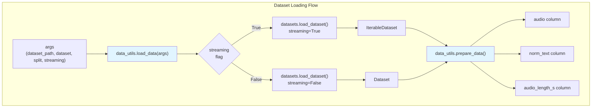
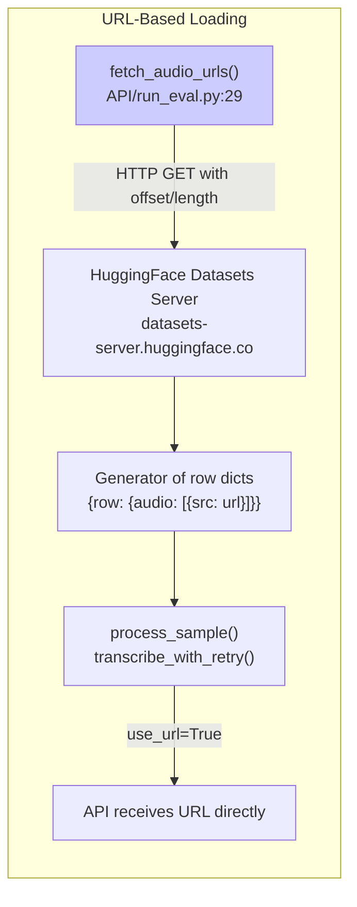
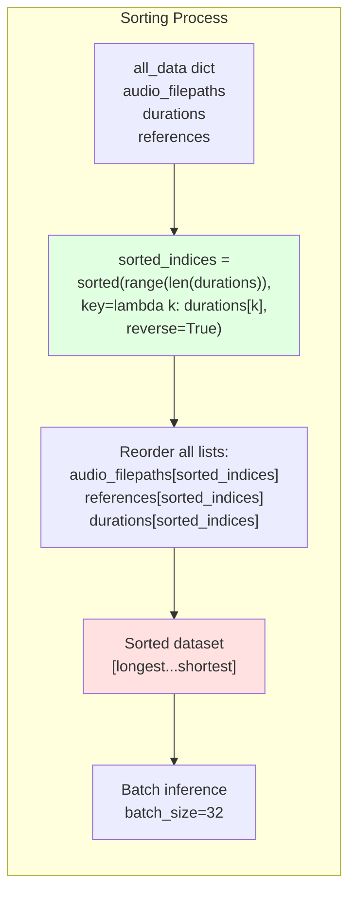
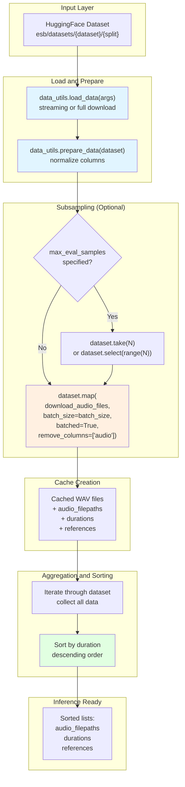
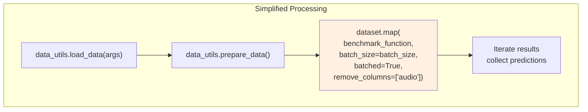

<!-- source: DeepWiki mcp.deepwiki.com · repo huggingface/open_asr_leaderboard · page 2.2 Data Processing · fetched 2026-10-26 -->

# Data Processing

<details>
<summary>Relevant source files</summary>

The following files were used as context for generating this wiki page:

- [api/run_api.sh](api/run_api.sh)
- [api/run_eval.py](api/run_eval.py)
- [granite/run_eval.py](granite/run_eval.py)
- [granite/run_granite.sh](granite/run_granite.sh)
- [nemo_asr/run_eval.py](nemo_asr/run_eval.py)
- [requirements/requirements-api.txt](requirements/requirements-api.txt)
- [requirements/requirements_granite.txt](requirements/requirements_granite.txt)

</details>


## Purpose and Scope

This document describes the data processing pipeline used across all evaluation frameworks in the Open ASR Leaderboard. Data processing encompasses dataset loading, audio file caching, duration-based sorting, and batch preparation. These operations occur in Phase 2 of the evaluation pipeline, between orchestration and inference.

For information about the overall evaluation workflow and phases, see [Evaluation Workflow](#2.1). For details on the `data_utils` functions referenced throughout this document, see [Data Utils](#3.2). For the list of supported datasets, see [Supported Datasets](#5.1).

---

## Dataset Loading

### Loading Methods

The repository supports two dataset loading methods, controlled by the `--streaming` flag:

| Method | Default | Advantage | Use Case |
|--------|---------|-----------|----------|
| **Streaming** | Yes (most frameworks) | Memory efficient, no disk usage | Large datasets, limited storage |
| **Full Download** | No | Faster repeated access, enables sorting | Small datasets, repeated evaluations |

The loading is handled by `data_utils.load_data()`, which abstracts the HuggingFace Datasets API:



**Sources:** [nemo_asr/run_eval.py:46](), [api/run_eval.py:312](), [granite/run_eval.py:87-88]()

### Dataset Sources

Datasets are loaded from HuggingFace Hub, typically from the `esb/datasets` or `hf-audio/esb-datasets-test-only-sorted` repositories. The standard loading pattern is:

```python
dataset = data_utils.load_data(args)
dataset = data_utils.prepare_data(dataset)
```

The `prepare_data()` function normalizes column names and computes audio durations. After preparation, datasets have consistent schema:
- `audio`: Dictionary with `array` (audio samples) and `sampling_rate` fields
- `norm_text`: Normalized reference transcription
- `audio_length_s`: Duration in seconds
- `id`: Unique sample identifier

**Sources:** [nemo_asr/run_eval.py:46](), [nemo_asr/run_eval.py:95](), [granite/run_eval.py:100](), [granite/run_eval.py:107]()

### URL-Based Fetching

The API evaluation framework (`api/run_eval.py`) supports an alternative loading method using direct URL fetching via the HuggingFace Datasets Server API. This avoids downloading audio files when the API accepts URLs:



This approach is enabled with `--use_url` flag and is particularly useful for APIs like AssemblyAI and Rev.ai that support URL-based transcription, reducing bandwidth and eliminating temporary file creation.

**Sources:** [api/run_eval.py:29-66](), [api/run_eval.py:99-101](), [api/run_eval.py:156](), [api/run_eval.py:224-228]()

---

## Audio Cache System

### Cache Architecture

To enable efficient batch processing and duration-based sorting, NeMo-based evaluations cache audio files to disk. The cache directory structure follows this pattern:

```
audio_cache/
├── {DATASET_NAME}/
│   └── {SPLIT_NAME}/
│       ├── {ID_1}.wav
│       ├── {ID_2}.wav
│       └── ...
```

The cache system is implemented in the `download_audio_files` function:

```mermaid
graph TB
    subgraph "Audio Caching Flow"
        Batch["Batch of samples<br/>(id, audio, norm_text)"]
        DownloadFunc["download_audio_files()<br/>nemo_asr/run_eval.py:48"]
        
        Batch --> DownloadFunc
        
        DownloadFunc --> Loop["For each sample"]
        
        Loop --> CleanID["Clean ID<br/>replace '/' with '_'<br/>remove '.wav' suffix"]
        CleanID --> PathCalc["audio_path =<br/>CACHE_DIR/{id}.wav"]
        
        PathCalc --> CheckExists{"File<br/>exists?"}
        
        CheckExists -->|No| HandleFormat{"Audio<br/>format"}
        CheckExists -->|Yes| AppendPath
        
        HandleFormat -->|"array" key| ArrayToWav["np.float32(array)<br/>sr=16000"]
        HandleFormat -->|"bytes" key| BytesToWav["soundfile.read()<br/>from BytesIO"]
        
        ArrayToWav --> WriteWav["soundfile.write()<br/>audio_path"]
        BytesToWav --> WriteWav
        
        WriteWav --> AppendPath["Append to<br/>audio_filepaths list"]
        AppendPath --> CalcDuration["duration =<br/>len(array) / sr"]
        
        CalcDuration --> UpdateBatch["Update batch:<br/>audio_filepaths<br/>durations<br/>references"]
    end
    
    style DownloadFunc fill:#e1f5ff
    style WriteWav fill:#fff0e1
```



**Sources:** [nemo_asr/run_eval.py:48-88](), [nemo_asr/run_eval.py:22-28]()

### Audio Format Handling

The cache system handles two audio formats produced by different versions of the HuggingFace `datasets` library:

1. **Array format** (older datasets library): Audio data as NumPy array with `array` and `sampling_rate` keys
2. **Bytes format** (datasets 3.x+): Audio data as byte stream with `bytes` key

```python
# Array format handling
if "array" in sample:
    audio_array = np.float32(sample["array"])
    sample_rate = 16000

# Bytes format handling  
elif "bytes" in sample:
    with io.BytesIO(sample["bytes"]) as audio_file:
        audio_array, sample_rate = soundfile.read(audio_file, dtype="float32")
```

All audio is normalized to 16kHz mono WAV files for consistent processing across models.

**Sources:** [nemo_asr/run_eval.py:65-74]()

### ID Sanitization

Dataset IDs are sanitized to create valid filenames and ensure uniqueness. This is critical for hierarchical datasets like `earnings22` where multiple files may share the same base filename (e.g., `281.wav`) in different directories:

```python
# Transform: earnings22/test/4432298/281.wav -> earnings22_test_4432298_281
id = id.replace('/', '_').removesuffix('.wav')
```

This prevents file collisions and ensures compatibility with downstream tools like `lhotse` that use filenames as unique identifiers.

**Sources:** [nemo_asr/run_eval.py:56-61]()

---

## Duration-Based Sorting

### Rationale

After downloading all audio files, the dataset is sorted by duration in descending order (longest files first). This optimization serves two purposes:

1. **Minimizes padding waste**: Grouping similar-length files in batches reduces the amount of padding needed
2. **Stabilizes RTFx measurements**: Processing longest files first ensures consistent GPU utilization patterns



**Implementation Details:**

The sorting is performed after all files are cached and before inference begins:

```python
# Sort audio_filepaths and references based on durations values
sorted_indices = sorted(range(len(all_data["durations"])), 
                       key=lambda k: all_data["durations"][k], 
                       reverse=True)
all_data["audio_filepaths"] = [all_data["audio_filepaths"][i] for i in sorted_indices]
all_data["references"] = [all_data["references"][i] for i in sorted_indices]
all_data["durations"] = [all_data["durations"][i] for i in sorted_indices]
```

**Sources:** [nemo_asr/run_eval.py:116-120]()

### Pre-sorted Datasets

Some dataset repositories provide pre-sorted variants (e.g., `hf-audio/esb-datasets-test-only-sorted`) that eliminate the need for runtime sorting. These are used in API evaluations where the full dataset is not downloaded locally.

**Sources:** [api/run_api.sh:31](), [granite/run_granite.sh:27]()

---

## Data Transformation Pipeline

### Complete Processing Flow

The following diagram shows the complete data transformation from raw dataset to model-ready batches:



**Sources:** [nemo_asr/run_eval.py:46](), [nemo_asr/run_eval.py:91-93](), [nemo_asr/run_eval.py:95](), [nemo_asr/run_eval.py:101](), [nemo_asr/run_eval.py:105-120]()

### Alternative Pattern: In-Memory Processing

Frameworks that don't require sorting (e.g., Granite, API evaluations) use a simpler pattern with direct batch processing:



This pattern processes audio in-memory without caching, passing raw audio arrays directly to the model. The `benchmark` function (or equivalent) handles:
- Audio format extraction (`audio["array"]`)
- Model preprocessing
- Inference timing
- Text normalization

**Sources:** [granite/run_eval.py:87-111](), [api/run_eval.py:326-369]()

---

## Batch Processing Configuration

### Batch Size Selection

Batch size is configurable per framework and model, balancing throughput against memory constraints:

| Framework | Typical Batch Size | Rationale |
|-----------|-------------------|-----------|
| NeMo Standard | 32 | Optimal for CTC-based models |
| NeMo Canary | 32 | Balanced for multilingual models |
| NeMo Parakeet TDT | 160 | Fast decoding with TDT |
| Transformers | 16 | Autoregressive overhead |
| Granite 2B | 160 | Efficient multimodal processing |
| Granite 8B | 64 | Memory constraint for larger model |
| API | N/A | Concurrent workers instead |

Batch processing occurs at different stages depending on framework:

**NeMo Pattern:**
```python
# Cache files in batches
dataset = dataset.map(download_audio_files, 
                     batch_size=args.batch_size, 
                     batched=True)

# Then transcribe with same batch_size
transcriptions = asr_model.transcribe(audio_files, 
                                     batch_size=args.batch_size)
```

**Transformers Pattern:**
```python
# Process in batches during map
dataset = dataset.map(benchmark, 
                     batch_size=args.batch_size, 
                     batched=True)
```

**Sources:** [nemo_asr/run_eval.py:101](), [nemo_asr/run_eval.py:138-140](), [granite/run_eval.py:109-111]()

### Concurrent Processing (API Framework)

API evaluations use concurrent workers instead of batching:

```python
with concurrent.futures.ThreadPoolExecutor(max_workers=max_workers) as executor:
    future_to_sample = {
        executor.submit(process_sample, sample): sample 
        for sample in ds
    }
```

The `max_workers` parameter (default 300 for some APIs, 10 for others) controls concurrent request throughput. Each worker independently:
1. Creates temporary WAV file (if not using URLs)
2. Submits transcription request
3. Waits for response
4. Cleans up temporary file

**Sources:** [api/run_eval.py:371-386](), [api/run_api.sh:23]()

---

## Memory and Storage Considerations

### Cache Size Estimation

Audio cache size depends on dataset size and audio duration:

```
Cache Size ≈ (Average Duration × Sample Count × 16000 Hz × 2 bytes/sample)
           ≈ (Average Duration × Sample Count × 32 KB/second)
```

Example for LibriSpeech test-clean (2,620 samples, ~5.4 hours total):
```
Cache Size ≈ 5.4 hours × 32 KB/second × 3600 s/hour
           ≈ 622 MB
```

Complete ESB benchmark (8 datasets, ~25 hours total) requires approximately 2.8 GB cache space.

### Cache Persistence

Cache directories are reused across evaluations of different models on the same dataset. The existence check `if not os.path.exists(audio_path)` prevents re-downloading:

```python
if not os.path.exists(audio_path):
    os.makedirs(os.path.dirname(audio_path), exist_ok=True)
    soundfile.write(audio_path, audio_array, sample_rate)
```

This optimization significantly speeds up multi-model evaluations on the same dataset.

**Sources:** [nemo_asr/run_eval.py:76-78]()

### Streaming vs. Full Download Trade-offs

| Aspect | Streaming | Full Download |
|--------|-----------|---------------|
| **Memory** | Constant (one batch) | O(dataset size) |
| **Disk** | None (API) or cache only (NeMo) | Dataset + cache |
| **First-run speed** | Slower (network I/O) | Slower (full download) |
| **Subsequent runs** | Same | Faster (local access) |
| **Sorting support** | No (iterative only) | Yes |
| **Subsampling** | `take(N)` | `select(range(N))` |

**Sources:** [nemo_asr/run_eval.py:217-223](), [granite/run_eval.py:198-202]()

---

