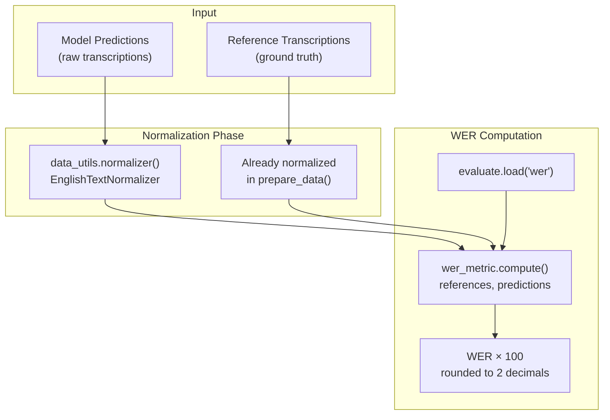
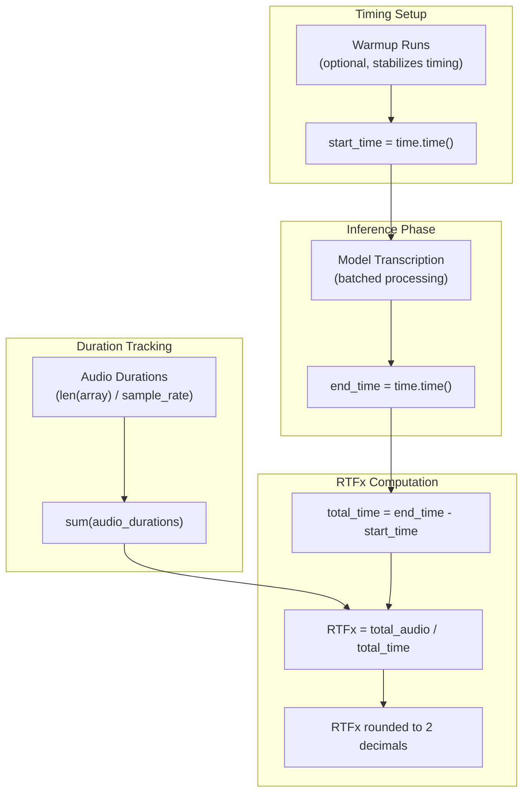
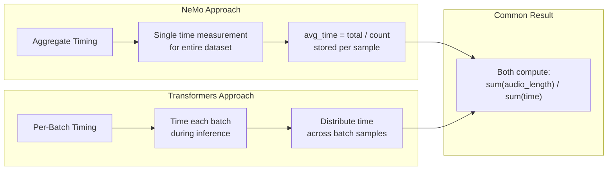
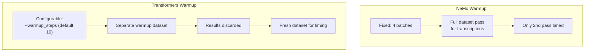
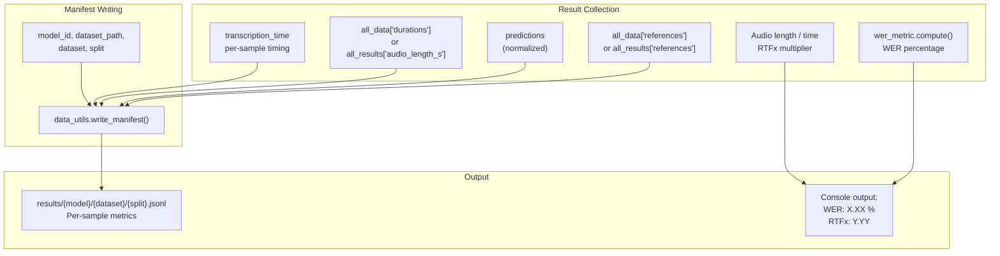
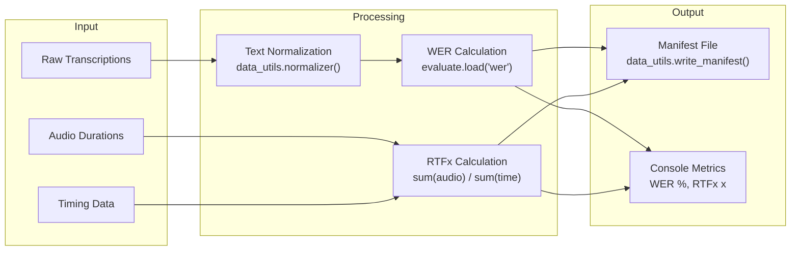

<!-- source: DeepWiki mcp.deepwiki.com · repo huggingface/open_asr_leaderboard · page 2.3 Metrics Calculation · fetched 2026-10-26 -->

# Metrics Calculation

<details>
<summary>Relevant source files</summary>

The following files were used as context for generating this wiki page:

- [nemo_asr/run_eval.py](nemo_asr/run_eval.py)
- [normalizer/__init__.py](normalizer/__init__.py)
- [normalizer/english_abbreviations.py](normalizer/english_abbreviations.py)
- [normalizer/normalizer.py](normalizer/normalizer.py)
- [transformers/run_eval.py](transformers/run_eval.py)

</details>


This page details how the Open ASR Leaderboard computes **Word Error Rate (WER)** and **Real-Time Factor (RTFx)** metrics for evaluating ASR model performance. These metrics are calculated after model inference and text normalization, and before result aggregation.

For information about the overall evaluation workflow that includes these metrics, see [Evaluation Workflow](#2.1). For details on text normalization applied before metrics calculation, see [Normalizer Module](#3.1). For information on how metrics are aggregated across datasets, see [Eval Utils](#3.3).

---

## Overview of Metrics

The leaderboard computes two primary metrics for each evaluated model:

| Metric | Definition | Unit | Interpretation |
|--------|-----------|------|----------------|
| **WER** | Word Error Rate - percentage of word-level errors (insertions, deletions, substitutions) | % | Lower is better (0% = perfect transcription) |
| **RTFx** | Real-Time Factor - ratio of audio duration to transcription time | x (multiplier) | Higher is better (>1.0 = faster than real-time) |

Both metrics are computed on normalized text to ensure fair comparison across models. The WER metric measures transcription accuracy, while RTFx measures transcription speed.

**Sources:** [nemo_asr/run_eval.py:167-176](), [transformers/run_eval.py:150-155]()

---

## WER Calculation

### Metric Definition

Word Error Rate (WER) is computed using the HuggingFace `evaluate` library's WER implementation. The metric calculates the Levenshtein distance at the word level between predictions and references:

```
WER = (Substitutions + Insertions + Deletions) / Total_Words_in_Reference × 100
```

The result is multiplied by 100 and rounded to 2 decimal places to express it as a percentage.

**Sources:** [nemo_asr/run_eval.py:17](), [transformers/run_eval.py:11]()

### WER Calculation Flow



**Sources:** [nemo_asr/run_eval.py:146-169](), [transformers/run_eval.py:94-96, 150-153]()

### Implementation Details

#### NeMo Framework

In NeMo evaluations, predictions are extracted from the model's transcription result objects and normalized:

```python
# Extract text from NeMo transcription objects
predictions = [data_utils.normalizer(pred.text) for pred in transcriptions]

# Compute WER
wer = wer_metric.compute(references=all_data['references'], predictions=predictions)
wer = round(100 * wer, 2)
```

**Sources:** [nemo_asr/run_eval.py:149, 167-168]()

#### Transformers Framework

In Transformers evaluations, predictions are normalized during the benchmark function:

```python
# Normalize predictions during inference
batch["predictions"] = [data_utils.normalizer(pred) for pred in pred_text]

# Compute WER after collecting all results
wer = wer_metric.compute(
    references=all_results["references"], 
    predictions=all_results["predictions"]
)
wer = round(100 * wer, 2)
```

**Sources:** [transformers/run_eval.py:95, 150-153]()

### Text Normalization Requirements

Before WER calculation, both predictions and references must be normalized to ensure consistent comparison. The normalization process:

1. **Predictions**: Normalized using `data_utils.normalizer()` which applies `EnglishTextNormalizer`
2. **References**: Pre-normalized during data preparation via `prepare_data()`

The `EnglishTextNormalizer` applies:
- Lowercase conversion
- Contraction expansion (e.g., "won't" → "will not")
- Number spelling normalization (e.g., "twenty three" → "23")
- British-to-American spelling conversion (799 mappings)
- Symbol and punctuation removal

For detailed normalization rules, see [Normalizer Module](#3.1).

**Sources:** [nemo_asr/run_eval.py:149](), [transformers/run_eval.py:95](), [normalizer/normalizer.py:528-613]()

---

## RTFx Calculation

### Metric Definition

Real-Time Factor (RTFx) measures the speed of transcription relative to the audio duration:

```
RTFx = Total_Audio_Duration / Total_Transcription_Time
```

Where:
- **Total_Audio_Duration**: Sum of all audio file durations in seconds
- **Total_Transcription_Time**: Total wall-clock time spent transcribing

An RTFx of 1.0 means transcription happens at real-time speed. RTFx > 1.0 means faster than real-time (e.g., RTFx of 10 means the model processes audio 10× faster than playback speed).

**Sources:** [nemo_asr/run_eval.py:171-173](), [transformers/run_eval.py:154]()

### RTFx Calculation Flow



**Sources:** [nemo_asr/run_eval.py:123-144, 171-173](), [transformers/run_eval.py:42-89, 154]()

### Framework-Specific Implementations

#### NeMo Framework RTFx

NeMo calculates RTFx using **aggregate timing** across all samples:

```python
# Single timing measurement for entire dataset
start_time = time.time()
transcriptions = asr_model.transcribe(audio_files, batch_size=args.batch_size)
end_time = time.time()
total_time = end_time - start_time

# Calculate RTFx
audio_length = sum(all_data["durations"])
rtfx = audio_length / total_time
rtfx = round(rtfx, 2)
```

This approach:
- Measures total time for all samples
- Includes any batch processing overhead
- Provides a single RTFx value per dataset

**Sources:** [nemo_asr/run_eval.py:129-144, 171-173]()

#### Transformers Framework RTFx

Transformers calculates RTFx using **per-sample timing** that is later aggregated:

```python
# Per-sample timing
start_time = time.time()
# ... model inference ...
runtime = time.time() - start_time

# Normalize by minibatch size for per-sample time
batch["transcription_time_s"] = minibatch_size * [runtime / minibatch_size]

# Aggregate RTFx across all samples
rtfx = round(sum(all_results["audio_length_s"]) / 
             sum(all_results["transcription_time_s"]), 2)
```

This approach:
- Records time for each batch
- Distributes batch time equally across samples
- Allows for per-sample RTFx analysis in manifests

**Sources:** [transformers/run_eval.py:42, 89, 92, 154]()

### Timing Methodology Comparison



| Aspect | NeMo | Transformers |
|--------|------|--------------|
| **Timing Granularity** | Dataset-level | Batch-level |
| **Per-sample Time** | Average (total/count) | Actual batch time distributed |
| **Manifest Detail** | Uniform time per sample | Variable time per sample |
| **Overhead Inclusion** | All included | Per-batch included |

**Sources:** [nemo_asr/run_eval.py:123-144, 151-163](), [transformers/run_eval.py:42-92, 128-146]()

---

## Warmup Runs

Both frameworks support **warmup runs** to stabilize timing measurements by allowing JIT compilation, GPU initialization, and cache warming before measurement begins.

### NeMo Warmup Strategy

NeMo performs **2 full passes** over the data:
1. **First pass**: Warmup on first 4 batches (excluded from timing)
2. **Second pass**: Timed transcription of all samples

```python
for _ in range(2):  # warmup once and calculate rtf
    if _ == 0:
        audio_files = all_data["audio_filepaths"][:args.batch_size * 4]  # 4 batches
    else:
        audio_files = all_data["audio_filepaths"]  # all samples
    
    start_time = time.time()
    transcriptions = asr_model.transcribe(audio_files, batch_size=args.batch_size)
    end_time = time.time()
    
    if _ == 1:
        total_time += end_time - start_time
```

**Sources:** [nemo_asr/run_eval.py:124-144]()

### Transformers Warmup Strategy

Transformers performs **configurable warmup steps** before the timed run:

```python
if args.warmup_steps is not None:
    num_warmup_samples = args.warmup_steps * args.batch_size
    warmup_dataset = dataset.take(num_warmup_samples)
    warmup_dataset = iter(warmup_dataset.map(benchmark, batch_size=args.batch_size))
    
    for _ in tqdm(warmup_dataset, desc="Warming up..."):
        continue

# Then proceed with timed evaluation
dataset = dataset.map(benchmark, batch_size=args.batch_size)
```

Default warmup: 10 steps (configurable via `--warmup_steps` argument).

**Sources:** [transformers/run_eval.py:99-111, 228-231]()

### Warmup Comparison



| Aspect | NeMo | Transformers |
|--------|------|--------------|
| **Warmup Size** | 4 batches (fixed) | 10 batches (configurable) |
| **Warmup Data** | Subset of evaluation data | Subset of evaluation data |
| **Implementation** | Loop-based (2 iterations) | Separate dataset pass |
| **Transcriptions Used** | Second pass only | Separate timed pass |

**Sources:** [nemo_asr/run_eval.py:124-144](), [transformers/run_eval.py:99-111]()

---

## Result Aggregation and Storage

After computing WER and RTFx, results are stored in JSONL manifest files for auditability and later aggregation.

### Code Entity Mapping for Result Writing



**Sources:** [nemo_asr/run_eval.py:154-176](), [transformers/run_eval.py:138-155]()

### Manifest Structure

Each manifest file contains per-sample results in JSONL format:

```jsonl
{
  "audio_filepath": "path/to/audio.wav",
  "duration": 4.2,
  "text": "normalized reference text",
  "pred_text": "normalized prediction text",
  "wer": 12.5,
  "rtfx": 8.3
}
```

The manifest files enable:
1. **Auditing**: Review individual sample predictions
2. **Aggregation**: Compute dataset-level metrics (see [Eval Utils](#3.3))
3. **Analysis**: Identify patterns in errors or performance

**Sources:** For manifest writing implementation, see [Data Utils](#3.2).

### Console Output

Both frameworks print final metrics to console:

**NeMo Output:**
```python
print("RTFX:", rtfx)
print("WER:", wer, "%")
```

**Transformers Output:**
```python
print("WER:", wer, "%", "RTFx:", rtfx)
```

**Sources:** [nemo_asr/run_eval.py:175-176](), [transformers/run_eval.py:155]()

---

## Summary: Metrics Calculation Pipeline



The metrics calculation phase is crucial for:
- **WER**: Measuring transcription accuracy after normalization
- **RTFx**: Measuring transcription speed relative to audio duration
- **Consistency**: Applying identical metrics across all evaluation frameworks

These metrics form the basis for leaderboard rankings and model comparison.

**Sources:** [nemo_asr/run_eval.py:123-176](), [transformers/run_eval.py:36-155]()

---

