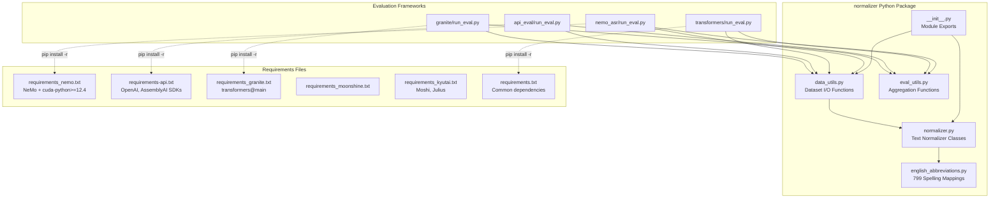
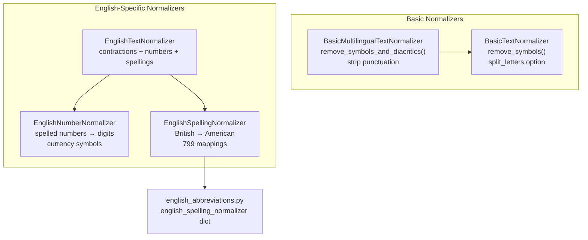
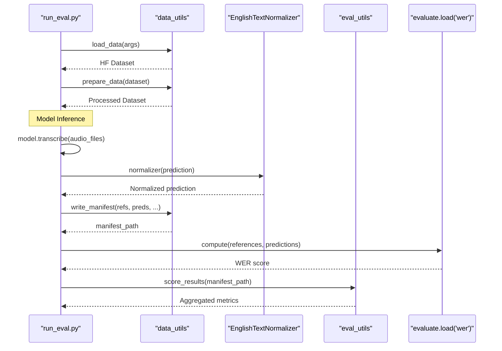
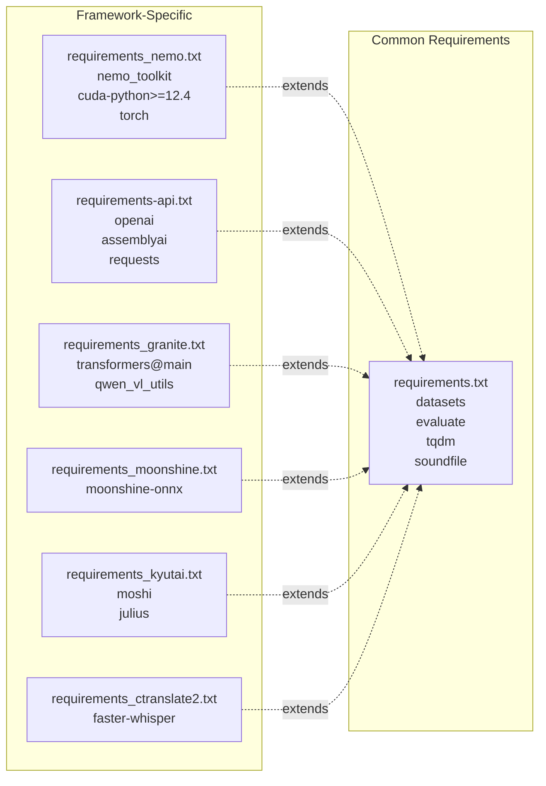

<!-- source: DeepWiki mcp.deepwiki.com · repo huggingface/open_asr_leaderboard · page 3 Shared Infrastructure · fetched 2026-10-26 -->

# Shared Infrastructure

<details>
<summary>Relevant source files</summary>

The following files were used as context for generating this wiki page:

- [README.md](README.md)
- [nemo_asr/run_eval.py](nemo_asr/run_eval.py)
- [normalizer/__init__.py](normalizer/__init__.py)
- [normalizer/english_abbreviations.py](normalizer/english_abbreviations.py)
- [normalizer/normalizer.py](normalizer/normalizer.py)

</details>


## Purpose and Scope

The shared infrastructure provides common utilities and dependencies used across all evaluation frameworks in the Open ASR Leaderboard. This infrastructure ensures consistent dataset handling, text normalization, metric computation, and result aggregation regardless of which ASR framework (NeMo, Transformers, API-based, etc.) is being evaluated.

This document covers the high-level architecture of shared components. For detailed information on specific components, see:
- [Normalizer Module](#3.1) - Text normalization for English and multilingual content
- [Data Utils](#3.2) - Dataset loading and manifest writing functions
- [Eval Utils](#3.3) - Result aggregation functions
- [Requirements Management](#3.4) - Framework-specific dependency management

## Architecture Overview

The shared infrastructure consists of two primary subsystems: the **normalizer module** (Python package) and **requirements management** (configuration files).



**Sources:** [normalizer/__init__.py:1-1](), [normalizer/normalizer.py:1-614](), [normalizer/english_abbreviations.py:1-1742](), [nemo_asr/run_eval.py:10-10](), [README.md:8-14]()

## The normalizer Module

The `normalizer` module is a Python package located in [normalizer/]() that provides text processing utilities shared across all evaluation frameworks. It consists of four main files:

| File | Purpose | Lines of Code |
|------|---------|---------------|
| `normalizer.py` | Text normalizer class implementations | 614 |
| `english_abbreviations.py` | British-American spelling dictionary (799 mappings) | 1742 |
| `data_utils.py` | Dataset loading, preparation, and manifest writing | (framework-specific) |
| `eval_utils.py` | Result aggregation and scoring | (framework-specific) |
| `__init__.py` | Module exports | 1 |

### Module Exports

The module exports two primary normalizer classes via [normalizer/__init__.py:1]():

```python
from .normalizer import EnglishTextNormalizer, BasicMultilingualTextNormalizer
```

These classes are imported by evaluation scripts as:

```python
from normalizer import data_utils
```

**Sources:** [normalizer/__init__.py:1]()

### Text Normalizer Classes

The [normalizer/normalizer.py]() file defines several normalizer classes organized hierarchically:



**Sources:** [normalizer/normalizer.py:76-110](), [normalizer/normalizer.py:112-512](), [normalizer/normalizer.py:514-526](), [normalizer/normalizer.py:528-614]()

#### Class Details

**`BasicTextNormalizer`** [normalizer/normalizer.py:76-93]()
- Removes symbols, brackets, parentheses
- Optional diacritic removal
- Optional letter splitting for CJK languages

**`BasicMultilingualTextNormalizer`** [normalizer/normalizer.py:95-110]()
- Extended version with punctuation removal
- Removes diacritics by default
- Used for non-English datasets

**`EnglishNumberNormalizer`** [normalizer/normalizer.py:112-512]()
- Converts spelled numbers to digits: "twenty one" → "21"
- Handles ordinals: "twenty first" → "21st"
- Processes currency: "$20 million" → "20000000 dollars"
- Supports fractions and decimals

**`EnglishSpellingNormalizer`** [normalizer/normalizer.py:514-526]()
- Applies British→American spelling corrections
- Uses dictionary from [normalizer/english_abbreviations.py:1-1742]()
- Examples: "colour" → "color", "realise" → "realize"

**`EnglishTextNormalizer`** [normalizer/normalizer.py:528-614]()
- Comprehensive English text normalization
- Expands contractions: "won't" → "will not", "can't" → "can not"
- Expands titles: "mr" → "mister", "dr" → "doctor"
- Chains number normalization and spelling correction

**Sources:** [normalizer/normalizer.py:76-614]()

### British-American Spelling Mappings

The [normalizer/english_abbreviations.py:1-1742]() file contains a dictionary named `english_spelling_normalizer` with 799 British→American spelling mappings:

```python
english_spelling_normalizer = {
    "colour": "color",
    "realise": "realize",
    "aluminium": "aluminum",
    "centre": "center",
    # ... 795 more mappings
}
```

This dictionary is used by `EnglishSpellingNormalizer` [normalizer/normalizer.py:521-525]() to ensure consistent American English spelling in all evaluation results.

**Sources:** [normalizer/english_abbreviations.py:1-1742](), [normalizer/normalizer.py:514-526]()

## Data Flow Through Shared Infrastructure

The following diagram shows how evaluation scripts use the shared infrastructure during the standard evaluation pipeline:



**Sources:** [nemo_asr/run_eval.py:46-176](), [README.md:34-36]()

### Integration Example

Here is how the NeMo evaluation script [nemo_asr/run_eval.py]() uses the shared infrastructure:

**Import the module** [nemo_asr/run_eval.py:10]():
```python
from normalizer import data_utils
```

**Load and prepare dataset** [nemo_asr/run_eval.py:46-95]():
```python
dataset = data_utils.load_data(args)
dataset = data_utils.prepare_data(dataset)
```

**Normalize predictions** [nemo_asr/run_eval.py:149]():
```python
predictions = [data_utils.normalizer(pred.text) for pred in transcriptions]
```

**Write results manifest** [nemo_asr/run_eval.py:154-163]():
```python
manifest_path = data_utils.write_manifest(
    all_data["references"],
    predictions,
    args.model_id,
    args.dataset_path,
    args.dataset,
    args.split,
    audio_length=all_data["durations"],
    transcription_time=[avg_time] * len(all_data["audio_filepaths"]),
)
```

**Sources:** [nemo_asr/run_eval.py:10](), [nemo_asr/run_eval.py:46-163]()

## Requirements Management

The repository uses framework-specific requirements files located in [requirements/]() to manage dependencies. Each evaluation framework has its own requirements file with specialized dependencies:



**Sources:** [README.md:8-14]()

### Key Requirements

**`requirements_nemo.txt`**
- Contains `cuda-python>=12.4` specifically for fast TDT and RNN-T inference
- Requires CUDA 12.6+ driver for cooperative kernels in conditional nodes
- See [README.md:15]() for CUDA version requirements

**`requirements_granite.txt`**
- Pins `transformers` to main branch for unreleased features
- Required for IBM Granite speech models

**`requirements-api.txt`**
- Contains SDKs for commercial ASR APIs
- Includes OpenAI, AssemblyAI, and other API client libraries

**Sources:** [README.md:8-16]()

### Installation Pattern

All evaluation frameworks follow the same installation pattern from [README.md:8-14]():

1. Install PyTorch from pytorch.org
2. Install common requirements: `pip install -r requirements/requirements.txt`
3. Install framework-specific requirements: `pip install -r requirements/requirements_<library_name>.txt`
4. Authenticate with Hugging Face: `huggingface-cli login`

**Sources:** [README.md:6-14]()

## Consistency Guarantees

The shared infrastructure provides three critical consistency guarantees across all evaluation frameworks:

| Guarantee | Implementation | Benefit |
|-----------|---------------|---------|
| **Identical Text Normalization** | All frameworks use `data_utils.normalizer()` | Fair WER comparison across models |
| **Standardized Data Loading** | All frameworks use `data_utils.load_data()` | Consistent dataset access patterns |
| **Uniform Result Format** | All frameworks use `data_utils.write_manifest()` | Compatible JSONL output format |

These guarantees enable the Open ASR Leaderboard to fairly compare models evaluated using different frameworks, as each model is evaluated using identical data processing and metric computation logic.

**Sources:** [README.md:34-36](), [nemo_asr/run_eval.py:46-163]()

---

