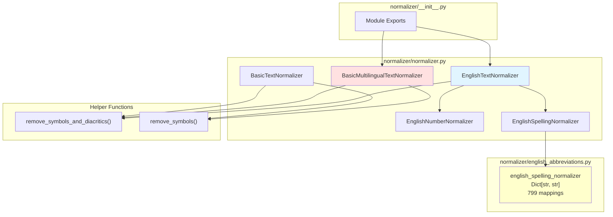
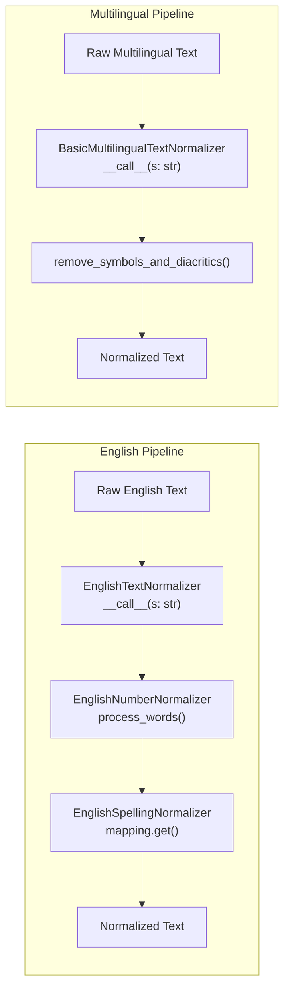
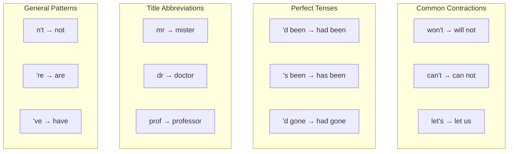
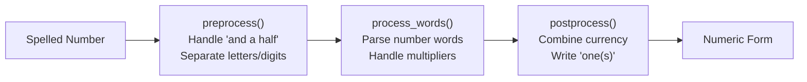
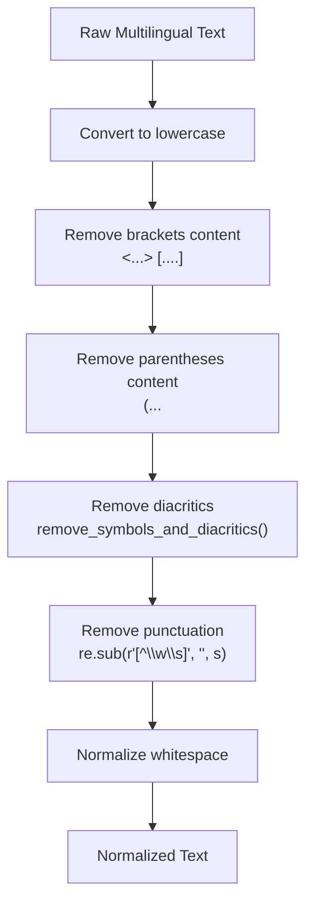
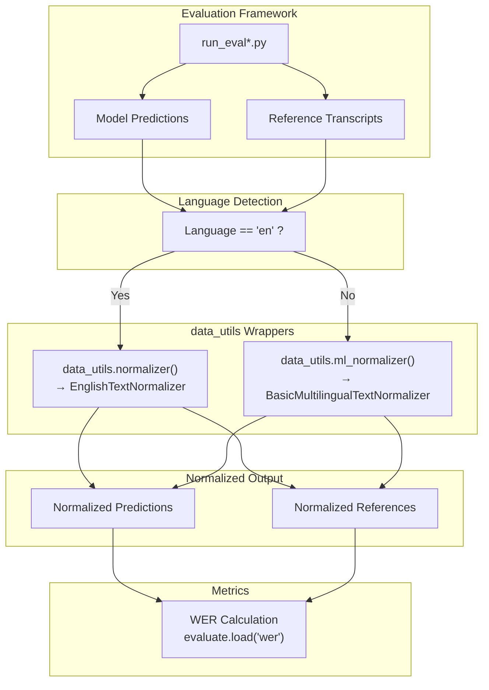

<!-- source: DeepWiki mcp.deepwiki.com · repo huggingface/open_asr_leaderboard · page 3.1 Normalizer Module · fetched 2026-10-26 -->

# Normalizer Module

<details>
<summary>Relevant source files</summary>

The following files were used as context for generating this wiki page:

- [nemo_asr/run_eval_ml.py](nemo_asr/run_eval_ml.py)
- [normalizer/__init__.py](normalizer/__init__.py)
- [normalizer/english_abbreviations.py](normalizer/english_abbreviations.py)
- [normalizer/normalizer.py](normalizer/normalizer.py)

</details>


The Normalizer Module provides standardized text normalization for all ASR evaluation frameworks in the repository. It ensures consistent Word Error Rate (WER) calculations by applying language-specific text cleaning rules to both model predictions and reference transcripts. This module supports English-specific normalization (including contraction expansion, number conversion, and British-American spelling standardization) and multilingual normalization (focusing on diacritic removal and symbol cleaning).

For information about how normalized text is used in metrics calculation, see [Metrics Calculation](#2.3). For details on the utility functions that wrap these normalizers, see [Data Utils](#3.2).

---

## Module Architecture

The normalizer module consists of four primary normalizer classes and a comprehensive British-American spelling dictionary. All normalizers follow a callable pattern where text is passed through `__call__()` methods.



**Sources:** [normalizer/__init__.py:1](), [normalizer/normalizer.py:1-614](), [normalizer/english_abbreviations.py:1-1742]()

---

## Class Hierarchy and Relationships

The normalizer classes are designed for composition, with higher-level normalizers incorporating lower-level ones to build comprehensive text processing pipelines.



**Sources:** [normalizer/normalizer.py:528-614](), [normalizer/normalizer.py:95-110]()

---

## EnglishTextNormalizer

The `EnglishTextNormalizer` class applies comprehensive English-specific normalization, including contraction expansion, number conversion, and spelling standardization.

### Initialization

```python
# From normalizer/normalizer.py:529-587
EnglishTextNormalizer(english_spelling_mapping=english_spelling_normalizer)
```

The class initializes with three key components:

| Component | Purpose | Example Transformations |
|-----------|---------|------------------------|
| `ignore_patterns` | Removes filler words | "hmm", "mm", "mhm", "uh", "um" → removed |
| `replacers` | Expands contractions | "won't" → "will not", "can't" → "can not" |
| `standardize_numbers` | Converts spelled numbers | "twenty three" → "23" |
| `standardize_spellings` | British→American spelling | "colour" → "color" |

**Sources:** [normalizer/normalizer.py:528-614]()

### Contraction Expansion

The normalizer handles 40+ contraction patterns, including common contractions, perfect tenses, and title abbreviations:



**Sources:** [normalizer/normalizer.py:532-585]()

### Number Normalization

The `EnglishNumberNormalizer` converts spelled-out numbers to digits while preserving suffixes and handling currency:



The normalizer handles:
- **Basic numbers**: "twenty three" → "23"
- **Large numbers**: "five million" → "5000000"
- **Ordinals**: "twenty third" → "23rd"
- **Decimals**: "three point one four" → "3.14"
- **Currency**: "$20 million" → "$20000000"
- **Nominal sequences**: "one oh one" → "101"

**Sources:** [normalizer/normalizer.py:112-511]()

### British-American Spelling Normalization

The `EnglishSpellingNormalizer` applies 799 British→American spelling mappings from `english_abbreviations.py`:

| Pattern | Examples | Count |
|---------|----------|-------|
| -our → -or | colour→color, honour→honor | ~50 |
| -ise → -ize | realise→realize, organise→organize | ~250 |
| -re → -er | centre→center, theatre→theater | ~30 |
| -ll- → -l- | traveller→traveler, cancelled→canceled | ~80 |
| ae → e | anaemia→anemia, paediatric→pediatric | ~40 |
| Misc | aluminium→aluminum, tyre→tire | ~349 |

**Example mappings:**
- "accessorise" → "accessorize"
- "aeroplane" → "airplane"
- "aluminium" → "aluminum"
- "analyse" → "analyze"
- "behaviour" → "behavior"
- "cancelled" → "canceled"
- "colour" → "color"
- "defence" → "defense"

**Sources:** [normalizer/english_abbreviations.py:1-1742](), [normalizer/normalizer.py:514-526]()

---

## BasicMultilingualTextNormalizer

The `BasicMultilingualTextNormalizer` provides language-agnostic normalization suitable for non-English languages. It focuses on removing diacritics, symbols, and punctuation while preserving word boundaries.

### Normalization Steps



**Sources:** [normalizer/normalizer.py:95-110]()

### Diacritic Handling

The `remove_symbols_and_diacritics()` function handles special characters through NFKD normalization and manual mappings:

| Category | Action | Examples |
|----------|--------|----------|
| ADDITIONAL_DIACRITICS | Manual mapping | œ→oe, ø→o, æ→ae, ß→ss, ð→d, þ→th |
| Unicode category 'Mn' | Remove | Combining diacritical marks |
| Unicode category 'M/S/P' | Replace with space | Symbols and punctuation |

**Sources:** [normalizer/normalizer.py:26-67]()

---

## Integration with Evaluation Frameworks

All evaluation frameworks use the normalizer module through wrapper functions in `data_utils`. The choice of normalizer depends on the language being evaluated.



**Sources:** [nemo_asr/run_eval_ml.py:170-175]()

### Usage Pattern Example

From the NeMo multilingual evaluation script:

```python
# Language-specific normalization selection
if LANGUAGE == "en":  # English is handled by the English normalizer
    references = [data_utils.normalizer(ref) for ref in references]
    predictions = [data_utils.normalizer(pred.text) for pred in transcriptions]
else:
    references = [data_utils.ml_normalizer(ref) for ref in references]
    predictions = [data_utils.ml_normalizer(pred.text) for pred in transcriptions]
```

**Sources:** [nemo_asr/run_eval_ml.py:169-175]()

---

## Text Transformation Examples

### English Text Normalization Examples

| Input | Output | Transformations Applied |
|-------|--------|------------------------|
| "I can't believe it's twenty-three dollars!" | "i can not believe it is 23 dollars" | Contractions, numbers, punctuation |
| "The colour of the theatre is grey" | "the color of the theater is gray" | British→American spelling |
| "Mr. Smith won't arrive at 3:30pm" | "mister smith will not arrive at 3 30 pm" | Title expansion, contractions, time |
| "She travelled one hundred kilometres" | "she traveled 100 kilometers" | Spelling, numbers, double-l |
| "It costs £5.99 (five pounds ninety-nine)" | "it costs 5.99 5 pounds 99" | Currency, parentheses removal |

### Multilingual Text Normalization Examples

| Input | Output | Language Context |
|-------|--------|-----------------|
| "Café résumé naïve" | "cafe resume naive" | Diacritics removed |
| "Øresund (København)" | "oresund" | Special chars, parentheses |
| "¡Hola! ¿Cómo estás?" | "hola como estas" | Punctuation, diacritics |
| "Straße Österreich" | "strasse osterreich" | German ß→ss, diacritics |
| "[música] <ruido>" | "" | Bracketed content removed |

**Sources:** [normalizer/normalizer.py:589-613](), [normalizer/normalizer.py:99-109]()

---

## Utility Functions

### remove_symbols_and_diacritics()

Removes or replaces non-ASCII characters based on Unicode categories:

```python
def remove_symbols_and_diacritics(s: str, keep=""):
    # Process each character through NFKD normalization
    # - Keep specified characters
    # - Map ADDITIONAL_DIACRITICS
    # - Remove combining marks (category 'Mn')
    # - Replace symbols/punctuation (category 'M/S/P') with space
```

**Parameters:**
- `s`: Input string
- `keep`: Characters to preserve (e.g., ".%$¢€£" for English number normalization)

**Sources:** [normalizer/normalizer.py:46-66]()

### remove_symbols()

Preserves diacritics while removing symbols:

```python
def remove_symbols(s: str):
    # Uses NFKC normalization (preserves diacritics)
    # Replaces symbols/punctuation with space
```

**Sources:** [normalizer/normalizer.py:69-73]()

---

## Special Handling Cases

### Numbers and Ordinals

The `EnglishNumberNormalizer` maintains context-aware number processing:

| Input | Output | Rule |
|-------|--------|------|
| "twenty first" | "21st" | Ordinal suffix preserved |
| "nineteen sixties" | "1960s" | Plural suffix preserved |
| "three and a half" | "3.5" | Fractional handling |
| "double zero seven" | "007" | Special word handling |
| "point five" | "0.5" | Decimal point |

**Sources:** [normalizer/normalizer.py:229-450]()

### Currency Processing

Currency symbols are handled through a two-stage process:

1. **During number processing**: Keep symbols for context
2. **Postprocessing**: Combine amounts with cents

Example: `"$2 and ¢7"` → `"$2.07"`

**Sources:** [normalizer/normalizer.py:481-504]()

### Contraction Edge Cases

Special handling for ambiguous contractions:

| Pattern | Expansion | Note |
|---------|-----------|------|
| "'s done" | Not expanded | Ambiguous: "is done" or "has done" |
| "'s been" | "has been" | Unambiguous perfect tense |
| "'d done" | "had done" | Unambiguous perfect tense |
| "n't" | "not" | Always negative |

**Sources:** [normalizer/normalizer.py:569-584]()

---

## Module Exports

The module exposes only the two primary normalizer classes through `__init__.py`:

```python
from .normalizer import EnglishTextNormalizer, BasicMultilingualTextNormalizer
```

Lower-level classes (`EnglishNumberNormalizer`, `EnglishSpellingNormalizer`) are internal implementation details and not directly imported by evaluation frameworks.

**Sources:** [normalizer/__init__.py:1]()

---

## Performance Considerations

The normalizer module is applied to every prediction and reference in the evaluation pipeline. Key performance characteristics:

1. **Regex Compilation**: All normalizers use `re.sub()` with pattern strings (not pre-compiled), relying on Python's internal regex caching
2. **Dictionary Lookups**: British-American spelling uses simple `dict.get()` for O(1) lookups across 799 mappings
3. **NFKD Normalization**: Unicode normalization is performed character-by-character for diacritic removal
4. **Word Processing**: Number normalization processes word lists iteratively with lookahead/lookbehind context

For large-scale evaluation, normalization is fast relative to model inference but can be optimized by caching normalized references.

**Sources:** [normalizer/normalizer.py:1-614]()

---

