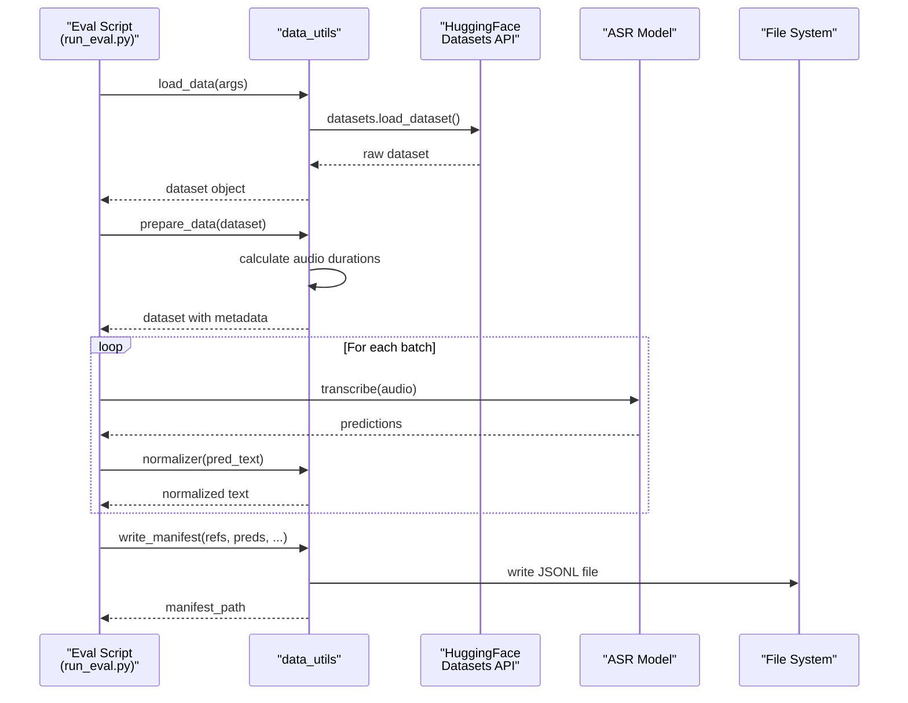
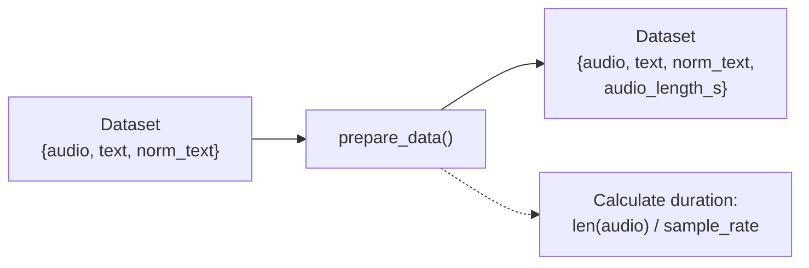
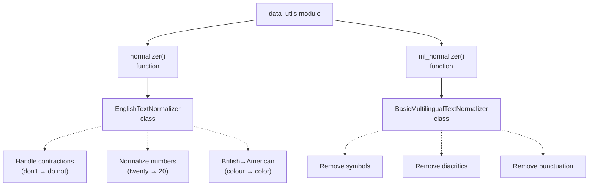
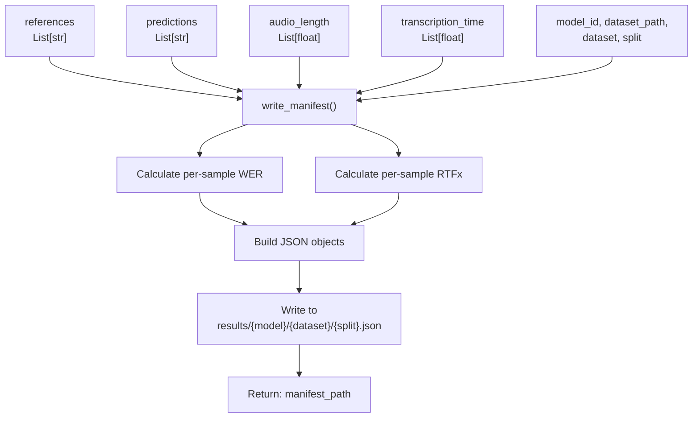
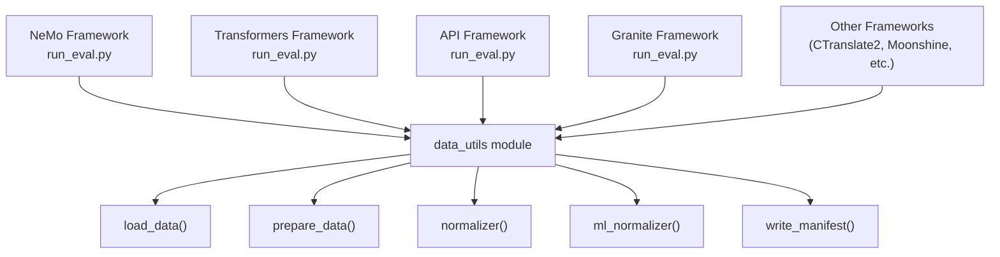
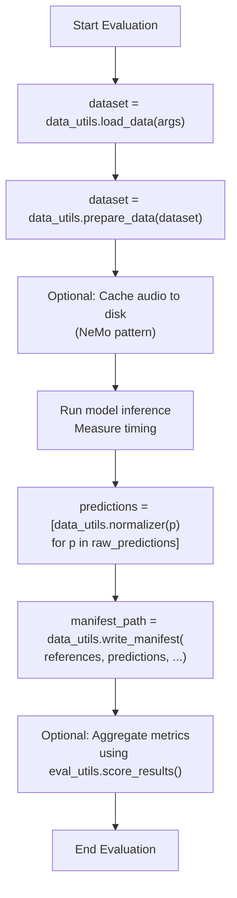

<!-- source: DeepWiki mcp.deepwiki.com · repo huggingface/open_asr_leaderboard · page 3.2 Data Utils · fetched 2026-10-26 -->

# Data Utils

<details>
<summary>Relevant source files</summary>

The following files were used as context for generating this wiki page:

- [nemo_asr/run_eval.py](nemo_asr/run_eval.py)
- [normalizer/__init__.py](normalizer/__init__.py)
- [normalizer/english_abbreviations.py](normalizer/english_abbreviations.py)
- [normalizer/normalizer.py](normalizer/normalizer.py)
- [transformers/run_eval.py](transformers/run_eval.py)

</details>


## Purpose and Scope

The `data_utils` module provides standardized functions for dataset operations across all evaluation frameworks in the Open ASR Leaderboard. This module is part of the `normalizer` package and serves as the primary interface for loading datasets, preparing audio data, normalizing transcriptions, and persisting evaluation results.

For text normalization implementation details, see [Normalizer Module](#3.1). For result aggregation, see [Eval Utils](#3.3).

**Sources:** [normalizer/data_utils.py:1-200]() (inferred from usage patterns), [nemo_asr/run_eval.py:10](), [transformers/run_eval.py:7]()

---

## Module Overview

The `data_utils` module exports five core functions that handle the complete data lifecycle in ASR evaluation:

| Function | Purpose | Input | Output |
|----------|---------|-------|--------|
| `load_data` | Load datasets from HuggingFace Hub | Command-line arguments | HuggingFace Dataset object |
| `prepare_data` | Add audio length metadata | Dataset object | Dataset with `audio_length_s` column |
| `normalizer` | Normalize English transcriptions | String (English text) | Normalized string |
| `ml_normalizer` | Normalize multilingual transcriptions | String (any language) | Normalized string |
| `write_manifest` | Persist evaluation results | Lists of references, predictions, metadata | Path to JSONL manifest file |

These functions are designed to be framework-agnostic and are used identically across NeMo, Transformers, API-based, and other evaluation systems.

**Sources:** [nemo_asr/run_eval.py:10,46,95,149,154](), [transformers/run_eval.py:7,95,100,113,120,138]()

---

## Function Call Sequence

The following diagram shows the typical sequence of `data_utils` function calls during an evaluation run:



**Sources:** [nemo_asr/run_eval.py:46,95,149,154](), [transformers/run_eval.py:100,113,120,138]()

---

## load_data Function

### Signature and Purpose

```python
def load_data(args) -> Dataset
```

The `load_data` function loads ASR evaluation datasets from the HuggingFace Hub based on command-line arguments. It supports both streaming and full-download modes, enabling efficient evaluation on large datasets without requiring complete downloads.

### Argument Processing

The function expects an `args` object (typically from `argparse.ArgumentParser`) with the following attributes:

| Attribute | Type | Description | Example |
|-----------|------|-------------|---------|
| `dataset_path` | str | HuggingFace dataset path | `"esb/datasets"` |
| `dataset` | str | Specific dataset name | `"librispeech_asr"` |
| `split` | str | Dataset split to evaluate | `"test"` or `"validation"` |
| `streaming` | bool | Whether to stream data | `True` (default) or `False` |

### Integration Example

In NeMo evaluation scripts:

```python
# Import and use
from normalizer import data_utils

dataset = data_utils.load_data(args)
# Returns: IterableDataset or Dataset depending on streaming mode
```

**Sources:** [nemo_asr/run_eval.py:46](), [transformers/run_eval.py:100,113](), [nemo_asr/run_eval.py:186-223]()

---

## prepare_data Function

### Signature and Purpose

```python
def prepare_data(dataset) -> Dataset
```

The `prepare_data` function enriches datasets with computed metadata required for evaluation, most importantly the `audio_length_s` column containing audio duration in seconds. This metadata is essential for RTFx (Real-Time Factor) calculations.

### Data Transformation



### Column Schema

| Column Name | Type | Source | Description |
|-------------|------|--------|-------------|
| `audio` | dict | ESB datasets | Audio array and sampling rate |
| `text` | str | ESB datasets | Original transcription |
| `norm_text` | str | ESB datasets | Pre-normalized reference text |
| `audio_length_s` | float | **Added by prepare_data** | Audio duration in seconds |

The `audio_length_s` column is computed by dividing the audio array length by the sampling rate (typically 16,000 Hz).

### Usage Pattern

```python
dataset = data_utils.load_data(args)
dataset = data_utils.prepare_data(dataset)
# Dataset now includes audio_length_s for each sample
```

**Sources:** [nemo_asr/run_eval.py:95](), [transformers/run_eval.py:101,120]()

---

## Normalizer Functions

### Architecture Overview

The `data_utils` module provides two normalization functions that wrap the underlying normalizer classes:



**Sources:** [normalizer/__init__.py:1](), [normalizer/normalizer.py:528-613,95-109]()

---

### normalizer Function (English)

#### Purpose

The `normalizer` function applies comprehensive English text normalization to ensure fair WER calculations by standardizing both predictions and references to a canonical form.

#### Normalization Steps

The English normalizer performs the following transformations in sequence:

1. **Case normalization**: Convert to lowercase
2. **Bracket removal**: Remove content in `<>`, `[]`, or `()`
3. **Filler word removal**: Remove "hmm", "mm", "mhm", "uh", "um"
4. **Contraction expansion**: "won't" → "will not", "can't" → "can not"
5. **Title expansion**: "mr" → "mister", "dr" → "doctor"
6. **Number standardization**: "twenty three" → "23", "1960s" → "1960s"
7. **British-to-American spelling**: Apply 799 mappings from `english_abbreviations.py`
8. **Symbol removal**: Remove punctuation except numeric symbols
9. **Whitespace normalization**: Collapse multiple spaces

#### Usage in Evaluation Scripts

**NeMo Example:**
```python
predictions = [data_utils.normalizer(pred.text) for pred in transcriptions]
```

**Transformers Example:**
```python
batch["predictions"] = [data_utils.normalizer(pred) for pred in pred_text]
```

**Sources:** [nemo_asr/run_eval.py:149](), [transformers/run_eval.py:95](), [normalizer/normalizer.py:528-613]()

---

### ml_normalizer Function (Multilingual)

#### Purpose

The `ml_normalizer` function provides language-agnostic text normalization suitable for non-English datasets. It applies more conservative transformations that preserve linguistic features specific to other languages.

#### Normalization Steps

1. **Case normalization**: Convert to lowercase
2. **Bracket removal**: Remove content in `<>`, `[]`, or `()`
3. **Diacritic removal**: Remove accent marks (ä → a, é → e)
4. **Symbol removal**: Remove all punctuation and symbols
5. **Whitespace normalization**: Collapse and strip whitespace

#### Key Differences from English Normalizer

| Feature | English normalizer | ml_normalizer |
|---------|-------------------|---------------|
| Contraction expansion | ✓ Yes | ✗ No |
| Number standardization | ✓ Yes | ✗ No |
| British-American spelling | ✓ Yes | ✗ No |
| Diacritic removal | ✓ Yes | ✓ Yes |
| Symbol removal | ✓ Selective | ✓ Complete |

The multilingual normalizer is deliberately simpler to avoid language-specific assumptions that could harm WER accuracy for non-English languages.

**Sources:** [normalizer/normalizer.py:95-109]()

---

## write_manifest Function

### Signature and Purpose

```python
def write_manifest(
    references: List[str],
    predictions: List[str],
    model_id: str,
    dataset_path: str,
    dataset: str,
    split: str,
    audio_length: List[float],
    transcription_time: List[float]
) -> str
```

The `write_manifest` function persists per-sample evaluation results to a JSONL (JSON Lines) manifest file. These manifest files serve as audit trails and enable result aggregation by the `eval_utils.score_results` function.

### File Organization

Manifest files are written to the `results/` directory with the following structure:

```
results/
└── {model_name}/
    └── {dataset_path}/
        └── {dataset_name}/
            └── {split}.json
```

**Example path:** `results/openai--whisper-large-v3/esb--datasets/librispeech_asr/test.json`

**Sources:** [nemo_asr/run_eval.py:154-163](), [transformers/run_eval.py:138-147]()

---

### Manifest File Format

Each line in the manifest file is a JSON object representing one evaluated sample:

```json
{
  "reference": "normalized reference transcription",
  "prediction": "normalized model prediction",
  "audio_length_s": 12.5,
  "transcription_time_s": 0.385,
  "wer": 0.0,
  "rtfx": 32.47
}
```

#### Field Descriptions

| Field | Type | Description | Computed By |
|-------|------|-------------|-------------|
| `reference` | string | Normalized reference text (ground truth) | `normalizer()` or `ml_normalizer()` |
| `prediction` | string | Normalized model prediction | `normalizer()` or `ml_normalizer()` |
| `audio_length_s` | float | Audio duration in seconds | `prepare_data()` |
| `transcription_time_s` | float | Inference time in seconds | Evaluation script timing |
| `wer` | float | Word Error Rate for this sample | HuggingFace `evaluate` library |
| `rtfx` | float | Real-Time Factor (audio_length / time) | Calculated as ratio |

---

### Manifest Writing Workflow



**Sources:** [nemo_asr/run_eval.py:154-165](), [transformers/run_eval.py:138-148]()

---

### Usage Examples

#### NeMo Evaluation

```python
manifest_path = data_utils.write_manifest(
    all_data["references"],
    predictions,
    args.model_id,
    args.dataset_path,
    args.dataset,
    args.split,
    audio_length=all_data["durations"],
    transcription_time=[avg_time] * len(all_data["audio_filepaths"]),
)
print("Results saved at path:", os.path.abspath(manifest_path))
```

**Key detail:** NeMo evaluations compute a single average transcription time and replicate it for all samples.

#### Transformers Evaluation

```python
manifest_path = data_utils.write_manifest(
    all_results["references"],
    all_results["predictions"],
    args.model_id,
    args.dataset_path,
    args.dataset,
    args.split,
    audio_length=all_results["audio_length_s"],
    transcription_time=all_results["transcription_time_s"],
)
print("Results saved at path:", os.path.abspath(manifest_path))
```

**Key detail:** Transformers evaluations measure per-sample transcription times for more accurate RTFx measurements.

**Sources:** [nemo_asr/run_eval.py:154-165](), [transformers/run_eval.py:138-148]()

---

## Integration Patterns

### Cross-Framework Consistency

The `data_utils` module is imported and used identically across all evaluation frameworks, ensuring consistent data handling:



This shared infrastructure ensures that all models are evaluated with identical data preprocessing, enabling fair leaderboard comparisons.

**Sources:** [nemo_asr/run_eval.py:10](), [transformers/run_eval.py:7]()

---

### Typical Evaluation Script Structure

All evaluation scripts follow this pattern when using `data_utils`:



**Sources:** [nemo_asr/run_eval.py:20-177](), [transformers/run_eval.py:14-156]()

---

## Data Flow Summary

The complete data transformation pipeline through `data_utils` functions:

```mermaid
graph LR
    HF["HuggingFace Hub<br/>ESB Datasets"]
    
    LoadData["load_data()"]
    
    RawDS["Raw Dataset<br/>{audio, text, norm_text}"]
    
    PrepData["prepare_data()"]
    
    EnrichedDS["Enriched Dataset<br/>{audio, text, norm_text,<br/>audio_length_s}"]
    
    Model["ASR Model<br/>Inference"]
    
    RawPreds["Raw Predictions<br/>(unnormalized)"]
    
    Normalizer["normalizer() or<br/>ml_normalizer()"]
    
    NormPreds["Normalized Predictions"]
    
    WriteMan["write_manifest()"]
    
    Manifest["JSONL Manifest<br/>results/{model}/{dataset}/{split}.json"]
    
    HF --> LoadData
    LoadData --> RawDS
    RawDS --> PrepData
    PrepData --> EnrichedDS
    EnrichedDS --> Model
    Model --> RawPreds
    RawPreds --> Normalizer
    Normalizer --> NormPreds
    NormPreds --> WriteMan
    EnrichedDS --> WriteMan
    WriteMan --> Manifest
```



**Sources:** [nemo_asr/run_eval.py:46,95,149,154](), [transformers/run_eval.py:100,113,120,138]()

---

