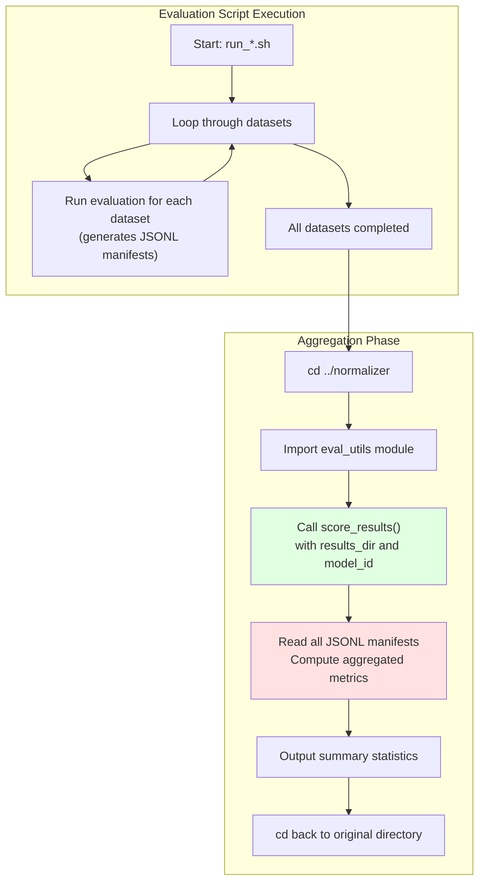
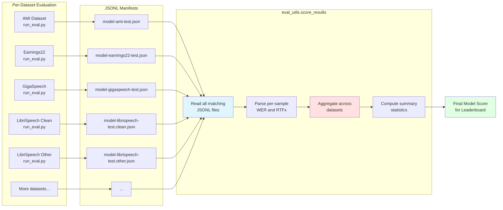
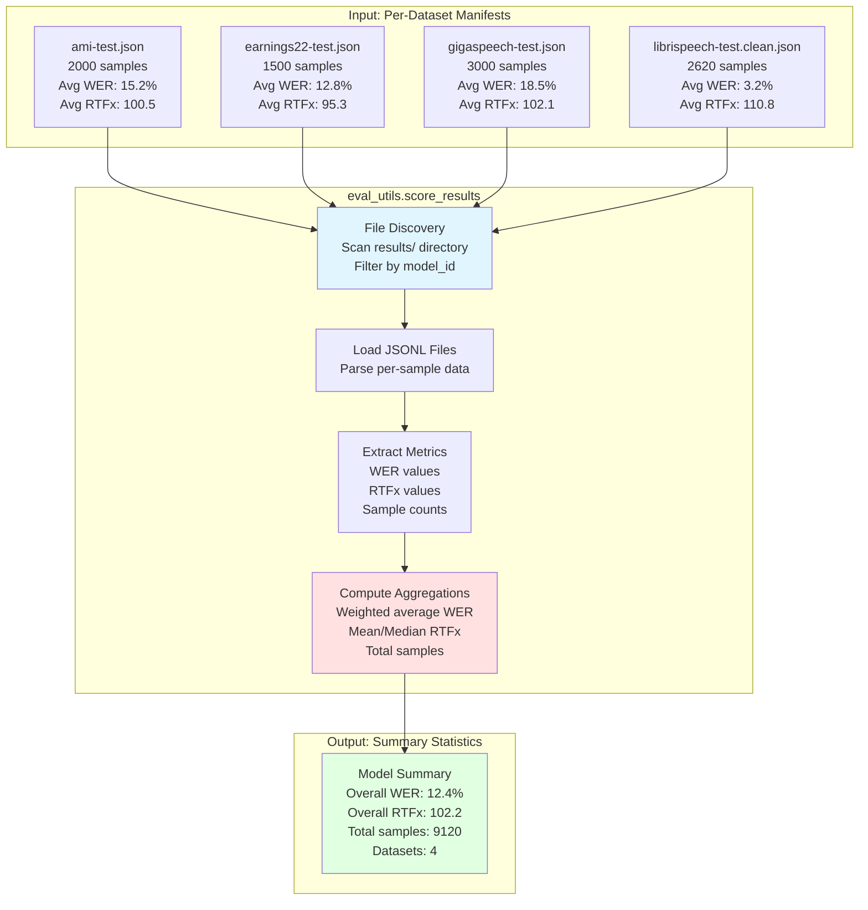

<!-- source: DeepWiki mcp.deepwiki.com · repo huggingface/open_asr_leaderboard · page 3.3 Eval Utils · fetched 2026-10-26 -->

# Eval Utils

<details>
<summary>Relevant source files</summary>

The following files were used as context for generating this wiki page:

- [api/run_api.sh](api/run_api.sh)
- [api/run_eval.py](api/run_eval.py)
- [nemo_asr/run_canary.sh](nemo_asr/run_canary.sh)
- [nemo_asr/run_nemo_ml.sh](nemo_asr/run_nemo_ml.sh)
- [nemo_asr/run_parakeet.sh](nemo_asr/run_parakeet.sh)
- [requirements/requirements-api.txt](requirements/requirements-api.txt)

</details>


## Purpose and Scope

This document describes the `eval_utils` module, which provides aggregation functionality for combining per-dataset evaluation results into model-level scores. The module is part of the shared infrastructure in the `normalizer` package and is used across all evaluation frameworks to produce final leaderboard metrics.

For information about generating per-dataset results, see [Data Utils](#3.2). For details on text normalization applied during evaluation, see [Normalizer Module](#3.1).

---

## Overview

The `eval_utils` module serves as the final stage in the evaluation pipeline, aggregating individual dataset results into model-level summary statistics. After a model has been evaluated on all datasets (e.g., AMI, Earnings22, GigaSpeech, LibriSpeech, etc.), `eval_utils` reads the generated JSONL manifest files and computes overall performance metrics.

The module is invoked identically across all evaluation frameworks—NeMo, Transformers, API-based, and others—ensuring consistent score calculation regardless of the underlying ASR technology.

**Key Responsibilities:**
- Read JSONL manifest files from the results directory
- Aggregate WER scores across datasets
- Compute overall RTFx (Real-Time Factor) metrics
- Generate summary statistics for leaderboard ranking

---

## The score_results Function

### Function Signature and Purpose

The primary entry point is the `score_results` function, which aggregates evaluation results for a specific model:

```python
eval_utils.score_results(results_dir, model_id)
```

**Parameters:**
| Parameter | Type | Description |
|-----------|------|-------------|
| `results_dir` | `str` | Path to directory containing JSONL manifest files (typically `results/`) |
| `model_id` | `str` | Model identifier used to filter relevant manifest files |

### Input: JSONL Manifest Files

The function reads JSONL (JSON Lines) manifest files created by `data_utils.write_manifest()` during evaluation. Each manifest file contains per-sample predictions and references for one dataset:

**Expected manifest filename pattern:**
```
{model_id_sanitized}-{dataset_path}-{dataset}-{split}.json
```

**Manifest file structure:**
```json
{"audio_filepath": "...", "duration": 4.5, "text": "reference text", "pred_text": "predicted text", "wer": 12.5, "rtfx": 100.2}
{"audio_filepath": "...", "duration": 3.2, "text": "another reference", "pred_text": "another prediction", "wer": 0.0, "rtfx": 95.8}
```

Each line represents one audio sample with:
- `audio_filepath`: Original audio file path
- `duration`: Audio length in seconds
- `text`: Normalized reference transcription
- `pred_text`: Normalized predicted transcription
- `wer`: Word Error Rate for this sample
- `rtfx`: Real-Time Factor for this sample (audio duration / transcription time)

### Output: Aggregated Scores

The function produces aggregated metrics across all datasets evaluated for the model. While the exact output format depends on the implementation, typical outputs include:

- **Overall WER**: Weighted average WER across all datasets
- **Per-dataset WER**: Individual WER for each dataset
- **Overall RTFx**: Average or median RTFx across datasets
- **Sample counts**: Total samples evaluated per dataset

---

## Integration in Evaluation Pipeline

### Invocation Pattern

The `score_results` function is invoked at the end of evaluation shell scripts after all datasets have been processed. The standard pattern involves:

1. Navigating to the `normalizer` directory
2. Importing `eval_utils` and calling `score_results`
3. Returning to the original directory



**Sources:** [nemo_asr/run_canary.sh:87-91](), [nemo_asr/run_nemo_ml.sh:92-95](), [api/run_api.sh:86-90](), [nemo_asr/run_parakeet.sh:97-101]()

### Cross-Framework Consistency

All evaluation frameworks use the identical invocation pattern:

**NeMo Framework:**
```bash
# After all dataset evaluations
RUNDIR=`pwd` && \
cd ../normalizer && \
python -c "import eval_utils; eval_utils.score_results('${RUNDIR}/results', '${MODEL_ID}')" && \
cd $RUNDIR
```

**API Framework:**
```bash
# After all dataset evaluations
RUNDIR=`pwd` && \
cd ../normalizer && \
python -c "import eval_utils; eval_utils.score_results('${RUNDIR}/results', '${MODEL_ID}')" && \
cd $RUNDIR
```

This consistency ensures that models evaluated through different frameworks receive identical score aggregation treatment, maintaining fairness in leaderboard comparisons.

**Sources:** [nemo_asr/run_canary.sh:88-91](), [api/run_api.sh:87-90]()

---

## Typical Workflow

### End-to-End Aggregation Process



**Sources:** [nemo_asr/run_canary.sh:15-85](), [nemo_asr/run_canary.sh:88-91]()

### Step-by-Step Execution

1. **Dataset Loop**: Shell script iterates through all datasets, invoking the evaluation script for each
2. **Manifest Creation**: Each dataset evaluation produces a JSONL manifest file via `data_utils.write_manifest()`
3. **Aggregation Trigger**: After all datasets complete, the script invokes `score_results()`
4. **File Discovery**: `score_results` locates all manifest files matching the model ID pattern
5. **Metric Aggregation**: Function reads each manifest, extracts per-sample metrics, and computes overall statistics
6. **Summary Output**: Final scores are printed or written to a summary file for leaderboard integration

---

## Manifest File Requirements

### Directory Structure

The `score_results` function expects a specific directory structure:

```
results/
├── nvidia-canary-1b-v2-hf-audio-esb-datasets-test-only-sorted-ami-test.json
├── nvidia-canary-1b-v2-hf-audio-esb-datasets-test-only-sorted-earnings22-test.json
├── nvidia-canary-1b-v2-hf-audio-esb-datasets-test-only-sorted-gigaspeech-test.json
├── nvidia-canary-1b-v2-hf-audio-esb-datasets-test-only-sorted-librispeech-test.clean.json
├── nvidia-canary-1b-v2-hf-audio-esb-datasets-test-only-sorted-librispeech-test.other.json
└── ...
```

### Naming Convention

Manifest filenames follow a standardized pattern to enable model-specific filtering:

**Pattern:** `{model_id}-{dataset_path}-{dataset}-{split}.json`

**Example:** `nvidia-canary-1b-v2-hf-audio-esb-datasets-test-only-sorted-ami-test.json`

Components:
- `model_id`: Model identifier with `/` replaced by `-` (e.g., `nvidia-canary-1b-v2`)
- `dataset_path`: Dataset repository path (e.g., `hf-audio-esb-datasets-test-only-sorted`)
- `dataset`: Dataset name (e.g., `ami`, `librispeech`)
- `split`: Dataset split (e.g., `test`, `test.clean`, `test.other`)

### Required Manifest Fields

Each JSONL line must contain:

| Field | Type | Description | Required |
|-------|------|-------------|----------|
| `text` | `str` | Normalized reference transcription | Yes |
| `pred_text` | `str` | Normalized predicted transcription | Yes |
| `duration` | `float` | Audio duration in seconds | For RTFx |
| `wer` | `float` | Per-sample Word Error Rate | Optional (computed if missing) |
| `rtfx` | `float` | Per-sample Real-Time Factor | For RTFx aggregation |

**Sources:** [api/run_eval.py:396-405]()

---

## Usage Examples Across Frameworks

### NeMo Canary Evaluation

```bash
# File: nemo_asr/run_canary.sh
MODEL_IDs=("nvidia/canary-1b-v2")

for (( i=0; i<${num_models}; i++ )); do
    MODEL_ID=${MODEL_IDs[$i]}
    
    # Evaluate each dataset
    python run_eval.py --model_id=${MODEL_ID} --dataset="ami" ...
    python run_eval.py --model_id=${MODEL_ID} --dataset="earnings22" ...
    python run_eval.py --model_id=${MODEL_ID} --dataset="gigaspeech" ...
    # ... more datasets
    
    # Aggregate results
    RUNDIR=`pwd` && \
    cd ../normalizer && \
    python -c "import eval_utils; eval_utils.score_results('${RUNDIR}/results', '${MODEL_ID}')" && \
    cd $RUNDIR
done
```

**Sources:** [nemo_asr/run_canary.sh:1-94]()

### NeMo Multilingual Evaluation

```bash
# File: nemo_asr/run_nemo_ml.sh
MODEL_ID="nvidia/parakeet-tdt-0.6b-v3"

# Run evaluations for all dataset/language combinations
for dataset in ${!EVAL_DATASETS[@]}; do
    for language in $languages; do
        python run_eval_ml.py --model_id="$MODEL_ID" --language="$language" ...
    done
done

# Aggregate results
RUNDIR=`pwd`
cd ../normalizer
python -c "import eval_utils; eval_utils.score_results('${RUNDIR}/results', '${MODEL_ID}')"
cd "$RUNDIR"
```

**Sources:** [nemo_asr/run_nemo_ml.sh:92-95]()

### API-Based Evaluation

```bash
# File: api/run_api.sh
MODEL_IDs=(
    "openai/gpt-4o-transcribe"
    "assembly/best"
    "elevenlabs/scribe_v1"
)

for (( i=0; i<${num_models}; i++ )); do
    MODEL_ID=${MODEL_IDs[$i]}
    
    # Evaluate each dataset with concurrent API calls
    python run_eval.py --model_name ${MODEL_ID} --dataset="ami" --max_workers 10
    python run_eval.py --model_name ${MODEL_ID} --dataset="earnings22" --max_workers 10
    # ... more datasets
    
    # Aggregate results
    RUNDIR=`pwd` && \
    cd ../normalizer && \
    python -c "import eval_utils; eval_utils.score_results('${RUNDIR}/results', '${MODEL_ID}')" && \
    cd $RUNDIR
done
```

**Sources:** [api/run_api.sh:1-93]()

---

## Data Flow Diagram



**Sources:** [nemo_asr/run_canary.sh:88-91](), [api/run_eval.py:396-405]()

---

## Related Components

### Data Utils Integration

The `eval_utils` module works in tandem with `data_utils`:

- **`data_utils.write_manifest()`**: Generates JSONL manifest files consumed by `score_results`
- **`data_utils.normalizer()`**: Ensures consistent text normalization before WER calculation
- **`data_utils.prepare_data()`**: Preprocesses datasets before evaluation

See [Data Utils](#3.2) for details on manifest file generation.

### Normalizer Module Context

The `eval_utils` module is part of the broader `normalizer` package:

```
normalizer/
├── __init__.py
├── data_utils.py       # Dataset loading, manifest writing
├── eval_utils.py       # Result aggregation (this module)
├── normalizer.py       # Text normalization logic
└── english_abbreviations.py
```

See [Normalizer Module](#3.1) for text normalization details.

### Evaluation Pipeline Position

Within the standard 5-phase evaluation pipeline:

1. **Orchestration**: Shell script loops through models and datasets
2. **Per-Model-Dataset Evaluation**: Individual `run_eval.py` invocations
3. **Metrics Calculation**: WER and RTFx computed per sample
4. **Results Storage**: `data_utils.write_manifest()` creates JSONL files
5. **Aggregation**: **`eval_utils.score_results()` produces final scores** ← This module

See [Core Evaluation Pipeline](#2) for the complete evaluation workflow.

---

## Key Characteristics

| Characteristic | Description |
|----------------|-------------|
| **Location** | `normalizer/eval_utils.py` |
| **Primary Function** | `score_results(results_dir, model_id)` |
| **Input** | JSONL manifest files with per-sample predictions and references |
| **Output** | Aggregated model-level metrics (WER, RTFx, sample counts) |
| **Invocation** | Called once after all datasets are evaluated |
| **Usage Pattern** | Identical across all evaluation frameworks |
| **Dependencies** | Requires manifest files generated by `data_utils.write_manifest()` |

**Sources:** [nemo_asr/run_canary.sh:88-91](), [nemo_asr/run_nemo_ml.sh:92-95](), [api/run_api.sh:87-90](), [nemo_asr/run_parakeet.sh:98-101]()

---

