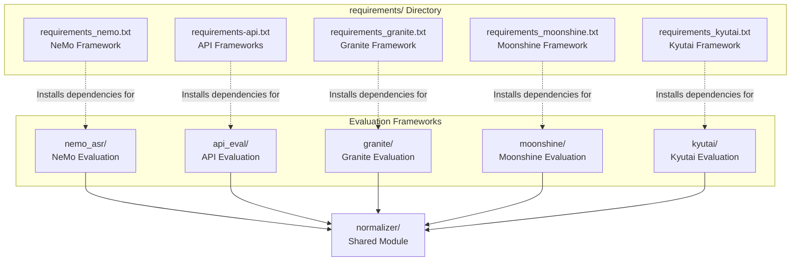
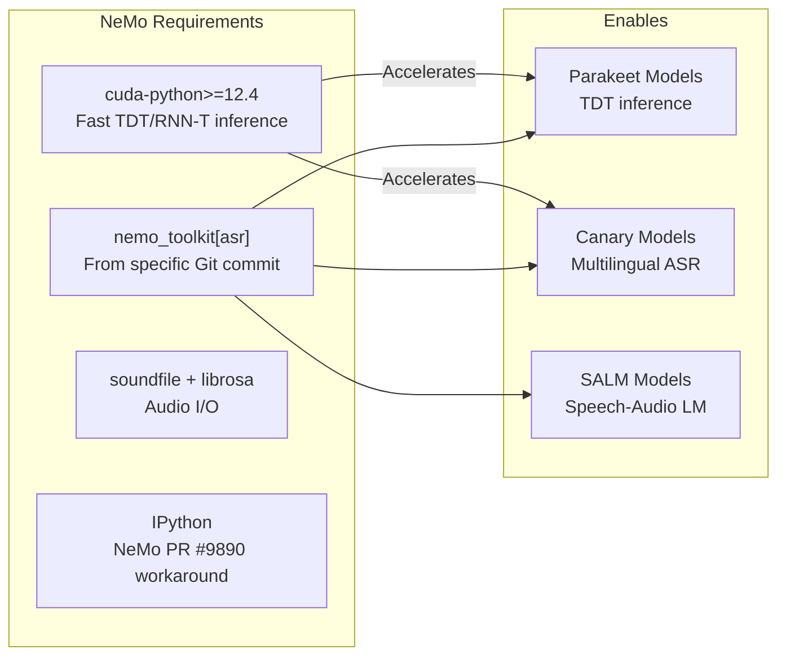
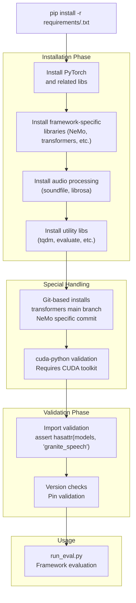
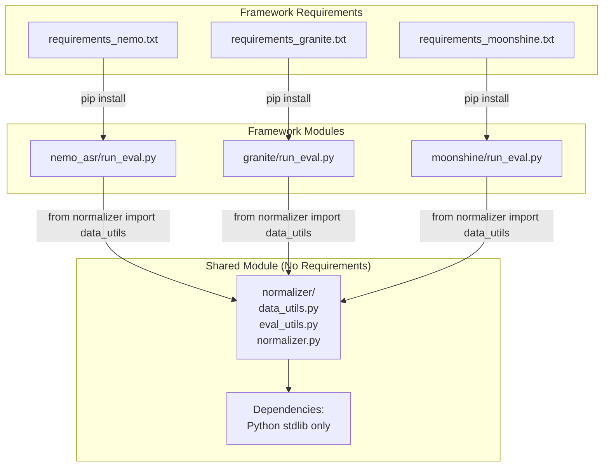

<!-- source: DeepWiki mcp.deepwiki.com · repo huggingface/open_asr_leaderboard · page 3.4 Requirements Management · fetched 2026-10-26 -->

# Requirements Management

<details>
<summary>Relevant source files</summary>

The following files were used as context for generating this wiki page:

- [granite/run_eval.py](granite/run_eval.py)
- [granite/run_granite.sh](granite/run_granite.sh)
- [moonshine/run_eval.py](moonshine/run_eval.py)
- [moonshine/run_moonshine.sh](moonshine/run_moonshine.sh)
- [requirements/requirements_granite.txt](requirements/requirements_granite.txt)
- [requirements/requirements_moonshine.txt](requirements/requirements_moonshine.txt)
- [requirements/requirements_nemo.txt](requirements/requirements_nemo.txt)

</details>


## Purpose and Scope

This document details the dependency management system used across the Open ASR Leaderboard repository. Each evaluation framework has isolated requirements managed through framework-specific requirements files in the `requirements/` directory. This page covers the structure of requirements files, framework-specific dependencies, special dependency handling (such as `cuda-python` for fast inference and unreleased `transformers` features), and version pinning strategies.

For information about using these requirements in the evaluation workflow, see [Evaluation Workflow](#2.1). For adding requirements when integrating new models, see [Adding New Models](#6.1).

---

## Requirements File Structure

The repository organizes dependencies using framework-specific requirements files, allowing independent installation of each evaluation framework without dependency conflicts. This isolation is critical because different frameworks may require incompatible versions of the same library.



**Sources:** [requirements/requirements_nemo.txt](), [requirements/requirements_granite.txt](), [requirements/requirements_moonshine.txt]()

---

## Framework-Specific Requirements

### NeMo Framework Requirements

The NeMo framework has the most specialized requirements, including GPU acceleration dependencies for fast inference of transducer models.

| Dependency | Version/Source | Purpose |
|------------|---------------|---------|
| `nemo_toolkit[asr]` | Git commit `6294bc7708ce67522b92f5e9b6917ea0b2e23429` | NVIDIA NeMo ASR framework with audio-specific extras |
| `cuda-python` | `>=12.4` | **Critical for fast TDT and RNN-T inference** |
| `tqdm` | Latest | Progress bar display |
| `soundfile` | Latest | Audio file I/O |
| `librosa` | Latest | Audio processing |
| `IPython` | Latest | Workaround for NeMo PR #9890 |

The `cuda-python>=12.4` dependency is particularly important as it enables optimized CUDA kernels for Transducer (TDT) and RNN-T model inference, providing significant speedup over CPU-based inference.

**Sources:** [requirements/requirements_nemo.txt:1-7]()



**Sources:** [requirements/requirements_nemo.txt:1-7]()

### Granite Framework Requirements

The Granite framework requires an unreleased version of the `transformers` library from the main branch to support `granite_speech` model architecture.

| Dependency | Version/Source | Purpose |
|------------|---------------|---------|
| `evaluate` | Latest | WER metric computation |
| `datasets` | `3.4.1` | HuggingFace Datasets API |
| `peft` | `0.13.1` | Parameter-Efficient Fine-Tuning (if used) |
| `torch` | `2.5.1` | PyTorch framework |
| `torchaudio` | `2.5.1` | Audio tensor operations |
| `transformers` | Main branch from GitHub | **Required for `granite_speech` model support** |
| `soundfile` | Latest | Audio file I/O |

The requirement for `transformers` from the main branch is validated at runtime in [granite/run_eval.py:11]() with an assertion:

```python
assert hasattr(models, "granite_speech")
```

This ensures the installed version includes the necessary model architecture before attempting evaluation.

**Sources:** [requirements/requirements_granite.txt:1-8](), [granite/run_eval.py:11-11]()

### Moonshine Framework Requirements

The Moonshine framework uses aggressive version pinning to ensure reproducible builds, particularly for numerical libraries where version differences can affect results.

| Dependency | Version/Source | Purpose |
|------------|---------------|---------|
| `torch` | Latest | PyTorch framework |
| `evaluate` | Latest | Metrics computation |
| `librosa` | Latest | Audio processing |
| `jiwer` | Latest | Alternative WER calculation |
| `einops` | Latest | Tensor operations |
| `datasets` | `==3.2.0` | **Pinned for reproducibility** |
| `numba` | `==0.60.0` | **Pinned for JIT compilation stability** |
| `numpy` | `==2.0.2` | **Pinned for numerical consistency** |
| `transformers` | Main branch from GitHub | Latest features for Moonshine model |

The strict pinning of `numba` and `numpy` prevents numerical drift across evaluations, ensuring WER scores remain comparable over time.

**Sources:** [requirements/requirements_moonshine.txt:1-10]()

---

## Dependency Installation Flow

The following diagram illustrates the typical dependency installation and validation flow when setting up an evaluation environment:



**Sources:** [requirements/requirements_nemo.txt](), [requirements/requirements_granite.txt](), [requirements/requirements_moonshine.txt](), [granite/run_eval.py:11]()

---

## Special Dependencies

### cuda-python for Fast Inference

The `cuda-python>=12.4` package in the NeMo requirements enables optimized CUDA operations for Transducer models. This dependency is **only required for Parakeet TDT and RNN-T models** and provides substantial performance improvements.

**Performance Impact:**
- **Without cuda-python**: CPU-based inference (slow)
- **With cuda-python>=12.4**: GPU-accelerated kernel execution (fast)

**Installation Requirements:**
- CUDA Toolkit 12.4 or higher must be installed on the system
- Compatible NVIDIA GPU with compute capability support
- Proper CUDA driver installation

**Frameworks affected:**
- Parakeet TDT models
- Parakeet RNN-T models  
- Canary models (when using transducer heads)

**Sources:** [requirements/requirements_nemo.txt:6]()

### Transformers Main Branch

Both Granite and Moonshine frameworks require unreleased features from the `transformers` main branch. This is installed via direct GitHub URL:

```
transformers @ https://github.com/huggingface/transformers/archive/main.zip
```

**Reason for main branch requirement:**
- **Granite**: The `granite_speech` model architecture is not yet in a released version
- **Moonshine**: Support for `MoonshineForConditionalGeneration` may require latest features

**Runtime Validation:**
The Granite framework validates the required model architecture is available:

[granite/run_eval.py:10-11]()
```python
# ensure installed transformers supports granite_speech
assert hasattr(models, "granite_speech")
```

**Sources:** [requirements/requirements_granite.txt:6](), [requirements/requirements_moonshine.txt:9](), [granite/run_eval.py:10-11]()

### IPython Workaround

The NeMo requirements include `IPython` as a workaround for a specific NeMo issue documented in PR #9890. This dependency prevents import errors when NeMo attempts to use IPython features even in non-interactive contexts.

**Sources:** [requirements/requirements_nemo.txt:5]()

---

## Version Pinning Strategy

The repository employs different version pinning strategies based on framework stability requirements:

```mermaid
graph TB
    subgraph "Strict Pinning (Moonshine)"
        MOON_DATASETS["datasets==3.2.0"]
        MOON_NUMBA["numba==0.60.0"]
        MOON_NUMPY["numpy==2.0.2"]
        MOON_REASON["Reason: Numerical<br/>reproducibility critical"]
    end
    
    subgraph "Minimum Version (NeMo)"
        NEMO_CUDA["cuda-python>=12.4"]
        NEMO_REASON["Reason: Performance<br/>features in >=12.4"]
    end
    
    subgraph "Specific Commit (NeMo)"
        NEMO_TOOLKIT["nemo_toolkit @ git commit"]
        NEMO_COMMIT["6294bc7708ce67522b92f5e9b6917ea0b2e23429"]
        NEMO_COMMIT_REASON["Reason: Tested<br/>stable version"]
    end
    
    subgraph "Main Branch (Granite, Moonshine)"
        TRANS_MAIN["transformers @ main"]
        TRANS_REASON["Reason: Unreleased<br/>model architectures"]
    end
    
    subgraph "Flexible (Most Libraries)"
        FLEX_LIBS["soundfile, librosa, tqdm, evaluate"]
        FLEX_REASON["Reason: Stable APIs,<br/>latest features acceptable"]
    end
    
    MOON_DATASETS --> MOON_REASON
    MOON_NUMBA --> MOON_REASON
    MOON_NUMPY --> MOON_REASON
    
    NEMO_CUDA --> NEMO_REASON
    
    NEMO_TOOLKIT --> NEMO_COMMIT
    NEMO_COMMIT --> NEMO_COMMIT_REASON
    
    TRANS_MAIN --> TRANS_REASON
    
    FLEX_LIBS --> FLEX_REASON
```



**Sources:** [requirements/requirements_nemo.txt](), [requirements/requirements_granite.txt](), [requirements/requirements_moonshine.txt]()

### Strategy Summary

| Strategy | Used By | Rationale |
|----------|---------|-----------|
| **Exact version pin** (`==X.Y.Z`) | Moonshine (`datasets`, `numba`, `numpy`) | Ensures numerical reproducibility; prevents drift in WER calculations |
| **Minimum version** (`>=X.Y`) | NeMo (`cuda-python>=12.4`) | Requires specific features introduced in version; newer versions acceptable |
| **Git commit pin** | NeMo (`nemo_toolkit`) | Locks to tested, stable commit; prevents breaking changes from upstream |
| **Main branch** | Granite, Moonshine (`transformers`) | Requires unreleased features; tracks latest development |
| **Unpinned** | Most utilities (`soundfile`, `librosa`, `tqdm`) | Stable APIs; latest versions provide bug fixes and improvements |

---

## Shared Dependencies

All frameworks share the `normalizer` module, which has no external dependencies beyond Python standard library. This design ensures that the text normalization logic (critical for fair WER comparison) is consistent regardless of which framework requirements are installed.



**Sources:** [nemo_asr/](), [granite/run_eval.py:6](), [moonshine/run_eval.py:7](), [normalizer/]()

---

## Framework Requirements Reference

### Complete Requirements Matrix

| Framework | Key Dependencies | Special Notes |
|-----------|-----------------|---------------|
| **NeMo** | `nemo_toolkit[asr]` (git commit), `cuda-python>=12.4`, `soundfile`, `librosa`, `IPython` | GPU acceleration via cuda-python; specific commit pin |
| **Granite** | `transformers` (main), `torch==2.5.1`, `torchaudio==2.5.1`, `peft==0.13.1`, `datasets==3.4.1` | Requires unreleased transformers; runtime validation of `granite_speech` |
| **Moonshine** | `transformers` (main), `datasets==3.2.0`, `numba==0.60.0`, `numpy==2.0.2`, `torch`, `einops` | Strict version pins for reproducibility |
| **API** | API SDKs (OpenAI, AssemblyAI, etc.) | Not shown in provided files; separate requirements file |
| **Kyutai** | Moshi, Julius, lhotse | Not shown in provided files; separate requirements file |

**Sources:** [requirements/requirements_nemo.txt](), [requirements/requirements_granite.txt](), [requirements/requirements_moonshine.txt]()

---

## Adding Requirements for New Frameworks

When adding a new evaluation framework, follow this pattern:

1. **Create requirements file**: `requirements/requirements_<framework>.txt`
2. **Specify core dependencies**:
   - Framework-specific library (e.g., model library)
   - PyTorch/TensorFlow (if needed)
   - Audio processing (`soundfile`, `librosa`, or `torchaudio`)
   - Utilities (`evaluate`, `tqdm`)
3. **Pin versions appropriately**:
   - Exact pins for numerical libraries if reproducibility is critical
   - Minimum versions for libraries with required features
   - Git commits/main branch for unreleased features
4. **Document special dependencies**: Add inline comments explaining unusual requirements
5. **Add runtime validation**: Include assertions to verify required features are available

**Example template**:
```
# Core framework
<framework-library>==X.Y.Z

# PyTorch/TensorFlow
torch>=X.Y
torchaudio>=X.Y

# Audio processing
soundfile
librosa

# Evaluation utilities
evaluate
tqdm

# Special dependencies with explanations
<special-lib>>=X.Y  # Required for <specific feature>
```

**Sources:** [requirements/requirements_nemo.txt](), [requirements/requirements_granite.txt](), [requirements/requirements_moonshine.txt]()

---

