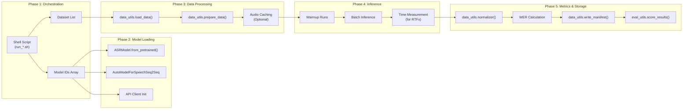
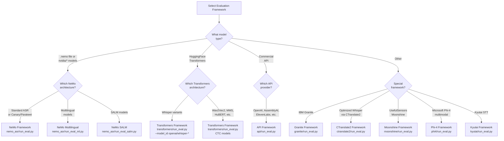
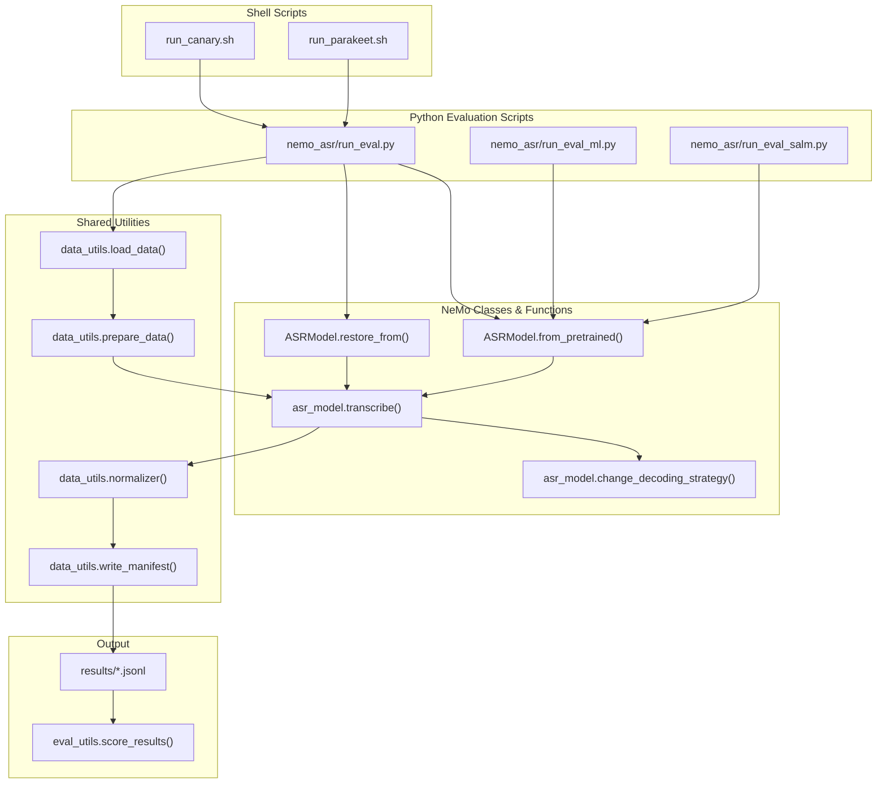
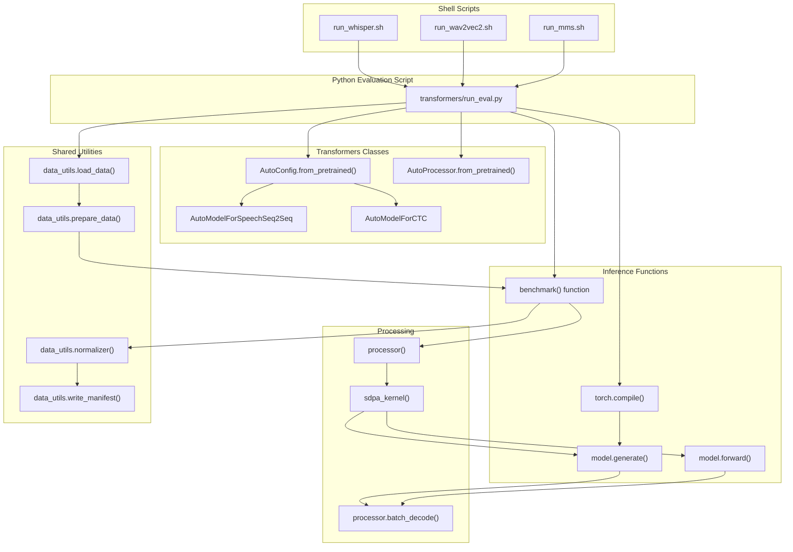
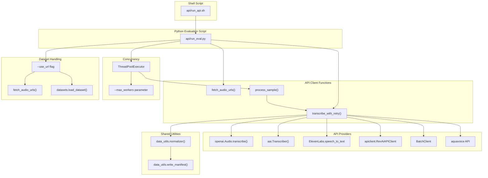
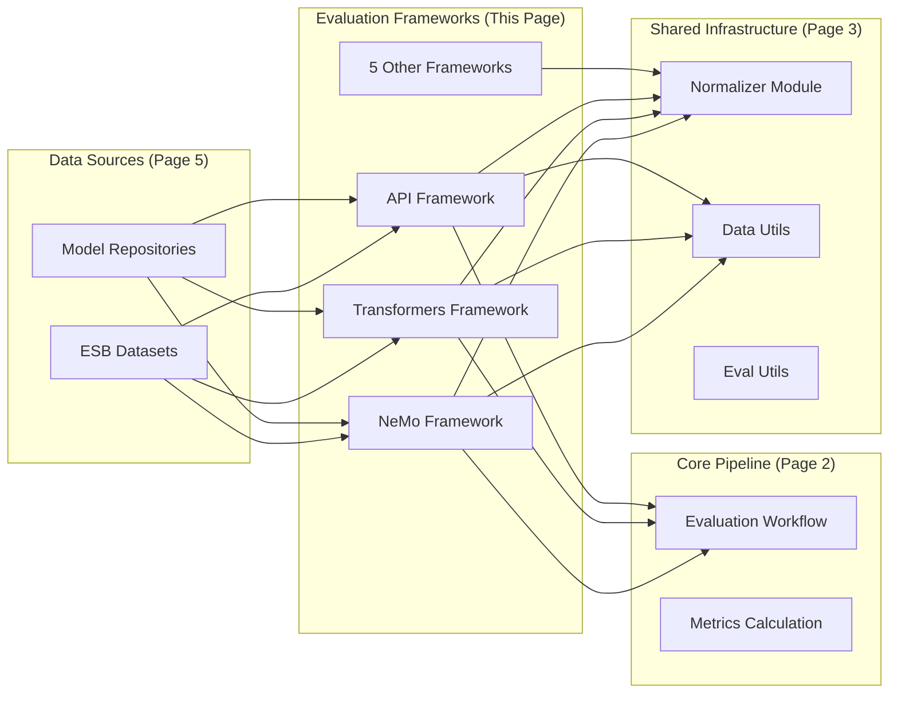

<!-- source: DeepWiki mcp.deepwiki.com · repo huggingface/open_asr_leaderboard · page 4 Evaluation Frameworks · fetched 2026-10-26 -->

# Evaluation Frameworks

<details>
<summary>Relevant source files</summary>

The following files were used as context for generating this wiki page:

- [api/run_api.sh](api/run_api.sh)
- [api/run_eval.py](api/run_eval.py)
- [nemo_asr/run_eval.py](nemo_asr/run_eval.py)
- [requirements/requirements-api.txt](requirements/requirements-api.txt)
- [transformers/run_eval.py](transformers/run_eval.py)

</details>


## Purpose and Scope

This document provides an overview of the 8 evaluation frameworks supported by the Open ASR Leaderboard, explaining their purpose, architecture, and when to use each one. Each framework implements the same standardized evaluation pipeline (detailed in [Core Evaluation Pipeline](#2)) but interfaces with different ASR technologies ranging from NVIDIA NeMo to commercial APIs.

For detailed implementation guides on individual frameworks, see subsections [4.1](#4.1) through [4.8](#4.8). For information about the shared infrastructure used across all frameworks, see [Shared Infrastructure](#3). For guidance on adding new frameworks, see [Adding New Models](#6.1).

---

## Framework Overview

The repository supports 8 distinct evaluation frameworks, each targeting specific ASR model families or deployment scenarios. The following table summarizes their characteristics:

| Framework | Primary Use Case | Model Types | Key Files | Importance Score |
|-----------|-----------------|-------------|-----------|------------------|
| **NeMo ASR** | NVIDIA NeMo models including Canary, Parakeet, SALM | `.nemo` files, HF Hub NeMo models | `nemo_asr/run_eval.py`, `nemo_asr/run_eval_ml.py` | 20.39 |
| **Transformers** | HuggingFace Transformers models (Whisper, Wav2Vec2, MMS, HuBERT) | Encoder-decoder, CTC architectures | `transformers/run_eval.py` | 19.49 |
| **API-based** | Commercial ASR services (OpenAI, AssemblyAI, etc.) | Cloud APIs via HTTP | `api/run_eval.py`, `api/run_api.sh` | 13.62 |
| **Granite** | IBM Granite speech models | Chat-template based models | `granite/run_eval.py` | 13.25 |
| **CTranslate2** | Optimized Whisper inference via faster-whisper | CTranslate2-converted models | `ctranslate2/run_eval.py` | 9.82 |
| **Moonshine** | UsefulSensors Moonshine edge models | ONNX-based lightweight models | `moonshine/run_eval.py` | 9.42 |
| **Phi-4** | Microsoft Phi-4 multimodal models | Vision-language models for audio | `phi4/run_eval.py` | 8.35 |
| **Kyutai** | Kyutai STT models using Moshi | Specialized STT architectures | `kyutai/run_eval.py` | 6.62 |

**Sources:** Diagram 1 (Overall Repository Architecture), Diagram 3 (Framework-Specific Implementations)

---

## Common Architecture Pattern

Despite supporting diverse ASR technologies, all frameworks implement the same standardized evaluation pattern. This ensures consistent metrics and fair comparison across models.

### Evaluation Pipeline Phases



**Key Characteristics:**

1. **Orchestration**: Shell scripts iterate through model/dataset combinations
2. **Model Loading**: Framework-specific loading mechanisms (`.from_pretrained()`, `.restore_from()`, API clients)
3. **Data Processing**: Shared `data_utils` functions ensure consistent dataset handling
4. **Inference**: Optional warmup, batched processing with timing for RTFx calculation
5. **Metrics**: Shared `normalizer` and `evaluate` library ensure consistent WER computation

**Sources:** [nemo_asr/run_eval.py:1-225](), [transformers/run_eval.py:1-237](), [api/run_eval.py:1-455](), Diagram 2 (Common Evaluation Pipeline Pattern)

---

## Framework Selection Guide

### Decision Tree



### Selection Criteria

**Choose NeMo Framework when:**
- Working with NVIDIA `.nemo` checkpoint files
- Evaluating models from `nvidia/` namespace on HuggingFace Hub
- Need optimized inference for Parakeet TDT/RNN-T models (requires `cuda-python>=12.4`)
- Evaluating Canary models (handles `pnc` parameter automatically)

**Choose Transformers Framework when:**
- Model is available via HuggingFace `transformers` library
- Want to leverage `torch.compile` for optimization (see `--torch_compile` flag)
- Evaluating Whisper, Wav2Vec2, MMS, HuBERT, or Data2Vec models
- Need static k/v caching for autoregressive models

**Choose API Framework when:**
- Evaluating commercial ASR services (OpenAI Whisper API, AssemblyAI, ElevenLabs, etc.)
- Need concurrent request handling (see `--max_workers` parameter)
- Want to avoid local model hosting

**Choose specialized frameworks (Granite, CTranslate2, Moonshine, Phi-4, Kyutai) when:**
- Model requires specific inference engines or preprocessing
- Optimizing for edge deployment (Moonshine)
- Using multimodal models for audio transcription (Phi-4)

**Sources:** Diagram 3 (Framework-Specific Implementations), Diagram 1 (Overall Repository Architecture)

---

## Framework Implementation Details

### Code Entity Mapping: NeMo Framework



**Key Code Entities:**

- **Model Loading**: [nemo_asr/run_eval.py:38-44]() - Uses `ASRModel.restore_from()` for `.nemo` files or `ASRModel.from_pretrained()` for HuggingFace models
- **Audio Caching**: [nemo_asr/run_eval.py:48-88]() - `download_audio_files()` function writes WAV files to `audio_cache/` directory
- **Duration-Based Sorting**: [nemo_asr/run_eval.py:116-120]() - Sorts by duration in descending order for efficient batching
- **Warmup Logic**: [nemo_asr/run_eval.py:124-144]() - Runs 4 batches for warmup, then measures full dataset for RTFx
- **Canary PNC Handling**: [nemo_asr/run_eval.py:132-138]() - Sets `pnc='nopnc'` for v1 Canary, `pnc='pnc'` for v2+

**Sources:** [nemo_asr/run_eval.py:1-225]()

---

### Code Entity Mapping: Transformers Framework



**Key Code Entities:**

- **Model Detection**: [transformers/run_eval.py:15-16]() - Uses `AutoConfig` to detect if model is Seq2Seq or CTC
- **SDPA Backend Selection**: [transformers/run_eval.py:70]() - Uses `MATH` backend for compiled models, `FLASH_ATTENTION` otherwise
- **Torch Compile**: [transformers/run_eval.py:30-34]() - Enables `torch.compile()` with static k/v cache for autoregressive models
- **Batch Processing**: [transformers/run_eval.py:36-97]() - `benchmark()` function handles padding, inference, and timing
- **Multilingual Whisper**: [transformers/run_eval.py:23-26]() - Sets `language="en"` and `task="transcribe"` for multilingual checkpoints
- **Warmup**: [transformers/run_eval.py:99-111]() - Optional warmup with configurable steps via `--warmup_steps`

**Sources:** [transformers/run_eval.py:1-237]()

---

### Code Entity Mapping: API Framework



**Key Code Entities:**

- **API Routing**: [api/run_eval.py:78-276]() - `transcribe_with_retry()` routes to appropriate API based on `model_name` prefix
- **Concurrent Execution**: [api/run_eval.py:371-386]() - Uses `ThreadPoolExecutor` with configurable `max_workers` (default 300)
- **Retry Logic**: [api/run_eval.py:68-295]() - Automatic retry with exponential backoff for transient API failures
- **URL-based Processing**: [api/run_eval.py:29-66]() - `fetch_audio_urls()` uses HuggingFace Datasets Server API to avoid downloading audio
- **Provider-Specific Code**:
  - OpenAI: [api/run_eval.py:177-197]()
  - AssemblyAI: [api/run_eval.py:148-175]()
  - ElevenLabs: [api/run_eval.py:199-218]()
  - Rev.ai: [api/run_eval.py:220-258]()
  - Speechmatics: [api/run_eval.py:78-146]()
  - AquaVoice: [api/run_eval.py:259-271]()

**Sources:** [api/run_eval.py:1-455](), [api/run_api.sh:1-93]()

---

## Framework Comparison: Performance Characteristics

| Framework | Batch Processing | GPU Acceleration | Warmup | Audio Caching | Concurrent Requests |
|-----------|-----------------|------------------|--------|---------------|---------------------|
| NeMo | ✓ (`--batch_size`) | ✓ (CUDA) | ✓ (4 batches) | ✓ (local WAV) | ✗ |
| Transformers | ✓ (`--batch_size`) | ✓ (CUDA, `torch.compile`) | ✓ (`--warmup_steps`) | ✗ (streaming) | ✗ |
| API | ✗ (per-sample) | N/A (server-side) | ✗ | Optional (`--use_url`) | ✓ (`--max_workers`) |
| Granite | ✓ (`--batch_size`) | ✓ (CUDA) | ✗ | ✗ | ✗ |
| CTranslate2 | ✓ (`--batch_size`) | ✓ (CUDA, optimized) | ✗ | ✗ | ✗ |
| Moonshine | ✓ (`--batch_size`) | CPU-optimized | ✗ | ✗ | ✗ |
| Phi-4 | ✓ (`--batch_size`) | ✓ (CUDA) | ✗ | ✗ | ✗ |
| Kyutai | ✓ (`--batch_size`) | ✓ (CUDA) | ✗ | ✗ | ✗ |

**Performance Notes:**

1. **NeMo**: Most mature framework with optimized batching and audio caching. Duration-based sorting minimizes padding overhead.
2. **Transformers**: Supports `torch.compile` for significant speedup (see `--compile_mode` options). Static k/v caching for autoregressive models.
3. **API**: Parallelism via threads compensates for per-sample processing. Use `--use_url` to avoid downloading audio files.
4. **CTranslate2**: Specialized for Whisper optimization, often faster than native Transformers implementation.

**Sources:** [nemo_asr/run_eval.py:116-120](), [transformers/run_eval.py:30-34](), [api/run_eval.py:371-386]()

---

## Requirements Management

Each framework has dedicated requirements files to isolate dependencies:

| Framework | Requirements File | Key Dependencies |
|-----------|------------------|------------------|
| NeMo | `requirements/requirements_nemo.txt` | `nemo_toolkit[asr]`, `cuda-python>=12.4` |
| Transformers | *(default requirements)* | `transformers`, `torch`, `evaluate` |
| API | `requirements/requirements-api.txt` | `assemblyai`, `openai`, `elevenlabs`, `rev-ai`, `speechmatics-python` |
| Granite | `requirements/requirements_granite.txt` | `transformers@main` (unreleased features) |
| CTranslate2 | `requirements/requirements_ctranslate2.txt` | `faster-whisper`, `ctranslate2` |
| Moonshine | `requirements/requirements_moonshine.txt` | `moonshine`, `onnxruntime` |
| Phi-4 | `requirements/requirements_phi4.txt` | `transformers>=4.46` |
| Kyutai | `requirements/requirements_kyutai.txt` | `moshi`, `julius` |

**Special Requirements:**

- **NeMo**: Requires `cuda-python>=12.4` specifically for fast TDT and RNN-T inference (Parakeet models)
- **Granite**: Pins to `transformers@main` branch for unreleased features needed by Granite models
- **API**: Requires API keys set as environment variables (see [api/run_api.sh:5-9]())

**Sources:** [requirements/requirements-api.txt:1-8](), Diagram 5 (Shared Infrastructure Components)

---

## Framework Initialization Patterns

### NeMo Framework Initialization

```python
# From nemo_asr/run_eval.py
if args.model_id.endswith(".nemo"):
    asr_model = ASRModel.restore_from(args.model_id, map_location=device)
else:
    asr_model = ASRModel.from_pretrained(args.model_id, map_location=device)

asr_model.to(compute_dtype)
asr_model.eval()

# Configure decoding strategy
if asr_model.cfg.decoding.strategy != "beam":
    asr_model.cfg.decoding.strategy = "greedy_batch"
    asr_model.change_decoding_strategy(asr_model.cfg.decoding)
```

**Sources:** [nemo_asr/run_eval.py:38-98]()

### Transformers Framework Initialization

```python
# From transformers/run_eval.py
config = AutoConfig.from_pretrained(args.model_id)
cls_model = AutoModelForSpeechSeq2Seq if type(config) in MODEL_FOR_SPEECH_SEQ_2_SEQ_MAPPING else AutoModelForCTC
model = cls_model.from_pretrained(args.model_id, torch_dtype=torch.bfloat16, attn_implementation="sdpa").to(args.device)
processor = AutoProcessor.from_pretrained(args.model_id)

if args.torch_compile:
    model.forward = torch.compile(model.forward, mode=args.compile_mode, fullgraph=True)
    if model.can_generate():
        model.generation_config.cache_implementation = "static"
```

**Sources:** [transformers/run_eval.py:15-34]()

### API Framework Initialization

```python
# From api/run_eval.py - Example for AssemblyAI
aai.settings.api_key = os.getenv("ASSEMBLYAI_API_KEY")
transcriber = aai.Transcriber()
config = aai.TranscriptionConfig(
    speech_model=model_name.split("/")[1],
    language_code="en",
)
transcript = transcriber.transcribe(audio_url, config=config)
```

**Sources:** [api/run_eval.py:148-175]()

---

## Relationship to Other Systems



- **Shared Infrastructure ([#3](#3))**: All frameworks depend on `normalizer`, `data_utils`, and `eval_utils` for consistency
- **Core Pipeline ([#2](#2))**: All frameworks implement the same 5-phase evaluation workflow
- **Datasets ([#5.1](#5.1))**: All frameworks evaluate on the same ESB benchmark datasets
- **Model Integration ([#5.2](#5.2))**: Each framework provides different model loading mechanisms

**Sources:** Diagram 1 (Overall Repository Architecture), Diagram 4 (Data Flow and Transformation)

---

