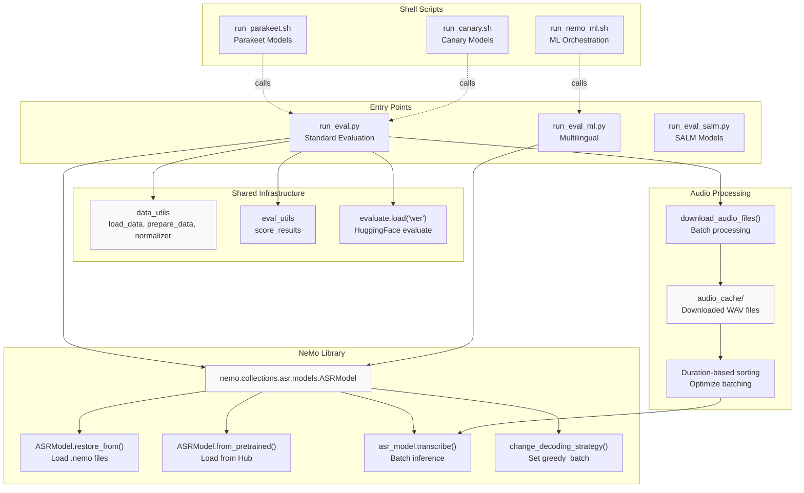
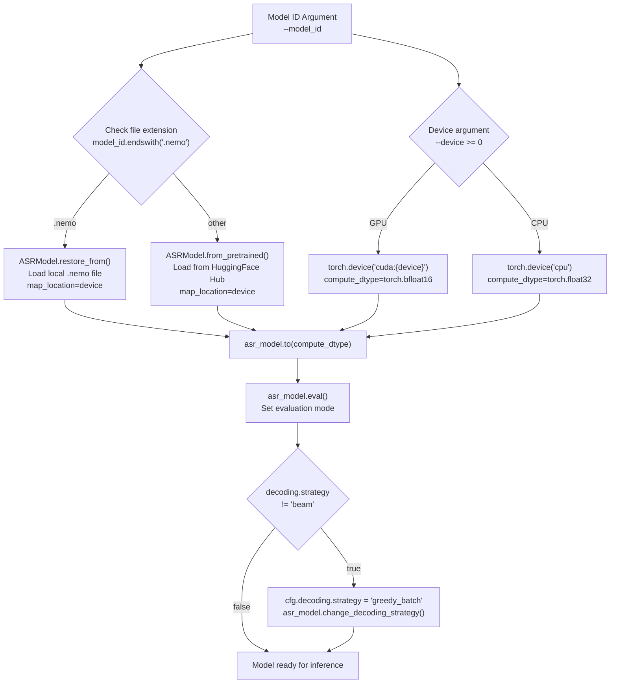
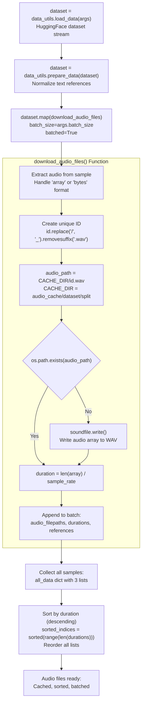
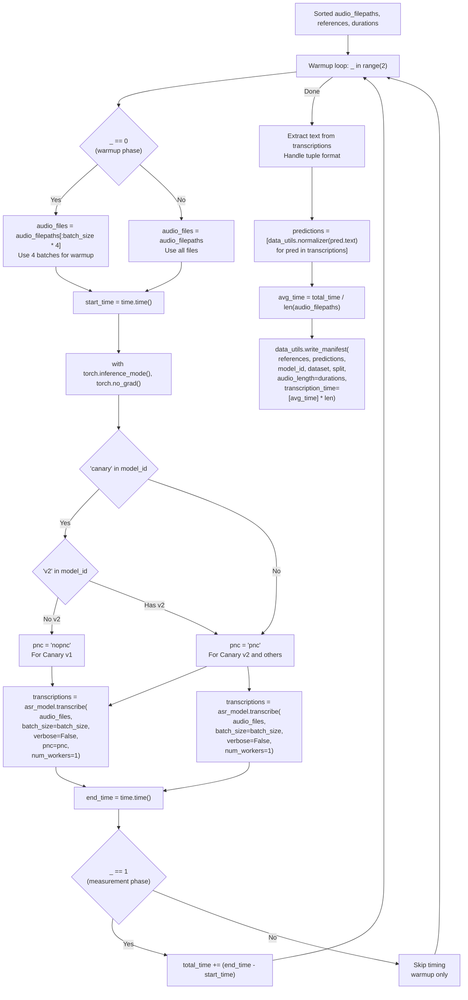
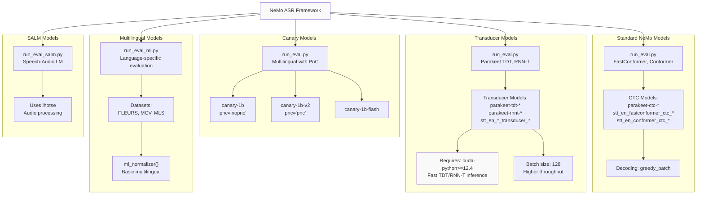
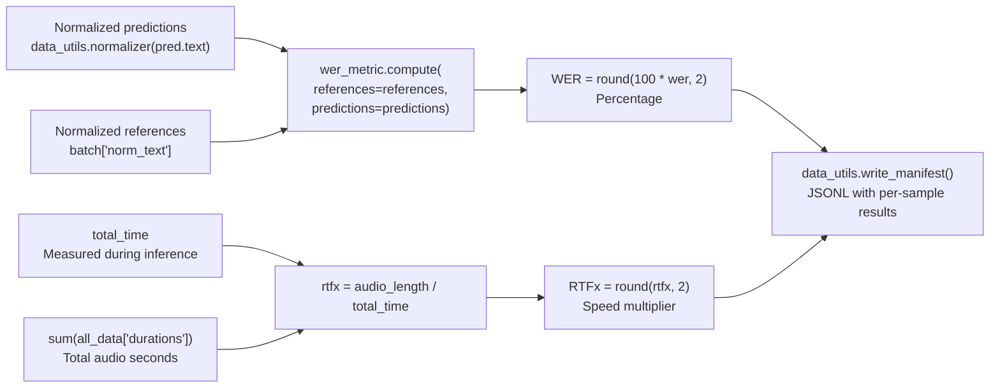

<!-- source: DeepWiki mcp.deepwiki.com · repo huggingface/open_asr_leaderboard · page 4.1 NeMo ASR Framework · fetched 2026-10-26 -->

# NeMo ASR Framework

<details>
<summary>Relevant source files</summary>

The following files were used as context for generating this wiki page:

- [nemo_asr/run_eval.py](nemo_asr/run_eval.py)
- [nemo_asr/run_nemo_ml.sh](nemo_asr/run_nemo_ml.sh)
- [nemo_asr/run_parakeet.sh](nemo_asr/run_parakeet.sh)
- [requirements/requirements_nemo.txt](requirements/requirements_nemo.txt)

</details>


## Purpose and Scope

This document covers the NVIDIA NeMo ASR evaluation system, the most important framework in the Open ASR Leaderboard (importance score 20.39). The NeMo framework provides evaluation capabilities for NVIDIA's ASR models, including standard models, multilingual variants, and specialized architectures like Canary and Parakeet.

This page provides an overview of the NeMo evaluation system architecture, model loading mechanisms, and core workflow. For detailed information on specific model types and evaluation scripts, see:
- Standard NeMo models: [4.1.1](#4.1.1)
- Multilingual evaluation: [4.1.2](#4.1.2)
- Canary models: [4.1.3](#4.1.3)
- Parakeet models: [4.1.4](#4.1.4)
- SALM models: [4.1.5](#4.1.5)

For general evaluation pipeline concepts, see [2](#2). For shared infrastructure components used across all frameworks, see [3](#3).

---

## System Architecture

The NeMo ASR framework integrates NVIDIA's NeMo toolkit with the standardized evaluation pipeline used across all frameworks in the repository. It supports multiple model architectures and provides specialized handling for different model families.

### NeMo Framework Components



**Key Components:**

| Component | Purpose | Code Entity |
|-----------|---------|-------------|
| **run_eval.py** | Standard NeMo evaluation script | [nemo_asr/run_eval.py:1-226]() |
| **ASRModel** | Core NeMo ASR model class | `nemo.collections.asr.models.ASRModel` |
| **restore_from()** | Load local .nemo checkpoint files | [nemo_asr/run_eval.py:39]() |
| **from_pretrained()** | Load models from HuggingFace Hub | [nemo_asr/run_eval.py:41]() |
| **transcribe()** | Batch transcription with NeMo models | [nemo_asr/run_eval.py:138-140]() |
| **download_audio_files()** | Audio caching function | [nemo_asr/run_eval.py:48-88]() |

**Sources:** [nemo_asr/run_eval.py:1-226](), [requirements/requirements_nemo.txt:1-7]()

---

## Model Loading and Initialization

The NeMo framework supports two model loading paths: local `.nemo` checkpoint files and models from HuggingFace Hub. Both paths produce an `ASRModel` instance configured for evaluation.

### Model Loading Workflow



**Initialization Steps:**

1. **Device Configuration** ([nemo_asr/run_eval.py:30-36]()): Set device to GPU (with bfloat16) or CPU (with float32) based on `--device` argument
2. **Model Loading** ([nemo_asr/run_eval.py:38-41]()): Load from `.nemo` file or HuggingFace Hub using `ASRModel.restore_from()` or `ASRModel.from_pretrained()`
3. **Dtype Conversion** ([nemo_asr/run_eval.py:43]()): Convert model to specified compute dtype
4. **Evaluation Mode** ([nemo_asr/run_eval.py:44]()): Set model to `eval()` mode to disable training-specific layers
5. **Decoding Strategy** ([nemo_asr/run_eval.py:96-98]()): Configure greedy batch decoding for non-beam models

**Sources:** [nemo_asr/run_eval.py:30-44](), [nemo_asr/run_eval.py:96-98]()

---

## Audio Processing and Caching

The NeMo framework implements an efficient audio caching system that downloads audio files once and reuses them across evaluations. This system also performs duration-based sorting to optimize batch processing.

### Audio Caching Architecture



**Audio Caching Details:**

| Aspect | Implementation | Code Reference |
|--------|----------------|----------------|
| **Cache Directory** | `audio_cache/{dataset}/{split}` | [nemo_asr/run_eval.py:22-28]() |
| **Unique ID Generation** | Replace `/` with `_`, remove `.wav` suffix | [nemo_asr/run_eval.py:61]() |
| **Audio Format Handling** | Support both `array` and `bytes` keys | [nemo_asr/run_eval.py:65-74]() |
| **Conditional Writing** | Only write if file doesn't exist | [nemo_asr/run_eval.py:76-78]() |
| **Duration Calculation** | `len(audio_array) / sample_rate` | [nemo_asr/run_eval.py:81]() |
| **Sorting Strategy** | Descending by duration | [nemo_asr/run_eval.py:117-120]() |

**Rationale for Duration-Based Sorting:** Sorting audio files by duration (longest first) minimizes padding waste in batches. When similar-length files are batched together, less zero-padding is required to match the longest file in the batch, improving GPU efficiency.

**Sources:** [nemo_asr/run_eval.py:48-120]()

---

## Evaluation Execution Flow

The NeMo evaluation follows a warmup-then-measure pattern to ensure stable timing measurements for RTFx calculation.

### Inference and Timing Workflow



**Execution Phases:**

1. **Warmup Phase** ([nemo_asr/run_eval.py:124-126]()): Process 4 batches to stabilize GPU state, timing not recorded
2. **Measurement Phase** ([nemo_asr/run_eval.py:127-143]()): Process all samples with timing recorded
3. **Model-Specific Handling** ([nemo_asr/run_eval.py:132-140]()): Canary v1 uses `pnc='nopnc'`, v2 and others use `pnc='pnc'`
4. **Transcription** ([nemo_asr/run_eval.py:138-140]()): Batch inference with `num_workers=1` for deterministic results
5. **Normalization** ([nemo_asr/run_eval.py:147-149]()): Apply English text normalizer to predictions
6. **Manifest Writing** ([nemo_asr/run_eval.py:154-163]()): Store results in JSONL format

**Sources:** [nemo_asr/run_eval.py:123-176]()

---

## Model Family Support

The NeMo framework provides specialized support for multiple model families, each with unique characteristics and evaluation requirements.

### Model Family Architecture



**Model Family Characteristics:**

| Model Family | Evaluation Script | Special Requirements | Batch Size | Notes |
|--------------|-------------------|---------------------|------------|-------|
| **CTC Models** | `run_eval.py` | Standard dependencies | 32-64 | Fastest inference |
| **TDT/RNN-T** | `run_eval.py` | `cuda-python>=12.4` | 128 | Requires fast inference library |
| **Canary v1** | `run_eval.py` | `pnc='nopnc'` parameter | 64 | Original Canary model |
| **Canary v2** | `run_eval.py` | `pnc='pnc'` parameter | 64 | Updated Canary with PnC |
| **Multilingual** | `run_eval_ml.py` | Multiple languages | 64 | FLEURS, MCV, MLS datasets |
| **SALM** | `run_eval_salm.py` | lhotse library | Varies | Speech-Audio Language Models |

**Sources:** [nemo_asr/run_eval.py:132-140](), [nemo_asr/run_parakeet.sh:1-104](), [nemo_asr/run_nemo_ml.sh:1-96]()

---

## Shell Script Orchestration

The NeMo framework provides shell scripts that orchestrate evaluations across multiple datasets for specific model families.

### Parakeet Evaluation Script

The `run_parakeet.sh` script evaluates Parakeet models across all 8 ESB datasets with optimized batch sizes:

```bash
MODEL_IDs=("nvidia/parakeet-tdt-0.6b-v3")
BATCH_SIZE=128
DEVICE_ID=0

# For each model:
#   - ami (test)
#   - earnings22 (test)
#   - gigaspeech (test)
#   - librispeech (test.clean, test.other)
#   - spgispeech (test)
#   - tedlium (test)
#   - voxpopuli (test)
#
# Then: eval_utils.score_results()
```

**Key Configuration:**
- **Model List**: Array of Parakeet model IDs ([nemo_asr/run_parakeet.sh:6]())
- **Batch Size**: 128 for optimal TDT/RNN-T throughput ([nemo_asr/run_parakeet.sh:15]())
- **Dataset Path**: `hf-audio/esb-datasets-test-only-sorted` ([nemo_asr/run_parakeet.sh:27]())
- **Final Scoring**: `eval_utils.score_results()` aggregates per-dataset results ([nemo_asr/run_parakeet.sh:100]())

**Sources:** [nemo_asr/run_parakeet.sh:1-104]()

### Multilingual Evaluation Script

The `run_nemo_ml.sh` script orchestrates multilingual evaluations across multiple language configurations:

```bash
MODEL_ID="nvidia/parakeet-tdt-0.6b-v3"
BATCH_SIZE=64

# Language configurations:
EVAL_DATASETS["fleurs"]="en de fr it es pt"
EVAL_DATASETS["mcv"]="en de es fr it"
EVAL_DATASETS["mls"]="es fr it pt"

# For each dataset-language pair:
#   run_eval_ml.py --config_name="${dataset}_${language}"
```

**Key Features:**
- **Dataset-Language Matrix**: Evaluates each dataset with multiple languages ([nemo_asr/run_nemo_ml.sh:20-26]())
- **Config Names**: Format `{dataset}_{language}` for unique identification ([nemo_asr/run_nemo_ml.sh:32]())
- **Parallel Execution**: Iterates through all combinations ([nemo_asr/run_nemo_ml.sh:74-86]())

**Sources:** [nemo_asr/run_nemo_ml.sh:1-96]()

---

## Dependencies and Requirements

The NeMo framework requires specific dependencies, particularly for fast transducer inference.

### Requirements Specification

```
git+https://github.com/NVIDIA/NeMo.git@6294bc7#egg=nemo_toolkit[asr]
tqdm
soundfile
librosa
IPython  # Workaround for NeMo issue
cuda-python>=12.4  # Fast TDT and RNN-T inference
```

**Critical Dependencies:**

| Package | Version | Purpose | Code Reference |
|---------|---------|---------|----------------|
| **nemo_toolkit[asr]** | Specific commit | Core ASR functionality | [requirements/requirements_nemo.txt:1]() |
| **cuda-python** | >=12.4 | Fast TDT/RNN-T inference | [requirements/requirements_nemo.txt:6]() |
| **soundfile** | Latest | Audio file I/O | [requirements/requirements_nemo.txt:3]() |
| **librosa** | Latest | Audio processing | [requirements/requirements_nemo.txt:4]() |
| **IPython** | Latest | Workaround for NeMo issue | [requirements/requirements_nemo.txt:5]() |

**Special Note on cuda-python:** The `cuda-python>=12.4` requirement enables accelerated inference for TDT (Token-and-Duration Transducer) and RNN-T (RNN Transducer) models. Without this library, transducer inference falls back to slower implementations.

**Sources:** [requirements/requirements_nemo.txt:1-7]()

---

## Metrics and Results

The NeMo evaluation produces two primary metrics: Word Error Rate (WER) and Real-Time Factor (RTFx).

### Metrics Calculation



**Calculation Details:**

1. **WER Computation** ([nemo_asr/run_eval.py:167-168]()): Uses HuggingFace `evaluate` library, multiplied by 100 for percentage
2. **RTFx Computation** ([nemo_asr/run_eval.py:171-173]()): Ratio of audio duration to processing time
3. **Timing Methodology**: Only the second pass (after warmup) is timed to exclude GPU initialization overhead
4. **Average Time**: Total time divided by number of samples for per-sample manifest ([nemo_asr/run_eval.py:151]())

**Output Format:**
- **Console Output**: WER and RTFx printed to stdout ([nemo_asr/run_eval.py:175-176]())
- **Manifest File**: JSONL file with per-sample predictions, references, and timing ([nemo_asr/run_eval.py:154-163]())
- **Aggregated Scores**: Generated by `eval_utils.score_results()` after all datasets

**Sources:** [nemo_asr/run_eval.py:146-176]()

---

## Integration with Shared Infrastructure

The NeMo framework uses shared infrastructure components to maintain consistency with other evaluation frameworks.

### Shared Component Usage

| Component | Usage in NeMo | Code Reference |
|-----------|---------------|----------------|
| **data_utils.load_data()** | Load datasets from HuggingFace Hub | [nemo_asr/run_eval.py:46]() |
| **data_utils.prepare_data()** | Normalize reference text | [nemo_asr/run_eval.py:95]() |
| **data_utils.normalizer()** | Normalize predictions (English) | [nemo_asr/run_eval.py:149]() |
| **data_utils.ml_normalizer()** | Normalize multilingual text | Used in `run_eval_ml.py` |
| **data_utils.write_manifest()** | Write JSONL results | [nemo_asr/run_eval.py:154-163]() |
| **eval_utils.score_results()** | Aggregate all dataset results | Called in shell scripts |
| **evaluate.load("wer")** | WER metric computation | [nemo_asr/run_eval.py:17]() |

For detailed documentation of these shared components, see:
- Data utilities: [3.2](#3.2)
- Evaluation utilities: [3.3](#3.3)
- Text normalization: [3.1](#3.1)

**Sources:** [nemo_asr/run_eval.py:10](), [nemo_asr/run_eval.py:46](), [nemo_asr/run_eval.py:95](), [nemo_asr/run_eval.py:149](), [nemo_asr/run_eval.py:154-163]()

---

