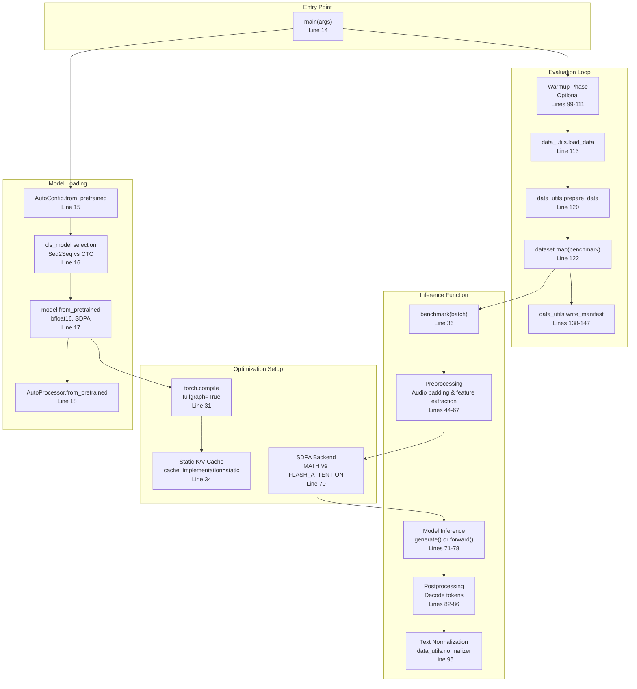
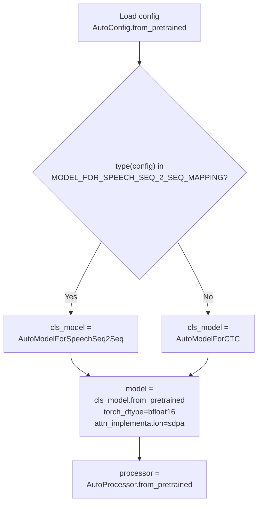
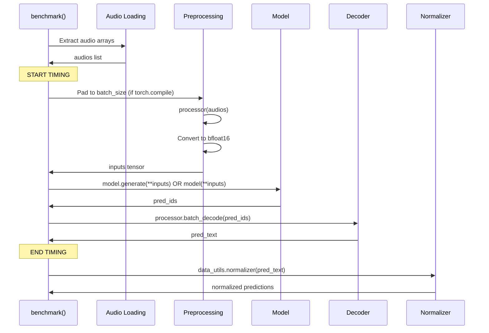
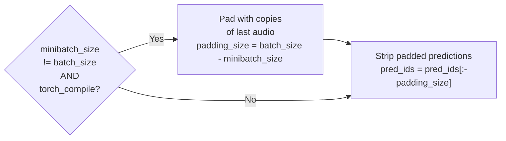
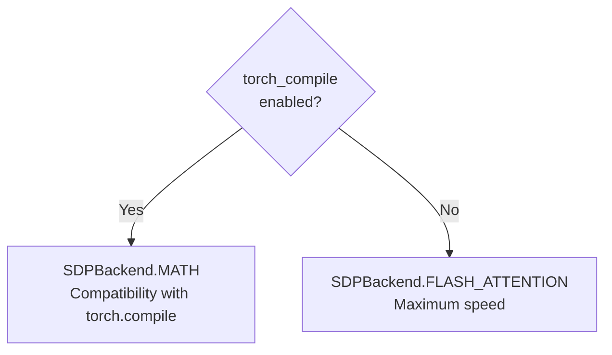
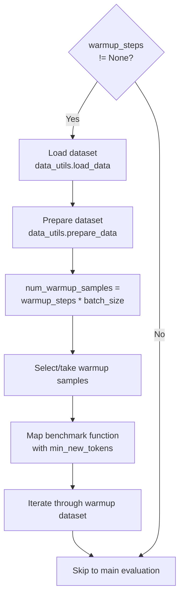
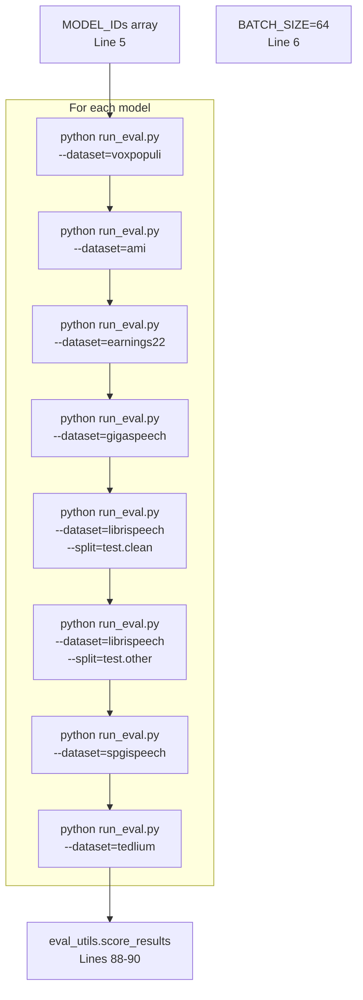
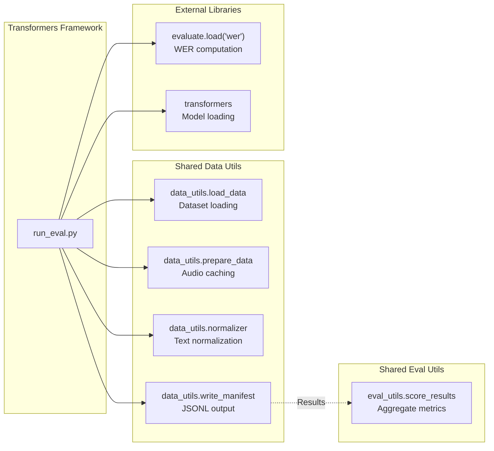

<!-- source: DeepWiki mcp.deepwiki.com · repo huggingface/open_asr_leaderboard · page 4.2 Transformers Framework · fetched 2026-10-26 -->

# Transformers Framework

<details>
<summary>Relevant source files</summary>

The following files were used as context for generating this wiki page:

- [README.md](README.md)
- [transformers/run_eval.py](transformers/run_eval.py)
- [transformers/run_whisper.sh](transformers/run_whisper.sh)

</details>


## Purpose and Scope

The Transformers Framework provides evaluation capabilities for Hugging Face Transformers-based Automatic Speech Recognition (ASR) models. This framework is the second most important evaluation system in the repository (importance score: 19.49), supporting multiple ASR model architectures including Whisper, Wav2Vec2, MMS, HuBERT, Data2Vec, and Conformer variants.

This page documents the core evaluation script [transformers/run_eval.py](), the optimization features available, and how to evaluate Transformers-based models. For specific model families, see [Whisper Models](#4.2.1), [Wav2Vec2 Models](#4.2.2), [MMS and Other Models](#4.2.3), and [HuBERT Models](#4.2.4). For general pipeline concepts, see [Evaluation Workflow](#2.1).

**Sources:** [transformers/run_eval.py:1-237](), [README.md:1-244]()

## Supported Model Architectures

The Transformers framework automatically detects and supports two primary ASR model categories:

| Model Type | Architecture | Examples | Generation Method |
|------------|-------------|----------|-------------------|
| **Encoder-Decoder (Seq2Seq)** | Autoregressive generation | Whisper, Distil-Whisper | `model.generate()` with beam search |
| **CTC (Connectionist Temporal Classification)** | Single forward pass | Wav2Vec2, HuBERT, MMS, Data2Vec, Conformer | `argmax` over logits |

The script uses `MODEL_FOR_SPEECH_SEQ_2_SEQ_MAPPING` to automatically determine which loading class to use (`AutoModelForSpeechSeq2Seq` or `AutoModelForCTC`).

**Sources:** [transformers/run_eval.py:14-17]()

## Architecture Overview



**Sources:** [transformers/run_eval.py:14-148]()

## Model Loading and Configuration

### Automatic Model Type Detection

The framework automatically detects whether a model is encoder-decoder (Seq2Seq) or CTC-based:



**Sources:** [transformers/run_eval.py:15-18]()

### Generation Configuration

For encoder-decoder models, the script automatically configures generation parameters:

- **Max New Tokens**: Specified via `--max_new_tokens` argument [transformers/run_eval.py:22]()
- **Multilingual Models**: For models with `is_multilingual` flag, the script sets `language="en"` and `task="transcribe"` to boost WER performance [transformers/run_eval.py:24-26]()

**Sources:** [transformers/run_eval.py:21-28]()

## Inference Pipeline

The `benchmark` function implements the core inference logic with precise timing:



**Sources:** [transformers/run_eval.py:36-97]()

### Preprocessing Strategies

The preprocessing logic varies based on model type and audio length:

| Condition | Preprocessing Method | Details |
|-----------|---------------------|---------|
| **CTC Models** | Normalize to mean 0, std 1 | `truncation=False`, `padding="longest"`, `return_attention_mask=True` [transformers/run_eval.py:54-61]() |
| **Short-form Seq2Seq** | Pad to 30 seconds, log-mel | Standard Whisper processing [transformers/run_eval.py:64]() |
| **Long-form Seq2Seq** | Variable length processing | Same as CTC [transformers/run_eval.py:52-61]() |

**Sources:** [transformers/run_eval.py:44-67]()

### Batch Padding for torch.compile

When using `torch.compile`, the script pads batches to a fixed size to prevent recompilations:



**Sources:** [transformers/run_eval.py:46-50](), [transformers/run_eval.py:82-83]()

## Performance Optimization Features

### torch.compile

The framework supports PyTorch 2.0's `torch.compile` for JIT compilation of the forward pass:

**Command-line Arguments:**
- `--torch_compile`: Enable compilation [transformers/run_eval.py:217-219]()
- `--compile_mode`: Compilation mode, default `"max-autotune"` [transformers/run_eval.py:221-226]()

**Compilation Configuration:**
```python
model.forward = torch.compile(model.forward, mode=args.compile_mode, fullgraph=True)
```

The `fullgraph=True` flag ensures the entire forward pass is compiled without graph breaks, maximizing performance.

**Sources:** [transformers/run_eval.py:30-31]()

### Static K/V Cache

For autoregressive models with `torch.compile` enabled, the script activates static key-value caching:

```python
model.generation_config.cache_implementation = "static"
```

This optimization pre-allocates cache tensors to avoid dynamic memory allocation during generation, significantly improving throughput.

**Sources:** [transformers/run_eval.py:32-34]()

### SDPA Backend Selection

The script uses Scaled Dot-Product Attention (SDPA) with backend selection:



Flash Attention 2 is faster but not compatible with `torch.compile`, so the script switches to the MATH backend when compilation is enabled.

**Sources:** [transformers/run_eval.py:70]()

### Float32 Matmul Precision

The script sets high precision for float32 matrix multiplications:

```python
torch.set_float32_matmul_precision('high')
```

This allows use of TensorFloat-32 (TF32) on Ampere GPUs, providing ~8x speedup for matmuls while maintaining accuracy.

**Sources:** [transformers/run_eval.py:12]()

## Warmup Phase

The framework includes an optional warmup phase to stabilize timing measurements:



The warmup phase runs inference on a subset of data before timed evaluation begins. This is crucial for:
- Triggering JIT compilation (if using `torch.compile`)
- Stabilizing GPU clocks
- Loading model weights into cache

**Sources:** [transformers/run_eval.py:99-111]()

## Running Evaluations

### Shell Script Structure

Evaluation shell scripts follow a standard pattern. Example from [transformers/run_whisper.sh]():



**Sources:** [transformers/run_whisper.sh:1-93]()

### Command-Line Arguments

| Argument | Type | Default | Description |
|----------|------|---------|-------------|
| `--model_id` | str | **Required** | Hugging Face model identifier |
| `--dataset_path` | str | `"esb/datasets"` | Dataset repository path |
| `--dataset` | str | **Required** | Dataset name (e.g., `"librispeech_asr"`) |
| `--split` | str | `"test"` | Dataset split to evaluate |
| `--device` | int | `-1` | GPU device index (-1 for CPU) |
| `--batch_size` | int | `16` | Batch size for inference |
| `--max_eval_samples` | int | `None` | Limit evaluation samples (for testing) |
| `--streaming` | bool | `False` | Stream dataset vs download |
| `--max_new_tokens` | int | `None` | Max tokens for generation (Seq2Seq only) |
| `--torch_compile` | bool | `False` | Enable torch.compile |
| `--compile_mode` | str | `"max-autotune"` | Compilation mode |
| `--warmup_steps` | int | `10` | Number of warmup batches |

**Sources:** [transformers/run_eval.py:159-233]()

### Example Usage

```bash
# Basic Whisper evaluation
python run_eval.py \
    --model_id="openai/whisper-large-v3" \
    --dataset="librispeech" \
    --split="test.clean" \
    --device=0 \
    --batch_size=64

# With torch.compile optimization
python run_eval.py \
    --model_id="openai/whisper-large-v3" \
    --dataset="librispeech" \
    --split="test.clean" \
    --device=0 \
    --batch_size=16 \
    --torch_compile \
    --compile_mode="max-autotune"

# CTC model (Wav2Vec2)
python run_eval.py \
    --model_id="facebook/wav2vec2-large-960h-lv60-self" \
    --dataset="librispeech" \
    --split="test.clean" \
    --device=0 \
    --batch_size=8
```

**Sources:** [transformers/run_eval.py:14-236](), [transformers/run_whisper.sh:14-85]()

## Code Entity Mapping

The following diagram maps natural language concepts to specific code entities in the framework:

```mermaid
graph TB
    subgraph "Natural Language Concepts"
        NL_MODEL["Model Loading"]
        NL_INFER["Inference"]
        NL_NORM["Normalization"]
        NL_TIMING["Timing"]
        NL_METRICS["Metrics"]
    end
    
    subgraph "Code Entities"
        CE_CONFIG["AutoConfig.from_pretrained()<br/>Line 15"]
        CE_MODEL["cls_model.from_pretrained()<br/>Line 17"]
        CE_PROC["AutoProcessor.from_pretrained()<br/>Line 18"]
        
        CE_BENCH["benchmark(batch)<br/>Line 36"]
        CE_GEN["model.generate(**inputs)<br/>Line 73"]
        CE_FWD["model(**inputs).logits<br/>Line 77"]
        
        CE_NORM["data_utils.normalizer(pred)<br/>Line 95"]
        
        CE_START["start_time = time.time()<br/>Line 42"]
        CE_END["runtime = time.time() - start_time<br/>Line 89"]
        
        CE_WER["wer_metric.compute()<br/>Line 150"]
        CE_RTFX["sum(audio_length_s) / sum(time_s)<br/>Line 154"]
        
        CE_MANIFEST["data_utils.write_manifest()<br/>Lines 138-147"]
    end
    
    NL_MODEL --> CE_CONFIG
    NL_MODEL --> CE_MODEL
    NL_MODEL --> CE_PROC
    
    NL_INFER --> CE_BENCH
    NL_INFER --> CE_GEN
    NL_INFER --> CE_FWD
    
    NL_NORM --> CE_NORM
    
    NL_TIMING --> CE_START
    NL_TIMING --> CE_END
    
    NL_METRICS --> CE_WER
    NL_METRICS --> CE_RTFX
    NL_METRICS --> CE_MANIFEST
```



**Sources:** [transformers/run_eval.py:15-154]()

## Integration with Shared Infrastructure

The Transformers framework relies on shared infrastructure components:



For details on these shared components, see:
- [Data Utils](#3.2) for dataset loading and preparation
- [Normalizer Module](#3.1) for text normalization
- [Eval Utils](#3.3) for result aggregation

**Sources:** [transformers/run_eval.py:1-11](), [transformers/run_eval.py:95](), [transformers/run_eval.py:100-101](), [transformers/run_eval.py:138-147]()

## Supported Models

The Transformers framework has been validated with the following model families:

### Whisper Variants
- OpenAI Whisper: `tiny.en`, `small.en`, `base.en`, `medium.en`, `large`, `large-v2`, `large-v3`
- Distil-Whisper: `distil-medium.en`, `distil-large-v2`, `distil-large-v3`
- Community models: `nyrahealth/CrisperWhisper`

### CTC Models
- Wav2Vec2 models (see [Wav2Vec2 Models](#4.2.2))
- MMS models (see [MMS and Other Models](#4.2.3))
- HuBERT models (see [HuBERT Models](#4.2.4))
- Data2Vec models
- Conformer variants

**Sources:** [transformers/run_whisper.sh:5]()

## Performance Considerations

### Batch Size Selection

Recommended batch sizes based on model type and optimization:

| Model Type | Without torch.compile | With torch.compile |
|------------|----------------------|-------------------|
| Whisper tiny/base/small | 64 | 16 |
| Whisper medium/large | 32 | 8 |
| Wav2Vec2 base | 32 | 8 |
| Wav2Vec2 large | 16 | 4 |

Smaller batch sizes with `torch.compile` avoid excessive compilation time while maintaining high throughput.

**Sources:** [transformers/run_whisper.sh:6]()

### Memory Management

The framework uses `torch.bfloat16` for inference to reduce memory usage:
- Model weights loaded in bfloat16 [transformers/run_eval.py:17]()
- Input features converted to bfloat16 [transformers/run_eval.py:67]()

This reduces memory requirements by ~50% compared to float32 while maintaining accuracy on Ampere+ GPUs.

**Sources:** [transformers/run_eval.py:17](), [transformers/run_eval.py:67]()

---

