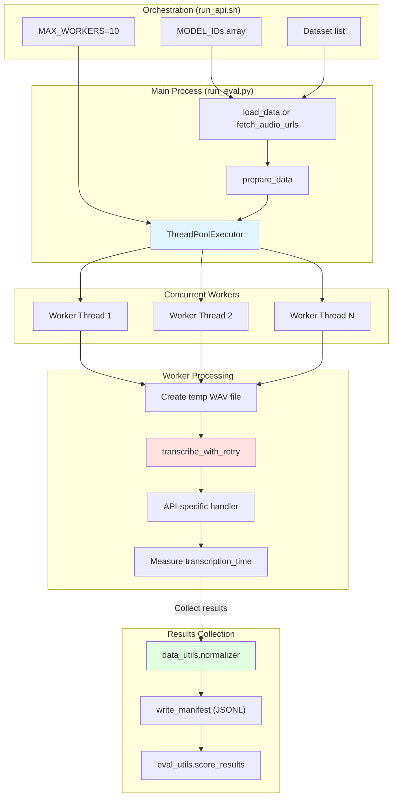
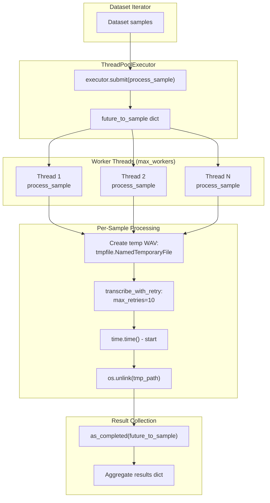
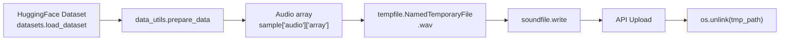
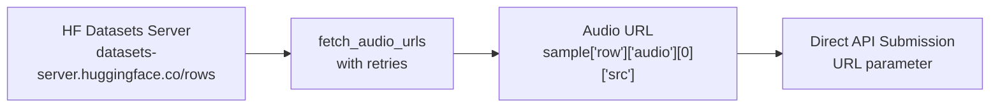
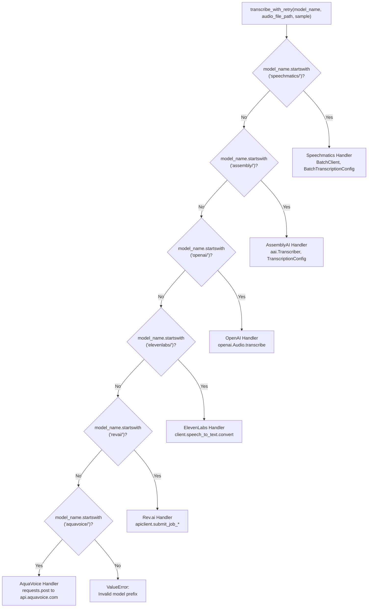
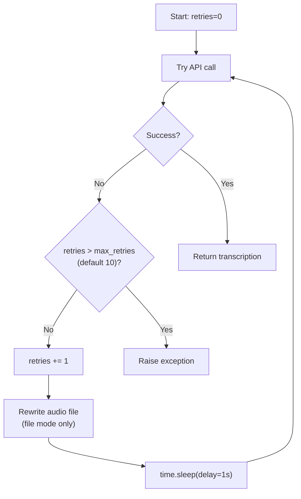
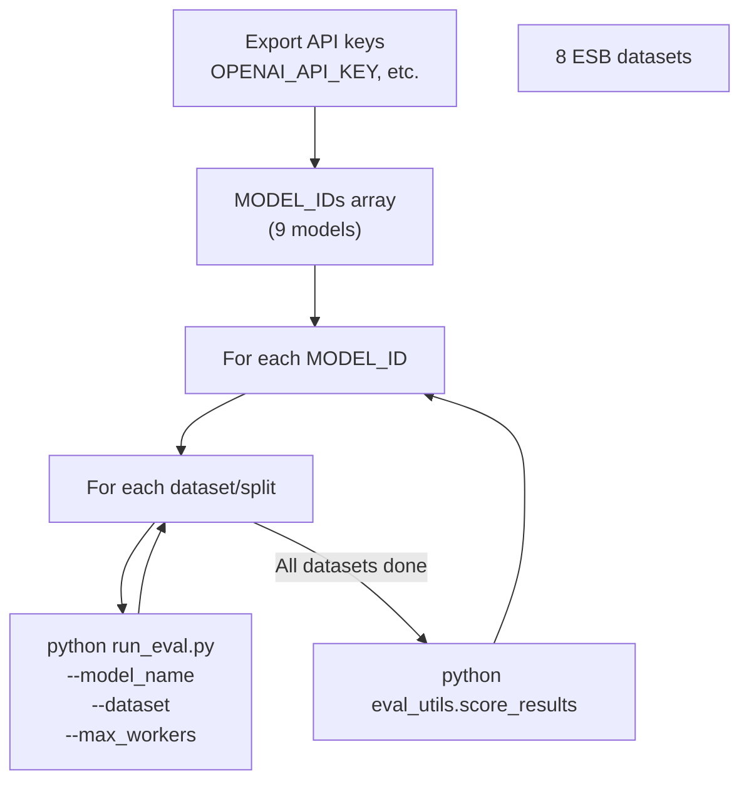
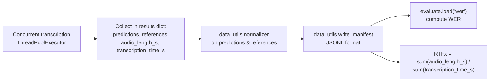

<!-- source: DeepWiki mcp.deepwiki.com · repo huggingface/open_asr_leaderboard · page 4.3 API-Based Evaluation · fetched 2026-10-26 -->

# API-Based Evaluation

<details>
<summary>Relevant source files</summary>

The following files were used as context for generating this wiki page:

- [api/run_api.sh](api/run_api.sh)
- [api/run_eval.py](api/run_eval.py)
- [nemo_asr/run_eval.py](nemo_asr/run_eval.py)
- [requirements/requirements-api.txt](requirements/requirements-api.txt)

</details>


## Purpose and Scope

This document covers the evaluation of commercial ASR APIs including OpenAI Whisper API, AssemblyAI, ElevenLabs, Rev.ai, Speechmatics, and AquaVoice. The API evaluation framework differs from local model evaluation (see [NeMo ASR Framework](#4.1) and [Transformers Framework](#4.2)) by using concurrent HTTP requests instead of local GPU inference. This approach enables evaluation of proprietary models that are only accessible through web APIs.

For information about the standard evaluation pipeline pattern, see [Core Evaluation Pipeline](#2). For details on text normalization and metrics calculation, see [Normalizer Module](#3.1) and [Metrics Calculation](#2.3).

**Sources**: [api/run_eval.py:1-455](), [api/run_api.sh:1-93]()

---

## Overview

The API evaluation system provides a unified interface for evaluating multiple commercial ASR services through their respective APIs. Unlike local model evaluation which loads models into GPU memory, API evaluation dispatches audio files to remote endpoints and processes responses concurrently to optimize throughput.

### Key Differences from Local Evaluation

| Aspect | Local Model Evaluation | API-Based Evaluation |
|--------|----------------------|---------------------|
| **Execution** | Batch inference on GPU | Concurrent HTTP requests |
| **Throughput** | Limited by GPU memory/speed | Limited by API rate limits |
| **Parallelization** | Batching (multiple samples per GPU call) | Threading (multiple concurrent requests) |
| **Audio Processing** | Direct numpy arrays | File uploads or URLs |
| **Cost** | Compute infrastructure | Per-request API pricing |
| **RTFx Measurement** | Includes model load time | Per-request latency |

**Sources**: [api/run_eval.py:297-420](), [nemo_asr/run_eval.py:20-177]()

---

## Supported APIs

The framework supports six commercial ASR providers through their respective SDKs. Each API requires configuration via environment variables for authentication.

### API Provider Configuration

| Provider | Model Identifiers | Environment Variable | SDK Package |
|----------|------------------|---------------------|-------------|
| **OpenAI** | `openai/whisper-1`<br>`openai/gpt-4o-transcribe`<br>`openai/gpt-4o-mini-transcribe` | `OPENAI_API_KEY` | `openai` |
| **AssemblyAI** | `assembly/best` | `ASSEMBLYAI_API_KEY` | `assemblyai` |
| **ElevenLabs** | `elevenlabs/scribe_v1` | `ELEVENLABS_API_KEY` | `elevenlabs` |
| **Rev.ai** | `revai/machine`<br>`revai/fusion` | `REVAI_API_KEY` | `rev-ai` |
| **Speechmatics** | `speechmatics/enhanced` | `SPEECHMATICS_API_KEY` | `speechmatics-python` |
| **AquaVoice** | `aquavoice/avalon-v1-en` | `AQUAVOICE_API_KEY` | (requests) |

**Configuration Example** (from shell script):
```bash
export OPENAI_API_KEY="your_api_key"
export ASSEMBLYAI_API_KEY="your_api_key"
export ELEVENLABS_API_KEY="your_api_key"
```

**Sources**: [api/run_api.sh:5-10](), [api/run_api.sh:11-21](), [requirements/requirements-api.txt:1-8](), [api/run_eval.py:78-276]()

---

## Architecture

### API Evaluation Flow

The API evaluation system replaces GPU-based batch inference with concurrent HTTP request handling. This architectural shift enables parallel processing of multiple audio samples without GPU memory constraints.



**Diagram: API Evaluation Architecture**

The `ThreadPoolExecutor` at [api/run_eval.py:371-386]() manages up to `max_workers` concurrent threads (default 300, configurable via `--max_workers` argument). Each worker thread processes a single audio sample independently, creating temporary WAV files and making API requests with retry logic.

**Sources**: [api/run_eval.py:297-420](), [api/run_api.sh:23-24](), [api/run_eval.py:371-386]()

---

## Concurrent Request Handling

### ThreadPoolExecutor Implementation

The core concurrency mechanism uses Python's `concurrent.futures.ThreadPoolExecutor` to dispatch multiple API requests in parallel:



**Diagram: Concurrent Request Execution Model**

**Implementation Details**:
- **Thread Pool Setup**: [api/run_eval.py:371]() creates `ThreadPoolExecutor(max_workers=max_workers)`
- **Job Submission**: [api/run_eval.py:372-374]() submits one `process_sample` job per dataset sample
- **Progress Tracking**: [api/run_eval.py:375-386]() uses `tqdm` with `as_completed` to display progress as requests finish
- **Temporary Files**: [api/run_eval.py:341-348]() creates WAV files in temp directory for API upload (unless using URL mode)
- **Cleanup**: [api/run_eval.py:363-366]() deletes temp files after transcription completes

**Why Threading vs Multiprocessing**: API evaluation is I/O-bound (waiting for HTTP responses), not CPU-bound. Threading provides sufficient parallelism without the overhead of process creation and inter-process communication.

**Sources**: [api/run_eval.py:371-386](), [api/run_eval.py:326-369](), [api/run_eval.py:341-348]()

---

## URL-Based vs File-Based Processing

The framework supports two modes for providing audio to APIs, selected via the `--use_url` flag:

### Mode Comparison

| Mode | Audio Source | Best For | Implementation |
|------|-------------|----------|----------------|
| **File-Based** (default) | Downloads dataset locally, creates temp WAV files | APIs requiring file upload | [api/run_eval.py:339-366]() |
| **URL-Based** (`--use_url`) | Fetches URLs from HuggingFace Datasets Server API | APIs supporting URL ingestion (AssemblyAI, Rev.ai, Speechmatics) | [api/run_eval.py:307-337]() |

### File-Based Processing Flow



**Diagram: File-Based Processing Flow**

**Sources**: [api/run_eval.py:312-315](), [api/run_eval.py:341-366]()

### URL-Based Processing Flow



**Diagram: URL-Based Processing Flow**

**URL Fetching Implementation** ([api/run_eval.py:29-66]()):
1. Query `datasets-server.huggingface.co/size` to get total row count
2. Paginate through dataset in batches of 100 rows
3. Extract audio URL from `sample["row"]["audio"][0]["src"]`
4. Pass URL directly to API (AssemblyAI, Rev.ai, Speechmatics support this)
5. Retry up to 20 times with 10s delays on failures

**Advantages of URL Mode**:
- No local disk I/O for audio files
- Reduced bandwidth (API downloads directly from HuggingFace)
- Faster startup (no dataset download wait)

**Limitations**:
- Requires API to support URL ingestion
- Cannot work with private/gated datasets without HF token
- Rev.ai and Speechmatics require `--use_url=True` (noted in shell script comments)

**Sources**: [api/run_eval.py:29-66](), [api/run_eval.py:99-101](), [api/run_eval.py:156](), [api/run_api.sh:17-18]()

---

## API-Specific Implementations

Each commercial provider has unique SDK patterns and API requirements. The `transcribe_with_retry` function at [api/run_eval.py:68-295]() dispatches to provider-specific handlers based on model name prefix.

### API Handler Dispatch Logic



**Diagram: API Provider Handler Dispatch**

**Sources**: [api/run_eval.py:78-276]()

### Speechmatics Implementation

**Key Features**:
- Batch transcription API with job submission and polling
- Supports URL fetching via `FetchData(url=audio_url)`
- Uses `BatchClient` with connection settings
- Waits for job completion with `wait_for_completion`

**Code Flow** ([api/run_eval.py:78-146]()):
```
1. Create ConnectionSettings with API key
2. Initialize BatchClient context manager
3. Create BatchTranscriptionConfig (language="en", operating_point)
4. Submit job (URL or file upload)
5. Wait for completion (blocking call)
6. Return transcript in txt format
```

**Error Handling**:
- 401: Invalid credentials (raises `ValueError`)
- 400: Bad request with error details
- Failed URL fetch: Skips retry (sets `retries = max_retries + 1`)

**Sources**: [api/run_eval.py:78-146]()

### AssemblyAI Implementation

**Key Features**:
- Synchronous transcription API
- Supports direct URL submission
- Automatic retry on errors
- Skips audio shorter than 0.16 seconds

**Code Flow** ([api/run_eval.py:148-175]()):
```
1. Set aai.settings.api_key from environment
2. Create Transcriber instance
3. Create TranscriptionConfig (speech_model, language_code="en")
4. Submit audio (URL or file path)
5. Check transcript.status for errors
6. Return transcript.text
```

**Duration Filtering**: [api/run_eval.py:158-160]() and [api/run_eval.py:166-168]() skip audio samples shorter than 0.16 seconds by returning `"."` (AssemblyAI API limitation).

**Sources**: [api/run_eval.py:148-175]()

### OpenAI Implementation

**Key Features**:
- Simple synchronous API
- Requires audio as file object
- Uses BytesIO for URL mode
- Fixed temperature=0.0 for deterministic output

**Code Flow** ([api/run_eval.py:177-197]()):
```
1. If use_url: Download audio to BytesIO
2. Call openai.Audio.transcribe with model, file, response_format="text"
3. Set language="en", temperature=0.0
4. Return response.strip()
```

**Model Extraction**: Model name is extracted by splitting on `/` (e.g., `openai/whisper-1` → `whisper-1`)

**Sources**: [api/run_eval.py:177-197]()

### ElevenLabs Implementation

**Key Features**:
- Uses `ElevenLabs` client SDK
- Speech-to-text API with audio event tagging
- Language code specification

**Code Flow** ([api/run_eval.py:199-218]()):
```
1. Initialize ElevenLabs(api_key)
2. If use_url: Download to BytesIO
3. Call client.speech_to_text.convert
4. Parameters: model_id, language_code="eng", tag_audio_events=True
5. Return transcription.text
```

**Sources**: [api/run_eval.py:199-218]()

### Rev.ai Implementation

**Key Features**:
- Job-based asynchronous API
- Requires polling for completion
- Supports both URL and file submission
- Transcriber selection (machine/fusion)

**Code Flow** ([api/run_eval.py:220-258]()):
```
1. Create RevAiAPIClient with access token
2. Submit job:
   - URL mode: submit_job_url with CustomerUrlData
   - File mode: submit_job_local_file
3. Poll job status in loop:
   - Check status: IN_PROGRESS, TRANSCRIBING → continue
   - FAILED → raise Exception
   - TRANSCRIBED → break
4. Get transcript_object
5. Combine all words from all monologues
6. Return joined transcript text
```

**Monologue Processing**: [api/run_eval.py:252-258]() iterates through all monologues and elements to reconstruct full transcript.

**Sources**: [api/run_eval.py:220-258]()

### AquaVoice Implementation

**Key Features**:
- REST API with file upload
- Requires API key from https://withaqua.com/api-dashboard
- Uses requests library directly (no dedicated SDK)

**Code Flow** ([api/run_eval.py:259-271]()):
```
1. Get AQUAVOICE_API_KEY from environment
2. POST to https://api.aquavoice.com/api/v1/audio/transcriptions
3. Headers: Authorization: Bearer {api_key}
4. Form data: file (audio), model (model name)
5. Return response.json()["text"]
```

**Sources**: [api/run_eval.py:259-271]()

---

## Retry Logic and Error Handling

The `transcribe_with_retry` function implements exponential backoff retry logic to handle transient API failures.

### Retry Mechanism



**Diagram: Retry Logic Flow**

**Implementation Details** ([api/run_eval.py:68-295]()):
- **Default max_retries**: 10 attempts
- **Delay**: Fixed 1 second between retries (could be improved with exponential backoff)
- **File rewrite**: [api/run_eval.py:283-289]() rewrites audio file before retry in file mode
- **Special handling**: Speechmatics URL fetch failures skip retries

**Retry Count Examples**:
- `fetch_audio_urls`: max_retries=20 ([api/run_eval.py:29]())
- `transcribe_with_retry`: max_retries=10 ([api/run_eval.py:72]())

**Error Message Format**: [api/run_eval.py:291-293]()
```
API Error: {str(e)}. Retrying in {delay}s... (Attempt {retries}/{max_retries})
```

**Sources**: [api/run_eval.py:68-295](), [api/run_eval.py:278-294]()

### Common Error Scenarios

| Error Type | Cause | Handling |
|-----------|-------|----------|
| **401 Unauthorized** | Invalid API key | Raises `ValueError` immediately (Speechmatics) |
| **400 Bad Request** | Malformed request | Raises `ValueError` with error details |
| **Rate Limiting** | Too many concurrent requests | Retries with delay |
| **Timeout** | Slow API response | Retries up to max_retries |
| **URL Fetch Failure** | HuggingFace CDN error | Skips sample (Speechmatics) |
| **Audio Too Short** | < 0.16s duration | Returns `"."` (AssemblyAI) |

**Sources**: [api/run_eval.py:119-146](), [api/run_eval.py:158-168](), [api/run_eval.py:278-294]()

---

## Evaluation Orchestration

The shell script [api/run_api.sh:1-93]() orchestrates full leaderboard evaluation across all datasets and models.

### Orchestration Flow



**Diagram: Shell Script Orchestration**

**Configuration**:
- **API Keys**: [api/run_api.sh:5-10]() exports all required environment variables
- **Models**: [api/run_api.sh:11-21]() defines 9 model identifiers
- **Concurrency**: [api/run_api.sh:23]() sets `MAX_WORKERS=10` (conservative to avoid rate limits)
- **Datasets**: [api/run_api.sh:32-84]() evaluates 8 datasets (ami, earnings22, gigaspeech, librispeech test.clean/test.other, spgispeech, tedlium, voxpopuli)

**Aggregation**: [api/run_api.sh:86-90]() runs `eval_utils.score_results` after all datasets complete for a model.

**Sources**: [api/run_api.sh:1-93]()

---

## Results Storage and Metrics

API evaluation follows the standard result format used across all frameworks.

### Result Collection Process



**Diagram: Results Collection and Metrics**

**Results Dictionary Structure** ([api/run_eval.py:317-322]()):
```python
results = {
    "references": [],          # Ground truth transcripts
    "predictions": [],         # API transcriptions
    "audio_length_s": [],     # Duration of each audio sample
    "transcription_time_s": [], # Time taken for each API call
}
```

**Normalization**: [api/run_eval.py:388-394]() applies `data_utils.normalizer` to both predictions and references to ensure fair comparison (see [Normalizer Module](#3.1)).

**Manifest Writing**: [api/run_eval.py:396-405]() calls `data_utils.write_manifest` which creates a JSONL file at `results/{model_name}/{dataset}/{split}.jsonl` with per-sample details.

**Metrics Calculation**:
- **WER**: [api/run_eval.py:409-413]() computes Word Error Rate using HuggingFace `evaluate` library
- **RTFx**: [api/run_eval.py:414-416]() computes Real-Time Factor (audio duration / transcription time)

**Why RTFx is Different**: Unlike local models where RTFx measures GPU inference speed, API RTFx measures end-to-end network latency including HTTP request/response overhead. This makes RTFx less comparable between local and API models.

**Sources**: [api/run_eval.py:317-420](), [api/run_eval.py:388-394](), [api/run_eval.py:396-416]()

---

## Usage Examples

### Basic Evaluation

Evaluate a single model on one dataset:
```bash
python run_eval.py \
    --dataset_path="hf-audio/esb-datasets-test-only-sorted" \
    --dataset="librispeech" \
    --split="test.clean" \
    --model_name="openai/whisper-1" \
    --max_workers=10
```

### URL-Based Evaluation (Rev.ai)

For APIs supporting URL ingestion:
```bash
python run_eval.py \
    --dataset_path="hf-audio/esb-datasets-test-only-sorted" \
    --dataset="tedlium" \
    --split="test" \
    --model_name="revai/fusion" \
    --max_workers=10 \
    --use_url
```

### High Concurrency (AssemblyAI)

Increase parallelism for fast APIs:
```bash
python run_eval.py \
    --dataset_path="hf-audio/esb-datasets-test-only-sorted" \
    --dataset="ami" \
    --split="test" \
    --model_name="assembly/best" \
    --max_workers=300
```

### Full Leaderboard Evaluation

Run all models on all datasets:
```bash
cd api
bash run_api.sh
```
This will iterate through all 9 models and 8 datasets, then aggregate results.

**Sources**: [api/run_eval.py:422-454](), [api/run_api.sh:27-93]()

---

## Performance Considerations

### Concurrency Tuning

| API Provider | Recommended max_workers | Constraint |
|-------------|------------------------|-----------|
| **OpenAI** | 10-20 | Rate limit: 500 requests/min |
| **AssemblyAI** | 100-300 | Generous rate limits |
| **ElevenLabs** | 10-50 | Varies by plan |
| **Rev.ai** | 10-20 | Polling-based (asynchronous) |
| **Speechmatics** | 20-50 | Job queue processing |
| **AquaVoice** | 10-20 | New service |

**Warning**: Setting `max_workers` too high can trigger rate limiting, resulting in failed requests even with retry logic. Start conservatively (10 workers) and increase gradually.

**ThreadPoolExecutor Overhead**: Each thread has minimal memory overhead (~8MB), so `max_workers=300` uses approximately 2.4GB for thread stacks alone.

**Sources**: [api/run_eval.py:436-437](), [api/run_api.sh:23]()

### API Cost Optimization

**Strategies to Reduce Costs**:
1. **Use `--max_samples`** ([api/run_eval.py:434]()) to test on a subset before full evaluation
2. **Enable URL mode** for APIs supporting it (no bandwidth costs for audio download)
3. **Cache results** - manifest files allow resuming evaluation without re-transcribing
4. **Batch datasets** - evaluate multiple datasets in one script run to amortize setup time

**Cost Estimation**: For a typical dataset with 2,000 samples and 20 hours of audio:
- OpenAI Whisper API: ~$12 (based on $0.006/minute)
- AssemblyAI: ~$25 (based on ~$0.02/minute)
- Costs vary significantly by provider and model tier

**Sources**: [api/run_eval.py:434](), [api/run_eval.py:307-310]()

---

## Troubleshooting

### Common Issues

| Issue | Symptom | Solution |
|-------|---------|----------|
| **Missing API Key** | `ValueError: SPEECHMATICS_API_KEY environment variable not set` | Export required environment variable or add to `.env` file |
| **Rate Limiting** | Repeated API errors after retries | Reduce `--max_workers` parameter |
| **Timeout Errors** | `Failed to transcribe after retries` in logs | Check network connectivity, increase `max_retries` |
| **URL Fetch Failure** | `could not fetch URL` (Speechmatics) | Dataset audio files may be temporarily unavailable, retry later |
| **Audio Too Short** | `Skipping audio duration 0.15s` (AssemblyAI) | Expected behavior, sample returns `"."` |
| **Invalid Model Name** | `ValueError: Invalid model prefix` | Ensure model name starts with valid prefix (openai/, assembly/, etc.) |

**Debugging Tips**:
1. Set `--max_samples=10` for quick testing
2. Check API provider dashboards for usage/rate limit status
3. Inspect manifest files in `results/` directory for per-sample errors
4. Monitor network traffic to identify slow/failing API endpoints

**Sources**: [api/run_eval.py:82-84](), [api/run_eval.py:261-264](), [api/run_eval.py:273-276](), [api/run_eval.py:158-160]()

---

## Integration with Shared Infrastructure

API evaluation integrates with the same shared infrastructure as other frameworks:

**Normalizer Module** ([api/run_eval.py:388-394]()):
- `data_utils.normalizer` applies English text normalization to API responses
- Handles punctuation removal, lowercasing, abbreviation expansion
- Ensures fair comparison with ground truth (which is also normalized)

**Data Utils** ([api/run_eval.py:313](), [api/run_eval.py:396-405]()):
- `prepare_data`: Standardizes dataset format before processing
- `write_manifest`: Persists per-sample results to JSONL files

**Eval Utils** ([api/run_api.sh:89]()):
- `score_results`: Aggregates all datasets for a model into single leaderboard entry
- Called after all datasets are evaluated

This shared infrastructure ensures API-based results are directly comparable to local model results on the leaderboard.

**Sources**: [api/run_eval.py:313](), [api/run_eval.py:388-405](), [api/run_api.sh:86-90]()

---

