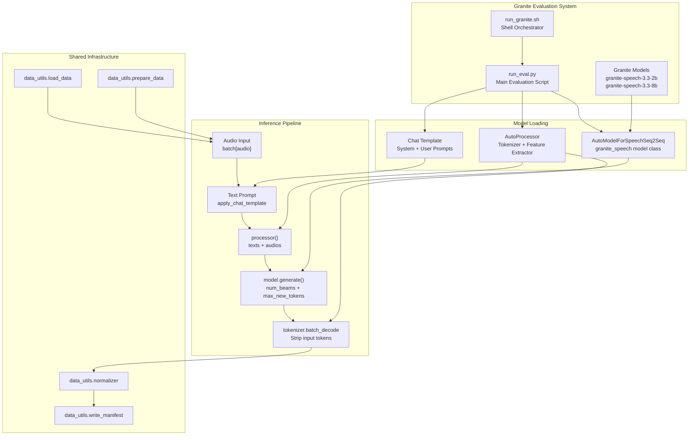
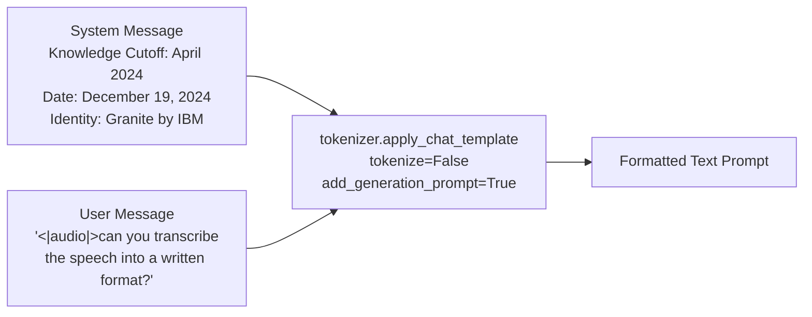
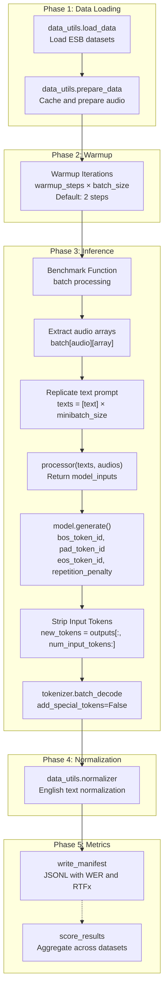
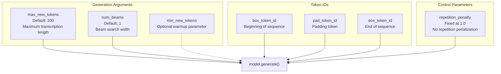
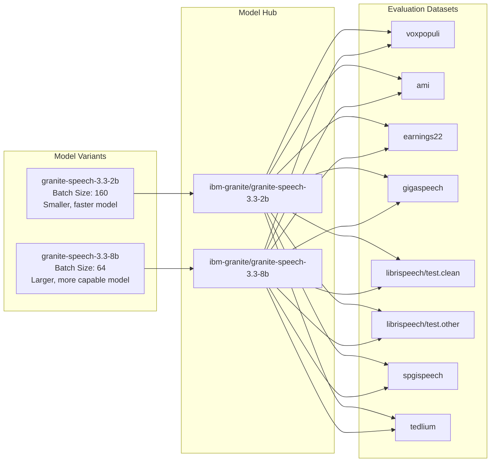
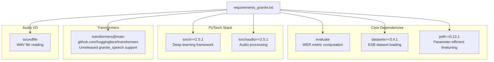
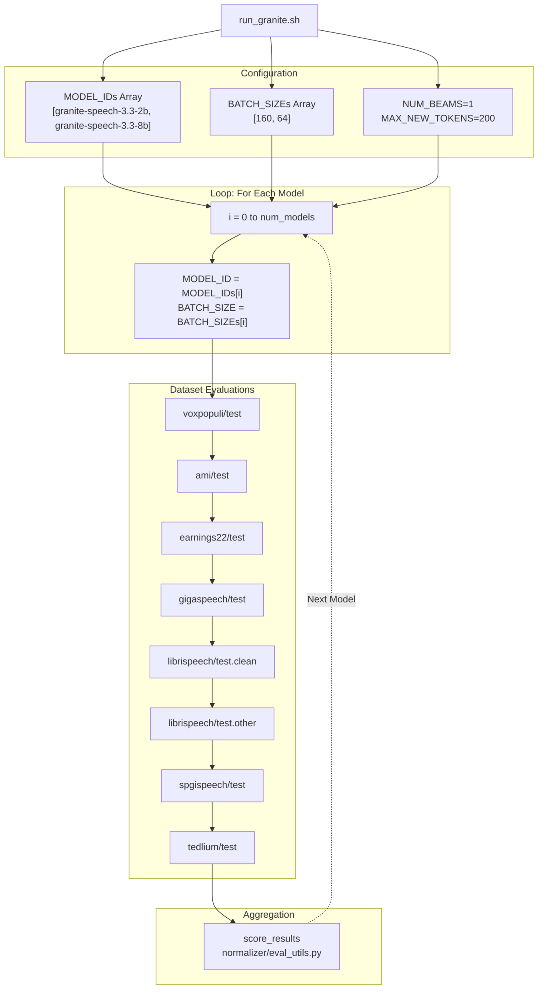
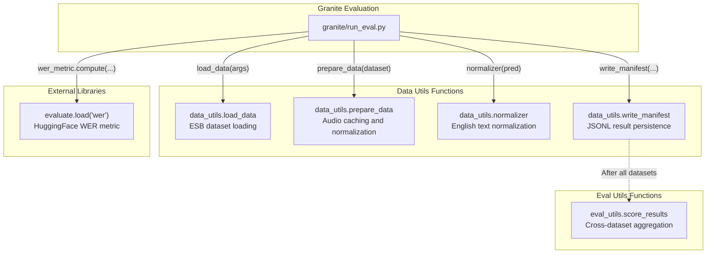

<!-- source: DeepWiki mcp.deepwiki.com · repo huggingface/open_asr_leaderboard · page 4.4 Granite Framework · fetched 2026-10-26 -->

# Granite Framework

<details>
<summary>Relevant source files</summary>

The following files were used as context for generating this wiki page:

- [granite/run_eval.py](granite/run_eval.py)
- [granite/run_granite.sh](granite/run_granite.sh)
- [requirements/requirements_granite.txt](requirements/requirements_granite.txt)
- [transformers/run_eval.py](transformers/run_eval.py)

</details>


## Purpose and Scope

The Granite Framework provides evaluation infrastructure for IBM's Granite speech models, a family of multimodal models that combine speech understanding with language generation capabilities. This framework implements a chat-based interface for speech transcription, where audio inputs are processed through a conversational template system.

This document covers the Granite-specific evaluation pipeline, including chat template construction, model loading, and generation parameters. For information about the general Transformers-based evaluation pattern, see [Transformers Framework](#4.2). For details on shared infrastructure like text normalization and dataset loading, see [Normalizer Module](#3.1) and [Data Utils](#3.2).

**Sources:** [granite/run_eval.py:1-220](), [granite/run_granite.sh:1-120]()

---

## System Architecture

The Granite Framework uses the Hugging Face Transformers library with specialized support for the `granite_speech` model family. Unlike standard encoder-decoder ASR models, Granite models require chat template formatting and support beam search decoding for improved transcription quality.



**Diagram: Granite Framework Architecture**

The architecture consists of three main layers:
1. **Model Loading**: Uses `AutoProcessor` and `AutoModelForSpeechSeq2Seq` with explicit assertion for `granite_speech` model support
2. **Inference Pipeline**: Combines chat template formatting with audio processing, followed by beam search generation
3. **Shared Infrastructure**: Integrates with standard `data_utils` functions for dataset handling and normalization

**Sources:** [granite/run_eval.py:1-19](), [granite/run_eval.py:39-84]()

---

## Chat Template System

The Granite Framework's distinguishing feature is its chat-based interface for speech transcription. The system constructs a conversational context that includes system information and a user request for transcription.

### Template Structure



**Diagram: Chat Template Construction Flow**

The chat template is constructed in [granite/run_eval.py:22-35]():

| Component | Content | Purpose |
|-----------|---------|---------|
| **System Role** | Knowledge cutoff date, current date, assistant identity | Provides context for the model's behavior |
| **User Role** | `"<|audio|>can you transcribe the speech into a written format?"` | Specifies the transcription task with audio token placeholder |
| **Template Application** | `tokenize=False`, `add_generation_prompt=True` | Formats the chat without tokenizing, adds generation starter |

The `<|audio|>` token is a special placeholder that indicates where audio features will be injected during processing. The template is applied to create a text string, which is then processed alongside audio data by the processor.

**Sources:** [granite/run_eval.py:22-35](), [granite/run_eval.py:49-54]()

---

## Evaluation Pipeline

The Granite evaluation pipeline follows the standard 5-phase pattern (see [Core Evaluation Pipeline](#2)) with Granite-specific adaptations for chat template handling and token stripping.



**Diagram: Granite Evaluation Pipeline with Token Stripping**

### Key Pipeline Characteristics

1. **Batch Processing**: The `benchmark` function [granite/run_eval.py:39-84]() processes multiple audio samples simultaneously
2. **Text Replication**: The same chat template is replicated for each audio sample in the batch [granite/run_eval.py:43]()
3. **Token Stripping**: Unlike standard models, Granite includes input tokens in generation output, requiring explicit stripping [granite/run_eval.py:68-69]()
4. **Timing**: Timing starts before processor call and ends after decoding, normalized by minibatch size [granite/run_eval.py:46](), [granite/run_eval.py:76](), [granite/run_eval.py:79]()

### Token Stripping Logic

The Granite models return both input and generated tokens in the output. The evaluation script handles this by:

```
num_input_tokens = model_inputs["input_ids"].shape[-1]  # Count input tokens
new_tokens = model_outputs[:, num_input_tokens:]        # Slice to get only generated tokens
```

This ensures that only the transcription output is decoded, not the entire chat template prefix.

**Sources:** [granite/run_eval.py:39-84](), [granite/run_eval.py:68-73]()

---

## Generation Configuration

Granite models support multiple generation parameters that control transcription quality and speed tradeoffs.

### Generation Parameters



**Diagram: Generation Parameter Configuration**

### Parameter Details

| Parameter | Value | Configuration | Purpose |
|-----------|-------|---------------|---------|
| **max_new_tokens** | 200 | [granite/run_granite.sh:16]() | Controls maximum transcription length |
| **num_beams** | 1 | [granite/run_granite.sh:15]() | Greedy decoding (beam search disabled) |
| **repetition_penalty** | 1.0 | [granite/run_eval.py:62]() | No penalty for repeated tokens |
| **min_new_tokens** | `max_new_tokens` | [granite/run_eval.py:64](), [granite/run_eval.py:95]() | Used only during warmup to ensure consistent generation |

The `min_new_tokens` parameter is specifically set during warmup [granite/run_eval.py:95]() to ensure that warmup iterations perform the full generation, stabilizing timing measurements.

**Sources:** [granite/run_eval.py:37](), [granite/run_eval.py:57-65](), [granite/run_granite.sh:15-16]()

---

## Model Support and Configuration

The framework supports two Granite speech model variants with different memory and performance characteristics.

### Supported Models



**Diagram: Granite Model Variants and Dataset Coverage**

### Model-Specific Configuration

The batch sizes are optimized based on model size and memory requirements:

| Model | Batch Size | Model Hub ID | Configuration |
|-------|------------|--------------|---------------|
| **2B** | 160 | `ibm-granite/granite-speech-3.3-2b` | [granite/run_granite.sh:6](), [granite/run_granite.sh:11]() |
| **8B** | 64 | `ibm-granite/granite-speech-3.3-8b` | [granite/run_granite.sh:7](), [granite/run_granite.sh:12]() |

The smaller 2B model can process larger batches (160 samples) due to lower memory requirements, while the 8B model requires a smaller batch size (64 samples) but may provide better transcription quality.

**Sources:** [granite/run_granite.sh:5-13]()

---

## Dependencies and Requirements

The Granite Framework requires specific versions of transformers and related libraries to support the `granite_speech` model architecture.

### Requirement Specifications



**Diagram: Granite Framework Dependencies**

### Special Requirements

The most critical requirement is the transformers installation from the main branch [requirements/requirements_granite.txt:6]():

```
transformers @ https://github.com/huggingface/transformers/archive/main.zip
```

This is necessary because the `granite_speech` model class is not yet released in a stable transformers version. The evaluation script explicitly asserts this support [granite/run_eval.py:11]():

```python
assert hasattr(models, "granite_speech")
```

If this assertion fails, the script will immediately error, indicating that the transformers version does not support Granite models.

### Dependency Rationale

| Package | Version/Source | Reason |
|---------|----------------|--------|
| **transformers** | main branch | Unreleased `granite_speech` model class |
| **torch** | 2.5.1 | Stable PyTorch version with bfloat16 support |
| **datasets** | 3.4.1 | Compatible with ESB benchmark datasets |
| **peft** | 0.13.1 | Supports potential parameter-efficient evaluation |

**Sources:** [requirements/requirements_granite.txt:1-8](), [granite/run_eval.py:11]()

---

## Orchestration Script

The shell script [granite/run_granite.sh]() orchestrates evaluation across all ESB benchmark datasets for each Granite model variant.

### Script Structure



**Diagram: Orchestration Flow for Granite Evaluation**

### Execution Pattern

Each model is evaluated on 8 ESB benchmark datasets:
1. **VoxPopuli** [granite/run_granite.sh:25-34]()
2. **AMI** [granite/run_granite.sh:36-45]()
3. **Earnings22** [granite/run_granite.sh:47-56]()
4. **GigaSpeech** [granite/run_granite.sh:58-67]()
5. **LibriSpeech test.clean** [granite/run_granite.sh:69-78]()
6. **LibriSpeech test.other** [granite/run_granite.sh:80-89]()
7. **SPGISpeech** [granite/run_granite.sh:91-100]()
8. **TEDLIUM** [granite/run_granite.sh:102-111]()

After all datasets are evaluated for a model, the script invokes `eval_utils.score_results` [granite/run_granite.sh:114-117]() to aggregate results across datasets and compute final WER and RTFx metrics.

### Dataset Path

All evaluations use the sorted dataset collection:
```
--dataset_path="hf-audio/esb-datasets-test-only-sorted"
```

This path points to pre-sorted versions of ESB datasets where audio samples are organized by duration, enabling more efficient batching (see [Data Processing](#2.2) for details on duration-based sorting).

**Sources:** [granite/run_granite.sh:1-120](), [granite/run_granite.sh:27]()

---

## Integration with Shared Infrastructure

The Granite Framework leverages the repository's shared infrastructure for consistent dataset handling, text normalization, and result persistence.

### Shared Component Usage



**Diagram: Integration with Shared normalizer Module**

### Function Usage

| Function | Purpose | Invocation |
|----------|---------|------------|
| **load_data** | Loads ESB datasets with streaming support | [granite/run_eval.py:87](), [granite/run_eval.py:100]() |
| **prepare_data** | Caches audio to local WAV files, adds duration info | [granite/run_eval.py:88](), [granite/run_eval.py:107]() |
| **normalizer** | Applies English text normalization to predictions | [granite/run_eval.py:82]() |
| **write_manifest** | Writes per-sample results to JSONL with WER and RTFx | [granite/run_eval.py:125-134]() |
| **score_results** | Aggregates results across all datasets for a model | [granite/run_granite.sh:116]() |

The normalization step [granite/run_eval.py:82]() ensures that Granite predictions are normalized using the same English normalizer as all other frameworks, enabling fair comparison on the leaderboard. This includes:
- Converting British to American spellings (799 mappings)
- Expanding contractions (e.g., "don't" → "do not")
- Normalizing numbers and symbols

For detailed information on text normalization rules, see [Normalizer Module](#3.1).

**Sources:** [granite/run_eval.py:6](), [granite/run_eval.py:82](), [granite/run_eval.py:87-88](), [granite/run_eval.py:100](), [granite/run_eval.py:107](), [granite/run_eval.py:125-134](), [granite/run_granite.sh:116]()

---

