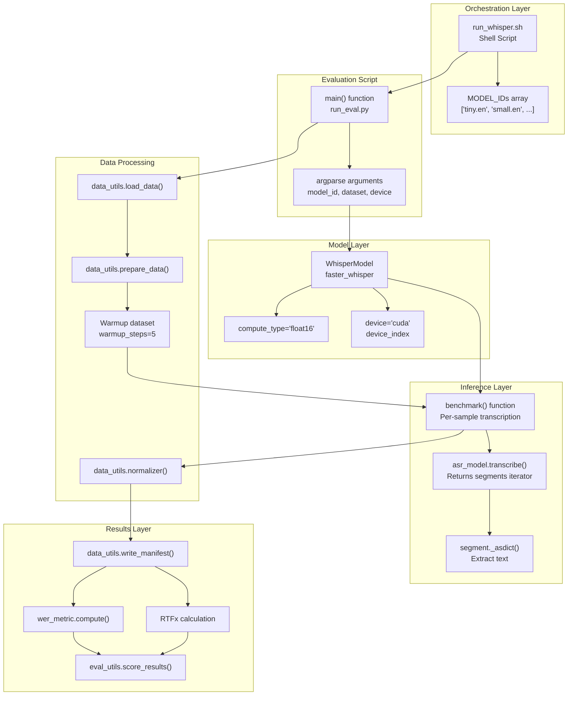
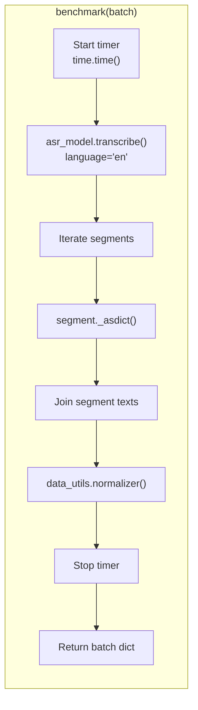
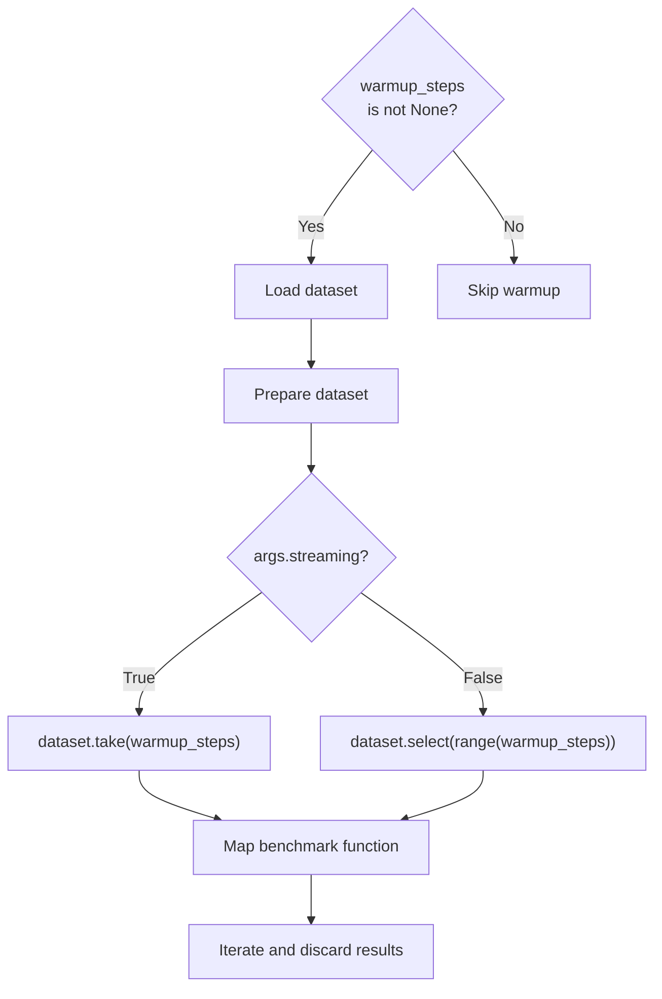
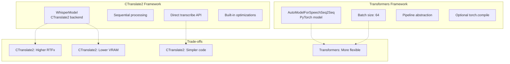
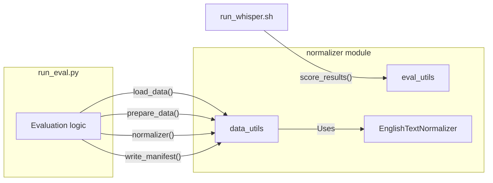

<!-- source: DeepWiki mcp.deepwiki.com · repo huggingface/open_asr_leaderboard · page 4.5 CTranslate2 Framework · fetched 2026-10-26 -->

# CTranslate2 Framework

<details>
<summary>Relevant source files</summary>

The following files were used as context for generating this wiki page:

- [ctranslate2/run_eval.py](ctranslate2/run_eval.py)
- [ctranslate2/run_whisper.sh](ctranslate2/run_whisper.sh)
- [transformers/run_whisper.sh](transformers/run_whisper.sh)

</details>


## Purpose and Scope

The CTranslate2 Framework provides optimized evaluation of Whisper ASR models using the `faster-whisper` library, which leverages the CTranslate2 backend for accelerated inference. This framework is designed for users who need faster inference speeds compared to standard Transformers-based evaluation while maintaining compatibility with OpenAI Whisper model architectures.

This page documents the CTranslate2-specific implementation, including model loading, inference configuration, and performance characteristics. For standard Whisper evaluation using the Transformers library, see [Whisper Models](#4.2.1). For general evaluation pipeline concepts, see [Core Evaluation Pipeline](#2).

---

## Architecture Overview

The CTranslate2 Framework implements the standard evaluation pattern using the `faster-whisper` library as the inference engine. Unlike the Transformers implementation which processes audio in batches, CTranslate2 processes samples sequentially using an optimized C++ backend.

### System Components



**Sources:** [ctranslate2/run_eval.py:1-142](), [ctranslate2/run_whisper.sh:1-85]()

---

## Model Loading and Configuration

### WhisperModel Initialization

The CTranslate2 framework uses the `WhisperModel` class from `faster-whisper`, which wraps Whisper models with an optimized CTranslate2 backend. The initialization occurs in the `main()` function:

```python
asr_model = WhisperModel(
    model_size_or_path=args.model_id,
    compute_type="float16",
    device="cuda",
    device_index=args.device
)
```

| Parameter | Value | Purpose |
|-----------|-------|---------|
| `model_size_or_path` | Model ID from command line | Specifies which Whisper variant to load |
| `compute_type` | `"float16"` | Uses half-precision for faster inference |
| `device` | `"cuda"` | Runs on GPU (hardcoded) |
| `device_index` | From `--device` arg | Selects specific GPU device |

**Sources:** [ctranslate2/run_eval.py:17-22]()

### Model Identifiers

CTranslate2 uses simplified model identifiers rather than full HuggingFace paths:

| CTranslate2 ID | Equivalent Transformers ID | Description |
|----------------|---------------------------|-------------|
| `tiny.en` | `openai/whisper-tiny.en` | Smallest English-only model |
| `small.en` | `openai/whisper-small.en` | Small English-only model |
| `base.en` | `openai/whisper-base.en` | Base English-only model |
| `medium.en` | `openai/whisper-medium.en` | Medium English-only model |
| `large-v1` | `openai/whisper-large` | Large multilingual v1 |
| `large-v2` | `openai/whisper-large-v2` | Large multilingual v2 |
| `large-v3` | `openai/whisper-large-v3` | Large multilingual v3 |

The `faster-whisper` library automatically downloads and converts these models from HuggingFace Hub on first use.

**Sources:** [ctranslate2/run_whisper.sh:5]()

---

## Evaluation Pipeline

### Benchmark Function

The core evaluation logic is implemented in a nested `benchmark()` function that processes individual audio samples:



**Sources:** [ctranslate2/run_eval.py:24-31]()

### Transcription Process

The `benchmark()` function performs the following steps:

1. **Start Timing**: Records start time for RTFx calculation
   ```python
   start_time = time.time()
   ```

2. **Transcribe Audio**: Calls `asr_model.transcribe()` with English language constraint
   ```python
   segments, _ = asr_model.transcribe(batch["audio"]["array"], language="en")
   ```
   The method returns an iterator of segments and info (info is discarded).

3. **Convert Segments**: Extracts segment dictionaries from the iterator
   ```python
   outputs = [segment._asdict() for segment in segments]
   ```

4. **Join Text**: Concatenates all segment texts into a single transcription
   ```python
   batch["predictions"] = data_utils.normalizer("".join([segment["text"] for segment in outputs])).strip()
   ```

5. **Calculate Time**: Stores transcription duration for RTFx computation
   ```python
   batch["transcription_time_s"] = time.time() - start_time
   ```

**Sources:** [ctranslate2/run_eval.py:24-31]()

### Warmup Phase

The framework includes an optional warmup phase to stabilize inference timing:



The warmup phase processes the first 5 samples (configurable via `--warmup_steps`) to ensure GPU kernels are compiled and memory is allocated before timed evaluation begins.

**Sources:** [ctranslate2/run_eval.py:33-44]()

---

## Inference Configuration

### Single-Sample Processing

Unlike the Transformers framework which processes audio in batches, CTranslate2 evaluates samples sequentially. The `dataset.map()` operation applies the `benchmark()` function to each sample individually:

```python
dataset = dataset.map(benchmark, remove_columns=["audio"])
```

This design decision reflects CTranslate2's optimization strategy: the backend handles internal batching and optimizations, so external batching is unnecessary and could interfere with performance.

**Sources:** [ctranslate2/run_eval.py:55]()

### Language Setting

All evaluations force English language mode:

```python
segments, _ = asr_model.transcribe(batch["audio"]["array"], language="en")
```

This hardcoded constraint ensures consistent behavior across all datasets and prevents the model from attempting multilingual detection, which could impact performance and accuracy on English-only benchmarks.

**Sources:** [ctranslate2/run_eval.py:26]()

---

## Dataset Evaluation Workflow

### Orchestration Script

The `run_whisper.sh` script orchestrates evaluation across 8 datasets for each model:

| Order | Dataset | Split | Purpose |
|-------|---------|-------|---------|
| 1 | AMI | test | Meeting transcription |
| 2 | Earnings22 | test | Financial earnings calls |
| 3 | GigaSpeech | test | Diverse audio sources |
| 4 | LibriSpeech | test.clean | Clean read speech |
| 5 | LibriSpeech | test.other | Challenging read speech |
| 6 | SPGISpeech | test | Financial presentations |
| 7 | TED-LIUM | test | TED talk presentations |
| 8 | VoxPopuli | test | European Parliament speeches |

After completing all datasets for a model, the script aggregates results:

```bash
RUNDIR=`pwd` && \
cd ../normalizer && \
python -c "import eval_utils; eval_utils.score_results('${RUNDIR}/results', '${MODEL_ID}')" && \
cd $RUNDIR
```

**Sources:** [ctranslate2/run_whisper.sh:14-82]()

---

## Results Processing

### Metrics Collection

The evaluation script accumulates four key metrics across all samples:

```python
all_results = {
    "audio_length_s": [],
    "transcription_time_s": [],
    "predictions": [],
    "references": [],
}
```

These metrics enable calculation of:
- **WER (Word Error Rate)**: Accuracy metric computed by comparing predictions to normalized references
- **RTFx (Real-Time Factor)**: Speed metric calculated as `sum(audio_length_s) / sum(transcription_time_s)`

**Sources:** [ctranslate2/run_eval.py:57-66]()

### Manifest Writing

Results are persisted using the shared `data_utils.write_manifest()` function:

```python
manifest_path = data_utils.write_manifest(
    all_results["references"],
    all_results["predictions"],
    args.model_id,
    args.dataset_path,
    args.dataset,
    args.split,
    audio_length=all_results["audio_length_s"],
    transcription_time=all_results["transcription_time_s"],
)
```

This creates a JSONL file in the `results/` directory containing per-sample transcriptions, timings, and WER scores.

**Sources:** [ctranslate2/run_eval.py:69-78]()

### Final Metrics

After writing the manifest, the script computes and prints aggregate metrics:

```python
wer = wer_metric.compute(
    references=all_results["references"], predictions=all_results["predictions"]
)
wer = round(100 * wer, 2)
rtfx = round(sum(all_results["audio_length_s"]) / sum(all_results["transcription_time_s"]), 2)
print("WER:", wer, "%", "RTFx:", rtfx)
```

**Sources:** [ctranslate2/run_eval.py:81-86]()

---

## Performance Characteristics

### Optimization Strategy

The CTranslate2 framework achieves performance improvements through several mechanisms:

| Optimization | Implementation | Benefit |
|-------------|----------------|---------|
| **Quantization** | `compute_type="float16"` | Reduces memory bandwidth and enables faster GPU operations |
| **Backend** | C++ CTranslate2 engine | Optimized kernels for transformer operations |
| **Memory Layout** | Contiguous tensor storage | Improves cache locality |
| **Operator Fusion** | Automatic kernel fusion | Reduces kernel launch overhead |

**Sources:** [ctranslate2/run_eval.py:19]()

### Comparison with Transformers Framework



**Key Differences:**

1. **Batching**: Transformers uses explicit batching (batch_size=64), CTranslate2 processes sequentially
2. **Model Format**: Transformers loads PyTorch checkpoints, CTranslate2 converts to optimized format
3. **Code Complexity**: CTranslate2 has simpler evaluation code without pipeline abstractions
4. **Precision**: Both use float16, but CTranslate2 optimizes the entire stack for it

**Sources:** [ctranslate2/run_eval.py:17-22](), [transformers/run_whisper.sh:6]()

---

## Command-Line Interface

### Required Arguments

| Argument | Type | Description | Example |
|----------|------|-------------|---------|
| `--model_id` | `str` | Model identifier for faster-whisper | `"large-v3"` |
| `--dataset` | `str` | Dataset name from ESB benchmark | `"librispeech"` |

### Optional Arguments

| Argument | Type | Default | Description |
|----------|------|---------|-------------|
| `--dataset_path` | `str` | `"esb/datasets"` | HuggingFace dataset path |
| `--split` | `str` | `"test"` | Dataset split to evaluate |
| `--device` | `int` | `-1` | GPU device index (-1 for CPU) |
| `--max_eval_samples` | `int` | `None` | Limit number of samples |
| `--no-streaming` | flag | Streaming enabled | Download full dataset |
| `--warmup_steps` | `int` | `5` | Number of warmup samples |

**Sources:** [ctranslate2/run_eval.py:90-139]()

### Usage Example

```bash
python run_eval.py \
    --model_id=large-v3 \
    --dataset_path="hf-audio/esb-datasets-test-only-sorted" \
    --dataset="librispeech" \
    --split="test.clean" \
    --device=0 \
    --max_eval_samples=-1
```

**Sources:** [ctranslate2/run_whisper.sh:14-20]()

---

## Integration with Shared Infrastructure

### Normalizer Module

The CTranslate2 framework uses the shared `data_utils` and `eval_utils` modules:



**Functions Used:**

1. **`data_utils.load_data(args)`**: Loads dataset from HuggingFace with streaming support
2. **`data_utils.prepare_data(dataset)`**: Adds normalized text and audio length fields
3. **`data_utils.normalizer(text)`**: Applies English text normalization to predictions
4. **`data_utils.write_manifest(...)`**: Writes results to JSONL format
5. **`eval_utils.score_results(results_dir, model_id)`**: Aggregates scores across datasets

This integration ensures that CTranslate2 evaluations produce results compatible with other frameworks and the leaderboard.

**Sources:** [ctranslate2/run_eval.py:10](), [ctranslate2/run_eval.py:29](), [ctranslate2/run_eval.py:69-78](), [ctranslate2/run_whisper.sh:78-82]()

---

## Limitations and Considerations

### English-Only Evaluation

The current implementation hardcodes `language="en"` in the transcribe call, limiting evaluation to English datasets. While the model identifiers include multilingual variants (large-v1, large-v2, large-v3), they are evaluated only on English speech.

**Sources:** [ctranslate2/run_eval.py:26]()

### Sequential Processing

Unlike the Transformers framework which processes batches of 64 samples, CTranslate2 processes samples one at a time. While the CTranslate2 backend internally optimizes this, it may affect overall throughput on systems with high GPU parallelism capacity.

**Sources:** [ctranslate2/run_eval.py:55]()

### Model Availability

The `faster-whisper` library supports only Whisper model architectures. Other model families (Wav2Vec2, MMS, HuBERT) require different evaluation frameworks. For those models, see [Wav2Vec2 Models](#4.2.2) and [MMS and Other Models](#4.2.3).

**Sources:** [ctranslate2/run_eval.py:17-22]()

---

