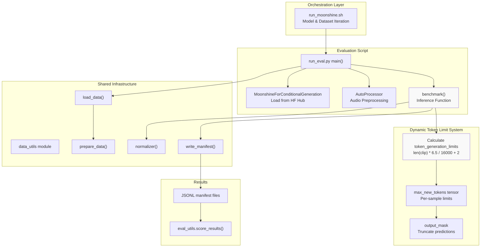
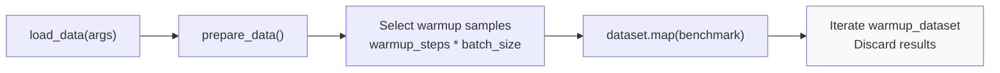
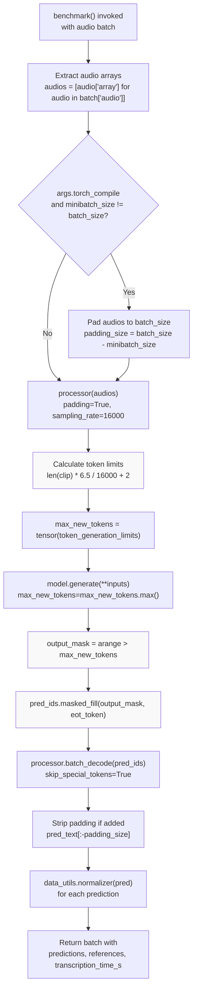

<!-- source: DeepWiki mcp.deepwiki.com · repo huggingface/open_asr_leaderboard · page 4.6 Moonshine Framework · fetched 2026-10-26 -->

# Moonshine Framework

<details>
<summary>Relevant source files</summary>

The following files were used as context for generating this wiki page:

- [moonshine/run_eval.py](moonshine/run_eval.py)
- [moonshine/run_moonshine.sh](moonshine/run_moonshine.sh)
- [requirements/requirements_moonshine.txt](requirements/requirements_moonshine.txt)
- [transformers/run_eval.py](transformers/run_eval.py)

</details>


## Purpose and Scope

This document describes the evaluation framework for UsefulSensors Moonshine models within the Open ASR Leaderboard. Moonshine is a family of lightweight ASR models optimized for edge deployment and low-resource environments. The framework evaluates these models using the standard ESB benchmark suite while handling model-specific requirements like dynamic token generation limits.

For information about the general evaluation pipeline pattern, see [Core Evaluation Pipeline](#2). For details on other Transformers-based models, see [Transformers Framework](#4.2). For performance optimization techniques applicable across frameworks, see [Performance Optimization](#6.2).

**Sources:** [moonshine/run_eval.py:1-209](), [moonshine/run_moonshine.sh:1-93]()

---

## Overview

The Moonshine framework evaluates ASR models designed by UsefulSensors for efficient on-device inference. Unlike general-purpose Transformers models, Moonshine models implement specialized optimizations including dynamic token generation limits based on input audio duration.

### Supported Models

| Model ID | Description | Typical Use Case |
|----------|-------------|------------------|
| `usefulsensors/moonshine-base` | Base Moonshine model | General ASR with balanced accuracy/speed |
| `usefulsensors/moonshine-tiny` | Tiny Moonshine model | Edge devices with strict resource constraints |

**Sources:** [moonshine/run_moonshine.sh:5]()

---

## Architecture and Components

The Moonshine evaluation system consists of three primary components: the evaluation script, orchestration shell script, and shared infrastructure integration.

### Component Relationships



**Sources:** [moonshine/run_eval.py:15-127](), [moonshine/run_moonshine.sh:1-93]()

---

## Evaluation Pipeline

### Phase 1: Model and Processor Initialization

The evaluation script loads the Moonshine model and processor from the Hugging Face Hub using the `MoonshineForConditionalGeneration` class:

```python
torch_dtype = torch.float16 if torch.cuda.is_available() else torch.float32
model = MoonshineForConditionalGeneration.from_pretrained(args.model_id).to(args.device).to(torch_dtype)
processor = AutoProcessor.from_pretrained(args.model_id)
```

The framework automatically selects `float16` for GPU inference and `float32` for CPU inference.

**Sources:** [moonshine/run_eval.py:16-18]()

### Phase 2: Optional Torch Compilation

When `--torch_compile` is enabled, the model forward pass is JIT-compiled for improved inference speed:

```python
if args.torch_compile:
    model.forward = torch.compile(model.forward, mode=args.compile_mode, fullgraph=True)
    if model.can_generate():
        model.generation_config.cache_implementation = "static"
```

Static KV caching is enabled for autoregressive generation when compilation is active.

**Sources:** [moonshine/run_eval.py:20-24]()

### Phase 3: Warmup Phase

The evaluation performs optional warmup iterations to stabilize timing measurements and trigger JIT compilation if enabled:



Default warmup is 10 steps as specified in [moonshine/run_eval.py:200-203]().

**Sources:** [moonshine/run_eval.py:71-83]()

### Phase 4: Inference with Dynamic Token Limits

The `benchmark()` function implements Moonshine-specific inference logic with dynamic token generation limits.

#### Audio Preprocessing

```python
# Load audio inputs
audios = [audio["array"] for audio in batch["audio"]]
minibatch_size = len(audios)

# Pad audios to max batch size if using torch compile
padding_size = 0
if minibatch_size != args.batch_size and args.torch_compile:
    padding_size = args.batch_size - minibatch_size
    padding_audios = [audios[-1] for _ in range(padding_size)]
    audios.extend(padding_audios)

inputs = processor(audios, return_tensors="pt", padding=True, sampling_rate=16000).to(args.device).to(torch_dtype)
```

Padding to fixed batch size prevents recompilation when using `torch.compile`.

**Sources:** [moonshine/run_eval.py:27-42]()

#### Dynamic Token Limit Calculation

Moonshine implements a unique feature where maximum token generation is dynamically calculated based on input audio duration:

```python
# Create a mask for output tokens to limit length based on input audio clip length.
# Add 2 to token limits to account for <sot> and <eot>.
token_generation_limits = [len(clip) * 6.5 // 16000 + 2 for clip in audios]
max_new_tokens = torch.tensor(token_generation_limits).reshape((-1, 1)).to(args.device)
```

The formula `len(clip) * 6.5 / 16000 + 2` derives the maximum tokens from audio length:
- `len(clip)` is the number of audio samples
- `16000` is the sample rate (16 kHz)
- `6.5` is the empirical tokens-per-second ratio for Moonshine
- `+2` accounts for start-of-transcription and end-of-transcription tokens

**Sources:** [moonshine/run_eval.py:44-47]()

#### Generation with Output Masking

```python
pred_ids = model.generate(**inputs, max_new_tokens=max_new_tokens.max())
output_mask = torch.arange(pred_ids.shape[-1]).repeat((pred_ids.shape[0], 1)).to(args.device)
output_mask = output_mask > max_new_tokens

eot_token = model.config.eos_token_id
pred_ids.masked_fill(output_mask, eot_token)
```

The system generates using the maximum limit across the batch, then masks excess tokens with the end-of-transcription token for shorter samples.

**Sources:** [moonshine/run_eval.py:49-54]()

#### Decoding and Normalization

```python
pred_text = processor.batch_decode(pred_ids, skip_special_tokens=True)

# Strip padding if added
pred_text = pred_text if padding_size == 0 else pred_text[:-padding_size]
batch["predictions"] = [data_utils.normalizer(pred) for pred in pred_text]
batch["references"] = batch["norm_text"]
```

The English normalizer from the shared infrastructure is applied to predictions for consistent WER calculation.

**Sources:** [moonshine/run_eval.py:57-68]()

### Phase 5: Timing and Metrics

Timing measurements encompass preprocessing, generation, and postprocessing:

```python
start_time = time.time()
# ... preprocessing, generation, postprocessing ...
runtime = time.time() - start_time

# normalize by minibatch size since we want the per-sample time
batch["transcription_time_s"] = minibatch_size * [runtime / minibatch_size]
```

**Sources:** [moonshine/run_eval.py:32-63]()

---

## Inference Flow Diagram



**Sources:** [moonshine/run_eval.py:26-69]()

---

## Orchestration Script

The `run_moonshine.sh` shell script orchestrates evaluation across all ESB benchmark datasets for each Moonshine model variant.

### Model and Dataset Configuration

```bash
MODEL_IDs=("usefulsensors/moonshine-base" "usefulsensors/moonshine-tiny")
BATCH_SIZE=64

num_models=${#MODEL_IDs[@]}

for (( i=0; i<${num_models}; i++ ));
do
    MODEL_ID=${MODEL_IDs[$i]}
    # ... evaluate across datasets ...
done
```

The script uses a batch size of 64, which is higher than typical Transformers evaluations due to Moonshine's efficiency.

**Sources:** [moonshine/run_moonshine.sh:5-12]()

### Dataset Evaluation Loop

Each model is evaluated on the following ESB datasets in sequence:

| Dataset | Split | Dataset Path |
|---------|-------|--------------|
| VoxPopuli | test | `hf-audio/esb-datasets-test-only-sorted` |
| AMI | test | `hf-audio/esb-datasets-test-only-sorted` |
| Earnings22 | test | `hf-audio/esb-datasets-test-only-sorted` |
| GigaSpeech | test | `hf-audio/esb-datasets-test-only-sorted` |
| LibriSpeech | test.clean | `hf-audio/esb-datasets-test-only-sorted` |
| LibriSpeech | test.other | `hf-audio/esb-datasets-test-only-sorted` |
| SPGISpeech | test | `hf-audio/esb-datasets-test-only-sorted` |
| TEDLium | test | `hf-audio/esb-datasets-test-only-sorted` |

The dataset path uses the sorted variant (`esb-datasets-test-only-sorted`) for optimized batching based on audio duration.

**Sources:** [moonshine/run_moonshine.sh:14-84]()

### Result Aggregation

After evaluating all datasets for a model, the script aggregates results using the shared `eval_utils` module:

```bash
RUNDIR=`pwd` && \
cd ../normalizer && \
python -c "import eval_utils; eval_utils.score_results('${RUNDIR}/results', '${MODEL_ID}')" && \
cd $RUNDIR
```

This produces model-level aggregate metrics across all evaluated datasets.

**Sources:** [moonshine/run_moonshine.sh:86-90]()

---

## Dependencies

Moonshine evaluation requires specific dependencies managed in `requirements_moonshine.txt`.

### Core Dependencies

| Package | Version Constraint | Purpose |
|---------|-------------------|---------|
| `torch` | (latest) | PyTorch framework |
| `evaluate` | (latest) | WER metric computation |
| `librosa` | (latest) | Audio processing utilities |
| `jiwer` | (latest) | Additional WER computation |
| `einops` | (latest) | Tensor operations |
| `datasets` | `==3.2.0` | HuggingFace datasets library |
| `numba` | `==0.60.0` | JIT compilation for NumPy |
| `numpy` | `==2.0.2` | Numerical operations |
| `transformers` | (git main) | MoonshineForConditionalGeneration class |

### Notable Constraints

The requirements file pins `datasets==3.2.0`, `numba==0.60.0`, and `numpy==2.0.2` for compatibility with the Moonshine model implementation. The `transformers` library is installed from the git repository main branch to include the latest Moonshine model support.

**Sources:** [requirements/requirements_moonshine.txt:1-10]()

---

## Command-Line Arguments

The evaluation script accepts the following arguments:

### Required Arguments

| Argument | Type | Description |
|----------|------|-------------|
| `--model_id` | str | Model identifier on Hugging Face Hub |
| `--dataset` | str | Dataset name from ESB benchmark |

### Optional Arguments

| Argument | Type | Default | Description |
|----------|------|---------|-------------|
| `--dataset_path` | str | `"esb/datasets"` | Dataset path on Hugging Face Hub |
| `--split` | str | `"test"` | Dataset split to evaluate |
| `--device` | int | `-1` | Device ID (-1 for CPU, 0+ for GPU) |
| `--batch_size` | int | `16` | Batch size for inference |
| `--max_eval_samples` | int | `None` | Limit number of samples evaluated |
| `--streaming` | bool | `False` | Stream dataset instead of downloading |
| `--max_new_tokens` | int | `None` | Unused for Moonshine (dynamic limits used) |
| `--torch_compile` | bool | `False` | Enable JIT compilation |
| `--compile_mode` | str | `"max-autotune"` | Torch compile optimization mode |
| `--warmup_steps` | int | `10` | Number of warmup batches |

**Note:** The `--max_new_tokens` argument is accepted for interface consistency but not used; Moonshine calculates token limits dynamically based on audio duration.

**Sources:** [moonshine/run_eval.py:130-204]()

---

## Performance Characteristics

### Batch Size Optimization

Moonshine evaluations use a batch size of 64, significantly higher than the typical 16 used for Transformers models. This reflects Moonshine's optimization for efficient batched inference.

**Sources:** [moonshine/run_moonshine.sh:6]()

### Dynamic Token Limits

The dynamic token limit system provides two benefits:

1. **Efficiency**: Avoids generating unnecessary tokens for short audio clips
2. **Accuracy**: Prevents the model from hallucinating content beyond the audio duration

The empirical ratio of 6.5 tokens per second of audio was determined through testing on the target datasets.

**Sources:** [moonshine/run_eval.py:44-47]()

### Torch Compile Compatibility

The framework supports `torch.compile` with padding to fixed batch sizes to prevent recompilations. When enabled:

```python
if minibatch_size != args.batch_size and args.torch_compile:
    padding_size = args.batch_size - minibatch_size
    padding_audios = [audios[-1] for _ in range(padding_size)]
    audios.extend(padding_audios)
```

Padded samples are stripped from predictions before normalization and metric computation.

**Sources:** [moonshine/run_eval.py:36-40](), [moonshine/run_eval.py:66]()

---

## Integration with Shared Infrastructure

### Data Loading

Moonshine evaluation uses the standard data loading pattern from `data_utils`:

```python
dataset = data_utils.load_data(args)
dataset = data_utils.prepare_data(dataset)
```

This ensures consistent dataset handling across all evaluation frameworks.

**Sources:** [moonshine/run_eval.py:72-73](), [moonshine/run_eval.py:85-92]()

### Text Normalization

All predictions are normalized using the English normalizer:

```python
batch["predictions"] = [data_utils.normalizer(pred) for pred in pred_text]
batch["references"] = batch["norm_text"]
```

This applies standardized text cleaning including contraction expansion, number normalization, and British-to-American spelling conversion.

**Sources:** [moonshine/run_eval.py:67-68]()

### Manifest Writing

Results are persisted in JSONL format using the shared `write_manifest` function:

```python
manifest_path = data_utils.write_manifest(
    all_results["references"],
    all_results["predictions"],
    args.model_id,
    args.dataset_path,
    args.dataset,
    args.split,
    audio_length=all_results["audio_length_s"],
    transcription_time=all_results["transcription_time_s"],
)
```

Each manifest file contains per-sample predictions, references, audio lengths, and transcription times for result auditing.

**Sources:** [moonshine/run_eval.py:110-119]()

### Metric Computation

WER and RTFx are computed using the standard formulas:

```python
wer = wer_metric.compute(
    references=all_results["references"], predictions=all_results["predictions"]
)
wer = round(100 * wer, 2)
rtfx = round(sum(all_results["audio_length_s"]) / sum(all_results["transcription_time_s"]), 2)
```

**Sources:** [moonshine/run_eval.py:122-126]()

---

## Example Usage

### Basic Evaluation

```bash
python run_eval.py \
    --model_id=usefulsensors/moonshine-base \
    --dataset_path="hf-audio/esb-datasets-test-only-sorted" \
    --dataset="librispeech" \
    --split="test.clean" \
    --device=0 \
    --batch_size=64
```

### With Torch Compile

```bash
python run_eval.py \
    --model_id=usefulsensors/moonshine-tiny \
    --dataset="voxpopuli" \
    --split="test" \
    --device=0 \
    --batch_size=64 \
    --torch_compile \
    --compile_mode="max-autotune"
```

### Full Evaluation Suite

```bash
cd moonshine
bash run_moonshine.sh
```

This evaluates both `moonshine-base` and `moonshine-tiny` across all ESB datasets and generates aggregated scores.

**Sources:** [moonshine/run_moonshine.sh:14-21]()

---

## Output Files

### Manifest Files

Individual manifest files are written to the `results/` directory with the naming pattern:

```
results/{model_id}/{dataset}__{split}.json
```

Each line in the JSONL file contains:
- `reference`: Normalized ground truth transcription
- `prediction`: Normalized model prediction
- `audio_length_s`: Audio duration in seconds
- `transcription_time_s`: Time taken for transcription
- `wer`: Word error rate for this sample
- `rtfx`: Real-time factor for this sample

### Aggregated Scores

After running `eval_utils.score_results()`, aggregated metrics are computed across all datasets for each model, producing model-level WER and RTFx statistics.

**Sources:** [moonshine/run_eval.py:110-119](), [moonshine/run_moonshine.sh:86-90]()

---

