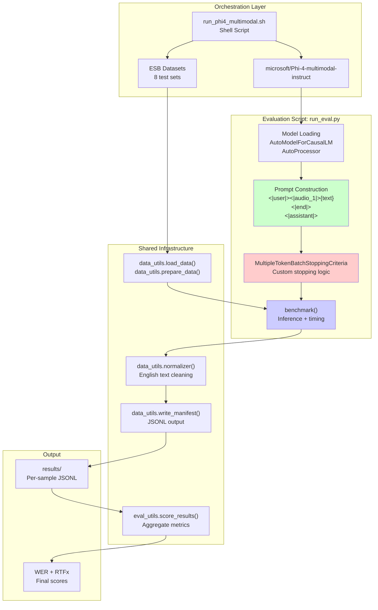
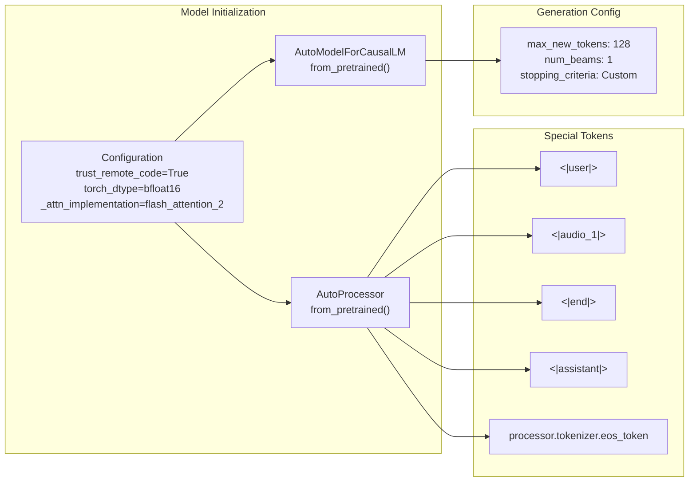
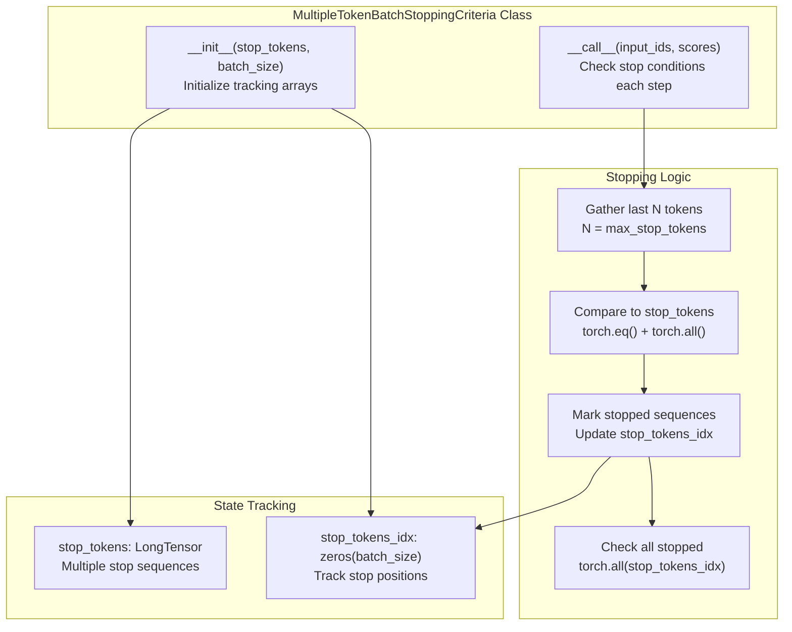
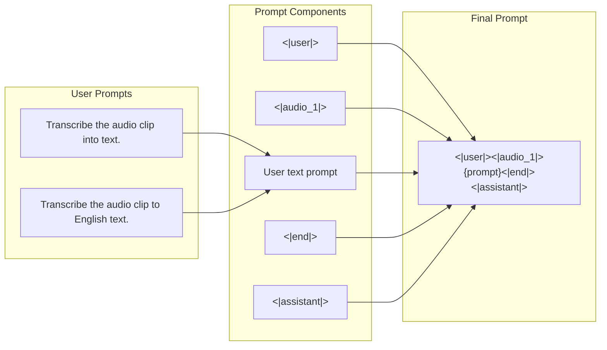
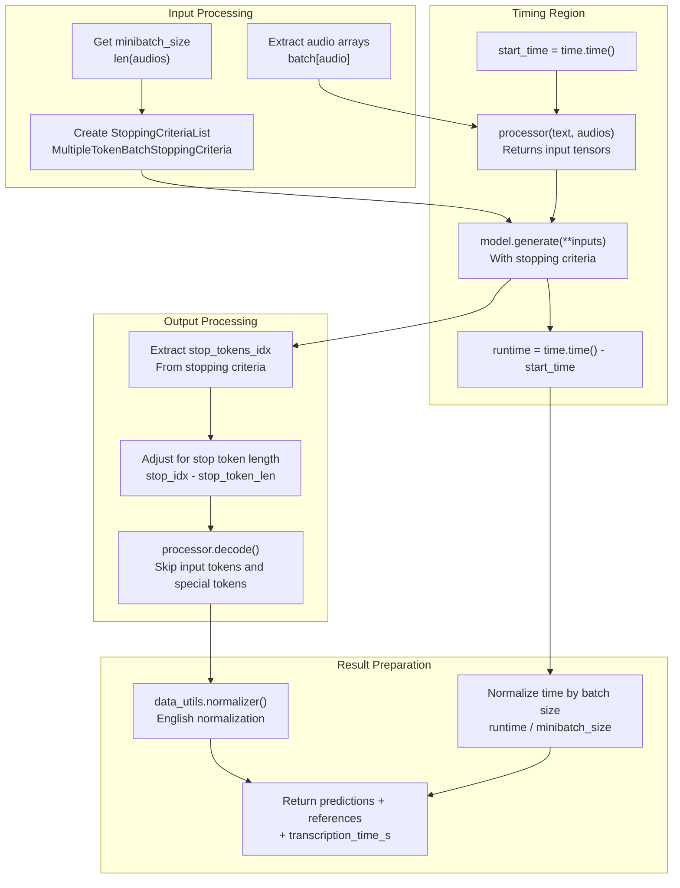
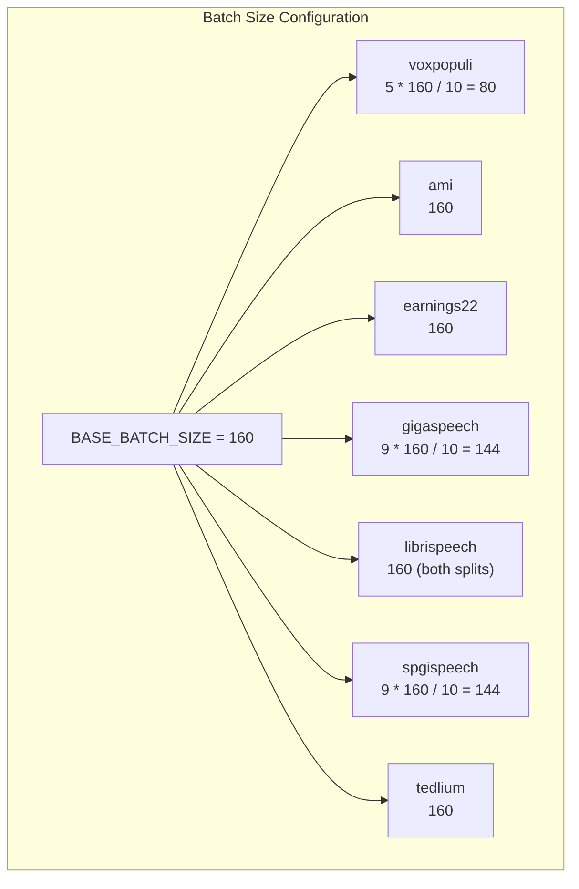
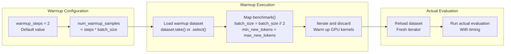
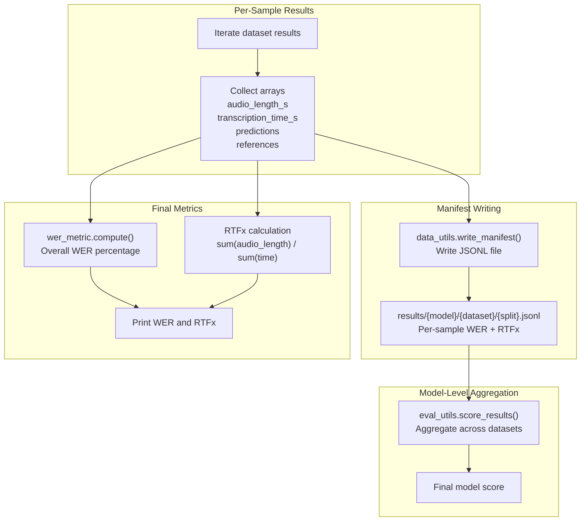

<!-- source: DeepWiki mcp.deepwiki.com · repo huggingface/open_asr_leaderboard · page 4.7 Phi-4 Multimodal Framework · fetched 2026-10-26 -->

# Phi-4 Multimodal Framework

<details>
<summary>Relevant source files</summary>

The following files were used as context for generating this wiki page:

- [granite/run_eval.py](granite/run_eval.py)
- [granite/run_granite.sh](granite/run_granite.sh)
- [phi/run_eval.py](phi/run_eval.py)
- [phi/run_phi4_multimodal.sh](phi/run_phi4_multimodal.sh)
- [requirements/requirements_granite.txt](requirements/requirements_granite.txt)

</details>


## Purpose and Scope

This document describes the evaluation framework for Microsoft's Phi-4 multimodal models within the Open ASR Leaderboard. The Phi-4 framework evaluates multimodal instruction-following models that perform speech transcription through audio-text interaction. This is distinct from pure ASR frameworks: Phi-4 models are causal language models that receive audio prompts alongside text instructions.

For standard Transformers-based ASR models (Whisper, Wav2Vec2), see [Transformers Framework](#4.2). For other multimodal speech models, see [Granite Framework](#4.4).

---

## Overview

The Phi-4 Multimodal Framework supports evaluation of Microsoft's `microsoft/Phi-4-multimodal-instruct` model. Unlike traditional ASR models that directly transcribe audio, Phi-4 operates as a multimodal causal language model that processes audio alongside text instructions using a chat-based interface.

**Key Characteristics:**

| Property | Value |
|----------|-------|
| Model Type | `AutoModelForCausalLM` (multimodal) |
| Primary Model | `microsoft/Phi-4-multimodal-instruct` |
| Precision | bfloat16 |
| Attention | Flash Attention 2 |
| Batch Size | 160 (variable per dataset) |
| Generation Strategy | Greedy decoding (num_beams=1) |
| Special Feature | Custom batch stopping criteria |

**Sources:** [phi/run_phi4_multimodal.sh:1-120](), [phi/run_eval.py:1-256]()

---

## System Architecture



**Diagram: Phi-4 Evaluation Pipeline**

The architecture follows the standard evaluation pattern (see [Core Evaluation Pipeline](#2)) but with multimodal-specific components: prompt construction with audio placeholders, custom stopping criteria for batched generation, and special token handling for output parsing.

**Sources:** [phi/run_phi4_multimodal.sh:1-120](), [phi/run_eval.py:1-256]()

---

## Model Loading and Configuration

The Phi-4 model is loaded as a causal language model with specific optimizations:



**Diagram: Model Initialization and Token Configuration**

The model loading sequence at [phi/run_eval.py:45-52]() includes:

1. **AutoModelForCausalLM**: Loads the multimodal causal LM with trust_remote_code enabled for custom model code
2. **Flash Attention 2**: Specified via `_attn_implementation="flash_attention_2"` for efficient attention computation
3. **bfloat16 Precision**: Reduces memory footprint while maintaining numerical stability
4. **AutoProcessor**: Handles both text tokenization and audio feature extraction

**Special Tokens** defined at [phi/run_eval.py:54-56]():
- `<|user|>`: Marks user message start
- `<|audio_1|>`: Placeholder for audio input in the prompt
- `<|end|>`: Marks end of user message
- `<|assistant|>`: Signals model to begin response
- `prompt_suffix`: Used as stopping token

**Sources:** [phi/run_eval.py:45-64]()

---

## Custom Stopping Criteria

The `MultipleTokenBatchStoppingCriteria` class at [phi/run_eval.py:13-41]() implements sophisticated stopping logic for batched generation with multiple stop tokens:



**Diagram: Custom Stopping Criteria Logic**

**Key Implementation Details:**

| Component | Purpose |
|-----------|---------|
| `stop_tokens` | Tensor of multiple stop token sequences (e.g., `<|end|>`, EOS) |
| `stop_tokens_idx` | Per-sequence tracking of where stopping occurred (0 = not stopped) |
| `max_stop_tokens` | Length of longest stop sequence for efficient gathering |
| Batch awareness | Handles all sequences in batch simultaneously |

**Algorithm** at [phi/run_eval.py:29-41]():

1. Gather last `max_stop_tokens` from each sequence in batch
2. Compare against all stop token sequences using `torch.eq`
3. Mark sequences that match any stop token (only if not already marked)
4. Return `True` when all sequences in batch have stopped

The stopping criteria is instantiated per minibatch at [phi/run_eval.py:70-72]() with `batch_size=args.num_beams * minibatch_size` to handle beam search.

**Sources:** [phi/run_eval.py:13-41](), [phi/run_eval.py:70-72]()

---

## Prompt Engineering

Phi-4 uses a chat-based prompt format with audio placeholders:



**Diagram: Prompt Template Structure**

The prompt is constructed at [phi/run_eval.py:58]() following the template:

```
<|user|><|audio_1|>{user_prompt}<|end|><|assistant|>
```

**Dataset-Specific Prompts:**

| Dataset | Prompt | Reason |
|---------|--------|--------|
| voxpopuli | "Transcribe the audio clip into text." | Default |
| ami | "Transcribe the audio clip into text." | Default |
| earnings22 | "Transcribe the audio clip to English text." | Emphasizes English output |
| gigaspeech | "Transcribe the audio clip into text." | Default |
| librispeech | "Transcribe the audio clip into text." | Default |
| spgispeech | "Transcribe the audio clip into text." | Default |
| tedlium | "Transcribe the audio clip into text." | Default |

The `--user_prompt` argument at [phi/run_eval.py:247-251]() allows customization, with earnings22 using a specialized prompt at [phi/run_phi4_multimodal.sh:51]().

**Sources:** [phi/run_eval.py:54-58](), [phi/run_phi4_multimodal.sh:11](), [phi/run_phi4_multimodal.sh:51]()

---

## Evaluation Process

The `benchmark()` function at [phi/run_eval.py:66-115]() implements the core evaluation logic:



**Diagram: Benchmark Function Flow**

**Key Steps:**

1. **Audio Loading** [phi/run_eval.py:68-69](): Extract audio arrays and sampling rates from batch
2. **Stopping Criteria Setup** [phi/run_eval.py:70-72](): Create batch-aware stopping criteria with appropriate batch size (accounting for beam search)
3. **Timing Start** [phi/run_eval.py:75](): Mark start of inference timing
4. **Input Processing** [phi/run_eval.py:77](): Process text prompts and audio through `processor()`
5. **Generation** [phi/run_eval.py:80-86](): Generate predictions with stopping criteria and generation kwargs
6. **Stop Index Extraction** [phi/run_eval.py:89-98](): Extract where each sequence stopped and adjust for stop token length
7. **Decoding** [phi/run_eval.py:101-104](): Decode only the new tokens (skip input) without special tokens
8. **Timing End** [phi/run_eval.py:107](): Calculate total runtime
9. **Normalization** [phi/run_eval.py:110-114](): Normalize transcriptions and time measurements

**Stop Token Handling Logic** at [phi/run_eval.py:89-98]():

The framework carefully extracts the actual transcription by:
- Getting stop indices from the custom stopping criteria
- Subtracting stop token length if stop token was produced
- Using full generation length if no stop token found
- Decoding only from end of input tokens to stop index

**Sources:** [phi/run_eval.py:66-115]()

---

## Dataset-Specific Configurations

The orchestration script at [phi/run_phi4_multimodal.sh]() applies dataset-specific batch sizes:



**Diagram: Dataset-Specific Batch Sizing**

**Batch Size Rationale:**

| Dataset | Batch Size | Calculation | Reason |
|---------|------------|-------------|--------|
| voxpopuli | 80 | `5 * 160 / 10` | European Parliament speeches, possibly longer |
| ami | 160 | `160` | Meeting transcriptions, standard length |
| earnings22 | 160 | `160` | Earnings calls, standard length |
| gigaspeech | 144 | `9 * 160 / 10` | Varied length, slightly reduced |
| librispeech | 160 | `160` | Clean audiobooks, standard length |
| spgispeech | 144 | `9 * 160 / 10` | Financial news, slightly reduced |
| tedlium | 160 | `160` | TED talks, standard length |

**Configuration at Script Level:**

The shell script iterates through datasets at [phi/run_phi4_multimodal.sh:17-111](), invoking `run_eval.py` with:
- `--model_id`: Model identifier
- `--dataset_path`: "hf-audio/esb-datasets-test-only-sorted" (pre-sorted by duration)
- `--dataset` and `--split`: Dataset configuration
- `--device=0`: GPU device
- `--batch_size`: Dataset-specific value
- `--num_beams=1`: Greedy decoding
- `--max_new_tokens=128`: Maximum generation length
- `--user_prompt`: Task instruction

**Sources:** [phi/run_phi4_multimodal.sh:6-111]()

---

## Warmup Strategy

Phi-4 evaluation includes warmup runs to stabilize GPU performance:



**Diagram: Warmup and Evaluation Flow**

The warmup implementation at [phi/run_eval.py:117-129]() performs:

1. **Load Warmup Data**: Take first `warmup_steps * batch_size` samples
2. **Smaller Batches**: Use `batch_size // 2` for warmup to avoid OOM
3. **Force Full Generation**: Set `min_new_tokens=max_new_tokens` to ensure GPU kernels are fully loaded
4. **Discard Results**: Iterate through warmup dataset without recording metrics
5. **Fresh Start**: Reload dataset for actual evaluation with clean timing

The warmup is controlled by `--warmup_steps` argument at [phi/run_eval.py:241-245]() with default value of 2 steps.

**Sources:** [phi/run_eval.py:117-129](), [phi/run_eval.py:241-245]()

---

## Results Aggregation

After evaluation completes, results are aggregated following the standard pattern:



**Diagram: Results Aggregation Pipeline**

The aggregation follows these steps:

1. **Collection** [phi/run_eval.py:144-153](): Iterate through evaluated dataset and collect per-sample results
2. **Manifest Writing** [phi/run_eval.py:156-166](): Write detailed JSONL manifest with per-sample WER and RTFx
3. **Immediate Metrics** [phi/run_eval.py:168-173](): Calculate and print overall WER and RTFx for the dataset
4. **Cross-Dataset Scoring** [phi/run_phi4_multimodal.sh:114-117](): After all datasets evaluated, run `eval_utils.score_results()` to aggregate model-level metrics

The manifest path follows the pattern: `results/{model_id}/{dataset_path}/{dataset}/{split}.jsonl`

**Sources:** [phi/run_eval.py:144-173](), [phi/run_phi4_multimodal.sh:114-117]()

---

## Performance Considerations

**Memory Optimization:**

| Technique | Impact |
|-----------|--------|
| bfloat16 precision | ~50% memory reduction vs float32 |
| Flash Attention 2 | O(N) memory vs O(N²) for standard attention |
| Batch size tuning | Dataset-specific to maximize throughput |
| Warmup with half batch | Prevents OOM during warmup |

**Inference Speed:**

- **Flash Attention 2**: Faster attention computation through kernel fusion
- **Greedy Decoding**: `num_beams=1` for faster generation vs beam search
- **Batched Processing**: Process multiple samples simultaneously
- **Custom Stopping**: Early termination when stop tokens detected

**Limitations:**

1. **Trust Remote Code**: Model requires `trust_remote_code=True` due to custom architecture
2. **Single Model**: Framework currently supports only `microsoft/Phi-4-multimodal-instruct`
3. **Greedy Only**: No beam search support (always `num_beams=1`)
4. **Limited Generation**: `max_new_tokens=128` cap may truncate long transcriptions

**Timing Accuracy:**

The timing measurement at [phi/run_eval.py:75-107]() includes:
- Processor time (audio feature extraction + tokenization)
- Model generation time
- Post-processing overhead (stop token handling, decoding)

This provides a realistic end-to-end transcription time suitable for RTFx calculation.

**Sources:** [phi/run_eval.py:45-52](), [phi/run_eval.py:75-107](), [phi/run_phi4_multimodal.sh:6-8]()

---

## Command-Line Interface

The evaluation script supports the following arguments:

| Argument | Type | Default | Description |
|----------|------|---------|-------------|
| `--model_id` | str | Required | Model identifier (e.g., `microsoft/Phi-4-multimodal-instruct`) |
| `--dataset_path` | str | `esb/datasets` | HuggingFace dataset path |
| `--dataset` | str | Required | Dataset name (e.g., `librispeech`) |
| `--split` | str | `test` | Dataset split (e.g., `test`, `test.clean`) |
| `--device` | int | -1 | GPU device (-1 for CPU, 0+ for GPU) |
| `--batch_size` | int | 16 | Samples per batch |
| `--num_beams` | int | 1 | Beam search width (always 1 for Phi-4) |
| `--max_eval_samples` | int | None | Limit evaluation samples (-1 for all) |
| `--no-streaming` | flag | False | Disable dataset streaming |
| `--max_new_tokens` | int | None | Maximum tokens to generate |
| `--warmup_steps` | int | 2 | Warmup iterations before timing |
| `--user_prompt` | str | "Transcribe..." | Task instruction for model |

**Example Usage:**

```bash
python run_eval.py \
    --model_id=microsoft/Phi-4-multimodal-instruct \
    --dataset_path=hf-audio/esb-datasets-test-only-sorted \
    --dataset=librispeech \
    --split=test.clean \
    --device=0 \
    --batch_size=160 \
    --num_beams=1 \
    --max_new_tokens=128 \
    --user_prompt="Transcribe the audio clip into text."
```

**Sources:** [phi/run_eval.py:176-255]()

---

## Comparison with Granite Framework

Both Phi-4 and Granite are multimodal frameworks, but differ in implementation:

| Aspect | Phi-4 | Granite |
|--------|-------|---------|
| Base Class | `AutoModelForCausalLM` | `AutoModelForSpeechSeq2Seq` |
| Prompt Format | `<|user|><|audio_1|>{text}<|end|><|assistant|>` | Chat template via `apply_chat_template()` |
| Stopping | Custom `MultipleTokenBatchStoppingCriteria` | Standard EOS token |
| Audio Token | `<|audio_1|>` placeholder | `<|audio|>` placeholder |
| Batch Sizes | 80-160 (dataset-specific) | 64-160 (model-specific) |
| Generation | Always greedy (num_beams=1) | Supports beam search |

**Architectural Differences:**

Phi-4 requires more sophisticated stopping logic because it's a general causal LM adapted for multimodal use, while Granite is purpose-built as `AutoModelForSpeechSeq2Seq`. The custom stopping criteria in Phi-4 ensures clean transcription extraction from the generated output.

**Sources:** [phi/run_eval.py:13-41](), [granite/run_eval.py:1-220]()

---

